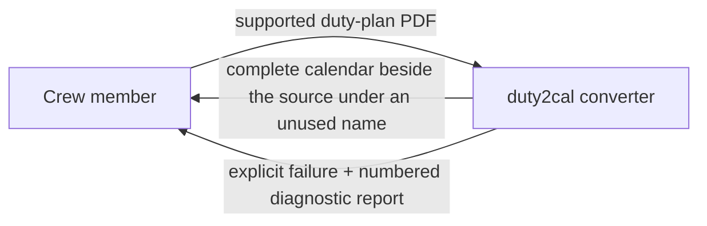
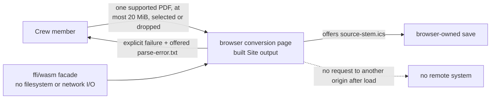
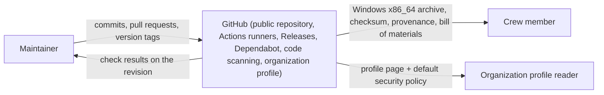
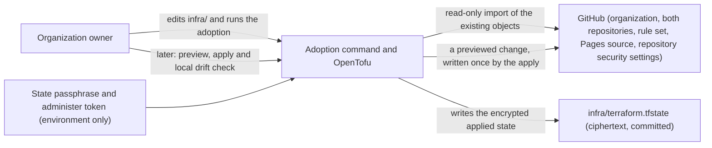
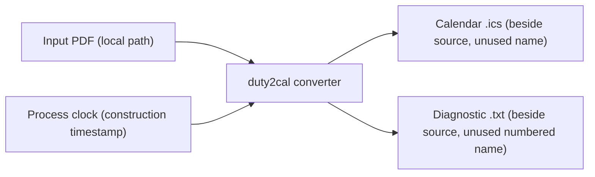

# 3. Context and Scope

## Business context

The converter itself is a local tool used by one crew member at a time. It has no business partners, no hosted services, and no ongoing state; its only counterpart is the person converting their own plan. The project around it, however, now has one external system: GitHub, which hosts its public home and publishes its releases.

| Partner / User | Input to system | Output from system |
|---|---|---|
| Crew member running the executable | One supported Released Roster duty-plan PDF (path or drag-and-drop) | A complete RFC 5545 calendar file beside the source; or an explicit failure with a numbered diagnostic report naming the source and reason |
| Crew member using the browser conversion page | One supported PDF selected or dropped in the tab, at most 20 MiB | The offered `<source-stem>.ics` download for the browser to save; or an explicit failure with an offered `<source-stem>.parse-error.txt` diagnostic; the page writes nothing |

### The browser conversion route

The page is served from the built Site output. It runs the same conversion
inside the tab, offers the calendar or diagnostic, and never contacts another
origin after it loads. The plan is never uploaded, and the page stores nothing
in persistent storage or a navigable address. Publishing that page at the
Public website is the separate Site publication; this change builds and serves
the page on loopback for its evidence.

### The public home and release channel

GitHub is the project's public home and release channel: the repository holds the history and the gate every change passes before it lands; GitHub Actions runners build, package, attest and publish each version; GitHub Releases serves the one Windows x86_64 archive at a stable latest-release address; Dependabot proposes dependency updates; and code scanning reviews the code and the project's own automation. The organization's overview page is GitHub's rendering of the reviewed profile content and the organization's default security policy, both published from the same declaration into the public `duty2cal/.github` repository.

The relationship runs one way, outward: the project pushes commits and version tags to GitHub, and GitHub serves the published archive and the organization profile to a reader. Nothing flows back into the product.

The product itself is unchanged: the converter has no network I/O and no runtime dependency, and it never contacts GitHub. Only the project's build-and-release automation runs on the host.

### The declared configuration and its adoption

The public home's configuration is also described from the project's side. The
maintainer edits the declaration under `infra/`, runs the adoption command once
to bind the objects that already exist, and later previews and applies changes.
GitHub remains the only owner of the live settings; the project's side reads
them to adopt them, reads them again for the local configuration drift check,
and — when a previewed change is applied — writes the declared values. The
binding and the applied values are recorded in an encrypted state file
committed in the repository.

| Partner | Input to the project | Output from the project |
|---|---|---|
| GitHub | The live configuration of the declared objects, read (adoption, preview, drift check) | The declared changes of one previewed revision, written by an apply; nothing during adoption or a preview |
| Organization owner | The declaration, the selected batches, the passphrase and the token | One adopted/bound line per object, a preview naming every difference, one reported change per applied object, or a refusal naming the object |
| Repository reader | The declaration, the batches and the encrypted state | The reviewable intended configuration; ciphertext they cannot open |
| Organization profile reader | The reviewed `org/` text and the default security policy, published by an apply | A public overview page and a default security policy that state the current release truthfully and request no third-party resource |
| Contributor without a repository policy | Nothing; GitHub resolves the organization default | The organization's default `SECURITY.md` with the private reporting route |

The release page's text is the newest section of the repository's change log — the changes a user receives (capability changes and dependency updates), grouped by kind — and the change log itself is one of the files a release publishes, so a reader of the source and a reader of the release page see the same history. Each version carries exactly one archive, for Windows x86_64; there is no per-platform asset set, and nothing is offered for a platform the release does not support. A crew member on any other platform obtains the tool by building the source with a Rust toolchain.

## Technical context

For the executable, all interfaces are the local filesystem. There is no
network interface, no database, and no external service in the executable.

The browser conversion route adds a browser boundary rather than a backend
interface: the page reads the selected file in the tab, calls the in-tab WASM
facade, and offers Blob downloads. It makes no request to another origin after
it loads, has no server or database, and keeps no plan in persistent storage.
Its only external systems are the browser and the static server that serves
the built Site output (loopback for the evidence and manual run; the Pages
repository after the separate Site publication).

The public-home tooling adds one separate interface to the project's side: it
reads GitHub's REST API during adoption, preview and the drift check, and
writes only the declared changes of a previewed configuration change, from the
maintainer's workstation.

| Interface | Technology / Protocol | Direction |
|---|---|---|
| Input duty plan (executable) | Local file read (PDF) | In |
| Input duty plan (browser) | File API read inside the tab; never a request | In |
| Published calendar (executable) | Local file write (RFC 5545 text, CRLF, UTF-8) | Out |
| Diagnostic report (executable) | Local file write (plain text, numbered) | Out |
| Offered calendar (browser) | In-memory Blob and `<a download>`; the browser performs the save | Out |
| Offered diagnostic (browser) | In-memory Blob and `<a download>`; the browser performs the save | Out |
| Construction clock | Operating-system clock (UTC) in the executable; `js_sys::Date` in the browser | In |
| Browser runtime | Chromium, Firefox or Safari with WebAssembly and ES modules; no other-origin request after load | In |
| Public-home adoption, preview and configuration change | GitHub REST API over HTTPS: object reads for adoption, preview and the drift check; writes only the declared changes of a previewed revision, from the maintainer's workstation | In (reads) and out (an apply only), never the converter |
| Organization profile publication | The same GitHub REST API: the profile repository is created and its two files are written by a previewed apply; GitHub renders the page and serves the default security policy | Out (an apply only), never the converter |
| Pinned repositories and private vulnerability reporting | The organization's and repository's web settings, changed once by the organization owner; no API or declaration path | Out (manual only), never the converter |

## Scope boundary

Inside: reading one supported plan, resolving its activities and dates, composing one calendar, publishing it without clobbering (executable) or offering it for a browser-owned save (browser), and reporting failures with diagnostics. The browser route also owns the capability gate, the 20 MiB input bound, the no-network/no-storage page behavior and the inline WASM build.

Outside: importing the calendar into a client, reconciling revised plans, editing the official schedule, entitlement/legality calculations, visa or booking actions, standby activation, and release approval. The public home and release channel — the repository, its automation, its release pages, the organization profile and the default security policy — belong to separate capabilities; the converter neither uses nor reaches them. Publishing the page at the Public website, the deploy key, the Pages workflow and the Built revision belong to the Site publication. See the use case's out-of-scope list for the full boundary.
