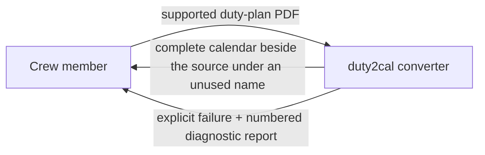
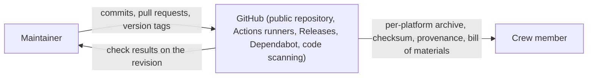
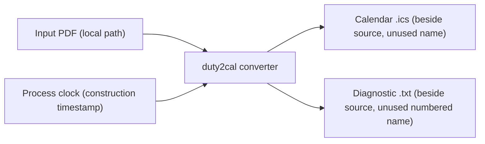

# 3. Context and Scope

## Business context

The converter itself is a local tool used by one crew member at a time. It has no business partners, no hosted services, and no ongoing state; its only counterpart is the person converting their own plan. The project around it, however, now has one external system: GitHub, which hosts its public home and publishes its releases.

| Partner / User | Input to system | Output from system |
|---|---|---|
| Crew member | One supported Released Roster duty-plan PDF (path or drag-and-drop) | A complete RFC 5545 calendar file beside the source; or an explicit failure with a numbered diagnostic report naming the source and reason |

### The public home and release channel

GitHub is the project's public home and release channel: the repository holds the history and the gate every change passes before it lands; GitHub Actions runners build, package, attest and publish each version; GitHub Releases serves the archives at a stable latest-release address; Dependabot proposes dependency updates; and code scanning reviews the code and the project's own automation.

The relationship runs one way, outward: the project pushes commits and version tags to GitHub, and GitHub serves the published archives to a downloader. Nothing flows back into the product.

The product itself is unchanged: the converter has no network I/O and no runtime dependency, and it never contacts GitHub. Only the project's build-and-release automation runs on the host.

The release page's text is the newest section of the repository's change log — the changes a user can see, grouped by kind — and the change log itself is one of the files a release publishes, so a reader of the source and a reader of the release page see the same history.

## Technical context

All interfaces are the local filesystem. There is no network interface, no database, and no external service.

| Interface | Technology / Protocol | Direction |
|---|---|---|
| Input duty plan | Local file read (PDF) | In |
| Published calendar | Local file write (RFC 5545 text, CRLF, UTF-8) | Out |
| Diagnostic report | Local file write (plain text, numbered) | Out |
| Construction clock | Operating-system clock (UTC) | In |

## Scope boundary

Inside: reading one supported plan, resolving its activities and dates, composing one calendar, publishing it without clobbering, and reporting failures with diagnostics.

Outside: importing the calendar into a client, reconciling revised plans, editing the official schedule, entitlement/legality calculations, visa or booking actions, standby activation, and release approval. The public home and release channel — the repository, its automation and its release pages — belong to a separate capability; the converter neither uses nor reaches them. See the use case's out-of-scope list for the full boundary.
