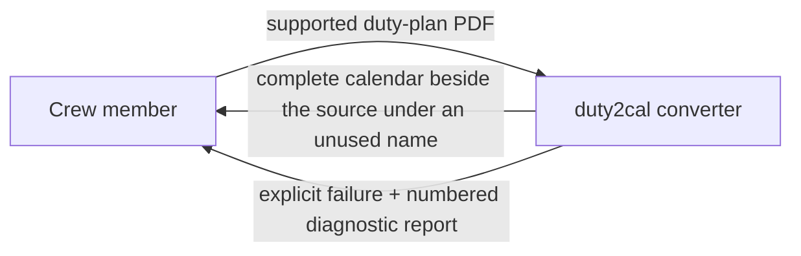
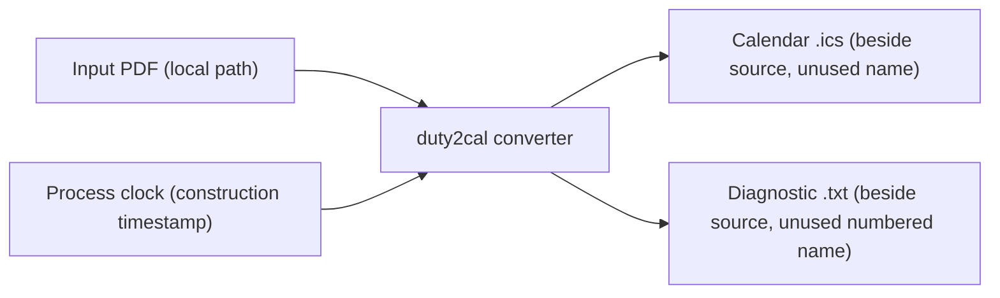

# 3. Context and Scope

## Business context

The system is a local tool used by one crew member at a time. It has no business partners, no hosted services, and no ongoing state; its only counterpart is the person converting their own plan.

| Partner / User | Input to system | Output from system |
|---|---|---|
| Crew member | One supported Released Roster duty-plan PDF (path or drag-and-drop) | A complete RFC 5545 calendar file beside the source; or an explicit failure with a numbered diagnostic report naming the source and reason |

## Technical context

All interfaces are the local filesystem. There is no network interface, no database, and no external service.

| Interface | Technology / Protocol | Direction |
|---|---|---|
| Input duty plan | Local file read (PDF) | In |
| Published calendar | Local file write (RFC 5545 text, CRLF, UTF-8) | Out |
| Diagnostic report | Local file write (plain text, numbered) | Out |
| Construction clock | Operating-system clock (UTC) | In |

## Scope boundary

Inside: reading one supported plan, resolving its activities and dates, composing one calendar, publishing it without clobbering, and reporting failures with diagnostics.

Outside: importing the calendar into a client, reconciling revised plans, editing the official schedule, entitlement/legality calculations, visa or booking actions, standby activation, and release approval. See the use case's out-of-scope list for the full boundary.
