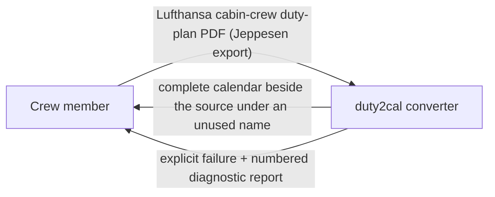
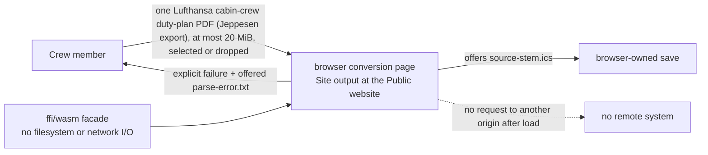
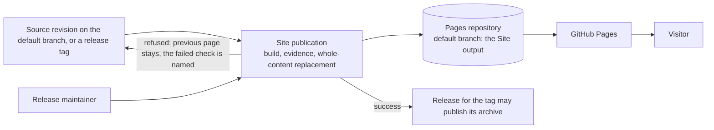
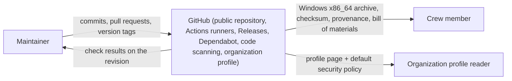
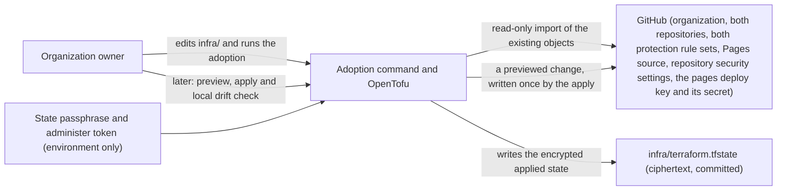
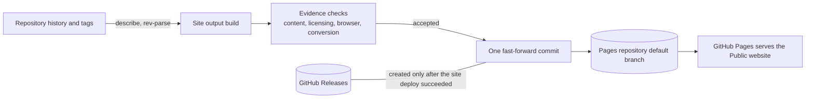
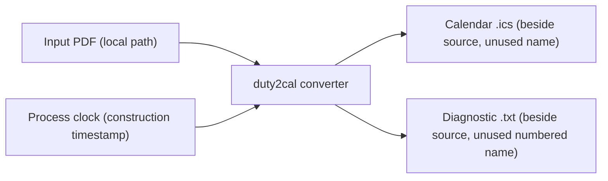

# 3. Context and Scope

## Business context

The converter itself is a local tool used by one crew member at a time. It has no business partners, no hosted services, and no ongoing state; its only counterpart is the person converting their own plan. The project around it, however, now has one external system: GitHub, which hosts its public home and publishes its releases.

| Partner / User | Input to system | Output from system |
|---|---|---|
| Crew member running the executable | One Lufthansa cabin-crew duty-plan PDF published as a Jeppesen PDF export (path or drag-and-drop) | A complete RFC 5545 calendar file beside the source; or an explicit failure with a numbered diagnostic report naming the source and reason |
| Crew member using the browser conversion page | One Lufthansa cabin-crew duty-plan PDF published as a Jeppesen PDF export, selected or dropped in the tab, at most 20 MiB | The offered `<source-stem>.ics` download for the browser to save; or an explicit failure with an offered `<source-stem>.parse-error.txt` diagnostic; the page writes nothing |

### The supported duty plan and the support statement

duty2cal converts a Lufthansa cabin-crew duty plan published as a Jeppesen PDF
export into one calendar file. One roster month of cabin crew; not cockpit
duties, other Lufthansa duty plans, other Jeppesen exports or another operator.
Not affiliated with Lufthansa, Jeppesen, or any duty-plan provider or airline.

The same statement is carried by the website's `what-it-does` statement, the
README, the organization profile and both issue forms. `scripts/support-statement-check.sh`
refuses a carrier that disagrees, and the site publication's page-content check
refuses an assembled page whose statement differs; the profile's carrier is
published by the declared configuration's apply. The statement reports the
evidence the repository exercises — the generated fixture for this plan
converting through the unchanged conversion — and shrinks when that evidence
stops holding.

### The browser conversion route and the Public website

The page is served from the Site output. It runs the same conversion inside the
tab, offers the calendar or diagnostic, and never contacts another origin after
it loads. The plan is never uploaded, and the page stores nothing in persistent
storage or a navigable address. The Site publication publishes that output at
the Public website: a gated command builds the Site output from a named Built
revision, refuses it unless the page-content, licensing, browser and conversion
checks pass, and replaces the hosting target's content as a whole.

### The Public website and its publication

The Public website is GitHub's serving of the Pages repository's default
branch. The project writes that branch from the monorepo and never by hand: a
source revision reaches the publication, the Site output is built from it, and
one commit replaces the target's content. The page's footer names and links the
Built revision, so a reader can trace the page in hand to the revision that
produced it. The hosting service serves the page; the project's side never
writes into a visitor's browser and never learns that a page was read.

| Partner | Input to the project | Output from the project |
|---|---|---|
| Release maintainer | The revision to publish and the publication command | A named Built revision, the accepted evidence, or a refusal naming the failed check; the hosting target's previous content is untouched on a refusal |
| Visitor opening the Public website | The served page, built from the Built revision named in its footer | A page whose statements panel, above the file picker, names the one plan the tool converts (a Lufthansa cabin-crew duty plan published as a Jeppesen PDF export) with its boundary, and states the browser route, downloads for various operating systems available on request with its release page linked, the privacy rule, the non-affiliation sentence naming Lufthansa and Jeppesen, and the as-is statement; whose panel below the converter carries the source and the licence; and whose footer names the Built revision |
| GitHub Pages (hosting service) | The Pages repository's default branch, written by the Site publication | The served Public website; the project asserts the content it published and the page it reads at the publication's verified address |
| GitHub Releases | The release the publication command creates only after the site publication succeeded | — |

### The legal notices and what a page request processes

The Site output carries an Impressum and a Datenschutzerklärung beside the
converter page. Both are static pages of the same output and the same origin,
written in German with a short English summary and the sentence that the German
version is binding. The Impressum names the operator, a postal address at
which service is possible and a mail address. The Datenschutzerklärung states
the controller, the hosting by GitHub, Inc., the visitor's IP address that the
host logs for security purposes, the absence of a published retention period,
the operator's lack of access to those logs, the legal basis, the third-country
transfer and its basis, the sub-processors that deliver the pages, the
browser-local conversion with no upload, storage or request after load, the
absence of cookies and third-party content, the reader's rights and the
standing date. The converter page's footer links both notices, each notice's
footer links the other notice and the converter page, so either is reachable in
one step from any page; the organization profile and the README each carry two
labelled links to them without copying the address.

The notices describe the project's public record, not a converter behaviour:
they change no conversion, and the processing they disclose belongs to the
host, which serves the page and logs the request for its own security purposes.
The project's side still learns nothing about a visitor, writes nothing into the
browser and cannot read or delete the host's logs.

| Partner | Input to the project | Output from the project |
|---|---|---|
| Reader of the legal notices | The Impressum or Datenschutzerklärung, reached through the footer of any page, or through the profile's and the README's two labelled links | Who publishes the site, an address at which service is possible and a mail address; and that GitHub, Inc. logs the page request's IP address for security purposes, that no fixed retention period is published and that the operator cannot read those logs |

### The public home and release channel

GitHub is the project's public home and release channel: the repository holds the history and the gate every change passes before it lands; GitHub Actions runners build, package, attest and publish each version; GitHub Releases serves the one Windows x86_64 archive at a stable latest-release address; Dependabot proposes dependency updates; and code scanning reviews the code and the project's own automation. The organization's overview page is GitHub's rendering of the reviewed profile content and the organization's default security policy, both published from the same declaration into the public `duty2cal/.github` repository.

The relationship runs one way, outward: the project pushes commits and version tags to GitHub, and GitHub serves the published archive and the organization profile to a reader. Nothing flows back into the product.

The product itself is unchanged: the converter has no network I/O and no runtime dependency, and it never contacts GitHub. Only the project's build-and-release automation runs on the host.

### The declared configuration and its adoption

The public home's configuration is also described from the project's side. The
maintainer edits the declaration under `infra/`, runs the adoption command once
to bind the objects that already exist, and later previews and applies changes.
GitHub remains the only owner of the live settings; the project's side reads
them to adopt them, reads them again for the local configuration drift check,
and — when a previewed change is applied — writes the declared values. The
binding and the applied values are recorded in an encrypted state file
committed in the repository.

| Partner | Input to the project | Output from the project |
|---|---|---|
| GitHub | The live configuration of the declared objects, read (adoption, preview, drift check) | The declared changes of one previewed revision, written by an apply; nothing during adoption or a preview |
| Organization owner | The declaration, the selected batches, the passphrase and the token | One adopted/bound line per object, a preview naming every difference, one reported change per applied object, or a refusal naming the object; a create guard naming an object that already exists live |
| Site publication (`scripts/publish-site.sh`, called by the reusable `site.yml` from `web.yml` or the release's `site` job) | The registered write-enabled deploy key and the monorepo's `PAGES_DEPLOY_KEY` secret | A push to the pages repository's default branch that the pages rule set admits: one commit carrying the complete Site output built from the Built revision |
| GitHub Pages (the served page) | The page served at the address the publication verifies (`--verify-url`), read with bounded retries after the replacement | The publication's acceptance: the served page names the same Built revision as the output, or a refusal naming the address and the served revision |
| Repository reader | The declaration, the batches and the encrypted state | The reviewable intended configuration; ciphertext they cannot open |
| Organization profile reader | The reviewed `org/` text and the default security policy, published by an apply | A public overview page and a default security policy that state the current release truthfully and request no third-party resource |
| Contributor without a repository policy | Nothing; GitHub resolves the organization default | The organization's default `SECURITY.md` with the private reporting route |

The release page's text is the newest section of the repository's change log — the changes a user receives (capability changes and dependency updates), grouped by kind — and the change log itself is one of the files a release publishes, so a reader of the source and a reader of the release page see the same history. Each version carries exactly one archive, for Windows x86_64; there is no per-platform asset set, and nothing is offered for a platform the release does not support. A crew member on any other platform obtains the tool by building the source with a Rust toolchain.

## Technical context

For the executable, all interfaces are the local filesystem. There is no
network interface, no database, and no external service in the executable.

The browser conversion route adds a browser boundary rather than a backend
interface: the page reads the selected file in the tab, calls the in-tab WASM
facade, and offers Blob downloads. It makes no request to another origin after
it loads, has no server or database, and keeps no plan in persistent storage.
Its only external systems are the browser and whatever serves the Site output:
loopback for the evidence and manual run, and GitHub Pages at the Public
website's address.

The Site publication adds a second interface to the project's side: it reads
the repository's history (tags and commits) through `git`, and writes the Site
output into the Pages repository over a git transport admitted by the pages
rule set. The hosting service then serves that branch. The project never calls
the hosting service's API, and no visitor request reaches the project.

The public-home tooling adds one separate interface to the project's side: it
reads GitHub's REST API during adoption, preview and the drift check, and
writes only the declared changes of a previewed configuration change, from the
maintainer's workstation.

| Interface | Technology / Protocol | Direction |
|---|---|---|
| Input duty plan (executable) | Local file read (PDF) | In |
| Input duty plan (browser) | File API read inside the tab; never a request | In |
| Published calendar (executable) | Local file write (RFC 5545 text, CRLF, UTF-8) | Out |
| Diagnostic report (executable) | Local file write (plain text, numbered) | Out |
| Offered calendar (browser) | In-memory Blob and `<a download>`; the browser performs the save | Out |
| Offered diagnostic (browser) | In-memory Blob and `<a download>`; the browser performs the save | Out |
| Construction clock | Operating-system clock (UTC) in the executable; `js_sys::Date` in the browser | In |
| Browser runtime | Chromium, Firefox or Safari with WebAssembly and ES modules; no other-origin request after load | In |
| Site publication target | Git push over SSH with the deploy key (or a local git target in the test twin), admitted by the pages rule set; one fast-forward commit | Out |
| Public website serving | GitHub Pages serves the Pages repository's default branch; the project never calls the hosting API | Out (the host's interface) |
| Public-home adoption, preview and configuration change | GitHub REST API over HTTPS: object reads for adoption, preview, the creation guard and the drift check; writes only the declared changes of a previewed revision (including the pages deploy key, its secret and the pages rule set), from the maintainer's workstation | In (reads) and out (an apply only), never the converter |
| Organization profile publication | The same GitHub REST API: the profile repository is created and its two files are written by a previewed apply; GitHub renders the page and serves the default security policy | Out (an apply only), never the converter |
| Pinned repositories and private vulnerability reporting | The organization's and repository's web settings, changed once by the organization owner; no API or declaration path | Out (manual only), never the converter |

## Scope boundary

Inside: reading one Lufthansa cabin-crew duty plan published as a Jeppesen PDF export, resolving its activities and dates, composing one calendar, publishing it without clobbering (executable) or offering it for a browser-owned save (browser), and reporting failures with diagnostics. The support statement that names this plan is a public record of the project rather than a converter behaviour: it is owned by the use case to state the converter's support statement and carried by the website, the README, the organization profile, this chapter and both issue forms. The browser route also owns the capability gate, the 20 MiB input bound, the no-network/no-storage page behavior and the inline WASM build. The legal notices are a project record rather than a converter behaviour in the same way: they state who publishes the site and what the host processes when a page is requested, and the conversion, its statements and its refusals are unchanged by their presence in the Site output.

Outside: importing the calendar into a client, reconciling revised plans, editing the official schedule, entitlement/legality calculations, visa or booking actions, standby activation, and release approval. The public home and release channel — the repository, its automation, its release pages, the organization profile and the default security policy — belong to separate capabilities; the converter neither uses nor reaches them. Publishing the page at the Public website — its Site output, gate, Built revision, hosting target and release coupling — is the site publication capability of the `publish-public-website` use case; the deploy key and its secret are a prerequisite created by the declared configuration, and the profile copy that describes the site is a configuration change. See the use case's out-of-scope list for the full boundary.
