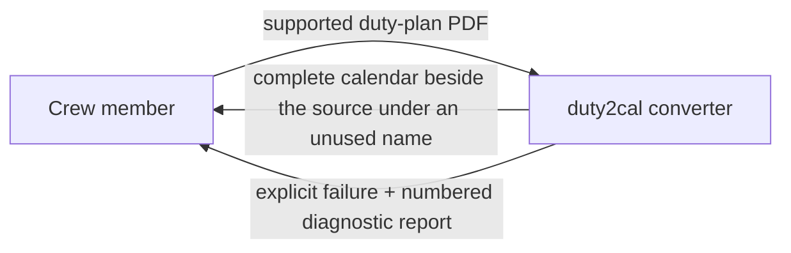
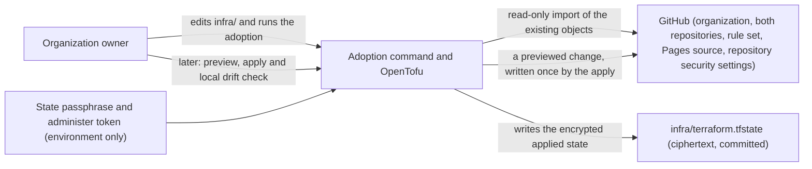
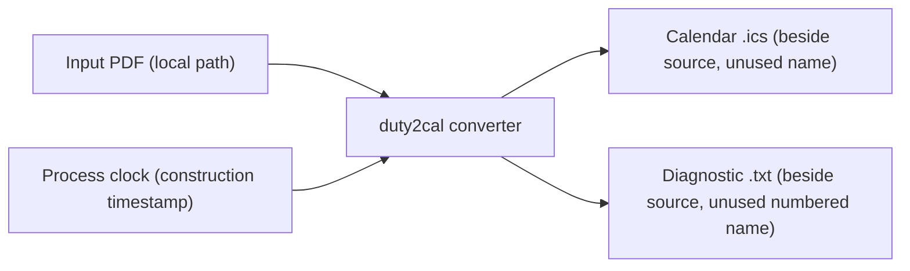

# 3. Context and Scope

## Business context

The converter itself is a local tool used by one crew member at a time. It has no business partners, no hosted services, and no ongoing state; its only counterpart is the person converting their own plan. The project around it, however, now has one external system: GitHub, which hosts its public home and publishes its releases.

| Partner / User | Input to system | Output from system |
|---|---|---|
| Crew member | One supported Released Roster duty-plan PDF (path or drag-and-drop) | A complete RFC 5545 calendar file beside the source; or an explicit failure with a numbered diagnostic report naming the source and reason |

### The public home and release channel

GitHub is the project's public home and release channel: the repository holds the history and the gate every change passes before it lands; GitHub Actions runners build, package, attest and publish each version; GitHub Releases serves the one Windows x86_64 archive at a stable latest-release address; Dependabot proposes dependency updates; and code scanning reviews the code and the project's own automation.

The relationship runs one way, outward: the project pushes commits and version tags to GitHub, and GitHub serves the published archive to a downloader. Nothing flows back into the product.

The product itself is unchanged: the converter has no network I/O and no runtime dependency, and it never contacts GitHub. Only the project's build-and-release automation runs on the host.

### The declared configuration and its adoption

The public home's configuration is also described from the project's side. The
maintainer edits the declaration under `infra/`, runs the adoption command once
to bind the objects that already exist, and later previews and applies changes.
GitHub remains the only owner of the live settings; the project's side reads
them to adopt them, reads them again for the local configuration drift check,
and — when a previewed change is applied — writes the declared values. The
binding and the applied values are recorded in an encrypted state file
committed in the repository.

| Partner | Input to the project | Output from the project |
|---|---|---|
| GitHub | The live configuration of the declared objects, read (adoption, preview, drift check) | The declared changes of one previewed revision, written by an apply; nothing during adoption or a preview |
| Organization owner | The declaration, the selected batches, the passphrase and the token | One adopted/bound line per object, a preview naming every difference, one reported change per applied object, or a refusal naming the object |
| Repository reader | The declaration, the batches and the encrypted state | The reviewable intended configuration; ciphertext they cannot open |

The release page's text is the newest section of the repository's change log — the changes a user receives (capability changes and dependency updates), grouped by kind — and the change log itself is one of the files a release publishes, so a reader of the source and a reader of the release page see the same history. Each version carries exactly one archive, for Windows x86_64; there is no per-platform asset set, and nothing is offered for a platform the release does not support. A crew member on any other platform obtains the tool by building the source with a Rust toolchain.

## Technical context

For the converter, all interfaces are the local filesystem. There is no network interface, no database, and no external service in the product. The public-home tooling adds one separate interface to the project's side: it reads GitHub's REST API during adoption, preview and the drift check, and writes only the declared changes of a previewed configuration change, from the maintainer's workstation.

| Interface | Technology / Protocol | Direction |
|---|---|---|
| Input duty plan | Local file read (PDF) | In |
| Published calendar | Local file write (RFC 5545 text, CRLF, UTF-8) | Out |
| Diagnostic report | Local file write (plain text, numbered) | Out |
| Construction clock | Operating-system clock (UTC) | In |
| Public-home adoption, preview and configuration change | GitHub REST API over HTTPS: object reads for adoption, preview and the drift check; writes only the declared changes of a previewed revision, from the maintainer's workstation | In (reads) and out (an apply only), never the converter |

## Scope boundary

Inside: reading one supported plan, resolving its activities and dates, composing one calendar, publishing it without clobbering, and reporting failures with diagnostics.

Outside: importing the calendar into a client, reconciling revised plans, editing the official schedule, entitlement/legality calculations, visa or booking actions, standby activation, and release approval. The public home and release channel — the repository, its automation and its release pages — belong to a separate capability; the converter neither uses nor reaches them. See the use case's out-of-scope list for the full boundary.
