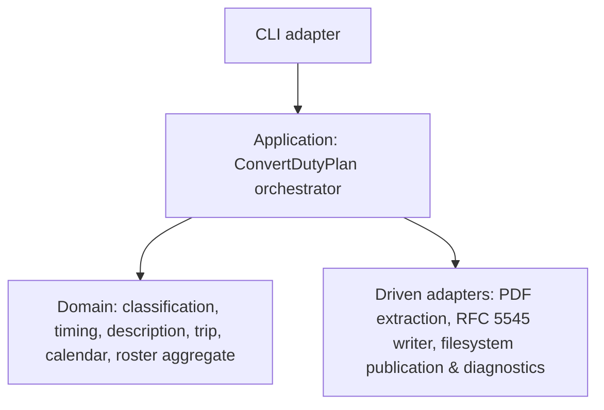

# 5. Building Block View

## Level 1 — System overview

| Building block | Responsibility |
|---|---|
| CLI adapter | Parse the invocation (path argument or drag-and-drop), invoke the conversion, print the reported path or the failure, set the exit status. |
| Application (ConvertDutyPlan) | Orchestrate the pipeline, own the `DutyPlanCalendar` aggregate and `ConversionOutcome`, and sequence publication and diagnostics. |
| Domain | Pure rules: classify source codes, resolve UTC endpoints, carry trip context, compose descriptions, compose calendar events, and enforce completeness. |
| Driven adapters | Read the PDF, write RFC 5545 text, allocate unused paths (no clobber), and write numbered diagnostics. |

## Level 2 — Key building blocks

### `CLI adapter`

**Responsibility:** Expose the conversion as a local command that a human or a drag-and-drop shell invokes.

**Contained elements:**

| Element | Responsibility |
|---|---|
| Argument / entry handling | Accept the source path and drive one conversion attempt. |
| Output reporting | Print the actual new calendar path on success; print the failure and the diagnostic result on rejection. |
| Exit status | Non-zero on rejection; zero only on real publication. |

### `ConvertDutyPlan`

**Responsibility:** Turn one source file into one `ConversionOutcome` without side effects before completeness is reached.

**Contained elements:**

| Element | Responsibility |
|---|---|
| Source recognition | Confirm the supported Released Roster detail-table family and build the `SourceSnapshot`. |
| Pipeline driver | Run classification → timing → description → calendar composition over the recognized activities. |
| Publication | Ask the publication port for an unused path and write the complete calendar. |
| Failure flow | On any rejection, return the primary reason and attempt a numbered diagnostic through the diagnostic port. |

### Domain modules

**Responsibility:** Express the conversion rules as pure functions over source-derived data; no I/O.

**Contained elements:**

| Element | Responsibility |
|---|---|
| `classification` | Source code → activity kind (all-day, timed duty, availability, travel, layover); unknown required codes are errors. |
| `timing` | Resolve each UTC endpoint's date independently (explicit adjacent-day qualifiers; narrow unqualified overnight rollover) and enforce start-before-end. |
| `description` | Selected field order, omission, complementary/equal coalescing, and differing-value role labelling. |
| `trip` | Carry a known Trip ID across one unambiguous roster trip and stop at its boundary. |
| `calendar` | Calendar event model, all-day/TZID handling, snapshot-scoped UIDs, and DTSTAMP provenance/fallback. |
| `roster` | The `DutyPlanCalendar` aggregate: accumulate resolved activities and gate completeness. |

### Driven adapters

**Responsibility:** Perform I/O and represent the outside world; contain no domain rules.

**Contained elements:**

| Element | Responsibility |
|---|---|
| PDF extraction | Use the pinned `pdfplumber` crate to obtain positioned words and table structure, and read the source revision footer. |
| RFC 5545 writer | Serialize composed events to bytes satisfying the format contract. |
| Filesystem publication | Allocate an unused calendar path (create-new, enumerated) and write it. |
| Diagnostic writer | Allocate an unused numbered report path and write the source name and reason. |
