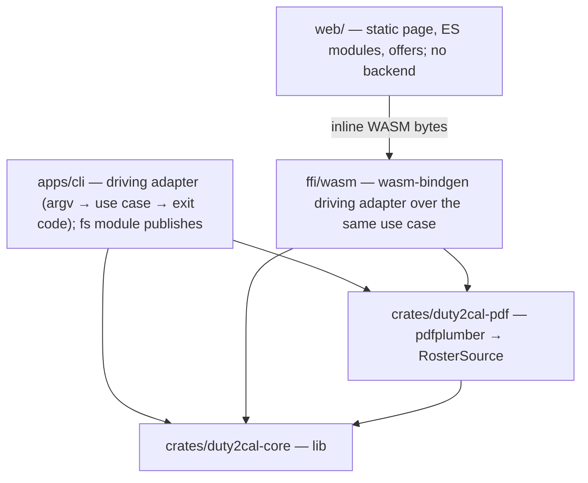
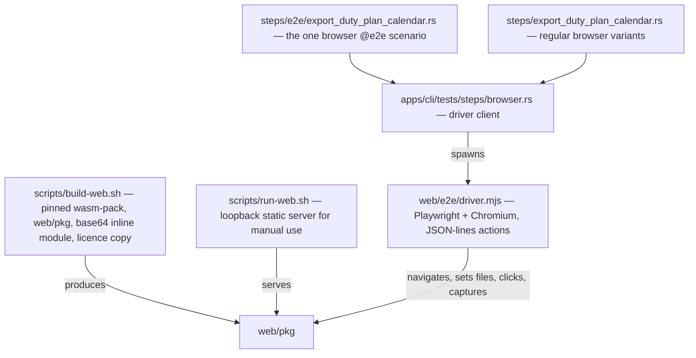
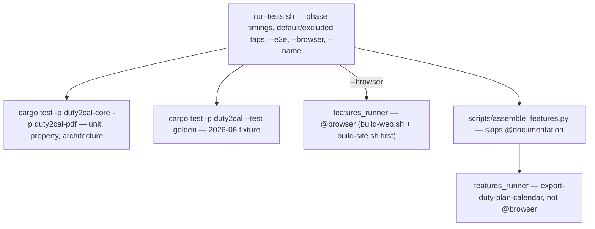
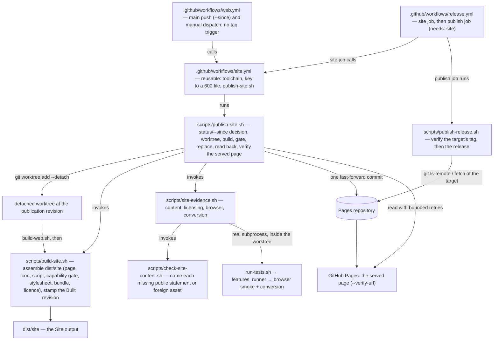
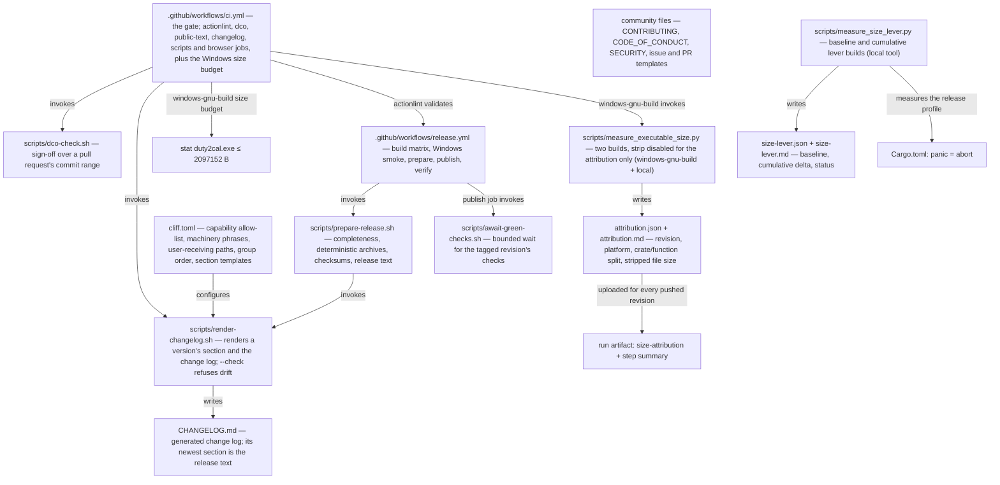
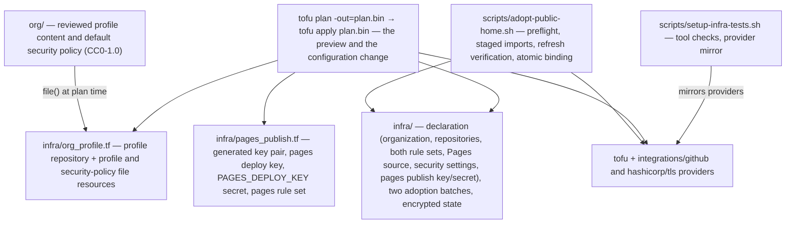

# 5. Building Block View

## Level 1 — System overview

| Building block | Responsibility |
|---|---|
| `apps/cli` (package `duty2cal`) | Parse the invocation, invoke the conversion, print the reported path or failure, set the exit status, and publish the calendar or the diagnostic (`fs` module). |
| `ffi/wasm` (package `duty2cal-wasm`) | A thin `wasm-bindgen` driving adapter: accepts the filename and bytes, wires the unchanged `ConvertRoster` with a browser clock, and returns calendar text or a structured failure. Target-scoped to `wasm32-unknown-unknown`; performs no filesystem, network or environment I/O. |
| `web/` | The converter page: a header with the project's vector mark (`icon.svg`) as a 48×48 mark left of the heading (and as the tab's primary icon, with the raster `icon.png` declared as its alternate), a statements panel above the converter panel (what it does, the browser route, downloads for various operating systems on request with the release page linked, privacy, non-affiliation, as-is), capability gate, file picker and drop zone, 20 MiB bound, conversion call, status/failure panels, Blob offers, a "Source and licence" panel below the converter panels, and a full footer carrying the Built revision and the plain-prose non-affiliation, as-is and privacy statements. No backend, no upload, no persistent storage. |
| `crates/duty2cal-pdf` | The only crate that depends on `pdfplumber`; produces the `RawRosterTable` anti-corruption input. |
| `crates/duty2cal-core` | Pure domain, application ports + `ConvertRoster`, and the dependency-free ICS adapter. |

## Browser build and evidence toolbox (outside the product crates)

The browser route adds a build step and a real-browser test driver. They are
test/build tooling; the product page and facade remain the blocks above.

| Block | Responsibility |
|---|---|
| `scripts/build-web.sh` | Install the pinned `wasm-pack`, build `web/pkg`, and generate the base64 `wasm-inline.js`. |
| `scripts/run-web.sh` | Build the Site output and serve `dist/site/` on loopback for manual use. |
| `web/e2e/driver.mjs` | Serve the Site output named by `DUTY2CAL_SITE_ROOT` on loopback and drive Chromium: perform actions, read rendered state/request log/storage, capture downloads and screenshots, and fail closed on an unknown action or a missing root. |
| `apps/cli/tests/steps/browser.rs` | The Rust client for the driver protocol; shared by the `@e2e` and regular browser step files. |
| `apps/cli/tests/steps/e2e/export_duty_plan_calendar.rs` | The one browser `@e2e` scenario, alongside the existing CLI e2e steps. |
| `apps/cli/tests/steps/export_duty_plan_calendar.rs` | The regular browser variants (size, family, stale offer, drop, capability, startup, offer failures, cancelled save, naming, persistence). |

## Test harness (outside the product crates)

The default suite runs product behaviour only. The operational Gherkin files
stay in the corpus as documentation and are skipped by the assembler.

| Block | Responsibility |
|---|---|
| `run-tests.sh` | Assemble the feature root, print `phase=<name> seconds=<n>` and the cucumber concurrency, run the Rust tests and the golden test on a full run, and select the scenario set. `--no-fail-fast` keeps one failing class from hiding the others. |
| `apps/cli/tests/features_runner.rs` | Cucumber-rs runner with `.fail_on_skipped()`; the world carries only the product scenario fields. |
| `apps/cli/tests/steps/export_duty_plan_calendar.rs` | The conversion capability's CLI and in-process steps. |
| `apps/cli/tests/steps/e2e/export_duty_plan_calendar.rs` | The one CLI `@e2e` scenario and the one browser `@e2e` scenario. |
| `apps/cli/tests/steps/browser.rs` | The Playwright driver client. |
| `apps/cli/tests/golden.rs` | Direct conversion of the generated 2026-06 plan against `tests/fixtures/expected/2026-06.ics`. |
| `scripts/assemble_features.py` | Merge delta specs and skip a feature whose prefix carries `@documentation`. |

## Site publication toolbox (outside the product crates)

The Public website's publication adds blocks beside the workspace. They are
build-and-publish tooling: they change nothing about the product blocks above,
and the page they publish is the same `web/` page.

| Block | Responsibility |
|---|---|
| `scripts/build-site.sh` | Assemble `dist/site/` from the checkout it is pointed at (the publication passes the revision's detached worktree) and those `web/pkg/` members, copy the project's vector mark to `icon.svg` and the raster to `icon.png`, stamp the footer anchor from `--revision`, and copy `LICENSES/MPL-2.0.txt` as `LICENSE.txt`; the output holds exactly nine members — `index.html`, `app.js`, `capability.js`, `styles.css`, `icon.svg`, `icon.png`, `pkg/duty2cal_wasm.js`, `pkg/wasm-inline.js` and `LICENSE.txt`; refuse a missing converter bundle (naming `scripts/build-web.sh`) and a missing vector or raster mark (naming the file). |
| `scripts/check-site-content.sh` | Read the assembled page and name every missing public statement, a header mark that is not `./icon.svg`, a tab whose vector declaration (`type="image/svg+xml"`, `./icon.svg`) is missing, untyped, or not on an earlier line than the raster declaration (`type="image/png"`, `./icon.png`), a missing icon member, a missing Built revision link or a missing licence file; refuse an `icon.svg` that is not a plain palette-only vector; refuse an asset loaded from another origin. |
| `scripts/site-evidence.sh` | Run the four checks as real subprocesses in fail-fast order and name the failing one; it runs inside the revision's worktree, so the conversion suite and browser scenario are that revision's own. |
| `scripts/publish-site.sh` | Refuse an unclean caller tree (`git status --porcelain --untracked-files=no`), decide `--since` against the site-input list it owns, resolve the Built revision, create a detached worktree at it, build and gate there, report the target as current and write nothing when republishing content the target already holds, replace the hosting target's content in one fast-forward commit under an exclusive lock, read the pushed tree back, and verify the page served at `--verify-url` names the same Built revision before reporting success. |
| `scripts/publish-release.sh` | Read the hosting target's branch tip (`git ls-remote`, then a fetch) and refuse before any `gh` call unless it carries the tagged Built revision; then create, inspect and publish the draft release through `gh`, comparing the asset set while excluding `release-notes.md`; it takes `--site-repo DIR` for the target it reads. |
| `.github/workflows/web.yml` | The trigger workflow only: every default-branch push (passing `github.event.before` as `--since`) and manual dispatch, with no `v*` tag trigger; it calls the reusable `site.yml` with `fetch-depth: 0` and holds no build, gate or publish step of its own. |
| `.github/workflows/site.yml` | The reusable publication workflow (`on: workflow_call`, inputs `revision` and `since`, secret `PAGES_DEPLOY_KEY`): prepares the gate's toolchain, writes the key to a `600` file and runs `scripts/publish-site.sh` with `--verify-url`; its concurrency group is the site publication's serialization. |
| `.github/workflows/release.yml` | A `site` job that calls `site.yml` for the tag (`fetch-depth: 0`, `revision` = the tag, no `since`), then a `publish` job (`needs: site`) that keeps the SBOM and attestation steps and runs `scripts/publish-release.sh`; the `publish` job no longer publishes the site itself. |
| `scripts/tests/publish-site.bats` | The publication's early refusals: bad arguments, an unknown `--since` base, and an unclean caller tree. It invokes the script before any build. |

The publication's former cucumber step definitions are deleted. The workflow's
golden test, build, evidence gate and deploy are the executable checks; the
`bats` file covers the shell refusals that must happen before a build.

## Release toolbox (outside the product crates)

The release channel adds blocks that sit beside the workspace, not inside it. They are build tooling and repository operation; they change nothing about the product blocks above.

| Release block | Responsibility |
|---|---|
| `scripts/prepare-release.sh` | The preparation contract: refuse a set missing the Windows x86_64 executable or carrying an executable for a platform outside the supported set, stage exactly one deterministic Windows `.tar.gz` archive and its checksum, and stage the change log and the release text the renderer produces. |
| `scripts/render-changelog.sh` | Render one version's section and the change log (and the release text) from the repository's history with the pinned generator; `--check` renders in memory and refuses a committed change log that differs from the released revision, naming the version whose section differs. The section's date is the released revision's own committer date — the `v<version>` tag when it exists, and otherwise `HEAD`, the revision the tag will point at — never the clock, so a section is renderable before its tag exists. It also refuses a version with a leading `v`, a repository with no `HEAD` to date the section from, a generator that is not the pinned version, an allow-list that differs from `givn/specs/`, a marked machinery skip list the configuration does not realize, a listed user-receiving path the tree does not hold, an announced revision whose changed paths cannot be read, and a render that names no change a user receives. An entry whose revision changed no user-receiving path is left out of the section, and a `### ` group heading left without a bullet is pruned before the visible count and the written section. |
| `cliff.toml` | The one configuration the project owns: the capability allow-list (the released capability scopes), the dependency-update parser for `chore(deps):` revisions, the marked machinery skip list (the project's own tooling words the allow-list cannot see), the marked list of the paths a user receives (which decides what a released revision must have changed to be announced), the group order (including the Dependencies group for `chore(deps):` updates), the skip rules and the templates that render a section, including the per-entry revision marker the renderer resolves and strips. Passed to the generator explicitly so a developer's global configuration cannot change a render. |
| `CHANGELOG.md` | The generated change log: the newest section is the version being released, every earlier section stays verbatim, and the first section back-fills `0.1.0`; published among a release's assets. |
| `scripts/dco-check.sh` | Check DCO sign-off over a pull request's commit range; run by the `dco` CI job on pull requests only. |
| `scripts/await-green-checks.sh` | The publication gate: resolve every release-workflow check suite on the tagged revision, wait (bounded) for the remaining check runs to conclude, and refuse a concluded non-success, no success, no check evidence, an unreadable source, or the bound, naming the checks. |
| `scripts/measure_executable_size.py` | The measurement: resolve a named revision into a temporary worktree, build the shipped artifact with the committed configuration, build the same revision again with `strip` disabled for that build only in a separate target directory, attribute it by crate and by function with the pinned generator, read the stripped artifact's file size, digest and section sizes, and write one report naming the revision, the platform and the build's identity. A failed build or a build that keeps no names yields no attribution; an unreadable file size leaves the report incomplete; nothing is inferred from the archive or a host build. |
| `scripts/measure_size_lever.py` | The reduction measurement: resolve the revision into a worktree, rebuild the unchanged release configuration (`panic = "unwind"`, `opt-level = "z"`) as the baseline, build each candidate lever cumulatively, measure the stripped executable's file size, record the delta and status, refuse a nightly/UPX/dynamic-linking proposal before a build, report the published binary's size separately, and preserve the accepted executable for the failure-path run. |
| `size-lever.json` and `size-lever.md` | The reduction report: baseline, cumulative rows, applied/rejected statuses, the published binary's size and the recorded panic/conversion outcome. |
| `.github/workflows/release.yml` | On a `v*` tag: cross-build the Windows x86_64 executable on Linux, smoke that executable on Windows, prepare the staged set over the one binary, wait for the tagged revision's checks to conclude green, publish the immutable release with provenance and a bill of materials, then verify the published release by reading it back. |
| `.github/workflows/ci.yml` | The gate on landing: `actionlint`, `dco`, `public-text`, `changelog`, `scripts` (`bats`), `browser` (one Playwright smoke), `coverage` on `main` only, and `windows-gnu-build` with the byte budget and the per-push attribution. The `test` job no longer installs the change-log, OpenTofu or attribution toolchains. |
| `attribution.json` and `attribution.md` | The report a measurement writes, not a committed file: the machine-readable and human renderings of one dataset. They name the revision, the platform and the build's identity, keep the crate/function split and the stripped executable's file size as separate fields, and carry the status `complete`, `incomplete` or `unreadable`. The `windows-gnu-build` job uploads the pair beside the run for the revision it built; the release maintainer can request the same report for any named revision. |
| Community files (`CONTRIBUTING.md`, `CODE_OF_CONDUCT.md`, `SECURITY.md`, `.github/ISSUE_TEMPLATE/*`, `.github/pull_request_template.md`) | The contributor routes: contribution and sign-off rules, conduct, the confidential reporting route, and issue and pull-request forms that ask for the export family and a stripped sample, never a real plan. |
| Release and size step definitions | Deleted with the operational test scope. The release channel's executable checks are the release workflow itself; `measure_executable_size.py` runs in `windows-gnu-build` and locally, `measure_size_lever.py` runs locally, and neither has a cucumber binding. |

## Public-home declaration toolbox (outside the product crates)

The public home's configuration adds blocks beside the workspace. They are
repository operation and its tests, not product blocks.

| Block | Responsibility |
|---|---|
| `infra/` | The declared configuration: `github_organization_settings`, the monorepo and Pages `github_repository` resources (the monorepo's `security_and_analysis` included), the profile repository and its two `github_repository_file` resources in `org_profile.tf` (source resolved by `variable "org_source_dir"`, whose default is `../org`), `github_repository_ruleset.main` (the existing `main protection` rule set), `github_repository_pages.pages`, `github_repository_vulnerability_alerts.mono` / `github_repository_dependabot_security_updates.mono`, and — in `pages_publish.tf` — `tls_private_key.pages_publish`, `github_repository_deploy_key.pages_publish`, `github_actions_secret.pages_publish` and `github_repository_ruleset.pages_publish`; the two adoption batches; the encrypted state and its backup; the two provider lock entries. |
| `org/` | The reviewed public copy: the profile content (`profile/README.md`) and the default security policy (`SECURITY.md`), both CC0-1.0 and covered by a `REUSE.toml` override. The profile repository is output; these files are the source. |
| `scripts/adopt-public-home.sh` | The adoption interface: validate the declaration and passphrase, import the selected batch into a staged copy of the state, verify the batch with a refresh-only plan, then bind atomically and report one line per object, or refuse and name the object. It stages the declaration without `org_profile.tf`, because the profile repository is created, never adopted, so the refresh-only verification never evaluates the profile files. |
| The apply | The declaration's normal mechanism, no wrapper: a read-only creation guard (`gh api` reads of the pages repository's deploy keys and rule sets and the monorepo's Actions secrets, with `jq` verdicts), `tofu init`, `tofu plan -out=plan.bin` (the preview; `plan.bin` is encrypted and git-ignored), a read-only refresh-only report, the guard again immediately before the write, `tofu apply plan.bin` (the configuration change), then a fresh plan that must be empty. A create-only revision is classified after a failure by live reads, not by the failed state. The state is committed only after a green apply. |
| `scripts/setup-infra-tests.sh` | Prepares the local planning environment: `tofu`, `python3` and `jq` checks and the mirror and `terraformrc` for both locked providers (`integrations/github`, `hashicorp/tls`). It still runs the fake-API import proof for local planning; the cucumber suite no longer drives it. |
| Configuration step definitions | Deleted with the operational test scope. The declaration is still exercised by the maintainer's preview, apply and local drift check; no cucumber binding drives `tofu`. |

## Level 2 — Key building blocks

### `duty2cal-core` modules

**Responsibility:** everything that is host-independent and testable without I/O.

| Element | Responsibility |
|---|---|
| `domain` | `Roster` aggregate, `DutyEntry` values, the one rule that reads a travel leg's printed crew position and activity together and composes the travel title (including the conditional ` Report <value> LT` report suffix), and the pure timing rules (`timing`). No I/O, no clock. |
| `application` | Ports (`RosterSource`, `CalendarSink`, `Clock`), the `ConvertRoster` use case, `RawRosterTable` as the anti-corruption intermediate, and the row interpretation that classifies activities and pairs travel fragments by their two printed fields. |
| `adapters/ics` | RFC 5545 serializer — the `CalendarSink` used by every facade. |

### `duty2cal-pdf`

**Responsibility:** header detection → X bands → Y clustering → `RawRosterTable`; error mapping to a crate-local `SourceError` (the orphan rule forbids `From<pdfplumber::Error>`).

### `apps/cli`

**Responsibility:** composition root and native-only concerns.

| Element | Responsibility |
|---|---|
| `main` | argv handling, wiring, exit status. |
| `fs` | unused-path allocation for calendars and numbered diagnostics. |

### `ffi/wasm`

**Responsibility:** the browser driving adapter over the unchanged application.

| Element | Responsibility |
|---|---|
| `convert(filename, bytes)` (wasm export) | Wire `ConvertRoster::new(PdfRosterSource, IcsSink, BrowserClock).execute(bytes)` and return `{ status: "ok", calendar }` or `{ status: "failure", reason, diagnostic }`. |
| `diagnostic_text(filename, reason)` (wasm export) | Call the shared `duty2cal_core::application::diagnostic_text`, so the page's pre-conversion size failure uses the same two lines as the executable. |
| `BrowserClock` / `NativeClock` | Implement the existing `Clock` port with `js_sys::Date` or `OffsetDateTime::now_utc`, so the crate lints natively and the source's Created footer stays preferred. |

The crate is `cdylib` + `rlib`; `wasm-bindgen`, `js-sys` and `getrandom` are
target-scoped, and the native `rlib` compiles for fmt, clippy and the Windows
workspace build.

### `web/`

**Responsibility:** the rendered converter screen and its browser rules.

| Element | Responsibility |
|---|---|
| `index.html` | Title, a flex header row carrying the project's vector mark as a 48×48 mark left of the `h1` and subheadline with the alt text `duty2cal` and `src="./icon.svg"`, two tab declarations — `<link rel="icon" type="image/svg+xml" href="./icon.svg">` first and `<link rel="icon" type="image/png" href="./icon.png">` as the raster alternate — the statements panel above the converter panel (what the tool does, the browser route, downloads for various operating systems on request with `https://github.com/duty2cal/duty2cal/releases` linked, privacy, non-affiliation, as-is), drop zone and picker markup hidden until ready, status and failure panels, a "Source and licence" panel below the converter panels, and a full footer carrying the Built revision and the plain-prose statements; meta CSP including `img-src 'self'`. |
| `capability.js` | Classic deferred check for WebAssembly and ES modules; renders the cannot-run message and leaves the picker hidden. |
| `app.js` | ES module: `init(bytes)` from the inline bundle, `acceptFile` (clear prior offer, size bound, read, convert), state machine, offer/object-URL lifecycle, failure/diagnostic fallback, no storage or network. |
| `styles.css` | Design tokens, layout, breakpoints, states and reduced-motion rules. |
| `pkg/` (generated, ignored) | `wasm-pack` output plus the base64 `wasm-inline.js`; never committed. |

### Deferred (roadmap)

`ffi/uniffi` and native UIs — driving adapters over the unchanged application; neither exists yet, and creating one is a later change. `ffi/wasm` is no longer on this list: the browser converter built it, and the Site publication now serves it.
