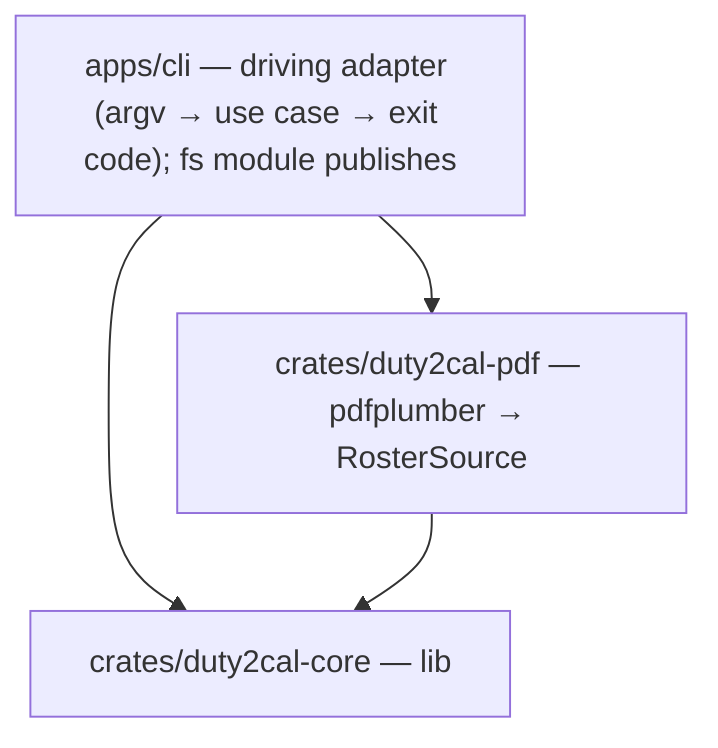
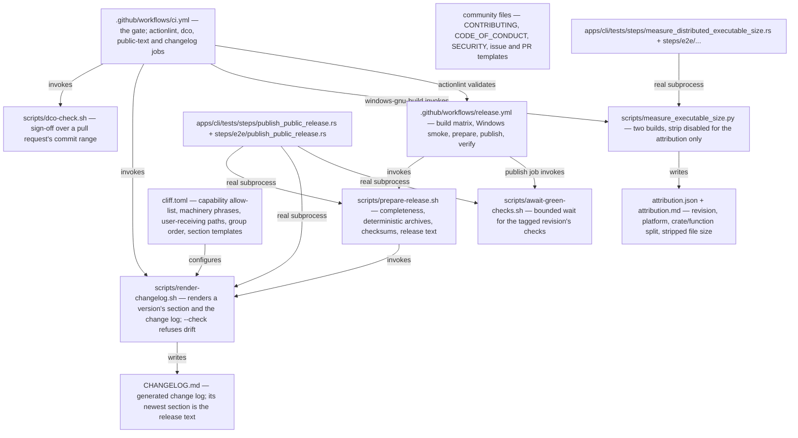
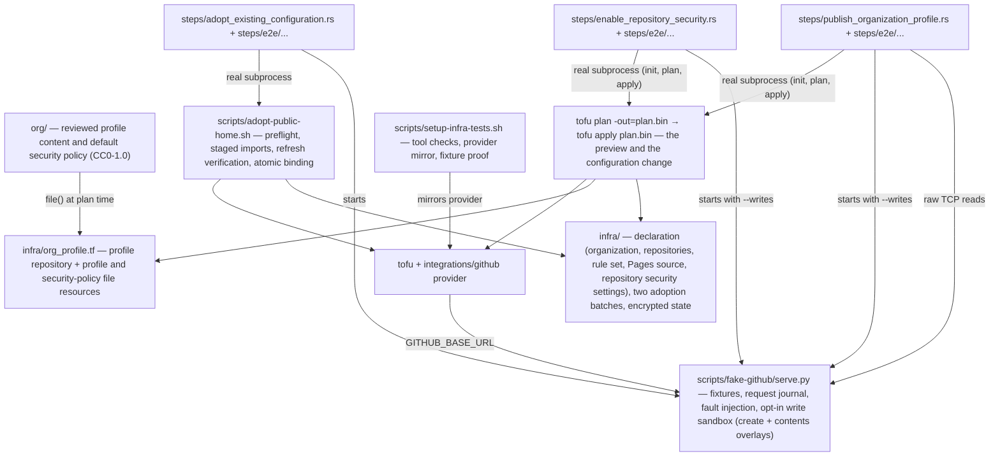

# 5. Building Block View

## Level 1 — System overview

| Building block | Responsibility |
|---|---|
| `apps/cli` (package `duty2cal`) | Parse the invocation, invoke the conversion, print the reported path or failure, set the exit status, and publish the calendar or the diagnostic (`fs` module). |
| `crates/duty2cal-pdf` | The only crate that depends on `pdfplumber`; produces the `RawRosterTable` anti-corruption input. |
| `crates/duty2cal-core` | Pure domain, application ports + `ConvertRoster`, and the dependency-free ICS adapter. |

## Release toolbox (outside the product crates)

The release channel adds blocks that sit beside the workspace, not inside it. They are build tooling and repository operation; they change nothing about the product blocks above.

| Release block | Responsibility |
|---|---|
| `scripts/prepare-release.sh` | The preparation contract: refuse a set missing the Windows x86_64 executable or carrying an executable for a platform outside the supported set, stage exactly one deterministic Windows `.tar.gz` archive and its checksum, and stage the change log and the release text the renderer produces. |
| `scripts/render-changelog.sh` | Render one version's section and the change log (and the release text) from the repository's history with the pinned generator; `--check` renders in memory and refuses a committed change log that differs from the released revision, naming the version whose section differs. The section's date is the released revision's own committer date — the `v<version>` tag when it exists, and otherwise `HEAD`, the revision the tag will point at — never the clock, so a section is renderable before its tag exists. It also refuses a version with a leading `v`, a repository with no `HEAD` to date the section from, a generator that is not the pinned version, an allow-list that differs from `givn/specs/`, a marked machinery skip list the configuration does not realize, a listed user-receiving path the tree does not hold, an announced revision whose changed paths cannot be read, and a render that names no change a user receives. An entry whose revision changed no user-receiving path is left out of the section, and a `### ` group heading left without a bullet is pruned before the visible count and the written section. |
| `cliff.toml` | The one configuration the project owns: the capability allow-list (the released capability scopes), the dependency-update parser for `chore(deps):` revisions, the marked machinery skip list (the project's own tooling words the allow-list cannot see), the marked list of the paths a user receives (which decides what a released revision must have changed to be announced), the group order (including the Dependencies group for `chore(deps):` updates), the skip rules and the templates that render a section, including the per-entry revision marker the renderer resolves and strips. Passed to the generator explicitly so a developer's global configuration cannot change a render. |
| `CHANGELOG.md` | The generated change log: the newest section is the version being released, every earlier section stays verbatim, and the first section back-fills `0.1.0`; published among a release's assets. |
| `scripts/dco-check.sh` | Check DCO sign-off over a pull request's commit range; run by the `dco` CI job on pull requests only. |
| `scripts/await-green-checks.sh` | The publication gate: resolve every release-workflow check suite on the tagged revision, wait (bounded) for the remaining check runs to conclude, and refuse a concluded non-success, no success, no check evidence, an unreadable source, or the bound, naming the checks. |
| `scripts/measure_executable_size.py` | The measurement: resolve a named revision into a temporary worktree, build the shipped artifact with the committed configuration, build the same revision again with `strip` disabled for that build only in a separate target directory, attribute it by crate and by function with the pinned generator, read the stripped artifact's file size, digest and section sizes, and write one report naming the revision, the platform and the build's identity. A failed build or a build that keeps no names yields no attribution; an unreadable file size leaves the report incomplete; nothing is inferred from the archive or a host build. |
| `.github/workflows/release.yml` | On a `v*` tag: cross-build the Windows x86_64 executable on Linux, smoke that executable on Windows, prepare the staged set over the one binary, wait for the tagged revision's checks to conclude green, publish the immutable release with provenance and a bill of materials, then verify the published release by reading it back. |
| `.github/workflows/ci.yml` | The gate on landing; the publishing change added the `actionlint` and `dco` jobs, and the change to generate release notes adds the `changelog` job (the pinned generator plus the drift check) and puts the pinned generator on the `test` job's `PATH`, because the suite's change-log scenarios drive the renderer as a real subprocess. The size-attribution change adds the measurement step to the `windows-gnu-build` job and puts the Windows target, `mingw-w64` and the pinned generator on the `test` and `coverage` jobs so the suite's `@e2e` scenario drives the same command. |
| `attribution.json` and `attribution.md` | The report a measurement writes, not a committed file: the machine-readable and human renderings of one dataset. They name the revision, the platform and the build's identity, keep the crate/function split and the stripped executable's file size as separate fields, and carry the status `complete`, `incomplete` or `unreadable`. The gate's Windows job uploads the pair beside the run for the revision it built; the release maintainer can request the same report for any named revision. |
| Community files (`CONTRIBUTING.md`, `CODE_OF_CONDUCT.md`, `SECURITY.md`, `.github/ISSUE_TEMPLATE/*`, `.github/pull_request_template.md`) | The contributor routes: contribution and sign-off rules, conduct, the confidential reporting route, and issue and pull-request forms that ask for the export family and a stripped sample, never a real plan. |
| `apps/cli/tests/steps/publish_public_release.rs` and `apps/cli/tests/steps/e2e/publish_public_release.rs` | The step definitions for this capability; the `@e2e` file drives `scripts/prepare-release.sh` and `scripts/render-changelog.sh` as real subprocesses, asserts the staged Windows archive and checksum, extracts it and inspects its only member and bytes, and reads the newest section out of the written change log. The real Windows executable is started by the `smoke-windows` job, not by the Linux suite. |
| `apps/cli/tests/steps/measure_distributed_executable_size.rs`, `apps/cli/tests/steps/e2e/measure_distributed_executable_size.rs`, and `apps/cli/tests/fixtures/size-attribution/` | The measurement capability's step definitions and its two-crate fixture workspace. The scenarios drive the real command as a subprocess against real git repositories, real cross-builds and the real generator; the `@e2e` scenario commits its terminal transcript. |

## Public-home declaration toolbox (outside the product crates)

The public home's configuration adds blocks beside the workspace. They are
repository operation and its tests, not product blocks.

| Block | Responsibility |
|---|---|
| `infra/` | The declared configuration: `github_organization_settings`, the monorepo and Pages `github_repository` resources (the monorepo's `security_and_analysis` included), the profile repository and its two `github_repository_file` resources in `org_profile.tf` (source resolved by `variable "org_source_dir"`, whose default is `../org`), `github_repository_ruleset.main` (the existing `main protection` rule set), `github_repository_pages.pages`, and `github_repository_vulnerability_alerts.mono` / `github_repository_dependabot_security_updates.mono`; the two adoption batches; the encrypted state and its backup; the provider lock file. |
| `org/` | The reviewed public copy: the profile content (`profile/README.md`) and the default security policy (`SECURITY.md`), both CC0-1.0 and covered by a `REUSE.toml` override. The profile repository is output; these files are the source. |
| `scripts/adopt-public-home.sh` | The adoption interface: validate the declaration and passphrase, import the selected batch into a staged copy of the state, verify the batch with a refresh-only plan, then bind atomically and report one line per object, or refuse and name the object. It stages the declaration without `org_profile.tf`, because the profile repository is created, never adopted, so the refresh-only verification never evaluates the profile files. |
| The apply | The declaration's normal mechanism, no wrapper: `tofu init`, `tofu plan -out=plan.bin` (the preview; `plan.bin` is encrypted and git-ignored), `tofu apply plan.bin` (the configuration change), then a fresh plan that must be empty. The state is committed only after a green apply. |
| `scripts/setup-infra-tests.sh` | Prepares the offline test environment: `tofu` and `python3` checks, the provider mirror and `terraformrc`, and the one-import proof that the fixture set satisfies the provider. The proof workspaces and the `security-applied` base workspace omit `org_profile.tf`, because they cover only the existing/adopted objects; the profile scenario owns the profile proof. |
| `scripts/fake-github/serve.py` and its fixtures | The digital twin of GitHub's REST API: deterministic JSON fixtures per scenario, a journal of every request, and fault injection for unreadable, missing and changed objects; `--writes` adds an opt-in sandbox that accepts the repository `PATCH`, the vulnerability-alerts and Dependabot-security-updates `PUT`s, organization-repository creation, and repository-contents `PUT`s, with branch and commit overlays served back to the provider's reads. |
| `apps/cli/tests/steps/adopt_existing_configuration.rs`, `apps/cli/tests/steps/e2e/adopt_existing_configuration.rs` | The adoption capability's step definitions; they drive the adoption command as a real subprocess against the fake. |
| `apps/cli/tests/steps/enable_repository_security.rs`, `apps/cli/tests/steps/e2e/enable_repository_security.rs` | The security-settings capability's step definitions; they prime the state with the real adoption command, then drive `tofu init`, `plan` and `apply` as real subprocesses against the fake in `--writes` mode. |
| `apps/cli/tests/steps/publish_organization_profile.rs`, `apps/cli/tests/steps/e2e/publish_organization_profile.rs` | The profile capability's step definitions; they copy `org/` beside the scenario's `infra/`, prime the same state, remove `org_profile.tf` for the base priming and restore it, drive the preview and the apply as real subprocesses, and read the published repository and contents back from the fake with raw loopback requests. |

## Level 2 — Key building blocks

### `duty2cal-core` modules

**Responsibility:** everything that is host-independent and testable without I/O.

| Element | Responsibility |
|---|---|
| `domain` | `Roster` aggregate, `DutyEntry` values, the one rule that reads a travel leg's printed crew position and activity together and composes the travel title (including the conditional ` Report <value> LT` report suffix), and the pure timing rules (`timing`). No I/O, no clock. |
| `application` | Ports (`RosterSource`, `CalendarSink`, `Clock`), the `ConvertRoster` use case, `RawRosterTable` as the anti-corruption intermediate, and the row interpretation that classifies activities and pairs travel fragments by their two printed fields. |
| `adapters/ics` | RFC 5545 serializer — the `CalendarSink` used by every facade. |

### `duty2cal-pdf`

**Responsibility:** header detection → X bands → Y clustering → `RawRosterTable`; error mapping to a crate-local `SourceError` (the orphan rule forbids `From<pdfplumber::Error>`).

### `apps/cli`

**Responsibility:** composition root and native-only concerns.

| Element | Responsibility |
|---|---|
| `main` | argv handling, wiring, exit status. |
| `fs` | unused-path allocation for calendars and numbered diagnostics. |

### Deferred (roadmap)

`ffi/wasm` (Phase 2), `ffi/uniffi` (Phase 2), native UIs (Phase 3) — driving adapters over the unchanged application; not created in this change.
