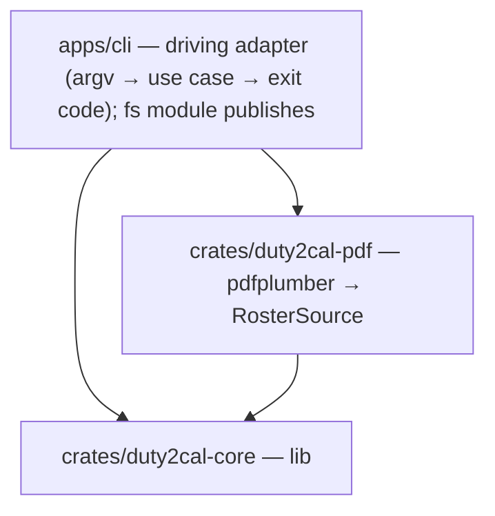
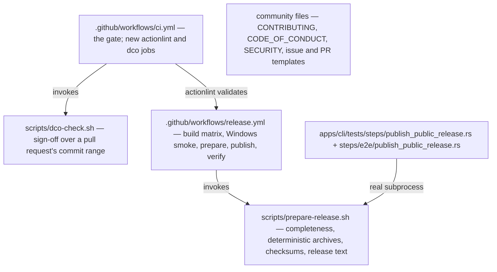

# 5. Building Block View

## Level 1 — System overview

| Building block | Responsibility |
|---|---|
| `apps/cli` (package `duty2cal`) | Parse the invocation, invoke the conversion, print the reported path or failure, set the exit status, and publish the calendar or the diagnostic (`fs` module). |
| `crates/duty2cal-pdf` | The only crate that depends on `pdfplumber`; produces the `RawRosterTable` anti-corruption input. |
| `crates/duty2cal-core` | Pure domain, application ports + `ConvertRoster`, and the dependency-free ICS adapter. |

## Release toolbox (outside the product crates)

The release channel adds blocks that sit beside the workspace, not inside it. They are build tooling and repository operation; they change nothing about the product blocks above.

| Release block | Responsibility |
|---|---|
| `scripts/prepare-release.sh` | The preparation contract: refuse an incomplete or unrecognised platform set, stage one deterministic `.tar.gz` archive and checksum per supported platform, and write the release text. |
| `scripts/dco-check.sh` | Check DCO sign-off over a pull request's commit range; run by the `dco` CI job on pull requests only. |
| `.github/workflows/release.yml` | On a `v*` tag: build the five platforms, smoke the Windows executable on Windows, prepare the staged set, publish the immutable release with provenance and a bill of materials, then verify the published release by reading it back. |
| `.github/workflows/ci.yml` | The gate on landing; this change adds the `actionlint` and `dco` jobs and leaves the existing jobs untouched. |
| Community files (`CONTRIBUTING.md`, `CODE_OF_CONDUCT.md`, `SECURITY.md`, `.github/ISSUE_TEMPLATE/*`, `.github/pull_request_template.md`) | The contributor routes: contribution and sign-off rules, conduct, the confidential reporting route, and issue and pull-request forms that ask for the export family and a stripped sample, never a real plan. |
| `apps/cli/tests/steps/publish_public_release.rs` and `apps/cli/tests/steps/e2e/publish_public_release.rs` | The step definitions for this capability; the `@e2e` file drives `scripts/prepare-release.sh` as a real subprocess and runs the executable taken out of the produced archive. |

## Level 2 — Key building blocks

### `duty2cal-core` modules

**Responsibility:** everything that is host-independent and testable without I/O.

| Element | Responsibility |
|---|---|
| `domain` | `Roster` aggregate, `DutyEntry` values, and the pure timing rules (`timing`). No I/O, no clock. |
| `application` | Ports (`RosterSource`, `CalendarSink`, `Clock`), the `ConvertRoster` use case, `RawRosterTable` as the anti-corruption intermediate, and the row interpretation that classifies activities and pairs travel fragments. |
| `adapters/ics` | RFC 5545 serializer — the `CalendarSink` used by every facade. |

### `duty2cal-pdf`

**Responsibility:** header detection → X bands → Y clustering → `RawRosterTable`; error mapping to a crate-local `SourceError` (the orphan rule forbids `From<pdfplumber::Error>`).

### `apps/cli`

**Responsibility:** composition root and native-only concerns.

| Element | Responsibility |
|---|---|
| `main` | argv handling, wiring, exit status. |
| `fs` | unused-path allocation for calendars and numbered diagnostics. |

### Deferred (roadmap)

`ffi/wasm` (Phase 2), `ffi/uniffi` (Phase 2), native UIs (Phase 3) — driving adapters over the unchanged application; not created in this change.
