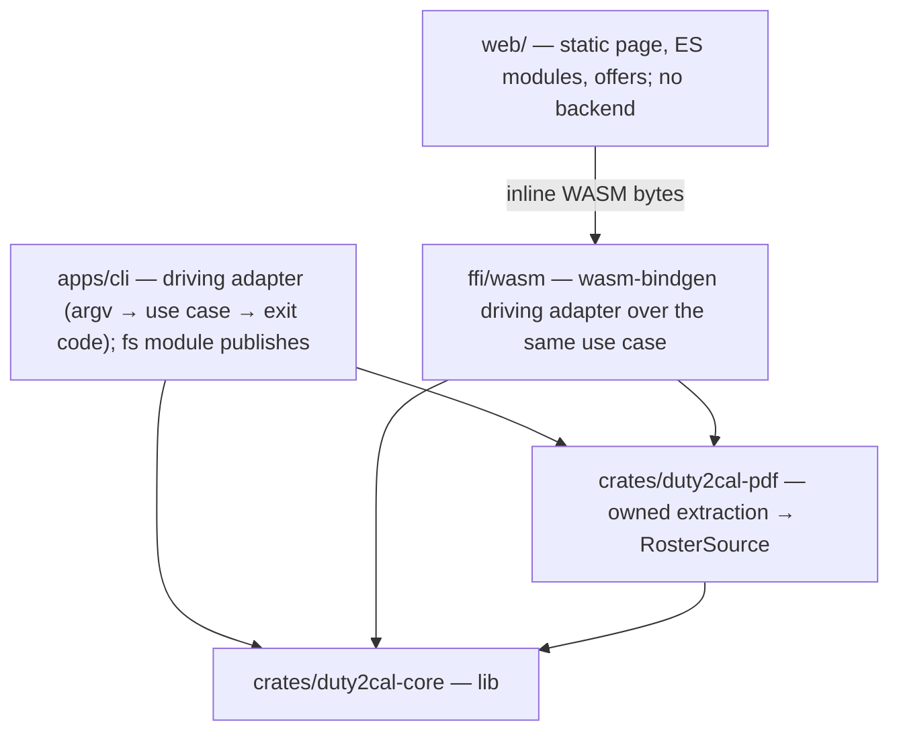
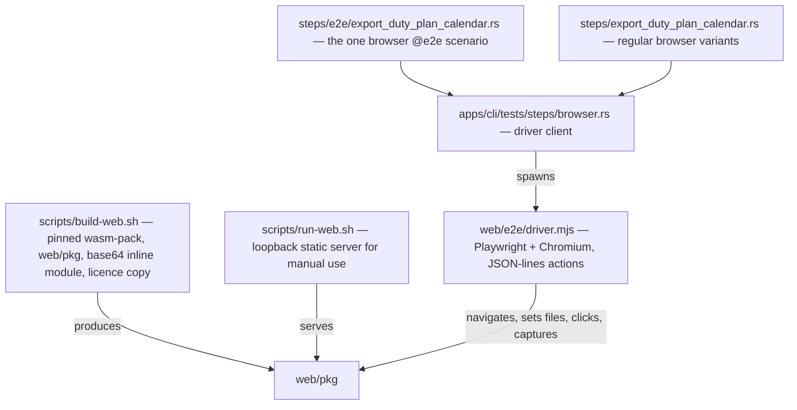
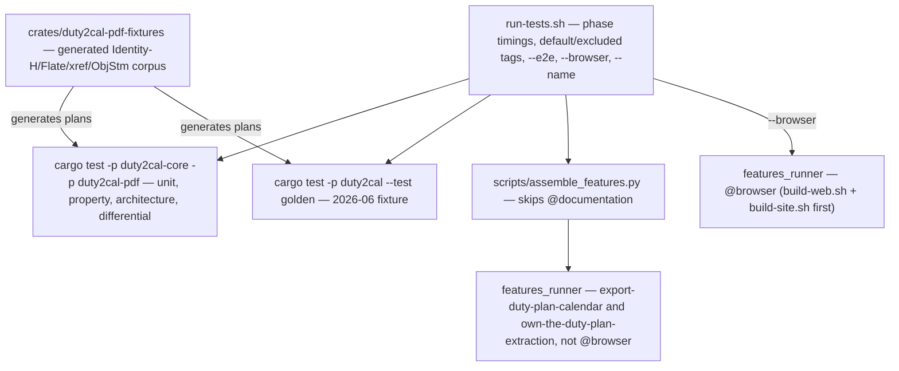
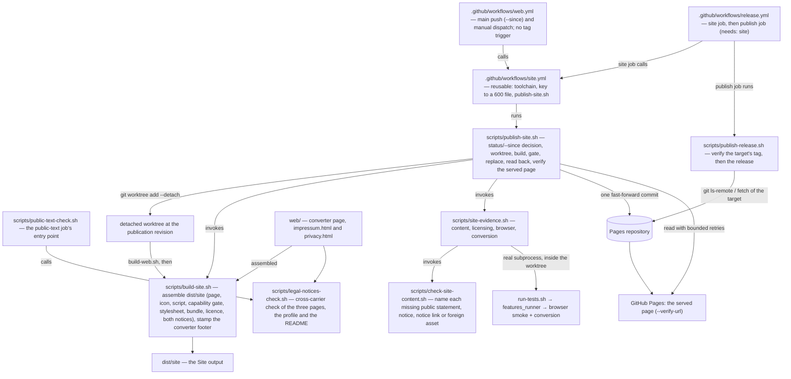
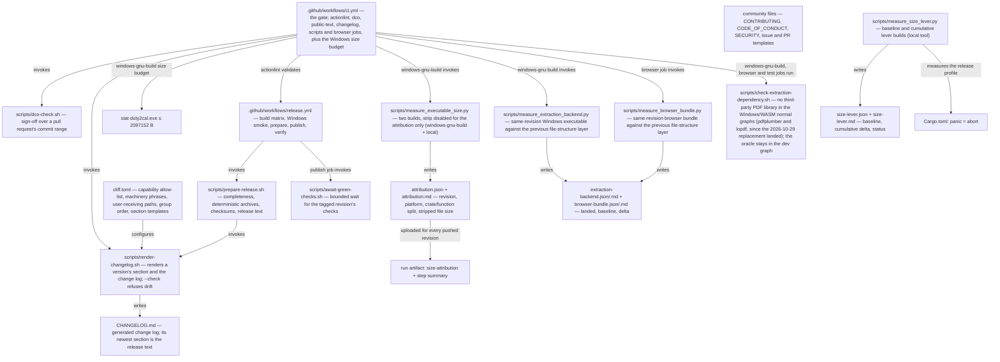
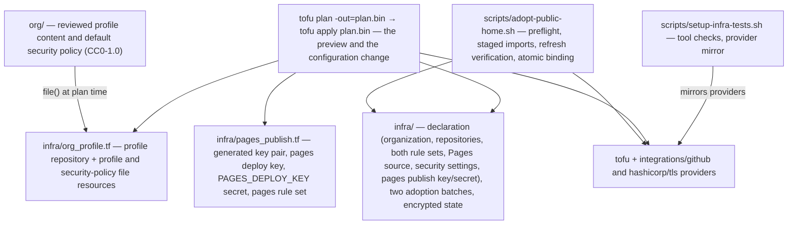
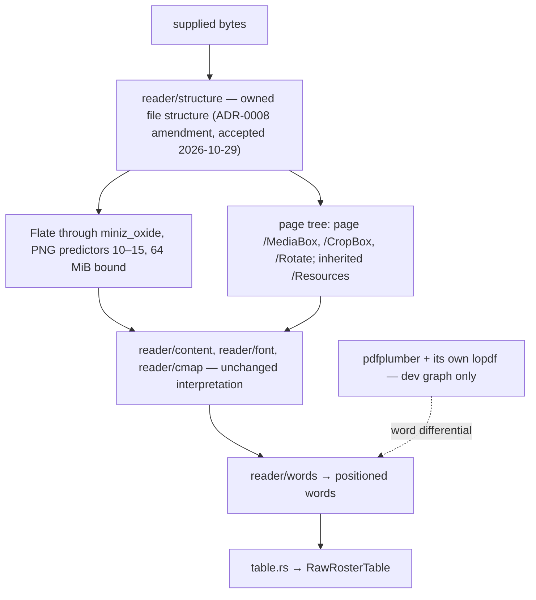

# 5. Building Block View

## Level 1 — System overview

| Building block | Responsibility |
|---|---|
| `apps/cli` (package `duty2cal`) | Parse the invocation, invoke the conversion, print the reported path or failure, set the exit status, and publish the calendar or the diagnostic (`fs` module). |
| `ffi/wasm` (package `duty2cal-wasm`) | A thin `wasm-bindgen` driving adapter: accepts the filename and bytes, wires the unchanged `ConvertRoster` with a browser clock, and returns the calendar text with its warnings and the represented unknown duties in plan order, or a structured failure. Target-scoped to `wasm32-unknown-unknown`; performs no filesystem, network or environment I/O. |
| `web/` | The converter page: a header with the project's vector mark (`icon.svg`) as a 48×48 mark left of the heading (and as the tab's primary icon, with the raster `icon.png` declared as its alternate), a statements panel above the converter panel (the tool's one plan — a Lufthansa cabin-crew duty plan published as a Jeppesen PDF export — with its boundary, the browser route, downloads for various operating systems on request with the release page linked, privacy, the non-affiliation sentence naming Lufthansa and Jeppesen, as-is), capability gate, file picker and drop zone, 20 MiB bound, conversion call, status/failure panels, Blob offers, a "Source and licence" panel below the converter panels, and a full footer carrying the Built revision and the plain-prose non-affiliation, as-is and privacy statements. No backend, no upload, no persistent storage. |
| `crates/duty2cal-pdf` | Owns the extraction of the frozen supported subset — the file structure through `reader/structure/` since the accepted ADR-0008 amendment of 2026-10-29, and the project's content, font, CMap and positioning interpretation — and produces the `RawRosterTable` anti-corruption input; `pdfplumber` is a test-only oracle. |
| `crates/duty2cal-core` | Pure domain, application ports + `ConvertRoster`, and the dependency-free ICS adapter. |

## Browser build and evidence toolbox (outside the product crates)

The browser route adds a build step and a real-browser test driver. They are
test/build tooling; the product page and facade remain the blocks above.

| Block | Responsibility |
|---|---|
| `scripts/build-web.sh` | Install the pinned `wasm-pack`, build `web/pkg`, and generate the base64 `wasm-inline.js`. |
| `scripts/run-web.sh` | Build the Site output and serve `dist/site/` on loopback for manual use. |
| `web/e2e/driver.mjs` | Serve the Site output named by `DUTY2CAL_SITE_ROOT` on loopback and drive Chromium: perform actions, read rendered state/request log/storage, capture downloads and screenshots, and fail closed on an unknown action or a missing root. |
| `apps/cli/tests/steps/browser.rs` | The Rust client for the driver protocol; shared by the `@e2e` and regular browser step files. |
| `apps/cli/tests/steps/e2e/export_duty_plan_calendar.rs` | The one browser `@e2e` scenario, alongside the existing CLI e2e steps. |
| `apps/cli/tests/steps/export_duty_plan_calendar.rs` | The regular browser variants (size, family, stale offer, drop, capability, startup, offer failures, cancelled save, naming, persistence). |

## Test harness (outside the product crates)

The default suite runs product behaviour only. The operational Gherkin files
stay in the corpus as documentation and are skipped by the assembler.

| Block | Responsibility |
|---|---|
| `run-tests.sh` | Assemble the feature root, print `phase=<name> seconds=<n>` and the cucumber concurrency, run the Rust tests and the golden test on a full run, and select the scenario set. `--no-fail-fast` keeps one failing class from hiding the others. |
| `apps/cli/tests/features_runner.rs` | Cucumber-rs runner with `.fail_on_skipped()`; the world carries only the product scenario fields. |
| `apps/cli/tests/steps/export_duty_plan_calendar.rs` | The conversion capability's CLI and in-process steps. |
| `apps/cli/tests/steps/own_the_duty_plan_extraction.rs` | The owned-extraction capability's regular and outline steps: generated supported and refusal plans, the accepted calendar, the named construct report, and (from the 2026-10-29 replacement) the four accepted file-structure spellings and the bad-pointer refusal, all driving the built executable. |
| `apps/cli/tests/steps/e2e/export_duty_plan_calendar.rs` | The one CLI `@e2e` scenario and the one browser `@e2e` scenario. |
| `apps/cli/tests/steps/e2e/own_the_duty_plan_extraction.rs` | The owned-extraction capability's `@e2e` scenario, its CLI invocation and committed transcript. |
| `crates/duty2cal-pdf-fixtures` | The dev-only generator: Identity-H fonts with per-font `ToUnicode`, Flate content, classic xref, xref stream, object streams, a logo image, multi-page plans and the refusal variants. It emits bytes in-process and commits no PDF; the 2026-10-29 replacement gains the file-structure spellings it must accept — an xref stream carrying the PNG predictor, an incremental update with `/Prev`, an indirect stream `/Length`, `/Resources` inherited from `/Pages`, a corrupt-checksum stream, a leading-junk header, a hybrid `/XRefStm`, a compact `/W`/`/Index` stream, a non-PNG predictor, the None, Sub, Average and Paeth PNG filters, and a raw-deflate retry — and a bad-pointer plan that must be refused as unreadable. |
| `crates/duty2cal-pdf/src/differential_tests.rs` | The word-level oracle comparison (exact text, 0.5 pt on `x0`/`top`, equal `RawRosterTable`), the refusal cases, and the ignored real-corpus run. |
| `scripts/validate-local-corpus.sh` | Runs the executable over `private/*.pdf` in place; `--differential` runs the ignored real-corpus oracle test. Opt-in, never CI. |
| `apps/cli/tests/steps/browser.rs` | The Playwright driver client. |
| `apps/cli/tests/golden.rs` | Direct conversion of the generated 2026-06 plan against `tests/fixtures/expected/2026-06.ics`. |
| `scripts/assemble_features.py` | Merge delta specs and skip a feature whose prefix carries `@documentation`. |
| `rust-toolchain.toml` | The compiler pin: the exact stable release, `profile = "minimal"`, `rustfmt`, `clippy` and `llvm-tools-preview`, and the `wasm32-unknown-unknown` and `x86_64-pc-windows-gnu` targets. rustup and the Nix overlay read it; no job or script carries a second channel. |
| `scripts/dev-tool-versions.env` | One line per pinned cargo tool (`cargo-llvm-cov`, `cargo-deny`, `cargo-about`, `cargo-bloat`, `git-cliff`); sourced by `scripts/setup-dev.sh` and the CI tool action. |
| `scripts/setup-dev.sh` | The non-Nix bootstrap, with a `--check` mode: ensure rustup, source its env, install the pinned toolchain, components and targets with `rustup show`, install the pinned cargo tools, read `web/e2e/.nvmrc` through nvm when present, run `npm ci --prefix web/e2e`, download Chromium, report the host package list from `playwright install-deps --dry-run`, refuse a browser-build/npm-client mismatch, and report a missing host library or system package by name without installing it. |
| `scripts/check-toolchain.sh` | Refuse a non-exact channel, a `rustc` that differs from the file, a sysroot without `llvm-cov`/`llvm-profdata`, or a set `LLVM_COV`/`LLVM_PROFDATA`, naming the remedy; `run-tests.sh` and `measure-coverage.sh` run it first. |
| `scripts/bump-toolchain.sh` | Move `rust-toolchain.toml` to a released version, update the rust-overlay revision in `flake.lock`, and re-run the guard in `nix develop`; an unresolvable release restores both files. |
| `scripts/check-playwright-version.sh` | Refuse a `web/e2e` Playwright client that differs from the flake's `PLAYWRIGHT_DRIVER_VERSION`; the `nix` CI job runs it, so an npm bump must move `flake.lock` with it. |
| `scripts/tests/check-toolchain.bats`, `scripts/tests/setup-dev.bats`, `scripts/tests/bump-toolchain.bats`, `scripts/tests/check-playwright-version.bats` | The developer scripts' executable refusals: a stub `rustc`/sysroot on `PATH` proves the matching, mismatched, missing-tool and env-override cases; `setup-dev.sh --check` names a missing tool without installing and refuses a browser-build/npm-client mismatch; the bump helper refuses a moving channel and a missing Nix; the browser check refuses a client/browser mismatch. |
| `flake.nix` and `flake.lock` | The Nix consumer of the same pin for `x86_64-linux`: `rust-bin.fromRustupToolchainFile`, the pinned cargo tools (`cargo-llvm-cov` with checks disabled), `wasm-pack`, Node, Playwright browsers, Python, jq, bats, actionlint and the Windows cross compiler (`pkgsCross.mingwW64.stdenv.cc` plus `pkgsCross.mingwW64.windows.pthreads` and `.mcfgthreads`); no `llvmPackages` on `PATH`. `reuse` stays out because the locked nixpkgs package fails to build (CI installs it with pipx), and OpenTofu stays out because nixpkgs carries 1.13.2 against the repository's 1.13.1 pin. |

## Site publication toolbox (outside the product crates)

The Public website's publication adds blocks beside the workspace. They are
build-and-publish tooling: they change nothing about the product blocks above,
and the pages they publish are the same `web/` pages.

| Block | Responsibility |
|---|---|
| `scripts/build-site.sh` | Assemble `dist/site/` from the checkout it is pointed at (the publication passes the revision's detached worktree) and those `web/pkg/` members, copy the project's vector mark to `icon.svg` and the raster to `icon.png`, copy the two notice pages `impressum.html` and `privacy.html` unchanged, stamp the footer anchor from `--revision` on the converter page only, and copy `LICENSES/MPL-2.0.txt` as `LICENSE.txt`; the output holds exactly eleven members — `index.html`, `app.js`, `capability.js`, `styles.css`, `icon.svg`, `icon.png`, `impressum.html`, `privacy.html`, `pkg/duty2cal_wasm.js`, `pkg/wasm-inline.js` and `LICENSE.txt`; refuse a missing converter bundle (naming `scripts/build-web.sh`), a missing vector or raster mark (naming the file), and a missing notice page (naming it). |
| `scripts/check-site-content.sh` | Read the assembled output and name every missing public statement, notice or notice link: an output whose member set differs from the eleven named members, a missing or empty `impressum.html` or `privacy.html`, a notice without an `h1`, a converter footer that does not link both, a notice that does not link the other and the converter page, an Impressum without a postal code, a city, a `mailto:` link or its service-address sentence, a Datenschutzerklärung without its standing date and its required disclosures from `scripts/legal-notices.env` (`GitHub, Inc.`, the logged `IP-Adresse`, the named further data, the legal basis, `Data Privacy Framework`, `Standardvertragsklauseln`, the sub-processors, the mail handling and the host link under `https`), a notice whose content security policy differs from `NOTICE_CSP`, a notice carrying a placeholder marker, the discontinued dispute-resolution address, a `<script` element, an `on*=` handler attribute or a foreign asset, and a relative `href` that resolves to no file in the output; it scans every `*.html` member, not only `index.html`; it also names a header mark that is not `./icon.svg`, a tab whose vector declaration (`type="image/svg+xml"`, `./icon.svg`) is missing, untyped, or not on an earlier line than the raster declaration (`type="image/png"`, `./icon.png`), a missing icon member, a missing Built revision link or a missing licence file; require the `what-it-does` element to state the support statement and its boundary and the `non-affiliation` element to name Lufthansa, Jeppesen and any duty-plan provider or airline; refuse an `icon.svg` that is not a plain palette-only vector; refuse an asset loaded from another origin. |
| `scripts/support-statement-check.sh` | The cross-carrier statement gate: compare the website's statement elements, the README, the organization profile, chapter 3 and both issue forms with the expected support, boundary and non-affiliation sentences, refuse withdrawn export-family wording, and require the plan's evidence record; `scripts/public-text-check.sh` calls it so the `public-text` CI job runs it. `scripts/tests/support-statement.bats` is its executable evidence. |
| `scripts/legal-notices-check.sh` | The cross-carrier legal-notice gate, called with the repository root: read the three pages under `web/` and the two non-output carriers — `org/profile/README.md` and `README.md` — and refuse a converter page whose footer does not link both notices, a notice that does not link the other or lacks a required element from `scripts/legal-notices.env`; either carrier that does not link `https://duty2cal.github.io/impressum` under the label "Impressum" and `https://duty2cal.github.io/privacy` under the label "Datenschutz"; a carrier that copies the postal address or a `mailto:` link; and any occurrence of a placeholder; every refusal prints one line naming the page or carrier and the missing or forbidden element. |
| `scripts/public-text-check.sh` | The `public-text` CI job's entry point: run the support-statement check and the cross-carrier legal-notices check with the repository root, so one job refuses a revision in which either public claim disagrees across its carriers. |
| `scripts/site-evidence.sh` | Run the four checks as real subprocesses in fail-fast order and name the failing one; it runs inside the revision's worktree, so the conversion suite and browser scenario are that revision's own. |
| `scripts/publish-site.sh` | Refuse an unclean caller tree (`git status --porcelain --untracked-files=no`), decide `--since` against the site-input list it owns, resolve the Built revision, create a detached worktree at it, build and gate there, report the target as current and write nothing when republishing content the target already holds, replace the hosting target's content in one fast-forward commit under an exclusive lock, read the pushed tree back, and verify the page served at `--verify-url` names the same Built revision before reporting success. |
| `scripts/publish-release.sh` | Read the hosting target's branch tip (`git ls-remote`, then a fetch) and refuse before any `gh` call unless it carries the tagged Built revision; then create, inspect and publish the draft release through `gh`, comparing the asset set while excluding `release-notes.md`; it takes `--site-repo DIR` for the target it reads. |
| `.github/workflows/web.yml` | The trigger workflow only: every default-branch push (passing `github.event.before` as `--since`) and manual dispatch, with no `v*` tag trigger; it calls the reusable `site.yml` with `fetch-depth: 0` and holds no build, gate or publish step of its own. |
| `.github/workflows/site.yml` | The reusable publication workflow (`on: workflow_call`, inputs `revision` and `since`, secret `PAGES_DEPLOY_KEY`): prepares the gate's toolchain, writes the key to a `600` file and runs `scripts/publish-site.sh` with `--verify-url`; its concurrency group is the site publication's serialization. |
| `.github/workflows/release.yml` | A `site` job that calls `site.yml` for the tag (`fetch-depth: 0`, `revision` = the tag, no `since`), then a `publish` job (`needs: site`) that keeps the SBOM and attestation steps and runs `scripts/publish-release.sh`; the `publish` job no longer publishes the site itself. |
| `scripts/tests/publish-site.bats` | The publication's early refusals: bad arguments, an unknown `--since` base, and an unclean caller tree. It invokes the script before any build. |

The publication's former cucumber step definitions are deleted. The workflow's
golden test, build, evidence gate and deploy are the executable checks; the
`bats` file covers the shell refusals that must happen before a build.

## Release toolbox (outside the product crates)

The release channel adds blocks that sit beside the workspace, not inside it. They are build tooling and repository operation; they change nothing about the product blocks above.

| Release block | Responsibility |
|---|---|
| `scripts/prepare-release.sh` | The preparation contract: refuse a set missing the Windows x86_64 executable or carrying an executable for a platform outside the supported set, stage exactly one deterministic Windows `.tar.gz` archive and its checksum, and stage the change log and the release text the renderer produces. |
| `scripts/render-changelog.sh` | Render one version's section and the change log (and the release text) from the repository's history with the pinned generator; `--check` renders in memory and refuses a committed change log that differs from the released revision, naming the version whose section differs. The section's date is the released revision's own committer date — the `v<version>` tag when it exists, and otherwise `HEAD`, the revision the tag will point at — never the clock, so a section is renderable before its tag exists. It also refuses a version with a leading `v`, a repository with no `HEAD` to date the section from, a generator that is not the pinned version, an allow-list that differs from `givn/specs/`, a marked machinery skip list the configuration does not realize, a listed user-receiving path the tree does not hold, an announced revision whose changed paths cannot be read, and a render that names no change a user receives. An entry whose revision changed no user-receiving path is left out of the section, and a `### ` group heading left without a bullet is pruned before the visible count and the written section. |
| `cliff.toml` | The one configuration the project owns: the capability allow-list (the released capability scopes), the dependency-update parser for `chore(deps):` revisions, the marked machinery skip list (the project's own tooling words the allow-list cannot see), the marked list of the paths a user receives (which decides what a released revision must have changed to be announced), the group order (including the Dependencies group for `chore(deps):` updates), the skip rules and the templates that render a section, including the per-entry revision marker the renderer resolves and strips. Passed to the generator explicitly so a developer's global configuration cannot change a render. |
| `CHANGELOG.md` | The generated change log: the newest section is the version being released, every earlier section stays verbatim, and the first section back-fills `0.1.0`; published among a release's assets. |
| `scripts/dco-check.sh` | Check DCO sign-off over a pull request's commit range; run by the `dco` CI job on pull requests only. |
| `scripts/await-green-checks.sh` | The publication gate: resolve every release-workflow check suite on the tagged revision, wait (bounded) for the remaining check runs to conclude, and refuse a concluded non-success, no success, no check evidence, an unreadable source, or the bound, naming the checks. |
| `scripts/measure_executable_size.py` | The measurement: resolve a named revision into a temporary worktree, build the shipped artifact with the committed configuration, build the same revision again with `strip` disabled for that build only in a separate target directory, attribute it by crate and by function with the pinned generator, read the stripped artifact's file size, digest and section sizes, and write one report naming the revision, the platform and the build's identity. A failed build or a build that keeps no names yields no attribution; an unreadable file size leaves the report incomplete; nothing is inferred from the archive or a host build. |
| `scripts/measure_size_lever.py` | The reduction measurement: resolve the revision into a worktree, rebuild the unchanged release configuration (`panic = "unwind"`, `opt-level = "z"`) as the baseline, build each candidate lever cumulatively, measure the stripped executable's file size, record the delta and status, refuse a nightly/UPX/dynamic-linking proposal before a build, report the published binary's size separately, and preserve the accepted executable for the failure-path run. |
| `size-lever.json` and `size-lever.md` | The reduction report: baseline, cumulative rows, applied/rejected statuses, the published binary's size and the recorded panic/conversion outcome. |
| `scripts/measure_extraction_backend.py` | The same-revision measurement: build the landed revision's Windows GNU executable, restore `crates/duty2cal-pdf/` and `Cargo.lock` from the base revision in a temporary worktree, build the same package, and record both sizes, the saved bytes and the two revisions. Its base-manifest predicate names the previous file-structure layer (`lopdf` in `[dependencies]`) of the 2026-10-29 replacement. It refuses a baseline that does not build, a worktree diff beyond the allowed paths, a non-Windows artifact or a non-positive delta, and records `status: not applicable` with the landed size once the base no longer names that layer — the measurement is one-shot. |
| `scripts/measure_browser_bundle.py` | The same comparison for the `wasm-pack` bundle and its inline module; the wasm size must be smaller, and the base predicate and the one-shot status are the same. |
| `scripts/check-extraction-dependency.sh` | The dependency split: no `pdfplumber` — and, since the 2026-10-29 replacement landed, no `lopdf` — in the `x86_64-pc-windows-gnu` or `wasm32-unknown-unknown` normal graphs, and the oracle present in `cargo tree -e dev -p duty2cal-pdf`, whose own `lopdf` copy is then expected. |
| `extraction-backend.json`/`.md` and `browser-bundle.json`/`.md` | The CI reports: landed and baseline sizes, saved bytes/percent, the two revisions and the toolchain. They are run artifacts, not committed files (ADR-0008). |
| `.github/workflows/release.yml` | On a `v*` tag: cross-build the Windows x86_64 executable on Linux, smoke that executable on Windows, prepare the staged set over the one binary, wait for the tagged revision's checks to conclude green, publish the immutable release with provenance and a bill of materials, then verify the published release by reading it back. |
| `.github/workflows/ci.yml` | The gate on landing: `actionlint`, `dco`, `public-text`, `changelog`, `scripts` (`bats`), `browser` (one Playwright smoke plus the bundle measurement), `nix` (the flake's toolchain, components, LLVM tools and Playwright equality), `coverage` on `main` only, `windows-gnu-build` with the byte budget, the per-push attribution and the same-revision backend measurement, and the dependency-split check in the Windows, browser and test jobs. The `test` job no longer installs the change-log, OpenTofu or attribution toolchains. |
| `.github/actions/rust-toolchain/action.yml` | Ensures rustup, then runs `rustup show` in the checkout, which installs the release, profile, components and targets named in `rust-toolchain.toml`; it asserts them with `scripts/check-toolchain.sh`, `cargo fmt --version` and `cargo clippy --version`. The install is an explicit step, not a side effect of the first proxy invocation. |
| `.github/actions/install-dev-tools/action.yml` | Reads `scripts/dev-tool-versions.env` and installs the tools a job names at those versions, so local and CI render byte-compared files with the same generators. |
| `attribution.json` and `attribution.md` | The report a measurement writes, not a committed file: the machine-readable and human renderings of one dataset. They name the revision, the platform and the build's identity, keep the crate/function split and the stripped executable's file size as separate fields, and carry the status `complete`, `incomplete` or `unreadable`. The `windows-gnu-build` job uploads the pair beside the run for the revision it built; the release maintainer can request the same report for any named revision. |
| Community files (`CONTRIBUTING.md`, `CODE_OF_CONDUCT.md`, `SECURITY.md`, `.github/ISSUE_TEMPLATE/*`, `.github/pull_request_template.md`) | The contributor routes: contribution and sign-off rules, conduct, the confidential reporting route, and issue and pull-request forms that state the support statement and ask whether the plan converted, what the refusal said and for a stripped sample, never a real plan and never an export-family classification. |
| Release and size step definitions | Deleted with the operational test scope. The release channel's executable checks are the release workflow itself; `measure_executable_size.py` runs in `windows-gnu-build` and locally, `measure_size_lever.py` runs locally, and neither has a cucumber binding. |

## Public-home declaration toolbox (outside the product crates)

The public home's configuration adds blocks beside the workspace. They are
repository operation and its tests, not product blocks.

| Block | Responsibility |
|---|---|
| `infra/` | The declared configuration: `github_organization_settings`, the monorepo and Pages `github_repository` resources (the monorepo's `security_and_analysis` included), the profile repository and its two `github_repository_file` resources in `org_profile.tf` (source resolved by `variable "org_source_dir"`, whose default is `../org`), `github_repository_ruleset.main` (the existing `main protection` rule set), `github_repository_pages.pages`, `github_repository_vulnerability_alerts.mono` / `github_repository_dependabot_security_updates.mono`, and — in `pages_publish.tf` — `tls_private_key.pages_publish`, `github_repository_deploy_key.pages_publish`, `github_actions_secret.pages_publish` and `github_repository_ruleset.pages_publish`; the two adoption batches; the encrypted state and its backup; the two provider lock entries. |
| `org/` | The reviewed public copy: the profile content (`profile/README.md`) and the default security policy (`SECURITY.md`), both CC0-1.0 and covered by a `REUSE.toml` override. The profile repository is output; these files are the source. |
| `scripts/adopt-public-home.sh` | The adoption interface: validate the declaration and passphrase, import the selected batch into a staged copy of the state, verify the batch with a refresh-only plan, then bind atomically and report one line per object, or refuse and name the object. It stages the declaration without `org_profile.tf`, because the profile repository is created, never adopted, so the refresh-only verification never evaluates the profile files. |
| The apply | The declaration's normal mechanism, no wrapper: a read-only creation guard (`gh api` reads of the pages repository's deploy keys and rule sets and the monorepo's Actions secrets, with `jq` verdicts), `tofu init`, `tofu plan -out=plan.bin` (the preview; `plan.bin` is encrypted and git-ignored), a read-only refresh-only report, the guard again immediately before the write, `tofu apply plan.bin` (the configuration change), then a fresh plan that must be empty. A create-only revision is classified after a failure by live reads, not by the failed state. The state is committed only after a green apply. |
| `scripts/setup-infra-tests.sh` | Prepares the local planning environment: `tofu`, `python3` and `jq` checks and the mirror and `terraformrc` for both locked providers (`integrations/github`, `hashicorp/tls`). It still runs the fake-API import proof for local planning; the cucumber suite no longer drives it. |
| Configuration step definitions | Deleted with the operational test scope. The declaration is still exercised by the maintainer's preview, apply and local drift check; no cucumber binding drives `tofu`. |

## Level 2 — Key building blocks

### `duty2cal-core` modules

**Responsibility:** everything that is host-independent and testable without I/O.

| Element | Responsibility |
|---|---|
| `domain` | `Roster` aggregate, `DutyEntry` values including `UnrecognizedActivity` for a row represented from printed evidence without a recognized code, the one rule that reads a travel leg's printed crew position and activity together and composes the travel title (including the conditional ` Report <value> LT` report suffix), and the pure timing rules (`timing`). No I/O, no clock. |
| `application` | Ports (`RosterSource`, `CalendarSink`, `Clock`), the `ConvertRoster` use case, `RawRosterTable` as the anti-corruption intermediate, the row interpretation that classifies activities and pairs travel fragments by their two printed fields, the `Diagnostic`/`Severity` model it collects, and the report builders (`failure_report_text`, `warning_report_text`, `diagnostic_text`). |
| `adapters/ics` | RFC 5545 serializer — the `CalendarSink` used by every facade; it renders a timed or all-day `UnrecognizedActivity` through the existing event shape. |

### `duty2cal-pdf`

**Responsibility:** the owned extraction of the frozen supported subset (bytes →
positioned words: the file structure, then the project's tokenizer, text state,
Type0/Identity-H fonts, `/W` advances, `/ToUnicode` CMaps and word assembly)
followed by the extraction-agnostic table construction (header detection → X
bands → Y clustering → `RawRosterTable`). The file structure is the project's
own under the accepted ADR-0008 amendment of 2026-10-29: object syntax, classic
cross-reference tables, cross-reference streams, object streams, the trailer,
the page tree with `/Resources` inherited from `/Pages` and `/MediaBox`, `/CropBox` and `/Rotate` read from the page dictionary, and Flate decoding through
`miniz_oxide`. `lopdf` no longer supplies that layer and the graphs no longer
name it. A construct outside the frozen subset maps to
`SourceError::UnsupportedConstruct` with a closed `Construct` name and page; a
readable non-family document maps to `UnsupportedFamily`; a corrupt file, a
damaged file structure or a decode over the 64 MiB bound maps to `Unreadable`.
The pinned `pdfplumber` is a `[dev-dependencies]` oracle only; it keeps its own
`lopdf` copy in the test graph. The normal graphs name neither the oracle nor
`lopdf`, which survives only in the dev graph through the oracle.

| Element | Responsibility |
|---|---|
| `reader/structure/` (`mod`, `object`, `parser`, `xref`, `filter`) — accepted by the ADR-0008 amendment of 2026-10-29 | The owned file structure: the object model with one-level reference resolution, the tokenizer and object parser over `&[u8]`, the last `%%EOF`/`startxref` lookup, classic cross-reference sections, cross-reference streams with `/Prev` and hybrid `/XRefStm`, object-stream entries, and Flate through `miniz_oxide` with PNG predictors 10–15 applied, every other value passed through, and the previous reader's raw-deflate retry on a failed zlib checksum and the 64 MiB decode bound. No repair: a structural failure is `Unreadable`. |
| `reader/` (`document`, `content`, `font`, `cmap`, `words`) | The owned extraction: page order and the page box, the operator subset, the graphics/text state, glyph boxes and word splitting, and the named refusal mapping. |
| `table.rs` | The table rules, moved from `lib.rs` and unchanged: rows, column bands, date resolution and the footer revision. |
| `differential_tests.rs` (`#[cfg(test)]`) | Oracle comparison over the generated corpus and the ignored local real-corpus run; equal `RawRosterTable` and `SourceDocument`. |

### `apps/cli`

**Responsibility:** composition root and native-only concerns.

| Element | Responsibility |
|---|---|
| `main` | argv handling, wiring, exit status, printing every conversion error and warning line, and publishing the warning report after a calendar with warnings. |
| `fs` | unused-path allocation for calendars, numbered warning reports and numbered failure reports. |

### `ffi/wasm`

**Responsibility:** the browser driving adapter over the unchanged application.

| Element | Responsibility |
|---|---|
| `convert(filename, bytes)` (wasm export) | Wire `ConvertRoster::new(PdfRosterSource, IcsSink, BrowserClock).execute(bytes)` and return `{ status: "ok", calendar, warnings, warningReport }` or `{ status: "failure", reason, diagnostic, errors, warnings }`. |
| `diagnostic_text(filename, reason)` (wasm export) | Call the shared `duty2cal_core::application::diagnostic_text`, so the page's pre-conversion size failure uses the same two lines as the executable. |
| `BrowserClock` / `NativeClock` | Implement the existing `Clock` port with `js_sys::Date` or `OffsetDateTime::now_utc`, so the crate lints natively and the source's Created footer stays preferred. |

The crate is `cdylib` + `rlib`; `wasm-bindgen`, `js-sys` and `getrandom` are
target-scoped, and the native `rlib` compiles for fmt, clippy and the Windows
workspace build.

### `web/`

**Responsibility:** the rendered converter screen and its browser rules.

| Element | Responsibility |
|---|---|
| `index.html` | Title, a flex header row carrying the project's vector mark as a 48×48 mark left of the `h1` and subheadline with the alt text `duty2cal` and `src="./icon.svg"`, two tab declarations — `<link rel="icon" type="image/svg+xml" href="./icon.svg">` first and `<link rel="icon" type="image/png" href="./icon.png">` as the raster alternate — the statements panel above the converter panel (the named plan and its boundary, the browser route, downloads for various operating systems on request with `https://github.com/duty2cal/duty2cal/releases` linked, privacy, the non-affiliation sentence naming Lufthansa and Jeppesen, as-is), drop zone and picker markup hidden until ready, the ready heading `Calendar ICS ready`, its status region, the `Unknown duties` list for the ready-with-warnings state, the offer copy `You can choose where to save the file.`, the calendar offer labelled `Save <stem>.ics`, the warning-report offer labelled `Save unknown duty warning for publisher`, the `Open new/next duty plan PDF` way back, and error and warning lists inside the failure panel, a "Source and licence" panel below the converter panels, and a full footer carrying the Built revision and the plain-prose statements; meta CSP including `img-src 'self'`. |
| `impressum.html` | The Impressum notice: one `h1`, the operator's `<address>` block carrying the postal address and a `mailto:` link, the sentence that the employer address is a service address for this private project and not the employer's offering, the non-affiliation, licence and as-is sentences, the German text followed by an English summary with the sentence that the German version is binding, and a footer linking the converter page and the Datenschutzerklärung; no script, the stricter notice CSP, no Built revision and no standing date. |
| `privacy.html` | The Datenschutzerklärung notice: the controller and its contact block, the hosting by GitHub, Inc., the IP address it logs for security purposes and the further data it processes (time, page, referrer, browser and device information), the legal basis, the third-country transfer, the sub-processors that deliver the pages, the mail handling with its provider, role, location and basis, the browser-local conversion, the absence of cookies and third-party content, the reader's rights and the standing date, with the English summary and the binding sentence; no script and the same stricter CSP. |
| `capability.js` | Classic deferred check for WebAssembly and ES modules; renders the cannot-run message and leaves the picker hidden. |
| `app.js` | ES module: `init(bytes)` from the inline bundle, `acceptFile` (clear prior offer, lists and size bound, read, convert), state machine including `ready-with-warnings`, offer/object-URL lifecycle, rendering of the structured unknown-duty list in plan order, rendering of the failure's error and warning lists, the warning-report offer labelled for the publisher, failure/report fallback, no storage or network. |
| `styles.css` | Design tokens, layout, breakpoints, states, the diagnostic-list primitive and reduced-motion rules. |
| `pkg/` (generated, ignored) | `wasm-pack` output plus the base64 `wasm-inline.js`; never committed. |

### Deferred (roadmap)

`ffi/uniffi` and native UIs — driving adapters over the unchanged application; neither exists yet, and creating one is a later change. `ffi/wasm` is no longer on this list: the browser converter built it, and the Site publication now serves it.
