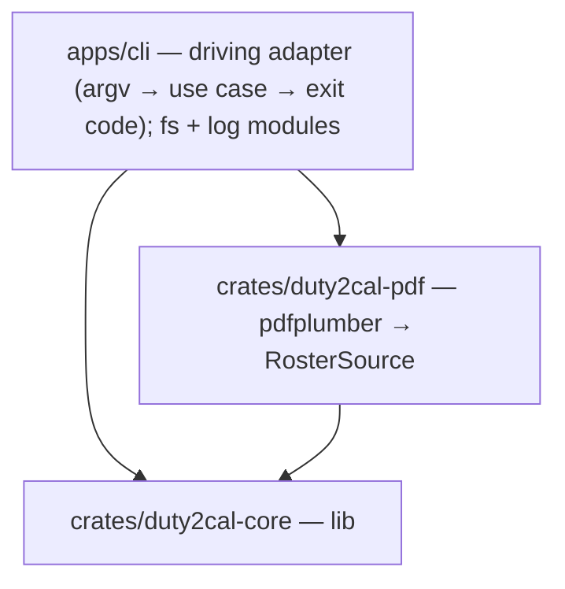

# 5. Building Block View

## Level 1 — System overview

| Building block | Responsibility |
|---|---|
| `apps/cli` (package `duty2cal`) | Parse the invocation, invoke the conversion, print the reported path or failure, set the exit status, publish files (fs module) and emit events (log module). |
| `crates/duty2cal-pdf` | The only crate that depends on `pdfplumber`; produces the `RawRosterTable` anti-corruption input. |
| `crates/duty2cal-core` | Pure domain, application ports + `ConvertRoster`, and the dependency-free ICS adapter. |

## Level 2 — Key building blocks

### `duty2cal-core` modules

**Responsibility:** everything that is host-independent and testable without I/O.

| Element | Responsibility |
|---|---|
| `domain` | `Roster` aggregate, value objects, and `merge_midnight_legs`, `classify_activity`, `derive_layover_days`. No I/O, no clock. |
| `application` | Ports (`RosterSource`, `CalendarSink`, `Clock`, `EventSubscriber`), the `ConvertRoster` use case, `RawRosterTable`, `DomainEvent`, and port fakes. |
| `adapters/ics` | RFC 5545 serializer — the `CalendarSink` used by every facade. |

### `duty2cal-pdf`

**Responsibility:** header detection → X bands → Y clustering → `RawRosterTable`; error mapping to a crate-local `SourceError` (the orphan rule forbids `From<pdfplumber::Error>`).

### `apps/cli`

**Responsibility:** composition root and native-only concerns.

| Element | Responsibility |
|---|---|
| `main` | argv handling, wiring, exit status. |
| `fs` | unused-path allocation for calendars and numbered diagnostics. |
| `log` | `EventSubscriber` printing to the terminal. |

### Deferred (roadmap)

`ffi/wasm` (Phase 2), `ffi/uniffi` (Phase 2), native UIs (Phase 3) — driving adapters over the unchanged application; not created in this change.
