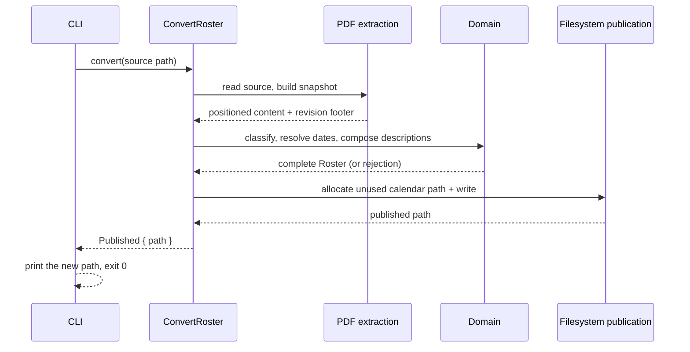
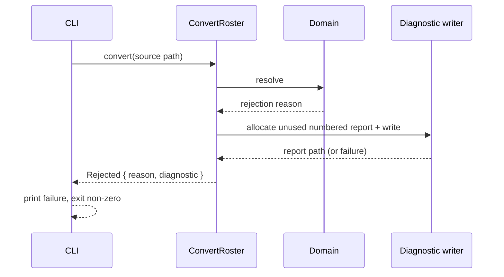
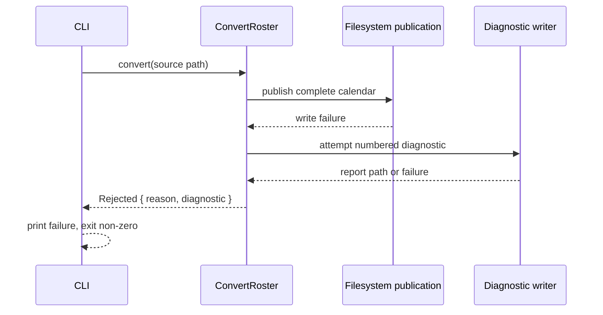
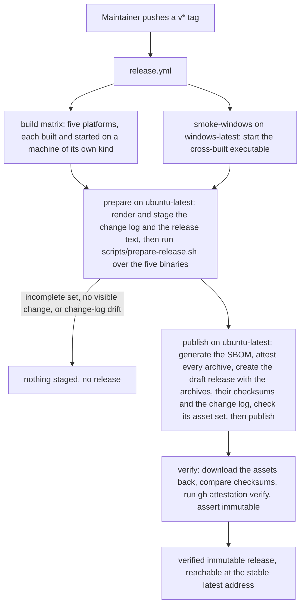
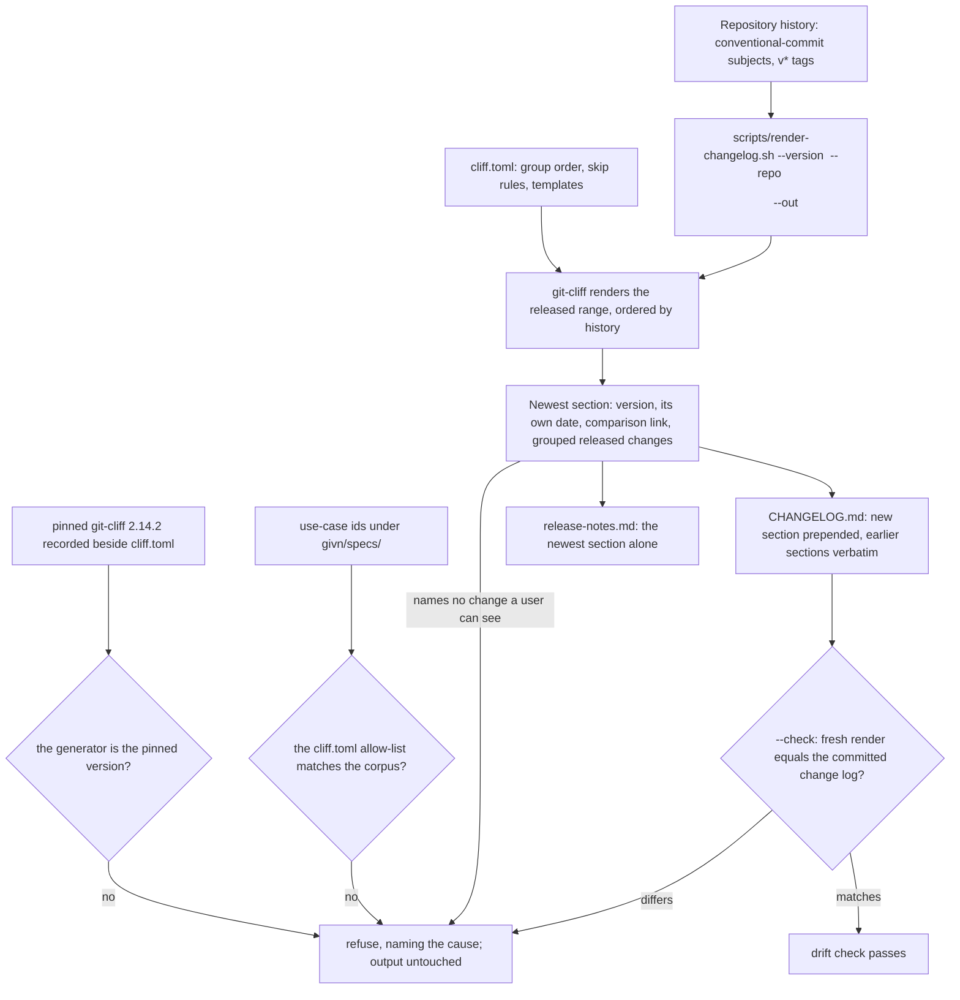
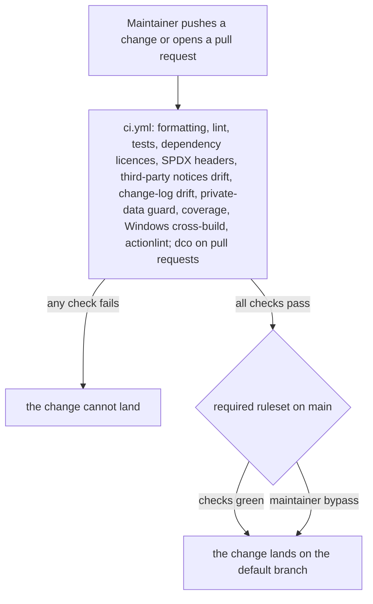

# 6. Runtime View

## Scenario: Successful conversion

**Trigger:** A crew member supplies a supported duty plan.

**Steps:**

1. The CLI reads the source path and calls the orchestrator.
2. The orchestrator recognizes the family, builds the source snapshot, and extracts positioned content and the revision footer.
3. The domain classifies activities, resolves each UTC endpoint's date, composes descriptions and events, and enforces completeness.
4. On completeness, the orchestrator asks the publication port for an unused calendar path and writes the calendar.
5. The CLI prints the actual new path and exits zero.

**Notes:** No side effect occurs before completeness; the source file is never modified.

## Scenario: Interpretation failure with a diagnostic

**Trigger:** A required activity, date, fragment, or source family cannot be resolved.

**Steps:**

1. The orchestrator reaches a rule that cannot be resolved.
2. It returns the primary reason and attempts a numbered diagnostic naming the source and reason.
3. The CLI prints the failure; when a report could not be saved, it states that no new report was written and never presents an older report as current.

**Notes:** Existing calendars and reports are unchanged. The diagnostic path is reported only after a successful write.

## Scenario: Publication failure

**Trigger:** Activities resolve, but the complete calendar cannot be written.

**Steps:**

1. The calendar is composed but cannot be published.
2. The orchestrator exposes the failure and independently attempts a diagnostic.
3. The CLI reports the failure and the diagnostic outcome; existing files are untouched.

**Notes:** Completeness and publication are distinct: a completed composition that fails to publish is not a success.

## Scenario: A version tag becomes a verified published release

**Trigger:** The maintainer decides a version is ready and pushes its `v*` tag.

**Steps:**

1. The tag starts `release.yml`; the build matrix builds and starts each platform's executable where it must run, and the Windows smoke job starts the cross-built executable on `windows-latest`.
2. The `prepare` job renders the change log and the release text (the newest section of that change log) and runs `scripts/prepare-release.sh` over the five binaries; it refuses and stages nothing when a supported platform is missing or unrecognised, when the render would name no change a user can see, or when the committed change log differs from the released revision.
3. The `publish` job generates the SBOM, attests every archive, creates a draft release with the archives, the release text and the change log, checks the draft's asset set against the staged set, and publishes it.
4. The `verify` job reads the published release back: it compares every checksum, runs `gh attestation verify` on each archive, and asserts the release reports `immutable: true`.

**Notes:** Publication cannot be undone, so every check that can precede publication does, and the one that cannot — reading the public record — fails the run loudly.

## Scenario: A version's section is rendered from the released history

**Trigger:** The maintainer generates the change log for a version.

**Steps:**

1. The version names a released revision; the renderer refuses a leading `v` or a version with no `v*` tag, because the section's date must be the released revision's own date and a version with no tag has none to take it from.
2. The pinned generator and the capability allow-list are checked before anything is rendered: a `git-cliff` whose version differs from the pinned one, or a `cliff.toml` allow-list that differs from the use-case ids under `givn/specs/`, refuses and leaves the output untouched.
3. The generator renders the released range — from the previous `v*` tag to the released revision, or the whole history for the first version — ordered by history, with each entry stating the release-note words its subject carries.
4. The section states the released revision's own date and the comparison against the previous version (none for the first), groups the changes a user can see (breaking changes, new capabilities, fixes, performance, reversals) and skips housekeeping, `test`, `build`, `ci` and every scope outside the allow-list. A render that names no change a user can see refuses the version as not releasable.
5. The change log is written with the new section prepended and every earlier section kept verbatim, and the release text is the newest section alone — one render, so the page and the repository cannot disagree. `--check` renders in memory and, on a committed file that differs, refuses and names the version whose section differs.

**Notes:** The render is deterministic: ordering is history order, the date is the released revision's own, and no working-directory path, user name or runner name enters the text, so the same history renders the same bytes on any machine.

## Scenario: A pushed change reaches the gated default branch

**Trigger:** A change is pushed, or a pull request is opened.

**Steps:**

1. Every push and pull request runs the project's checks; the pull-request-only `dco` job additionally checks sign-off over the commit range.
2. A change whose checks are not green cannot land: the default branch's ruleset requires the CI status checks and blocks force pushes and deletion.
3. The maintainer keeps an explicit bypass route for an urgent correction.

**Notes:** The gate is enforced by the repository, not by habit, and a reader sees the outcome on the revision they are looking at.
