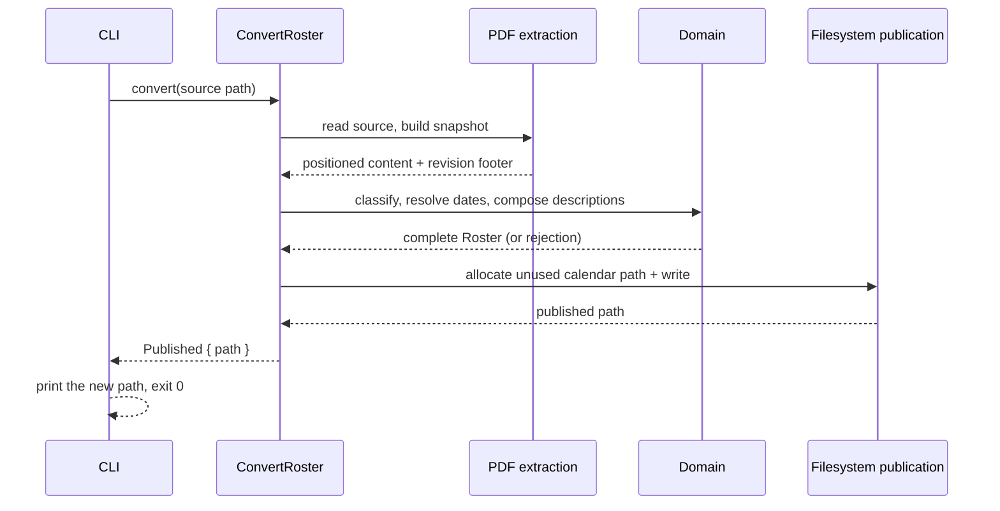
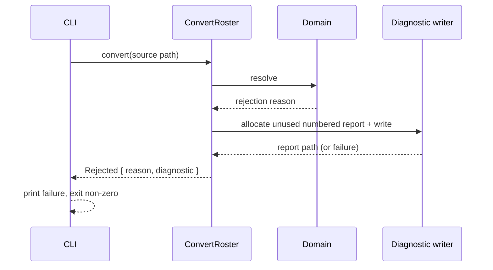
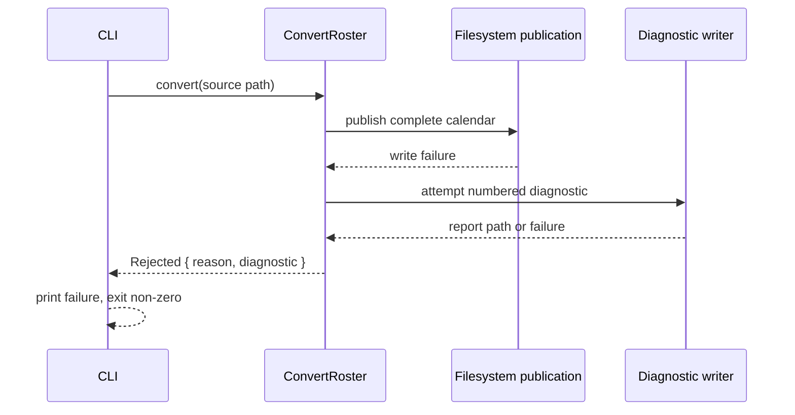
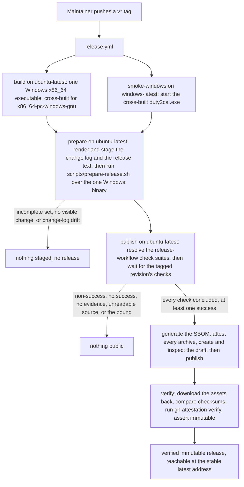
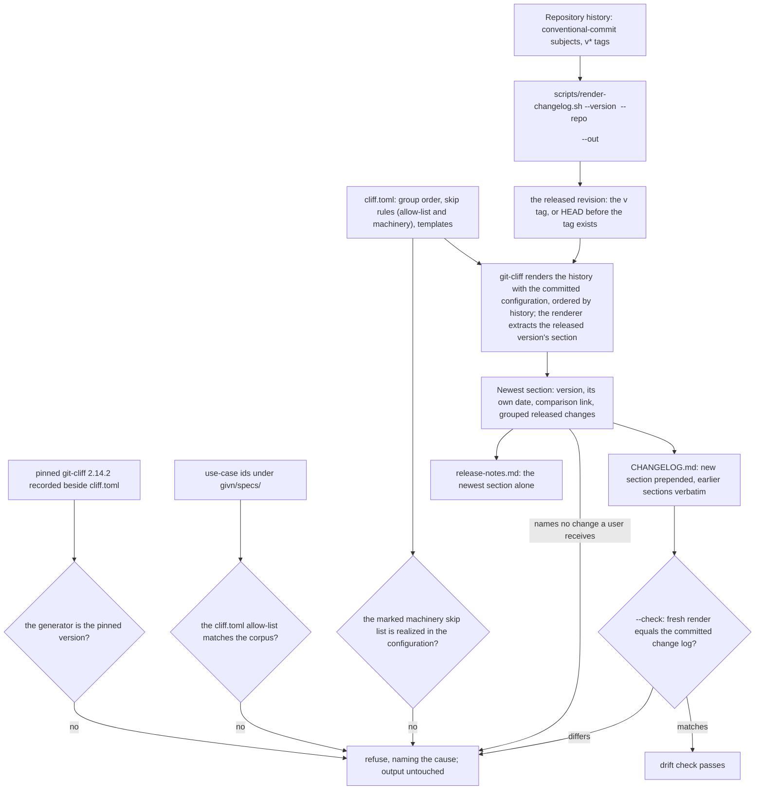
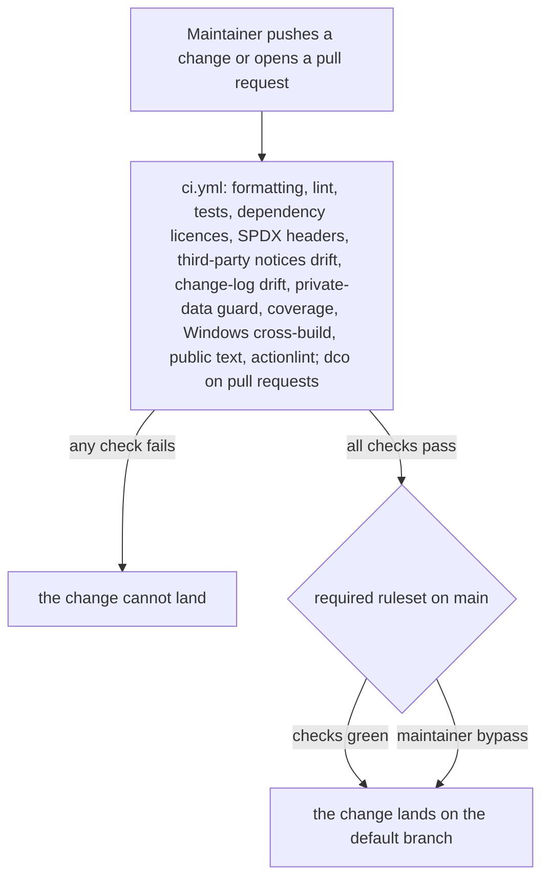

# 6. Runtime View

## Scenario: Successful conversion

**Trigger:** A crew member supplies a supported duty plan.

**Steps:**

1. The CLI reads the source path and calls the orchestrator.
2. The orchestrator recognizes the family, builds the source snapshot, and extracts positioned content and the revision footer.
3. The domain classifies activities, resolves each UTC endpoint's date, composes descriptions and events, and enforces completeness.
4. On completeness, the orchestrator asks the publication port for an unused calendar path and writes the calendar.
5. The CLI prints the actual new path and exits zero.

**Notes:** No side effect occurs before completeness; the source file is never modified.

## Scenario: Interpretation failure with a diagnostic

**Trigger:** A required activity, date, fragment, or source family cannot be resolved.

**Steps:**

1. The orchestrator reaches a rule that cannot be resolved.
2. It returns the primary reason and attempts a numbered diagnostic naming the source and reason.
3. The CLI prints the failure; when a report could not be saved, it states that no new report was written and never presents an older report as current.

**Notes:** Existing calendars and reports are unchanged. The diagnostic path is reported only after a successful write.

## Scenario: Publication failure

**Trigger:** Activities resolve, but the complete calendar cannot be written.

**Steps:**

1. The calendar is composed but cannot be published.
2. The orchestrator exposes the failure and independently attempts a diagnostic.
3. The CLI reports the failure and the diagnostic outcome; existing files are untouched.

**Notes:** Completeness and publication are distinct: a completed composition that fails to publish is not a success.

## Scenario: A version tag becomes a verified published release

**Trigger:** The maintainer decides a version is ready and pushes its `v*` tag.

**Steps:**

1. The tag starts `release.yml`; the build job cross-builds the one Windows x86_64 executable (`x86_64-pc-windows-gnu`) on `ubuntu-latest`, and the Windows smoke job starts that executable on `windows-latest`.
2. The `prepare` job installs the pinned generator, renders the change log and the release text (the newest section of that change log) and runs `scripts/prepare-release.sh` over the one Windows binary; it refuses and stages nothing when that executable is missing or unreadable, when an executable is presented for a platform outside the supported set (including a previously offered Linux or macOS target), when the render would name no change a user receives, or when the committed change log differs from the released revision.
3. The `publish` job resolves every check suite the release workflow created for the tagged revision and invokes `scripts/await-green-checks.sh`; the gate waits, bounded, for the remaining check runs to conclude. It refuses a concluded non-success, a set with no successful check, no check outside the release-workflow suites, an unreadable check-run source, or a check still running at the bound, naming the checks. Nothing later in the job runs on a refusal.
4. After the gate passes, the `publish` job generates the SBOM, attests the archive, creates a draft release with the Windows archive, the release text and the change log, checks the draft's asset set against the staged set, and publishes it.
5. The `verify` job reads the published release back: it compares the checksum, runs `gh attestation verify` on the archive, and asserts the release reports `immutable: true`.

**Notes:** Publication cannot be undone, so every check that can precede publication does, and the one that cannot — reading the public record — fails the run loudly.

## Scenario: A version's section is rendered from the released history

**Trigger:** The maintainer generates the change log for a version.

**Steps:**

1. The version names a released revision: the `v<version>` tag when it exists, and otherwise `HEAD`, the revision the tag will point at. The renderer refuses a leading `v`, and a repository with no `HEAD` to take the section's date from; the date it stamps is that revision's own committer date, never the clock, which is what lets a section be rendered before its tag exists.
2. The pinned generator, the capability allow-list, the machinery skip list and the list of paths a user receives are checked before anything is rendered: a `git-cliff` whose version differs from the pinned one, a `cliff.toml` allow-list that differs from the use-case ids under `givn/specs/`, a marked machinery skip list whose terms the configuration does not realize, or a listed user-receiving path the tree does not hold refuses and leaves the output untouched.
3. The generator renders the history — from the previous `v*` tag to the released revision, or the whole history for the first version — ordered by history, and the renderer extracts the released version's section from it, with each entry stating the release-note words its subject carries. A version that is not tagged yet is rendered with `--tag v<version>` for the newest release, which the generator cannot name otherwise.
4. The section states the released revision's own date and the comparison against the previous version (none for the first), groups the changes a user receives (breaking changes, new capabilities, fixes, performance, reversals, dependency updates) and skips housekeeping — except a dependency update that changed a path a user receives — `test`, `build`, `ci`, every scope outside the allow-list and every revision whose words name the project's own tooling. Each surviving entry is then resolved to its revision, and one whose revision changed none of the paths a user receives — the converter, its build inputs, and the packaging and release workflow that decide what an archive holds — is left out. A `### ` group heading whose next non-blank line is another heading or the section end is then pruned, so a group emptied by the path filter does not appear. A render that names no change a user receives refuses the version as not releasable.
5. The change log is written with the new section prepended and every earlier section kept verbatim, and the release text is the newest section alone — one render, so the page and the repository cannot disagree. `--check` renders in memory and, on a committed file that differs, refuses and names the version whose section differs.

**Notes:** The render is deterministic: ordering is history order, the date is the released revision's own, and no working-directory path, user name or runner name enters the text, so the same history renders the same bytes on any machine.

## Scenario: A pushed change reaches the gated default branch

**Trigger:** A change is pushed, or a pull request is opened.

**Steps:**

1. Every push and pull request runs the project's checks; the pull-request-only `dco` job additionally checks sign-off over the commit range.
2. A change whose checks are not green cannot land: the default branch's ruleset requires the CI status checks and blocks force pushes and deletion.
3. The maintainer keeps an explicit bypass route for an urgent correction.

**Notes:** The gate is enforced by the repository, not by habit, and a reader sees the outcome on the revision they are looking at.
