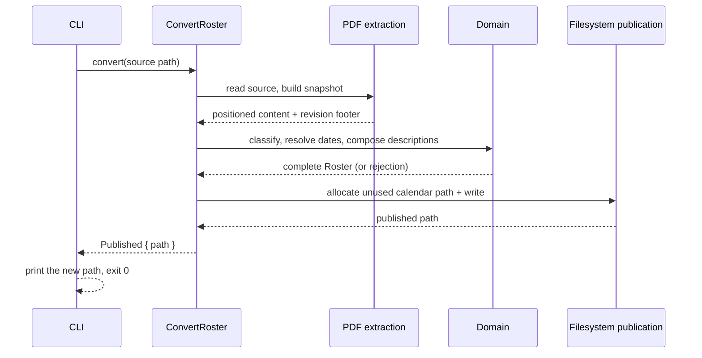
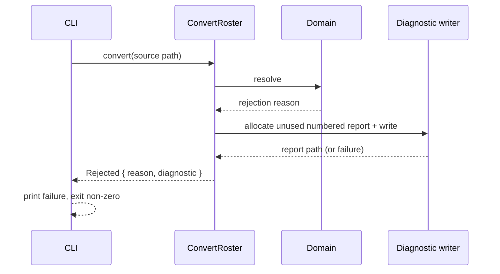
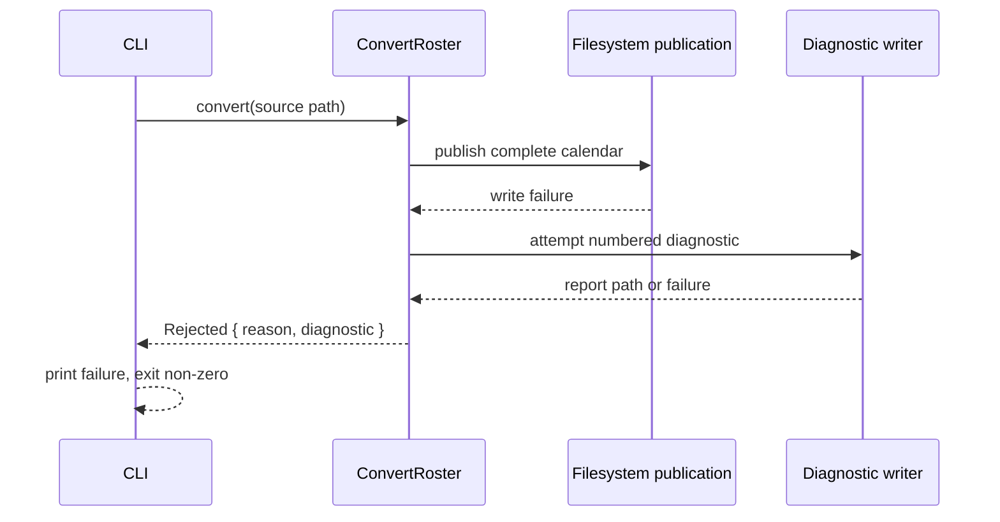

# 6. Runtime View

## Scenario: Successful conversion

**Trigger:** A crew member supplies a supported duty plan.

**Steps:**

1. The CLI reads the source path and calls the orchestrator.
2. The orchestrator recognizes the family, builds the source snapshot, and extracts positioned content and the revision footer.
3. The domain classifies activities, resolves each UTC endpoint's date, composes descriptions and events, and enforces completeness.
4. On completeness, the orchestrator asks the publication port for an unused calendar path and writes the calendar.
5. The CLI prints the actual new path and exits zero.

**Notes:** No side effect occurs before completeness; the source file is never modified.

## Scenario: Interpretation failure with a diagnostic

**Trigger:** A required activity, date, fragment, or source family cannot be resolved.

**Steps:**

1. The orchestrator reaches a rule that cannot be resolved.
2. It returns the primary reason and attempts a numbered diagnostic naming the source and reason.
3. The CLI prints the failure; when a report could not be saved, it states that no new report was written and never presents an older report as current.

**Notes:** Existing calendars and reports are unchanged. The diagnostic path is reported only after a successful write.

## Scenario: Publication failure

**Trigger:** Activities resolve, but the complete calendar cannot be written.

**Steps:**

1. The calendar is composed but cannot be published.
2. The orchestrator exposes the failure and independently attempts a diagnostic.
3. The CLI reports the failure and the diagnostic outcome; existing files are untouched.

**Notes:** Completeness and publication are distinct: a completed composition that fails to publish is not a success.
