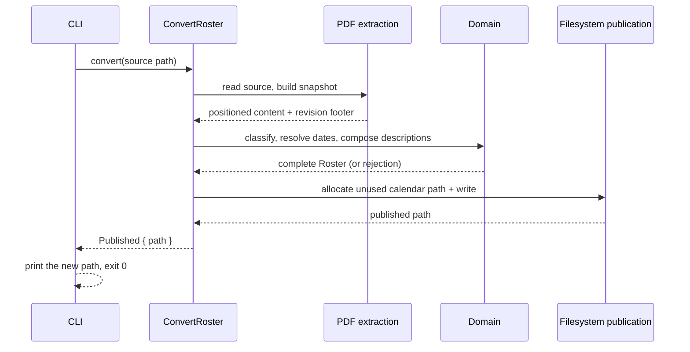
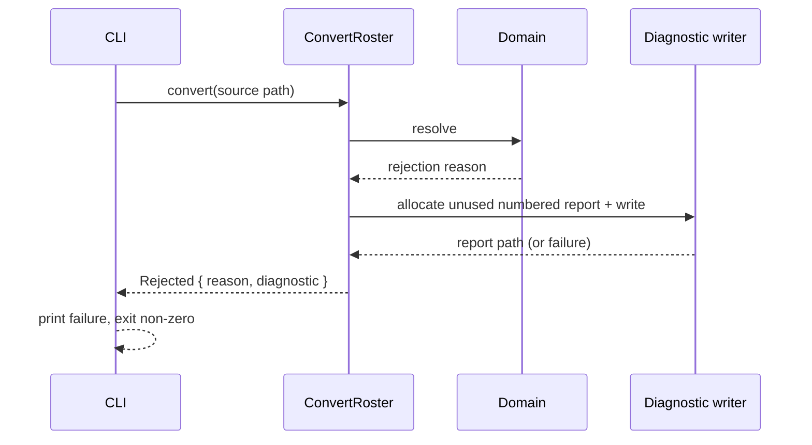
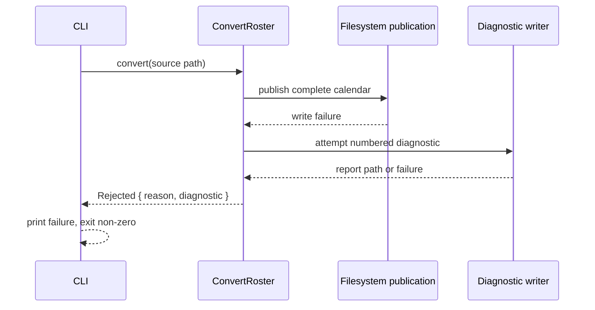
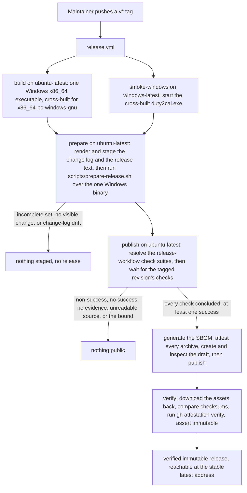
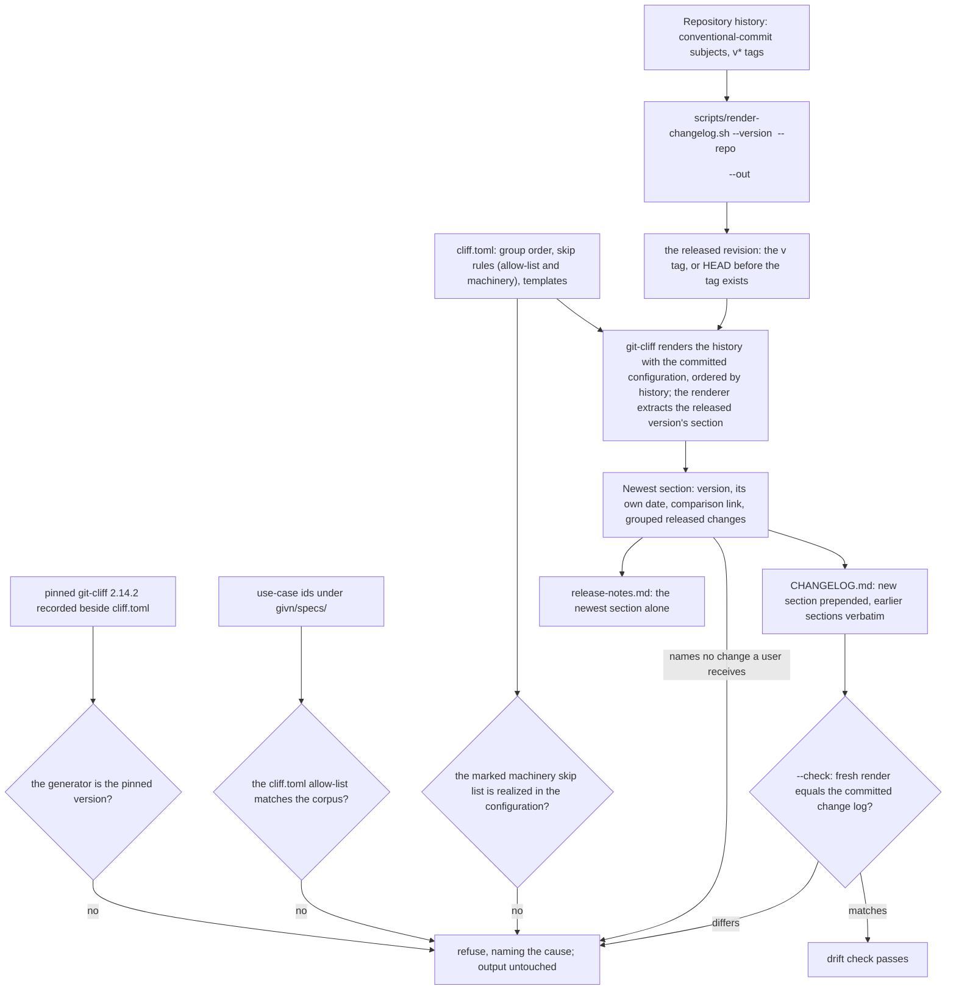
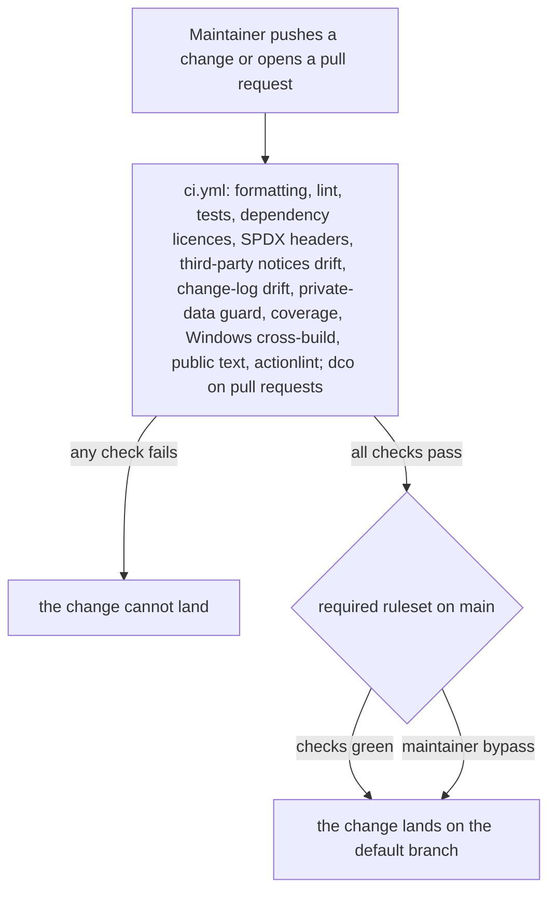
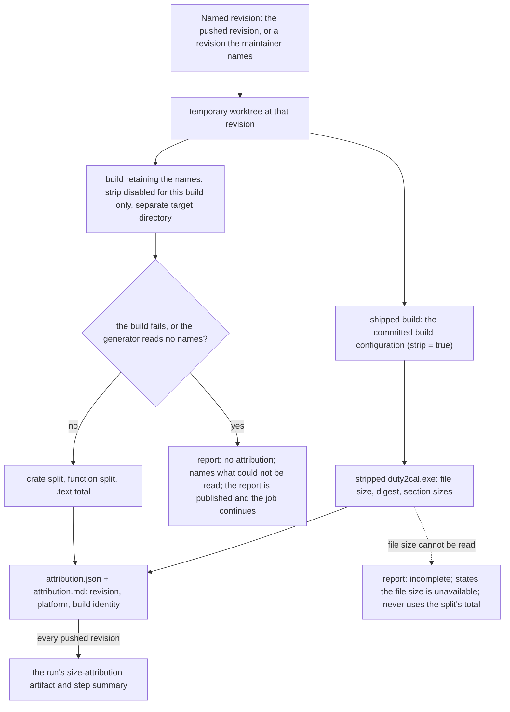
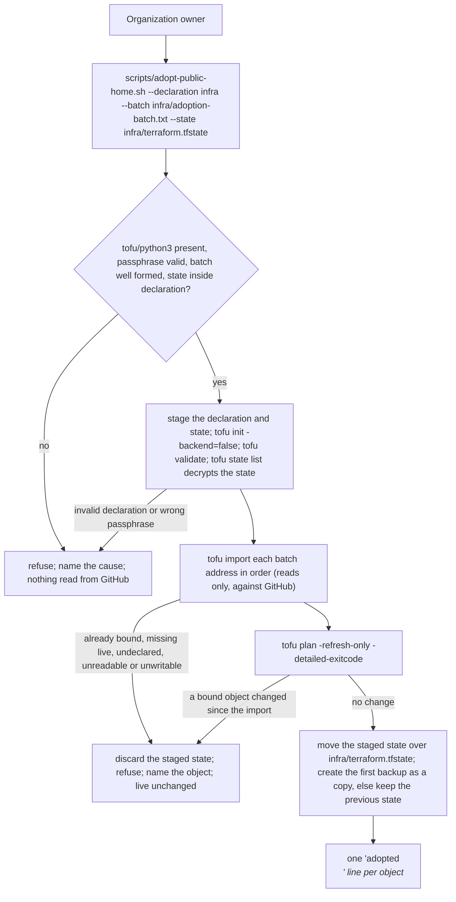
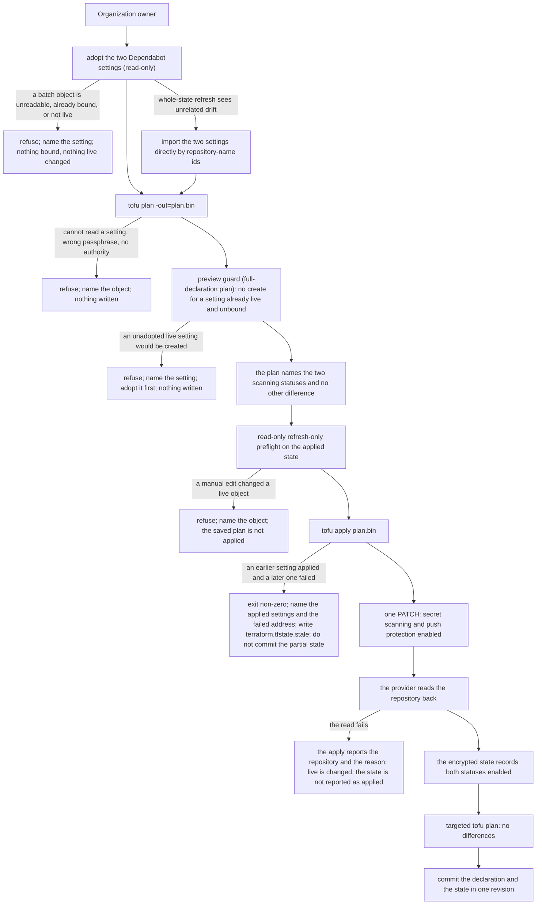
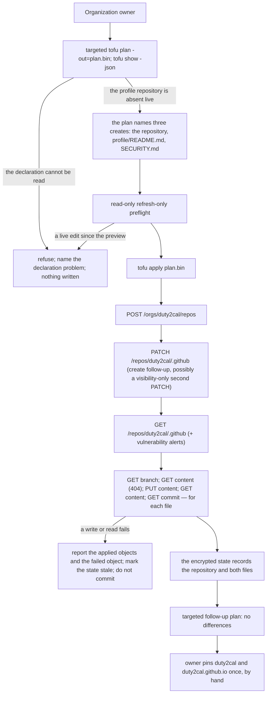

# 6. Runtime View

## Scenario: Successful conversion

**Trigger:** A crew member supplies a supported duty plan.

**Steps:**

1. The CLI reads the source path and calls the orchestrator.
2. The orchestrator recognizes the family, builds the source snapshot, and extracts positioned content and the revision footer.
3. The domain classifies activities, resolves each UTC endpoint's date, composes descriptions and events, and enforces completeness.
4. On completeness, the orchestrator asks the publication port for an unused calendar path and writes the calendar.
5. The CLI prints the actual new path and exits zero.

**Notes:** No side effect occurs before completeness; the source file is never modified.

## Scenario: Interpretation failure with a diagnostic

**Trigger:** A required activity, date, fragment, or source family cannot be resolved.

**Steps:**

1. The orchestrator reaches a rule that cannot be resolved.
2. It returns the primary reason and attempts a numbered diagnostic naming the source and reason.
3. The CLI prints the failure; when a report could not be saved, it states that no new report was written and never presents an older report as current.

**Notes:** Existing calendars and reports are unchanged. The diagnostic path is reported only after a successful write.

## Scenario: Publication failure

**Trigger:** Activities resolve, but the complete calendar cannot be written.

**Steps:**

1. The calendar is composed but cannot be published.
2. The orchestrator exposes the failure and independently attempts a diagnostic.
3. The CLI reports the failure and the diagnostic outcome; existing files are untouched.

**Notes:** Completeness and publication are distinct: a completed composition that fails to publish is not a success.

## Scenario: A version tag becomes a verified published release

**Trigger:** The maintainer decides a version is ready and pushes its `v*` tag.

**Steps:**

1. The tag starts `release.yml`; the build job cross-builds the one Windows x86_64 executable (`x86_64-pc-windows-gnu`) on `ubuntu-latest`, and the Windows smoke job starts that executable on `windows-latest`.
2. The `prepare` job installs the pinned generator, renders the change log and the release text (the newest section of that change log) and runs `scripts/prepare-release.sh` over the one Windows binary; it refuses and stages nothing when that executable is missing or unreadable, when an executable is presented for a platform outside the supported set (including a previously offered Linux or macOS target), when the render would name no change a user receives, or when the committed change log differs from the released revision.
3. The `publish` job resolves every check suite the release workflow created for the tagged revision and invokes `scripts/await-green-checks.sh`; the gate waits, bounded, for the remaining check runs to conclude. It refuses a concluded non-success, a set with no successful check, no check outside the release-workflow suites, an unreadable check-run source, or a check still running at the bound, naming the checks. Nothing later in the job runs on a refusal.
4. After the gate passes, the `publish` job generates the SBOM, attests the archive, creates a draft release with the Windows archive, the release text and the change log, checks the draft's asset set against the staged set, and publishes it.
5. The `verify` job reads the published release back: it compares the checksum, runs `gh attestation verify` on the archive, and asserts the release reports `immutable: true`.

**Notes:** Publication cannot be undone, so every check that can precede publication does, and the one that cannot — reading the public record — fails the run loudly.

## Scenario: A version's section is rendered from the released history

**Trigger:** The maintainer generates the change log for a version.

**Steps:**

1. The version names a released revision: the `v<version>` tag when it exists, and otherwise `HEAD`, the revision the tag will point at. The renderer refuses a leading `v`, and a repository with no `HEAD` to take the section's date from; the date it stamps is that revision's own committer date, never the clock, which is what lets a section be rendered before its tag exists.
2. The pinned generator, the capability allow-list, the machinery skip list and the list of paths a user receives are checked before anything is rendered: a `git-cliff` whose version differs from the pinned one, a `cliff.toml` allow-list that differs from the use-case ids under `givn/specs/`, a marked machinery skip list whose terms the configuration does not realize, or a listed user-receiving path the tree does not hold refuses and leaves the output untouched.
3. The generator renders the history — from the previous `v*` tag to the released revision, or the whole history for the first version — ordered by history, and the renderer extracts the released version's section from it, with each entry stating the release-note words its subject carries. A version that is not tagged yet is rendered with `--tag v<version>` for the newest release, which the generator cannot name otherwise.
4. The section states the released revision's own date and the comparison against the previous version (none for the first), groups the changes a user receives (breaking changes, new capabilities, fixes, performance, reversals, dependency updates) and skips housekeeping — except a dependency update that changed a path a user receives — `test`, `build`, `ci`, every scope outside the allow-list and every revision whose words name the project's own tooling. Each surviving entry is then resolved to its revision, and one whose revision changed none of the paths a user receives — the converter, its build inputs, and the packaging and release workflow that decide what an archive holds — is left out. A `### ` group heading whose next non-blank line is another heading or the section end is then pruned, so a group emptied by the path filter does not appear. A render that names no change a user receives refuses the version as not releasable.
5. The change log is written with the new section prepended and every earlier section kept verbatim, and the release text is the newest section alone — one render, so the page and the repository cannot disagree. `--check` renders in memory and, on a committed file that differs, refuses and names the version whose section differs.

**Notes:** The render is deterministic: ordering is history order, the date is the released revision's own, and no working-directory path, user name or runner name enters the text, so the same history renders the same bytes on any machine.

## Scenario: A pushed change reaches the gated default branch

**Trigger:** A change is pushed, or a pull request is opened.

**Steps:**

1. Every push and pull request runs the project's checks; the pull-request-only `dco` job additionally checks sign-off over the commit range.
2. A change whose checks are not green cannot land: the default branch's ruleset requires the CI status checks and blocks force pushes and deletion.
3. The maintainer keeps an explicit bypass route for an urgent correction.

**Notes:** The gate is enforced by the repository, not by habit, and a reader sees the outcome on the revision they are looking at.

## Scenario: A pushed revision gains a size attribution

**Trigger:** A revision is pushed or a pull request is opened; the release maintainer may request the same measurement for any named revision.

**Steps:**

1. The measurement resolves the named revision into a temporary worktree, so it never describes the working tree, and names the supported platform `x86_64-pc-windows-gnu`.
2. It builds the shipped artifact with the committed build configuration and reads that stripped executable's file size, digest and section sizes.
3. It builds the same revision again with `strip` disabled for that build only, in a separate target directory, and reads the crate split, the function split and that build's `.text` total.
4. It writes one report — a machine-readable file and a human rendering of the same data — naming the requested revision, the resolved revision, the platform and the build's identity, with the split and the stripped executable's file size kept as separate numbers.
5. The Windows cross-build job produces the report for the revision it built and publishes it beside that run; the release maintainer can run the same command for any named revision.

**Notes:** A failed build or a build that keeps no names yields no attribution and names what could not be read; the report is still written, appended to the step summary and uploaded, and the job continues — the measurement is evidence, not a gate. A stripped executable whose file size cannot be read leaves the attribution explicitly incomplete and never presents the split's total as the file size. No number is inferred from the release archive or from a host build, and the shipped build configuration is unchanged. Scenario "A pushed change reaches the gated default branch" still decides whether the revision lands; the attribution does not refuse a revision or a release.

## Scenario: The existing public home is adopted into the declared configuration

**Trigger:** The maintainer asks to adopt the selected batch of objects that already exist on GitHub.

**Steps:**

1. The command checks that `tofu` and `python3` exist, that the passphrase is present and at least 16 characters, that the batch is well formed, and that `--state` lies inside `--declaration`. Nothing is read from GitHub and nothing in the repository is written before these pass.
2. It copies the declaration into a staging workspace and the current encrypted state to that workspace's root `terraform.tfstate`, so `infra/` is untouched while the batch runs. It then runs `tofu init -backend=false` and `tofu validate` inside the staged copy — a fresh checkout has no `infra/.terraform/`, so init comes first. An invalid declaration discards the staging directory and names the declaration error.
3. `tofu state list` in the staged workspace proves the state decrypts before any import; a state encrypted with a different passphrase refuses here and names the applied state.
4. Each `address<TAB>import-id` line is imported in order. `tofu import` reads the live object; it creates, modifies and deletes nothing. An object already managed by the copied state, an import target the declaration does not name, a live object that does not exist, an object the token cannot read, or a state that cannot be written stops the batch: the staged state is discarded and the command refuses, naming the object and the reason.
5. A refresh-only plan over the staged state compares the imported objects with GitHub again; a non-no-op change means a live object changed after it was read, so the batch is refused and the object named. With no change, the staged state and the live objects agree.
6. The staged state is moved over `infra/terraform.tfstate`; on the first adoption `<state>.backup` is created as a copy of the new state, and on later runs the previous state is kept as the backup. The command prints one `adopted` line per object.

**Notes:** Adoption is read-only against GitHub by construction; the suite proves it from the fake API's request journal: a refused write or a GraphQL mutation would be the evidence of a write, while a query-only POST is a read. Every refusal step also asserts that the journal holds no unknown-path entry, so a refusal is never the fake's own missing fixture. The declaration revision is the repository commit, so the command never edits the declaration.

## Scenario: The declared security settings are previewed and applied

**Trigger:** The maintainer has declared the monorepo's security settings and
asks for a preview, then applies the previewed revision.

**Steps:**

1. Before anything else, a `terraform.tfstate.stale` marker is checked; while
   it exists the preview and the apply refuse and name the stale state. The two
   Dependabot settings are then adopted with the second batch: the existing
   adoption command binds them read-only, so they are not reported as
   creations. A refusal binds nothing. If that command refuses because its
   whole-state refresh sees a pre-existing drift elsewhere, the two settings
   are imported directly by their repository-name ids, which still satisfies
   adopt-before-create.
2. The targeted security preview reads the encrypted state, the declaration
   and the live configuration. On this declaration it names the two scanning
   statuses as the only live difference and proposes nothing to create or
   delete. A `create`
   for a setting that already exists live and is unbound is refused by address
   before any write. It writes nothing.
3. The previewed revision is saved to `plan.bin` (encrypted, git-ignored). A
   read-only `tofu plan -refresh-only -detailed-exitcode -json
   -target=github_repository.mono` immediately before the apply names a live
   edit made since the preview and refuses; its JSON report is authoritative,
   not its exit status. The scope is the previewed object, so the pre-existing
   organization billing drift outside it neither refuses the apply nor marks
   the state stale. With no change in the
   security scope, `tofu apply plan.bin`
   applies exactly the previewed plan.
4. The provider charges the declared change to GitHub with one repository
   `PATCH`, reading the repository back afterwards. Success enables both
   settings; the failed read is reported as a failure of the repository and the
   state does not claim the statuses.
5. The encrypted state records the enabled statuses; a second plan targeted to
   the security scope reports no differences, the plan file and the stale
   marker are removed, and the declaration and state are committed together.
   The full preview still names the pre-existing organization billing drift, a
   separate issue outside this change; the full configuration is not clean.

**Notes:** The suite drives steps 2–4 against the fake with a write sandbox and
asserts the journal's single applied write and its body keys; the live API's
acceptance of push protection is proven only by the operator's real apply,
which is a required step after GREEN. A partial failure is reported by resource
address, writes the stale marker beside the state, and the state is
deliberately not committed.

## Scenario: The organization profile is previewed, applied and published

**Trigger:** The maintainer has declared the organization profile repository and
its two reviewed files and asks for a preview, then applies the previewed
revision.

**Steps:**

1. The owner records the declaration revision that adds
   `github_repository.dot_github`, `github_repository_file.org_profile_readme`
   and `github_repository_file.org_security`; the two file contents are read
   from `org/` at plan time.
2. A `tofu plan -out=plan.bin` targeted at the profile repository and its two
   files reads the applied state and the live configuration. The profile
   repository does not exist and is not bound, so the preview names three
   creates and no update or delete; a declaration that cannot be read is
   refused. The preview writes nothing. The plan is targeted to the revision's
   scope — the three objects it adds — matching the sibling capability's
   preview rule. The apply `@e2e` scenario primes from the unchanged
   `security-applied` fixture, whose organization body carries
   `billing@example.test`. The preview `@e2e` scenario reuses the sibling's
   base priming, which introduces the known organization billing drift after
   its base apply; that drift is outside the three targets, so the targeted
   plan names no unrelated difference.
3. The read-only refresh-only preflight, targeted at the same three objects,
   compares them with live and refuses a manual edit by address; the saved plan
   is not applied.
4. `tofu apply plan.bin` creates the repository: `POST /orgs/duty2cal/repos`,
   the provider's create follow-up `PATCH`, and the repository read. The
   provider then creates `profile/README.md` and `SECURITY.md`: for each file
   it reads the repository and the `main` branch, reads the absent path,
   writes the reviewed content, and reads the file and its commit back. The two
   file creations are independent and may run concurrently.
5. The apply reports the three creations; the encrypted state records the
   repository and both files; a follow-up plan targeted at the three objects
   reports no differences. The
   profile repository is public, with its issue tracker, projects and wiki
   disabled, and GitHub now serves the profile page and the organization's
   default security policy from it.
6. Before the apply, the owner has enabled private vulnerability reporting on
   `duty2cal/duty2cal` by hand, because the published policy names its route and
   the provider cannot declare it. Once, after the apply, the owner pins
   `duty2cal` and `duty2cal.github.io` in the organization's web settings. No
   declaration, preview or drift check covers either step; chapter 7 records
   both.

**Notes:** The suite drives steps 2–5 against the fake in `--writes` mode and
asserts the API responses, the journal's applied-write set and the state; the
real GitHub acceptance and rendering are proven only by the operator's apply
after GREEN. The state is primed by adopting both existing batches and applying
the inherited pre-security base tree; that base apply performs the security
change's scanning write, and the scenario takes the journal offset after it, so
only the three profile creations are asserted. The apply scenario's base
omits `org_profile.tf` and copies `org/` beside its `infra/`; the preview
scenario reuses the sibling's base priming and writes its own 404 descriptors
before the targeted plan, which excludes the introduced billing drift.
A write failure after the repository creation is reported as a partial outcome
and the state is not committed; the stale marker rules are the shared
configuration-change rules, not re-asserted by this capability.

