# 6. Runtime View

> **Test-scope amendment (reduce-test-runtime).** The operational capability
> feature files remain as `@documentation`; their cucumber step definitions were
> deleted. Where this chapter names a scenario, a suite or a fake-API proof for
> an operational behaviour, the executable evidence is the owning workflow, the
> `bats` tests, or the maintainer's preview/apply. `scripts/setup-infra-tests.sh`
> covers only the provider/import/base setup. The product scenario suite is the
> conversion capability only.

## Scenario: Successful conversion

**Trigger:** A crew member supplies a supported duty plan.

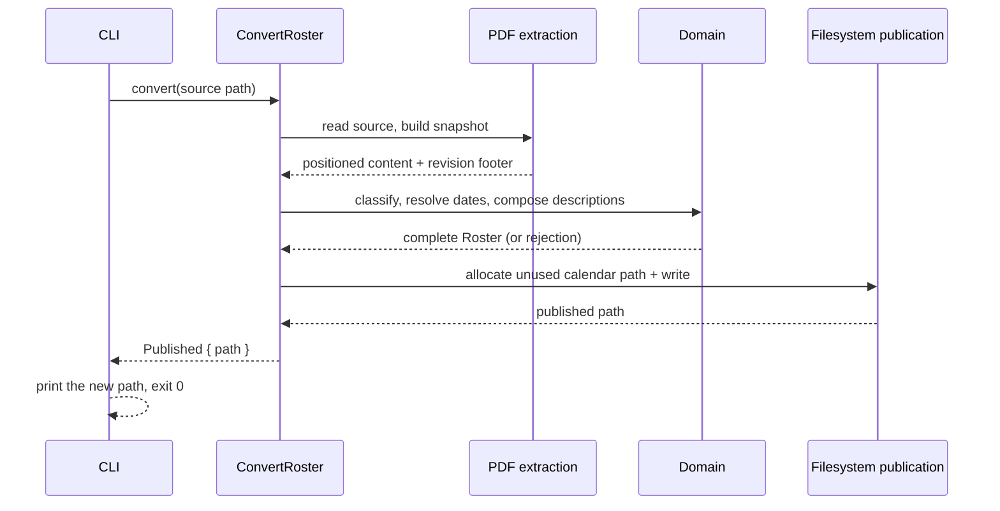

**Steps:**

1. The CLI reads the source path and calls the orchestrator.
2. The orchestrator recognizes the family, builds the source snapshot, and extracts positioned content and the revision footer.
3. The domain classifies activities, resolves each UTC endpoint's date, composes descriptions and events, and enforces completeness.
4. On completeness, the orchestrator asks the publication port for an unused calendar path and writes the calendar.
5. The CLI prints the actual new path and exits zero.

**Notes:** No side effect occurs before completeness; the source file is never modified.

## Scenario: Interpretation failure with a diagnostic

**Trigger:** A required activity, date, fragment, or source family cannot be resolved.

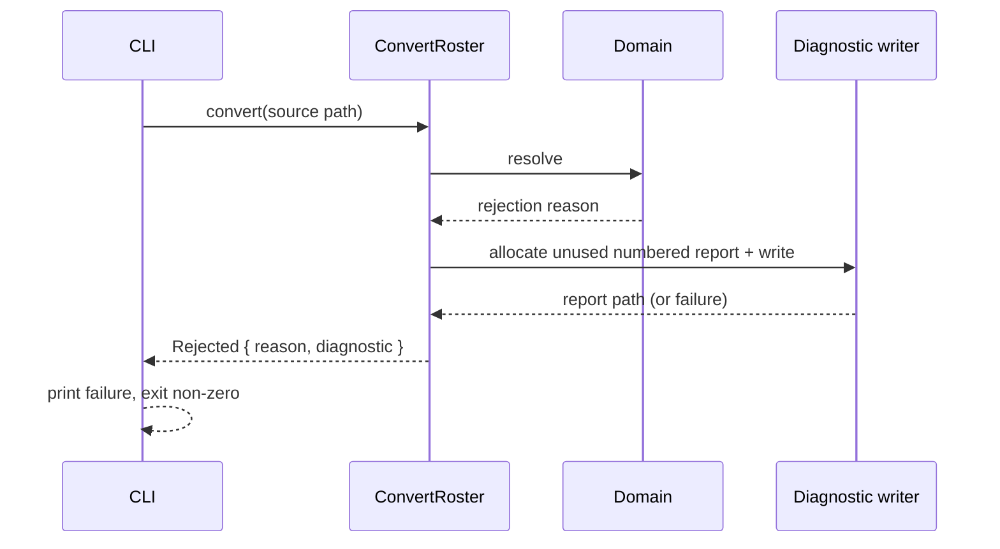

**Steps:**

1. The orchestrator reaches a rule that cannot be resolved.
2. It returns the primary reason and attempts a numbered diagnostic naming the source and reason.
3. The CLI prints the failure; when a report could not be saved, it states that no new report was written and never presents an older report as current.

**Notes:** Existing calendars and reports are unchanged. The diagnostic path is reported only after a successful write.

## Scenario: Publication failure

**Trigger:** Activities resolve, but the complete calendar cannot be written.

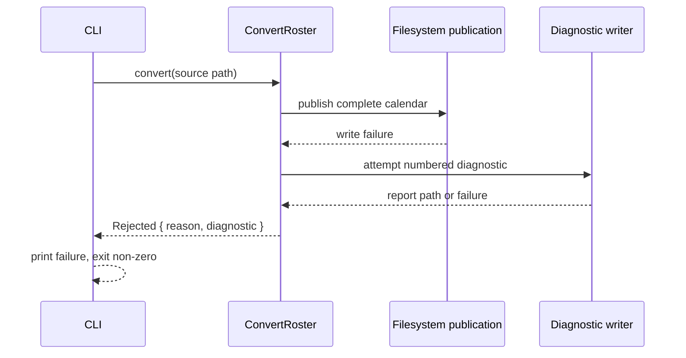

**Steps:**

1. The calendar is composed but cannot be published.
2. The orchestrator exposes the failure and independently attempts a diagnostic.
3. The CLI reports the failure and the diagnostic outcome; existing files are untouched.

**Notes:** Completeness and publication are distinct: a completed composition that fails to publish is not a success.

## Scenario: Browser conversion offers the calendar for a browser-owned save

**Trigger:** A crew member supplies a supported plan through the converter page.

```mermaid
sequenceDiagram
  participant Crew as Crew member
  participant Page as web/ page
  participant Wasm as ffi/wasm facade
  participant App as ConvertRoster
  participant Browser as Browser
  Crew->>Page: select or drop one PDF
  Page->>Page: clear prior offer/state
  Page->>Page: refuse >20 MiB, or read bytes
  Page->>Wasm: convert(filename, bytes)
  Wasm->>App: execute(bytes) with BrowserClock
  App-->>Wasm: complete calendar (or typed failure)
  Wasm-->>Page: {status:"ok", calendar}
  Page->>Browser: Blob + <a download="<stem>.ics">
  Browser-->>Crew: offered download; the browser saves
  Note over Page,Browser: the page writes nothing and claims no save
```

**Steps:**

1. The page clears any offer and status from the previous attempt, then refuses a file larger than 20 MiB by name before reading it.
2. The page reads the file in the tab and calls the facade with the filename and bytes. No request is made.
3. The facade runs the unchanged use case with the browser clock and returns the calendar text or a structured failure.
4. On success the page offers `<stem>.ics` through an object URL and an `<a download>`; the browser owns the save location and any collision, and the page never claims a save it did not observe.

**Notes:** A failed attempt withdraws an earlier offer because the attempt clears it first. The page sends no request to another origin after load and stores nothing persistent.

## Scenario: Browser failure offers the diagnostic

**Trigger:** A supported plan cannot be converted, or the page cannot create the calendar offer.

```mermaid
sequenceDiagram
  participant Crew as Crew member
  participant Page as web/ page
  participant Wasm as ffi/wasm facade
  Crew->>Page: plan selected or dropped
  Page->>Page: clear prior offer/state
  Page->>Wasm: convert(filename, bytes)
  Wasm-->>Page: failure reason (or a trap/abort is caught)
  Page->>Page: failure panel: heading, reason, no calendar
  Page->>Page: offer <stem>.parse-error.txt with the two-line diagnostic
  alt diagnostic offer throws
    Page->>Page: keep primary failure; state "No diagnostic was offered."
  end
  Page-->>Crew: visible reason and way to choose another plan
```

**Steps:**

1. The attempt clears any earlier offer, so a previously offered calendar is not left visible.
2. A conversion failure or a caught trap becomes a generic or specific failure; no partial calendar is offered.
3. The page attempts the diagnostic offer. If that offer cannot be created, the primary failure remains visible and the page says no diagnostic was offered.
4. The diagnostic content is read from the captured download, not fetched from the Blob under `connect-src 'none'`.

## Scenario: Browser capability or startup failure

**Trigger:** The page loads in a browser without WebAssembly or ES modules, or the module cannot initialize.

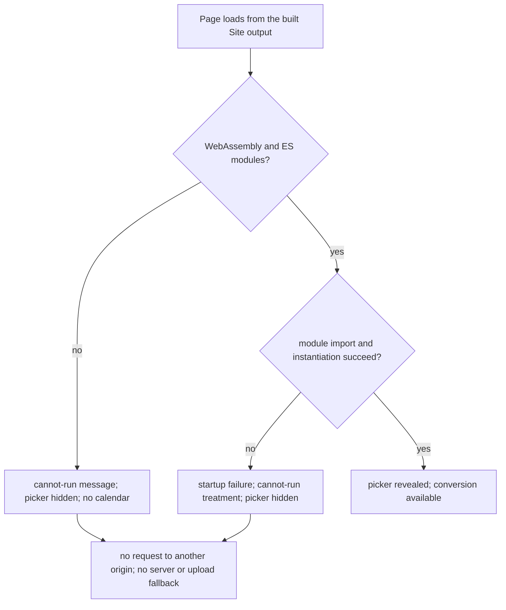

**Steps:**

1. The classic capability script checks WebAssembly, `WebAssembly.instantiate` and ES-module support before the ES module is used.
2. A missing capability renders the cannot-run message and leaves the picker hidden.
3. A module-load or instantiation failure renders the same treatment; the page never falls back to a server or an upload.
4. The failed states make no request to another origin.

## Scenario: The Site publication builds, gates and publishes the page

**Trigger:** A default-branch revision that changes the site's inputs, a release tag, or the maintainer running the publication command.

```mermaid
sequenceDiagram
  participant M as Release maintainer
  participant P as publish-site
  participant W as detached worktree
  participant G as site-evidence
  participant B as browser check
  participant T as Pages repository
  participant H as GitHub Pages
  M->>P: publish the site from a revision (and a base revision on a branch push)
  P->>P: git status --porcelain --untracked-files=no
  alt the caller's tree is unclean
    P-->>M: refused, naming the unclean revision
  else clean
    P->>P: diff base..revision against the site-input list
    alt the base is unknown
      P-->>M: refused, naming the base
    else no site input changed
      P-->>M: "no site input changed"; nothing built or written
    else a site input changed, or no base was supplied
      P->>P: resolve git describe and the commit
      alt the Built revision cannot be resolved
        P-->>M: refused, naming the revision
      else resolved
        P->>W: git worktree add --detach at that commit
        alt the worktree cannot be created
          P-->>M: refused, naming the worktree
        else the revision's tree is checked out
          W->>W: build-web.sh, then build-site.sh (stamp the footer, copy the licence)
          alt the build fails
            P-->>M: refused, naming the build step
          else dist/site is assembled
            P->>G: evaluate the evidence inside the worktree
            G->>G: page content, then licensing
            G->>B: drive the assembled page in Chromium
            B->>B: convert, and record every request after load
            alt any check fails
              G-->>M: refused, naming the failed check
            else every check passed
              G->>G: run the conversion suite
              G-->>P: accepted
              P->>T: compare the target's branch tip with the output
              alt the target already holds this output
                P-->>M: "target is current"; nothing written
              else the content differs
                P->>T: one commit whose tree is the Site output, pushed fast-forward
                P->>T: read the pushed tree back
                P->>H: fetch the --verify-url address with bounded retries
                alt the served page does not name the Built revision
                  P-->>M: refused, naming the address and the served revision
                else the served page names the Built revision
                  P-->>M: report the Built revision
                end
              end
              P->>W: remove the worktree
            end
          end
        end
      end
    end
  end
```

**Steps:**

1. The command first refuses an unclean caller tree
   (`git status --porcelain --untracked-files=no`), because the publication
   would otherwise look as if it shipped the maintainer's uncommitted edits; it
   names the revision. Untracked files are excluded deliberately: the commit's
   tree is the Site output, so an untracked build output or scratch file cannot
   reach the published page, while a change to a tracked file can.
2. A default-branch publication compares the supplied base revision with the
   publication revision against the site-input list it owns; an empty
   intersection reports `no site input changed` and writes nothing, and an
   unresolvable base is refused rather than read as "no change". A tag
   publication supplies no base and always continues.
3. The Built revision is resolved next, and the revision's own tree is checked
   out into a detached worktree; every later step runs there, so a tag
   publication publishes the tagged tree even when the default branch is newer,
   and the footer's string and the assembled content describe one commit.
4. The assembled output is the artifact the gate inspects and the artifact the
   commit carries; nothing is rebuilt between the check and the push, and the
   gate's conversion suite is the revision's own.
5. The checks run fail-fast in the order page content, licensing, browser
   check, conversion suite; the first failure ends the publication, names the
   check and leaves the target untouched. The worktree is removed on every exit
   path, including a refusal.
6. Before writing, the command compares the target branch's content with the
   output. When the target already holds it, the publication reports that the
   target is current and exits 0 without a commit, so a repeated or retried run
   adds nothing to the target's history.
7. The replacement is one commit with a single parent, so the pages rule set's
   linear-history and non-fast-forward rules admit it, and the previous pages
   remain in the target's history.
8. The command reads the pushed tree back, then fetches the required
   `--verify-url` address with bounded retries. The publication succeeds only
   when the served page carries the same Built revision text as the output; when
   it does not, or the address never answers within the bound, the publication
   refuses and names the address and the served revision. The check runs after
   the replacement, so a serving refusal leaves the new page in the target
   instead of restoring the previous one.

## Scenario: A release publishes the site before its archive

**Trigger:** The maintainer publishes a version whose tag is pushed.

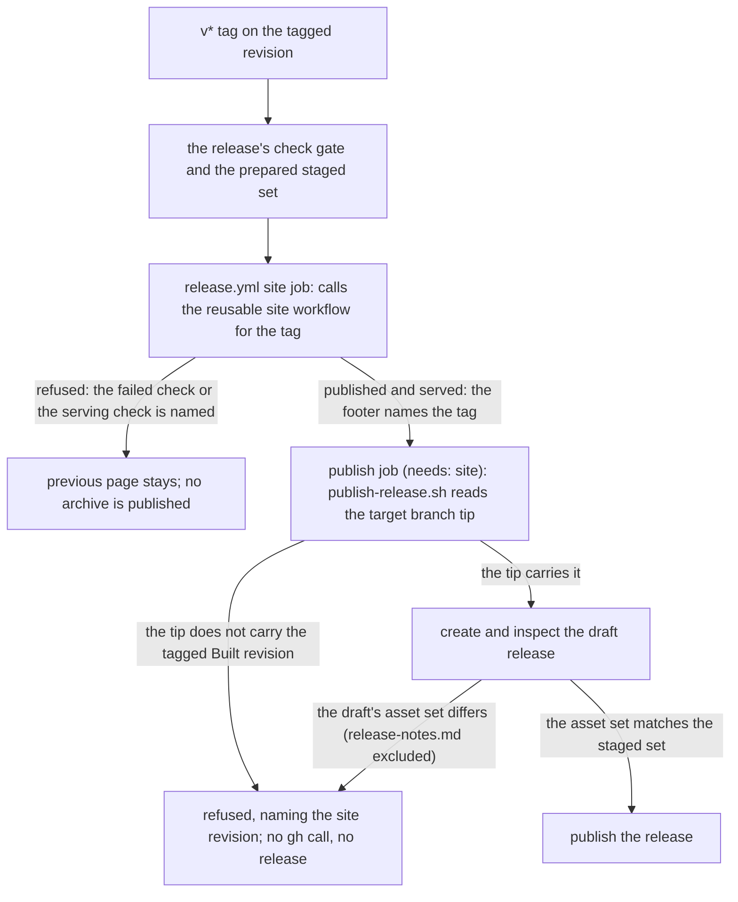

**Steps:**

1. The release's `site` job calls the reusable site workflow with the tag as
   its revision and no `since`; the site is built, gated, published and its
   serving verified there. A refusal ends the release with the failed check
   named and publishes no archive; the previous page stays.
2. Only after that job succeeds does the `publish` job (`needs: site`) run
   `scripts/publish-release.sh`, which reads the hosting target's branch tip
   with `git ls-remote` and a fetch. When the tip does not carry the tagged
   Built revision the command refuses before any `gh` call, naming the site
   revision, and no release is published.
3. When the tip carries the tagged Built revision, the command creates the
   draft release, compares its asset set with the staged set while excluding
   `release-notes.md`, and publishes it.
4. The site's footer names the tag, because the tag itself is the revision the
   site was built from, and the target verification is what makes the release
   notes' announcement of the site true.

## Scenario: A version tag becomes a verified published release

**Trigger:** The maintainer decides a version is ready and pushes its `v*` tag.

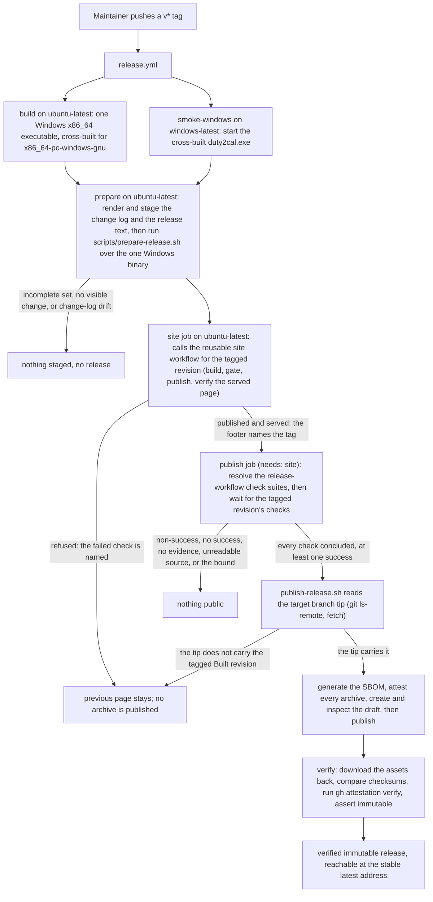

**Steps:**

1. The tag starts `release.yml`; the build job cross-builds the one Windows x86_64 executable (`x86_64-pc-windows-gnu`) on `ubuntu-latest`, and the Windows smoke job starts that executable on `windows-latest`.
2. The `prepare` job installs the pinned generator, renders the change log and the release text (the newest section of that change log) and runs `scripts/prepare-release.sh` over the one Windows binary; it refuses and stages nothing when that executable is missing or unreadable, when an executable is presented for a platform outside the supported set (including a previously offered Linux or macOS target), when the render would name no change a user receives, or when the committed change log differs from the released revision.
3. The `site` job calls the reusable site workflow for the tagged revision (no `since`, `fetch-depth: 0`); the site is built, gated, published and its serving verified there. A refusal ends the release here, publishes no archive and leaves the previous page.
4. The `publish` job (`needs: site`) resolves every check suite the release workflow created for the tagged revision and invokes `scripts/await-green-checks.sh`; the gate waits, bounded, for the remaining check runs to conclude. It refuses a concluded non-success, a set with no successful check, no check outside the release-workflow suites, an unreadable check-run source, or a check still running at the bound, naming the checks. Nothing later in the job runs on a refusal.
5. The `publish` job runs `scripts/publish-release.sh`, which first reads the hosting target's branch tip with `git ls-remote` and a fetch. When the tip does not carry the tagged Built revision the command refuses before any `gh` call, naming the site revision, so a release never announces a page the target lacks.
6. When the tip carries the tagged Built revision, the command creates a draft release with the Windows archive, the release text and the change log, checks the draft's asset set against the staged set while excluding `release-notes.md`, and publishes it.
7. The `verify` job reads the published release back: it compares the checksum, runs `gh attestation verify` on the archive, and asserts the release reports `immutable: true`.

**Notes:** Publication cannot be undone, so every check that can precede publication does, and the one that cannot — reading the public record — fails the run loudly.

## Scenario: A version's section is rendered from the released history

**Trigger:** The maintainer generates the change log for a version.

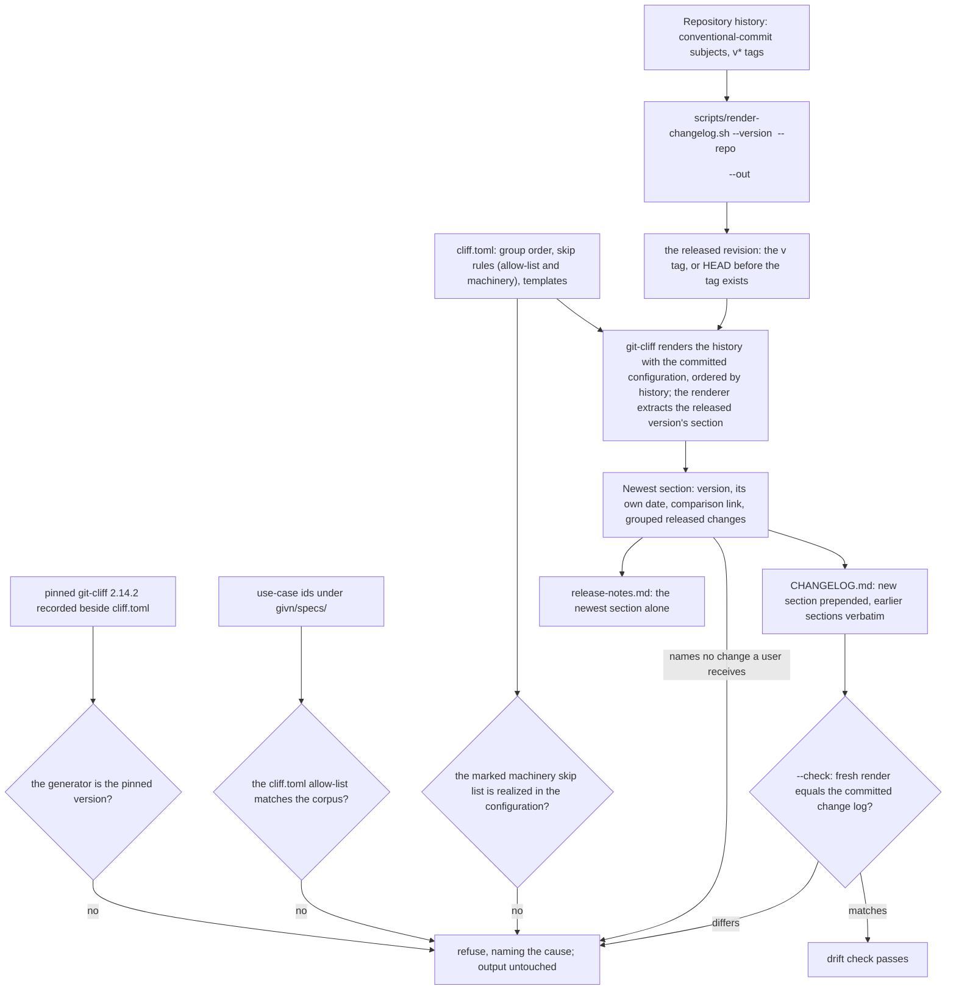

**Steps:**

1. The version names a released revision: the `v<version>` tag when it exists, and otherwise `HEAD`, the revision the tag will point at. The renderer refuses a leading `v`, and a repository with no `HEAD` to take the section's date from; the date it stamps is that revision's own committer date, never the clock, which is what lets a section be rendered before its tag exists.
2. The pinned generator, the capability allow-list, the machinery skip list and the list of paths a user receives are checked before anything is rendered: a `git-cliff` whose version differs from the pinned one, a `cliff.toml` allow-list that differs from the use-case ids under `givn/specs/`, a marked machinery skip list whose terms the configuration does not realize, or a listed user-receiving path the tree does not hold refuses and leaves the output untouched.
3. The generator renders the history — from the previous `v*` tag to the released revision, or the whole history for the first version — ordered by history, and the renderer extracts the released version's section from it, with each entry stating the release-note words its subject carries. A version that is not tagged yet is rendered with `--tag v<version>` for the newest release, which the generator cannot name otherwise.
4. The section states the released revision's own date and the comparison against the previous version (none for the first), groups the changes a user receives (breaking changes, new capabilities, fixes, performance, reversals, dependency updates) and skips housekeeping — except a dependency update that changed a path a user receives — `test`, `build`, `ci`, every scope outside the allow-list and every revision whose words name the project's own tooling. Each surviving entry is then resolved to its revision, and one whose revision changed none of the paths a user receives — the converter, its build inputs, and the packaging and release workflow that decide what an archive holds — is left out. A `### ` group heading whose next non-blank line is another heading or the section end is then pruned, so a group emptied by the path filter does not appear. A render that names no change a user receives refuses the version as not releasable.
5. The change log is written with the new section prepended and every earlier section kept verbatim, and the release text is the newest section alone — one render, so the page and the repository cannot disagree. `--check` renders in memory and, on a committed file that differs, refuses and names the version whose section differs.

**Notes:** The render is deterministic: ordering is history order, the date is the released revision's own, and no working-directory path, user name or runner name enters the text, so the same history renders the same bytes on any machine.

## Scenario: A pushed change reaches the gated default branch

**Trigger:** A change is pushed, or a pull request is opened.

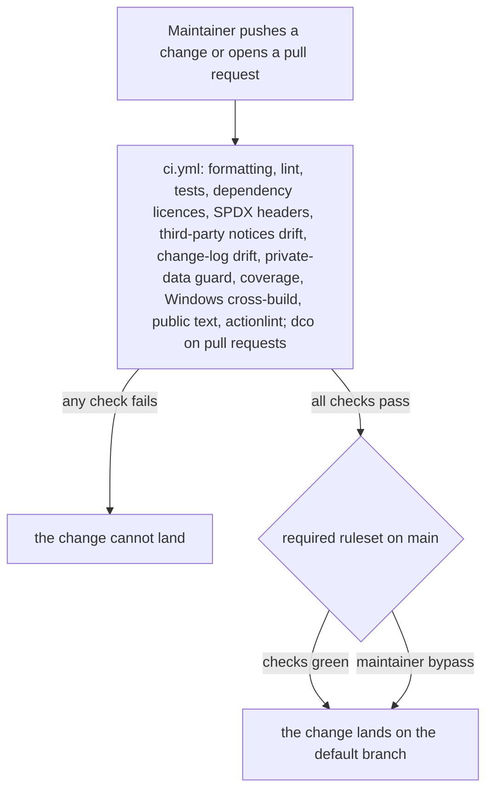

**Steps:**

1. Every push and pull request runs the project's checks; the pull-request-only `dco` job additionally checks sign-off over the commit range.
2. A change whose checks are not green cannot land: the default branch's ruleset requires the CI status checks and blocks force pushes and deletion.
3. The maintainer keeps an explicit bypass route for an urgent correction.

**Notes:** The gate is enforced by the repository, not by habit, and a reader sees the outcome on the revision they are looking at.

## Scenario: A pushed revision gains a size attribution

**Trigger:** A revision is pushed or a pull request is opened; the release maintainer may request the same measurement for any named revision.

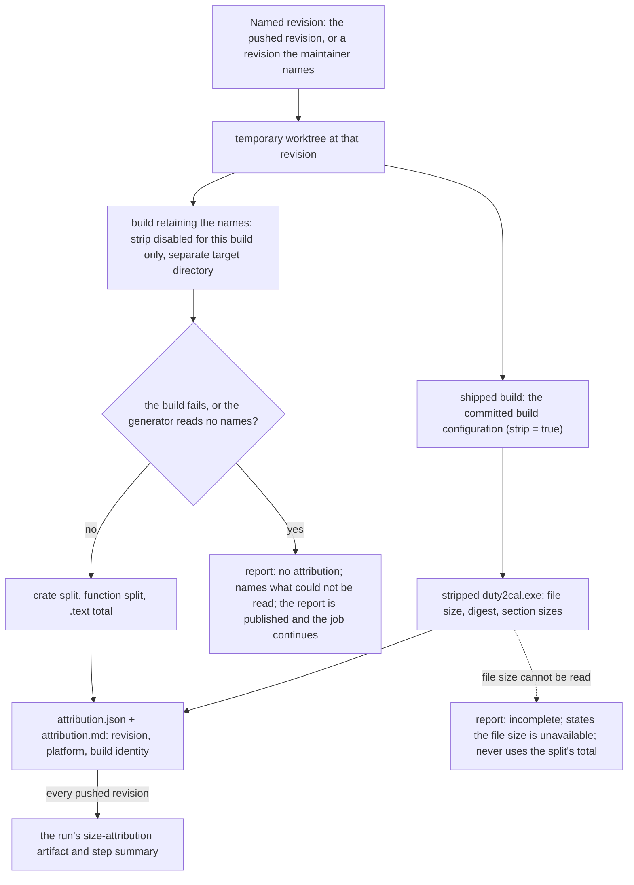

**Steps:**

1. The measurement resolves the named revision into a temporary worktree, so it never describes the working tree, and names the supported platform `x86_64-pc-windows-gnu`.
2. It builds the shipped artifact with the committed build configuration and reads that stripped executable's file size, digest and section sizes.
3. It builds the same revision again with `strip` disabled for that build only, in a separate target directory, and reads the crate split, the function split and that build's `.text` total.
4. It writes one report — a machine-readable file and a human rendering of the same data — naming the requested revision, the resolved revision, the platform and the build's identity, with the split and the stripped executable's file size kept as separate numbers.
5. The Windows cross-build job produces the report for the revision it built and publishes it beside that run; the release maintainer can run the same command for any named revision.

**Notes:** A failed build or a build that keeps no names yields no attribution and names what could not be read; the report is still written, appended to the step summary and uploaded, and the job continues — the measurement is evidence, not a gate. A stripped executable whose file size cannot be read leaves the attribution explicitly incomplete and never presents the split's total as the file size. No number is inferred from the release archive or from a host build, and the shipped build configuration is unchanged. Scenario "A pushed change reaches the gated default branch" still decides whether the revision lands; the attribution does not refuse a revision or a release.

## Scenario: A size lever is measured and landed

**Trigger:** The release maintainer selects one stable lever the size attribution justifies.

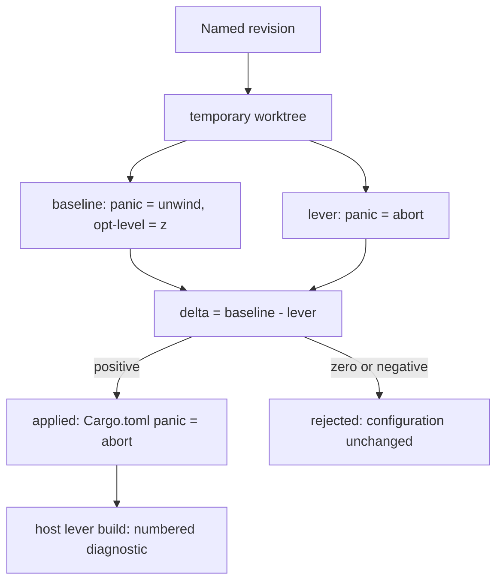

**Steps:**

1. The command refuses a nightly-only, UPX or dynamic-linking proposal before any build, naming the violated constraint.
2. It resolves the revision into a worktree and rebuilds the unchanged configuration as the baseline; the published binary's size is reported separately and never used as the baseline.
3. It builds each candidate lever cumulatively against the configuration carrying the previously accepted levers; a positive delta is applied, a zero or negative delta is rejected and the configuration stays.
4. The landed `panic = "abort"` build is smaller by the recorded delta: 2,014,208 B against a 2,098,176 B rebuild on the release branch. A panic aborts with the standard Rust panic message; an unsupported source still writes a numbered diagnostic naming the source and reason.

## Scenario: The existing public home is adopted into the declared configuration

**Trigger:** The maintainer asks to adopt the selected batch of objects that already exist on GitHub.

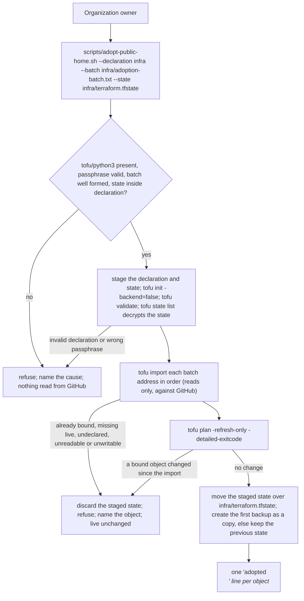

**Steps:**

1. The command checks that `tofu` and `python3` exist, that the passphrase is present and at least 16 characters, that the batch is well formed, and that `--state` lies inside `--declaration`. Nothing is read from GitHub and nothing in the repository is written before these pass.
2. It copies the declaration into a staging workspace and the current encrypted state to that workspace's root `terraform.tfstate`, so `infra/` is untouched while the batch runs. It then runs `tofu init -backend=false` and `tofu validate` inside the staged copy — a fresh checkout has no `infra/.terraform/`, so init comes first. An invalid declaration discards the staging directory and names the declaration error.
3. `tofu state list` in the staged workspace proves the state decrypts before any import; a state encrypted with a different passphrase refuses here and names the applied state.
4. Each `address<TAB>import-id` line is imported in order. `tofu import` reads the live object; it creates, modifies and deletes nothing. An object already managed by the copied state, an import target the declaration does not name, a live object that does not exist, an object the token cannot read, or a state that cannot be written stops the batch: the staged state is discarded and the command refuses, naming the object and the reason.
5. A refresh-only plan over the staged state compares the imported objects with GitHub again; a non-no-op change means a live object changed after it was read, so the batch is refused and the object named. With no change, the staged state and the live objects agree.
6. The staged state is moved over `infra/terraform.tfstate`; on the first adoption `<state>.backup` is created as a copy of the new state, and on later runs the previous state is kept as the backup. The command prints one `adopted` line per object.

**Notes:** Adoption is read-only against GitHub by construction. The feature file documents the proof the deleted cucumber suite performed; `scripts/setup-infra-tests.sh` exercises the provider's import and refresh-only shape against the fake, not the adoption command itself. The maintainer's real adoption is the operational evidence, and R-067 records that no automated scenario drives it. The declaration revision is the repository commit, so the command never edits the declaration.

## Scenario: The declared security settings are previewed and applied

**Trigger:** The maintainer has declared the monorepo's security settings and
asks for a preview, then applies the previewed revision.

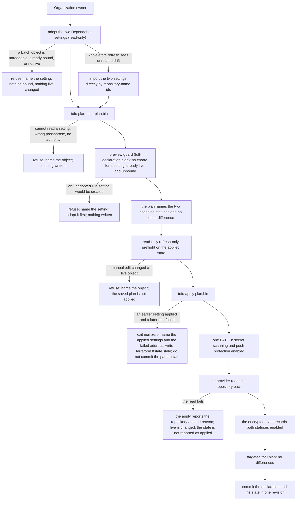

**Steps:**

1. Before anything else, a `terraform.tfstate.stale` marker is checked; while
   it exists the preview and the apply refuse and name the stale state. The two
   Dependabot settings are then adopted with the second batch: the existing
   adoption command binds them read-only, so they are not reported as
   creations. A refusal binds nothing. If that command refuses because its
   whole-state refresh sees a pre-existing drift elsewhere, the two settings
   are imported directly by their repository-name ids, which still satisfies
   adopt-before-create.
2. The targeted security preview reads the encrypted state, the declaration
   and the live configuration. On this declaration it names the two scanning
   statuses as the only live difference and proposes nothing to create or
   delete. A `create`
   for a setting that already exists live and is unbound is refused by address
   before any write. It writes nothing.
3. The previewed revision is saved to `plan.bin` (encrypted, git-ignored). A
   read-only `tofu plan -refresh-only -detailed-exitcode -json
   -target=github_repository.mono` immediately before the apply names a live
   edit made since the preview and refuses; its JSON report is authoritative,
   not its exit status. The scope is the previewed object, so the pre-existing
   organization billing drift outside it neither refuses the apply nor marks
   the state stale. With no change in the
   security scope, `tofu apply plan.bin`
   applies exactly the previewed plan.
4. The provider charges the declared change to GitHub with one repository
   `PATCH`, reading the repository back afterwards. Success enables both
   settings; the failed read is reported as a failure of the repository and the
   state does not claim the statuses.
5. The encrypted state records the enabled statuses; a second plan targeted to
   the security scope reports no differences, the plan file is removed, and the
   declaration and state are committed together.
   The full preview still names the pre-existing organization billing drift, a
   separate issue outside this change; the full configuration is not clean.

**Notes:** The feature file documents this flow; no cucumber scenario drives it after this change. `scripts/setup-infra-tests.sh` prepares a security-applied base state against the fake, but it does not drive the targeted preview or apply. The maintainer's real preview and apply are the operational evidence, and the live API's acceptance of push protection is proven only by that apply. A partial failure is reported by resource address, writes the stale marker beside the state, and the state is deliberately not committed (R-067).

## Scenario: The pages publishing plumbing is previewed and created

**Trigger:** The maintainer has declared the pages deploy key, the
`PAGES_DEPLOY_KEY` secret and the pages protection rule set, and asks for a
preview, then applies the previewed revision.

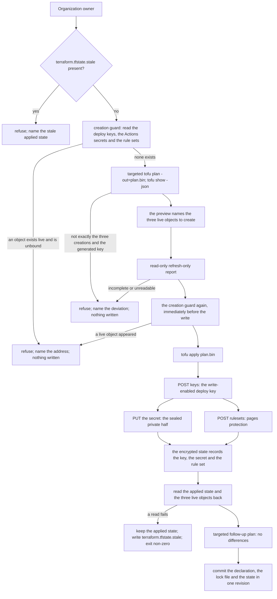

**Steps:**

1. A `terraform.tfstate.stale` marker refuses the run before anything is read;
   the operator removes it after reading the report, and the next green apply
   completes the revision.
2. The creation guard reads the pages repository's deploy keys, the monorepo's
   Actions secrets and the pages repository's rule sets. A deploy key with the
   declared title, a `PAGES_DEPLOY_KEY` secret, or a rule set with the declared
   name that the applied state does not bind refuses the run and names the
   address. Nothing is planned and nothing is written.
3. The targeted preview reads the applied state, the declaration and live. On
   this declaration it names exactly three live objects to create — the deploy
   key, the secret and the rule set — plus the generated key pair, which has no
   live counterpart. A plan that is not exactly that set is refused.
4. A read-only refresh-only report over the previewed addresses proves the
   state decrypts and the provider configures; for a create-only revision it
   cannot name a live edit, so the guard is what detects a live change.
5. The guard runs again immediately before the write. Only then does
   `tofu apply plan.bin` create the key (`POST /repos/duty2cal/duty2cal.github.io/keys`),
   the secret (the provider fetches the repository public key, seals the
   private half with a NaCl box, and `PUT`s `key_id` and the ciphertext) and
   the rule set (`POST /repos/duty2cal/duty2cal.github.io/rulesets`, carrying
   the `DeployKey` bypass actor and the three rules).
6. The provider reads the deploy key and the rule set back; the secret create
   makes one timestamp read and ignores that read's failure, and the provider
   framework performs no second read after create. The routine therefore reads
   the applied state and the three live objects back before it reports success;
   a failed read keeps the applied state, prints `failed read-back: <object>
   <reason>`, writes `terraform.tfstate.stale` and exits non-zero. On success
   the encrypted state records the generated private key, the three bindings and
   the secret's sealed value; a targeted follow-up plan reports no differences;
   the declaration, the lock file and the state are committed in one revision.
   The apply writes no site file, changes no Pages configuration and rebuilds
   nothing; the credential's consumer is the Site publication, which writes the
   Pages repository's default branch and replaces the stock page with the Site
   output.

**Notes:** The feature file documents this flow; no cucumber scenario drives it after this change, and `scripts/setup-infra-tests.sh` only prepares the inherited base state. The maintainer's real preview and apply are the operational evidence: they exercise the guard's verdicts, the four declared addresses, the apply's outcome, the secret write, the rule set's bypass actor and rules, and the state's four addresses. GitHub's acceptance of the key, the secret and the bypass actor is proven only by that apply. The failure and read-back rules above remain the documented contract; R-067 records that no automated scenario drives them.

## Scenario: The organization profile is previewed, applied and published

**Trigger:** The maintainer has declared the organization profile repository and
its two reviewed files and asks for a preview, then applies the previewed
revision.

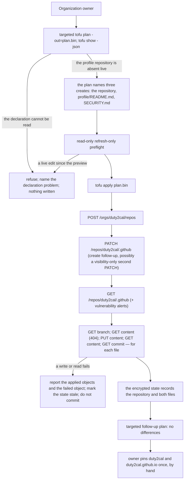

**Steps:**

1. The owner records the declaration revision that adds
   `github_repository.dot_github`, `github_repository_file.org_profile_readme`
   and `github_repository_file.org_security`; the two file contents are read
   from `org/` at plan time.
2. A `tofu plan -out=plan.bin` targeted at the profile repository and its two
   files reads the applied state and the live configuration. The profile
   repository does not exist and is not bound, so the preview names three
   creates and no update or delete; a declaration that cannot be read is
   refused. The preview writes nothing. The plan is targeted to the revision's
   scope — the three objects it adds — matching the sibling capability's
   preview rule. The deleted scenario primed a `security-applied` fixture whose
   base apply introduced the known organization billing drift; that drift is
   outside the three targets, so the targeted plan names no unrelated
   difference.
3. The read-only refresh-only preflight, targeted at the same three objects,
   compares them with live and refuses a manual edit by address; the saved plan
   is not applied.
4. `tofu apply plan.bin` creates the repository: `POST /orgs/duty2cal/repos`,
   the provider's create follow-up `PATCH`, and the repository read. The
   provider then creates `profile/README.md` and `SECURITY.md`: for each file
   it reads the repository and the `main` branch, reads the absent path,
   writes the reviewed content, and reads the file and its commit back. The two
   file creations are independent and may run concurrently.
5. The apply reports the three creations; the encrypted state records the
   repository and both files; a follow-up plan targeted at the three objects
   reports no differences. The
   profile repository is public, with its issue tracker, projects and wiki
   disabled, and GitHub now serves the profile page and the organization's
   default security policy from it.
6. Before the apply, the owner has enabled private vulnerability reporting on
   `duty2cal/duty2cal` by hand, because the published policy names its route and
   the provider cannot declare it. Once, after the apply, the owner pins
   `duty2cal` and `duty2cal.github.io` in the organization's web settings. No
   declaration, preview or drift check covers either step; chapter 7 records
   both.

**Notes:** The feature file documents this flow; no cucumber scenario drives it after this change. The deleted scenario primed an inherited base tree and asserted the API responses, the journal and the state; `scripts/setup-infra-tests.sh` prepares only the imports and the base apply and does not inspect `org/` or drive the profile preview. The maintainer's real preview and apply are the operational evidence, and the real GitHub acceptance and rendering are proven only there. A write failure after the repository creation is reported as a partial outcome and the state is not committed; the stale marker rules are the shared configuration-change rules, not re-asserted by this capability (R-067).

## Scenario: The support statement is checked across its carriers

**Trigger:** The release owner publishes or revises the support statement — on
a release, or because the evidence behind it changed. The statement names one
plan: a Lufthansa cabin-crew duty plan published as a Jeppesen PDF export.

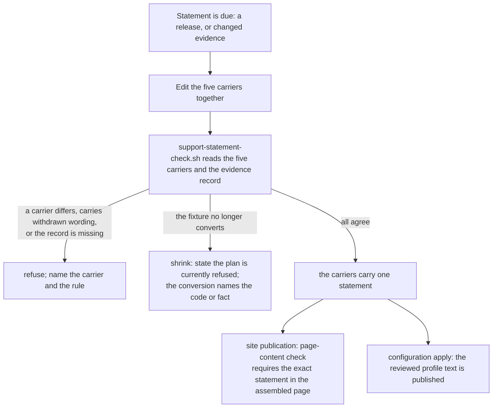

**Steps:**

1. The release owner edits the website's `what-it-does` and
   `non-affiliation` statements, the README, `org/profile/README.md`, chapter 3
   and both issue forms in one act; the page's sentence has "This tool" as its
   subject, and the other four use the project's name.
2. `scripts/support-statement-check.sh` normalizes each carrier's whitespace,
   reads the two page elements and the four documents, and compares them with
   the three expected sentences. The `public-text` CI job runs it through
   `scripts/public-text-check.sh`.
3. A carrier that differs, still carries the withdrawn export-family wording,
   or a missing evidence record is refused with one line naming the carrier and
   the rule; no carrier is published as agreeing.
4. If the generated fixture stops converting, the conversion suite is red and
   its refusal names the unknown activity code or the missing column; the
   carriers are revised to state that the plan is currently refused, and the
   evidence record states the failure. The statement does not wait for a
   release.
5. The site publication's page-content check requires the assembled page's
   exact `what-it-does` and `non-affiliation` text; a page that disagrees is
   refused and named, and the previous page stays.
6. The profile's carrier is published by the operator's configuration apply
   after GREEN; until then the reviewed source carries the statement and the
   published profile lags it.

**Notes:** The feature files are documentation. The executable evidence is
`scripts/tests/support-statement.bats` for the check and the existing browser
smoke for the rendered page; the site publication's gate is its own executable
evidence. The profile's live apply remains the operator's step (D5), and the
statement's shrink is a reviewed act by the release owner, not an automatic
rewrite.


## Scenario: The legal notices are checked and published

**Trigger:** A revision changes a notice page, a footer link, the organization
profile or the README, or the publication builds a revision whose Site output
carries the notices.

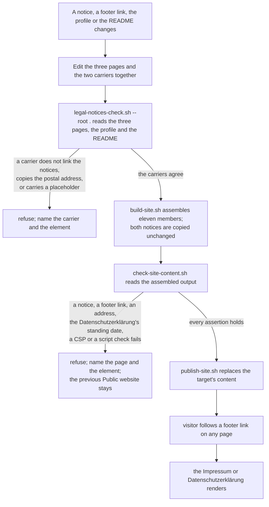

**Steps:**

1. The release owner edits `web/impressum.html`, `web/privacy.html` and the
   converter page's footer together, and keeps `org/profile/README.md` and
   `README.md` linking the notices without copying the postal address.
2. `scripts/legal-notices-check.sh --root .` reads the three pages and the two
   carriers that are not output members, and refuses a converter footer that
   does not link both notices, a notice that does not link the other or lacks a
   required element, a carrier without the two labelled absolute links, a
   carrier that copies the postal address or a `mailto:` link, and any
   placeholder; each refusal names the page or carrier and the element.
3. `scripts/public-text-check.sh` calls the check with the repository root in
   the `public-text` CI job, so a revision that breaks a carrier is refused
   before it lands.
4. `scripts/build-site.sh` copies both notice pages into `dist/site/`
   unchanged, stamps the Built revision on the converter page only and writes an
   output of eleven members.
5. `scripts/check-site-content.sh` scans every `*.html` member of the assembled
   output and refuses a member set that differs from the eleven named members, a
   missing notice or `h1`, a footer link or notice-to-notice link that is
   absent, an Impressum without a postal code, a city, a `mailto:` link or its
   service-address sentence, a Datenschutzerklärung without its standing date
   and required disclosures, a content security policy that differs from
   `NOTICE_CSP`, a `<script` element, an `on*=` handler attribute, a placeholder,
   the discontinued dispute-resolution reference, a foreign asset or a relative
   link to a missing file, naming the page and the element. The publication
   replaces the target's content only when every assertion holds; a refusal
   leaves the previous Public website in place.
6. A visitor follows the converter page's footer link, or the other notice's
   footer link, or the profile's and the README's two labelled links, and reads
   who publishes the site, an address at which service is possible, a mail
   address and what the host processes on a page request. The German version is
   binding; the English summary below it does not replace it.

**Notes:** The notice pages carry no script and a stricter content security
policy than the converter page, and they are byte-identical between builds
because no revision is stamped into them; only the Datenschutzerklärung carries
a standing date. The two checks prove that the converter page's footer links
both notices, that each notice's footer links the other and the converter page,
that the required elements are present and that no carrier copies the address;
they cannot prove that the notices are legally sufficient, which the operator
answers for. The browser steps are the two `@e2e` notice scenarios driven
through `web/e2e/driver.mjs`'s `click`, `navigate` and `read_text` actions by
`apps/cli/tests/steps/legal_notices.rs`; each observes the site root's `h1`
before activation and the notice's `h1` after it, and reads an empty cookie jar
and empty storage.
