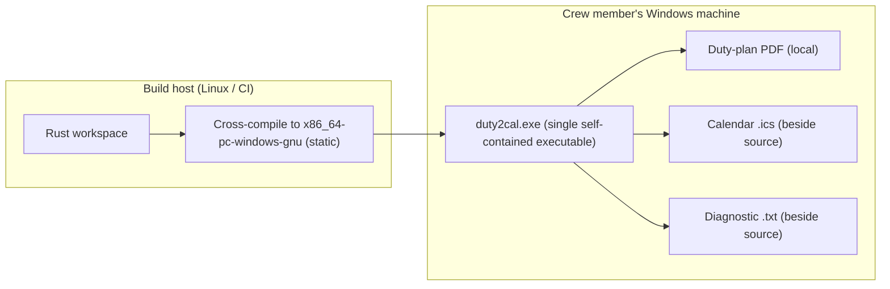

# 7. Deployment View

## Infrastructure level 1

`duty2cal` is a single self-contained executable. No server, no database, no infrastructure: it runs on the crew member's machine and touches only the local filesystem.

| Node / Environment | Description |
|---|---|
| Build host (Linux/CI) | Builds and cross-compiles the workspace for the Windows GNU target. |
| Windows machine | Runs the single executable; supplies the plan and receives the calendar or a diagnostic. |
| Local filesystem | Holds the input plan and the published calendar/report files. |

## Infrastructure level 2

### `Windows machine`

| Property | Value |
|---|---|
| Hardware / VM | Crew member's ordinary machine |
| OS | Windows |
| Middleware / Runtime | None beyond the executable (statically linked GNU target; no companion DLL or runtime installer) |
| Key software deployed | One self-contained `duty2cal` executable |

## Deployment consequences

- No package manager, service, or configuration file is required.
- The executable may be launched by path or by dragging a PDF onto it.
- Windows GNU was kept over the brief's MSVC target: the Linux cross-build stays available and static linking preserves the single-executable requirement. The GNU runtime imports and the cross-build are release-evidence gates, not assumptions.
