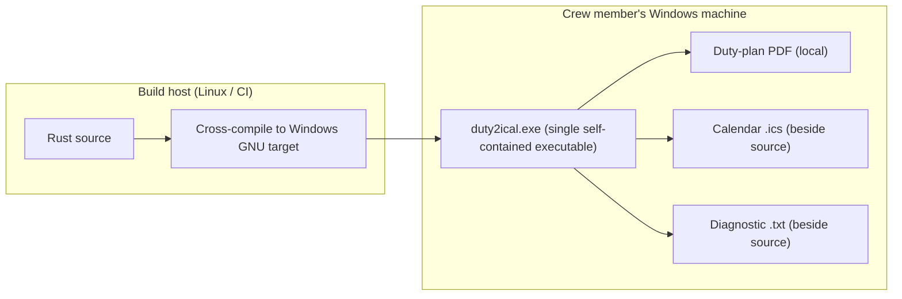

# 7. Deployment View

## Infrastructure level 1

The converter is a single self-contained executable. There is no server, no database, and no infrastructure: it runs on the crew member's machine and touches only the local filesystem.

| Node / Environment | Description |
|---|---|
| Build host (Linux/CI) | Builds and cross-compiles the Rust application for the Windows GNU target. |
| Windows machine | Runs the single executable; supplies the plan and receives the calendar or a diagnostic. |
| Local filesystem | Holds the input plan and the published calendar/report files. |

## Infrastructure level 2

### `Windows machine`

| Property | Value |
|---|---|
| Hardware / VM | Crew member's ordinary machine |
| OS | Windows |
| Middleware / Runtime | None required beyond the executable; no companion DLL or runtime installer |
| Key software deployed | One self-contained `duty2ical` executable |

## Deployment consequences

- No package manager, service, or configuration file is required.
- The executable may be launched by path or by dragging a PDF onto it.
- Because there is no runtime dependency, the Windows GNU cross-build and the executable's absence of companion runtime imports are release-evidence gates, not assumptions.
