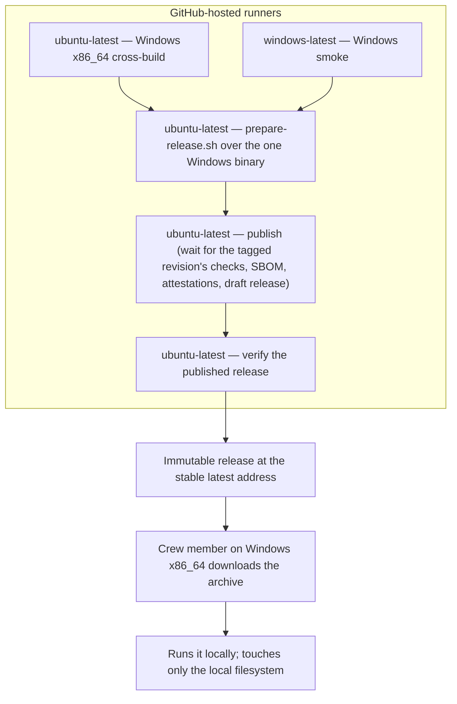

# 7. Deployment View

## Infrastructure level 1

The project publishes one self-contained Windows x86_64 executable, cross-built by its own automation on a GitHub-hosted Linux runner, started on a Windows runner and published as an immutable release from the public repository. A crew member on Windows downloads the archive from the stable latest-release address and runs the executable on their own machine; it touches only the local filesystem. Other platforms are unsupported, untested and undistributed and build the source with a Rust toolchain.

| Node / Environment | Description |
|---|---|
| `ubuntu-latest` | Cross-builds the Windows (`x86_64-pc-windows-gnu`) executable and also runs the single packaging, publish and verify jobs; the publish job waits for the tagged revision's checks before anything becomes public. It remains the CI, coverage and local test host but publishes nothing of its own. |
| `windows-latest` | Starts the cross-built Windows executable: the "started on a machine of that kind" evidence. |
| GitHub Releases | Serves the published Windows archive, its checksum, its provenance and bill of materials, the release text, and the change log (`CHANGELOG.md`) at a stable latest-release address. |
| Crew member's machine | Runs the downloaded executable; supplies the plan and receives the calendar or a diagnostic. |
| Local filesystem | Holds the input plan and the published calendar/report files. |

## Infrastructure level 2

### The Windows artefact and the runners that build it

| Artefact | Target triple | Built by |
|---|---|---|
| `duty2cal-<version>-windows-x86_64.tar.gz` | `x86_64-pc-windows-gnu` | Cross-built on `ubuntu-latest`, then started on `windows-latest`. |

The archive holds `duty2cal.exe` and nothing else; a checksum file covering the archive sits beside it on the release. Packaging into the archive happens once, on `ubuntu-latest`; the release is published and then verified on `ubuntu-latest` as well. No other platform archive is built or attached.

### The change log among the release assets

Beside the one Windows archive and its checksum (and the archive's provenance and bill of materials), a release carries the change log and its newest section: `CHANGELOG.md` is published as an asset, so a downloader reads what changed without visiting the repository, and the release page's text is that same file's newest section. Both come from one render of the released revision, so the page and the published file cannot state different things about what a version contains.

### The crew member's machine

| Property | Value |
|---|---|
| Hardware / VM | Crew member's ordinary machine |
| OS | Windows x86_64 only. Linux, macOS and any other platform are unsupported, untested and undistributed; their users may build the source with a Rust toolchain. |
| Middleware / Runtime | None beyond the executable (Windows GNU statically linked; no companion DLL or runtime installer) |
| Key software deployed | One self-contained `duty2cal.exe` executable |

### Downloading and verifying

- A downloader on Windows x86_64 takes `duty2cal-<version>-windows-x86_64.tar.gz` from the stable latest-release address `https://github.com/kressnerd/duty2cal/releases/latest`, which stays reachable as later versions are published. No archive is offered for any other platform.
- They recompute the archive's digest and compare it with the published `.sha256` (`sha256sum --check` or `Get-FileHash`), so they verify what they received before extracting it.
- They then confirm the file's build provenance and bill of materials with `gh attestation verify`, run against the archive, which ties the file in hand to the tagged revision and this project's automation.
- Already-published releases keep their original assets and links; only future releases are Windows-only.

## Deployment consequences

- No package manager, service, or configuration file is required on the supported platform.
- The executable may be launched by path or by dragging a PDF onto it.
- One Windows archive is attached per version: the executable runs there with no runtime installer and no companion library beyond the platform's own. Other platforms receive no archive and build the source; that route is not exercised by CI.
- Windows GNU was kept over the brief's MSVC target: the Linux cross-build stays available and static linking preserves the single-executable requirement; the GNU runtime imports, the cross-build, and the Windows smoke start are release-evidence gates, not assumptions.
- Linux is the cross-build, CI and local test host, not a published platform; it does not appear on the release page.
- Already-published Linux and macOS archives stay as they were: releases are immutable, so this narrowing applies to future releases only.
