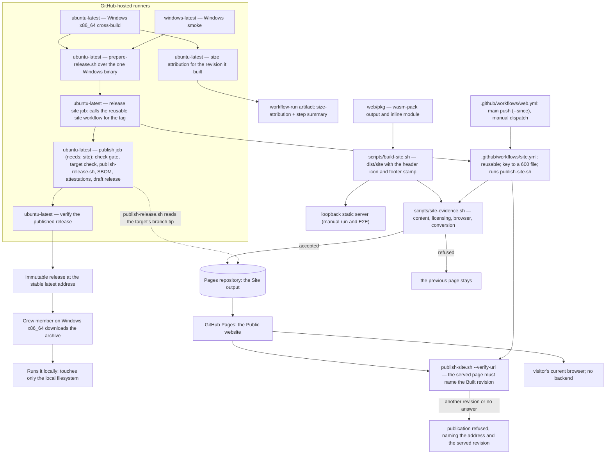

# 7. Deployment View

## Infrastructure level 1

The project publishes one self-contained Windows x86_64 executable, cross-built by its own automation on a GitHub-hosted Linux runner, started on a Windows runner and published as an immutable release from the public repository. A crew member on Windows downloads the archive from the stable latest-release address and runs the executable on their own machine; it touches only the local filesystem. Other platforms receive no published archive; builds for them are available on request, and the source can be built with a Rust toolchain.

The browser conversion page is a second deployment realization of the same
conversion: a static Site output published at the Public website. The page
needs no application server, database or runtime service; its only runtime is
the browser. The Site publication builds the output, gates it and writes it into
the Pages repository, which GitHub Pages serves at `https://duty2cal.github.io/`;
the same publication also runs from a maintainer's workstation against any git
target, which is how it is tested.



| Node / Environment | Description |
|---|---|
| `ubuntu-latest` | Cross-builds the Windows (`x86_64-pc-windows-gnu`) executable and also runs the single packaging, site, publish and verify jobs; the release's `site` job publishes and verifies the page for the tag, and the `publish` job (`needs: site`) waits for the tagged revision's checks and then publishes the archive only when the hosting target's branch tip carries the tagged Built revision. The Windows cross-build also produces the size attribution for the revision it built and uploads it beside the run. The same runner class hosts `web.yml`, the trigger workflow that calls the reusable `site.yml` for default-branch pushes and manual dispatch, and `site.yml`'s single publication job builds and gates `dist/site`, publishes it and verifies the served page. It remains the CI, coverage and local test host. |
| `windows-latest` | Starts the cross-built Windows executable: the "started on a machine of that kind" evidence. |
| GitHub Releases | Serves the published Windows archive, its checksum, its provenance and bill of materials, the release text, and the change log (`CHANGELOG.md`) at a stable latest-release address. |
| Crew member's machine | Runs the downloaded executable; supplies the plan and receives the calendar or a diagnostic. |
| Local filesystem | Holds the input plan and the published calendar/report files. |
| Loopback static server | Serves the assembled `dist/site/` output for the manual run and each browser scenario, and the Pages repository's checked-out tree when a scenario renders what was published; no application server, database or queue. |
| Crew member's browser | Runs the page and the inline WASM; offers the calendar/diagnostic for a browser-owned save. Supported by capability (WebAssembly and ES modules), not by a version matrix. |
| GitHub Pages / Public website | Serves the Pages repository's default branch at `https://duty2cal.github.io/`. The project writes that branch through the Site publication and never calls the hosting API; after the replacement the publication reads the served page at its `--verify-url` address and succeeds only when that page names the same Built revision, so an unserved push is refused rather than reported as a publication. |

## Infrastructure level 2

### The browser conversion output

| Property | Value |
|---|---|
| Artefact | The assembled Site output `dist/site/`, holding exactly eight members: `index.html` with the stamped footer, `app.js`, `capability.js`, `styles.css`, `icon.png` (the project icon, also the favicon), `pkg/duty2cal_wasm.js`, `pkg/wasm-inline.js` and `LICENSE.txt` |
| Page layout | A header flex row with the 48×48 icon left of the `h1` and subheadline; a statements panel above the converter panel (what it does, the browser route, downloads for various operating systems on request with the release page linked, privacy, non-affiliation, as-is); the converter panels; a "Source and licence" panel below them; and the full footer with the Built revision and plain prose |
| Build | `scripts/build-web.sh` installs the pinned `wasm-pack` and builds the bundle; `scripts/build-site.sh` assembles the output, copies the icon, resolves and stamps the Built revision and copies the licence; Node, Playwright and Chromium are test-only and pinned |
| Runtime | The visitor's current browser; no application server, database, queue or container |
| Serving | GitHub Pages serves the Pages repository's default branch at the canonical address; a loopback static server serves the same output for the manual run and each E2E scenario |
| Network | No request to another origin after load; no third-party asset; the WASM is inline, so no `.wasm` request occurs |
| Evidence | A Playwright/Chromium `@e2e` scenario plus regular browser variants; screenshots at 360x780 and 1920x1080; the capability and startup branches are forced with init scripts; the publication's `@e2e` additionally renders the published tree |

### The Public website and the site publication

| Property | Value |
|---|---|
| Canonical address | `https://duty2cal.github.io/` — GitHub Pages serving the Pages repository's default branch |
| Hosting target | `duty2cal/duty2cal.github.io`, public, holding only the Site output; its Pages source stays `main` at `/` with `build_type = "legacy"` |
| Credential | The write-enabled deploy key `duty2cal.github.io publish`, whose private half is the monorepo's `PAGES_DEPLOY_KEY` secret; the `pages protection` rule set admits `DeployKey` actors with `always` and forbids deletion, non-fast-forward pushes and merge commits |
| Publication command | `scripts/publish-site.sh --repo <dir> [--revision <rev>] [--since <base>] --target <url> --out dist/site --verify-url <address>`, which refuses an unclean caller tree (`git status --porcelain --untracked-files=no`), decides the `--since` trigger, resolves and validates the Built revision, checks it out into a detached worktree, builds and gates there, reports the target as current and writes nothing when the output is already there, replaces the target's content in one fast-forward commit under an exclusive lock, reads the pushed tree back, and verifies the served page names the same Built revision |
| Gate | `scripts/site-evidence.sh`, run inside the revision's worktree: page content, licensing/REUSE, the browser check (every request after load) and the conversion suite, fail-fast and named |
| Serving check | After the replacement and the read-back, the required `--verify-url` address is fetched with bounded retries; the publication succeeds only when the served page carries the same Built revision text as the output, and otherwise refuses naming the address and the served revision. Because it runs after the replacement, a serving refusal leaves the new page in the target rather than restoring the previous one |
| Built revision | `git describe --tags --always --match 'v*'` plus the commit, resolved from the detached worktree and stamped by `scripts/build-site.sh` into the footer and linked to the commit |
| Trigger | The command's `--since` comparison, not a workflow filter: `web.yml` runs on every default-branch push and on manual dispatch, with no `v*` tag trigger, and passes `github.event.before`; a revision that changes none of `crates/**`, `ffi/wasm/**`, `web/**`, `Cargo.toml`, `Cargo.lock`, `rust-toolchain.toml`, `LICENSES/MPL-2.0.txt`, `docs/assets/**` or the two site workflows reports `no site input changed` and writes nothing. A tag's site publication is the release's `site` job, which calls the same reusable workflow with the tag and no `--since`. |
| Release coupling | `release.yml` has a `site` job that calls the reusable site workflow for the tag, then a `publish` job (`needs: site`) that runs `scripts/publish-release.sh`; that command reads the hosting target's branch tip with `git ls-remote` and a fetch, refuses before any `gh` call unless it carries the tagged Built revision, and compares the draft's assets while excluding `release-notes.md`. A site refusal leaves the previous page and publishes no archive |
| Local twin | A local bare git repository as the target, a loopback server over its checked-out tree (and a second loopback server presenting an earlier tree for the serving refusal), and a recording stand-in for `gh`; no credential and no GitHub |
| Hand editing | Never: whole-content replacement removes any file the Site output does not hold, and the target's earlier pages stay in its history |

The target's content is replaced as a whole, so the published bytes are exactly
the bytes the gate inspected, and the served page is read back before success is
reported. The reusable `site.yml` workflow holds `contents: read`, receives
`PAGES_DEPLOY_KEY` from its caller and writes it to a `600` file for
`scripts/publish-site.sh`; `web.yml` and the release's `site` job are the two
callers that pass the secret onward, and no other credential reaches the
publication. A push is not by itself a served page, so the publication's own
serving check — not the host's report — is what turns a successful push into a
successful publication.

### The Windows artefact and the runners that build it

| Artefact | Target triple | Built by |
|---|---|---|
| `duty2cal-<version>-windows-x86_64.tar.gz` | `x86_64-pc-windows-gnu` | Cross-built on `ubuntu-latest`, then started on `windows-latest`. |

The archive holds `duty2cal.exe` and nothing else; a checksum file covering the archive sits beside it on the release. Packaging into the archive happens once, on `ubuntu-latest`; the release is published and then verified on `ubuntu-latest` as well. No other platform archive is built or attached.

### The release profile

The Windows executable is built from `[profile.release]` with `panic = "abort"`: the measured lever removes 83,968 B (2,014,208 B against a 2,098,176 B rebuild of the unchanged configuration on the release branch). A panic aborts with the standard Rust panic message; the conversion's typed failures still write the numbered diagnostic naming the source and reason. The build and Windows smoke jobs are otherwise unchanged.

### The change log among the release assets

Beside the one Windows archive and its checksum (and the archive's provenance and bill of materials), a release carries the change log and its newest section: `CHANGELOG.md` is published as an asset, so a downloader reads what changed without visiting the repository, and the release page's text is that same file's newest section. Both come from one render of the released revision, so the page and the published file cannot state different things about what a version contains.

### The size attribution beside the run

The Windows cross-build job runs `scripts/measure_executable_size.py` after it has built and inspected the executable, so the report describes the revision that job built, and uploads the report as the run's `size-attribution` artifact beside the step summary. The measurement step is evidence, not a gate: it exits zero whatever the command reported, always appends the report (or a note that none was written) to the step summary, and uploads the artifact with `if: always()`, so an unreadable report is published and the job continues; no revision or release is refused because of it. The report is not a release asset, not committed, and not attached to the change: it belongs to the run for the revision it names, which is what lets a reviewer compare two revisions before either lands.

The same command runs on the maintainer's Linux host once the Windows target, `mingw-w64` and the pinned generator are installed; the suite's `test` and `coverage` jobs install the same three so the `@e2e` scenario drives the real command. A host without them runs the suite in a container that provides them (the local deployment path recorded in the change's design).

### The crew member's machine

| Property | Value |
|---|---|
| Hardware / VM | Crew member's ordinary machine |
| OS | Windows x86_64 for this executable. No archive is offered for Linux, macOS or any other platform, and their users may build the source with a Rust toolchain. The browser conversion route is separate: it needs a current browser, not this machine class. |
| Middleware / Runtime | None beyond the executable (Windows GNU statically linked; no companion DLL or runtime installer) |
| Key software deployed | One self-contained `duty2cal.exe` executable |

### Downloading and verifying

- A downloader on Windows x86_64 takes `duty2cal-<version>-windows-x86_64.tar.gz` from the stable latest-release address `https://github.com/duty2cal/duty2cal/releases/latest`, which stays reachable as later versions are published. No archive is offered for any other platform.
- They recompute the archive's digest and compare it with the published `.sha256` (`sha256sum --check` or `Get-FileHash`), so they verify what they received before extracting it.
- They then confirm the file's build provenance and bill of materials with `gh attestation verify`, run against the archive, which ties the file in hand to the tagged revision and this project's automation.
- Already-published releases keep their original assets and links; only future releases are Windows-only.

## The declared configuration and the applied state

The public home's configuration is deployed from the maintainer's workstation,
never from CI. The declaration lives in the repository; the binding between the
declaration and GitHub's objects is an encrypted state file that is committed
with it; the passphrase that opens it, and the token that authorizes the
operation, exist only in the maintainer's environment. The declaration covers
the organization settings, the monorepo, the Pages repository, both protection
rule sets, the repository security settings, the pages publishing credential,
and the public organization profile repository with its two reviewed files. The
last of those and the credential's three objects are created by an apply when
live lacks them; the others were adopted before their first change.

```mermaid
flowchart TB
  ws["Maintainer's workstation"]
  decl["infra/ — declaration, adoption batch, terraform.tfstate (ciphertext, holding the publishing key), two provider lock entries"]
  env["Environment only: TF_VAR_state_passphrase, GITHUB_TOKEN, TF_VAR_billing_email"]
  tool["tofu + integrations/github and hashicorp/tls providers (offline mirror in tests)"]
  gh{{"GitHub REST API"}}
  ws --> env --> tool
  ws --> decl --> tool
  tool -->|"read-only guard, import / refresh; one previewed apply"| gh
  tool -->|"writes the encrypted state"| decl
```



| Node / Environment | Description |
|---|---|
| Maintainer's workstation | Runs the guard, the adoption and later the preview, apply and local drift check; holds the passphrase and the token, and is now the only place the publishing private key can be recovered. |
| `infra/` | The declaration, the batch, the provider lock entries and the encrypted state; committed, reviewed and public — but the state is ciphertext. |
| GitHub | The only owner of the live settings; receives a write only from a later, separately reviewed apply, and holds the deploy key's public half and the sealed secret. |
| CI | Runs the same suite against a local fake API; holds no GitHub token and no passphrase, so it can neither apply nor report drift. |

### The organization profile repository

| Property | Value |
|---|---|
| Repository | `duty2cal/.github`, public, created by the archived profile apply (it did not exist live before that apply) |
| Profile page | `profile/README.md` in that repository; GitHub renders it on the organization's overview page |
| Default security policy | `SECURITY.md` at that repository's root; GitHub uses it for an organization repository that has no policy of its own; its private-reporting route was enabled manually before that publication |
| Source | `org/profile/README.md` and `org/SECURITY.md` in the monorepo, reviewed and covered by REUSE as CC0-1.0; the declaration resolves them through `variable "org_source_dir"` (default `../org` beside `infra/`) |
| Licence | The page's own prose is CC0-1.0 and the project is MPL-2.0; third-party Unicode data is licensed under Unicode-3.0 and attributed with an absolute link to `LICENSES/Unicode-3.0.txt` |
| Repository features | issue tracker, projects, wiki and discussions disabled; no Pages site, no declared scanning block; a public repository's scanning statuses are GitHub's computed defaults |
| Publication mechanism | `github_repository_file` resources in `infra/org_profile.tf`, applied from the maintainer's workstation like every other declared change |
| Adoption | none — the repository was created by that apply rather than adopted, and the applied state records the binding; a later copy revision updates the files in place |

The profile repository is output. A text change is a change to `org/`, reviewed
in the same history as the declaration, previewed and applied like any other
configuration change. The repository is never edited by hand; the declaration's
file resources replace an existing file when the reviewed content differs.

The profile page is a public presentation surface, not a system UI: GitHub
renders it, and the project neither serves nor scripts that rendering. The
page's truthfulness is a property of the reviewed `org/` text; its links are
absolute and it embeds no third-party image or widget.

### The pages publishing credential and rule set

| Property | Value |
|---|---|
| Pages repository | `duty2cal/duty2cal.github.io`, public; it served the stock Jekyll site until the Site publication replaced that content with the Site output, and it now holds only built output |
| Organization prerequisite | `deploy_keys_enabled_for_repositories = true`; manual, not expressible in provider 6.13.0 |
| Deploy key | `duty2cal.github.io publish`, write-enabled (`read_only = false`), public half generated from the declaration's Ed25519 key pair |
| Secret | `PAGES_DEPLOY_KEY` on `duty2cal/duty2cal`, carrying the private half in the OpenSSH format; the provider seals it with the repository's public key before sending it |
| Private material | Exists only in `infra/terraform.tfstate` (twice: the generated key and the secret's value) and in the encrypted plan file, which is deleted after the apply; GitHub never returns it |
| Rule set | `pages protection` on the pages repository: deletion, non-fast-forward, linear history; bypass actor `DeployKey` with `always` and no actor id |
| Consumer | The Site publication (`scripts/publish-site.sh`, invoked by the reusable `.github/workflows/site.yml` from `web.yml` or the release's `site` job): the only writer of the Pages repository's default branch |
| Publication mechanism | `infra/pages_publish.tf`, applied from the maintainer's workstation behind the creation guard |
| Adoption | none — the three objects were created by the archived apply rather than adopted, and they are live and bound in the applied state; the guard still refuses a live object the state does not bind |

The credential's apply writes no file into the pages repository, changes no
Pages configuration and rebuilds nothing; the Site publication is what writes
the branch, replacing the stock placeholder as a whole. Losing the passphrase
loses the material behind the live deploy key; the state cannot be rebuilt from
GitHub, so recovery is a credential rotation — a separate decision (Q11),
recorded as a chapter-11 risk.

### Manual operator prerequisite: private vulnerability reporting

The default security policy names the private vulnerability reporting route
`https://github.com/duty2cal/duty2cal/security/advisories/new`. That route
exists only when the repository owner has enabled private vulnerability
reporting on `duty2cal/duty2cal` (Settings → Code security and analysis); the
pinned `integrations/github` provider (6.13.0) has no resource for it. The
operator therefore enabled it by hand **before** the profile was published, and
the route exists:

1. Open `https://github.com/duty2cal/duty2cal/settings/security_analysis` as
   the organization owner.
2. Enable private vulnerability reporting.
3. Confirm the repository's "Security" tab offers "Report a vulnerability".

The setting remains outside the declaration, the applied state and the drift
check; chapter 11's R-030 records the gap. The default-security scenario asserts
only that the published policy names the route; neither the fake nor the suite
can prove the live setting, and the operator's confirmation is the acceptance
evidence that the route exists.

### Manual operator prerequisite: organization deploy-key policy (satisfied)

The pages publishing credential required the organization's deploy-key policy
to be enabled. The pinned `integrations/github` provider (6.13.0) has no
attribute for `deploy_keys_enabled_for_repositories`, so the setting is outside
the declaration, the applied state and the drift check. The operator confirmed
it before the archived pages apply, and it is true:

```bash
gh api orgs/duty2cal --jq '.deploy_keys_enabled_for_repositories'
```

The confirmation must print `true`; the key exists and the Site publication
uses it. If the setting is ever cleared, or the credential is re-created, the
operator re-confirms it and enables it with an `admin:org` token
(or Organization settings → Repository policies → Deploy keys):

```bash
gh api -X PATCH orgs/duty2cal -F deploy_keys_enabled_for_repositories=true
```

A disabled policy makes a credential create fail with
`422 Deploy keys are disabled for this repository`. The rule set and the
state-only TLS key may already have landed in that attempt; the operator
recovers through the stale marker and `tofu state rm`, removes the marker, and
re-runs the preview. Chapter 11's R-056 records the gap. The setting cannot be
previewed and is not in the applied state; the confirmation is the acceptance
evidence.

### Manual operator step: pinned repositories

GitHub shows up to six pinned repositories on the organization overview, and
the organization owner sets them in the organization's web settings. The pinned
`integrations/github` provider (6.13.0) exposes no resource for them, and the
archived profile change introduced no API script or other second write path.
The step is therefore durable operator documentation, not a declared object;
the owner performed it after the apply that created the profile repository:

1. Open `https://github.com/organizations/duty2cal/settings/profile` as the
   organization owner.
2. Pin `duty2cal` and `duty2cal.github.io`. Up to six repositories may be
   pinned; the `.github` repository itself does not need to be pinned.
3. Save, then open the organization overview once and confirm both appear.

The step is one-time. It cannot be previewed, it is not recorded in the applied
state, and the local configuration drift check cannot report a change to it; a
later organization-settings change that clears the pins is repaired by
repeating the step. Chapter 11 records the limitation.

## Deployment consequences

- No package manager, service, or configuration file is required on the supported platform.
- The executable may be launched by path or by dragging a PDF onto it.
- One Windows archive is attached per version: the executable runs there with no runtime installer and no companion library beyond the platform's own. Other platforms receive no published archive; builds for them are available on request, and the source can be built with a Rust toolchain; that route is not exercised by CI.
- Windows GNU was kept over the brief's MSVC target: the Linux cross-build stays available and static linking preserves the single-executable requirement; the GNU runtime imports, the cross-build, and the Windows smoke start are release-evidence gates, not assumptions.
- Linux is the cross-build, CI and local test host, not a published platform; it does not appear on the release page.
- Already-published Linux and macOS archives stay as they were: releases are immutable, so this narrowing applies to future releases only.
- The applied state is deployed as a committed ciphertext: `infra/terraform.tfstate` and its backup are in the repository, protected by the passphrase and by OpenTofu's `enforced = true` encryption. Losing the passphrase loses the state; re-adopting rebuilds the bindings without changing anything live, except for the pages publishing key, whose private material cannot be read back from GitHub — that one is replaced, which is a credential rotation (Q11).
- The security change from this workstation, after the earlier configuration change, enables secret scanning and push protection on the monorepo. The two Dependabot settings are adopted read-only first, so the apply carries one live change; a read-only refresh-only preflight refuses a live edit made since the preview before `tofu apply` runs. The state that records the change is committed only after the apply is green; a partial apply's state is marked stale beside itself and is not committed.
- The pages publishing change created three objects and one generated key: the write-enabled deploy key on the pages repository, the `PAGES_DEPLOY_KEY` secret on the monorepo, and the `pages protection` rule set. The private half exists only in the encrypted state and the deleted plan file, so the repository holds a live credential's only recoverable copy; a lost passphrase means replacing the credential, not rebuilding the state from GitHub. The Pages configuration and the source repository were untouched by that apply; the credential's consumer is the Site publication.
- The Site publication deploys the page from the maintainer's workstation, from `web.yml` (through the reusable `site.yml`), or from the release's `site` job, never by hand in the target. It checks the publication revision out into a detached worktree, assembles `dist/site/` there from the page, the icon, the script, the capability gate, the stylesheet, the two bundle members and the licence, gates it there, and replaces the target's content in one commit pushed by fast-forward, so the pages rule set admits it and every earlier page stays in the target's history. A refused check, an unresolvable revision, an unclean caller tree, a worktree that cannot be created, a missing converter bundle or a refused push leaves the previous page in place and names the failure. After the replacement it fetches the required `--verify-url` address with bounded retries and refuses unless the served page names the same Built revision; that refusal is the one failure that comes after the replacement, so it leaves the new page in the target.
- The trigger decision is the command's `--since` comparison against the site-input list it owns; `web.yml` runs on every default-branch push and on manual dispatch, with no `v*` tag trigger, and passes `github.event.before`, so a documentation-only revision starts a job that exits after reporting `no site input changed`. A `v*` tag's site publication is the release's `site` job, which calls the same reusable workflow with the tag and no base, so it always builds the tagged tree. Republishing content the target already holds reports the target as current and writes nothing.
- The published page is the artifact the gate inspected: the browser check drives the assembled output, the page-content check reads it, and the commit carries exactly it. The footer names the Built revision from `git describe` and links the commit; a release tag republishes the page from the tagged revision, so the footer's tag and the release agree.
- A release publishes its archive only after the Site publication for its tagged revision succeeded, and only when the hosting target's branch tip carries that tagged Built revision. A site failure leaves the previous page and publishes no archive, so a version never becomes public while the page is stale or names another revision. The coupling is a `site` job that calls the reusable workflow and a `publish` job (`needs: site`) whose command reads the target's branch tip with `git ls-remote` and a fetch before any `gh` call, so one tag costs one site build and gate and one target read.
- The maintainer's workstation can run the whole publication against a local bare git repository, with no credential and no network; the scenarios do exactly that, a loopback server renders the published tree, and a second loopback server presenting an earlier tree drives the serving refusal. Only the SSH transport and the deploy key are exercised on the host.
- The organization's deploy-key policy was confirmed before that apply and is true: `deploy_keys_enabled_for_repositories` is set on the organization, while the pinned provider cannot declare it. A re-created credential would need the same confirmation, and a false policy fails the deploy-key create with 422 after the rule set and TLS key have landed.
- The creation guard runs before the preview and again immediately before the write: an object that already exists live and the state does not bind refuses, naming the address. A failure after the deploy key is created restores the pre-apply state, reads live again, marks the state stale when a write landed, and refuses a blind retry.
- The apply that published the profile created `duty2cal/.github` and wrote its two reviewed files. The repository was not adopted: it did not exist live, so the preview named the three creations and the apply recorded them. The profile and security-policy text stays in `org/` under CC0-1.0; the profile repository is output and is never edited by hand.
- Before that apply, the owner enabled private vulnerability reporting on `duty2cal/duty2cal` by hand, because the pinned provider cannot declare it and the published policy names its route. The setting remains outside the declaration, the applied state and the drift check.
- The declaration resolves its reviewed source through `variable "org_source_dir"`; the default is `../org` beside `infra/`. The adoption command stages the declaration without `org_profile.tf`, and the setup proof and security base workspaces omit it, so no non-profile workspace evaluates the profile files.
- The organization profile page is GitHub's rendering of that output. The site publication has replaced the stock placeholder: the live Pages site serves the Site output, and the profile copy is corrected by an apply that follows the live site, so the copy never promises a page that is absent. No three-platform archive is released. The profile page embeds no third-party resource, so opening it issues no request beyond GitHub's own.
- Pinned repositories are a one-time manual step in the organization's web settings. They have no declared object, no state binding and no drift report; the step is recorded above and the limitation is a chapter-11 risk.
- The test environment starts the fake in `--writes` mode only for the scenarios that apply a change; it now serves repository creation, repository contents, branches and commits from an in-memory overlay. The adoption scenarios keep the read-only server and still prove that adoption issues no write.
- The administer token, the passphrase, the billing email and the transient encrypted plan file never leave the workstation; the plan file is git-ignored and deleted after the apply.
- The administer token and the passphrase are not deployed to any service: there is no apply in Actions and no configuration drift job in CI, so divergence from the declaration is found by the maintainer's local check.
- The test environment deploys no service: the fake GitHub API runs on loopback from the suite's step definitions, and the provider is installed from a local mirror.
