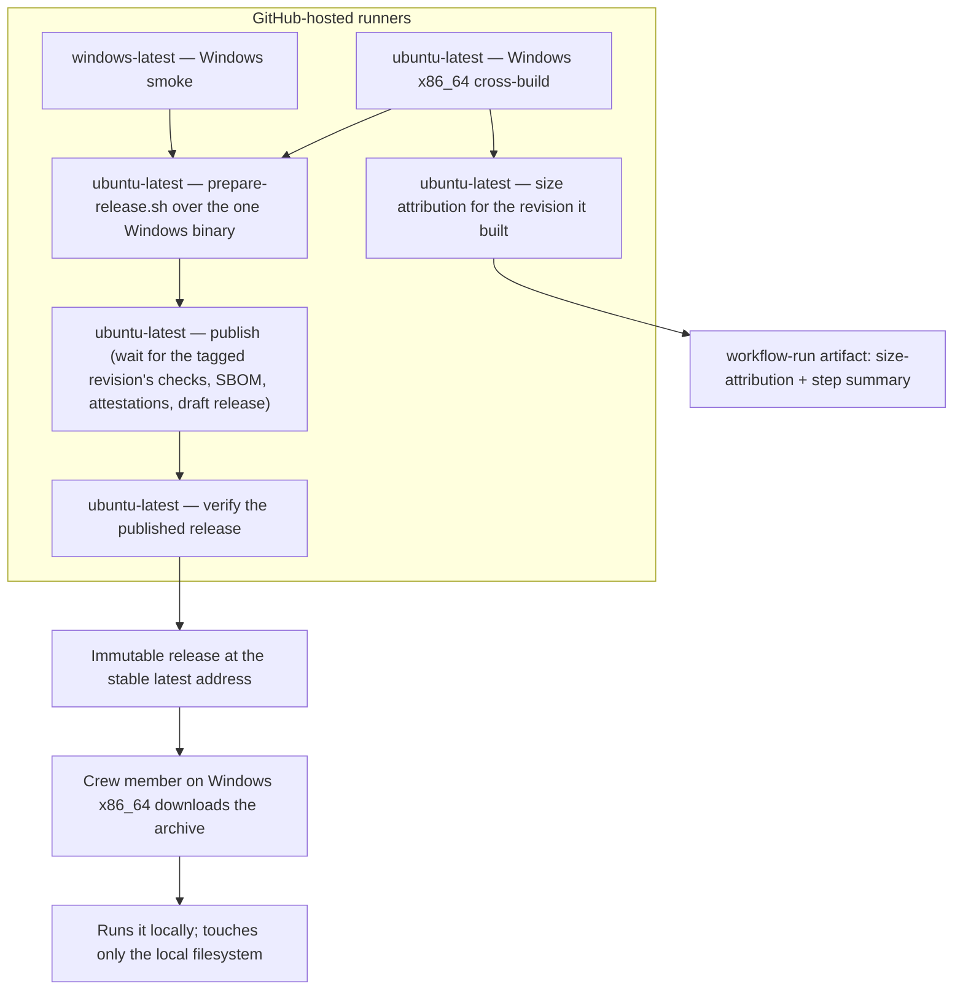
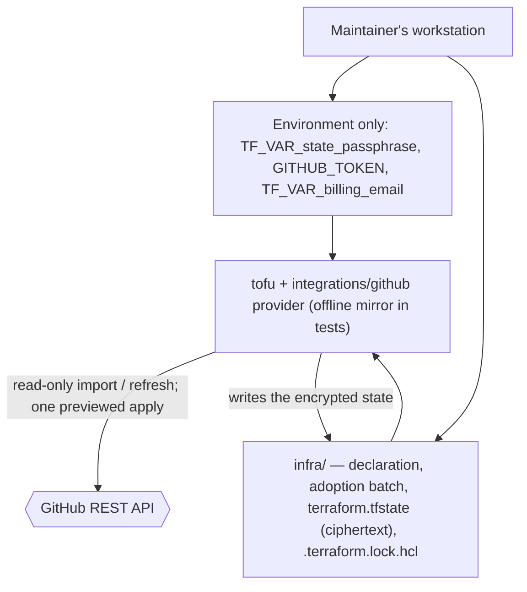

# 7. Deployment View

## Infrastructure level 1

The project publishes one self-contained Windows x86_64 executable, cross-built by its own automation on a GitHub-hosted Linux runner, started on a Windows runner and published as an immutable release from the public repository. A crew member on Windows downloads the archive from the stable latest-release address and runs the executable on their own machine; it touches only the local filesystem. Other platforms are unsupported, untested and undistributed and build the source with a Rust toolchain.

| Node / Environment | Description |
|---|---|
| `ubuntu-latest` | Cross-builds the Windows (`x86_64-pc-windows-gnu`) executable and also runs the single packaging, publish and verify jobs; the publish job waits for the tagged revision's checks before anything becomes public. The Windows cross-build also produces the size attribution for the revision it built and uploads it beside the run. It remains the CI, coverage and local test host but publishes nothing of its own. |
| `windows-latest` | Starts the cross-built Windows executable: the "started on a machine of that kind" evidence. |
| GitHub Releases | Serves the published Windows archive, its checksum, its provenance and bill of materials, the release text, and the change log (`CHANGELOG.md`) at a stable latest-release address. |
| Crew member's machine | Runs the downloaded executable; supplies the plan and receives the calendar or a diagnostic. |
| Local filesystem | Holds the input plan and the published calendar/report files. |

## Infrastructure level 2

### The Windows artefact and the runners that build it

| Artefact | Target triple | Built by |
|---|---|---|
| `duty2cal-<version>-windows-x86_64.tar.gz` | `x86_64-pc-windows-gnu` | Cross-built on `ubuntu-latest`, then started on `windows-latest`. |

The archive holds `duty2cal.exe` and nothing else; a checksum file covering the archive sits beside it on the release. Packaging into the archive happens once, on `ubuntu-latest`; the release is published and then verified on `ubuntu-latest` as well. No other platform archive is built or attached.

### The change log among the release assets

Beside the one Windows archive and its checksum (and the archive's provenance and bill of materials), a release carries the change log and its newest section: `CHANGELOG.md` is published as an asset, so a downloader reads what changed without visiting the repository, and the release page's text is that same file's newest section. Both come from one render of the released revision, so the page and the published file cannot state different things about what a version contains.

### The size attribution beside the run

The Windows cross-build job runs `scripts/measure_executable_size.py` after it has built and inspected the executable, so the report describes the revision that job built, and uploads the report as the run's `size-attribution` artifact beside the step summary. The measurement step is evidence, not a gate: it exits zero whatever the command reported, always appends the report (or a note that none was written) to the step summary, and uploads the artifact with `if: always()`, so an unreadable report is published and the job continues; no revision or release is refused because of it. The report is not a release asset, not committed, and not attached to the change: it belongs to the run for the revision it names, which is what lets a reviewer compare two revisions before either lands.

The same command runs on the maintainer's Linux host once the Windows target, `mingw-w64` and the pinned generator are installed; the suite's `test` and `coverage` jobs install the same three so the `@e2e` scenario drives the real command. A host without them runs the suite in a container that provides them (the local deployment path recorded in the change's design).

### The crew member's machine

| Property | Value |
|---|---|
| Hardware / VM | Crew member's ordinary machine |
| OS | Windows x86_64 only. Linux, macOS and any other platform are unsupported, untested and undistributed; their users may build the source with a Rust toolchain. |
| Middleware / Runtime | None beyond the executable (Windows GNU statically linked; no companion DLL or runtime installer) |
| Key software deployed | One self-contained `duty2cal.exe` executable |

### Downloading and verifying

- A downloader on Windows x86_64 takes `duty2cal-<version>-windows-x86_64.tar.gz` from the stable latest-release address `https://github.com/duty2cal/duty2cal/releases/latest`, which stays reachable as later versions are published. No archive is offered for any other platform.
- They recompute the archive's digest and compare it with the published `.sha256` (`sha256sum --check` or `Get-FileHash`), so they verify what they received before extracting it.
- They then confirm the file's build provenance and bill of materials with `gh attestation verify`, run against the archive, which ties the file in hand to the tagged revision and this project's automation.
- Already-published releases keep their original assets and links; only future releases are Windows-only.

## The declared configuration and the applied state

The public home's configuration is deployed from the maintainer's workstation,
never from CI. The declaration lives in the repository; the binding between the
declaration and GitHub's objects is an encrypted state file that is committed
with it; the passphrase that opens it, and the token that authorizes the
operation, exist only in the maintainer's environment.

| Node / Environment | Description |
|---|---|
| Maintainer's workstation | Runs the adoption and later the preview, apply and local drift check; holds the passphrase and the token. |
| `infra/` | The declaration, the batch, the provider lock file and the encrypted state; committed, reviewed and public — but the state is ciphertext. |
| GitHub | The only owner of the live settings; receives a write only from a later, separately reviewed apply. |
| CI | Runs the same suite against a local fake API; holds no GitHub token and no passphrase, so it can neither apply nor report drift. |

## Deployment consequences

- No package manager, service, or configuration file is required on the supported platform.
- The executable may be launched by path or by dragging a PDF onto it.
- One Windows archive is attached per version: the executable runs there with no runtime installer and no companion library beyond the platform's own. Other platforms receive no archive and build the source; that route is not exercised by CI.
- Windows GNU was kept over the brief's MSVC target: the Linux cross-build stays available and static linking preserves the single-executable requirement; the GNU runtime imports, the cross-build, and the Windows smoke start are release-evidence gates, not assumptions.
- Linux is the cross-build, CI and local test host, not a published platform; it does not appear on the release page.
- Already-published Linux and macOS archives stay as they were: releases are immutable, so this narrowing applies to future releases only.
- The applied state is deployed as a committed ciphertext: `infra/terraform.tfstate` and its backup are in the repository, protected by the passphrase and by OpenTofu's `enforced = true` encryption. Losing the passphrase loses the state; re-adopting rebuilds it without changing anything live.
- The security change from this workstation, after the earlier configuration change, enables secret scanning and push protection on the monorepo. The two Dependabot settings are adopted read-only first, so the apply carries one live change; a read-only refresh-only preflight refuses a live edit made since the preview before `tofu apply` runs. The state that records the change is committed only after the apply is green; a partial apply's state is marked stale beside itself and is not committed.
- The administer token, the passphrase, the billing email and the transient encrypted plan file never leave the workstation; the plan file is git-ignored and deleted after the apply.
- The administer token and the passphrase are not deployed to any service: there is no apply in Actions and no configuration drift job in CI, so divergence from the declaration is found by the maintainer's local check.
- The test environment deploys no service: the fake GitHub API runs on loopback from the suite's step definitions, and the provider is installed from a local mirror.
