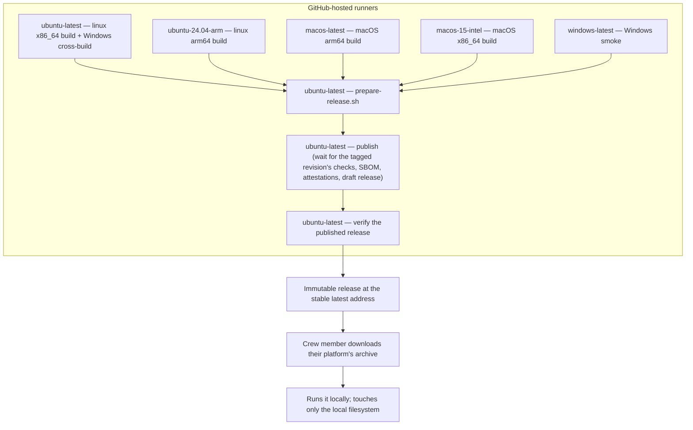

# 7. Deployment View

## Infrastructure level 1

The project publishes five self-contained executables — one per supported platform — built by its own automation on GitHub-hosted runners and published as an immutable release from the public repository. A crew member downloads the archive for their platform from the stable latest-release address and runs the executable on their own machine; it touches only the local filesystem.

| Node / Environment | Description |
|---|---|
| `ubuntu-latest` | Builds the linux x86_64 (`x86_64-unknown-linux-musl`) executable and cross-builds the Windows (`x86_64-pc-windows-gnu`) executable; also runs the single packaging, publish and verify jobs; the publish job waits for the tagged revision's checks before anything becomes public. |
| `ubuntu-24.04-arm` | Builds the linux arm64 (`aarch64-unknown-linux-musl`) executable. |
| `macos-latest` | Builds the macOS arm64 (`aarch64-apple-darwin`) executable natively. |
| `macos-15-intel` | Builds the macOS x86_64 (`x86_64-apple-darwin`) executable natively. |
| `windows-latest` | Starts the cross-built Windows executable: the "started on a machine of that kind" evidence. |
| GitHub Releases | Serves the published archives, their checksums, their provenance and bill of materials, the release text, and the change log (`CHANGELOG.md`) at a stable latest-release address. |
| Crew member's machine | Runs the downloaded executable; supplies the plan and receives the calendar or a diagnostic. |
| Local filesystem | Holds the input plan and the published calendar/report files. |

## Infrastructure level 2

### The five artefacts and the runners that build them

| Artefact | Target triple | Built by |
|---|---|---|
| `duty2cal-<version>-windows-x86_64.tar.gz` | `x86_64-pc-windows-gnu` | Cross-built on `ubuntu-latest`, then started on `windows-latest`. |
| `duty2cal-<version>-linux-x86_64.tar.gz` | `x86_64-unknown-linux-musl` | `ubuntu-latest`, statically linked. |
| `duty2cal-<version>-linux-arm64.tar.gz` | `aarch64-unknown-linux-musl` | `ubuntu-24.04-arm`, statically linked. |
| `duty2cal-<version>-macos-arm64.tar.gz` | `aarch64-apple-darwin` | `macos-latest`, built natively. |
| `duty2cal-<version>-macos-x86_64.tar.gz` | `x86_64-apple-darwin` | `macos-15-intel`, built natively. |

Each archive holds that platform's executable under the name the platform uses (`duty2cal`, or `duty2cal.exe` on Windows) and nothing else; a checksum file covering the archive sits beside it on the release. Packaging into the archives happens once, on `ubuntu-latest`; the release is published and then verified on `ubuntu-latest` as well.

### The change log among the release assets

Beside the five archives and their checksums (and each archive's provenance and bill of materials), a release carries the change log and its newest section: `CHANGELOG.md` is published as an asset, so a downloader reads what changed without visiting the repository, and the release page's text is that same file's newest section. Both come from one render of the released revision, so the page and the published file cannot state different things about what a version contains.

### The crew member's machine

| Property | Value |
|---|---|
| Hardware / VM | Crew member's ordinary machine |
| OS | Windows x86_64, Linux x86_64 or arm64, or macOS arm64 or x86_64 |
| Middleware / Runtime | None beyond the executable (Windows GNU statically linked; Linux musl-static; macOS self-contained; no companion DLL or runtime installer) |
| Key software deployed | One self-contained `duty2cal` executable |

### Downloading and verifying

- A downloader selects the archive named for their machine, from the stable latest-release address `https://github.com/kressnerd/duty2cal/releases/latest`, which stays reachable as later versions are published.
- They recompute the archive's digest and compare it with the published `.sha256` (`sha256sum --check`), so they verify what they received before extracting it.
- They then confirm the file's build provenance and bill of materials with `gh attestation verify`, run against the archive, which ties the file in hand to the tagged revision and this project's automation.
- The macOS archives are published unsigned: a download from a browser is quarantined and needs a one-time approval from the crew member, which the README documents before they meet the dialog.

## Deployment consequences

- No package manager, service, or configuration file is required on any supported platform.
- The executable may be launched by path or by dragging a PDF onto it.
- Five archives replace the former single Windows artefact: each platform's executable runs there with no runtime installer and no companion library beyond that platform's own.
- Windows GNU was kept over the brief's MSVC target: the Linux cross-build stays available and static linking preserves the single-executable requirement; the GNU runtime imports, the cross-build, and the Windows smoke start are release-evidence gates, not assumptions.
- Linux is musl-static so the "no runtime installation" promise does not depend on a glibc version or a distribution.
- The macOS archives are unsigned and need the one-time approval above; removing that step would need a paid Apple Developer account and is out of scope for this change.
