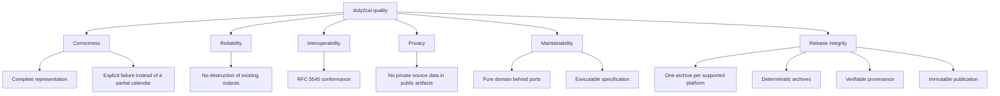

# 10. Quality Requirements

## Quality tree

## Quality scenarios

| ID | Quality attribute | Scenario | Metric / Acceptance criterion |
|---|---|---|---|
| QS-001 | Correctness / completeness | A supported plan contains a required activity code the converter does not recognize. | No calendar is published; the failure names the source and a numbered diagnostic is attempted. |
| QS-002 | Reliability (no data loss) | `roster.pdf` is converted while `roster.ics` and `roster-1.ics` already exist. | A complete calendar is published as `roster-2.ics`; `roster.ics` and `roster-1.ics` are byte-identical before and after. |
| QS-003 | Interoperability | A supported plan with timed and all-day activities is converted. | The published file uses CRLF and UTF-8, escapes text as RFC 5545 requires, folds within 75 octets without splitting a character, and every timed activity ends after it starts. |
| QS-004 | Determinism | The identical source snapshot is converted twice under different output names. | The same activity carries the same component identifier in both calendars. |
| QS-005 | Privacy | The change's public fixtures and golden calendars are reviewed before archive. | No real duty-plan content, filename, or identifying value appears in any committed artifact; material is generated or anonymized. |
| QS-006 | Correctness (timing) | A local-date block boundary coincides with a UTC-day boundary. | Explicit \"(13)\" style qualifiers resolve to the matching adjacent Gregorian date; an unqualified same-block overnight pair rolls End to the next UTC day; a zero-length pair is not repaired. |
| QS-007 | Release completeness | A supported platform's executable was not built before the release is prepared. | The preparation refuses and names the missing platform; no archive is staged and no release is published. |
| QS-008 | Release determinism | The same five executables and version are prepared twice. | The two prepared sets of archives are identical, byte for byte. |
| QS-009 | Release verifiability | A downloader holds a published archive and its checksum. | The checksum matches the archive it names, and `gh attestation verify` confirms the archive's build provenance against the released revision. |
| QS-010 | Release immutability | A published release's asset is replaced, deleted, or its version tag moved. | The published release rejects the change: assets cannot be replaced or deleted and the tag cannot be moved, so a correction appears as the next version. |

**Stimulus / response / metric** for the primary scenario:

- **QS-002 stimulus:** three files present beside the source (`roster.pdf`, `roster.ics`, `roster-1.ics`).
- **QS-002 system response:** allocate the next unused name and write only there.
- **QS-002 metric:** the new file is `roster-2.ics`; the two prior files' bytes are unchanged.
