# 10. Quality Requirements

## Quality tree

```mermaid
flowchart TB
  root["duty2cal quality"]
  root --> corr["Correctness"]
  root --> rel["Reliability"]
  root --> inter["Interoperability"]
  root --> priv["Privacy"]
  root --> maint["Maintainability"]
  corr --> c1["Complete representation"]
  corr --> c2["Explicit failure instead of a partial calendar"]
  rel --> r1["No destruction of existing outputs"]
  inter --> i1["RFC 5545 conformance"]
  priv --> p1["No private source data in public artifacts"]
  maint --> m1["Pure domain behind ports"]
  maint --> m2["Executable specification"]
  root --> rel2["Release integrity"]
  rel2 --> ri1["One Windows x86_64 archive per version"]
  rel2 --> ri2["Deterministic archives"]
  rel2 --> ri3["Verifiable provenance"]
  rel2 --> ri4["Immutable publication"]
  rel2 --> ri5["Notes group the changes a reader can see"]
  rel2 --> ri6["Committed change log matches the released revision"]
  rel2 --> ri7["Dependency updates are releasable and announced"]
  rel2 --> ri8["Publication waits for every check to conclude"]
  root --> repro["Reproducibility of the public home"]
  repro --> rp1["Reviewable declaration"]
  repro --> rp2["All-or-none adoption with no live change"]
  repro --> rp3["Encrypted state at rest"]
  repro --> rp4["Security settings declared and applied"]
  repro --> rp5["A refusal changes nothing and a partial failure is named"]
```

## Quality scenarios

| ID | Quality attribute | Scenario | Metric / Acceptance criterion |
|---|---|---|---|
| QS-001 | Correctness / completeness | A supported plan contains a required activity code the converter does not recognize. | No calendar is published; the failure names the source and a numbered diagnostic is attempted. |
| QS-002 | Reliability (no data loss) | `roster.pdf` is converted while `roster.ics` and `roster-1.ics` already exist. | A complete calendar is published as `roster-2.ics`; `roster.ics` and `roster-1.ics` are byte-identical before and after. |
| QS-003 | Interoperability | A supported plan with timed and all-day activities is converted. | The published file uses CRLF and UTF-8, escapes text as RFC 5545 requires, folds within 75 octets without splitting a character, and every timed activity ends after it starts. |
| QS-004 | Determinism | The identical source snapshot is converted twice under different output names. | The same activity carries the same component identifier in both calendars. |
| QS-005 | Privacy | The change's public fixtures and golden calendars are reviewed before archive. | No real duty-plan content, filename, or identifying value appears in any committed artifact; material is generated or anonymized. |
| QS-006 | Correctness (timing) | A local-date block boundary coincides with a UTC-day boundary. | Explicit \"(13)\" style qualifiers resolve to the matching adjacent Gregorian date; an unqualified same-block overnight pair rolls End to the next UTC day; a zero-length pair is not repaired. |
| QS-007 | Release completeness | The Windows x86_64 executable was not built before the release is prepared. | The preparation refuses and names `windows-x86_64`; no archive is staged and no release is published. |
| QS-008 | Release determinism | The same Windows executable and version are prepared twice. | The two prepared archives are identical, byte for byte, with identical checksums. |
| QS-009 | Release verifiability | A downloader holds a published archive and its checksum. | The checksum matches the archive it names, and `gh attestation verify` confirms the archive's build provenance against the released revision. |
| QS-010 | Release immutability | A published release's asset is replaced, deleted, or its version tag moved. | The published release rejects the change: assets cannot be replaced or deleted and the tag cannot be moved, so a correction appears as the next version. |
| QS-011 | Release notes / releasability | A history whose released revisions name a new capability, a fix, and work no user can see — including a revision that changed only the release machinery — is released as version 0.2.0. | The release text is version 0.2.0's newest section of the change log, names the new capability before the fix, names no revision whose work no user can see and no revision that changed none of the paths a user receives, and states the comparison against version 0.1.0; a version whose notes would name no visible change is refused before publication. |
| QS-012 | Release integrity (repository-history currency) | A committed `CHANGELOG.md` whose newest section differs from what the released revision's history states. | The check refuses and names the version whose section differs, so a release is not published from a stale change log. |
| QS-013 | Correctness (printed fidelity) | A supported plan prints a crew position beside a flight number on a travel leg. | The published travel title prints the two as separate words (`FB 123 ABC-DEF`); a leg that prints no crew position keeps the flight number alone (`123 ABC-DEF`), and a crew position printed beside a non-flight activity stays out of that activity's title. |
| QS-014 | Release notes / dependency updates | A history whose released revisions carry only dependency updates, each changing the dependency graph. | The release text lists them under Dependencies after Reversals, in history order; preparation stages the version, so a dependency-only version is releasable; a dependency update that changed only the project's checks is not listed, and a version whose notes would name nothing at all is still refused. |
| QS-015 | Release gate currency | A check run on the tagged revision is still queued or running when the `publish` job begins. | Publication waits for every check run outside the release-workflow suites; it publishes only after all conclude, at least one succeeds, and skipped/neutral are the only non-successes. A concluded non-success, no successful check, no evidence, an unreadable source, or the 30-minute bound refuses and names the checks; nothing is published. |
| QS-016 | Configuration reproducibility | The maintainer adopts a batch whose objects all exist live. | Every object in the batch is bound in the applied state, the command prints one `adopted` line per object, and the API journal records no refused write and no mutation (a GraphQL query POST is a read); the live configuration is unchanged. |
| QS-017 | State secrecy | The applied state is committed to the repository. | The committed file is ciphertext: `state` and `plan` encryption are `enforced`, the passphrase is required and has no default, and no workflow holds it. |
| QS-018 | Atomicity of a batch | One object of the batch cannot be read, is already bound, does not exist live, is not named by the declaration, changes after it is read, or the state cannot be decrypted or written. | The command refuses, names the object and the reason, and binds nothing: the applied state contains none of the batch's objects and no live object changed. |
| QS-019 | Declared security settings | The declaration enables secret scanning and push protection on the monorepo, both Dependabot settings are already on and bound, and the live monorepo reports both scanning settings disabled. | The targeted security preview names exactly the two scanning statuses and proposes no object to create or delete; the apply enables both, writes only the repository change, the state records both as enabled, and a later targeted security preview reports no differences; the full preview still names the pre-existing organization billing drift, a separate issue outside this change. |
| QS-020 | Truthful apply outcome | A targeted apply whose authority cannot perform the first change, and a targeted apply whose earlier settings succeed and whose later setting fails. | The first exits non-zero, names the repository, and writes nothing; the second exits non-zero, names the applied settings and the failed setting, and the applied state records only what succeeded. |
| QS-021 | Correctness (printed fidelity) | A supported travel leg supplies report time 07:30. | The published title ends with ` Report 07:30 LT`; a leg that supplies no report time keeps its previous title, and differing report values on the two fragments leave the title without a suffix while the description keeps both labelled values. |

**Stimulus / response / metric** for the primary scenario:

- **QS-002 stimulus:** three files present beside the source (`roster.pdf`, `roster.ics`, `roster-1.ics`).
- **QS-002 system response:** allocate the next unused name and write only there.
- **QS-002 metric:** the new file is `roster-2.ics`; the two prior files' bytes are unchanged.
