# 10. Quality Requirements

> **Test-scope amendment (reduce-test-runtime).** The operational capability
> feature files remain as `@documentation`; their cucumber step definitions were
> deleted. Where this chapter names a scenario, a suite or a fake-API proof for
> an operational behaviour, the executable evidence is the owning workflow, the
> `bats` tests, or the maintainer's preview/apply. `scripts/setup-infra-tests.sh`
> covers only the provider/import/base setup. The product scenario suite is the
> conversion capability only.

## Quality tree

```mermaid
flowchart TB
  root["duty2cal quality"]
  root --> corr["Correctness"]
  root --> rel["Reliability"]
  root --> inter["Interoperability"]
  root --> priv["Privacy"]
  root --> maint["Maintainability"]
  corr --> c1["Complete representation"]
  corr --> c2["Explicit failure instead of a partial calendar"]
  rel --> r1["No destruction of existing outputs"]
  inter --> i1["RFC 5545 conformance"]
  priv --> p1["No private source data in public artifacts"]
  maint --> m1["Pure domain behind ports"]
  maint --> m2["Executable specification"]
  root --> rel2["Release integrity"]
  rel2 --> ri1["One Windows x86_64 archive per version"]
  rel2 --> ri2["Deterministic archives"]
  rel2 --> ri3["Verifiable provenance"]
  rel2 --> ri4["Immutable publication"]
  rel2 --> ri5["Notes group the changes a reader can see"]
  rel2 --> ri6["Committed change log matches the released revision"]
  rel2 --> ri7["Dependency updates are releasable and announced"]
  rel2 --> ri8["Publication waits for every check to conclude"]
  rel2 --> ri9["Measured size attribution"]
  root --> browser["Browser conversion"]
  browser --> b1["Same calendar as the executable"]
  browser --> b2["No plan leaves the tab; no request after load"]
  browser --> b3["Explicit failure; offer withdrawn on failure"]
  browser --> b4["Capability and startup gate"]
  root --> siteq["Published public website"]
  siteq --> sq1["Only evidence-gated content becomes public"]
  siteq --> sq2["Whole-content replacement; no hand edits"]
  siteq --> sq3["The footer names a resolvable Built revision"]
  siteq --> sq4["A release publishes only after the site deploy and the target carries the tag"]
  siteq --> sq5["The served page names the Built revision"]
  siteq --> sq6["Either notice is one step from every page; an incomplete notice set is refused"]
  root --> repro["Reproducibility of the public home"]
  repro --> rp1["Reviewable declaration"]
  repro --> rp2["All-or-none adoption with no live change"]
  repro --> rp3["Encrypted state at rest"]
  repro --> rp4["Security settings declared and applied"]
  repro --> rp5["A refusal changes nothing and a partial failure is named"]
  repro --> rp6["Public profile copy is truthful and self-contained"]
  repro --> rp7["One support statement across its five carriers"]
```

## Quality scenarios

| ID | Quality attribute | Scenario | Metric / Acceptance criterion |
|---|---|---|---|
| QS-001 | Correctness / completeness | A supported plan contains a required activity code the converter does not recognize. | No calendar is published; the failure names the source and a numbered diagnostic is attempted. |
| QS-002 | Reliability (no data loss) | `roster.pdf` is converted while `roster.ics` and `roster-1.ics` already exist. | A complete calendar is published as `roster-2.ics`; `roster.ics` and `roster-1.ics` are byte-identical before and after. |
| QS-003 | Interoperability | A supported plan with timed and all-day activities is converted. | The published file uses CRLF and UTF-8, escapes text as RFC 5545 requires, folds within 75 octets without splitting a character, and every timed activity ends after it starts. |
| QS-004 | Determinism | The identical source snapshot is converted twice under different output names. | The same activity carries the same component identifier in both calendars. |
| QS-005 | Privacy | The change's public fixtures and golden calendars are reviewed before archive. | No real duty-plan content, filename, or identifying value appears in any committed artifact; material is generated or anonymized. |
| QS-006 | Correctness (timing) | A local-date block boundary coincides with a UTC-day boundary. | Explicit \"(13)\" style qualifiers resolve to the matching adjacent Gregorian date; an unqualified same-block overnight pair rolls End to the next UTC day; a zero-length pair is not repaired. |
| QS-007 | Release completeness | The Windows x86_64 executable was not built before the release is prepared. | The preparation refuses and names `windows-x86_64`; no archive is staged and no release is published. |
| QS-008 | Release determinism | The same Windows executable and version are prepared twice. | The two prepared archives are identical, byte for byte, with identical checksums. |
| QS-009 | Release verifiability | A downloader holds a published archive and its checksum. | The checksum matches the archive it names, and `gh attestation verify` confirms the archive's build provenance against the released revision. |
| QS-010 | Release immutability | A published release's asset is replaced, deleted, or its version tag moved. | The published release rejects the change: assets cannot be replaced or deleted and the tag cannot be moved, so a correction appears as the next version. |
| QS-011 | Release notes / releasability | A history whose released revisions name a new capability, a fix, and work no user can see — including a revision that changed only the release machinery — is released as version 0.2.0. | The release text is version 0.2.0's newest section of the change log, names the new capability before the fix, names no revision whose work no user can see and no revision that changed none of the paths a user receives, and states the comparison against version 0.1.0; a version whose notes would name no visible change is refused before publication. |
| QS-012 | Release integrity (repository-history currency) | A committed `CHANGELOG.md` whose newest section differs from what the released revision's history states. | The check refuses and names the version whose section differs, so a release is not published from a stale change log. |
| QS-013 | Correctness (printed fidelity) | A supported plan prints a crew position beside a flight number on a travel leg. | The published travel title prints the two as separate words (`FB 123 ABC-DEF`); a leg that prints no crew position keeps the flight number alone (`123 ABC-DEF`), and a crew position printed beside a non-flight activity stays out of that activity's title. |
| QS-014 | Release notes / dependency updates | A history whose released revisions carry only dependency updates, each changing the dependency graph. | The release text lists them under Dependencies after Reversals, in history order; preparation stages the version, so a dependency-only version is releasable; a dependency update that changed only the project's checks is not listed, and a version whose notes would name nothing at all is still refused. |
| QS-015 | Release gate currency | A check run on the tagged revision is still queued or running when the `publish` job begins. | Publication waits for every check run outside the release-workflow suites; it publishes only after all conclude, at least one succeeds, and skipped/neutral are the only non-successes. A concluded non-success, no successful check, no evidence, an unreadable source, or the 30-minute bound refuses and names the checks; nothing is published. |
| QS-016 | Configuration reproducibility | The maintainer adopts a batch whose objects all exist live. | Every object in the batch is bound in the applied state, the command prints one `adopted` line per object, and the API journal records no refused write and no mutation (a GraphQL query POST is a read); the live configuration is unchanged. |
| QS-017 | State secrecy | The applied state is committed to the repository. | The committed file is ciphertext: `state` and `plan` encryption are `enforced`, the passphrase is required and has no default, and no workflow holds it. |
| QS-018 | Atomicity of a batch | One object of the batch cannot be read, is already bound, does not exist live, is not named by the declaration, changes after it is read, or the state cannot be decrypted or written. | The command refuses, names the object and the reason, and binds nothing: the applied state contains none of the batch's objects and no live object changed. |
| QS-019 | Declared security settings | The declaration enables secret scanning and push protection on the monorepo, both Dependabot settings are already on and bound, and the live monorepo reports both scanning settings disabled. | The targeted security preview names exactly the two scanning statuses and proposes no object to create or delete; the apply enables both, writes only the repository change, the state records both as enabled, and a later targeted security preview reports no differences; the full preview still names the pre-existing organization billing drift, a separate issue outside this change. |
| QS-020 | Truthful apply outcome | A targeted apply whose authority cannot perform the first change, and a targeted apply whose earlier settings succeed and whose later setting fails. | The first exits non-zero, names the repository, and writes nothing; the second exits non-zero, names the applied settings and the failed setting, and the applied state records only what succeeded. |
| QS-021 | Correctness (printed fidelity) | A supported travel leg supplies report time 07:30. | The published title ends with ` Report 07:30 LT`; a leg that supplies no report time keeps its previous title, and differing report values on the two fragments leave the title without a suffix while the description keeps both labelled values. |
| QS-022 | Truthful public copy | The organization profile and the Public website are published and the only published archive is Windows x86_64. | The profile describes the converter and its crew duty plan input, names Windows x86_64 as the only published archive platform and states that builds for other operating systems are available on request, states that a current browser converts a plan on the Public website at `https://duty2cal.github.io/` and links it, makes no hosted-converter claim, links the stable latest-release address and the source and site repositories, states that the project is not affiliated with any provider or airline, attributes the third-party Unicode data to Unicode-3.0, links only absolute addresses, and embeds no image, badge or other third-party resource; the published page states the same terms itself before it offers a file picker, does not prescribe a Windows-only download, and instead names downloads for various operating systems available on request while linking its release page. |
| QS-023 | Default security policy | A repository without its own security policy is read by a contributor. | The organization profile repository carries `SECURITY.md` at its root; the policy names the private vulnerability reporting route, forbids attaching a real duty plan or a converted calendar, and states that only the latest published release is supported; the Pages repository serves no policy of its own. The route was enabled manually before that publication. |
| QS-024 | Browser conversion equivalence | A supported plan whose Created footer supplies its revision timestamp is converted by both the executable and the browser. | The offered calendar matches the reference fixture (one event per expected activity, `SUMMARY`/`DTSTART`/`DTEND`, CRLF, UID, DTSTAMP, no extra or partial event) and is byte-identical to the executable's calendar for the same plan. |
| QS-025 | Browser privacy | A plan is converted in the page while the driver records every request and a storage snapshot. | No request to another origin occurs after load, no third-party asset is loaded, the plan never enters a request, and no plan or derived data appears in localStorage, sessionStorage, IndexedDB, a cookie, the address or a history entry. |
| QS-026 | Browser explicit failure | A conversion fails after an earlier successful conversion, or the calendar offer cannot be created. | The failure heading and reason are visible, no calendar is offered, the earlier offer is withdrawn, a diagnostic offer is attempted, and a failed diagnostic offer leaves the primary failure visible with "No diagnostic was offered." |
| QS-027 | Browser capability and startup gate | The page is loaded without WebAssembly, without ES modules, or with a converter module that cannot be instantiated. | A cannot-run/startup heading is visible, the picker and calendar are absent, and no request to another origin or server/upload fallback occurs. |
| QS-028 | Browser input bound | A plan of exactly 20 MiB and a plan of 25 MiB are supplied. | The 20 MiB plan reaches the ready state and offers `<stem>.ics`; the 25 MiB plan is refused by name before parsing, offers no calendar and offers the diagnostic. |
| QS-029 | Browser diagnostic fidelity | A conversion failure is produced and the diagnostic download is captured. | The captured `<stem>.parse-error.txt` contains `Source PDF: <filename>` and `Reason: <reason>` exactly as the executable composes them, and names the source stem. |
| QS-030 | Browser save semantics | The offered calendar is saved, dismissed, or the page is reloaded. | A dismissed save leaves the offer visible and the page never reports a save; a reload shows the empty state and offers nothing. |
| QS-031 | Browser evidence reproducibility | The browser suite is prepared on a clean machine, and the Site publication runs from a checkout whose `web/e2e/package-lock.json` differs from the published revision's. | Node resolves from the committed `.nvmrc`, Playwright/axe from the lockfile, `wasm-pack` from its pin, and Chromium from the Playwright package; a missing tool fails the run rather than skipping the browser scenarios; a publication whose lockfiles differ refuses and names the lockfile and `npm ci --prefix web/e2e` instead of borrowing an installed tree that pins other versions. The publication's lockfile comparison refuses a differing tree and names the lockfile; the feature file is documentation. |
| QS-032 | Measured size evidence | A revision is pushed, and the Windows cross-build produces its attribution; a build fails, a build keeps no names, and a stripped executable's file size cannot be read. | The report names the requested revision, the resolved revision and `x86_64-pc-windows-gnu`, records the build identity (toolchain, `cargo-bloat 0.12.1`, configuration digests), divides the build that retains the names by crate and by function, and states the stripped executable's file size beside the split; the two numbers are different quantities and neither is substituted for the other. A failed build or a build that keeps no names produces no attribution and names what could not be read; an unreadable file size leaves the report incomplete and never presents the split's total as the file size. The measurement is evidence, not a gate: its CI step publishes the report and exits zero, so it does not refuse a revision or a release. |
| QS-033 | Measured size reduction | The release profile carries `panic = "abort"`; the unchanged configuration rebuilds to 2,098,176 B, the lever to 2,014,208 B, and `opt-level = "s"` measures larger. | The reduction is applied (83,968 B smaller); `opt-level = "s"` is rejected; the landed executable is rebuilt and measured smaller; a panic aborts with the standard message, and an unsupported source still writes a numbered diagnostic. |
| QS-034 | Pages publishing plumbing | The declaration added the pages deploy key, the `PAGES_DEPLOY_KEY` secret and the pages rule set, none of which existed live at that apply, and the applied state bound every earlier object. | The creation guard reads the three live lists and finds nothing; the targeted preview names exactly the three live creations plus the generated key and no other change; the apply creates the write-enabled key, the sealed secret and the active rule set with the `DeployKey`/`always` bypass, records the three bindings and the generated key material, and a later targeted preview reports no differences; the stock site, its source and its Pages configuration were unchanged by that apply. If any object exists live and unbound the preview refuses and names it; a failure after the deploy key is created is reported as partial with the applied and failed objects named and the state marked stale, and the next preview refuses until a green apply records the whole revision. |
| QS-035 | Gated site publication | A default-branch revision changes the page and one of the required evidence checks fails: the page misses a required statement, loads a third-party asset, or ships an asset with no licence information; or the revision's tree cannot be checked out. | The publication refuses, names the failing check (or the missing statement, the request, the asset or the worktree), writes nothing into the hosting target, and the previous page stays; when every check passes, the target holds exactly the Site output as one commit and nothing else. |
| QS-036 | Published revision traceability | A revision three commits after the tag `v0.5.0` publishes the site, and a later `v0.5.0` tag publication follows it while the default branch is newer. | The footer names `v0.5.0-3-g<sha>` and links the commit; the tag publication names `v0.5.0`, links the tagged commit and publishes the tagged tree even though the default branch is newer; an unresolvable revision or an unclean caller tree refuses the publication and names the revision. |
| QS-037 | Release gated on the site deploy | A version is tagged and its page requests a third-party asset; a prepared release finds a hosting target that does not hold the tagged Built revision. | The site publication is refused with the browser check named, the previous page stays, no release is published, and the staged archive is unchanged. In the second case the release command reads the target's branch tip, refuses before any `gh` call, names the site revision and publishes no release, which the release workflow's site job and `scripts/publish-release.sh` enforce; the feature file is documentation. |
| QS-038 | Site-input trigger decision | A default-branch revision changes only the project's documents, and a release tag names a revision that changes no site input. | The default-branch publication reports `no site input changed`, builds nothing and writes nothing; the tag publication builds and publishes anyway. An unresolvable comparison base refuses and names it. The `scripts/tests/publish-site.bats` documentation-only case covers the `--since` decision; a tag publication is the release workflow's `site` job with no `--since`; the feature file is documentation. |
| QS-039 | Served-revision truthfulness | A publication replaces the target's content, and the address it verifies serves an earlier page (or does not answer within the bound). | The publication retries the fetch with a bound, then refuses and names the address and the served revision; it reports no success. The target still holds the newly published page, because the check runs after the replacement, so the refusal never claims the previous page was restored. When the served page names the Built revision, the publication reports success. The publication's `--verify-url` check enforces this; the feature file is documentation. |
| QS-040 | Verification runtime | The default suite runs on a clean CI runner and on a developer machine. | The owned target is 10 minutes in CI and 5 minutes locally; the job's 20-minute timeout is the hard failure line. `run-tests.sh` prints one `phase=<name> seconds=<n>` line per class with the cucumber concurrency. |
| QS-041 | Executable size budget | The Windows cross-build produces the executable. | The job fails when `stat -c %s target/x86_64-pc-windows-gnu/release/duty2cal.exe` exceeds 2,097,152 bytes (the last published executable's file size); the per-push attribution remains the evidence report. |
| QS-042 | Nightly verification | The scheduled workflow is enabled and runs on the default branch with no new commit. | The product suite (including the CLI e2e) and all 16 browser variants pass; `cargo deny check` reads a fresh advisory database. The run holds `contents: read` and no state passphrase, administer token or deploy key; a failure is visible in the run and its transcript artifact. GitHub disables the schedule after 60 days without repository activity; a manual dispatch or any push re-enables it (R-071). |
| QS-043 | One support statement across its carriers | A revision edits the support sentence in the README, and one of the other carriers (the page, the profile, chapter 3 or an issue form) still carries the earlier wording or an export-family question. | `scripts/support-statement-check.sh` exits non-zero and names the disagreeing carrier and the rule; the clean tree passes; the site publication refuses an assembled page whose `what-it-does` or `non-affiliation` element differs and names the statement; the profile's reviewed source is the one the apply publishes. The check proves the words agree, not that they are true; the generated fixture and review carry that (R-072). |
| QS-044 | Legal notice reachability | A reader opens any page of the Public website, the organization profile or the README; and a revision drops a notice or a footer link, pastes a placeholder into a notice, or copies the postal address into the profile. | The converter page's footer links both notices and each notice's footer links the other notice and the converter page, so the Impressum and the Datenschutzerklärung are one step from any page; the profile and the README each carry two labelled links without a copied address. A dropped notice or footer link, a missing postal or mail address, a missing standing date in the Datenschutzerklärung, a placeholder or the discontinued dispute-resolution reference is refused by the publication, naming the page and the element; the source-level check refuses a carrier that does not link the notices or that copies the postal address, naming the carrier. The checks prove reachability, not legal sufficiency. |

**Stimulus / response / metric** for the primary scenario:

- **QS-002 stimulus:** three files present beside the source (`roster.pdf`, `roster.ics`, `roster-1.ics`).
- **QS-002 system response:** allocate the next unused name and write only there.
- **QS-002 metric:** the new file is `roster-2.ics`; the two prior files' bytes are unchanged.
