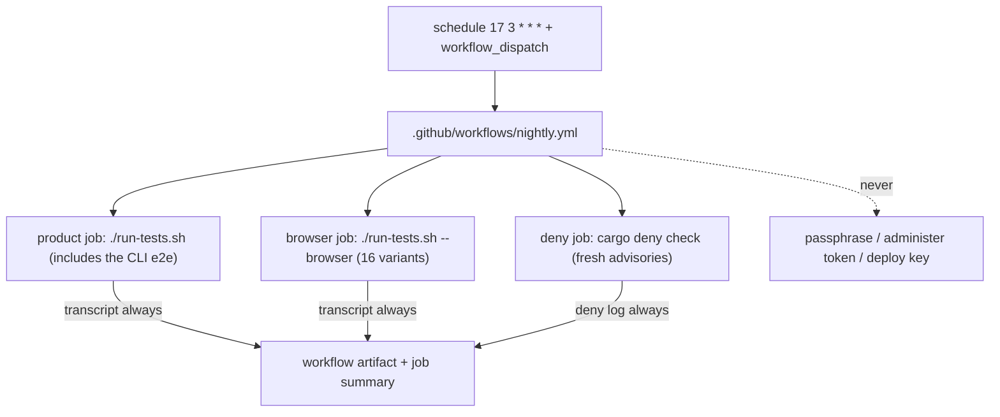

# Design: add-nightly-ci

## Scope

Operational maintenance change: add a scheduled workflow that runs the whole
runnable suite and the dependency-advisory check. No product code, capability
or site/release workflow changes. `specs` is skipped in `.givn-skip`.

## Technology decisions

| Area | Decision | Rationale |
|---|---|---|
| Workflow | New `.github/workflows/nightly.yml`, `schedule` at `17 3 * * *` and `workflow_dispatch`. | A non-round minute avoids the top-of-hour load; manual dispatch is the re-run path. |
| Permissions | `contents: read` at workflow level and on each job. | The nightly reads the repository and runs the existing suite; it never writes. |
| Concurrency | `group: nightly`, `cancel-in-progress: false`. | A slow browser run is not killed by the next night; overlapping manual runs serialize. |
| Product job | `./run-tests.sh`; Rust cache; 15-minute timeout. | Runs the 84 product scenarios (which include the CLI e2e scenario), the golden test, and the unit/property/architecture tests. |
| Browser job | `./run-tests.sh --browser`; Rust cache, wasm target, Node/Playwright/Chromium; 30-minute timeout. | Runs all 16 browser variants, including the smoke. |
| Dependency job | `taiki-e/install-action@v2` with `cargo-deny`, then `cargo deny check`; 10-minute timeout. | A fresh advisory database is the value a nightly adds over per-push CI. |
| Transcripts | `DUTY2CAL_TRANSCRIPT_PATH` for the product and browser jobs; `cargo deny check` is piped to `nightly-deny.log`; all three are uploaded with `if: always()`. | A red nightly names the failing scenario or the advisory in the run and its artifact. |
| Actionlint | Add `nightly.yml` to the `actionlint` job's file list. | The new workflow is checked with the others. |
| No drift/apply | No `tofu`, passphrase, administer token or deploy key in the nightly. | ADR-0006 and chapter 2 keep the state passphrase and administer token in the maintainer's environment. |
| No publication | The nightly does not call `site.yml`, `publish-site.sh` or `publish-release.sh`. | A tag or default-branch push remains the publication trigger; the nightly is verification only. |

**Version freshness.** No new version is written from memory. The workflow uses
`dtolnay/rust-toolchain@stable`, the repository's `web/e2e/.nvmrc` and
`package-lock.json`, and `taiki-e/install-action@v2` for `cargo-deny`.

## Architecture impact

No product crate, FFI surface, web asset or published artifact changes. CI gains
one scheduled workflow and one actionlint entry.

New or changed files:

| Path | Kind | Purpose |
|---|---|---|
| `.github/workflows/nightly.yml` | new | Scheduled product, browser and dependency jobs. |
| `.github/workflows/ci.yml` | changed | `actionlint` checks `nightly.yml` too. |
| `docs/arc42/02-architecture-constraints.md` | changed | Records the nightly-run boundary and the no-secrets rule. |
| `docs/arc42/07-deployment-view.md` | changed | Adds the nightly workflow to the runner/job description. |
| `docs/arc42/08-crosscutting-concepts.md` | changed | The test-scope concept names the per-push smoke and the nightly all-variant run. |
| `docs/arc42/10-quality-requirements.md` | changed | New QS-042 for nightly verification. |
| `docs/arc42/11-risks-and-technical-debt.md` | changed | R-070's mitigation names the nightly; R-071 records the 60-day schedule limit. |

## Step definitions

Existing product step files only; no new step definition.

| Step definition file | Permanent merge target | Subject |
|---|---|---|
| `apps/cli/tests/steps/export_duty_plan_calendar.rs` | same | CLI and in-process conversion. |
| `apps/cli/tests/steps/e2e/export_duty_plan_calendar.rs` | same | CLI and browser end-to-end actions. |
| `apps/cli/tests/steps/browser.rs` | same | Playwright driver client. |

## Test runner and commands

- Product: `./run-tests.sh` (84 scenarios, 303 steps, plus the Rust tests and
  golden test).
- CLI e2e: `./run-tests.sh --e2e` (1 scenario, 5 steps).
- Browser: `./run-tests.sh --browser` (16 scenarios).
- Strict mode: `.fail_on_skipped()`; unchanged.
- The nightly reuses the same scripts; it adds no runner path.

## Interaction Coverage Matrix

| Inventory entry | @e2e scenario title | Real interface | Driving mechanism |
|---|---|---|---|
| supply a duty plan for conversion through the executable | Crew member converts a supported duty plan and receives a calendar file | CLI | Real `duty2cal` subprocess |
| supply a duty plan through the converter page and save the offered calendar | Crew member converts a supported duty plan in the browser and saves the offered calendar | Web UI | Playwright driver |

The nightly runs both; it does not change the matrix.

## Local runnability

`./run-tests.sh`, `./run-tests.sh --e2e` and `./run-tests.sh --browser` remain
the local commands. The browser command needs the pinned Node, Playwright and
Chromium; the other two need only the Rust toolchain.

## Decisions

- Decides D1: run the whole runnable suite nightly and on manual dispatch —
  realized in `.github/workflows/nightly.yml`.
- Decides D2: keep the nightly read-only and secret-free — realized in the
  workflow permissions and the absence of `tofu`, deploy keys and publication
  steps.
- Decides D3: refresh the advisory database nightly with `cargo deny` —
  realized in the `deny` job.
- Decides D4: record GitHub's 60-day inactivity disable for scheduled
  workflows and the re-enable path — realized in R-071, the workflow header,
  and QS-042's qualified wording.

## Use-case traceability

| Use-case guarantee or rule | Design decision | E2E evidence |
|---|---|---|
| Export through the executable | Product job | "Crew member converts a supported duty plan and receives a calendar file" |
| Offer and save in the browser | Browser job | "Crew member converts a supported duty plan in the browser and saves the offered calendar" |
| No operational test in `cargo test` | Reuses the archived scope; no new step binding | `./run-tests.sh` |
| No passphrase or administer token in CI | Read-only workflow; no `tofu` | Workflow permissions and step list |
