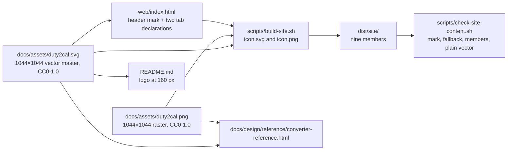

# Design: add-vector-brand-assets

## Scope

Give the project's existing brand mark a vector master and use it wherever the
mark is displayed at a user-interface size: the published page's header mark,
the page's tab icon declaration and the repository README logo. The existing raster stays
as the tab-icon fallback and as the project's raster asset. The mark itself is
unchanged: same silhouette, same three colours, same transparent rounded
corners.

What the change does not touch: the mark's design, the design tokens, the page
layout, the page's statements and states, the content security policy, the
publication's trigger list, its evidence order, the hosting target, the release
coupling, or the licensing.

## Technology decisions

- **Vector format:** a plain SVG 1.1 document — `<svg>` with `viewBox="0 0 1044
  1044"`, `width="1044"`, `height="1044"`, and `<path>` elements only. No
  embedded raster (`<image>`), no `<text>`, no `<style>`, no `<filter>`, no
  `<clipPath>`, no `<mask>`, no `<use>`, no gradient element, no `style`
  attribute, no fill, stroke or stop colour outside the palette, and no
  reference outside the file's own bytes. A plain path document is
  what every current browser renders identically and what the page-content check
  can verify without a renderer. The intrinsic `width`/`height` also give a tab
  declaration a nominal size where a browser asks for one.
- **No new tooling at runtime:** the page keeps loading same-origin assets only;
  the SVG is a member of the Site output, not a fetched template, and the CSP's
  `img-src 'self' data:` continues to cover it unchanged.
- **No new test or measurement dependency:** the recorded fidelity comparison
  used librsvg 2.62.3 through ImageMagick 7.1.2, both already present on the
  measurement host, and the implementation's re-run uses the Chromium that
  Playwright already installs for `web/e2e` (selected through `CHROMIUM_PATH`);
  the durable assertions are shell greps and one stdlib XML parse in the
  content check. Nothing is added
  to `package.json` and nothing new is installed by the gate.
- **The raster is frozen, not regenerated:** `docs/assets/duty2cal.png` keeps its
  bytes, so the fallback a browser without SVG tab icons receives is exactly the
  asset that shipped before this change.

### Version freshness

- Playwright **1.64.1** — pinned in `web/e2e/package.json` and
  `web/e2e/package-lock.json`, read 2026-10-27; unchanged by this change.
- Node **24** — `web/e2e/.nvmrc`, read 2026-10-27; unchanged.
- `wasm-pack` **0.15.0** — `web/.wasm-pack-version`, read 2026-10-27; unchanged.
- SVG: W3C SVG 1.1 (Second Edition), a stable Recommendation, not a
  version-pinned dependency. No new library or runtime is introduced, so no new
  version has to be resolved.

## Architecture impact



### Files

| File | New / changed | What changes |
|---|---|---|
| `docs/assets/duty2cal.svg` | new | The vector master: four `<path>` elements (the silhouette base plus the navy, cream and orange layers), `viewBox="0 0 1044 1044"`, `width`/`height` 1044, fills drawn only from `#0B1F3F`, `#F4F1EA` and `#FF9F1C`, 9,474 bytes. Traced from the CC0-1.0 raster, so it is derived from a CC0-1.0 asset and needs no new licence information |
| `web/index.html` | changed | `<link rel="icon" type="image/svg+xml" href="./icon.svg">` followed by `<link rel="icon" type="image/png" href="./icon.png">`; the header `` keeps its `class`, `alt="duty2cal"`, `width="48"` and `height="48"` and takes `src="./icon.svg"` |
| `scripts/build-site.sh` | changed | Copies `docs/assets/duty2cal.svg` to `out/icon.svg` beside the existing copy of `docs/assets/duty2cal.png` to `out/icon.png`; requires both sources and names the missing one; the header comment enumerates nine members |
| `scripts/check-site-content.sh` | changed | Requires both icon members; requires the header mark at `./icon.svg` and refuses a header mark at `./icon.png`; requires the vector tab declaration (`type="image/svg+xml"`, `./icon.svg`) on an earlier line than the raster declaration (`type="image/png"`, `./icon.png`); checks that `icon.svg` is a plain vector of the mark. Exact assertions below |
| `README.md` | changed | The logo line at line 2 points at `docs/assets/duty2cal.svg` at `width="160"`, with the existing alt text. Source content owned by no capability (see "The README surface") |
| `docs/design/design-system.md` | changed | The "Header icon and favicon" primitive and the accessibility paragraph record the vector mark with the raster fallback |
| `docs/design/reference/converter-reference.html` | changed | The reference's tab declarations and header `` point at `../../assets/duty2cal.svg` (and the raster as the tab alternate), so the approved rendered reference shows the vector mark |
| `scripts/assemble_features.py` | changed | Skips a **delta** feature whose feature-level tag line carries `@documentation`, exactly as it already skips a permanent one. Without this the delta's scenarios are assembled into the runnable corpus with no step bindings, and `.fail_on_skipped()` makes every `./run-tests.sh` run fail on undefined steps. The change is four lines in the delta-emission loop plus its one-line note, and it brings the code in line with the rule chapter 5 already records |
| `apps/cli/tests/steps/e2e/export_duty_plan_calendar.rs` | changed | `evidence_dir()` gains a `DUTY2CAL_VISUAL_EVIDENCE_DIR` **change-id** override (default `build-browser-converter`) so this change's screenshots are committed under its own directory instead of rewriting the frozen record; the active/archived resolution and every assertion are unchanged |

Unchanged on purpose: `REUSE.toml` (the existing `docs/assets/**` override
already licenses the new file CC0-1.0), `scripts/publish-site.sh` (its
`site_inputs` already names `docs/assets/*`, so a revision that changes the
vector starts a Site publication exactly as one that changes the raster does),
the workflows, the hosting target, the page's CSP, its statements, its states
and its layout.

No database, schema or stored-state change. The only new artifact shape is one
more file in the assembled Site output.

### The vector master

The master is produced once, by tracing the raster's three flat colour regions
into paths at the raster's own coordinate system:

1. The silhouette base path covers the rounded-square field, so the mark has the
   same outline and the same transparent corners as the PNG.
2. Three further paths fill the navy field, the cream disc and the orange accent
   in the raster's own colours, drawn in that order (base, navy, cream, orange),
   so no overlap depends on a blend mode.
3. Every `fill` is one of the three palette values; no opacity, blend or filter
   attribute is used, because the raster is flat apart from antialiased edges.

Result: 4 paths, 9,474 bytes, `viewBox="0 0 1044 1044"`. The raster is 42,802
bytes, so the Site output grows by 9,474 bytes while keeping the raster.

**Fidelity verification (one-off, per mark change).** The recorded measurement
rendered the four-path master — the trace kept as a scratch file
(`logo-base-b.svg`) and committed as `docs/assets/duty2cal.svg` — with
**librsvg 2.62.3 through ImageMagick 7.1.2**, on 2026-10-27. The pipeline is
fixed, so each number means exactly one thing:

1. Rasterise the vector once at the master's own size with
   `rsvg-convert -w 1044 -h 1044`.
2. Compare that render with `docs/assets/duty2cal.png` at 1044×1044.
3. Downscale both the 1044 render and the PNG to 48 with
   `magick -resize 48x48` (ImageMagick's default filter) and compare those.
4. Separately record a browser-native 48-pixel rasterisation (Chromium, DPR 1)
   of the vector against the 48-pixel raster.

Every comparison is over RGBA, not RGB: the mark's rounded corners are
transparent, so an RGB-only comparison would weigh colour that is undefined
there and would be meaningless (26.4% at 1044).

```sh
rsvg-convert -w 1044 -h 1044 -o render-1044.png docs/assets/duty2cal.svg
magick compare -metric RMSE docs/assets/duty2cal.png render-1044.png null:
magick docs/assets/duty2cal.png -resize 48x48 raster-48.png
magick render-1044.png         -resize 48x48 render-48.png
magick compare -metric RMSE raster-48.png render-48.png null:
```

| Comparison | Recorded (librsvg 2.62.3 / ImageMagick 7.1.2) | Acceptance bar |
|---|---|---|
| RGBA RMSE at 1044×1044 | 1.65% | ≤ 2.0% |
| RGBA RMSE of the 1044 renders downscaled to 48×48 | 0.32% | ≤ 1.0% |
| RGBA RMSE of a browser-native 48-pixel render (Chromium, DPR 1) against the 48-pixel raster | 3.30% (3.12% with a Lanczos pre-resize) | ≤ 4.0% |
| Sample points: navy field, cream disc, orange accent, transparent corner | identical at both sizes | identical |
| Distinct colour values in the SVG | exactly the three palette values plus `none` | no other value |

RMSE is `sqrt(mean((a−b)²))` over the RGBA channels, expressed as a percentage of
full scale. The residual at 1044 is the raster's antialiased edge fringe (1,112
grey-blue and 925 mid-tone pixels on the rounded corners and the disc edge),
which a flat path reproduces as a hard edge. At 48 pixels that fringe is a larger
share of the image, so a native 48-pixel rasterisation measures 3.30%: the 0.32%
figure belongs to the downscaled 1044 comparison and is not a claim about the
delivered 48-pixel icon. A native-render result is never compared against the
1.0% bar.

Provenance matters here: the recorded numbers are librsvg's, not a browser's, so
the implementation re-measures all three comparisons — 1044, the downscaled 48
and the browser-native 48 — with the pinned Chromium (Playwright 1.64.1, the
renderer the published page actually uses) and records all three side by side,
each against its own bar. No new tool or dependency is needed for that re-run —
the repository already lets a caller name the browser through `CHROMIUM_PATH`:
`scripts/site-evidence.sh` resolves it before falling back to the Playwright
package's own executable, and `web/e2e/driver.mjs` launches Chromium with
`executablePath: process.env.CHROMIUM_PATH || undefined`. A Chromium result
outside its bar is a failure even when librsvg is inside it.

The fidelity run is a recorded measurement, not a committed test. A pixel-diff
gate would require a renderer in the publication's gate for an asset that only
changes with a design decision, and the visible evidence for every ordinary
revision is the browser screenshot at both viewports. The shipped file's
contract is instead enforced structurally by the content check (below), which
refuses a vector that is not plain or not drawn in the palette.

### The assembled Site output

`dist/site/` holds exactly nine members:

| Member | Origin | Why it is in the output |
|---|---|---|
| `index.html` | `web/index.html`, footer anchor stamped | The published page |
| `app.js`, `capability.js`, `styles.css` | `web/` verbatim | The page's script, capability gate and stylesheet |
| `icon.svg` | `docs/assets/duty2cal.svg` verbatim | The header mark and the tab's primary icon. Named by the relative path `./icon.svg`, so it is served from the page's own origin |
| `icon.png` | `docs/assets/duty2cal.png` verbatim | The tab's raster alternate for a browser that cannot use an SVG tab icon; the project's existing raster asset |
| `pkg/duty2cal_wasm.js`, `pkg/wasm-inline.js` | `web/pkg/` from `scripts/build-web.sh` | The WASM bundle |
| `LICENSE.txt` | `LICENSES/MPL-2.0.txt` | The licence file |

Nothing else. The publication's read-back compares the pushed tree with this
list, so a stray member is still removed by the whole-content replacement.

### The page's icon declarations

```html
<link rel="icon" type="image/svg+xml" href="./icon.svg">
<link rel="icon" type="image/png" href="./icon.png">
```

The vector is declared first so a browser that understands it takes it, and so
the browser evidence, which reads the first `link[rel="icon"]`, observes the
vector. The content check enforces that ordering — the vector's declaration must
appear on an earlier line than the raster's, and each declaration must carry its
own `type` (`image/svg+xml`, `image/png`) — so a page that flips the two, or
drops a type, is refused rather than silently passing on presence alone. A
browser that cannot use an SVG tab icon takes the raster declaration, which is
the mark it already had.

The fallback is not ceremonial. Current support tables (caniuse, "SVG favicons";
read 2026-10-27) show SVG tab icons unsupported in Chrome 4–79, Edge 12–79,
Firefox before 41 and **every Safari up to 18.7** — Safari's support begins at
26.0. Safari is a current browser on macOS and iOS, so a vector-only declaration
would leave its tab with no project mark at all; the raster declaration is what
keeps the mark there, and its bytes are the ones that shipped before this
change. Both paths are same-origin relative paths, so the existing foreign-asset
refusals in the content check still cover them.

The header element is unchanged except for its source:

```html

```

`width`/`height` keep the 48×48 rendered box and the reserved space, so no
layout shift or reflow appears at either viewport; the SVG's own 1044-scale
intrinsic size never decides the rendered box.

### The page-content check

`scripts/check-site-content.sh` gains these assertions, in the existing
fail-by-name style. Every message names the page-content check and the element
it refused, which is what the added scenarios assert.

```sh
# Both icon members, non-empty.
[ -s "$out/icon.svg" ] || fail "the output holds no icon.svg"
[ -s "$out/icon.png" ] || fail "the output holds no icon.png"

# The tab declares the vector first, typed, and the raster after it, typed.
# `|| true` keeps `set -euo pipefail` from exiting on a no-match pipeline before
# the named refusal on the next line can run.
svg_line="$(grep -nE '<link[^>]+rel="icon"[^>]+type="image/svg[+]xml"[^>]+href="\./icon\.svg"' "$index" | head -n 1 | cut -d: -f1 || true)"
[ -n "$svg_line" ] \
  || fail "the page's tab declares no vector icon at ./icon.svg with type=\"image/svg+xml\""
png_line="$(grep -nE '<link[^>]+rel="icon"[^>]+type="image/png"[^>]+href="\./icon\.png"' "$index" | head -n 1 | cut -d: -f1 || true)"
[ -n "$png_line" ] \
  || fail "the page's tab declares no raster alternate at ./icon.png with type=\"image/png\""
[ "$svg_line" -lt "$png_line" ] \
  || fail "the page declares the raster tab icon (line $png_line) before the vector (line $svg_line); the vector must be the tab's first declaration"

# The header mark is the vector; the raster there is a refusal.
grep -Eq ']+src="\./icon\.svg"[^>]*>' "$index" \
  || fail "the page's header mark does not point at ./icon.svg"
if grep -Eq ']+src="\./icon\.png"[^>]*>' "$index"; then
  fail "the page's header mark is the raster; the vector mark is required"
fi
grep -Eq ']+src="\./icon\.svg"[^>]+alt="duty2cal"' "$index" \
  || fail "the page's header icon carries no alt text naming the project"
grep -Eq ']+width="48"[^>]+height="48"' "$index" \
  || fail "the page's header icon is not declared at 48 by 48"
```

The shipped vector's plainness and palette are checked on the assembled member,
so a doctored output is refused as well as a doctored source:

```sh
# Plainness and palette, parsed from the assembled member with the stdlib only.
# A malformed document is refused by the parse itself; the per-element rules
# below refuse anything that is not a plain path drawing in the mark's palette.
python3 - "$out/icon.svg" <<'PY' \
  || fail "icon.svg is not a plain palette vector of the mark: $out/icon.svg"
import sys
import xml.etree.ElementTree as ET

svg_ns = "{http://www.w3.org/2000/svg}"
palette = {"#0B1F3F", "#F4F1EA", "#FF9F1C"}
forbidden = {
    "image", "text", "style", "filter", "clipPath", "mask",
    "linearGradient", "radialGradient", "use",
}

root = ET.parse(sys.argv[1]).getroot()
if root.tag != svg_ns + "svg":
    sys.exit("the document's root is not an SVG element")
if root.get("viewBox") != "0 0 1044 1044":
    sys.exit("the document does not carry the mark's 1044-unit viewBox")

for element in root.iter():
    local = element.tag.rsplit("}", 1)[-1]
    if local in forbidden:
        sys.exit(f"the document carries <{local}>")
    if element.get("style"):
        sys.exit("the document carries a style attribute")
    for name, value in element.attrib.items():
        attribute = name.rsplit("}", 1)[-1]
        if attribute == "href" and "//" in value:
            sys.exit(f"the document references another origin: {value}")
        if attribute in {"fill", "stroke", "stop-color"} and value.lower() != "none":
            if value.upper() not in palette:
                sys.exit(f"{attribute}={value!r} is outside the palette")
PY
```

The markup assertions are `grep` matches in the same idiom as the statements
check; the plainness and palette assertions are one
`xml.etree.ElementTree` parse. `python3` is already a dependency of the
publication (`scripts/publish-site.sh` uses it), so the check adds nothing to
install. The existing `[ -s "$out/icon.png" ]` line stays and is joined by
`icon.svg`.

A malformed path — a truncated or mistyped `d` attribute, the shape a botched
re-trace produces — is caught by the XML parse, which exits non-zero and names
the file. A well-formed document whose paths do not render at all is not caught
structurally: that case is covered by the committed browser screenshots at both
viewports, reviewed as visual evidence. No new browser assertion and no second
renderer gate is added for it.

The tab assertions enforce the ordering decision, not just the presence of two
declarations: each declaration must carry its own `type` (`image/svg+xml` for the
vector, `image/png` for the raster), placed between `rel` and `href` as the page
markup is written, and the vector's line number must be lower than the raster's.
A page with the raster first — or with either declaration absent or untyped — is
refused by name, because each line-number assignment ends in `|| true`: without
that guard `set -euo pipefail` would exit on the no-match `grep | head | cut`
pipeline before the following `fail` could print, leaving the page refused but
un-named. The guard is part of the assertion, not a convenience.

### `scripts/build-site.sh`

Two icon sources replace one:

```sh
vector_source="$repo/docs/assets/duty2cal.svg"
[ -f "$vector_source" ] || die "the project's vector mark is missing: $vector_source"
raster_source="$repo/docs/assets/duty2cal.png"
[ -f "$raster_source" ] || die "the project's raster mark is missing: $raster_source"
...
cp "$vector_source" "$out/icon.svg"
cp "$raster_source" "$out/icon.png"
```

The member list in the header comment becomes nine entries. The script refuses a
missing vector by naming it, exactly as it refuses a missing raster today, so a
revision that deletes one of the two never produces an output that publishes
half a mark.

### The README surface

`README.md` line 2 changes `src="docs/assets/duty2cal.png"` to
`src="docs/assets/duty2cal.svg"`, keeping `alt="duty2cal app icon"` and
`width="160"`. No capability or use case owns the README: it is repository
documentation, it has no entry in any interaction inventory, and this design
does not invent one. The requirement is stated in the proposal and verified by
reading the file; no scenario is written for it, and no check reads
`README.md`.

### Visual evidence for the browser screenshots

The existing `@browser` scenario "Crew member converts a supported duty plan in
the browser and saves the offered calendar" renders the assembled Site output, so
its screenshots are the execution evidence that the header mark is the vector.
Its capture path becomes this change's directory:

`givn/changes/add-vector-brand-assets/evidence/visual/crew-member-converts-a-supported-duty-plan-in-the-browser-and-saves-the-offered-calendar/`
— `mobile.png` and `desktop.png` for the ready state, `mobile--empty.png` and
`desktop--empty.png` for the empty state.

`evidence_dir()` gains a `DUTY2CAL_VISUAL_EVIDENCE_DIR` override that names a
**change id**, read only when `DUTY2CAL_UPDATE_VISUAL_EVIDENCE` is set. It
defaults to `build-browser-converter`, resolves `givn/changes/<id>` versus
`givn/archive/<id>` by `proposal.md` presence exactly as the helper does today,
and then appends the scenario's evidence path:

```rust
fn evidence_dir() -> PathBuf {
    let root = PathBuf::from(env!("CARGO_MANIFEST_DIR")).join("../..");
    // The override names a change id. The active/archived resolution below still
    // decides which tree the gate is testing, so an archived change's evidence
    // never lands outside the candidate.
    let change = std::env::var("DUTY2CAL_VISUAL_EVIDENCE_DIR")
        .unwrap_or_else(|_| "build-browser-converter".to_string());
    let active = root.join("givn/changes").join(&change);
    let archived = root.join("givn/archive").join(&change);
    let base = if active.join("proposal.md").is_file() {
        active
    } else {
        archived
    };
    base.join(
        "evidence/visual/\
         crew-member-converts-a-supported-duty-plan-in-the-browser-and-saves-the-offered-calendar",
    )
}
```

The override therefore never bypasses the archive resolution: if it is still set
when this change archives, the capture lands under `givn/archive/<id>` with the
rest of the candidate instead of recreating an active change directory. When the
variable is unset, the existing freeze semantics stay (a normal run writes to the
scenario's temporary directory). This is a three-line addition to an existing
helper, not a new step file, and the archived `build-browser-converter` record is
not rewritten by a capture made for a later change.

The documentation scenario "Release maintainer publishes the site and the
hosting target holds the built page" captures nothing: the feature is
`@documentation` and the assembler skips it.

## Data model changes

None. No schema, struct or stored state changes; the only new shapes are one
asset file and one more member in the generated output.

## Step Definitions

No step definition is added or changed for the delta scenario. The delta lives in
the `publish-public-website` capability whose feature is `@documentation`, and
`scripts/assemble_features.py` excludes such a feature from the assembled corpus
(it prints `is @documentation; not executed`), so the scenario is a documentation
record of an operational behaviour rather than a Cucumber-bound test — the same
convention the permanent feature already follows.

That exclusion is the reason `scripts/assemble_features.py` is part of this
change: it applied the rule only to features under `givn/specs/`, while a delta
feature was always emitted. A delta written for a `@documentation` capability
therefore reached the runnable corpus unbound. The fix applies the same test to
the delta emission loop and prints the same note; it is a **setup** item, not a
late task, because every later run of `./run-tests.sh` depends on it. The proof
is mechanical:

```sh
root="$(scripts/assemble-features.sh 2>assembled.log)"
grep -l "@givn.delta" "$root"/*.feature || echo "the delta is not in the corpus"
grep "add-vector-brand-assets" assembled.log   # names it as not executed
rm -rf "$root" assembled.log
```

| Capability | Step definition file | Role | Permanent merge target |
|---|---|---|---|
| publish-public-website | none — no binding is created | The modified scenario and the added refusals are documentation; the executable assertions are `scripts/check-site-content.sh` (run by `scripts/site-evidence.sh`) and the browser capture below | none; no delta step copy exists, so the archive gate has no phrase to resolve |
| publish-public-website (browser evidence, Rust side) | `apps/cli/tests/steps/e2e/export_duty_plan_calendar.rs` | The existing `@browser` scenario's `evidence_dir()` helper, which gains the change-id capture override | `apps/cli/tests/steps/e2e/export_duty_plan_calendar.rs` — existing file, helper amended in place |
| publish-public-website (browser evidence, driver side) | `web/e2e/driver.mjs` | The Playwright driver that serves the assembled output, reads the header `img` and the first `link[rel="icon"]` and captures the screenshots; unchanged by this change | `web/e2e/driver.mjs` — existing file, no change |

The added refusals are proven by running the check itself, not by a Gherkin
binding (the snippet shows the header-mark case; the tab, member and plain-vector
refusals fail the same way, each naming what it refused):

```sh
out="$(mktemp -d)/site"
scripts/build-site.sh --repo . --revision HEAD --out "$out"      # needs web/pkg from scripts/build-web.sh
sed -i 's|src="\./icon\.svg"|src="./icon.png"|' "$out/index.html"
scripts/check-site-content.sh "$out"                             # exits non-zero, names the header mark
```

## Test runner, strict mode, and single-scenario command

- **Regular suite:** `./run-tests.sh` — the configured `verify.command`; it
  assembles `givn/specs/**` and `givn/changes/*/specs/**` through
  `scripts/assemble-features.sh` and runs `cargo test -p duty2cal --test
  features_runner`. This change adds no executable scenario; the delta feature is
  skipped as `@documentation` **once the assembler fix in this design lands**.
  Until it does, the delta's scenarios are assembled unbound and strict mode
  fails every run, which is why that fix is the first implementation task.
- **E2E suite:** `./run-tests.sh --e2e` — the configured `verify.e2e_command`,
  filtered to `@e2e`; the delta's `@e2e` scenario is inside a `@documentation`
  feature and is therefore not assembled or selected.
- **Browser evidence:** `./run-tests.sh --browser --name "Crew member converts a
  supported duty plan in the browser and saves the offered calendar"` — the
  single-scenario invocation that renders the assembled output, asserts the
  visual baseline at both viewports and captures the screenshots. It builds the
  Site output itself, so it also proves that the assembler produced nine members.
- **Single-scenario command for the documentation scenario:** none exists. The
  assembler prints `assemble_features: … is @documentation; not executed` for
  this feature, which is the documented reason no runner invocation selects it.
- **Strict mode:** `apps/cli/tests/features_runner.rs` builds the runner with
  `.fail_on_skipped()`, so an undefined, skipped or pending step exits non-zero.
  This change adds no step and no scenario to the executable corpus, so the
  strictness proof remains the existing one; the new refusals are proven by the
  content check's own non-zero exit above, which fails closed on an unknown
  argument, an unreadable output and every refused assertion.
- **Environment:** unchanged — Node 24 (`web/e2e/.nvmrc`), `web/e2e/node_modules`,
  Chromium from Playwright 1.64.1, the pinned `wasm-pack` and `reuse` on `PATH`.

## Decisions

Resolves the proposal's `D1`–`D6` and records two design-local decisions, `D7`
and `D8`. No ideation question exists for this change.

- **Decides D1: the mark gets a vector master beside the frozen raster.**
  `docs/assets/duty2cal.svg` is the mark used at user-interface sizes;
  `docs/assets/duty2cal.png` keeps its bytes as the tab-icon fallback. Realised
  in `web/index.html`, `scripts/build-site.sh` and the content check.
- **Decides D2: the tab declares the vector first and the raster as its
  alternate.** Two `<link rel="icon">` declarations — the vector with
  `type="image/svg+xml"` on an earlier line, the raster with `type="image/png"`
  after it — and the content check requires both, their types, and the vector's
  earlier position, so a page that drops the fallback, drops a type, flips the
  order or points the tab at another origin is refused. The fallback is required
  by the browsers that still cannot use an SVG tab icon: Safari up to 18.7
  (support begins at 26.0), Edge 12–79, Chrome 4–79 and Firefox before 41
  (caniuse "SVG favicons", read 2026-10-27). Realised in `web/index.html` and
  `scripts/check-site-content.sh`.
- **Decides D3: exact palette, identical sample points, and a fixed-pipeline
  closeness bound — 2.0% RGBA RMSE at 1044, 1.0% at 48 for the downscaled 1044
  comparison, and 4.0% for a browser-native 48-pixel render.** The recorded
  measurement rendered the four-path master with librsvg 2.62.3 through
  ImageMagick 7.1.2 and compared it with `magick compare -metric RMSE`: **1.65%
  at 1044×1044 and 0.32% for the 1044 renders downscaled to 48×48**, the residual
  being the raster's antialiased edge fringe; a browser-native 48-pixel render
  measures 3.30% and is barred separately, never against the 1.0% bar. The
  implementation re-measures all three values in the pinned Chromium through
  `CHROMIUM_PATH` and records all three. The structural half of the contract is
  enforced on every revision by the content check's plainness and palette
  assertions. Realised in the "The vector master" measurement and
  `scripts/check-site-content.sh`.
- **Decides D4: the published page and the README adopt the vector; nothing
  else.** The organization profile is another change's apply, the release
  archive carries no icon. Realised in `web/index.html`, `README.md` and
  `docs/design/reference/converter-reference.html`.
- **Decides D5: no action icons are added.** The design system defines none and
  this change adds none; the page's controls keep their visible text labels.
  Realised by the absence of any UI control change.
- **Decides D6: the Site output holds nine members and the licence is
  unchanged.** `icon.svg` and `icon.png` travel together; `REUSE.toml`'s
  `docs/assets/**` override (CC0-1.0) already covers the new file, so no
  licensing edit is made, and the publication's read-back enforces the member
  list. Realised in `scripts/build-site.sh` and the existing read-back.
- **D7 (design-local): the visual capture's change id is overridden, not
  hardcoded.** `DUTY2CAL_VISUAL_EVIDENCE_DIR`, read only when
  `DUTY2CAL_UPDATE_VISUAL_EVIDENCE` is set, names the change whose evidence
  directory receives the capture (default `build-browser-converter`); the
  active/archived resolution by `proposal.md` presence still decides which tree
  the evidence lands in, so an override cannot write outside the candidate and
  the archived `build-browser-converter` record is not rewritten. Realised in
  `apps/cli/tests/steps/e2e/export_duty_plan_calendar.rs`.
- **D8 (design-local): the assembler skips a `@documentation` delta.** The
  documentation exclusion already exists for permanent features and chapter 5
  already states the rule; the delta path was missing it. Without the fix this
  change cannot pass its own `verify.command`, so the fix lands first and no
  scenario or step binding is added for it. Realised in
  `scripts/assemble_features.py` and proven by the assembly check above.

## Use-case traceability

The owning use case is `givn/specs/publish-public-website/usecase.md`; its goal,
guarantees, rules, Personas and its single `## Interactions` entry are preserved
unchanged by this change. Its wording "the project icon" stays true — the icon
is still the project's icon; what changes is that the displayed mark is its
vector form and the tab declares both forms.

| Use-case element | Technical decision | Evidence |
|---|---|---|
| Rule: "The page shows the project icon at 48×48 to the left of its heading and its subheadline, with the alternative text 'duty2cal', and as its tab icon" | The header `` keeps `alt`, `width` and `height` and takes `src="./icon.svg"`; the tab declares the vector and the raster alternate | The modified `@e2e` documentation scenario; the content check's header and tab assertions; the browser screenshot at both viewports |
| Rule: "The Site output carries the icon, copied from the project's own non-code asset under CC0-1.0; no icon, font or badge is fetched from another origin" | `icon.svg` and `icon.png` are copied from `docs/assets/**` (CC0-1.0 through `REUSE.toml`); both are relative same-origin paths; the foreign-asset refusals are unchanged | The modified scenario's nine-member list; `reuse lint`; the content check's foreign-asset patterns |
| Main flow 3: "System evaluates the required evidence for publication" | The content check gains the mark, fallback, member and plain-vector refusals in the same fail-fast position | The added refusal scenarios; a direct check run against a doctored output |
| Main flow 4: "System replaces the hosting target's content with the complete built content" | The output grows by one member; the whole-content replacement and read-back are unchanged | The existing read-back and whole-content scenarios |
| Rule: "The Site publication starts on a push … that changes … `docs/assets/**`" | The path list already covers the new file; no edit | `scripts/publish-site.sh`'s `site_inputs` |
| Persona impact | The release owner judges the mark and the built output; the web reviewer judges the asset's provenance and the page's asset closure | Persona impact below |

## Persona impact

- **`project-maintainer--release-owner`** — primary lens. The published page now
  carries a sharp mark in the header and at every tab density, the Site output
  names nine members (both icons) and the footer, the statements and the
  revision coupling are unchanged. A publication that loses the vector, the
  fallback or the mark's plainness is refused and named before it replaces the
  page.
- **`contributor--web-reviewer`** — judges the two new asset members' provenance
  under CC0-1.0, the fact that both are same-origin so the CSP's `img-src 'self'
  data:` needs no change, and the content check's new assertions. The reviewer
  also reads the fidelity numbers, because a wrong trace would ship unnoticed.
- Unchanged lenses: a visitor sees the same mark, sharper, at the same 48×48 box,
  with the same page content; a crew member's conversion route and file are
  untouched.

## Visual Design Contract

- Interface: web
- Viewports: mobile (360x780), desktop (1920x1080)
- Design system: `docs/design/design-system.md`

**Screens covered:** the Public website — one visible change: the header mark and
the tab declaration now come from the vector, at the same 48×48 box and the same
flex row, in every page state (empty, ready, failure, `cannot-run`). Nothing else
on the screen changes; the layout, the statements, the footer and the states are
untouched.

**Design tokens:** unchanged. The vector introduces no new colour — its fills are
the raster's three existing values — so the colour roles, the 0–64 px spacing
scale, the system typographic stack, the 4 px/8 px radii, the flat elevation and
the 120 ms motion all stay as recorded in the design system.

**Component primitives and states:**

| Primitive | States |
|---|---|
| Header icon and favicon | default only; the project's vector mark at a fixed 48×48 box, left of the `h1` and its subheadline, `alt="duty2cal"`, served as `./icon.svg`; the tab declares `./icon.svg` first and `./icon.png` as the raster alternate; no hover, focus, disabled, loading or error state |
| Picker button, drop zone, status region, offer link, failure panel, reset button, statements panel, source-and-licence panel, footer | unchanged |

**Breakpoints:** unchanged. The 48×48 box is fixed at every width, so the header
row keeps its alignment and the 720 px centred column is untouched.

**Accessibility:** WCAG 2.2 AA, unchanged mechanisms. The mark stays one image
with the alt text `duty2cal` inside the existing header landmark and is not the
sole carrier of any information; the tab icon is decorative browser chrome, not
page content; contrast is unaffected because the palette is unchanged; `lang`,
keyboard focus and reduced motion are untouched. Verified by the existing
`@axe-core/playwright` run and the visual baseline in both states the browser
scenario traverses.

**Rendered reference:** `docs/design/reference/converter-reference.html` now shows
the vector mark in its header and declares the vector tab icon with the raster
alternate, using the same markup roles, tokens and copy as the page.

**Capture mechanism and evidence path:** the existing Playwright driver resizes
to 360x780 and 1920x1080, emulates `prefers-reduced-motion: reduce` and a light
colour scheme, waits for `document.fonts.ready` and two animation frames after
the final assertion, and calls `page.screenshot({ animations: 'disabled' })`.
The `@browser` scenario commits `mobile.png` and `desktop.png` for the ready
state and `mobile--empty.png` and `desktop--empty.png` for the empty state under
`givn/changes/add-vector-brand-assets/evidence/visual/crew-member-converts-a-supported-duty-plan-in-the-browser-and-saves-the-offered-calendar/`.
Intermediate captures stay under `reports/visual/`.

**Motion:** unchanged — one 120 ms opacity/translate transition, `0ms` under
`prefers-reduced-motion: reduce`, no looping animation. The mark is static and
the E2E still asserts the reduced-motion computed value.

## E2E smoke test infrastructure

- **E2E runner command:** `./run-tests.sh --e2e` — the configured
  `verify.e2e_command`. The delta's `@e2e` scenario is documentation and is not
  selected by it.
- **Browser evidence command:** `./run-tests.sh --browser --name "Crew member
  converts a supported duty plan in the browser and saves the offered calendar"`.
- **E2E step definition location:** unchanged — the browser scenario's steps live
  in `apps/cli/tests/steps/e2e/export_duty_plan_calendar.rs` and the regular steps
  in `apps/cli/tests/steps/export_duty_plan_calendar.rs`, driven through the
  shared `apps/cli/tests/steps/browser.rs` client. No file is added for the
  documentation feature.
- **Local test infrastructure:** the browser run needs `web/e2e/node_modules`,
  Chromium from Playwright 1.64.1, Node 24 and the `web/pkg` bundle; it builds the
  Site output itself and serves it on a loopback port. No database, queue,
  container or credential is involved, and nothing reaches GitHub.
- **E2E framework choice and justification:** Playwright through the project's
  long-lived JSON-lines driver, because the change is visible only when rendered
  (a 48×48 mark in a flex row and two tab declarations) and Playwright is already
  the project's browser driver. The mark's text is not the interface; the
  rendered page is.
- **E2E strict-mode proof:** `.fail_on_skipped()` in
  `apps/cli/tests/features_runner.rs`; unchanged because this change adds no
  bound step. The new content-check refusal is proven by its own non-zero exit
  against a doctored output, and the check fails closed on an unknown argument or
  a missing file.

## Interaction Coverage Matrix

The owning use case's inventory has one normalized entry. A vector-form change is
not a new consumer action: the Release maintainer performs the same publication,
and a visitor performs no action at all. The entry therefore keeps its existing
`@e2e` scenario, whose modified text now names the vector mark, the raster
alternate and the nine members.

| Inventory entry | @e2e scenario title | Real interface | Driving mechanism |
|---|---|---|---|
| publish-public-website · publish the site from a source revision | Release maintainer publishes the site and the hosting target holds the built page | CLI (the publication command) for the publication; Web UI for the published page | `scripts/check-site-content.sh <out>` over the assembled output is the executable assertion for the mark, the fallback, the members and the vector's plainness (run by `scripts/site-evidence.sh` in the publication's gate); the rendered page is observed by Playwright 1.64.1 (pinned in `web/e2e/package-lock.json`, read 2026-10-27) through `web/e2e/driver.mjs`, which reads `header img` (`src`, `alt`, box) and the first `link[rel="icon"]` and screenshots both viewports |

The added refusal scenarios are error cases of the same action, so they add no
inventory entry and no `@e2e` scenario.

## Black-Box-First policy

Every assertion is about the published artifact and the rendered page: the
assembled output's members, the check's refusal and its named reason, and what
Chromium renders. No unit test is added for the SVG, the assembler or the check —
the content check is exercised through its own command against a real assembled
output, which is the same path the publication takes.

## Local runnability & digital twins

- **Local run command:** `./scripts/run-web.sh` assembles `dist/site/` and serves
  it at `http://127.0.0.1:8000/`; the page's header mark and tab icon are then the
  published ones, including the stamped footer.
- **Local evidence run:** `./scripts/run-web.sh` (or `scripts/build-web.sh` once)
  then `scripts/check-site-content.sh dist/site` for the content gate, and
  `./run-tests.sh --browser --name "Crew member converts a supported duty plan in
  the browser and saves the offered calendar"` for the rendered screenshots.
- **Isolated network:** everything runs on the host and on loopback; the browser
  driver starts its own per-scenario server on an ephemeral port, and the page
  itself makes no request after load.
- **Digital twins:**

| External dependency | Twin | Behaves deterministically because |
|---|---|---|
| The Pages host (serving the published page) | the driver's loopback static server over the assembled output | It serves the bytes its directory holds, which is what the page is |
| The Pages repository (write target) | none needed for this change | No publication path changes; the existing local bare-repository twin is untouched |

- **Anticipated interface obstacles and fixes:**
  - *A browser may prefer the raster tab icon.* The page declares the vector
    first, and the content check asserts that ordering in the markup. The
    browser driver records the served tab declaration's `href` as an
    observation; it does not assert it, so the ordering guarantee is the content
    check's, not the browser evidence's. A browser that ignores the vector still
    shows the mark.
  - *The frozen archived screenshot record.* A capture for this change would
    rewrite `build-browser-converter`'s committed record, so the capture path is
    overridden for this change (D7) and the default freeze semantics stay.
  - *A doctored `icon.svg` could pass a markup-only check.* The check reads the
    assembled member, not the source file, so an output whose icon was replaced
    during assembly is refused as well.
  - *The header mark could keep the raster.* The check refuses an `` outright, so the older markup cannot survive as an
    accidental pass.

## Coverage process boundaries

No production process is added or instrumented by this change. The vector asset
and the modified shell checks are asset and build tooling outside the coverage
denominator; the conversion path and the browser scenario it drives are
unchanged.

| Process | Started by | Instrumented artifact | Profile output | Merge step | Non-zero production probe |
|---|---|---|---|---|---|
| `features_runner` (non-@e2e) | `./measure-coverage.sh` (unchanged) | unchanged | `coverage/non-e2e-cobertura.xml` | `./merge-coverages.sh` (unchanged) | `crates/duty2cal-core/src/domain/timing.rs` (unchanged) |
| `features_runner` + browser driver + Chromium (@e2e) | `./measure-coverage.sh` (unchanged) | unchanged | `coverage/e2e-cobertura.xml` | `./merge-coverages.sh` (unchanged) | `apps/cli/src/fs.rs` from the existing CLI `@e2e` scenario (unchanged) |
| `scripts/build-site.sh` and `scripts/check-site-content.sh` | the publication, the browser run and a reviewer | none — POSIX shell and asset tooling | none | none | the checks' own non-zero refusal on a doctored output (this design) |

## Risks recorded here for the arc42 artifact

- **Two files, one mark.** The vector is traced from the raster, so a future mark
  change must update both, and nothing compares them visually on every revision.
  Mitigated by the recorded fidelity measurement per mark change and by the
  content check's structural contract; recorded as **TD-026** in chapter 11
  rather than closed here.
- **The fallback can be dropped silently by an edit outside this change.** A page
  edit that removes the raster declaration would leave a browser without SVG tab
  icons with no mark. Not a chapter-11 entry: the content check refuses that page,
  so the publication's gate — not review — is the control.
- **A browser that ignores both declarations.** No page markup can force a tab
  icon onto a browser that supports neither form; the raster declaration is the
  widest support the project can offer, and the header mark is unaffected.
  Accepted as inherent; chapter 11 does not carry an entry for a limit no change
  can lift.
- **The assembler defect this change corrects.** A `@documentation` delta reached
  the runnable corpus unbound, so a change to an operational capability could not
  pass its own suite. Corrected here (D8) and proven by the assembly check;
  chapter 11 carries no entry because the defect is closed by this change, not
  carried forward.
