# Design: announce-dependency-updates

## Scope

The HOW for the rule in [the delta](specs/publish-public-release/publish-public-release.feature): a dependency update that changed a path a user receives is announced under **Dependencies**, after Reversals, and a version made only of such updates can be prepared and published.

The release channel, the pinned generator, the capability allow-list, the machinery skip list, the user-receiving path list, the drift check, the archive set and the preparation's staging behaviour are unchanged. The product crates do not change: this is release-tooling configuration, one generic renderer post-filter step, and the tests that prove it.

## Technology decisions

No new runtime, library, tool or version is selected. The change uses the generator the repository already pins.

| Area | Decision | Rationale / source |
|---|---|---|
| Generator | `git-cliff` 2.14.2, exactly as recorded in `cliff.toml` and enforced by `scripts/render-changelog.sh`. | The repository pins 2.14.2 and the renderer refuses any other version. No version is chosen from memory; the pin is read from the committed configuration. |
| Language / runtime | None added. Configuration and shell stay as they are; no Rust production code changes. | One parser entry and test fixtures express the whole behaviour. |
| Data model | None. No schema, struct, persisted record or in-memory type changes. | The change is release-tooling configuration; `DutyWorld` only gains fixture use through existing fields. |
| Configuration | One entry in `cliff.toml`: `{ message = "^chore\\(deps\\):", group = "<!-- 5 -->Dependencies" }`, placed after the Reversals parsers and before the catch-all skip. | `git-cliff` assigns a revision to the first parser it matches; the entry must follow the capability parsers so a capability-scoped subject keeps its capability group, and precede the catch-all so a dependency update is not skipped. |
| Renderer | `scripts/render-changelog.sh` — one generic post-filter step: after path filtering and identical-subject collapse, prune a `### ` group heading whose next non-blank line is another heading or the section end. | The parser creates the group; the path filter can empty it. The heading must not reach the change log or the release text with no bullet. The rest of the renderer (section extraction, marker stripping, path filter, collapse, visible-count refusal, mark validation) is unchanged and already generic. |
| Preparation | `scripts/prepare-release.sh` — **unchanged**. | It calls the renderer and stages its outputs; a dependency-only version now passes the renderer's visible-count check, so preparation stages it. Every refusal is unchanged. |
| Test runner | `./run-tests.sh` → `cargo test -p duty2cal --test features_runner` over the assembled feature root. | Already `verify.command`; the delta's `.feature` file is the executable test. |
| Marked-list validation | Unchanged: the capability allow-list is still compared against `givn/specs/*`, the machinery skip list is still compared against the `skip` parsers, and the user-receiving paths are still checked against the tree. | The new parser carries no capability scope and is not a skip parser, so none of the three checks gains or loses an entry. |

## Architecture impact

No component moves. One configured parser row joins the render pipeline; the existing filter and refusals decide the rest.

```mermaid
flowchart LR
  HIST["repository history: feat/fix/perf/revert, chore(deps), housekeeping"] --> CLIFF["git-cliff 2.14.2<br/>first matching parser in cliff.toml"]
  CLIFF --> GROUPS["groups: Breaking changes, New capabilities, Fixes, Performance, Reversals, Dependencies"]
  GROUPS --> SECTION["the released version's section"]
  SECTION --> REV["each entry's revision marker"]
  REV --> PATHS["git show --name-only"]
  PATHS --> KEEP{"changed a user-receiving path?"}
  KEEP -->|"Cargo.lock, Cargo.toml, crates/, release workflow"| KEEPENTRY["kept"]
  KEEP -->|"ci.yml, docs/, other machinery"| DROP["left out"]
  KEEPENTRY --> COLLAPSE["identical subjects collapse"]
  COLLAPSE --> PRUNE["empty group headings pruned"]
  PRUNE --> VISIBLE{"any entry left?"}
  VISIBLE -->|yes| OUT["CHANGELOG.md and release-notes.md"]
  VISIBLE -->|no| REFUSE["refuse: changes nothing a user can see"]
```



Changed files at implementation time:

| Path | Kind | Purpose |
|---|---|---|
| `cliff.toml` | changed | The Dependencies parser and group marker; the header and catch-all comments updated to name the dependency-update exception. |
| `scripts/render-changelog.sh` | changed | Prune a `### ` group heading left without bullets after path filtering and identical-subject collapse, before the visible-count check and normalization. |
| `scripts/prepare-release.sh` | unchanged | It calls the renderer and stages its outputs; the renderer now prunes an empty group before either call returns. Every preparation refusal is unchanged. |
| `apps/cli/tests/steps/publish_public_release.rs` | extended | Dependency fixture histories and the new non-`@e2e` step definitions. |
| `apps/cli/tests/steps/e2e/publish_public_release.rs` | unchanged | No new `@e2e` scenario; the two existing ones stay the interaction evidence. |
| `README.md` | changed | Amend the existing `### Releasing a version` paragraph: the blanket “so it is never released at all” gains the `chore(deps):` exception, the dependency-only version is releasable, its updates appear under Dependencies, and a bump that changed only the checks stays unannounced. |
| `docs/arc42/12-glossary.md` | changed | Add **Dependency update**; refine **Released change** to include a dependency update that changed a user-receiving path, and **Housekeeping revision** to name that dependency update as the one housekeeping-typed revision that can be announced. |
| `givn/specs/publish-public-release/usecase.md` | merged on archive | The delta already carries the changed rules; archive merges it. |

## The parser entry

`cliff.toml` gains exactly one `commit_parsers` row, after the Reversals parsers:

```toml
  # Dependency updates a user receives: Dependabot's `chore(deps):` bump
  # changes the dependency graph, which is a user-receiving path, so the entry
  # survives the renderer's path filter. A bump that changed only the project's
  # checks does not survive it; a bump to the release workflow does.
  { message = "^chore\\(deps\\):", group = "<!-- 5 -->Dependencies" },
```

Why this row and this position:

- **Exact prefix.** Dependabot's conventional subject is `chore(deps): bump …`. The regex anchors the type and scope and requires the conventional colon, so it names no other `chore` revision. A housekeeping subject that merely contains the word "deps" elsewhere does not match.
- **After the capability parsers.** `git-cliff` assigns each revision to the first matching parser. The existing `feat|fix|perf|revert(<capability>)` parsers run first, so a revision such as `fix(export-duty-plan-calendar): Upgrade the PDF parser` stays in **Fixes** and never reaches the dependency row. This is what prevents a duplicate entry.
- **After the machinery skip parsers.** Ordinary Dependabot subjects (`chore(deps): bump serde …`, `chore(deps): bump actions/checkout …`) match none of the distinctive machinery phrases. Keeping the skips first preserves their existing priority, so a dependency whose own subject names a listed tooling phrase would still be skipped by that existing rule; this change does not weaken or widen the words rule.
- **Before the catch-all.** The final `{ message = ".*", skip = true }` must not see a `chore(deps)` revision first.
- **Group marker `<!-- 5 -->`.** Existing markers are `0`–`4` (Breaking changes, New capabilities, Fixes, Performance, Reversals). The marker is cosmetic: `git-cliff` 2.14.2 orders groups by parser position, so placing the dependency parser last places Dependencies last; the marker text is stripped from the rendered heading, leaving `### Dependencies`. The full group string (`<!-- 5 -->Dependencies`) must be unique because identical group strings merge entries. The template emits the heading whenever a revision matched the parser, even when the path filter later removes its only bullet; the renderer prunes such a heading (below).

The header comment and the catch-all comment in `cliff.toml` currently say that only capability-scoped subjects are released and that every other revision is skipped. They are updated to name the one exception. This is a comment change; the allow-list marker line and the machinery-skip marker line are not touched.

## The renderer change: prune an empty group heading

The parser creates the group; the path filter can empty it. `git-cliff` emits a
group heading whenever a revision matched that parser, and the renderer's path
filter then drops a bullet whose revision changed no user-receiving path.
Without a prune, a checks-only dependency bump would leave this in the change
log and the release text:

```text
### Dependencies
```

with no bullet under it. The renderer therefore gains one generic post-filter
step, not a dependency-specific rule. Walking its actual order of operations:

1. **Section extraction.** `git-cliff` renders the whole history; the renderer takes the released version's section by its `## [<version>]` heading. A dependency entry is an ordinary `- <words><!--rev:<sha>-->` line inside that section. Nothing about the section extraction keys on the group.
2. **Group markers are stripped.** `sed -e 's|<!-- [0-9]* -->||g'` removes `<!-- 5 -->` exactly as it removes `<!-- 1 -->`; the heading survives as `### Dependencies`. The template's `commit_groups(groups=commit_parsers_groups)` already renders every configured group, so no template change is needed.
3. **The path filter admits or drops the entry.** The renderer reads each entry's `<!--rev:<sha>-->`, runs `git -c diff.renames=false show --name-only --format= <sha>`, and keeps the entry when any changed path matches a prefix in the marked `user-receiving-paths` line. That line already contains `Cargo.lock`, `Cargo.toml`, `crates/`, `apps/cli/src/`, and `.github/workflows/release.yml`, and does not contain `.github/workflows/ci.yml`. Therefore:
   - a Cargo dependency bump (which changes `Cargo.lock` and usually `Cargo.toml`) is kept;
   - a release-workflow action bump is kept;
   - a CI-only action bump is dropped;
   - a dependency bump that changed nothing listed is dropped.
   This is the same rule every other entry already obeys; no dependency-specific arm is added.
4. **Identical subjects collapse.** `awk '/^- / { if (seen[$0]++) next }'` collapses identical entry text after the marker is stripped. Two dependency revisions carrying the same words become one entry, like any other released change. A capability-scoped revision is in one group only (step 2 of the parser section), so it cannot be counted twice.
5. **An empty group heading is pruned.** After the collapse, a `### ` heading is kept only when its next non-blank line is a bullet; a heading followed by another heading or the section end is removed. The version heading (`## [`) is never touched. The step reads:

   ```sh
   section=$(printf '%s\n' "$section" | awk '
     { line[NR] = $0 }
     END {
       for (i = 1; i <= NR; i++) {
         if (line[i] ~ /^### /) {
           j = i + 1
           while (j <= NR && line[j] ~ /^[[:space:]]*$/) j++
           if (j > NR || line[j] ~ /^## /) { i = j - 1; continue }
         }
         print line[i]
       }
     }')
   ```

   It runs after the collapse and before the visible-count check.
6. **The visible count decides refusal.** `grep -c '^- '` counts the retained entries. A dependency-only section retains at least one bullet, so the count is non-zero and the existing `refuse "version … changes nothing a user can see"` arm does not fire. A version whose every entry is filtered out still counts zero and is still refused — the refusal is not weakened. The heading prune runs first, so an empty group cannot contribute to the count and cannot survive into the section.
7. **The allow-list check is untouched.** It reads the marked `capability-allow-list` line and compares it with the directories under `givn/specs/`. The dependency row carries no scope, so neither side of that comparison changes.
8. **The machinery skip-list check is untouched.** It reads the marked `machinery-skip-list` line and asserts each term is realized as a `skip` parser. The new row is a group parser, not a skip parser, and adds no term, so the check sees the same set.
9. **The path-list check is untouched.** `Cargo.lock`, `Cargo.toml` and the release workflow already exist in the tree, so the renderer's existence check passes for the same reasons it does today.

## Why the preparation needs no change

`scripts/prepare-release.sh` runs the renderer twice — once with `--check` when a committed change log exists, once to stage `CHANGELOG.md` and `release-notes.md`. It has no visibility rule of its own. A dependency-only version now renders with at least one bullet, the renderer prunes any group heading left empty before either call returns, so both renderer calls succeed, and the command proceeds to stage the five archives and the two text files exactly as it does for a capability release. The platform-set, unrecognised-platform, unreadable-executable, already-prepared, bare-version, drift and empty-section refusals are all before or inside the unchanged renderer, so none of them is weakened.

## Step definitions and fixtures

One file per capability, unchanged. No new e2e steps.

**Non-e2e file:** `apps/cli/tests/steps/publish_public_release.rs`.

The existing fixture harness is reused, not replaced. `build_history` delegates to `build_history_with`, which copies the committed `cliff.toml` and the capability directories, pre-creates every `RECEIVED_PATHS` entry (including `Cargo.lock` and `.github/workflows/release.yml`), writes each revision's paths, and commits with fixed dates. The new histories pass explicit path overrides because `default_path` maps every `chore(…)` subject to `MACHINERY`; a dependency history that relied on the default would be filtered out and the scenario would test the wrong thing.

New fixture constants and overrides:

| Constant | Revisions (oldest first) | Overrides | Tag |
|---|---|---|---|
| `DEPENDENCY_ONLY_HISTORY` | `chore(deps): bump serde …`, `chore(deps): bump clap …`, `chore(ci): tune the release pipeline`, `docs(readme): describe the download route` | indices 0–1 → `["Cargo.lock"]` | `v0.2.0` on the last revision |
| `DEPENDENCY_COLLAPSE_HISTORY` | `chore(deps): bump serde from 1.0.0 to 1.0.1`, `chore(deps): bump serde from 1.0.0 to 1.0.1`, `chore(ci): tune the release pipeline` | index 0 → `["Cargo.lock"]`; index 1 → `["Cargo.toml"]` (both user-receiving, so the second revision is not an empty commit) | `v0.2.0` on the last revision |
| `DEPENDENCY_ORDER_HISTORY` | `fix(export-duty-plan-calendar): Name the platform in the refusal`, `revert(publish-public-release): Restore the previous download notice`, `chore(deps): bump serde …`, `chore(deps): bump clap …` | indices 2–3 → `["Cargo.lock"]` | `v0.2.0` on the last revision |
| `DEPENDENCY_CI_HISTORY` | `fix(export-duty-plan-calendar): Name the platform in the refusal`, `chore(deps): bump actions/checkout …`, `chore(ci): tune the release pipeline` | index 1 → `[".github/workflows/ci.yml"]` | `v0.2.0` on the last revision |
| `DEPENDENCY_RELEASE_WORKFLOW_HISTORY` | `chore(deps): bump actions/upload-artifact …`, `chore(ci): tune the release pipeline` | index 0 → `[".github/workflows/release.yml"]` | `v0.2.0` on the last revision |
| `DEPENDENCY_CAPABILITY_HISTORY` | `fix(export-duty-plan-calendar): Upgrade the PDF parser`, `chore(deps): bump serde …`, `chore(ci): tune the release pipeline` | index 0 → `["crates/duty2cal-core/src/lib.rs", "Cargo.lock"]`; index 1 → `["Cargo.lock"]` | `v0.2.0` on the last revision |
| `INVISIBLE_WITH_CI_DEPENDENCY_HISTORY` | `chore(deps): bump actions/checkout …`, `chore(ci): tune the release pipeline`, `docs(readme): describe the download route` | index 0 → `[".github/workflows/ci.yml"]` | `v0.2.0` on the last revision |

The `revert(…)` subject is committed literally; the existing `commit_preprocessors` entry rewrites its leading `revert` to the `xrevert` the Reversals parser matches. No new fixture machinery is needed for it.

New helpers in the same file:

- `group_of(text: &str, heading: &str) -> Vec<String>` — the bullets between `### <heading>` and the next heading or the section end, so the Dependencies membership can be asserted without parsing the whole file.
- `position_of(notes: &[String], needle: &str) -> usize` — the index of the first bullet containing `needle`, panicking with the full note list when absent; used by the ordering assertions.

New step definitions, exact signatures and text:

```rust
#[given("a history whose released revisions carry only dependency updates")]
async fn a_history_of_dependency_updates(w: &mut DutyWorld)

#[then("the notes for version 0.2.0 name the dependency updates")]
async fn notes_name_the_dependency_updates(w: &mut DutyWorld)

#[then("the notes name no housekeeping revision")]
async fn notes_name_no_housekeeping_revision(w: &mut DutyWorld)

#[given("a history whose dependency updates repeat one subject")]
async fn a_history_with_repeated_dependency_subjects(w: &mut DutyWorld)

#[then("the notes name that dependency update once")]
async fn dependency_update_named_once(w: &mut DutyWorld)

#[then("the prepared release holds an archive for every supported platform")]
async fn prepared_release_holds_every_platform(w: &mut DutyWorld)

#[given("a history whose released revisions include a fix, a reversal, and dependency updates")]
async fn a_history_with_a_reversal_and_dependency_updates(w: &mut DutyWorld)

#[then("the notes name the fix before the dependency update")]
async fn fix_precedes_dependency_update(w: &mut DutyWorld)

#[then("the notes name the reversal before the dependency update")]
async fn reversal_precedes_dependency_update(w: &mut DutyWorld)

#[then("the notes name the dependency updates in history order")]
async fn dependency_updates_in_history_order(w: &mut DutyWorld)

#[given("a history whose dependency updates changed only the project's own checks")]
async fn a_history_with_check_only_dependency_updates(w: &mut DutyWorld)

#[then("the notes name the converter fix")]
async fn notes_name_the_converter_fix(w: &mut DutyWorld)

#[then("the notes name no dependency update")]
async fn notes_name_no_dependency_update(w: &mut DutyWorld)

#[then("the notes name no Dependencies group")]
async fn notes_name_no_dependencies_group(w: &mut DutyWorld)

#[given("a history whose dependency update changed the release workflow")]
async fn a_history_with_a_release_workflow_dependency_update(w: &mut DutyWorld)

#[then("the notes name the dependency update")]
async fn notes_name_the_dependency_update(w: &mut DutyWorld)

#[given("a history whose released revisions name only work no user can see, including dependency updates that changed no path a user receives")]
async fn a_history_with_no_announceable_entries(w: &mut DutyWorld)

#[given("a history whose dependency update carries a capability scope")]
async fn a_history_with_a_capability_scoped_dependency_update(w: &mut DutyWorld)

#[then("the notes name the capability-scoped update once")]
async fn capability_scoped_update_once(w: &mut DutyWorld)

#[then("the Dependencies group names only the update that carries no capability scope")]
async fn dependencies_group_holds_only_unscoped_updates(w: &mut DutyWorld)

#[then("the release text names the dependency updates")]
async fn release_text_names_the_dependency_updates(w: &mut DutyWorld)
```

Reused existing steps: `the maintainer generates the change log for version <v>`, `the generation fails and states that the version changes nothing a user can see`, `an executable built for every supported platform`, `the maintainer prepares the release for version <v>`, `the release text names version <v>`, `the staged change log holds the section the release text states`.

`prepared_release_holds_every_platform` asserts the preparation exited zero and that `staged_dir` holds one archive per `SUPPORTED` platform; this is what "publishable" means observably. `notes_name_the_dependency_updates` asserts both update texts are present and `notes_name_no_housekeeping_revision` asserts the `chore(ci)` and `docs(readme)` subjects are absent, so a leaked housekeeping bullet fails. `a_history_with_repeated_dependency_subjects` uses `DEPENDENCY_COLLAPSE_HISTORY`, whose two identical subjects write different user-receiving paths so the second revision is a real change; `dependency_update_named_once` counts bullets containing "bump serde" and requires exactly one. `notes_name_no_dependencies_group` asserts the rendered section contains no `### Dependencies` heading, which is the assertion that fails against a parser-only implementation that leaves an empty heading. `capability_scoped_update_once` counts occurrences of "Upgrade the PDF parser" across all bullets and requires exactly one. `dependencies_group_holds_only_unscoped_updates` reads `group_of(change_log, "Dependencies")` and asserts it contains the serde update and not the parser upgrade. The dependency wording assertions compare lowercased note text, because the template applies `upper_first` to every entry (`Bump serde …`), exactly as it already does for every released change. The modified refusal scenario reuses the existing generation and refusal steps.

Two scenarios are preservation guards rather than RED-on-production: "A dependency update that changes only the project's checks is not listed" and the modified "A version that changes nothing a user can see is refused" both pass before the parser is added, because the old configuration already skips every `chore(deps)` revision. Their RED is induced by the new step stubs, and the checks-only scenario becomes a genuine failing case against a parser-only implementation because of the empty-heading assertion. The other six scenarios fail before the change for the intended reason: no dependency bullet, no dependency-only release, or the refusal.

After archive, the old `INVISIBLE_HISTORY` constant and the old `Given("a history whose released revisions name only work no user can see")` step become unused, because the delta replaces that scenario by title. The tasks artifact records their removal as archive-time cleanup; they stay during the change because the permanent and delta features run together.

**E2E file:** `apps/cli/tests/steps/e2e/publish_public_release.rs` — unchanged. This change adds no distinct consumer action, so no `@e2e` scenario and no new transcript are owed. Tagging one of the new regular scenarios `@e2e` would over-cover the existing inventory entries (see the matrix).

## Test runner, strict mode, and single-scenario command

- **Regular suite:** `./run-tests.sh` (the configured `verify.command`), which assembles `givn/specs/**` and `givn/changes/*/specs/**` and runs `cargo test -p duty2cal --test features_runner`.
- **E2E suite:** `./run-tests.sh --e2e` (the configured `verify.e2e_command`), filtering `@e2e`.
- **Strict mode:** `apps/cli/tests/features_runner.rs` builds the runner with `.fail_on_skipped()` and `.run_and_exit(root)`. An undefined or skipped step therefore makes the process non-zero; no scenario can pass with an unimplemented step.
- **Strict-mode proof:** the setup task adds one deliberately undefined step to the exact runner configuration and requires the process to exit non-zero; passing that check is the independent proof that an unimplemented step cannot be reported as a pass. During RED, each new step body is additionally a stub that panics with its own step name, and the run must fail. During GREEN, the scenario passes through the real renderer or preparation subprocess.
- **Single-scenario run:** `./run-tests.sh --name "<scenario title>"`, used for every RED/GREEN check.
- **Environment:** the renderer refuses any `git-cliff` but 2.14.2, so the pinned binary must be on `PATH` for every scenario run, as it already is for the existing change-log scenarios (`nix-shell -p git-cliff`, which the repository records as providing 2.14.2).

## Decisions

The proposal records four questions; all four are decided here.

- **Decides D1:** only dependency updates that changed a user-receiving path are announced. The parser admits `chore(deps)` entries to the section; the renderer's existing path filter then keeps those that changed `Cargo.lock`/`Cargo.toml`/`crates/`/`apps/cli/src/`/the release workflow and drops those that changed only `.github/workflows/ci.yml`, `docs/`, tests or other machinery. Realized in the `cliff.toml` parser plus the unchanged marked `user-receiving-paths` line; evidenced by "A version whose only changes are dependency updates is announced", "A dependency update that changes only the project's checks is not listed", "A dependency update that changes the release workflow is listed", and the modified refusal scenario.
- **Decides D2:** dependency updates form a **Dependencies** group after Reversals, in history order. Realized in the group marker `<!-- 5 -->Dependencies` and the generator's `--sort oldest` invocation; evidenced by "The Dependencies group follows Reversals".
- **Decides D3:** a capability-scoped dependency update is announced once, in its capability's group; Dependencies names only updates without a capability scope. Realized by the parser's position after the capability parsers (first match wins) and the renderer's unchanged identical-subject collapse; evidenced by "A dependency update typed with a capability is announced once" and "Identical dependency update subjects collapse to one entry".
- **Decides D4:** the configuration gains the parser, the renderer gains one generic empty-heading prune, and the preparation command needs no change. Realized by the proof section above: the generic marker stripping, path filter, collapse and visible count already admit a dependency-only section; the only gap is a heading whose only bullets the path filter removed, and one post-filter prune closes it before the visible-count check and both preparation calls. Rejected: leaving the empty heading (the release page would carry a group with nothing under it, and the delta's checks-only scenario asserted only that no update was named); a renderer visibility exception for dependencies (a second rule that can disagree with the path filter and could leak a checks-only bump); and a preparation-side dependency exception (duplicates the visible-count decision and lets the two gates drift).

Design decisions beyond the proposal's questions, each with the alternative rejected:

- **One parser row, exact Dependabot prefix `^chore\\(deps\\):`** (rejected: widening the `chore` type, which would announce every housekeeping revision; and rejected: matching any subject containing `deps`, which would announce unrelated notes).
- **Group string `<!-- 5 -->Dependencies`, with the parser placed last** (rejected: renaming or renumbering the existing groups, which would churn the rendered headings and the drift check for reasons unrelated to this change; and rejected: relying on the number for ordering, which `git-cliff` does not do).
- **Fixture histories override the written path for each `chore(deps)` revision** (rejected: changing `default_path` to treat `chore(deps)` as user-receiving, which would hide the very path-filter rule these scenarios must prove and could weaken the refusal fixture).
- **No new `@e2e` scenario** (rejected: tagging a dependency variant as `@e2e`, which would over-cover the existing "generate the change log" and "prepare the release" inventory entries under the canonical one-E2E-per-action rule).
- **Documentation is updated with the behaviour** — the README release runbook paragraph is amended (its blanket “never released at all” gains the `chore(deps):` exception) and the glossary terms are refined (rejected: appending a sentence while leaving the blanket claim, which would contradict itself; and rejected: leaving the runbook silent, which would leave a maintainer unable to know that a dependency-only version is now releasable, or that a checks-only bump remains invisible).

## Use-case traceability

| Use-case element (added or changed by this delta) | Technical decision | Scenario |
|---|---|---|
| Rule: a dependency update that changed a user-receiving path is a released change | The `cliff.toml` dependency parser plus the unchanged path filter over `Cargo.lock`, `Cargo.toml`, `crates/` and the release workflow | "A version whose only changes are dependency updates is announced" |
| Rule: a dependency update that changed only the project's checks or automation is not announced | The unchanged `user-receiving-paths` line does not list `.github/workflows/ci.yml`, so the path filter drops the entry; the renderer then prunes the heading left with no bullet | "A dependency update that changes only the project's checks is not listed" |
| Rule: a dependency update that changed the release workflow is announced | The unchanged `user-receiving-paths` line lists `.github/workflows/release.yml`, so the path filter keeps the entry | "A dependency update that changes the release workflow is listed" |
| Rule: announced dependency updates are grouped as Dependencies, after Reversals, in history order | Parser placed last; group string `<!-- 5 -->Dependencies`; generator `--sort oldest`; renderer strips the marker | "The Dependencies group follows Reversals" |
| Rule: a version whose only announced changes are dependency updates is releasable | The parser produces retained bullets; the renderer prunes empty groups and the non-zero visible count passes; preparation stages | "A dependency-only version can be prepared" |
| Rule: a dependency update whose subject names a capability is announced once; Dependencies names only unscoped updates | Parser order after the capability parsers plus the renderer's unchanged identical-subject collapse | "A dependency update typed with a capability is announced once" |
| Rule: identical update subjects collapse to one entry | The renderer's unchanged identical-subject collapse | "Identical dependency update subjects collapse to one entry" |
| Rule: a version whose notes would name nothing at all is refused | The renderer's unchanged empty-section refusal, now reached only when no capability entry and no dependency entry survives | Modified "A version that changes nothing a user can see is refused" |
| Rule: the release text is the newest section of the change log and the two cannot disagree | `prepare-release.sh` stages `CHANGELOG.md` and `release-notes.md` from one renderer run, unchanged | "The release text and the change log state the same dependency updates" |
| Every other release rule (capability groups, machinery skip list, path filter, version/date/comparison, drift check, immutability, five platforms) | Unchanged configuration; the renderer gains only the empty-heading prune; the new row sits below the existing priority rules | Existing permanent scenarios, not restated in the delta |
| Capability ownership | `publish-public-release` only | Interaction Coverage Matrix |

Actors in Gherkin remain domain roles (the release maintainer); Personas are review lenses, not Actors.

## Persona impact

User-visible surface: terminal output from the renderer and the preparation command, plus the release text and the committed change log a crew member reads. Confirmed Personas:

- **`crew-member--personal-calendar-owner`** — the reader. A version made only of dependency updates now says so, in a predictable group, instead of having no release at all or being silently folded into another group; a checks-only bump stays out of the notes, so the group retains its meaning.
- **`project-maintainer--release-owner`** — the actor. They can publish a security or maintenance update on its own, and the runbook states that a dependency-only version is releasable. They still cannot publish a version whose notes would be empty.

## Visual Design Contract

- Interface: terminal
- Viewports: n/a (no rendered screen; the release page and repository text are GitHub's rendering of the release text and change log)
- Design system: none
- Evidence kind: none new. This change adds no `@e2e` scenario, so no transcript is owed; the two existing transcripts under the archived changes still evidence the two inventory actions, and the new regular scenarios are exercised by the suite.
- Baseline for the existing transcripts (unchanged): the command and the reported version and section are shown; run-specific fixture directories are replaced by a placeholder; no host path, user name or clock value appears.

## E2E smoke test infrastructure

- **E2E runner command:** `./run-tests.sh --e2e`, distinct from `verify.command`.
- **E2E step location:** `apps/cli/tests/steps/e2e/publish_public_release.rs`, one file per capability, unchanged.
- **Real interface:** `scripts/prepare-release.sh` and `scripts/render-changelog.sh` as real subprocesses through `std::process::Command`; the extraction uses `tar` and runs the produced executable.
- **Local infrastructure:** a throwaway git repository per scenario with fixed committer dates and `v*` tags, a temporary binaries directory, and a temporary staging directory. No server, port, database, container, network or credentials.
- **Framework:** cucumber-rs over the existing `DutyWorld`; it matches the CLI/script interface because the scenarios invoke the real commands and read their output and files.
- **E2E strict-mode proof:** the same `features_runner` builder with `.fail_on_skipped()` and `.run_and_exit(root)`; an undefined or skipped e2e step fails the process. Step bodies are never empty.
- **Single-scenario run:** `./run-tests.sh --name "<title>"`.

## Interaction Coverage Matrix

The inventory is the owning `usecase.md`'s two entries. This change adds no consumer action, so the rows and their `@e2e` evidence are unchanged.

| Inventory entry | @e2e scenario title | Real interface | Driving mechanism |
|---|---|---|---|
| prepare the release for a version | Maintainer prepares a release and runs the archived executable | CLI (terminal) | `std::process::Command` runs `scripts/prepare-release.sh --version 0.1.0 --binaries <dir> --out <dir>`, asserts the reported archive and checksum for this machine's platform, extracts the archive with `tar`, and runs the produced executable. |
| generate the change log for a version | Maintainer generates the change log for a version and reads its newest section | CLI (terminal) | `std::process::Command` runs `scripts/render-changelog.sh --version 0.1.0 --repo <fixture repo> --out <path>` and asserts the written section; the transcript is committed as evidence. |

The new dependency scenarios are variants of these two actions (same commands, different fixture histories), so they are regular scenarios and add neither an inventory entry nor an `@e2e` scenario.

## Local runnability & digital twins

- **Local run:** `scripts/render-changelog.sh --version <version> --repo <fixture> --out CHANGELOG.md` renders a version locally; `scripts/prepare-release.sh --version <version> --binaries <dir> --out <dir> --repo <fixture>` prepares the full set. The suite path is `./run-tests.sh --name "<scenario>"` or `./run-tests.sh --e2e`.
- **Isolated network:** not applicable — the renderer and preparation touch only the filesystem, the pinned `git-cliff` binary and the local git history. No scenario uses the network.
- **Digital twins:** none required. The only external service in this use case is GitHub, driven by GitHub's own automation, not by a local client. The fixture git repositories are deterministic local histories, not third-party service twins.
- **Interface obstacles and their fixes:** the only foreseeable obstacle is a dependency fixture that writes no user-receiving path and is therefore filtered out; the fixture table above pins an explicit `Cargo.lock` (or `ci.yml`) override for every dependency revision, so each scenario exercises the intended arm rather than the default machinery path.

## Coverage process boundaries

Unchanged: this change adds no production process and no Rust production code.

| Process | Started by | Instrumented artifact | Profile output | Merge step | Non-zero production probe |
|---|---|---|---|---|---|
| features_runner (unit/integration) | `./measure-coverage.sh` (`--tags "not @e2e"`) | `cargo llvm-cov --workspace --test features_runner` | `coverage/non-e2e-cobertura.xml` | `./merge-coverages.sh` | `crates/duty2cal-core/src/domain/timing.rs` |
| E2E runner + spawned CLI | `./measure-coverage.sh` (`--tags "@e2e"`) | `cargo llvm-cov --workspace --test features_runner` with the CLI built under instrumentation | `coverage/e2e-cobertura.xml` | `./merge-coverages.sh` | `apps/cli/src/fs.rs` |

The new step definitions are part of `features_runner` and are instrumented with it. `cliff.toml` is configuration and `scripts/render-changelog.sh` is shell, so neither is in the Rust coverage denominator; their observable contract is covered by the delta's scenarios.

## Black-Box-First policy

Every new scenario drives the real renderer or the real preparation command over a fixture repository, and asserts the section that was written or the release text that was staged. No internal unit test is added, and no production crate changes. The behaviour is observable only through those scripts, which is exactly the boundary the scenarios use.

- The parser's effect is observed in the written change log, not by inspecting the configuration.
- The path filter's effect is observed by a Cargo bump surviving and a CI-only bump disappearing.
- The preparation's effect is observed by staged archives and a staged release text.
- The existing `@e2e` scenarios continue to cover the two real interactions; the dependency scenarios are their regular variants.

## Risks and follow-ups

- **Group order is parser position, not the numeric marker.** `git-cliff` 2.14.2 renders groups in the order their parsers appear; the `<!-- 5 -->` prefix is cosmetic and the renderer strips it. A future group must be placed below the dependency parser to render after Dependencies, and its full group string must be unique: an identical group string merges its entries into the existing group. Reusing the number `5` with a different label is harmless to ordering but confusing; keep the numbering sequential as a convention, not as a mechanism.
- **The parser names `chore(deps):` exactly.** A Dependabot commit-message customization, or an ecosystem that emits a different prefix such as `chore(deps-dev):`, is outside this contract and would not be announced. Widening the prefix is a separate decision; the fixtures use the confirmed shape.
- **Every Cargo dependency update carrying the confirmed prefix is announced, including build/test-only dependencies.** They change `Cargo.lock`, which is a user-receiving path by the confirmed rule. Excluding dev-only dependencies would need a different signal and is a separate change.
- **If `Cargo.lock` were removed from the user-receiving list, Cargo bumps would silently stop being announced.** The renderer's path-existence check would not notice because the file still exists; the dependency scenarios would fail, which is the intended guard.
- **A breaking `chore(deps)!:` subject is outside this contract.** Dependabot's semver-major bumps still use the plain `chore(deps):` prefix; the exact regex intentionally names only that shape. If such a subject ever appears, the existing breaking-commit protection keeps it from being silently discarded, and its grouping would need a separate decision.
