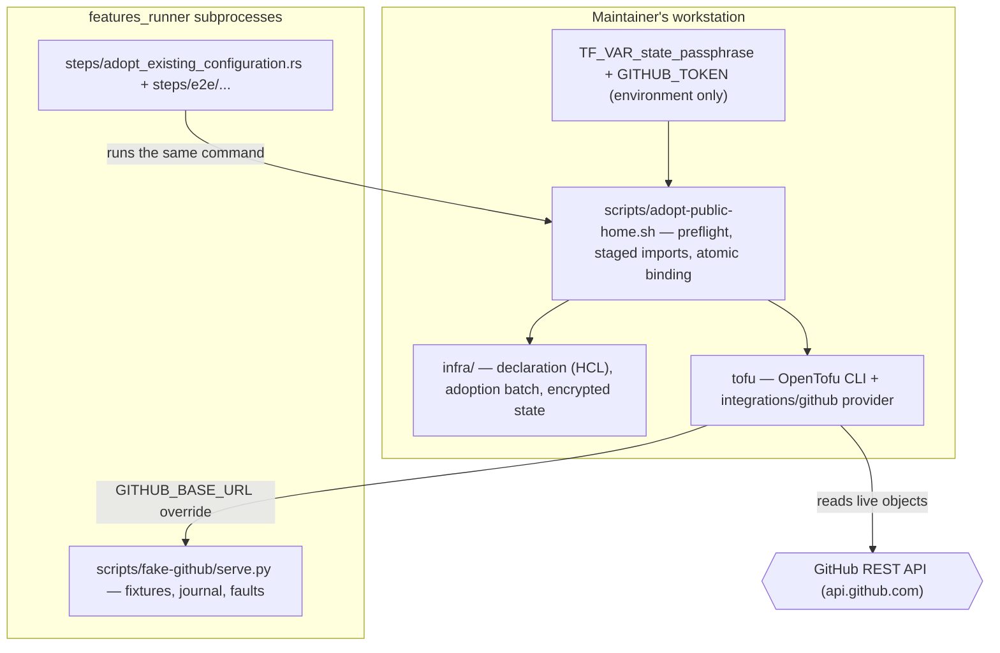

# Design: declare-public-home

## Scope

Technical design for the change that places the public home under a reviewed
declaration and adopts the objects that already exist:
[adopt the existing public-home configuration](specs/adopt-existing-configuration/usecase.md).
The observable WHAT is fixed by the proposal and the spec delta; this document
is the HOW — the declaration under `infra/`, the adoption command, the encrypted
applied state that records the binding, and the seam that lets the delta's
scenarios drive the adoption without touching the real GitHub organization.

Three boundaries shape everything below:

- **What the declaration is.** `infra/` is the declared configuration: the
  organization's settings, both repositories, the default branch's existing
  rule set, and the pages repository's Pages source. It is reviewed like any
  other revision; no apply is run by this change.
- **What adoption does.** Adoption binds identities. It never creates,
  modifies or deletes a live object, and it never reconciles a declared value
  with a live one. A batch is bound or none is.
- **What the suite can prove.** Every scenario drives one real command —
  `scripts/adopt-public-home.sh` — as a subprocess, with a locally served fake
  GitHub API behind the provider's base URL and a real OpenTofu binary. No
  scenario touches `api.github.com`.

## Technology decisions

Every version below is either the ecosystem's "latest at setup" or a
registry-verified value with its lookup noted; nothing is written from memory.

| Area | Decision | Rationale / source |
|---|---|---|
| Declaration mechanism | OpenTofu with the `integrations/github` provider; HCL under `infra/`, MPL-2.0 per file. | Supplied direction, researched in the topic's Frame against `safe-settings` (a GitHub App with no Pages management) and raw API scripts (no preview, no drift detection). Recorded as ADR-0005. |
| OpenTofu version | `required_version = ">= 1.7"` in the declaration for users; the project pins **1.13.1** in `infra/.opentofu-version` — the version installed on the maintainer's workstation (observed 2026-10-17) — and `scripts/setup-infra-tests.sh` and CI install exactly that version, refusing a different one. | 1.7 is the floor the user's state-encryption decision requires; the pin makes the tool version part of the reviewed contract instead of whatever a runner resolves, while a user's newer OpenTofu still satisfies the declaration's floor. |
| GitHub provider version | Constraint `~> 6.0`; the **latest 6.x resolved at setup** and pinned in `infra/.terraform.lock.hcl`. The topic's research verified 6.13.0 against the Terraform and OpenTofu registries on 2026-10-17. | The draft already constrains to 6.x; the concrete patch is whatever the lock file resolves. |
| Provider authentication | `github` provider with the maintainer's owner token in `GITHUB_TOKEN`, owner `duty2cal`; the provider's `base_url` is overridable so tests can point it at a fake. In production the base URL is the default. | One credential, held only on the maintainer's machine; no token in the repository and no apply in Actions (chapter 2). |
| Applied state | Local backend: `infra/terraform.tfstate` and `infra/terraform.tfstate.backup` are committed and encrypted at rest by OpenTofu's `encryption` block (PBKDF2-derived key over AES-GCM; both `state` and `plan` `enforced = true`). | The user's decision of 2026-10-17 (proposal D1). Recorded as ADR-0006. |
| Passphrase | `var.state_passphrase`, `sensitive`, **no default**; supplied as `TF_VAR_state_passphrase` from the maintainer's password manager. The wrapper refuses to run when it is absent or shorter than 16 characters. | A default or a repository secret would defeat the encryption; the value never exists in the repository or in CI. |
| Locking | None. One maintainer applies at a time; the assumption is recorded, not enforced. | Local backend with a single writer; a lock file would be committed noise. |
| Adoption command | `scripts/adopt-public-home.sh`, POSIX shell with `set -euo pipefail`, driving the real `tofu` binary. | The project owns its tooling as scripts beside the workspace; adoption is operational tooling, not product behaviour. |
| Batch definition | `infra/adoption-batch.txt`, one `address<TAB>import-id` per line, `#` comments. | The selected set is reviewable data, not a hardcoded loop; a scenario can supply its own batch without changing the command. |
| All-or-none | Imports run in a **staged copy** of the declaration whose state starts as a copy of the current encrypted state; only a fully successful batch is moved into `infra/`. | `tofu import` is per-object and can leave partial bindings; staging makes the "whole batch or none" guarantee structural rather than a rollback. |
| Fake GitHub API | `scripts/fake-github/serve.py`, Python standard library only, serving fixture responses on `127.0.0.1` on an ephemeral port, with a request journal and fault injection. | The GitHub API is the external dependency adoption talks to; a deterministic local twin is the only way to drive the real command offline and to observe that no write was attempted. |
| Provider installation for tests | `scripts/setup-infra-tests.sh` mirrors the pinned provider into a cache outside the repository (`~/.cache/duty2cal/terraform-provider-mirror`) and writes a `terraformrc` that points OpenTofu at it; the steps export `TF_CLI_CONFIG_FILE`. | `tofu init` must run offline during the suite; the mirror is prepared once, like the `git-cliff` install the suite already needs. |
| Test runner | Unchanged: `./run-tests.sh` → `cargo test -p duty2cal --test features_runner`, features assembled by `scripts/assemble-features.sh`. | The executable-spec invariant: the `.feature` file is the test. |
| Gherkin library | Unchanged: the workspace's `cucumber-rs` (pinned in `Cargo.lock`). | No new test dependency. |

## Architecture impact

The product is untouched: no crate, no port, no scenario of the conversion or
release capabilities changes. The change adds an infrastructure plane beside
the workspace and a test seam for it.



New or changed files:

| Path | Kind | Purpose |
|---|---|---|
| `infra/versions.tf` | new | `required_version`, provider constraint, `encryption` block (state and plan enforced), variables with no defaults. |
| `infra/main.tf` | new | Provider configuration and `github_organization_settings`. |
| `infra/repos.tf` | new | `github_repository.mono` and `github_repository.pages`, with the decided values. |
| `infra/rulesets.tf` | new | `github_repository_ruleset.main` — the existing `main protection` rule set. |
| `infra/pages.tf` | new | `github_repository_pages.pages` for the site source, in its existing legacy form. |
| `infra/adoption-batch.txt` | new | The selected batch: five `address<TAB>import-id` lines. |
| `infra/terraform.tfstate`, `infra/terraform.tfstate.backup` | new (committed) | The encrypted applied state and its backup, written by the adoption. |
| `infra/.terraform.lock.hcl` | new | Provider checksums; the concrete version resolved at setup. |
| `infra/.opentofu-version` | new | The pinned OpenTofu version `1.13.1`; read by `scripts/setup-infra-tests.sh` and CI, which refuse a different tool version. The declaration keeps the user-facing floor `required_version = ">= 1.7"`. |
| `.gitignore` | changed | Ignore `infra/.terraform/` and the adoption's staging directory `infra/.adoption-staging/`; the state files stay tracked. The repository has no `*.tfstate` ignore rule, so nothing is revoked — the change states the rule positively (ADR-0006). |
| `scripts/adopt-public-home.sh` | new | The adoption interface: preflight, staged import, verification, atomic move, one output line per bound object or a refusal naming the object. |
| `scripts/setup-infra-tests.sh` | new | Checks `tofu` against `infra/.opentofu-version` and `python3`, mirrors the provider, writes the `terraformrc`, and prints what it resolved. |
| `scripts/fake-github/serve.py` | new | The fake GitHub API: fixture tree, request journal, fault injection, ephemeral port. |
| `scripts/fake-github/fixtures/adopt-all/…` | new | One complete, proven API-response tree for the five adopted objects (organization, both repositories, the rule set, the Pages source); each scenario copies it and adds its faults/mutations. A provider read the fake does not serve is a 599 unknown-path failure and extends the set. |
| `apps/cli/tests/steps/adopt_existing_configuration.rs` | new | Non-e2e step definitions for this capability. |
| `apps/cli/tests/steps/e2e/adopt_existing_configuration.rs` | new | E2E step definitions (real subprocess, fake API, transcript evidence). |
| `apps/cli/tests/steps/mod.rs`, `apps/cli/tests/steps/e2e/mod.rs` | changed | Declare the two new modules; without that they are never compiled. |
| `apps/cli/tests/features_runner.rs` | changed | World fields for the declaration directory, the fake API child, the adoption transcript and the batch. |
| `.github/workflows/ci.yml` | changed | The `test` job installs the pinned OpenTofu `1.13.1` (read from `infra/.opentofu-version`) and runs `scripts/setup-infra-tests.sh` before `./run-tests.sh`. |
| `givn/changes/declare-public-home/evidence/live-read/` | new | The one-time authenticated read of today's live values (monorepo topics, pages-repository features and description, organization profile and member defaults), committed beside the declaration. |
| `givn/changes/declare-public-home/evidence/real-adoption/transcript.txt` | new | The transcript of the required post-GREEN real adoption against the real organization, with the five bound addresses. |
| `cliff.toml` | changed at archive only | Not edited by this change now: the archive adds `adopt-existing-configuration` to the marked capability allow-list and its per-type parser rows in the same revision that creates `givn/specs/adopt-existing-configuration/` (see "Archive-time obligation" below). |
| `REUSE.toml` | unchanged | The existing aggregate annotation covers the fake's JSON fixtures; the scripts and HCL carry headers. |
| `docs/arc42/*`, `docs/arc42/adr/*` | changed | The 12-chapter impact assessment, the affected chapters and two ADRs. |

## The declaration

### Declared objects and values

| Resource address | Live counterpart | Declared values |
|---|---|---|
| `github_organization_settings.org` | organization `duty2cal` | Name `duty2cal`; profile fields and member defaults at today's values (profile fields empty, default repository permission `read`, members may create public and private repositories); `billing_email = var.billing_email` (`sensitive`, no default). |
| `github_repository.mono` | `duty2cal/duty2cal` | `description = "Convert a duty plan to a calendar"`; today's topics verbatim; `has_issues = true` (today's live value, kept), `has_projects = false`, `has_wiki = false`, `has_discussions = false`, `allow_auto_merge = false`, `allow_forking = true`, `allow_merge_commit = false`, `allow_rebase_merge = true`, `allow_squash_merge = false`, `delete_branch_on_merge = true`, `ignore_vulnerability_alerts_during_read = false`; no `license_template`; `lifecycle { ignore_changes = [pages] }`. |
| `github_repository.pages` | `duty2cal/duty2cal.github.io` | Public; `has_issues = false`, `has_wiki = false` (the draft's values), `has_projects = false` (decided 2026-10-18: projects are not needed), `ignore_vulnerability_alerts_during_read = false`; description at today's live value; `lifecycle { ignore_changes = [pages] }`. |
| `github_repository_ruleset.main` | rule set `main protection` | `name = "main protection"` (the live name, so the binding is the same object); target branch, `enforcement = "active"`; deletion, non-fast-forward and `required_linear_history`; no bypass actors; condition `~DEFAULT_BRANCH`. |
| `github_repository_pages.pages` | Pages on the pages repository | `build_type = "legacy"`; `source { branch = "main", path = "/" }` — the existing form, imported rather than enabled anew. |

Two kinds of value appear above and are treated differently:

- **Decided values** come from the user's Q5/Q9 answers (proposal D2, D3) and
  are written as stated. They are the values the first configuration change
  will apply.
- **Today's live values** are captured, never invented. The topics of the
  monorepo, the pages repository's features and description, and the
  organization's profile and member defaults are read once by the maintainer
  from the GitHub API (`gh api repos/duty2cal/duty2cal`,
  `gh api repos/duty2cal/duty2cal.github.io`, `gh api orgs/duty2cal`) and
  recorded in `infra/` verbatim; the captured read is committed as the
  declaration's evidence under
  `givn/changes/declare-public-home/evidence/live-read/`. No value in the
  declaration is a guess.

The provider sends `false` for an omitted Optional-only boolean, so omission is
not neutral for those fields. Every repository feature boolean is therefore
stated explicitly: the monorepo keeps issues on and turns projects, wiki and
discussions off; the pages repository turns issues and wiki off and keeps
projects on. Non-boolean fields the provider exposes but no decision covers are
still omitted rather than set to a provider default, and the first preview
names every such difference for a later decision. `license_template` is omitted
because it only acts at creation.

The first configuration change therefore changes the monorepo's `has_projects`,
`allow_merge_commit`, `allow_squash_merge` and `delete_branch_on_merge`, and
the pages repository's `has_issues` and `has_wiki`; every other declared value
matches live.

### The adoption batch

`infra/adoption-batch.txt` selects the five objects and carries the import
identifier each one needs. The forms below are the ones the provider's
documentation states (checked on 2026-10-17), not invented:

| Address (then a tab, then the identifier) | Import identifier | Source of the concrete value |
|---|---|---|
| `github_organization_settings.org` | the organization's numeric id | today's live organization, read once at setup (`GET /orgs/duty2cal` returns it) |
| `github_repository.mono` | `duty2cal` — the repository name; the provider takes the owner from its configuration | fixed |
| `github_repository.pages` | `duty2cal.github.io` | fixed |
| `github_repository_pages.pages` | `duty2cal.github.io` — the repository slug | fixed |
| `github_repository_ruleset.main` | `duty2cal:<numeric ruleset id>` | today's live rule set, read once at setup (`GET /repos/duty2cal/duty2cal/rulesets` returns it) |

Two identifiers are live data, so they are captured with the same one-time read
as the live values and recorded in the batch; the declaration's review sees
them as text. The batch is the single place that carries an identifier, so a
provider change to an import form changes one file and the scenarios' fixtures,
never the command.

### The encryption block and variables

`infra/versions.tf` carries the shape below; the exact attribute spelling is
validated against the resolved OpenTofu version by `tofu validate` in the setup
task, not assumed here.

```hcl
terraform {
  required_version = ">= 1.7"
  required_providers {
    github = { source = "integrations/github", version = "~> 6.0" }
  }
  encryption {
    key_provider "pbkdf2" "passphrase" {
      passphrase = var.state_passphrase
    }
    method "aes_gcm" "state" {
      keys = key_provider.pbkdf2.passphrase
    }
    state { method = method.aes_gcm.state
            enforced = true }
    plan  { method = method.aes_gcm.state
            enforced = true }
  }
}

variable "state_passphrase" {
  type      = string
  sensitive = true
}
variable "billing_email" {
  type      = string
  sensitive = true
}
```

With `enforced = true`, OpenTofu refuses to write unencrypted state or a plan
file, which is what makes committing `infra/terraform.tfstate` acceptable: the
file is ciphertext. Losing the passphrase loses the state, and the state can be
rebuilt only by re-adopting; that consequence is recorded as a risk (chapter
11), not softened by an unencrypted copy.

## The adoption command

```
scripts/adopt-public-home.sh [--declaration DIR] [--batch FILE] [--state FILE] [--api-url URL] [--token TOKEN]
```

Defaults: `--declaration infra`, `--batch infra/adoption-batch.txt`,
`--state infra/terraform.tfstate`, `--api-url https://api.github.com`,
`--token $GITHUB_TOKEN`. `--state` must lie inside `--declaration`; preflight
refuses a state path outside it, because the staged workspace uses the local
backend's default state path and the command never passes `-state`. Required
environment: `TF_VAR_state_passphrase` (at least 16 characters) and whatever
the declaration's variables require (`TF_VAR_billing_email`).

The command performs one adoption of the selected batch:

1. **Preflight the inputs.** Refuse when `tofu` or `python3` is missing, when
   the passphrase is absent or shorter than 16 characters, when the batch is
   empty or malformed, or when `--state` is not inside `--declaration`. Print
   `refused <object>: <reason>` naming the object — the declaration error, the
   malformed batch line, or the state path outside the declaration — and exit
   2.
2. **Stage and validate.** Create `infra/.adoption-staging/` beside the
   declaration (a git-ignored directory, removed on exit), copy the declaration
   into it, copy the current encrypted state to the staged workspace's root
   `terraform.tfstate` (the local backend's state path), and select that
   workspace. Then run `tofu init -backend=false` and `tofu validate` inside
   the staged copy: a fresh checkout has no `infra/.terraform/`, so init comes
   first and validate never depends on a machine-local cache. A refusal
   discards the staging directory and names the declaration error; no declared
   file is touched, and the staging directory sits on the same filesystem as
   the state, so the move in step 6 is a rename rather than a copy.
3. **Decrypt the state.** Run `tofu state list` in the staged workspace before
   any import. A state encrypted with a different passphrase refuses here,
   naming the applied state, before any object is bound.
4. **Import in batch order.** For each `address<TAB>import-id` line run
   `tofu import -input=false <address> <import-id>`. A failure stops the batch;
   the staged state is discarded and the real state is untouched.
5. **Verify the batch.** Run `tofu plan -refresh-only -detailed-exitcode -json`
   in the staging workspace and refuse when it reports a non-no-op change for a
   bound address, naming each such address: a live object that changed since
   the import does not get bound. With no live change, the imported state and
   the live objects agree, because `-refresh-only` compares state to live, not
   declaration to live. **The exit status alone is not the verdict**: OpenTofu
   1.13.1 returns `2` for this invocation even when `add`, `change` and
   `destroy` are all zero (opentofu/opentofu#3015, observed while implementing
   this change). The command parses the JSON and refuses only on a reported
   non-no-op change. **Only a completed report can be a no-op**: the JSON must
   contain a `change_summary` message; an exit 2 without one, and any exit
   status other than 0, 1 or 2 (for example a killed process), is a
   verification failure and refuses the batch. The drift entries appear as
   `resource_drift` objects whose `change` object carries a string `action`
   (the parser also accepts an `actions` array), and the parser reads both
   shapes.
6. **Bind atomically.** Rename the staged state over `--state`. On the first
   adoption, create `<state>.backup` as a copy of the new state, so both
   committed files exist; on later runs, keep the previous state as
   `<state>.backup`. Remove the staging directory, print one
   `adopted <address> <import-id>` line per batch entry, and exit 0.

Failure modes and where they are detected:

| Refusal | Detected by |
|---|---|
| a selected object is already bound | the staged state is a copy of the applied state; `tofu import` refuses with "already managed", naming the address |
| a declared object does not exist live | the provider's read returns 404 for the import id |
| the declaration does not name the selected address | `tofu import` refuses an import target that is not in the configuration |
| a selected object cannot be read | the provider's read returns 401/403/5xx; the refusal names the object and the reason |
| the applied state cannot be written | the staged import or the final move fails; nothing is bound and nothing live changes |
| a live object changed after it was read | the post-import `-refresh-only` plan reports a non-no-op change, named by address |
| the applied state cannot be decrypted with the supplied passphrase | `tofu state list` in the staged workspace before any import refuses; the applied state is named |
| the state path is outside the declaration | input preflight refuses before staging, naming the path |
| a batch line is malformed | preflight parses every line before staging; the refusal names the batch line |
| the declaration cannot be read or validated | `tofu init -backend=false` / `tofu validate` inside the staged copy before any import; the declaration error is named |

The command never runs `tofu apply`, never issues a write request to GitHub,
and never edits the declaration. The declaration revision is a repository
commit; that is how the owner "records the intended values" in the use case's
main flow, which is why the command only reads it.

## The applied state

- `infra/terraform.tfstate` and `infra/terraform.tfstate.backup` are tracked.
  The repository holds no `*.tfstate` ignore rule today, so the change states
  the intended rule positively in `.gitignore`: ignore `infra/.terraform/` and
  `infra/.adoption-staging/`, track the state files. The topic Frame's supplied
  direction "local state, kept out of Git" is superseded by D1: the state is
  encrypted and committed; the confirmed Frame itself is not rewritten, and
  there was no committed ignore rule to delete.
- The first adoption creates `<state>.backup` as a copy of the new state, so
  both tracked files exist in the binding revision; later runs preserve the
  previous state as the backup. No run leaves the backup absent or holding a
  plaintext copy.
- The state binds identities. It is not a copy of the project's intended
  values, and adoption never flags a declared-vs-live difference; the first
  preview does that.
- The state is committed after a successful adoption together with the
  declaration, in one revision whose release-note subject is this change's
  release note (the change's own commit discipline).
- There is no lock and no remote backend. Two simultaneous adoptions are not
  defended against; the single-maintainer assumption is the recorded answer.
- The state will later hold the publishing key. That is why the passphrase is
  machine-local and why the drift check is local: anything that can read the
  state can read that key.

## Test seam: the fake GitHub API

The provider's `base_url` is pointed at a local fake, so the real adoption
command and the real `tofu` binary run unchanged while every request stays on
loopback.

- `scripts/fake-github/serve.py --fixtures <dir> --port 0 --journal <file>`
  binds an ephemeral port on `127.0.0.1`, prints the port on stdout, and serves
  the fixture tree. With a configured `base_url`, the provider prefixes its
  requests with `/api/v3` (its GitHub Enterprise path); the fake strips that
  prefix before fixture lookup so the same tree serves both forms.
- Fixtures are JSON responses keyed by request path (for example
  `repos/duty2cal/duty2cal.json` and `users/duty2cal.json`). One base tree
  (`fixtures/adopt-all/`) holds the complete, proven set; each scenario's step
  copies it into that scenario's temporary directory and writes its faults and
  mutations into the copy. The committed tree is deliberately not one directory
  per scenario: copying one proven base is what keeps the fixture set complete
  and the per-scenario isolation real. The proven set is
  `GET /orgs/{org}`, `GET /repos/{owner}/{repo}` (topics arrive in the
  repository body), `GET /repos/{owner}/{repo}/pages`, and
  `GET /repos/{owner}/{repo}/rulesets[/{id}]`; provider 6.13.0 with an explicit
  `owner` did not call `Users.Get`, so no `users/` fixture is required today.
  Any path the fake does not know
  returns a distinctive **599** marker response with an `X-Fake-Unknown-Path`
  header **and is journaled as an unknown-path entry**, so a missing fixture
  fails loudly instead of being silently defaulted. Every refusal step asserts
  that the journal contains no unknown-path entry, so a refusal is never the
  fake's own gap leaking through as a provider error. The fixture values mirror the live read under
  `givn/changes/declare-public-home/evidence/live-read/`, not the declared
  values: adoption binds identity, so the `@e2e` scenario asserts that the
  applied state carries the live project and issue settings while the
  declaration states the decided ones. The setup task extends
  the fixture set until one real `tofu import` per object succeeds — that is
  the proof the fixture set is complete, and it is run before the scenarios
  rely on it. The same proof asserts that a `-refresh-only` plan against an
  unchanged fake is a no-op, so the provider's own normalization can never
  masquerade as a live change in the change-detection step.
- A `faults.json` per scenario injects a status (401/403/404/500) for a path
  pattern; a `mutate.json` replaces a response body deterministically after an
  explicit request count for that path (`after_requests: N`) or on a
  step-controlled trigger file, never after an implicit "first read". That is
  how "a live object changed after it was read" is driven without racing the
  provider's read order.
- The journal records method, path, status, an unknown-path flag and, for a
  GraphQL request, the operation name. The fake serves `GET` reads and plain
  GraphQL query POSTs (the provider's current client implementation uses
  `POST /graphql` for some reads); every other method, and every GraphQL
  mutation, is refused with 405 and journaled as a refused write. "The live
  configuration is unchanged" is asserted from the journal: no refused write
  and no mutation; a GraphQL query POST is a read, so the assertion is not
  "no non-GET request". This is a secondary assertion; the primary one is the
  command's own output.
- The fake is started per scenario by the step definitions and killed at
  scenario end; no container, no network, no shared port.

## Test runner, strict mode, and single-scenario command

- **Runner command (`verify.command`):** `./run-tests.sh` — unchanged. It
  assembles `givn/specs/**` and `givn/changes/*/specs/**` into one feature root
  and runs `cargo test -p duty2cal --test features_runner` over it.
- **E2E command (`verify.e2e_command`):** `./run-tests.sh --e2e` — unchanged;
  it is the same runner with the `@e2e` tag filter.
- **Strict mode:** `Cucumber::fail_on_skipped()` in
  `apps/cli/tests/features_runner.rs`. An undefined, pending or skipped step
  fails the run, so a `@wip` scenario with unimplemented definitions is red.
  The proof is an implementation task recorded for `tasks.md`, not a mutation
  performed by `scripts/setup-infra-tests.sh`: temporarily rename one step in a
  throwaway scenario and observe a non-zero exit and an "undefined step"
  report, then restore. A green run with an unimplemented step is impossible.
  The fake's unknown-path 599 marker plus journal is the second strictness net:
  a missing fixture cannot pass as an empty response, and a refusal scenario
  cannot be satisfied by an unserved path.
- **Single-scenario command:**
  `./run-tests.sh --name "Maintainer adopts the existing public home and every object is bound without changing it"`.
  `run-tests.sh` forwards `--name` to cucumber-rs unchanged.

## Step definitions

One file per capability, as the project already does:

| File | Contents |
|---|---|
| `apps/cli/tests/steps/adopt_existing_configuration.rs` | Non-e2e steps: prepare a temporary declaration and batch, start the fake with a scenario's fixtures and faults, run `scripts/adopt-public-home.sh`, capture stdout/stderr/exit status, read the copied state and the journal. |
| `apps/cli/tests/steps/e2e/adopt_existing_configuration.rs` | The same real subprocess, plus the committed transcript. It asserts on what the command printed and on the journal, never on an in-process call. |

`apps/cli/tests/features_runner.rs`'s `DutyWorld` gains fields for the
declaration directory, the adoption transcript, the fake's child handle and
port, the journal path and the batch file; both new modules are declared in
`apps/cli/tests/steps/mod.rs` and `apps/cli/tests/steps/e2e/mod.rs`.

A scenario that needs a pre-existing applied state (the already-bound
scenario) primes it with a successful **monorepo-only** batch against the same
fake, then adopts the full batch; `tofu import` refuses the monorepo and the
refusal names `duty2cal/duty2cal`. No state is fabricated: every binding in a
test was written by the real command.

## Decisions

Resolves the proposal's open questions; seed IDs are recorded beside the ledger
IDs so the link is readable here and in the proposal.

- **Decides D1 (seed Q4):** the applied state is local, encrypted at rest with
  a passphrase-derived key, and committed under `infra/`; the passphrase lives
  only on the maintainer's machine via `TF_VAR_state_passphrase`, with no
  default and no repository secret; `required_version = ">= 1.7"`; no locking,
  single-maintainer assumption recorded; the configuration drift check runs
  locally and the Frame's CI drift report is withdrawn. Realized in
  `infra/versions.tf` (the `encryption` block), `scripts/adopt-public-home.sh`,
  the committed `infra/terraform.tfstate` and the explicit `.gitignore` rule.
- **Decides D2 (seed Q5):** the monorepo carries the decided values
  (`has_issues = true` kept; `has_projects = false`, `has_wiki = false`,
  `has_discussions = false` stated explicitly because the provider sends
  `false` for an omitted Optional-only boolean; rebase merges only, no squash or merge commits;
  delete-branch-on-merge on; the current description and topics; auto-merge
  off; forking allowed; no licence template). The pages repository states
  `has_issues = false`, `has_wiki = false` (the draft's values) and
  `has_projects = true` (today's live value; the draft is silent). The
  organization's profile and member defaults keep today's values because no
  draft profile text describes today's project. Realized in `infra/repos.tf`
  and `infra/main.tf`.
- **Decides D3 (seed Q9):** the declaration carries the existing rule set
  `main protection` with deletion, non-fast-forward and linear history, no
  bypass actor, and no `github_branch_protection` resource; retiring the legacy
  protection belongs to the first configuration change
  (`enable-repository-security`). Realized in `infra/rulesets.tf` and the
  absence of a legacy resource.
- **Carried D4 (seed Q2):** whether the pages repository's protection rule
  bypasses the publish deploy key. Owner: the user. Decided by
  `publish-site-plumbing`; this declaration declares no pages rule set.
- **Carried D5 (seed Q3):** whether the default branch requires pull requests.
  Owner: the user. Decided by `enable-repository-security`.
- **Carried D6 (seed Q10):** whether a review gates an apply. Owner: the user.
  Decided by the apply seeds, starting with `enable-repository-security`.
- **Carried D7 (seed Q11):** what a configuration change may delete. Owner: the
  user. Decided by the apply seeds.
- **Out of scope D8 (seed Q6):** team access and membership. Owner: the user;
  the Frame keeps them outside this topic and the organization has one member,
  so the question returns only when a second person is invited.

Design decisions beyond the proposal's questions, each with the alternative it
rejected:

- **Staged import instead of import-then-rollback** (rejected: importing into
  the real state and restoring a backup on failure — a crash mid-batch would
  leave partial bindings, and the use case's guarantee is all-or-none).
- **A wrapper command instead of a documented `tofu import` sequence**
  (rejected: a sequence of hand-run imports cannot refuse a batch, cannot name
  the failing object consistently, and cannot guarantee atomically that nothing
  was bound).
- **The post-import refresh-only plan as the change detector** (rejected: the
  wrapper reading GitHub itself — that duplicates the provider's knowledge of
  each object's API and its normalization, and could disagree with what the
  provider actually bound).
- **A batch file instead of positional arguments** (rejected: long argument
  lists are duplicated between the command, the documentation and the tests;
  the batch is the reviewable selected set).
- **A Python-stdlib fake instead of a container** (rejected: WireMock or a
  compose service adds an image, a network and a startup the suite does not
  need; the fake must run on the same loopback interface and be inspectable
  from the steps).
- **The fixture set is proven by a real import in the setup task** (rejected:
  assuming the provider's reads from memory; the endpoint list is
  version-dependent and the fake's 404-plus-journal makes a gap visible).
- **No configuration drift job in CI** (rejected: a CI drift check would need
  the passphrase and therefore the future publishing key; the local check is
  the recorded decision, D1).
- **Opt-in provider mirror outside the repository** (rejected: committing the
  provider binaries; the cache is prepared once by
  `scripts/setup-infra-tests.sh`).

## Use-case traceability

| Use-case element | Technical decision | Evidence |
|---|---|---|
| Success guarantee: every already-existing object in the selected batch is bound in the applied state, live unchanged | Declaration plus batch; staged imports; atomic move | `@e2e` "Maintainer adopts the existing public home and every object is bound without changing it" |
| Rule: the whole batch is adopted or none is | Staged state under a temporary declaration copy; discard on any failure | The refusal scenarios (invalid declaration, malformed batch, missing object, unreadable object, already bound, undeclared entry, changed object, wrong-passphrase state, state write) |
| Rule: adoption changes no live object | `tofu import` and `-refresh-only` issue reads only; the fake's journal proves no refused write and no mutation operation | `@e2e` journal assertion; every refusal scenario's unchanged-live assertion |
| Rule: the state binds an identity, not a copy of the values | Imported identities; no reconciliation step; declared-vs-live differences are not applied | `@e2e` (declared projects-off vs live projects-on stays live), and the design's "no apply" boundary |
| Rule: the batch is the selected set | `infra/adoption-batch.txt`; only its lines are imported | "Only the selected batch is bound" |
| Rule: a declared object absent live is never created | Import's read-only nature; refusal names the object | "A declared object that does not exist live refuses the whole batch" |
| Rule: no duplicate binding | Import into a copy of the applied state refuses an already-managed address | "An object already bound is not bound again" |
| Rule: the deploy key and secret are never adopted | Not in the declaration or the batch; they do not exist | "Only the selected batch is bound"; the deployment view |
| Rule: one protection object, no bypass | Declaration's rule set only; no legacy resource | `@e2e` (rule set bound); chapter 2 lists the constraint; D3 records the decision |
| Rule: the binding lives in the encrypted committed state | `encryption` block with `enforced = true`; passphrase from the environment | The setup task's `tofu validate` and the state file being ciphertext (checked by the e2e's state read) |
| Persona impact: organization owner | The command and its transcript | `@e2e` output lines |
| Persona impact: contributor reviewer | The declaration, batch and state are reviewable in the repository | Design-level; the reviewed commit |
| Persona impact: crew member | Nothing live changes, so the release channel and site are untouched | The journal assertion |

Actors in Gherkin are the organization owner; Personas are review lenses, not
Actors.

## Persona impact

User-visible surface: a terminal interface (the adoption command's output) and
the repository's files (the declaration, the batch and the encrypted state).

- **`project-maintainer--organization-owner`** — runs the adoption, sees one
  line per bound object or a refusal naming the object, and can rebuild the
  state by re-adopting if the passphrase is lost.
- **`contributor--infrastructure-reviewer`** — can read the declaration and the
  batch in the same history as the code, and can see that the state is
  ciphertext; holds no token and no passphrase, so cannot apply.
- **`crew-member--personal-calendar-owner`** — no change: the adoption makes no
  live write, so the release channel and the published site are untouched.

## Visual Design Contract

- Interface: terminal
- Viewports: n/a (no rendered screen)
- Design system: none
- Screens covered: none
- rendered reference: n/a
- Capture mechanism and evidence path: one transcript per `@e2e` scenario under
  `givn/changes/declare-public-home/evidence/visual/<scenario-slug>/transcript.txt`,
  captured by the scenario's final step with the temporary directory, port,
  token and passphrase replaced by placeholders.
- Baseline: the transcript names each adopted address and import identifier and
  no other output; no live settings value, token, passphrase or temporary path
  appears in it.
- Motion: n/a.

## E2E smoke test infrastructure

- **E2E runner command:** `./run-tests.sh --e2e`, distinct from
  `verify.command`; it filters `@e2e`.
- **E2E step location:** `apps/cli/tests/steps/e2e/adopt_existing_configuration.rs`,
  separate from the non-e2e steps because it also starts the fake and commits
  the transcript.
- **Real interface:** `scripts/adopt-public-home.sh`, invoked as a subprocess
  with real arguments, a real `tofu` binary and a real HTTP client inside the
  provider, against a local fake GitHub API.
- **Local test infrastructure:** the fake server on loopback (port 0), a
  temporary declaration copy and state, a provider mirror prepared by
  `scripts/setup-infra-tests.sh`, a fixed 16-plus-character test passphrase and
  a dummy billing email in the environment, and a fixture directory per
  scenario. No container, no network, no credentials.
- **Framework:** cucumber-rs with `std::process::Command` and `std::net` to
  discover the fake's port, as the existing E2E steps use subprocesses.
- **E2E strict-mode proof:** the same `fail_on_skipped()`, plus the fake's
  unknown-path 599 marker and journal. The rename-a-step check is an
  implementation task recorded for `tasks.md`, not a setup-script mutation.

## Interaction Coverage Matrix

| Inventory entry | @e2e scenario title | Real interface | Driving mechanism |
|---|---|---|---|
| adopt the selected batch of existing objects | Maintainer adopts the existing public home and every object is bound without changing it | CLI (terminal) | `std::process::Command` runs `scripts/adopt-public-home.sh --declaration <tmp>/infra --batch <tmp>/infra/adoption-batch.txt --state <tmp>/infra/terraform.tfstate --api-url http://127.0.0.1:<port> --token test-token`, with `TF_VAR_state_passphrase` set; asserts the five `adopted` lines, then reads the request journal (no refused write, no mutation, no unknown-path entry) and runs `tofu state list` against the copied state (five addresses) |

## Local runnability & digital twins

- **Setup, once:** `./scripts/setup-infra-tests.sh` — checks `tofu` (exactly
  the version in `infra/.opentofu-version`) and `python3`, installs nothing
  silently, mirrors the pinned provider into
  `~/.cache/duty2cal/terraform-provider-mirror`, writes the `terraformrc`, and
  performs the one-import fixture proof.
- **Run the suite:** `./run-tests.sh` (or
  `./run-tests.sh --name "<scenario>"`). The scenarios start the fake
  themselves; no service has to be running.
- **Manual walkthrough:** `./scripts/fake-github/serve.py --fixtures
  scripts/fake-github/fixtures/adopt-all --port 8099 --journal /tmp/journal`,
  then `GITHUB_BASE_URL=http://127.0.0.1:8099 TF_VAR_state_passphrase=… TF_VAR_billing_email=… ./scripts/adopt-public-home.sh --api-url http://127.0.0.1:8099 --declaration <tmp>/infra --state <tmp>/infra/terraform.tfstate`.
- **Isolated network:** every dependency is on loopback; the fake binds an
  ephemeral port and the steps pass its URL explicitly. No shared dev service,
  no assumption that anything is already running.
- **Digital twin:** GitHub's REST API is the only external service this
  change's tooling talks to, and `scripts/fake-github/serve.py` is its twin —
  deterministic fixtures, no outbound network, a request journal and fault
  injection. No scenario reaches `api.github.com`.
- **Interface obstacles and their named fixes:**
  - *The provider fetches itself from a registry during `init`.* Fix: the
    filesystem mirror and `TF_CLI_CONFIG_FILE` prepared by
    `scripts/setup-infra-tests.sh`; the suite runs offline.
  - *The provider may read through GraphQL, where a read is a POST.* Fix: the
    fake answers a GraphQL query POST by operation name and refuses a mutation;
    the "unchanged live" assertion is "no refused write and no mutation", not
    "no non-GET request" (a GraphQL query POST is a read). The setup proof
    records which reads use GraphQL for the pinned version.
  - *The provider's reads depend on its version.* Fix: the mirror is resolved
    from `infra/.terraform.lock.hcl`, and the setup task's one-import proof
    fixes the fixture set before scenarios run; the fake journals an unserved
    path instead of inventing a response.
  - *The declaration must validate on a fresh checkout that has no
    `infra/.terraform/`.* Fix: the command stages the declaration first, then
    runs `tofu init -backend=false` and `tofu validate` **inside the staged
    copy**, so validation never depends on a machine-local cache and no
    untracked directory appears in `infra/`.
  - *`tofu init` writes `.terraform/` into the declaration directory.* Fix: the
    command copies the declaration into `infra/.adoption-staging/` (git-ignored,
    removed on exit) and the steps invoke the command, so the repository's
    tracked files stay clean.
  - *The state path must be the local backend's state file inside the staged
    workspace.* Fix: preflight refuses `--state` outside `--declaration`, and
    staging copies the current state to the staged workspace's root
    `terraform.tfstate`, which is the path `tofu` reads without a `-state`
    argument.
  - *The final binding must not be a half-written copy.* Fix: the staging
    directory is created beside the state file, so the binding is a
    same-filesystem rename; a reader never sees a partially written state.
  - *The provider may fall back to `gh auth token` when no token is set, which
    would send a real maintainer token to the fake or, worse, a test to the
    real API.* Fix: the wrapper always exports `GITHUB_TOKEN` (the `--token`
    value, `test-token` in the steps) and always exports `GITHUB_BASE_URL`
    from `--api-url`, so neither fallback nor the default endpoint can be
    reached in a test.
  - *The passphrase is required to read state and must never be committed.*
    Fix: the steps generate a fixed test passphrase into the environment only;
    the transcript scrub replaces it and the token.
  - *Encryption is enforced, so a deliberately corrupted state cannot be
    produced by hand.* Fix: the "state cannot be written" scenario makes the
    state target path unwritable instead of corrupting the ciphertext; the
    command's own write failure is what is exercised.
  - *Two adoptions must not interleave on one state.* Fix: no locking is
    claimed; each scenario uses its own temporary declaration and state, and
    the single-maintainer assumption is recorded in ADR-0006.

## Coverage process boundaries

| Process | Started by | Instrumented artifact | Profile output | Merge step | Non-zero production probe |
|---|---|---|---|---|---|
| features_runner (non-e2e) | `./measure-coverage.sh` (no `--tags`; it produces both reports) | `cargo llvm-cov --workspace --test features_runner` | `coverage/non-e2e-cobertura.xml` | `./merge-coverages.sh` | `crates/duty2cal-core/src/domain/timing.rs` |
| features_runner (`@e2e`) + spawned adoption + fake | `./measure-coverage.sh` (no `--tags`; it produces both reports) | `cargo llvm-cov --workspace --test features_runner` | `coverage/e2e-cobertura.xml` | `./merge-coverages.sh` | `apps/cli/src/fs.rs` |

The adoption wrapper, the fake and the HCL are not Rust and stay outside the
coverage denominator, like `scripts/prepare-release.sh`; their observable
contract is covered by the delta's scenarios. The only Rust added here is step
definitions and the `DutyWorld` fields, which the runner instruments.

## Risks and follow-ups recorded here

- **Losing the passphrase loses the state.** The state is unrecoverable without
  the passphrase and can only be rebuilt by re-adopting; accepted by the state
  decision (D1). Mitigation: the passphrase lives in the maintainer's password
  manager, and re-adoption is a supported path because it changes nothing live.
- **No locking.** Two simultaneous adoptions could write the state; the
  single-maintainer assumption is recorded, not enforced. Mitigation: staging
  means a lost race leaves one complete batch, never a partial one.
- **The committed state is a public ciphertext.** An attacker can read and
  modify it; only the passphrase protects the contents. Mitigation: encryption
  is enforced, and the state is reviewed as part of the declaration revision.
- **The verification's exit status is unreliable.** OpenTofu 1.13.1 returns
  exit `2` from `plan -refresh-only -detailed-exitcode` even when nothing
  changed (opentofu/opentofu#3015, observed while implementing this change).
  Mitigation: the command parses the JSON and refuses only on a reported
  non-no-op change; the setup proof pins the no-op case, and a future release
  that fixes the exit code still behaves correctly because the JSON, not the
  status, is authoritative.
- **The fixture set must track the provider's reads.** A provider upgrade can
  request a new endpoint; the setup task's one-import proof and the fake's
  599-plus-journal unknown-path marker turn that into a red run, not a silent
  pass.
- **The local drift check is only as current as the last run.** Withdrawn CI
  reporting means divergence is found when the maintainer looks; recorded as
  the accepted cost of keeping the passphrase off automation. Reporting drift
  is out of this change's scope (`report-configuration-drift`).
- **Two import identifiers are live data.** The organization's numeric id and
  the rule set's numeric id are read once at setup and recorded in the batch;
  a re-created organization or rule set would need the batch updated, which the
  setup read and the adoption's own refusal make visible rather than silent.
- **The first live preview has not been run by this change.** Adoption is
  read-only, so the declared-vs-live differences (the monorepo's projects,
  merge strategies and delete-branch-on-merge; the pages repository's issues
  and wiki) are named by the first configuration change's preview; this change
  claims no preview result.

## Post-GREEN real adoption (required)

The suite proves the adoption against a fake API; it cannot prove that the
provider's live reads and the real import identifiers agree with the
organization. The change is therefore not done when the suite is GREEN: the
maintainer runs `scripts/adopt-public-home.sh` **once against the real
organization**, with the real `GITHUB_TOKEN`, passphrase and billing email, and:

- records the transcript (the five `adopted` lines, scrubbed of the token,
  passphrase and any temporary path) under
  `givn/changes/declare-public-home/evidence/real-adoption/transcript.txt`;
- commits the resulting encrypted `infra/terraform.tfstate` and
  `infra/terraform.tfstate.backup` together with the declaration;
- review verifies the five bound addresses with `tofu state list` against the
  committed state and confirms the transcript names the same five addresses.

This is a required step in the change's task list, not an optional follow-up.
No live object is created or changed by it; a refusal is the expected safe
outcome and must be reported before anything is called done.

## Archive-time obligation: the capability allow-list

`scripts/render-changelog.sh` compares the marked capability allow-list in
`cliff.toml` with the directories under `givn/specs/` only. The capability
directory `givn/specs/adopt-existing-configuration/` is created by this
change's **archive**, not by its implementation, so the allow-list must not be
edited now: adding `adopt-existing-configuration` before the directory exists
would make the `changelog` gate refuse on every push between now and the
archive.

The archive therefore owes a single-revision edit: when it creates
`givn/specs/adopt-existing-configuration/`, it adds
`adopt-existing-configuration` to the marked `capability-allow-list` line in
`cliff.toml` **and** to the per-type parser rows that repeat the list (the
allow-list is duplicated inside each type's parser because `git-cliff` groups
by the parser a revision matches). Until then the gate stays green. This is a
tasks-facing note: `tasks.md` must carry it as the archive step's obligation.

## Black-Box-First policy

All eleven scenarios drive `scripts/adopt-public-home.sh` as a real subprocess;
the `@e2e` scenario drives the same command end to end and asserts its output,
the request journal and the bound state. No internal test is retained
alongside: the only Rust added is step definitions. The GitHub API is never
mocked inside the command — it is replaced at the HTTP boundary by a local
server, which is exactly the boundary the production code talks to.

## Post-archive fix — 2026-10-17

The live-change scenario was made deterministic after the archive. The fake
mutates its monorepo response on a trigger file that the adoption command
writes after the import loop and before the verification plan, only when the
test-only `ADOPT_TEST_TRIGGER` is set; production runs never set it. This
preserves the design's rule that the mutation never follows an implicit first
read and removes the provider-read-count race that let the scenario pass
locally and fail on the host.


## Post-archive decision update — 2026-10-18

The user superseded the squash-only merge policy before the first apply. The
declaration now allows rebase merges and forbids squash and merge commits:
`allow_rebase_merge = true`, `allow_squash_merge = false`,
`allow_merge_commit = false`. Rebase-and-merge keeps every commit and a linear
`main`; a literal fast-forward is a local `git rebase` plus push, because
GitHub offers no ff-only merge button. The first apply therefore changes
`allow_merge_commit` (true to false), `allow_squash_merge` (true to false) and
`delete_branch_on_merge` (false to true); `allow_rebase_merge` already matches
live. The pages repository's projects are also off (`has_projects = false`), so
the first apply changes that field as well. The provider's
`ignore_vulnerability_alerts_during_read` flag is declared explicitly as
`false` on both repositories: it only controls whether the provider skips the
vulnerability-alert read, so the plan no longer proposes adding it to the
state. The verification receipt predates
these changes; CI on the revision that carries them is the evidence.
