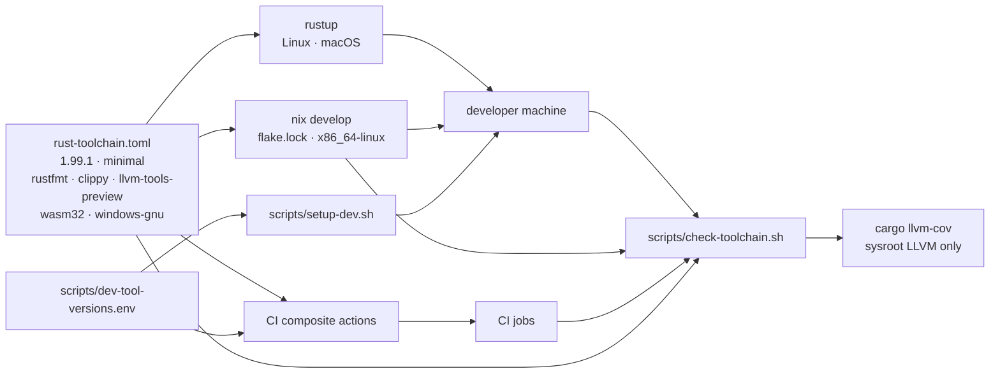

# Design: developer-setup

## Scope

Operational maintenance change: declare the build toolchain once and make
every installer consume it. No product code, capability, scenario, step
definition or rendered product surface changes. `specs` is skipped in
the change's `.givn-skip`; no `.feature` file is added, amended or removed. One wording
correction in the release-size use case makes the permanent contract name the
pinned toolchain (see "Permanent spec wording").

The change delivers:

- one pin in `rust-toolchain.toml`, read by rustup on Linux and macOS and by
  rust-overlay in the flake;
- one non-Nix bootstrap (`scripts/setup-dev.sh`) and one guard
  (`scripts/check-toolchain.sh`);
- one Nix development shell (`flake.nix`, `flake.lock`) for `x86_64-linux`;
- one tool-version source (`scripts/dev-tool-versions.env`) for the cargo
  tools that render byte-compared files;
- CI that reads the same files instead of passing a floating channel and
  per-job components;
- developer documentation and the architecture record.

Supported bootstrap platforms are explicit: Linux and macOS through
`scripts/setup-dev.sh` with rustup; NixOS and Nix-capable `x86_64-linux`
through `nix develop`. A Windows host is not added as a development target in
this change, and no aarch64 Nix shell is declared.

## Decisions

- Decides D1: the exact stable release is pinned in `rust-toolchain.toml`;
  rustup is the non-Nix installer and rust-overlay is the Nix installer, both
  reading that file — realized in `rust-toolchain.toml`, `scripts/setup-dev.sh`
  and `flake.nix`.
- Decides D2: the pin installs `wasm32-unknown-unknown` and
  `x86_64-pc-windows-gnu` beside the host standard library — realized in
  `rust-toolchain.toml` `targets`.
- Decides D3: one versions file feeds the developer script and a CI composite
  action — realized in `scripts/dev-tool-versions.env`,
  `scripts/setup-dev.sh` and `.github/actions/install-dev-tools/action.yml`.
- Decides D4: the Nix development shell is part of this change and reads
  `rust-toolchain.toml` through `rust-bin.fromRustupToolchainFile` — realized
  in `flake.nix` and `flake.lock`.

## Technology decisions

| Area | Decision | Rationale |
|---|---|---|
| Compiler pin | `rust-toolchain.toml`: `channel = "1.99.1"`, `profile = "minimal"`, `components = ["rustfmt", "clippy", "llvm-tools-preview"]`, `targets = ["wasm32-unknown-unknown", "x86_64-pc-windows-gnu"]`. | One file is read by rustup everywhere and by rust-overlay on Nix. `minimal` keeps `rust-docs` out; the three components are what the build paths invoke. `llvm-tools-preview` makes the LLVM tools part of the compiler, so coverage has no second LLVM. |
| Non-Nix installer | rustup. `scripts/setup-dev.sh` installs it when absent, sources `$CARGO_HOME/env`, then runs `rustup show` in the repository root; `rustup show` installs the pinned toolchain and adds every component and target the file names, including when the toolchain is already present. | rustup is the standard cross-platform installer, verifies every downloaded artifact against its published `.sha256`, and reads the file without a second pin. The proxy path is not used as the installer: `rustup show` installs the file's release, profile, components and targets, also into an already-installed toolchain, which is why the script and CI both call it. |
| Nix installer | `flake.nix` input `rust-overlay`; `toolchain = pkgs.rust-bin.fromRustupToolchainFile ./rust-toolchain.toml`; `nixpkgs` and `rust-overlay` locked in `flake.lock`. Dev shells are declared for `x86_64-linux`; other systems keep the rustup path. | The NixOS host's nixpkgs `rustc` ignores `rust-toolchain.toml`; the overlay toolchain binds that machine to the same file. Non-Nix machines do not need Nix. |
| LLVM for coverage | Only the compiler sysroot: `cargo llvm-cov` resolves `llvm-cov` and `llvm-profdata` from `$sysroot/lib/rustlib/<host>/bin`, and the guard refuses `LLVM_COV` or `LLVM_PROFDATA` in the environment. Do not add `pkgs.llvmPackages` to the shell. | A second LLVM is the recorded failure: profile format 11 against LLVM 21/22/23 reports zero counters. cargo-llvm-cov prefers the two environment variables over the sysroot, so the guard must refuse them, not merely leave them unset. |
| Coverage guard | `scripts/check-toolchain.sh`: parse `channel` from the file and refuse a non-exact channel; compare the release in `rustc -V`; derive the tool directory from `rustc --print target-libdir` (the same call cargo-llvm-cov uses); require `llvm-cov` and `llvm-profdata` there; refuse a set `LLVM_COV` or `LLVM_PROFDATA`; print the condition-specific remedy (`rustup show`, `rustup component add llvm-tools-preview`, or `nix develop`). `run-tests.sh` and `measure-coverage.sh` call it before doing work. | A mismatch becomes a named refusal with the remedy instead of an empty report at the archive gate. Putting it in `run-tests.sh` makes the proposal's "refused by name" true for every check, not only coverage. |
| Cargo tools | `scripts/dev-tool-versions.env` names `cargo-llvm-cov`, `cargo-deny`, `cargo-about`, `cargo-bloat` and `git-cliff`; `wasm-pack` keeps its existing `web/.wasm-pack-version` pin. `setup-dev.sh` installs with `cargo install --locked <crate> --version <pin>` and skips an already matching version; `--check` reports without installing. | The versions that render `CHANGELOG.md` and `THIRD-PARTY-NOTICES.md` are part of the byte comparison; local 0.8.7 versus CI latest is the drift this removes. |
| CI toolchain | A composite action `.github/actions/rust-toolchain/action.yml` ensures rustup, runs `rustup show` in the checkout (which installs the pinned release, its components and its targets), then asserts them with `scripts/check-toolchain.sh`, `cargo fmt --version` and `cargo clippy --version`, so the channel, the LLVM tools and both components are named. Jobs stop passing `components` or `targets`. | The file is the single source. `rustup show` is the command that installs the file's release, profile, components and targets, including into an already-installed toolchain; the install is an explicit step, not a side effect of the first proxy invocation. Every job downloads the three components and two targets, which is accepted inside the existing timeouts (rustup artifacts are not covered by the Rust cache). |
| CI tools | A composite action `.github/actions/install-dev-tools/action.yml` sources `scripts/dev-tool-versions.env` and installs the requested tools through `taiki-e/install-action@v2` at those versions. | One edit moves local, Nix and CI. Installing all tools in every job would waste time; the action takes the job's tool list. |
| Node | `web/e2e/.nvmrc` (value `24`) is the only Node pin; the flake provides `nodejs_24`; `setup-dev.sh` sources `$NVM_DIR/nvm.sh` when present and otherwise refuses a major mismatch with nvm's install command. | Node builds no shipped artifact; the major is the contract QS-031 already records. A patch pin is out of scope. |
| Playwright | `web/e2e/package.json`/lockfile stay the pin (`1.64.1`). `setup-dev.sh` runs `npm ci --prefix web/e2e` before any browser command, then `npx --prefix web/e2e playwright install chromium` without `--with-deps`; it reports the missing host libraries and the package list from `playwright install-deps --dry-run chromium`, and refuses a mismatch between the npm client and `PLAYWRIGHT_DRIVER_VERSION`. The flake exposes `playwright-driver.browsers` and `PLAYWRIGHT_DRIVER_VERSION` from the locked nixpkgs, sets `PLAYWRIGHT_BROWSERS_PATH` and `PLAYWRIGHT_SKIP_VALIDATE_HOST_REQUIREMENTS=1`, and its shell refuses the same mismatch. | The proposal promises that the bootstrap installs no operating-system package, so `--with-deps` is not used and root is never required. The browser suite refuses with the same names until the developer installs them. The npm client must be installed from the lockfile; `npx` alone would resolve another driver. |
| Windows cross compiler | rustup supplies the target; the host supplies `mingw-w64` (CI apt, developer package). The flake adds `pkgsCross.mingwW64.stdenv.cc`, `pkgsCross.mingwW64.windows.pthreads` and `pkgsCross.mingwW64.windows.mcfgthreads`, and exports `NIX_LDFLAGS_x86_64_w64_mingw32` with their `-L` directories (verified: the packages' setup hooks do not set it in a devShell). | `.cargo/config.toml` names `x86_64-w64-mingw32-gcc`; the nixpkgs wrapper provides it, and the two libraries provide `libpthread.a` and its `mcfgthread` dependency. An unqualified `pkgs.windows.pthreads` is a Windows-host package and fails evaluation on a Linux shell; the cross-suffixed attributes are required. The wrapper ignores `LIBRARY_PATH`; `NIX_LDFLAGS_x86_64_w64_mingw32` is the mechanism, and without it the link says `cannot find -l:libpthread.a`. |
| `cargo-llvm-cov` in Nix | `cargo-llvm-cov.overrideAttrs (_: { doCheck = false; })`. | Its own test suite fails in the locked nixpkgs revision; the override builds the tool (one-time cost) without running packaging tests. |
| Other Nix tools | `wasm-pack` 0.15.0, `nodejs_24`, `python3`, `jq`, `bats`, `actionlint` 1.7.12. Neither `reuse` nor OpenTofu is in the shell: the locked nixpkgs revision's `reuse` package fails to build (its `man` output is missing), and nixpkgs carries OpenTofu 1.13.2 while `infra/.opentofu-version` pins 1.13.1. CI installs `reuse` with pipx; the bootstrap reports both by name. | One shell for the build and test paths; a broken package or a second version must not block `nix develop`. Infra tooling keeps its own pin. |
| Documentation | `CONTRIBUTING.md` gains "Set up a development machine"; `README.md` Prerequisites points at the pin; chapters 2, 4, 5, 6, 7, 8, 9, 10, 11 and 12 are updated. No ADR is created: the qualification gate routes the choice to chapter 2 as the single canonical artifact (the constraint and why this pin over flake-only, container or vendored tarballs); `CONTRIBUTING.md` owns only the procedure. The existing-ADR check names ADR-0003 and TD-005 (the rolling-compiler debt) and does not amend either decision; their factual consequence text is corrected. | One documented route per installer, and the static record names the decision that already required it without inventing a new ADR. |
| Permanent spec wording | The release-size use case's baseline sentence changes from "the current stable toolchain" to "the toolchain pinned in `rust-toolchain.toml`" (two occurrences). No scenario or step changes; the feature's "stable-toolchain constraint" remains true because the pin is a stable release. | The proposal promised consistent wording; a factual correction is not a behaviour delta, and `specs` stays skipped. |

## Architecture impact

No product crate, FFI surface, web asset or published artifact changes. The
build environment becomes one declaration with four readers and one guard:

New or changed files:

| Path | Kind | Purpose |
|---|---|---|
| `rust-toolchain.toml` | changed | Exact release, minimal profile, three components, two targets. |
| `flake.nix`, `flake.lock` | new | `nix develop` from the same pin; pinned cargo tools, Node, Playwright browsers, Python, jq, bats, actionlint, reuse, `wasm-pack` and the Windows cross compiler. |
| `scripts/dev-tool-versions.env` | new | One line per pinned cargo tool; sourced by the developer script and CI. |
| `scripts/setup-dev.sh` | new | Idempotent non-Nix bootstrap with a `--check` mode; installs no operating-system package and reports missing packages by name. |
| `scripts/check-toolchain.sh` | new | Refuses a differing `rustc`, a sysroot without `llvm-cov`/`llvm-profdata`, a non-exact channel, or a set `LLVM_COV`/`LLVM_PROFDATA`, naming the remedy. |
| `scripts/tests/check-toolchain.bats` | new | Stub `rustc`/sysroot on `PATH`: matching version, mismatched version, missing `llvm-cov`, set `LLVM_PROFDATA`; run by the `scripts` CI job. |
| `scripts/tests/setup-dev.bats` | new | `setup-dev.sh --check` with stubbed tool detection: reports a missing component by name and exits without installing. |
| `run-tests.sh` | changed | Calls the guard before running the suite. |
| `measure-coverage.sh` | changed | Calls the guard before the first measurement. |
| `.github/actions/rust-toolchain/action.yml` | new | Ensures rustup, runs `rustup show`, asserts the channel and the components/targets. |
| `.github/actions/install-dev-tools/action.yml` | new | Reads the versions file; installs the job's tools at those versions. |
| `.github/workflows/ci.yml`, `nightly.yml`, `release.yml`, `site.yml` | changed | Replace floating toolchain steps and per-job components/targets with the toolchain action; install cargo tools from the versions file; the jobs that run `run-tests.sh` or `measure-coverage.sh` therefore run the guard. |
| `.github/dependabot.yml` | unchanged | The `rust-toolchain` ecosystem is deliberately not added: a Dependabot bump would move the file without `flake.lock`, which CI cannot detect. A toolchain bump stays a deliberate change that updates the lock. |
| `CONTRIBUTING.md` | changed | New developer-setup section with both installers, the pinned table and the browser host-library refusal. |
| `README.md` | changed | Prerequisites point at the pin and the setup script. |
| `docs/arc42/02-architecture-constraints.md` | changed | The toolchain constraint names the pin, its components, targets and guard; records the D1 alternatives. |
| `docs/arc42/04-solution-strategy.md` | changed | The language/runtime row points at the pin. |
| `docs/arc42/05-building-block-view.md` | changed | Lists the developer scripts, the versions file, the flake and the two CI actions. |
| `docs/arc42/06-runtime-view.md` | changed | Adds the fresh-machine bootstrap and the guard's refusal path. |
| `docs/arc42/07-deployment-view.md` | changed | Developer-machine subsection: platforms, installers, guard and the Windows prerequisite. |
| `docs/arc42/08-crosscutting-concepts.md` | changed | The build-toolchain pinning concept covers the compiler, its LLVM tools and the env-override refusal. |
| `docs/arc42/09-architecture-decisions.md` | changed | Records the routing verdict for the non-qualifying candidate. |
| `docs/arc42/10-quality-requirements.md` | changed | QS-049: a fresh machine reproduces the pin; a mismatch is refused. |
| `docs/arc42/11-risks-and-technical-debt.md` | changed | R-080 (lock coupling and no Dependabot), R-081 (Playwright driver/browser lock); the R-011 and TD-005 references to the rolling toolchain step corrected. |
| `docs/arc42/12-glossary.md` | changed | Adds **Pinned toolchain** and **Toolchain guard**. |
| `givn/specs/reduce-distributed-executable-size/usecase.md` | changed | Two baseline sentences name the pinned toolchain. |

## Data model

None. No persisted structure, schema or file format changes.

## Step definitions

None. `specs` is skipped and no scenario is added or amended. The existing
bindings in `apps/cli/tests/features_runner.rs` and the other test files are
unchanged; no permanent merge target is created. The not-implemented stub
pattern and the strict-mode proof are not applicable because no scenario is
added; the existing strict mode remains as recorded below.

## Test runner, strict mode, single-scenario command

- Runner: `./run-tests.sh`, which assembles the features and runs
  `cargo test -p duty2cal --test features_runner` plus the unit, property,
  architecture and golden tests. `verify.command` stays `./run-tests.sh`.
  It now calls `scripts/check-toolchain.sh` first.
- E2E: `./run-tests.sh --e2e` (`verify.e2e_command`), filtered to `@e2e and not
  @browser`; no new `@e2e` scenario.
- Browser: `./run-tests.sh --browser --name "<title>"` for one scenario, or
  `./run-tests.sh --browser` for the browser set. `npm ci --prefix web/e2e`
  is a prerequisite, in the setup script and in the Nix runnability steps.
- Single scenario: `./run-tests.sh --name "<title>"`.
- Strict mode: `apps/cli/tests/features_runner.rs:80` keeps
  `.fail_on_skipped()`, so an undefined or pending step fails. The runner is
  untouched by this change; the tasks step proves it once against the pinned
  toolchain.

## Coverage process boundaries

Coverage is enabled and its two processes are unchanged; the change makes the
LLVM pairing explicit and guarded.

| Process | Started by | Instrumented artifact | Profile output | Merge step | Non-zero production probe |
|---|---|---|---|---|---|
| Feature runner (non-e2e) | `./measure-coverage.sh` → `cargo llvm-cov … --test features_runner --tags "not @e2e …"` | the test binary built by cargo-llvm-cov for `duty2cal-core`, `duty2cal-pdf` and `duty2cal` | cargo-llvm-cov's profile directory under its target directory | cargo-llvm-cov writes `coverage/non-e2e-cobertura.xml`; `./merge-coverages.sh` combines | a `duty2cal-pdf` reader path exercised by the conversion scenarios |
| CLI (e2e) | the `@e2e` scenarios, which spawn the built executable | the CLI binary built under instrumentation in the same cargo-llvm-cov run | the per-process profile files the spawned binary writes | cargo-llvm-cov writes `coverage/e2e-cobertura.xml`; `./merge-coverages.sh` combines | `main`'s conversion path exercised by the e2e scenario |

The guard runs before either profile, so an instrumented build cannot be
started with a mismatched `llvm-profdata` or an overridden tool path.

## Canonical E2E policy and interaction coverage

No capability and no `@e2e` scenario is added, amended or removed, so the
interaction inventory has no delta and no matrix row is created. The existing
browser smoke and the existing CLI e2e scenario keep their drivers and
commands; the environment that runs them is the subject of this change.

## Visual Design Contract

None. The change adds no rendered screen and changes no product CLI output. It
adds developer scripts whose terminal output (refusals and `--check` reports)
is covered by `scripts/tests`; that is not a product surface. No confirmed
Persona is required for a change that declares no visual design contract; the
operator requested the setup on 2026-10-29.

## Local runnability and digital twins

- **Setup, non-Nix:** `./scripts/setup-dev.sh` (or `--check` to report only),
  then `npm ci --prefix web/e2e` for the browser suite.
- **Setup, Nix:** `nix develop`, then `npm ci --prefix web/e2e`; the shell
  supplies Node, `wasm-pack` and the Playwright browsers, not the npm client.
- **Product:** `cargo run --release -p duty2cal -- <duty-plan.pdf>`; the built
  executable is used the same way.
- **Browser suite:** `./run-tests.sh --browser` (builds the bundle and Site
  output first).
- **Windows executable:** `cargo build --release --target
  x86_64-pc-windows-gnu` after setup, on Linux.
- **External services:** none. The conversion is local and the page makes no
  request after load; there is no third-party dependency to twin and no
  isolated network to create. The only network use is the one-time tool
  installation in `setup-dev.sh`, `npm ci`, `nix develop` and the Playwright
  browser download.

## Version freshness

No version is written from memory. Every row was resolved on 2026-10-29.

| Technology | Version | Source of the lookup |
|---|---|---|
| Rust | 1.99.1 | `rustc -V` on the host; rust-overlay `manifests/stable/1.99.1.nix`; a scratch rustup install resolved the same release |
| LLVM (from `llvm-tools-preview`) | 23.1.1-rust-1.99.1 | `<sysroot>/lib/rustlib/x86_64-unknown-linux-gnu/bin/llvm-profdata --version` in the host `rustc 1.99.1` sysroot and in a scratch rustup installation of 1.99.1; rust-overlay and nixpkgs install that same release's sysroot |
| cargo-llvm-cov | 0.9.0 | nixpkgs evaluation; local 0.8.7 is the drift this pin removes |
| cargo-deny | 0.20.2 | nixpkgs evaluation |
| cargo-about | 0.9.0 | `ci.yml` pin and nixpkgs evaluation |
| cargo-bloat | 0.12.1 | `ci.yml` pin and nixpkgs evaluation |
| git-cliff | 2.14.2 | `ci.yml` pin and nixpkgs evaluation |
| wasm-pack | 0.15.0 | `web/.wasm-pack-version` and nixpkgs evaluation |
| Node.js | 24 (major) | `web/e2e/.nvmrc`; nixpkgs provides 24.21.0 |
| Playwright | 1.64.1 | `web/e2e/package-lock.json`; nixpkgs provides playwright-driver 1.64.1 |
| actionlint | 1.7.12 | `ci.yml` container tag and nixpkgs evaluation |
| bats | 1.14.0 | nixpkgs evaluation; CI's apt package is unpinned |
| reuse | 6.2.0 | nixpkgs evaluation; CI installs via pipx without a pin |
| OpenTofu | 1.13.1 | `infra/.opentofu-version`; nixpkgs provides 1.13.2, so the build shell omits it |

## Risks and limits

- **`flake.lock` must know the pinned Rust release.** rust-overlay carries the
  release manifests; a bump of `rust-toolchain.toml` without `nix flake update
  rust-overlay` makes `nix develop` fail by name ("Rust 1.x.y doesn't have
  manifest"). CI uses rustup and would not catch that, so the change does not
  add the Dependabot `rust-toolchain` ecosystem: a toolchain bump stays a
  deliberate change that updates the lock and runs `nix develop -c rustc -V`.
- **Playwright browser build versus the npm client.** The flake exposes the
  locked nixpkgs `playwright-driver.browsers`; the JS driver is the npm
  package. A `flake.lock` update that moves the browsers away from the
  lockfile's Playwright version fails the browser suite with "Executable
  doesn't exist". `setup-dev.sh` and `nix develop` refuse the mismatch when
  `PLAYWRIGHT_BROWSERS_PATH` is set, naming both versions.
- **`cargo-llvm-cov` builds from source in Nix.** Its packaging tests fail in
  the locked nixpkgs revision, so the shell overrides `doCheck = false`; the
  first `nix develop` builds it once.
- **The flake is not exercised by CI.** CI keeps the rustup path, which is the
  non-Nix route this change must guarantee. A `nix` CI job is a later change;
  the local `nix develop -c ./run-tests.sh` run is the evidence.
- **Every CI job installs the full component/target set** because `rustup show`
  is the mechanism that installs the file's list. The download is accepted
  inside the existing timeouts; rustup artifacts are not covered by the Rust
  cache.
- **Operating-system packages stay outside the scripts.** `mingw-w64`,
  `python3`, `jq`, `bats`, `actionlint`, `reuse`, the Playwright host
  libraries and `tofu` are checked and named with their package, never
  installed with root; a machine without a package manager the script knows
  still gets the exact name to install.
- **Node is pinned by major, not patch.** The browser evidence is not
  byte-compared; a patch change between npm and nixpkgs is accepted. A patch
  pin is a separate change if it becomes necessary.
