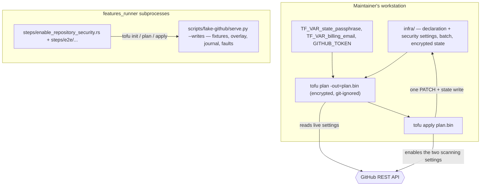

# Design: enable-repository-security

## Scope

Technical design for the change that makes secret scanning, push protection,
Dependabot alerts and Dependabot security updates part of the monorepo's
declared configuration, enables the two scanning settings on the live
repository, and proves the preview-and-apply flow:
[apply a configuration change](specs/apply-configuration-change/usecase.md),
capability `enable-repository-security`.

The observable WHAT is fixed by the proposal and the spec delta; this document
is the HOW: the two additions to the declaration, the second adoption batch
that binds the settings that are already on, the operator's preview-and-apply
procedure, and the seam that lets the delta's scenarios drive the real `tofu`
binary against a local fake GitHub API without touching the real organization.

Three boundaries shape what follows:

- **What is declared.** `infra/` gains the monorepo's security settings: the
  two scanning fields on the repository that is already bound, and two
  settings toggles that the provider exposes as their own resources.
- **What changes live.** Exactly one repository field pair: secret scanning and
  push protection go from disabled to enabled. Nothing else is created,
  updated or deleted; the Dependabot settings are already on and are only
  brought under the declaration.
- **What the suite can prove.** Every scenario drives the real `tofu` binary
  (`init`, targeted `plan -out`, `show -json`, the targeted refresh-only preflight, `apply
  <plan>`) as a subprocess, against the local fake API behind the provider's
  base URL. The fake gains an opt-in write sandbox so that an apply — not only a
  plan — is exercised end to end on loopback.

## Technology decisions

No new technology and no new version is introduced. Every version below is
read from the repository's own pins on 2026-10-18, not from memory.

| Area | Decision | Source |
|---|---|---|
| Declaration mechanism | OpenTofu with the `integrations/github` provider under `infra/`, unchanged (ADR-0005). | The existing declaration. |
| OpenTofu version | `1.13.1`, read from `infra/.opentofu-version`; the declaration keeps its user-facing floor `required_version = ">= 1.7"`. The suite and CI install exactly the pinned version and refuse another. | `infra/.opentofu-version`, checked 2026-10-18; `scripts/setup-infra-tests.sh`. |
| GitHub provider version | `6.13.0`, read from `infra/.terraform.lock.hcl`; constraint `~> 6.0`. The provider's behaviour below was checked against its `v6.13.0` source on 2026-10-18, not assumed. | `infra/.terraform.lock.hcl`; provider source at tag `v6.13.0`. |
| Security settings representation | The two scanning fields are nested blocks of `github_repository.mono`'s `security_and_analysis`; Dependabot alerts and Dependabot security updates use the dedicated `github_repository_vulnerability_alerts` and `github_repository_dependabot_security_updates` resources. The repository's own `vulnerability_alerts` field is deprecated in 6.13.0 and is not declared. | Provider `docs/resources/repository.md` and the resource source at `v6.13.0`. |
| Advanced security | Not declared. The provider's schema states that a public repository's advanced security cannot be supplied, and the live read does not report an `advanced_security` status. | Provider docs, checked 2026-10-18. |
| Apply mechanism | The operator's normal mechanism, no wrapper: `tofu init`, `tofu plan -input=false -out=plan.bin`, a read-only refresh-only preflight, then `tofu apply -input=false plan.bin`. The saved plan is the applied revision; `infra/plan.bin` is already git-ignored and is deleted after the apply. | The topic's apply contract; `.gitignore`. |
| Applied-state recording | The state after a green apply is committed with the declaration it applied, in one revision. A failed apply's state is marked stale by a sidecar beside it and is not committed; the preview refuses while the sidecar exists, and a green apply removes it. | ADR-0006; the use case's minimal guarantee. |
| Test runner | Unchanged: `./run-tests.sh` → `cargo test -p duty2cal --test features_runner` over an assembled feature root. | `run-tests.sh`; `givn/commands.yaml`. |
| Gherkin library | Unchanged: `cucumber-rs` 0.23.0, pinned in `Cargo.lock`; strict via `.fail_on_skipped()`. | `Cargo.lock`, checked 2026-10-18; `apps/cli/tests/features_runner.rs`. |
| Fake GitHub API | `scripts/fake-github/serve.py`, standard library only, extended with an opt-in write sandbox (`--writes`) and status-only fixture responses. No container, no network. | The existing twin; this design. |

## Architecture impact

The product is untouched: no crate, port or conversion scenario changes. The
change adds two resources and one block to the declaration, a second batch, and
a test-only write seam for the fake.



New or changed files:

| Path | Kind | Purpose |
|---|---|---|
| `infra/repos.tf` | changed | `github_repository.mono` gains `security_and_analysis { secret_scanning { status = "enabled" } secret_scanning_push_protection { status = "enabled" } }`. No other field changes. |
| `infra/security.tf` | new | `github_repository_vulnerability_alerts.mono` (`enabled = true`) and `github_repository_dependabot_security_updates.mono` (`enabled = true`, `depends_on` the alerts resource because GitHub requires alerts first). |
| `infra/adoption-batch-security.txt` | new | The two settings to bind: one `address<TAB>repository-name` line each. The historical `infra/adoption-batch.txt` is not edited, because it would then refuse its already-bound lines. |
| `infra/terraform.tfstate`, `infra/terraform.tfstate.backup` | changed after the apply | The encrypted state records the two new bindings and the enabled scanning values. |
| `infra/terraform.tfstate.stale` | transient, git-ignored | Written only after an apply that fails after its first write; its presence refuses the preview and the apply; a green apply removes it. |
| `.gitignore` | changed | Gains `infra/terraform.tfstate.stale` and `infra/guard.bin` beside the existing `infra/plan.bin` rule. |
| `scripts/fake-github/serve.py` | changed | Opt-in write sandbox, status-only fixture responses, in-memory overlay, `applied_write` journal entries with the request body's keys, `manual_edit` journal entries, `after_applied_writes` + `once` fault conditions. |
| `scripts/fake-github/fixtures/adopt-all/**` | changed | The two repository bodies gain `security_and_analysis` from the 2026-10-17 live read; the two vulnerability-alerts reads and the monorepo's automated-security-fixes read are added. |
| `scripts/fake-github/fixtures/security-applied/**` | new | The same file set with both repository bodies at the state the 2026-10-18 live read (`evidence/live-read/`) reports: the earlier apply's field values and the security block; the security scenarios' base tree. |
| `scripts/setup-infra-tests.sh` | changed | The fixture proof runs over both trees: the base batch against `adopt-all`, and the base batch followed by the security batch against `security-applied`; it also checks `jq`, which the apply routine's guard and preflight use. |
| `givn/changes/enable-repository-security/evidence/live-read/**` | new | The authenticated post-apply read of 2026-10-18 (`org`, both repositories, topics, pages, rulesets, the two vulnerability-alerts reads and the two automated-security-fixes reads) that `security-applied` is derived from and checked against. |
| `apps/cli/tests/steps/enable_repository_security.rs` | new | Non-e2e step definitions for this capability. |
| `apps/cli/tests/steps/e2e/enable_repository_security.rs` | new | E2E step definitions (real subprocesses, the fake with `--writes`, transcript evidence). |
| `apps/cli/tests/steps/mod.rs`, `apps/cli/tests/steps/e2e/mod.rs` | changed | Declare the two new modules; without that they are never compiled. |
| `apps/cli/tests/features_runner.rs` | changed | `DutyWorld` gains `plan_path`, `preview_transcript` and `apply_transcript`. |
| `givn/changes/enable-repository-security/evidence/real-apply/transcript.txt` | new after GREEN | The scrubbed transcript of the required operator apply against the real organization. |
| `givn/changes/enable-repository-security/evidence/visual/<scenario-slug>/transcript.txt` | new | One scrubbed transcript per `@e2e` scenario. |
| `docs/arc42/*` | changed | The 12-chapter impact assessment and the affected chapters; no new ADR. |

## The declaration

### The repository's scanning fields

`infra/repos.tf`, inside `github_repository.mono`:

```hcl
security_and_analysis {
  secret_scanning {
    status = "enabled"
  }
  secret_scanning_push_protection {
    status = "enabled"
  }
}
```

Every repository field already declared stays exactly as it is. The block names
only the two settings this change decides. `advanced_security`, `code_security`,
`secret_scanning_ai_detection`, `secret_scanning_non_provider_patterns` and
`secret_scanning_validity_checks` are deliberately not supplied: the first
cannot be supplied for a public repository, and the others are outside the seed's
guarantee (proposal D2). The pinned provider's read flattens only
`advanced_security` (when present), `secret_scanning` and
`secret_scanning_push_protection`; the live read of 2026-10-18 reports no
`advanced_security` status, so the state and the declaration carry the same two
nested settings and no other nested field can produce a difference.

The authenticated post-apply live read of 2026-10-18, captured in
`evidence/live-read/` and recorded in its `README.md`, reports the monorepo's
`security_and_analysis` as `secret_scanning = disabled`,
`secret_scanning_push_protection = disabled`,
`secret_scanning_non_provider_patterns = disabled`,
`secret_scanning_validity_checks = disabled` and
`dependabot_security_updates = enabled`, with no `advanced_security` status. The
same read confirms the state the earlier configuration change (`c87a34d`) left:
the monorepo's projects off, merge and squash merges off, rebase on,
delete-branch-on-merge on; the pages repository's issues, wiki and projects off;
the organization display name set; both Dependabot settings on for the monorepo
(the vulnerability-alerts read is a 204 and the automated-security-fixes read is
`{"enabled": true}`); and the classic branch protection gone (the read returns
404 "Branch not protected" after its removal by hand on 2026-10-18). The
security preview therefore shows a single change: the two scanning statuses.

### The two settings toggles

`infra/security.tf`:

```hcl
resource "github_repository_vulnerability_alerts" "mono" {
  repository = github_repository.mono.name
  enabled    = true
}

resource "github_repository_dependabot_security_updates" "mono" {
  repository = github_repository.mono.name
  enabled    = true

  depends_on = [github_repository_vulnerability_alerts.mono]
}
```

Both settings are already enabled live. Their resources are bound to the
existing settings by the second adoption batch before the apply, so the apply
does not create them and the preview does not claim a creation of something
that exists (proposal D1). The `depends_on` is not cosmetic: GitHub requires
vulnerability alerts to be enabled before Dependabot security updates can be,
so the dependency is in the real provider's contract and is also what makes the
partial-failure scenario's order deterministic.

`security_and_analysis` triggers a provider read of the alert status whenever a
repository body carries it (provider source `v6.13.0`,
`resource_github_repository.go`), so the fake must serve the
vulnerability-alerts endpoint for **both** repositories even for the
predecessor's adoption scenarios; the fixtures above do.

### The adoption batch

`infra/adoption-batch-security.txt`:

```
github_repository_vulnerability_alerts.mono	duty2cal
github_repository_dependabot_security_updates.mono	duty2cal
```

Both provider resources import by repository name in 6.13.0; the names above
are the identifiers their importers document. The batch is a separate file
rather than two more lines in `infra/adoption-batch.txt`: the existing command
imports exactly the selected batch into a copy of the applied state, and the
historical batch's five addresses are already managed, so extending that file
would refuse the whole batch on its first line. A second file is data for the
same command — no new command, no new flag.

The operator runs the adoption once for this batch before the preview:

```
scripts/adopt-public-home.sh --batch infra/adoption-batch-security.txt
```

The command's all-or-none guarantee and its read-only nature are unchanged: the
two imports read the repository and its two settings and bind them. A refusal
names the object and binds nothing.

## The apply procedure

The operator's routine, run after GREEN and after the second adoption. It is a
sequence of the declaration's own commands plus read-only checks; no second
apply command and no wrapper around `tofu apply` is introduced.

```sh
cd infra
test ! -e terraform.tfstate.stale ||
  { echo "refused: the applied state is stale" >&2; exit 2; }
preview_report=$(mktemp)
guard_report=$(mktemp)
preflight_report=$(mktemp)
state_before=$(mktemp)
cp terraform.tfstate "$state_before"
tofu init -input=false
# Full-declaration guard plan: a create outside the targeted saved plan must
# still be seen.
tofu plan -input=false -no-color -out=guard.bin
tofu show -json guard.bin >"$guard_report"
tofu plan -input=false -no-color -target=github_repository.mono -out=plan.bin
tofu show -json plan.bin >"$preview_report"
tofu plan -refresh-only -detailed-exitcode -json -input=false \
  -target=github_repository.mono >"$preflight_report"

# Preview guard: refuse a create for a setting already live and unbound. The
# refreshed prior state carries the live `vulnerability_alerts` flag; the
# dependency-updates status is not in the repository schema (provider 6.13.0),
# so its create is judged by the alerts flag: GitHub serves the
# automated-security-fixes endpoint only while alerts are enabled, so the
# setting's object exists live and must be adopted before it is updated.
guard_verdict=$(jq -r '
  (.prior_state.values.root_module.resources // []) as $res
  | ($res | map(select(.address == "github_repository.mono")) | .[0].values) as $repo
  | [ .resource_changes[]?
      | select((.change.actions // []) | index("create"))
      | .address
      | select(
          (. == "github_repository_vulnerability_alerts.mono"
           or . == "github_repository_dependabot_security_updates.mono")
          and $repo.vulnerability_alerts == true)]
  | if length == 0 then "ok" else join(" ") end
' "$guard_report")
[ "$guard_verdict" = ok ] ||
  { echo "refused: adopt the setting first: $guard_verdict" >&2; exit 2; }

# Live-change preflight: only a completed report with no non-no-op change
# continues; the JSON is the verdict, not the exit status (opentofu#3015).
preflight_verdict=$(jq -sr '
  if (map(select(.type == "change_summary")) | length) == 0 then "incomplete"
  else
    [ .[] | select(.type == "planned_change" or .type == "resource_drift")
      | .change as $c
      | (($c.actions // []) + (if $c.action then [$c.action] else [] end))
      | select(any(.[]; . != "no-op"))
      | ($c.resource.addr // empty) ]
    | if length == 0 then "ok" else join(" ") end
  end
' "$preflight_report")
[ "$preflight_verdict" = ok ] ||
  { echo "refused: live changed after the preview: $preflight_verdict" >&2; exit 2; }

if ! tofu apply -input=false plan.bin; then
  # SDKv2 persists the planned values for a failed update, so the failed
  # state is not evidence of a write. Restore the pre-apply state and ask
  # live with the read-only refresh-only report.
  state_failed=$(mktemp)
  cp terraform.tfstate "$state_failed"
  cp "$state_before" terraform.tfstate
  failure_report=$(mktemp)
  tofu plan -refresh-only -detailed-exitcode -json -input=false \
    -target=github_repository.mono >"$failure_report"
  failure_verdict=$(jq -sr '
    if (map(select(.type == "change_summary")) | length) == 0 then "incomplete"
    else
      [ .[] | select(.type == "planned_change" or .type == "resource_drift")
        | .change as $c
        | (($c.actions // []) + (if $c.action then [$c.action] else [] end))
        | select(any(.[]; . != "no-op"))
        | ($c.resource.addr // empty) ]
      | if length == 0 then "ok" else join(" ") end
    end
  ' "$failure_report")
  if [ "$failure_verdict" = ok ]; then
    # No drift: the refusal happened before any write; keep the restored
    # pre-apply state and write no marker. This inference holds for a plan
    # whose write set is updates to objects already in the applied state;
    # a plan containing a create needs the saved plan's create addresses
    # checked against live before the pre-apply state is kept.
    rm -f "$state_failed"
  elif [ "$failure_verdict" = incomplete ]; then
    # Live could not be verified: keep the restored pre-apply state, write no
    # marker, and state that the applied state is unverified.
    rm -f "$state_failed"
    printf 'refused: live could not be verified after the failed apply; the applied state is unverified\n' >&2
  else
    # Drift: a write landed; keep the failed apply's state and mark it stale.
    cp "$state_failed" terraform.tfstate
    date -u +%FT%TZ > terraform.tfstate.stale
    rm -f "$state_failed"
  fi
  rm -f "$failure_report"
  exit 1
fi
rm -f plan.bin guard.bin "$preview_report" "$guard_report" "$preflight_report" "$state_before" terraform.tfstate.stale
```

- **Environment:** `TF_VAR_state_passphrase` (at least 16 characters, from the
  password manager), `TF_VAR_billing_email` and `GITHUB_TOKEN` (the owner's
  token). No default, no repository secret, no workflow.
- **The preview** reads the encrypted state, the declaration and the live
  configuration, and names every difference. On this change's declaration the
  targeted preview prints one changed resource and the two scanning statuses, and its summary
  reads `Plan: 0 to add, 1 to change, 0 to destroy.` It writes nothing to
  GitHub.
- **The stale check.** A `terraform.tfstate.stale` sidecar beside the state means
  an earlier apply failed after its first write. The routine keeps a pre-apply
  copy of the state outside the state path. After a non-zero apply it restores
  that copy and runs the read-only refresh-only report; no drift proves the
  refusal happened before any write, so the restored state stays and no marker
  is written, while drift proves a write landed, so the failed apply's state is
  reinstalled and the marker is written. The no-drift inference holds for a plan
  whose write set is updates to objects already in the applied state — this
  change's plan; a plan containing a create needs the saved plan's create
  addresses checked against live before the pre-apply state is kept. An
  incomplete report (no `change_summary`) keeps the restored state, writes no
  marker and states that the applied state is unverified. The failed state itself is not
  evidence: SDKv2 persists the planned values for a failed update (measured
  with a refused `PATCH` on 2026-10-18), and OpenTofu also persists a refreshed
  envelope, so neither bytes nor values distinguish a refusal from a write.
  While the sidecar exists the preview and the apply refuse and name the stale
  state, and a green apply removes it. The sidecar is git-ignored and never
  committed, like `plan.bin`.
- **The preview guard: an unadopted object is not created.** The preview's full-declaration guard plan
  (`tofu show -json guard.bin`) carries, in its refreshed prior state
  for `github_repository.mono`, the live `vulnerability_alerts` flag the
  provider read. A `create` action for either declared Dependabot setting is
  refused by address before any write; the owner adopts it first (the second
  batch). The dependency-updates status is *not* available in the plan JSON:
  provider 6.13.0's repository schema has no
  `security_and_analysis.dependabot_security_updates` member, and its read
  flattens only `advanced_security`, `secret_scanning` and
  `secret_scanning_push_protection` (measured on 2026-10-18). The
  dependency-updates create is therefore judged by the alerts flag: GitHub
  serves the automated-security-fixes endpoint (200 `{enabled}`) only while
  alerts are enabled and 404 otherwise, so a live-enabled alerts setting means
  the updates object exists live — enabled or disabled — and a `create` for it
  is a re-creation of an existing object, refused until the owner adopts it.
  No second API call and no new command are needed: the check is a read of the
  guard plan's JSON, like the adoption verifier's.
- **The saved plan is the applied revision.** `plan.bin` is encrypted by the
  declaration's `plan` encryption block and is git-ignored; `tofu apply
  plan.bin` applies exactly the previewed actions, and OpenTofu refuses a plan
  whose state serial no longer matches (a preview made against a different
  state). A declaration edit made after the preview is not carried: the saved
  plan is the previewed revision, and the edit takes effect only after a new
  preview. The plan file is deleted after the apply, so no transient artifact
  enters the repository.
- **The live-change preflight.** Immediately before `tofu apply plan.bin` the
  routine runs the read-only `tofu plan -refresh-only -detailed-exitcode -json`
  over the same state, scoped to the previewed object
  (`-target=github_repository.mono` for this change), so a pre-existing
  organization drift outside the preview does not refuse or mark the change. `-refresh-only` compares the state with the live object,
  so a manual edit made after the preview appears as `resource_drift`; a
  non-no-op change refuses the apply, names each address, and the saved plan is
  not applied. **The JSON report is authoritative, not the exit status:**
  OpenTofu 1.13.1 returns exit 2 from this invocation even for a no-op
  (opentofu/opentofu#3015), so the routine accepts only a completed
  `change_summary` with no non-no-op `planned_change` or `resource_drift`, and
  an incomplete report refuses — the same rule and the same JSON reading
  `scripts/adopt-public-home.sh` already applies to the adoption verification.
  The residual window is a live edit made *during* the preflight, recorded as
  R-031 and measured in seconds rather than a human pause.
- **The outcome.** `tofu apply` reports each changed resource; after it, a
  fresh targeted `tofu plan -target=github_repository.mono` reports no changes. The encrypted state on disk now records
  the enabled statuses, and the operator commits it with the declaration in one
  revision scoped `apply-configuration-change` (see "Post-GREEN operator
  apply").
- **A refusal** — an unreadable setting, an unset or wrong passphrase, or an
  authority that cannot perform the change — stops the run before or at the
  first write. OpenTofu exits non-zero and names the object; the routine
  restores the pre-apply state, so the state on disk is unchanged even though
  the failed apply itself may have written the planned values.
- **A partial failure** — an earlier resource applied and a later one failed —
  exits non-zero, names the applied resources and the failed address.
  OpenTofu's state then records the applied resources and not the failed one;
  the routine writes `terraform.tfstate.stale` beside the state and the state is
  not committed. The next preview refuses and names the stale state; a green
  apply records the whole revision and removes the sidecar. This is how the use
  case's partial-failure rule is realized without a rollback claim.

The partial-failure behavior needs more than one write, and the sanctioned
routine leaves exactly one on this change. With the preview guard in place, the
skipped-adoption shape is refused before the plan is accepted, so the routine
cannot reach a partial apply here. The delta's partial-failure scenario
therefore drives the raw apply in that skip state — it produces the plan
without the routine's guard, applies it, and writes the failure-path sidecar —
and proves the contract's reporting, the unrecorded failed setting and the
stale marker. The scenario is labelled as the off-routine skip path; the
routine still adopts first, and the second batch remains a named step (TD-013).

## Test seam: the fake GitHub API

The suite never reaches `api.github.com`. The provider's base URL points at
`scripts/fake-github/serve.py` on loopback, and the scenarios run the same
`tofu` binary the operator runs.

### Read fixtures

Two base trees, each a complete and proven set:

- `fixtures/adopt-all/` — the live read of 2026-10-17 that the adoption
  scenarios bind. It gains `security_and_analysis` in both repository bodies
  (the statuses the live read captured on 2026-10-17), and the
  vulnerability-alerts and automated-security-fixes reads below.
- `fixtures/security-applied/` — the same file set at the state the
  authenticated post-apply read of 2026-10-18 reports (`evidence/live-read/`):
  the monorepo's projects off, merge commit and squash off, rebase on,
  delete-branch-on-merge on, downloads off, and both scanning settings disabled
  with Dependabot security updates enabled; the pages repository's issues, wiki
  and projects off, with its scanning settings disabled; the organization's
  display name set. This is the live state the earlier configuration change
  left, and the security scenarios use it so that a preview names only the
  change this change makes. The adoption scenarios keep `adopt-all`, because
  their `@e2e` scenario asserts that adoption records the live values rather
  than the declared ones — a contrast that exists only before the earlier
  change's apply. `evidence/live-read/README.md` records each value's source
  command; a divergence between that read and the fixture is a fixture defect.

The security scenarios do not start from an adoption-only state. After adopting
the base batch against a copy of `security-applied`, the step removes
`security.tf` and the two-line `security_and_analysis` block (the base
declaration this change inherits), runs that base declaration's real `tofu
init`/`plan`/`apply` against the same fake tree, and only then restores the
security declaration and adopts the second batch. The base apply records the
provider's one-time state-only `ignore_vulnerability_alerts_during_read = false`
per repository and the live values the earlier apply left, so the security
targeted preview has exactly one changed resource (`github_repository.mono`) and exactly
two changed live attributes (the two scanning statuses). The step parses the
saved plan's JSON and asserts that exact set; if a state-only attribute still
appears it is classified as bookkeeping and allowed, but any other live
attribute fails the scenario.

The base tree `adopt-all` also gains:

- `repos/duty2cal/duty2cal/vulnerability-alerts.json` and the pages
  repository's counterpart, each a status-only 204 response, because the
  provider's repository read fetches the alert status whenever the body carries
  `security_and_analysis`.
- `repos/duty2cal/duty2cal/automated-security-fixes.json`, the
  `{"enabled": true}` read that the Dependabot resource's importer and reader
  call.

A fixture whose JSON object carries `"__fake_response__": {"status": 204}`
is a response descriptor: the fake replies with that status and no body. This
is the only new fixture shape; every other fixture remains a plain JSON body.

`scripts/setup-infra-tests.sh` runs its import proof over both trees: the base
batch against `adopt-all`, and the base batch followed by the security batch
against `security-applied`. The security scenarios' base-declaration apply is
the third proof: it must report no live change, and a non-empty base plan fails
before the security plan is made. A missing read in either tree fails the proof
with the 599 unknown-path marker rather than surfacing inside a scenario.

### Write sandbox (`--writes`)

Off by default, so every existing adoption scenario keeps proving that adoption
issues no write. With `--writes` the fake accepts exactly three write shapes:

| Method and path | Effect |
|---|---|
| `PATCH /repos/{owner}/{repo}` | Merges the JSON body's top-level fields into the in-memory overlay of that repository; a `security_and_analysis` object is merged nested. Responds 200 with the merged body. |
| `PUT /repos/{owner}/{repo}/vulnerability-alerts` | Marks alerts enabled in the overlay; responds 204. |
| `PUT /repos/{owner}/{repo}/automated-security-fixes` | Marks Dependabot security updates enabled in the overlay; responds 204. |

The `DELETE` counterparts flip the overlay back (the provider's delete path;
not exercised by these scenarios). Every other write, and every method on an
unknown path, is still refused with 405 and journaled as a refused write, so an
unexpected write cannot hide. Reads consult the overlay before the fixture file,
so the provider's post-update read and the scenario's later plan see what the
apply wrote.

The journal entry for an applied write carries `"applied_write": true`, the
method, the path, and — for a repository `PATCH` — the scrubbed request body:
its sorted top-level keys plus the full `security_and_analysis` object. The
step asserts that the request carries `security_and_analysis`, that every
top-level key it sends is either a fixture key or one of the provider's
create-only defaults (`auto_init`, `gitignore_template`,
`license_template`), that the security object names exactly the two settings
both enabled, and that the follow-up read's declared fields equal the fixture's
with only the two statuses differing live — so "wrote nothing else" is proven
by the request and the overlay, not inferred. The provider does not send the
whole API body, only the fields its update schema controls (measured
2026-10-18); the earlier wording was corrected during implementation.

A test-only manual edit is a direct loopback `PATCH` from the step, not through
`tofu`; the fake journals it with `"manual_edit": true` and the same body
recording, and the live-change scenario asserts the apply sent no write of its
own.

### Fault injection

`faults.json` keeps its `path` / `path_regex` + `method` form and gains two
optional conditions: `after_applied_writes: N`, so a fault applies only after
the server has applied a number of writes, and `once: true`, so a matching
fault fires once and is then consumed. `once` is what lets the read-back
failure hit the provider's post-`PATCH` read while the next preview reads
successfully. The scenarios need:

| Scenario | Fault |
|---|---|
| unreadable settings | status 403 for `GET` on `repos/duty2cal/duty2cal` |
| first change refused | status 403 for `PATCH` on `repos/duty2cal/duty2cal` |
| partial failure | status 403 for `PUT` on `repos/duty2cal/duty2cal/automated-security-fixes` |
| read-back failure | status 403 for `GET` on `repos/duty2cal/duty2cal`, `after_applied_writes: 1`, `once: true`. A 500 is not usable: the provider's HTTP client retries 5xx, so a `once` 500 is consumed by the retry and the apply succeeds (measured 2026-10-18); a non-retried status fails the read-back exactly once |
| live change | none: the step toggles `has_projects` through the loopback write sandbox after the preview |

`mutate.json` is unchanged and is not needed by this change.

## Test runner, strict mode, and single-scenario command

- **Runner command (`verify.command`):** `./run-tests.sh` — unchanged. It
  assembles `givn/specs/**` and `givn/changes/*/specs/**` into one feature root
  and runs `cargo test -p duty2cal --test features_runner` over it, so this
  change's `.feature` file and the permanent corpus both execute.
- **E2E command (`verify.e2e_command`):** `./run-tests.sh --e2e` — unchanged;
  the same runner with the `@e2e` filter.
- **Strict mode:** `DutyWorld::cucumber().fail_on_skipped()` in
  `apps/cli/tests/features_runner.rs`. An undefined, pending or skipped step
  fails the run, so the eight `@wip` scenarios are red until their definitions
  exist. The proof is an implementation task: temporarily rename one step in a
  throwaway copy of the feature and observe a non-zero exit and an "undefined
  step" report, then restore. The fake's unknown-path 599 marker and its
  refused-write journal are the second net: a missing fixture or an unexpected
  write fails loudly instead of looking like an empty response.
- **Single-scenario command:**
  `./run-tests.sh --name "Organization owner applies the previewed revision and the security settings are enabled"`.
  `run-tests.sh` forwards `--name` to cucumber-rs unchanged.

## Step definitions

One file per capability, as the project already does:

| File | Contents |
|---|---|
| `apps/cli/tests/steps/enable_repository_security.rs` | Non-e2e steps: prepare a temporary declaration copy, adopt the base batch against a copy of `fixtures/security-applied`, run the base declaration's `tofu init`/`plan`/`apply` (the inherited applied state, including the state-only `ignore_vulnerability_alerts_during_read`), restore the security declaration, adopt the second batch, start the fake in `--writes` mode with the scenario's faults, run `tofu init`, a full-declaration `tofu plan -out` for the guard, the targeted `tofu plan -out`, `tofu show -json`, the preflight and `tofu apply`, capture stdout/stderr and the exit status, parse the plan JSON for the exact changed set and the guard, read the journal and the state, and snapshot the state bytes and the stale sidecar. |
| `apps/cli/tests/steps/e2e/enable_repository_security.rs` | The same real subprocesses, plus the committed transcript. It asserts on what the plan and the apply printed, on the journal entry for the applied write (body keys and `security_and_analysis`), and on the state read back with the real binary. |

Both modules are declared in `apps/cli/tests/steps/mod.rs` and
`apps/cli/tests/steps/e2e/mod.rs`. The steps reuse the adoption module's
`terraformrc()`, `PASSPHRASE`, `BILLING_EMAIL` and `TOKEN` helpers (made
`pub(crate)` in that module or moved to `support.rs`); no state is fabricated —
every binding in a scenario was written by the real adoption command.

`DutyWorld` gains `plan_path`, `preview_transcript` and `apply_transcript`. The
scenario's temporary declaration is a copy of `infra/` with `terraform.tfstate`
initialised by the adoption; `GITHUB_TOKEN`, `GITHUB_BASE_URL`,
`TF_VAR_state_passphrase`, `TF_VAR_billing_email` and `TF_CLI_CONFIG_FILE` are
set on every child invocation, so neither the provider's `gh auth token`
fallback nor the default endpoint can be reached.

## Decisions

Resolves the proposal's open questions; seed IDs are recorded beside the
ledger IDs so the link is readable here and in the proposal.

- **Decides D1 (seed: "security features are declared configuration"):** the
  Dependabot alerts and Dependabot security updates are declared through their
  dedicated resources and bound to the live settings by a second adoption batch
  before the apply. The preview therefore names no creation, and both settings
  become drift-managed. Realized in `infra/security.tf`,
  `infra/adoption-batch-security.txt` and the adoption invocation in "The apply
  procedure".
- **Decides D2:** only `secret_scanning` and
  `secret_scanning_push_protection` are supplied; non-provider patterns,
  validity checks, advanced security and code security are not. The pinned
  provider 6.13.0 cannot write them anyway: its update path
  (`calculateSecurityAndAnalysis`) sends only `advanced_security`,
  `secret_scanning` and `secret_scanning_push_protection`, and
  `secret_scanning_validity_checks` is not in its schema, so a later change
  that wants those checks needs a provider upgrade or another mechanism, not
  just a declaration edit. Realized in `infra/repos.tf` and asserted by the
  preview scenario's "only changes" assertion.
- **Out of scope D3 (seed Q3):** whether the ruleset requires pull requests.
  Owner: the user. The ruleset is not modified by this change; decided by a
  later ruleset change and kept open in the topic log.
- **Out of scope D4 (seed Q10):** whether a review gates an apply. Owner: the
  user. This change is reviewed by the givn review and applied by the operator
  after GREEN; no runtime gate is built.
- **Out of scope D5 (seed Q11):** what an apply may delete. Owner: the user.
  This change deletes and disables nothing. The legacy classic protection was
  removed by hand on 2026-10-18 (the live read returns 404 "Branch not
  protected"); this change verifies it stays gone and does not touch it.
- **Decides D6:** private vulnerability reporting stays manual and undeclarable
  in provider 6.13.0; recorded as a gap in chapter 11. Realized by the declared
  scope of `infra/` and the risk entry.

Design decisions beyond the proposal's questions, each with the alternative it
rejected:

- **The apply is the normal mechanism (saved plan + apply), with two read-only
  checks in the routine, not a wrapper command** (rejected: an apply script that
  re-plans, compares and *applies* — it would add a second command beside the
  declaration, and the change's contract is the declaration's own flow). The
  live-change check is a read-only refresh-only plan immediately before
  `tofu apply`; its report is authoritative, not its exit status
  (opentofu/opentofu#3015). The residual window is recorded as R-031.
- **The unadopted-setting guard reads a full-declaration plan** (rejected: a
  second live API read, or a new command beside `tofu`; the refreshed prior
  state in `tofu show -json` already carries the live alerts flag). The saved,
  applied plan is targeted at the monorepo. Corrected
  during implementation: the plan JSON does not carry the dependency-updates
  status at all (provider 6.13.0 has no such repository-schema member), so both
  Dependabot creates are judged by the live `vulnerability_alerts` flag, which
  means the automated-security-fixes object exists live. The read-back fault is
  a non-retried status for the same reason: the provider retries a `once` 500
  and the read-back then succeeds (both measured on 2026-10-18).
- **A stale sidecar rather than a commit rule alone** (rejected: relying on the
  operator's memory not to commit a partial state, which leaves the on-disk
  state indistinguishable from an applied one and gives the future drift check
  no signal).
- **The stale signal is live drift against the restored pre-apply state, not
  the failed state's bytes or values** (corrected during implementation after
  measuring OpenTofu 1.13.1 + SDKv2: a refused `PATCH` still persists the
  planned repository values into the state, and the first apply after an
  adoption also persists a refreshed envelope. A byte or value comparison of
  the failed state therefore marks a pure refusal stale, and a later preview
  would no longer name the change. Restoring the pre-apply state and reading
  the read-only refresh-only report separates a refusal (no drift) from a
  partial apply (drift); an incomplete report keeps the restored state, writes
  no marker and reports the applied state as unverified. The no-drift inference
  assumes a plan whose write set is updates to objects already in the applied
  state; a plan containing a create needs its create addresses checked against
  live before the pre-apply state is kept).
- **The commit scope is the use-case id, `apply-configuration-change`, not
  `enable-repository-security`** (rejected: scoping by this change's id, which
  the changelog allow-list does not name, so a user-receiving change would be
  filtered out; `infra/` is outside the user-receiving paths, so this change is
  intentionally absent from `CHANGELOG.md` unless that path list is widened by
  a separate decision).
- **A second adoption batch file, not an edited historical batch** (rejected:
  appending the two lines to `infra/adoption-batch.txt`, whose five addresses
  are already managed, so the batch would refuse on its first line).
- **An opt-in write sandbox in the existing fake, not a second fake or a
  container** (rejected: a read-only-only seam would leave the apply untested;
  a container adds an image, a network and startup the suite does not need).
- **Adopt the toggles rather than let the apply create them** (rejected:
  declaring without adoption makes the preview claim two creations of settings
  that already exist, contradicting the adoption rule).
- **The applied revision is the committed state plus the declaration revision,
  not a variable carried in the declaration** (rejected: a
  `terraform_data`/`null_resource` carrying `var.declared_revision` would turn
  every commit into a plan diff and duplicate what the commit already proves).
- **`depends_on` between the two Dependabot resources** (rejected: relying on
  `-parallelism=1` traversal order — the alerts-before-updates requirement is
  real and the partial-failure assertion depends on a stated order).

## Use-case traceability

| Use-case element | Technical decision | Evidence |
|---|---|---|
| Goal: the live configuration matches the applied revision | Declared scanning fields plus the two bound toggles; `tofu apply plan.bin` | `@e2e` "Organization owner applies the previewed revision and the security settings are enabled"; the post-apply empty targeted security plan |
| Main flow 2: the preview names every difference by object and field | Plan against the adopted state and the encrypted state | `@e2e` "Organization owner previews the security settings and only the declared differences are named" |
| Rule: an existing setting is adopted before it is updated | Second adoption batch binds both Dependabot settings; a preview that would still create a live, unbound setting is refused by the plan-JSON guard | The preview scenario's "no object to create or delete" assertion; "The preview refuses to add a Dependabot setting that already exists live and is unbound" |
| Rule: a refused apply makes no live change | Authority gaps are refused by the provider before the write; the journal shows no applied write | "An unreadable repository setting refuses the preview and names the repository"; "An apply whose first change is refused changes nothing" |
| Rule: a partial failure is reported and names the object, and the state is stale | Provider order (repository → alerts → updates) in the off-routine skip path; the failed address is named, the state does not record it, and the failure path writes `terraform.tfstate.stale` | "A partial failure reports the applied settings and names the failed one" (including the stale marker and the refusing next preview) |
| Rule: the applied revision is recorded only when every object succeeded | The state is committed only after a green apply; a partial state carries the stale sidecar, is not committed, and is refused by the next preview until a green apply | The apply procedure; the partial scenario's state and marker assertions |
| Rule: settings the authority cannot read are named | The provider read fails and the preview names the repository | The unreadable-settings scenario |
| Extension: the live configuration changed since the preview is refused | The read-only refresh-only preflight immediately before `tofu apply` reports the drift by address and refuses; the JSON report is authoritative (opentofu/opentofu#3015). A live edit during the preflight is the only residual window (R-031) | "A live edit between the preview and the apply is refused and named" |
| Extension: a setting that already exists live is not created | The preview's plan JSON is checked before any write; a `create` for an already-live, unbound setting refuses by address | "The preview refuses to add a Dependabot setting that already exists live and is unbound" |
| Minimal guarantee: a failed PATCH is not recorded as applied | The provider's post-`PATCH` read-back failure is reported; live carries the change, the state may carry the planned values and is marked stale (SDKv2 persists them), and the next preview refuses until a green apply | "A failed read-back after the PATCH is reported and the state is marked stale" |
| Minimal guarantee: a failure names the object and the reason | Provider error text carries the address and the API reason; the steps assert the address | The failure scenarios |
| Persona impact: organization owner | Preview, apply, refuse, partial outcome | `@e2e` transcripts |
| Persona impact: contributor reviewer | The declaration, the second batch and the encrypted state are readable in one history | Design-level; the reviewed revision |
| Parent-use-case lens: crew member (no impact) | The crew member is a stakeholder of the parent use case, not this change: the release channel is untouched and no rule, release or archive changes | The declaration touches no release object |

Actors in Gherkin are the organization owner; Personas are review lenses, not
Actors.

## Persona impact

User-visible surface: a terminal interface (the preview and the apply output)
and the repository's files (the declaration, the batch and the encrypted
state).

- **`project-maintainer--organization-owner`** — previews the revision, reads
  the named difference, applies it, sees the changed settings reported, and
  answers for a refusal or a partial outcome. Holds the token and the
  passphrase; commits the state after a green apply.
- **`contributor--infrastructure-reviewer`** — reads the declaration and the
  batch in the same history as the code, sees that the state is ciphertext, and
  cannot apply: no token, no passphrase.
- **`crew-member--personal-calendar-owner`** — the parent use case's lens, not
  a Persona confirmed for this change and not an Actor: no impact, because no
  release object, rule or archive is touched and the repository's release
  channel keeps working.

## Visual Design Contract

- Interface: terminal
- Viewports: n/a (no rendered screen)
- Design system: none
- Screens covered: none
- rendered reference: n/a
- Capture mechanism and evidence path: one transcript per `@e2e` scenario under
  `givn/changes/enable-repository-security/evidence/visual/<scenario-slug>/transcript.txt`,
  captured by the scenario's final step with the temporary directory, the fake's
  port, the token and the passphrase replaced by placeholders.
- Baseline: the transcript carries the plan's summary and the changed setting
  names, or the apply's outcome; no token, passphrase, temporary path or live
  credential appears in it.
- Motion: n/a.

## E2E smoke test infrastructure

- **E2E runner command:** `./run-tests.sh --e2e`, distinct from
  `verify.command`; it filters `@e2e`.
- **E2E step location:** `apps/cli/tests/steps/e2e/enable_repository_security.rs`,
  separate from the non-e2e steps because it starts the fake and commits the
  transcript.
- **Real interface:** the `tofu` CLI — `init`, `plan -out`, `show -json`, the
  refresh-only preflight and `apply <plan>` — invoked as real subprocesses, with
  the real provider, against the local fake GitHub API over loopback.
- **Local test infrastructure:** the fake server on an ephemeral loopback port
  in `--writes` mode, a temporary declaration copy whose encrypted state is
  primed by the base adoption batch and then by the base declaration's real
  apply, the provider mirror prepared by `scripts/setup-infra-tests.sh`, a fixed
  16-plus-character test passphrase and a dummy billing email in the
  environment, and the two base trees. No container, no network, no
  credentials.
- **Framework:** cucumber-rs with `std::process::Command` and `std::net` to
  discover the fake's port, as the existing infrastructure steps already do.
- **E2E strict-mode proof:** the same `fail_on_skipped()`, plus the fake's
  unknown-path 599 marker and refused-write journal; the rename-a-step check is
  an implementation task in `tasks.md`.

## Interaction Coverage Matrix

| Inventory entry | @e2e scenario title | Real interface | Driving mechanism |
|---|---|---|---|
| preview the declared configuration and read the named differences | Organization owner previews the security settings and only the declared differences are named | CLI (terminal) | `std::process::Command` runs `tofu init -input=false`, the full-declaration `tofu plan -input=false -no-color -out=<tmp>/guard.bin` and `tofu show -json <tmp>/guard.bin` for the guard, then the targeted `tofu plan -input=false -no-color -target=github_repository.mono -out=<tmp>/plan.bin` and `tofu show -json <tmp>/plan.bin` in the scenario's declaration copy (primed by the base apply), with `TF_VAR_state_passphrase`, `TF_VAR_billing_email`, `GITHUB_TOKEN=test-token`, `GITHUB_BASE_URL=http://127.0.0.1:<port>` and `TF_CLI_CONFIG_FILE` set; asserts the plan text names both scanning statuses, the summary `0 to add, 1 to change, 0 to destroy`, the plan JSON's only changed resource is `github_repository.mono` and its only changed live attributes are the two scanning statuses (the state-only `ignore_vulnerability_alerts_during_read` is classified and allowed), and a journal with no applied and no refused write |
| apply the previewed revision and read the outcome | Organization owner applies the previewed revision and the security settings are enabled | CLI (terminal) | `std::process::Command` runs the targeted preflight, `tofu apply -input=false <tmp>/plan.bin`, then a targeted `tofu plan -target=github_repository.mono`; asserts the apply's outcome lines, the journal's single `applied_write` PATCH whose fields are the provider's update schema with both statuses enabled in `security_and_analysis`, the declared fields unchanged and the two statuses the only live difference in the targeted scope, the repository read reporting them enabled, the applied state read with `tofu state show` and the raw state's serial, and an empty targeted follow-up plan |

## Black-Box-First policy

All eight scenarios drive the real `tofu` binary as subprocesses; the two
`@e2e` scenarios drive the same binary end to end and assert its output, the
request journal and the recorded state. No internal test is retained: the only
Rust added is step definitions and three world fields. The GitHub API is never
mocked inside the command — it is replaced at the HTTP boundary by a local
server, the boundary the provider actually talks to.

## Local runnability & digital twins

- **Setup, once:** `./scripts/setup-infra-tests.sh` — checks `tofu` against
  `infra/.opentofu-version`, `python3` and `jq` (the apply routine and the
  preflight/guard filters use it, as `scripts/await-green-checks.sh` already
  does), mirrors the locked provider into
  `~/.cache/duty2cal/terraform-provider-mirror`, writes the `terraformrc`, and
  proves the base fixture set with one real import per base batch entry.
- **Run the suite:** `./run-tests.sh` (or `./run-tests.sh --name "<scenario>"`).
  The scenarios start the fake themselves; no service has to be running.
- **Manual walkthrough:** run `./scripts/setup-infra-tests.sh` once (it prints
  the `TF_CLI_CONFIG_FILE` it wrote), start
  `scripts/fake-github/serve.py --fixtures scripts/fake-github/fixtures/security-applied --port 8099 --journal /tmp/journal --writes`,
  copy `infra/` to a temporary directory, adopt both batches:
  `GITHUB_BASE_URL=http://127.0.0.1:8099 TF_VAR_state_passphrase=… TF_VAR_billing_email=… ./scripts/adopt-public-home.sh --declaration <tmp>/infra --batch <tmp>/infra/adoption-batch.txt --api-url http://127.0.0.1:8099 --token test-token`,
  then the same with `--batch <tmp>/infra/adoption-batch-security.txt`, and
  **export the fake environment for the `tofu` commands themselves** — the
  provider reads `GITHUB_BASE_URL`/`GITHUB_TOKEN` and the backend reads the
  passphrase — before running the routine:

  ```sh
  export GITHUB_BASE_URL=http://127.0.0.1:8099
  export GITHUB_TOKEN=test-token
  export TF_CLI_CONFIG_FILE=<the path setup-infra-tests.sh printed>
  export TF_VAR_state_passphrase=<test passphrase>
  export TF_VAR_billing_email=test@example.test
  cd <tmp>/infra
  tofu init -input=false
  tofu plan -input=false -no-color -target=github_repository.mono -out=plan.bin
  tofu show -json plan.bin > preview.json
  tofu plan -refresh-only -detailed-exitcode -json -input=false \
    -target=github_repository.mono > preflight.json
  tofu apply -input=false plan.bin
  ```

  Apply the preview guard and the live-change preflight described in "The apply
  procedure" to `preview.json` and `preflight.json` before `tofu apply`; the
  walkthrough is the same routine, with the reports kept for inspection.
  Without those exports the provider would reach `api.github.com` and the
  backend would refuse the state for a missing passphrase; the walkthrough
  never relies on an ambient token or the registry.
- **Isolated network:** every dependency is on loopback; the fake binds an
  ephemeral port and the steps pass its URL explicitly. No shared dev service,
  no assumption that anything is already running.
- **Digital twin:** GitHub's REST API is the only external service this
  change's tooling talks to, and `scripts/fake-github/serve.py` is its twin —
  deterministic fixtures, an in-memory write overlay, a request journal and
  fault injection. No scenario reaches `api.github.com`.
- **Interface obstacles and their named fixes:**
  - *The provider fetches itself during `init`.* Fix: the filesystem mirror
    and `TF_CLI_CONFIG_FILE` prepared by `scripts/setup-infra-tests.sh`; the
    suite runs offline.
  - *The provider reads the vulnerability-alerts status whenever a repository
    body carries `security_and_analysis`.* Fix: the two 204 fixtures, added for
    both repositories, so the predecessor's adoption scenarios keep passing.
  - *A 204 response has no body to serve from a plain fixture file.* Fix: the
    `__fake_response__` descriptor; a status-only response is data, not a
    special case in the handler.
  - *The fake must not accept arbitrary writes.* Fix: `--writes` enables an
    allow-list of three shapes; everything else is still 405 and journaled, and
    the apply scenarios assert the applied-write set exactly.
  - *The provider sends its update-schema fields on `PATCH`, not the changed
    field only.* Fix: the fake merges the body into the overlay; the journal
    records the scrubbed body's sorted top-level keys and the
    `security_and_analysis` member, and the scenario asserts no unexpected key,
    both enabled statuses in the member, unchanged declared fields in the
    overlay, and the two statuses as the only live difference. The provider
    writes three create-only defaults (`auto_init`, `gitignore_template`,
    `license_template`) the API read never returns, and reorders `topics`
    (measured 2026-10-18); the comparison allows the former and treats the
    latter as a set.
  - *The partial-failure scenario needs a deterministic order.* Fix:
    `depends_on` plus `-parallelism=1`; the apply's actions are then repository
    → vulnerability alerts → Dependabot security updates.
  - *A saved plan is applied without re-reading live.* Fix: the read-only
    refresh-only preflight immediately before `tofu apply plan.bin` refuses a
    non-no-op change by address, and its JSON report is authoritative because
    OpenTofu 1.13.1 can return exit 2 for a no-op; R-031 records only the
    during-preflight residual window, and the follow-up plan is asserted empty.
  - *A preview can claim creations of settings that already exist live.* Fix:
    the preview's plan JSON is read before any write, and a `create` for an
    already-live, unbound setting refuses by address.
  - *A partial state on disk looks like an applied state.* Fix: the failure
    path writes `terraform.tfstate.stale`, the preview and the apply refuse
    while it exists, and a green apply removes it.
  - *A read-back fault would also fail the follow-up preview.* Fix: the fault's
    `once: true` consumes it on the provider's post-`PATCH` read, so the next
    preview reads the overlay and names the still-unrecorded statuses.
  - *A plan file must not enter the repository.* Fix: `infra/plan.bin` and `infra/guard.bin` are
    git-ignored, encrypted by the `plan` encryption block, and deleted after
    the apply.
  - *The provider may fall back to `gh auth token` when no token is set.* Fix:
    every child invocation exports `GITHUB_TOKEN` and `GITHUB_BASE_URL`.

## Coverage process boundaries

| Process | Started by | Instrumented artifact | Profile output | Merge step | Non-zero production probe |
|---|---|---|---|---|---|
| features_runner (non-e2e) | `./measure-coverage.sh` (no `--tags`; it produces both reports) | `cargo llvm-cov --workspace --test features_runner` | `coverage/non-e2e-cobertura.xml` | `./merge-coverages.sh` | `crates/duty2cal-core/src/domain/timing.rs` |
| features_runner (`@e2e`) + spawned `tofu`/fake | `./measure-coverage.sh` (no `--tags`; it produces both reports) | `cargo llvm-cov --workspace --test features_runner` | `coverage/e2e-cobertura.xml` | `./merge-coverages.sh` | `apps/cli/src/fs.rs` |

The HCL, the fake and the `tofu` CLI are not Rust and stay outside the coverage
denominator, like `scripts/adopt-public-home.sh`; their observable contract is
covered by the delta's scenarios. The only Rust added is step definitions and
the `DutyWorld` fields, which the runner instruments.

## Risks and follow-ups recorded here

- **Push protection may not be enableable on this repository (R-026).** The
  provider's own acceptance test for a public repository keeps push protection
  `disabled` with a comment about purchased advanced security, while GitHub's
  secret-scanning documentation states that secret scanning runs automatically
  for free on public repositories, the push-protection page states it is
  disabled by default and can be enabled by a repository administrator,
  organization owner, security manager or enterprise owner, and the live read
  shows the field and admin permission. The provider test's comment concerns
  GHAS on private repositories. The apply is still the proof: the
  pre-flight is read-only (the live read and the documented availability), and a
  refusal names the setting, changes nothing, and stops the change — the
  question returns to the user rather than being papered over. Carried to
  chapter 11.
- **The declaration's security block is provider-version-specific (R-027).**
  The provider flattens only some of the settings the API returns, and 6.13.0's
  write path sends only `advanced_security`, `secret_scanning` and
  `secret_scanning_push_protection`; a provider upgrade can change which
  statuses the plan compares and is the only way to declare the remaining
  checks. The lock pin and the scenario re-run on an upgrade are the control.
- **The fake's write sandbox proves ordering and reporting, not GitHub's
  acceptance (R-028).** The sandbox twins the API shape, not its policy. The
  operator's real apply after GREEN is the missing evidence and is required.
- **A partial apply's state is real and is marked stale (R-029).** The state
  records the applied resources and not the failed one; on failure the routine
  restores the pre-apply state and keeps it only when the scoped report shows no drift, and
  otherwise reinstalls the failed apply's state and writes
  `terraform.tfstate.stale`. Only a green apply's state is committed, and the
  next preview refuses and names the stale state until a green apply removes
  it. A failed update's state values may include the planned object, so the
  marker never rests on them.
- **Private vulnerability reporting remains manual (R-030).** No resource exists
  in provider 6.13.0; the setting is off and undeclarable, recorded as a gap.
- **The saved-plan window is the preflight window (R-031).** A manual live edit
  between the preview and the apply is refused by the read-only refresh-only
  preflight, whose JSON report is authoritative because the exit status is not
  (opentofu/opentofu#3015). A live edit made *during* the preflight is the only
  residual, measured in seconds; a wrapper command that re-planned and applied
  is still rejected as a second apply path.
- **The preview guard reads the plan JSON.** An object that already exists live
  and is unbound is refused before any write; a guard miss (a live object the
  refreshed prior state does not expose) remains possible, which is why the
  declaration only adopts-or-updates known objects and the second batch stays a
  named step (TD-013).

## Post-GREEN operator apply (required)

The suite proves the preview and the apply against the fake; it cannot prove
that the live API accepts both statuses on `duty2cal/duty2cal`. The change is
therefore not done when the suite is GREEN. The maintainer:

1. runs `scripts/adopt-public-home.sh --batch infra/adoption-batch-security.txt`
   once against the real organization, with the real token, passphrase and
   billing email; on 2026-10-18 the command refused the batch because its
   whole-state refresh saw the pre-existing organization billing drift, so the
   two Dependabot resources are imported directly (`tofu import
   github_repository_vulnerability_alerts.mono duty2cal` and `tofu import
   github_repository_dependabot_security_updates.mono duty2cal`), which
   satisfies adopt-before-create;
2. confirms the read-only pre-flight: the live read still reports both fields
   and the admin permission, and GitHub's documentation still states the
   free public-repository secret-scanning availability and the administrator
   enablement of push protection; a refusal here stops the change;
3. runs the full-declaration guard plan
   (`tofu plan -input=false -no-color -out=guard.bin`) and reads it: no
   `create` for either Dependabot setting (the preview guard); then runs the
   targeted security preview
   (`tofu plan -input=false -no-color -target=github_repository.mono -out=plan.bin`)
   and reads it: `0 to add, 1 to change, 0 to destroy` and the two scanning
   statuses as the only difference;
4. runs the read-only refresh-only preflight scoped to the previewed object
   (`tofu plan -refresh-only -detailed-exitcode -json -target=github_repository.mono`),
   requires a completed report with no non-no-op change in that scope, and only
   then applies the saved plan (`tofu apply -input=false plan.bin`; a saved plan
   already fixes its scope and must not be given `-target`); on success, a
   targeted `tofu plan -target=github_repository.mono` confirms no differences
   and `terraform.tfstate.stale` is absent. The full preview still
   names the pre-existing organization billing drift, a separate issue outside
   this change; the full configuration is not clean;
5. records the scrubbed transcripts (guard plan or its omission, targeted plan,
   apply, targeted follow-up plan), the adoption refusal and the two
   direct-import successes under
   `givn/changes/enable-repository-security/evidence/real-apply/transcript.txt`;
   the 2026-10-18 live run omitted the preflight, and the transcript records the
   omission; the suite proves the preflight rule;
6. commits the declaration, the second batch, the encrypted
   `infra/terraform.tfstate` and its backup in one revision scoped
   `apply-configuration-change` — for example
   `feat(apply-configuration-change): enable secret scanning and push
   protection` — and removes `plan.bin` and `guard.bin`. The scope is the use-case id because
   the archive adds `apply-configuration-change` to the changelog allow-list;
   `infra/` is outside the user-receiving paths, so this change is
   intentionally absent from `CHANGELOG.md` unless that list is widened in a
   separate decision.

A refusal is the expected safe outcome and is reported before anything is
called done; a partial failure is reported with the applied and failed settings
named, `terraform.tfstate.stale` is written, the partial state is not committed,
and the change is not done.

## Archive-time obligation: the capability allow-list

`scripts/render-changelog.sh` compares the marked capability allow-list in
`cliff.toml` with the directories under `givn/specs/` only. The directory
`givn/specs/apply-configuration-change/` is created by this change's **archive**,
not by its implementation, so the allow-list must not be edited now: adding it
before the directory exists would make the `changelog` gate refuse on every push
between now and the archive.

The archive therefore owes one revision: when it creates
`givn/specs/apply-configuration-change/`, it adds `apply-configuration-change` to
the marked `capability-allow-list` line in `cliff.toml` **and** to the per-type
parser rows that repeat the list. `tasks.md` must carry this as the archive
step's obligation.

**Implementation commit scope and changelog intent.** Every implementation
commit uses `apply-configuration-change` (the use-case id) as its scope, not
`enable-repository-security` — the same id the archive will add to the
allow-list, so the changelog renderer can classify the revision. The marked
`user-receiving-paths` in `cliff.toml` does not include `infra/`, so this change
is intentionally absent from `CHANGELOG.md` even once the scope is allowed:
nothing a downloader receives changes. Adding `infra/` to the path list would
be a separate decision about whether live configuration counts as a
user-receiving change, and is not taken here. The proposal's release-note
sentence describes the operator-facing outcome; it is not a commit subject.


## Live operator run — 2026-10-18

- The second adoption batch was refused by `scripts/adopt-public-home.sh` with
  `refused github_organization_settings.org: the live object … changed after it
  was read`: the command's post-import refresh covers the whole applied state,
  and the organization settings already drift (the billing email). Both
  Dependabot resources were imported directly by their repository-name IDs and
  are bound; the direct import satisfies adopt-before-create.
- The security plan was generated with `-target=github_repository.mono` and
  applied as the saved plan: one resource changed, the two statuses enabled; the targeted plan then exits 0
  and the live API reports both `enabled`. The targeted apply is the deliberate
  recovery path around the unrelated organization drift.
- Defect for a follow-up: the adoption command's verification must refresh only
  the batch addresses; a pre-existing drift elsewhere must not refuse an
  unrelated adoption. The organization billing email drift is separate and
  pre-existing (the first apply recorded a value the provider cannot read
  back); the full preview still names it, and it is not applied here.
- Design correction (2026-10-18): Post-GREEN steps 1, 4 and 5 and arc42
  chapters 6 and 10 now record the targeted security scope. The targeted
  security preview is empty; the full preview still names the pre-existing
  organization billing drift, and the full configuration is not claimed clean.
