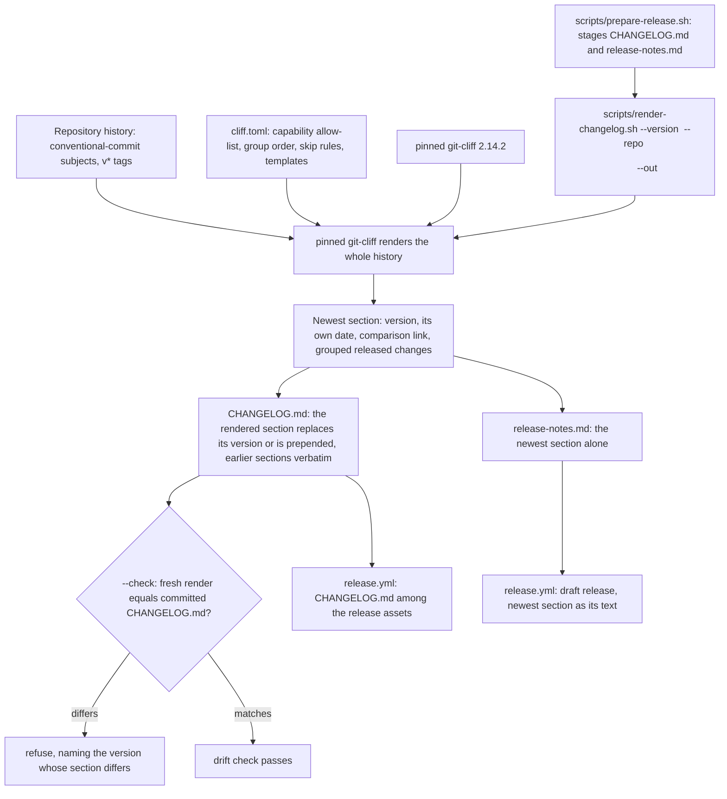

# Design: generate-release-notes

## Scope

Technical design for the change that makes a released version state the changes a user can see: [publish a public release](specs/publish-public-release/usecase.md). The observable WHAT is fixed by the proposal and the spec delta; this document is the HOW — the one generator and its configuration, the change log it renders, the drift and visibility checks that guard it, the wiring of both into the release preparation, and the back-fill of the already-published `0.1.0` section.

Two boundaries shape everything below:

- **What runs on this machine.** The project's own suite drives the generator and the drift check as real subprocesses: `scripts/render-changelog.sh`, invoked with real arguments against a throwaway repository the steps build. It needs no network, no credentials and no GitHub; that is what the delta's eleven scenarios exercise.
- **What runs on the pipeline.** The published release page carries the newest section as its release text, and the generated `CHANGELOG.md` is published among the release's assets. That is GitHub's interface, exercised by the project's own release automation and recorded as this change's evidence, not invented here as a second interaction.

This change adds no product code: no crate, no module, no port, and no scenario of `export-duty-plan-calendar` changes. What changes is what a release states and what the repository keeps about it.

## Technology decisions

Every version below was resolved from the live source on 2026-10-13, not from memory. `git-cliff` was resolved on both sides the environment carries: `https://crates.io/api/v1/crates/git-cliff` reports `max_version`/`newest_version` **2.14.2** (published 2026-09-18), and `nix-shell -p git-cliff --run 'git-cliff --version'` reports **git-cliff 2.14.2** — nixpkgs offers the same version, so there is no lag to reconcile here.

| Area | Decision | Rationale / source |
|---|---|---|
| Generator | `git-cliff` 2.14.2 — a single pinned release, recorded in the repository beside its configuration. | The project's history is conventional-commit subjects, which a commit-grouping generator consumes directly; writing a bespoke renderer would re-implement grouping, templating and tag handling. The gate compares generated text, and the tool's output shape changes between versions (the `cargo-about` 0.9.0→0.9.2 duplication cost a round trip), so the version is part of the contract. Resolved: crates.io API (`max_version` 2.14.2, 2026-09-18) and `nix-shell -p git-cliff` (2.14.2), both checked 2026-10-13. |
| CI installation | `taiki-e/install-action@v2` with `tool: git-cliff@2.14.2`, exactly the `notices` job's pinning pattern. | The version the CI gate runs must be the version the committed file was produced with, or the byte comparison is meaningless; `install-action` fetches the pinned release binary instead of resolving a version at run time. `@v2` is the action major the repository already carries in `ci.yml`. |
| Configuration | `cliff.toml` at the repository root, committed; the renderer always passes it with `--config`. | One configuration the project owns decides which subjects count, how they group and what the section looks like. The capability allow-list is written into each type's parser — `feat`, `fix`, `perf`, `revert` and each breaking-change case carries it in its message pattern — rather than shared in one `field = "scope"` parser, because `git-cliff` groups by the parser a revision matches: a single parser over the allow-list cannot separate a new capability from a chore, and the grilling's render put a `chore(publish-public-release)` revision under New capabilities. A second, marked list carries the project's own tooling words and is realized as `skip` parsers ahead of the type parsers, so a `fix(<capability>):` revision whose words describe the project's machinery is omitted even though its scope is a capability; the renderer reads both marked lists and refuses a difference. Passing the config explicitly also stops `git-cliff` from discovering a developer's global `~/.config/git-cliff/cliff.toml`, which would make a local render differ from CI. |
| Generated artefact | `CHANGELOG.md` at the repository root, committed and generated. | A reader of the source sees what changed between versions without visiting the release page, and there is a file for the drift check to compare against the released revision. Rejected: keeping the notes only on the release page (no history for a reader of the source) and a hand-maintained file (drifts from the history it claims to summarise). |
| Renderer | `scripts/render-changelog.sh` — POSIX shell with `set -euo pipefail`, Linux-only, run by `prepare-release.sh`, by the suite's steps, and by the CI `changelog` job. | The project already owns its tooling as scripts (`run-tests.sh`, `coverage/*.sh`, `scripts/*`); rendering is build tooling, not product behaviour, so it stays out of the crates and off the coverage denominator. |
| Release text | The released version's notes are the **newest section** of the change log, not a flat list of revision subjects. | The page and the repository cannot disagree about what a version contains, because the page is a slice of the same generated file. |
| Capability allow-list | A released change is a revision whose conventional-commit type carries a **capability** scope: the use-case ids present as directories under `givn/specs/` (`export-duty-plan-calendar`, `publish-public-release`), materialised per type in `cliff.toml` and checked against the corpus by the renderer. | A revision whose subject names a capability is a released change; a revision that names a tool, a workflow, a check, a test, a document or the machinery of building, packaging and publishing is not. Rejected: treating every kebab-case scope as a capability — `fix(ci)` is shaped exactly like `fix(publish-public-release)`, so shape cannot decide, which is the very confusion the flat release text exhibited. |
| Group order and skip rules | Groups, in this order, with the group a reader looks for first at the top: **Breaking changes**, then **New capabilities**, then **Fixes**, then **Performance**, then **Reversals**. Identical release-note subjects collapse to one entry, which the permanent specification and the glossary already require: one released change carried by many revisions is one entry, and the generator does not collapse on its own, so the renderer does. Skipped entirely: housekeeping (`chore`, `docs`, `style`), `test`, `build`, `ci`, any scope outside the allow-list, and — whatever a revision's scope says — a revision whose words name the project's own tooling, which the marked machinery skip list decides. Entries state the release-note words the revision carries, never a rewritten summary. | A reader separates a new capability from a build fix; internal work typed `fix(...)` no longer reads like a fix a user cares about, and the realization catches internal work that carries a capability scope too, which the type-plus-scope allow-list alone cannot see. The collapse matters more than it looks: the 0.1.0 section's two capability notes are carried by thirty-four revisions, so without it the back-filled section would list thirty-seven bullets — thirty-four duplicate revisions plus two capabilities plus one fix — exactly the noise this change exists to remove. Rejected: revision order or one flat sequence, which is what a reader could not scan; and rejected: leaving duplicates in, which contradicts the permanent scenario that asserts one occurrence for a repeated subject and the glossary that says so. |
| Comparison links | Each section links the comparison against the immediately preceding version as a literal URL `https://github.com/kressnerd/duty2cal/compare/<previous>...<this>`, built by the renderer from the two versions and appended to the section's text, each side the version's `v*` tag; the first version states no comparison. The remote integration is not enabled. | A downloader sees what is new since the version they already have, offline. Rejected: linking every version to the latest release, which tells a downloader nothing about the step they are taking; and rejected: `[remote.github]`, which makes live GitHub API calls and panics without a token or network, then renders a placeholder under `--offline` instead of the real link — a render must not need the network. |
| Range | `<previous v* tag>..<released revision>`; for the first release, every revision reachable from the released revision. The renderer renders the history once with the committed configuration and takes the released version's section from it: the pinned generator mis-groups a render carried by `--tag`, and by a positional range, whenever a later tag exists, so the version is selected by extracting its rendered section. The released revision is the `v<version>` tag when it exists and otherwise `HEAD`, the revision the tag will point at; the section heading is stamped from that revision's own committer date, never from the clock. (`git-cliff v0.1.0` and `git-cliff HEAD` fail in this position; the tool wants a range or a tag pair, and an untagged newest revision makes it error outright, which is why the renderer passes `--tag v<version>` exactly in that case.) | The section summarises exactly the revisions the version released and states the released revision's own date. Rendering before the tag exists is what makes the documented order possible at all: render the section, commit the change log, then create the tag — and the committer date of the revision it will point at is exactly the date the tagged revision will carry, so the drift check on the tag agrees with the file. Rejected: rendering only the released revision's own subject, which would announce a version with one line while it carries many changes; and rejected: passing `--tag <version>` for an already tagged version, which mis-groups a history that carries a later tag; and rejected: refusing an untagged version, which made the documented release procedure exit non-zero on its first command. |
| CI gate | A `changelog` job in `ci.yml` (pushes and pull requests) checks out with `fetch-depth: 0`, so the full history and every `v*` tag are present, installs the pinned tool and runs `scripts/render-changelog.sh --version <newest v* tag> --check`. The job that runs the scenario suite installs the pinned `git-cliff` on `PATH`, because the suite's render scenarios drive the renderer as real subprocesses. | The same shape the third-party notices already use: the committed file is compared against a fresh render of the released revision, and a committed file that differs is refused by name. The shallow default checkout has no tags and no older revisions, so the range the check renders would be empty without `fetch-depth: 0`; and a suite whose steps cannot invoke the pinned tool cannot run at all. |
| Release pipeline | `prepare-release.sh` refuses a committed change log that is not current for the version being released, then stages `CHANGELOG.md` and derives `release-notes.md` from the same render; `release.yml`'s draft carries the change log among its assets. | The released version's section becomes the release text and the change log becomes a published file, so a downloader reads it without visiting the repository. The pipeline checks the file itself rather than trusting the gate: the `publish` job only refuses a check run that has already concluded non-green, so a `changelog` job still running when the tag is pushed would let a stale release go public; the preparation's own check closes that window regardless of when the CI job concludes. The draft asset set is verified against the staged set, so the change log joins that comparison explicitly. |

## Architecture impact

Nothing in the product changes. The change adds a render path around the existing history, driven by the same history the release already stamps.



New or changed files:

| Path | Kind | Purpose |
|---|---|---|
| `cliff.toml` | new | The one configuration: the capability allow-list repeated in each type's parser, the marked machinery skip list, group order, skip rules, and the templates that render the section. |
| `CHANGELOG.md` | new, generated | The change log itself; its newest section is the version being released, earlier sections stay as they were, and the first section back-fills `0.1.0`. |
| `scripts/render-changelog.sh` | new | Renders one version's section and the change log (`--check` mode checks drift), the release text, and the refusals. |
| `scripts/prepare-release.sh` | changed | Stops building the release text from the flat subject list; checks the committed change log for drift before it stages anything, then stages `CHANGELOG.md` and derives `release-notes.md` from the rendered newest section. |
| `.github/workflows/ci.yml` | changed | One added job: `changelog`, checking out with `fetch-depth: 0` (the render range needs the full history and every `v*` tag), installing `git-cliff@2.14.2` with `taiki-e/install-action@v2` and running the drift check; the job that runs the scenario suite also installs the pinned `git-cliff` on `PATH`, because the suite's steps invoke the renderer as a real subprocess. Every existing job keeps its name and its other steps. |
| `.github/workflows/release.yml` | changed so the draft carries the change log among its assets: `staged/CHANGELOG.md` joins the `gh release create` asset list (the release text is unchanged in shape — it is now the newest section). Its `prepare` job also installs `git-cliff@2.14.2` with `taiki-e/install-action@v2`, because the preparation now renders the release text and the change log; its `fetch-depth: 0` checkout was already there. |
| `apps/cli/tests/features_runner.rs` | extended | The `DutyWorld` gains the `changelog` field the render scenarios carry (the change log path each one wrote). The strict-mode builder (`.fail_on_skipped()`) is unchanged. |
| `apps/cli/tests/steps/publish_public_release.rs` | extended | The new non-`@e2e` step definitions for this capability, in the existing file — one file per capability, not a new one. |
| `apps/cli/tests/steps/e2e/publish_public_release.rs` | extended | The new `@e2e` step definitions, in the existing e2e file. |
| `README.md` | changed | The `### Releasing a version` subsection after the givn-managed Development block records the extra release step — render the version's section, commit the change log with the tagged revision's own committer date, then create the tag and push the branch and the tag together (`git push --atomic`, so the tag cannot land without the branch), naming the pinned generator version so a local render does not fail for a reason the reader must guess — without editing the managed blocks. |
| `docs/arc42/01-introduction-and-goals.md`, `02-architecture-constraints.md`, `03-context-and-scope.md`, `04-solution-strategy.md`, `05-building-block-view.md`, `06-runtime-view.md`, `07-deployment-view.md`, `08-crosscutting-concepts.md`, `10-quality-requirements.md`, `11-risks-and-technical-debt.md`, `12-glossary.md` | changed | The eleven durable chapters this change updates (chapter 09 is untouched: its ADR candidate does not qualify). The review re-derived `02`, `05`, `06`, `08`, `11` and `12` against the implementation, and the assessment updated `01`, `03`, `04`, `07` and `10`; together they carry the renderer's date rule and refusals, the `changelog` job and the preparation's check among the landing checks, the change log in the release toolbox and among the release assets, the machinery skip list and generation determinism among the cross-cutting concepts, quality scenarios QS-011/QS-012, risks R-015–R-017, technical debt TD-008 and TD-009, and the glossary's code symbols. |

`apps/cli/tests/steps/mod.rs` and `apps/cli/tests/steps/e2e/mod.rs` already declare these modules and do not change.

## The renderer

```
scripts/render-changelog.sh --version <version> --repo <dir> --out <path> [--release-text <path>] [--check]
```

- `<version>` is the bare version whose section is rendered (a leading `v` is refused, as the preparation command already refuses one, so the section, the tag and the archive names cannot disagree).
- `<repo>` is the checkout whose history supplies the section; `<out>` is the change log file (`CHANGELOG.md` by default). A render replaces the section that already carries the target version and, for a version not yet present, prepends the new section above the earlier ones, which are kept verbatim; a version's section is therefore never duplicated. The precondition is that the committed change log already carries the released version's section — the section is committed before the version's tag — so rendering the version being released replaces its section rather than adding a second one.
- `--release-text <path>` additionally writes the newest section alone, which is what `prepare-release.sh` stages as `release-notes.md`. Because both outputs come from one render, the release page and the repository cannot disagree.
- `--check` renders in memory and compares the rendered version's section — its own text, with every earlier section kept verbatim — against the committed change log, refusing and naming the version whose section differs. It writes nothing.

It refuses, leaving its output untouched:

- a version with a leading `v`, or a repository with no `HEAD` to date the section from;
- a `git-cliff` whose version differs from the pinned version recorded beside `cliff.toml`;
- a capability allow-list that differs from the use-case ids present under `givn/specs/` — a capability the repository holds and the configuration leaves out is named, because the corpus is the source of truth for what a capability is — or a machinery skip list whose marked terms the configuration does not realize;
- a render that names no change a user can see — the version is not releasable, so nothing is written and the message states that;
- in `--check`, a committed change log that holds no section for the version being released — the precondition is not met, so nothing is written and the version whose section is missing is named;
- in `--check`, a committed change log that differs from a fresh render.

An untagged version is **not** refused. The released revision is the `v<version>` tag when it exists and otherwise `HEAD`, the revision the tag will point at, and the section's date is that revision's own committer date either way — never the clock. That is what lets the documented release order work: render the section, commit the change log, then create the tag. For the untagged case the renderer passes `--tag v<version>` to the generator, which needs a name for the newest release and errors outright on an untagged newest revision; the version being released is the newest by construction there, so there is no later tag for the tool to mis-group under.

**Determinism.** The generator must render the same history to the same bytes on any machine at any time, or the byte-comparing drift check has no meaning. Three inputs are fixed:

- **Ordering** — `git-cliff` is invoked with `--sort oldest`, so commits are ordered by history rather than by the order a checkout happened to expose.
- **Time** — the section's date is the released revision's own committer date, never the clock. The released revision is the `v<version>` tag when it exists and otherwise `HEAD`, the revision the tag will point at; `git-cliff`'s release timestamp falls back to "now" for a revision it cannot date (observed directly: an untagged commit rendered today's date), so the renderer never uses the tool's timestamp. The generator renders the history, the renderer extracts the version's section and stamps its heading from the released revision's own committer date, and `--tag v<version>` is passed exactly when the tag does not exist yet — the case where the tool has no name for the newest release and errors instead.
- **Host paths** — neither the section nor the change log embeds a working-directory path, a user name or a runner name; the renderer appends the comparison as a literal `https://github.com/kressnerd/duty2cal/compare/<previous>...<this>` built from the two versions, and the remote integration is never enabled, so no render needs the network.

## Decisions

This change has no proposal `D<n>`: the proposal's Open Questions section states that none remain open and records two decisions without numbering them. Those two are carried here with the alternatives they rejected, followed by the design-level decisions from the technology table.

The proposal's two decisions:

- **The release trigger** — a pushed `v*` tag stays the only entry point: a transient failure is repaired by re-running the workflow, a faulty revision by fixing forward to the next version. Rejected: a manual trigger that names a version and tags the revision it runs on, which would remove the hand-pushed tag and the tag move the first release needed but adds an entry point the operator did not want (operator's decision of 2026-10-13). Realized in `release.yml`'s `on: push: tags: ["v*"]`, unchanged by this change.
- **Where the change log lives** — one file in the repository (`CHANGELOG.md`), generated and drift-checked, and published with the release. Rejected: notes only on the release page, which leaves a reader of the source with no history and nothing to compare a version against; and a hand-maintained file, which drifts from the history it claims to summarise. Realized in `CHANGELOG.md`, the `changelog` CI job, and the release asset.

Design decisions beyond those, each with the alternative it rejected:

- **The generator is `git-cliff` 2.14.2, pinned in the repository and installed in CI at that version** (rejected: an unpinned or run-time-resolved tool — the gate compares generated text, so a tool whose output shape moves between versions makes the comparison meaningless, the failure the `cargo-about` pin already demonstrated).
- **Installed with `taiki-e/install-action@v2`** (rejected: `cargo install git-cliff`, which compiles from source on every run and still needs a version pinned by hand; and rejected: relying on a `git-cliff` the runner happens to carry, which is exactly the unpinned case).
- **The capability allow-list is the use-case ids under `givn/specs/`, checked against the corpus, and the correlation is expressed per type** — each type's parser (`feat`, `fix`, `perf`, `revert`, and each breaking-change case) carries the allow-list in its message pattern, so a `feat(publish-public-release)` groups as a new capability while a `chore(publish-public-release)` is skipped (rejected: every kebab-case scope is a capability — `fix(ci)` is shaped exactly like `fix(publish-public-release)`; and rejected: one shared `field = "scope"` parser over the allow-list, which `git-cliff` cannot split by type and which put a `chore(publish-public-release)` revision under New capabilities when the grilling ran the pinned generator).
- **Group order: breaking changes, new capabilities, fixes, performance, reversals; skip housekeeping, documentation, tests, CI, tooling, and the machinery of building, packaging and publishing** (rejected: revision order, which is the flat list a reader cannot scan).
- **A marked machinery skip list keeps the project's own tooling out of every release, whatever a revision's scope says** (implementation, 2026-10-13; narrowed by the design-review re-run, 2026-10-14): the type-plus-scope allow-list cannot see that a `fix(<capability>):` revision describes the project's own machinery, and the back-filled 0.1.0 section carried two such entries a reader cannot act on. Each term is a **distinctive tooling phrase**, not a bare common word — `coverage report`, `coverage merge`, `cobertura`, `clippy`, `rustfmt`, `third-party notices`, `ci workflow`, `release workflow`, `e2e transcript` — realized as `skip` parsers placed ahead of the type parsers and matched against the revision's subject only, so a body that happens to discuss the tooling cannot silence a released change, and a subject that merely borrows one of those words for a crew member's own work (`Support the crew's ramp workflow`, `Handle notices from the roster`) is still a released change. The marked list is comma-separated so a term may be a phrase; the renderer reads it and refuses a term the configuration does not realize, so the list cannot drift from what the generator applies. Rejected: widening the allow-list with tooling scopes, which would leave a capability-scoped machinery revision released; rejected: matching whole messages, which dropped a capability note whose body mentioned the coverage reports; and rejected by the design-review re-run (2026-10-14): the bare single words `coverage`, `notices`, `workflow`, `transcript`, which silently dropped genuine crew-facing subjects that merely used the word — `Support the crew's ramp workflow` and `Handle notices from the roster` never reached a reader, which the scenario `A version's notes group the changes a reader can see` now pins.
- **Comparison links are literal URLs of the form `https://github.com/kressnerd/duty2cal/compare/<previous>...<this>`, built by the renderer from the two versions and appended to the section, none for the first version** (rejected: no link at all, which leaves a downloader unable to tell what is new since their version; rejected: linking every section to the latest release; and rejected: `[remote.github]`, which makes live GitHub API calls and panics without a token or network, and under `--offline` renders a placeholder rather than the link — a render must not need the network).
- **Range `<previous v* tag>..<released revision>`, whole history for the first release; the released revision is the tag when it exists and otherwise `HEAD`, whose own committer date the heading is stamped with; `--tag v<version>` is passed exactly when the tag does not exist yet** (rejected: the released revision's subject alone, which under-announces what a version carries; rejected: passing `--tag <version>` for a version that is already tagged, which mis-groups a history carrying a later tag and leaks the current date into a historic section; and rejected: refusing an untagged version, which made the documented release procedure exit non-zero on its first command and left no working route to a first release).
- **The release text is the newest section** (rejected: keeping the flat subject list beside the rendered section, which would let the page and the repository state different things).
- **The rendering seam is a script, not a crate** (rejected: an `xtask` binary — rendering is build tooling and would drag a workspace member, its licences and its coverage into the product's story).
- **The generator's configuration is `cliff.toml` passed explicitly** (rejected: relying on `git-cliff`'s config discovery, which would pick up a developer's global configuration and make a local render differ from CI's).
- **A render replaces its own version's section** — the section is committed before the tag, so the released version's section is already present and the render writes over it, prepending only a version that is not yet there (rejected: a literal prepend, which would duplicate the section the precondition commits and make `--check` fail on every release).

- **The identical subjects collapse** (design-review, 2026-10-13): one released change carried by many revisions is one entry, which the permanent scenario and the glossary already required and the first draft of this design had dropped; the renderer collapses, because the generator does not. The consequence is visible in the back-fill: the 0.1.0 section's two capability notes are carried by thirty-four revisions, so a render without the collapse would list thirty-seven bullets — thirty-four duplicate revisions plus two capabilities plus one fix — and the committed section lists three, the two capabilities and the one fix, the two machinery entries the skip list removes among those that went.
- **v0.1.0's page is brought in line** (operator, 2026-10-13): the published release's body becomes the repository's 0.1.0 section together with the one-off execute-bit note, so the agreement between page and repository holds for every version rather than from the next one. Rejected: leaving the page as the older rule generated it and qualifying the promise, because the body is being edited anyway and the page is the account a downloader reads.
- **A version's section is committed before its tag** (operator, 2026-10-13): releasing a version gains one step — render the section, commit the change log, then push the branch and the tag together (`git push --atomic origin <branch> v<version>`), so the tagged revision already carries its own section and the drift check passes by construction, and the tag cannot land without the branch (a rejected branch push would otherwise still publish the tag and start the release workflow for a revision that never reached the default branch). The commit must carry the tagged revision's own committer date (`GIT_COMMITTER_DATE` from `git log -1 --format=%cd` on the revision the tag will point at), and the renderer must be able to run before the tag exists: the section's date is the date that revision will carry when tagged, so a commit dated by the clock would leave the tagged revision stating a different date from the section for ever. Rejected: exempting the version being released from the check and letting the file catch up afterwards, which would make the repository lag the page in exactly the window where the agreement is claimed.
- **The release preparation checks the committed change log itself** (review, 2026-10-13): `prepare-release.sh` runs the drift check for the version being released before it stages anything. Rejected: trusting the landing gate alone, whose `publish` job refuses only checks that have already concluded non-green, so a `changelog` job still running when the tag is pushed would let a stale release through.
- **The version's section is extracted from a whole-history render** (implementation, 2026-10-13): the pinned generator mis-groups a render carried by `--tag`, and by a positional range, whenever a later tag exists — reproduced on fixture repositories and on this tree — so the renderer renders the history once with the committed configuration and takes the released version's section from it, stamping the heading date from the released revision's own committer date. The observable contract is unchanged: in production the released version is the newest, and the section it extracts is exactly its range. Rejected: the range syntax this design first prescribed, which the tool cannot express faithfully; and rejected: `--tag` for a version that is already tagged, which mis-groups and leaks the current date — it is passed only for a version whose tag does not exist yet, where the tool has no name for the newest release at all and no later tag exists for it to mis-group under.

## Use-case traceability

Every rule, precondition and extension the delta adds, mapped to the decision that realises it and the scenario that evidences it.

| Use-case element (added by this change) | Technical decision | Scenario |
|---|---|---|
| Precondition: the change log committed in the repository is current for the revision being released | The `changelog` CI job's drift check over the newest `v*` tag | "A change log that does not match the released revision is refused" |
| Main flow 1: the release text is the newest section of the change log, not a flat list of subjects | Release text = newest section; `prepare-release.sh` stages `CHANGELOG.md` and derives `release-notes.md` from one render | "@e2e" Maintainer generates the change log for a version and reads its newest section |
| Main flow 7: the release states what changed, grouped by kind | Group order and skip rules in `cliff.toml` | "A version's notes group the changes a reader can see" |
| Rule: notes name the changes a user can see, grouped by kind, the first group at the top | Group order (breaking, new capabilities, fixes, performance, reversals) | "A version's notes group the changes a reader can see" |
| Rule: a revision whose subject names a capability is released; one naming a tool, workflow, check, test, document or build/packaging/publishing machinery is not | Capability allow-list checked against `givn/specs/`; the marked machinery skip list realized as subject-anchored `skip` parsers | "A version's notes group the changes a reader can see" |
| Rule: each entry states the release-note words the revision carries, and never claims work the released revision does not contain | `git-cliff` renders the history with the entry body taken verbatim from the subject, and the renderer extracts the released version's section from it | "A version's notes group the changes a reader can see"; "@e2e" Maintainer generates the change log for a version and reads its newest section |
| Rule: a version whose notes name no visible change is refused rather than published | The renderer's empty-section refusal | "A version that changes nothing a user can see is refused" |
| Rule: the notes are the newest section of the change log, every earlier version unchanged beside it | `CHANGELOG.md` written with the released version's section replaced in place and a new version's section prepended above the earlier sections, which stay verbatim | "The change log keeps the earlier versions beside the new one" |
| Rule: each section states its own date and, where an earlier version exists, the comparison against the immediately preceding version | Section date stamped from the released revision's own committer date (the tag, or `HEAD` when the tag does not exist yet); literal `https://github.com/kressnerd/duty2cal/compare/<previous>...<this>` links appended to the section by the renderer, none for the first version | "Each version's section is dated and compared with the one before it" |
| Rule: the section is renderable before the version's tag exists — render the section, commit the change log, then create the tag — and states the date that revision will carry when tagged | The released revision is the `v<version>` tag when it exists and otherwise `HEAD`; `--tag v<version>` is passed to the generator exactly in the untagged case | "A version's section can be rendered before its tag exists" |
| Rule: the section is rendered by the project's own generator, whose version is recorded beside its configuration; a committed change log differing from a fresh render is refused | Pinned `git-cliff` 2.14.2 recorded beside `cliff.toml`; `--check` byte comparison | "A change log that does not match the released revision is refused" |
| Extension 1: a version whose notes would name no visible change → preparation fails, nothing published | The renderer's empty-section refusal surfacing through `prepare-release.sh` | "A version that changes nothing a user can see is refused" |
| Extension 1: the committed change log does not match the released revision → preparation fails, naming the version whose section differs | `--check` in the preparation itself, and in the `changelog` job | "A change log that does not match the released revision is refused" |
| Example: the first version of all — no change log yet, one section, no comparison | Range = whole history, no comparison link for the first version | "The first released version is recorded from the history" |
| Rule: identical release-note subjects collapse to one entry, one released change carried by many revisions | The renderer's collapse of repeated subjects (the decision "The identical subjects collapse") | "The release text states the released revisions' release notes" (the collapse's evidence) |
| Main flow 1: a prepared release carries the change log its release text is drawn from | `prepare-release.sh` stages `CHANGELOG.md`, whose newest section is the release text | "The prepared release carries the change log its section came from" |
| Rule: the configuration that decides which subjects are released names every capability the repository holds; a capability it leaves out is refused | The renderer's allow-list-versus-corpus refusal | "A capability missing from the configured allow-list is refused" |
| Precondition and rule: a committed change log missing the section for the version being released is refused | The `--check` missing-section refusal | "A committed change log missing the released version's section is refused" |
| Rule: writing a version's section replaces that version's section where it already exists and adds it where it does not, so one version has one section | The render's replace-or-prepend write | "The change log keeps the earlier versions beside the new one" |
| Capability ownership | `publish-public-release` only | Interaction Coverage Matrix |

Actors in Gherkin are domain roles (the maintainer); Personas are review lenses, not Actors.

## Persona impact

User-visible surface: a terminal interface (the renderer's and the preparation command's output) plus the release page and the repository text this change authors (the newest section as the release text, `CHANGELOG.md` as a published asset). The host's pages are rendered by GitHub, not by this project.

- **`crew-member--personal-calendar-owner`** — the reader. The change gives them a release whose notes name the changes they can see, grouped so the new capabilities come first, with a link to compare against the version they already have, and the same text in the repository so they can read the history without visiting the release page. They judge it by whether they can tell, from the notes alone, whether the new version contains something they would want.
- **`project-maintainer--release-owner`** — the author. The change gives them one configuration that decides what is released, a generator whose version is pinned so the same history renders the same file, a drift check that refuses a stale committed change log before publication, and a refusal when a version would state nothing a user can see. They judge it by whether a release can be prepared and published without hand-editing any text, and whether the page and the repository can ever disagree.

## Visual Design Contract

- Interface: terminal
- Viewports: n/a (no rendered screen; the release page and the repository text are GitHub's rendering, not this project's)
- Design system: none
- Evidence kind: captured transcript per `@e2e` scenario at `givn/changes/generate-release-notes/evidence/visual/<scenario-slug>/transcript.txt`.
- Baseline: the transcript shows the renderer command and its reported newest section, names the version and the changes a user can see, has the run-specific directory replaced by a placeholder, and contains no host path, user name or clock value.
- Motion: n/a.

## E2E smoke test infrastructure

- **E2E runner command:** `./run-tests.sh --e2e` (the assembled root with `--tags "@e2e"`), distinct from `verify.command` (`./run-tests.sh`).
- **E2E step location:** `apps/cli/tests/steps/e2e/publish_public_release.rs`, one file per capability, separate from the in-process steps — extended, not replaced.
- **Real interface:** `scripts/render-changelog.sh`, invoked as a subprocess with real arguments. The assertion is on the change log the command wrote and on the newest section it reports.
- **Local infrastructure:** a throwaway git repository the steps build (`git init`, commits with fixed commit dates and conventional subjects, and `v*` tags), plus a temporary `--out` path. No network, no credentials, no container.
- **Framework:** cucumber-rs with `std::process::Command`, as the existing E2E steps use; the same harness that drives `export-duty-plan-calendar` and the release preparation.
- **Strict-mode proof:** `.fail_on_skipped()` on the `Cucumber` builder in `apps/cli/tests/features_runner.rs`; a step left unimplemented or skipped makes the run non-zero. A new step body is written as a stub that panics with its own name, so an undefined step exits non-zero rather than passing.
- **Single-scenario run command:** `./run-tests.sh --name "<title>"`, used by every RED/GREEN check.
- **Transcript evidence:** committed by the scenario's final step with the run-specific directory replaced by a placeholder, as the existing `@e2e` transcript does.

## Interaction Coverage Matrix

| Inventory entry | @e2e scenario title | Real interface | Driving mechanism |
|---|---|---|---|
| prepare the release for a version | Maintainer prepares a release and runs the archived executable | CLI (terminal) | `std::process::Command` runs `scripts/prepare-release.sh --version 0.1.0 --binaries <dir> --out <dir>`; asserts the reported archive and checksum for this machine's platform and the version named in the release text; then extracts and runs this machine's executable. The staged change log is not asserted here; the delta's own prepare scenario asserts it. |
| generate the change log for a version | Maintainer generates the change log for a version and reads its newest section | CLI (terminal) | `std::process::Command` runs `scripts/render-changelog.sh --version 0.1.0 --repo <fixture repo> --out <path>`; asserts the written change log holds a section for version 0.1.0 naming the released change a user can see, and commits the transcript as evidence |

## Local runnability & digital twins

- **Local run:** `scripts/render-changelog.sh --version 0.1.0 --repo . --out CHANGELOG.md` renders the committed change log from the local history; `scripts/render-changelog.sh --version 0.1.0 --repo . --out CHANGELOG.md --check` checks it for drift. The full local path is `./run-tests.sh --e2e`, which builds the fixture repository and drives the renderer as a subprocess.
- **Isolated network:** not applicable — the renderer touches only the filesystem, the pinned `git-cliff` binary and the local git history. The suite stays offline.
- **Digital twins:** none, and deliberately so. The only external service this change concerns is GitHub, and the only thing that talks to it is GitHub's own automation, running on GitHub's infrastructure with that repository's token. There is no local client of the release API, so no twin is required and no scenario may depend on a live third-party service.
- **Interface obstacles and their fixes:**
  - *A fixture history has to be built rather than borrowed, or the released revision's date would come from the clock.* Fix: the steps build the history themselves — `git init`, commits made with fixed `GIT_COMMITTER_DATE`/`--date` values and conventional subjects, then `git tag v<version>` for the released version — so the released revision and its date are deterministic and no real repository or clock is involved. A fixture that deliberately leaves the version untagged exercises the render-before-tag path; there the renderer dates the section from `HEAD`, whose date the fixture also fixes.
  - *`git-cliff` must not read the developer's global configuration.* Fix: the renderer always passes `--config cliff.toml` explicitly and never relies on discovery; the step asserts the rendered section against the section the fixture's own history states, so a stray global config shows up as a failing assertion rather than a silently different render.
  - *The pinned tool must be the one CI runs, or a local render and the gate disagree.* Fix: the version is recorded beside `cliff.toml` and the renderer refuses a `git-cliff` whose `--version` differs; CI installs `git-cliff@2.14.2` with `taiki-e/install-action@v2` and the local environment gets the same version from `nix-shell -p git-cliff` (2.14.2 as of 2026-10-13).

## Coverage process boundaries

| Process | Started by | Instrumented artifact | Profile output | Merge step | Non-zero production probe |
|---|---|---|---|---|---|
| features_runner (unit/integration) | `./measure-coverage.sh` (`--tags "not @e2e"`) | `cargo llvm-cov --workspace --test features_runner` | `coverage/non-e2e-cobertura.xml` | `./merge-coverages.sh` | `crates/duty2cal-core/src/domain/timing.rs` |
| E2E runner + spawned CLI | `./measure-coverage.sh` (`--tags "@e2e"`) | `cargo llvm-cov --workspace --test features_runner` with the CLI built under instrumentation | `coverage/e2e-cobertura.xml` | `./merge-coverages.sh` | `apps/cli/src/fs.rs` |

Unchanged by this change: the new step definitions are part of `features_runner` and are instrumented with it. `scripts/render-changelog.sh` — like `scripts/prepare-release.sh` and the coverage scripts already there — is not Rust and is therefore outside the coverage denominator; its observable contract is covered by the delta's scenarios instead.

## Risks and follow-ups recorded here

- **The pinned tool's output shape can move between versions.** `git-cliff`'s templates and grouping changed across releases, and the drift check compares bytes, so a version bump can change the committed file without any history change. The pin and the renderer's version refusal make a mismatch loud rather than silent; a bump is a deliberate change that re-renders the file, never an automatic one.
- **The capability allow-list can drift from the corpus.** A new capability added under `givn/specs/` without a matching entry in `cliff.toml` would leave its changes out of every release. The renderer compares the list against the use-case ids under `givn/specs/` and refuses on any difference, so the two cannot diverge quietly.
- **The back-filled `0.1.0` section differs from what the published page says.** The page lists 16 entries, generated by the older rule on the whole released range; the repository's 0.1.0 section lists 3, generated from the same history under the new rules. The change records the difference rather than editing the release, because a published release is immutable — the divergence is the change's deliberate record, not an unnoticed drift.
- **The notes inherit their quality from the revision subjects.** A revision whose scope names no capability, or whose release-note words are unhelpful, produces an unclear entry or none at all. The visibility refusal catches a version that would say nothing, and the machinery skip list removes the entries that name the project's own tooling, but neither can make a badly worded subject good — a subject written in the project's vocabulary rather than a crew member's passes every rule. The maintainer's discipline in the commit message remains the upstream input; the arc42 technical-debt register carries the follow-up.

## Black-Box-First policy

The delta's scenarios drive the generator and the checks as real subprocesses; eleven of them assert invariants a render can observe (grouping and the machinery skip list, the visibility refusal, section ordering and immutability, the drift and missing-section refusals, the allow-list refusal, the date and comparison link, the first version, rendering before the tag exists, the idempotent write, and the prepared release's change log) and the `@e2e` scenario additionally reads the newest section out of the written change log. No internal test is retained alongside them: the only Rust added by this change is step definitions.

- **The `changelog` CI job's drift check** covers the case the `@e2e` scenario does not: a *committed* `CHANGELOG.md` that differs from a fresh render of the real repository's newest `v*` tag. The `@e2e` scenario proves the renderer writes a correct newest section from a fixture history; it never compares against a committed file in the real checkout, which is exactly what the gate must refuse.
- **The renderer's version and allow-list refusals** cover the case the `@e2e` scenario does not: a host whose `git-cliff` is not the pinned version, and a configuration whose capability allow-list no longer matches `givn/specs/`. The `@e2e` scenario runs against the pinned tool and the committed configuration, so it cannot observe either drift; the shell-level refusals are where those cases are exercised, and the local steps drive them through the same subprocess.
- **The preparation's own drift check** covers the window the CI gate leaves open: the `publish` job refuses a check run that has already concluded non-green, so a `changelog` job still running when the tag is pushed would otherwise let a stale release through. No scenario asserts that refusal — the delta's prepare scenarios build fixture checkouts with no committed change log — so it is proven by a throwaway run against a fixture whose committed change log was made stale by hand, recorded in `tasks.md`.
