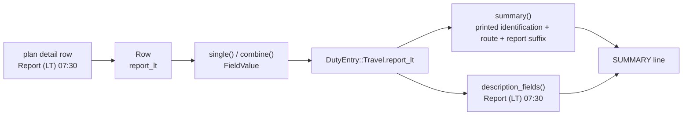

# Design: include-report-time-in-travel-title

## Scope

The HOW for the observable rule in [the delta](specs/export-duty-plan-calendar/export-duty-plan-calendar.feature). The converter keeps its crates, ports, adapters, runner, fixtures, and publication behaviour. What changes is one branch of the travel title: the title that already carries the printed crew position, flight number, and route also ends with the report time when the plan supplies one single value.

No new technology, no new dependency, and no new module are introduced. The change adds three `Given` step definitions and strengthens one shared `Then` step in the existing step file; it adds no new test target, file, or crate.

## Technology decisions

No version-bearing decision changes. The workspace's inherited choices are reused as they are; the versions named below are read from the workspace manifests at design time, not assumed to be current releases.

| Area | Decision | Source |
|---|---|---|
| Language and layout | Rust stable (`rust-toolchain.toml` channel `stable`), edition 2021 workspace `duty2cal-core` / `duty2cal-pdf` / `apps/cli` | Unchanged; the change edits one function in the core's domain |
| Descriptive value type | `FieldValue` (`Single` / `Differing`) already carries the report value; no new type, no new field | `crates/duty2cal-core/src/domain/mod.rs` |
| Calendar writer | Hand-written RFC 5545 serializer; it writes `SUMMARY` from `DutyEntry::summary()` verbatim | `crates/duty2cal-core/src/adapters/ics/mod.rs` |
| Gherkin runner | cucumber-rs `cucumber = "0.23"` as a `harness = false` test target, invoked through `./run-tests.sh` | Read from `apps/cli/Cargo.toml` at design time; unchanged |
| Fixtures | Generated at test time by `apps/cli/tests/steps/support.rs`; only the expected calendar is committed | Unchanged |
| Golden oracle | `apps/cli/tests/fixtures/expected/2098-06.ics` remains byte-identical | The reference plan supplies no report time |

Version freshness: this design changes no language, runtime, framework, library, driver, or image version. Nothing is pinned from memory. A later implementation change that introduces a version must re-evaluate it under the design instruction's freshness rule.

## Architecture impact

The value already reaches the domain. The application reads the plan's `Report` column into `Row.report_lt`, wraps one row's value in `FieldValue::Single`, and `combine()` yields:

- `Single(value)` for one supplied value or equal values from both fragments;
- `Differing { departure, arrival }` for two different values;
- `None` when neither fragment supplies one.

`DutyEntry::Travel.report_lt` already holds that value, `description_fields()` already renders it as `Report (LT)`, and `DutyEntry::summary()` is the single place that composes a title. The change therefore adds one read of an existing field; no crate, port, adapter, file layout, or publication path moves.



Changed files:

| Path | Kind | Purpose |
|---|---|---|
| `crates/duty2cal-core/src/domain/mod.rs` | changed | `DutyEntry::summary()` appends ` Report <value> LT` for a `FieldValue::Single` report value; `None` and `Differing` produce no suffix. |
| `givn/changes/include-report-time-in-travel-title/specs/export-duty-plan-calendar/export-duty-plan-calendar.feature` | added | The four delta scenarios. |
| `apps/cli/tests/steps/export_duty_plan_calendar.rs` | changed | `that activity's title is "..."` strengthened from a substring check to an exact `SUMMARY` line match; three new `Given` steps for the no-report, differing-report, and equal-report fixtures. |
| `givn/specs/export-duty-plan-calendar/usecase.md` | changed | The permanent title rule states the suffix and its omission when no single report time exists; one generated example shows the suffix. |

Downstream documentation, recorded by the separate arc42 artifact: chapter 5 (the `domain` responsibility names the title suffix), chapter 8 (the title-composition concept), chapter 10 (the quality scenario for the report suffix), and chapter 12 (the glossary's **Travel leg** contract use and the new **Report time** term). Chapter selection is Yes on 5, 8, 10, and 12; No on 1–4, 6, 7, 9, and 11. `givn/changes/include-report-time-in-travel-title/arc42.md` is written by the arc42-docs artifact, not by this design. `apps/cli/tests/fixtures/expected/2098-06.ics` is deliberately absent from this table because it must not change.

Glossary impacts the arc42 artifact applies (not edited here): **Travel leg**'s wording now names the conditional report-time suffix; a new **Report time** term is added, defined as the printed local briefing time, descriptive only, rendered in the description as `Report (LT)` and in the title as ` Report <value> LT`, and never as an instant or activity date.

## The title composition rule

`DutyEntry::summary()` remains the only title rule. For a travel entry it joins the existing printed identification and route, then appends the suffix only for a single report value:

```rust
Self::Travel {
    activity,
    position,
    from,
    to,
    report_lt,
    ..
} => {
    let title = format!(
        "{} {from}-{to}",
        printed_identification(position.as_deref(), activity)
    );
    match report_lt {
        Some(FieldValue::Single(value)) => format!("{title} Report {value} LT"),
        None | Some(FieldValue::Differing { .. }) => title,
    }
}
```

The resulting strings:

```
activity "LU742", no position, ABC-DEF, report Single("07:30")  -> "LU742 ABC-DEF Report 07:30 LT"
activity "123",   position "FB", ABC-DEF, report None           -> "FB 123 ABC-DEF"
activity "LU742", no position, ABC-DEF, report Differing{07:30, 08:00} -> "LU742 ABC-DEF"
```

Rules the implementation must preserve:

- Exactly one space before `Report`, one space between `Report` and the value, and one space before `LT`. No parentheses, colon, or other label.
- The value is appended as printed; it is not reformatted, padded, or converted into a time value.
- `LT` is literal text. It states that the printed value is local time; it never becomes a UTC instant, and no timing code reads it.
- `Differing` produces no suffix. The description already retains both labelled values through `description_fields()`'s existing `push_value()` path (`Report (LT) 07:30 (departure fragment)`, `Report (LT) 08:00 (arrival fragment)`); this change leaves that path untouched.
- `None` produces no suffix and the title is unchanged.
- Equal values from both fragments already collapse to `FieldValue::Single` in `combine()`, so they append one suffix with no extra branch.
- Other `DutyEntry` variants (`AllDay`, `Availability`, `NonFlightDuty`, `Layover`) keep their current arms unchanged.

### Why the rule lives in `summary()`

`apps/cli` and `adapters/ics` do not know about the report column. The ICS adapter writes `SUMMARY` from `entry.summary()` and nothing else. Putting the suffix in the domain title keeps one composition point, so the title a crew member sees and the title the golden scenario compares cannot drift apart, and no adapter grows a second formatting rule.

### Why differing values omit the suffix

The suffix's meaning is "report at this local time". Two different values on the two fragments leave no single briefing time for the leg; choosing one would silently discard the other and could make a crew member report at the wrong hour. The description's fragment-labelled pair remains the faithful representation, and its existing rule is unchanged. The title stays the route-only form.

## Step definition locations

One file per capability, as before. All step work stays in `apps/cli/tests/steps/export_duty_plan_calendar.rs` (module `steps::export_duty_plan_calendar` of the `features_runner` test target).

| Scenario | Steps | Status |
|---|---|---|
| A travel activity's title ends with its report time in local time | `Given a supported duty plan travel leg supplying Trip ID T42, …` (existing) | unchanged Given |
| | `Then that activity's title is "…"` | **strengthened** |
| A travel activity without a report time keeps its title unchanged | `Given a supported duty plan travel leg without a report time` | **new Given** |
| | `Then that activity's title is "…"` | **strengthened** |
| Differing report times leave the title without a report suffix | `Given a compatible departure and arrival fragment of one travel leg supplying different report times 07:30 and 08:00` | **new Given** |
| | `Then that activity's title is "…"`; the existing description step | **strengthened** Then; unchanged description step |
| Equal report times on both fragments produce one title suffix | `Given a compatible departure and arrival fragment of one travel leg supplying the same report time 07:30` | **new Given** |
| | `Then that activity's title is "…"` | **strengthened** |

The exact strengthened step is `that activity's title is "..."`. Today it asserts `calendar.contains("SUMMARY:<title>")`, a substring check; the implementation must split `calendar.lines()`, trim the trailing `\r` and any folded continuation, and require exactly one line equal to `SUMMARY:<title>`. Without that tightening a wrong implementation that appends a `Differing` value would still satisfy the substring, so the differing and no-report guards could not fail.

RED mechanics:

- Scenario 1 is RED-first behaviour: its Given resolves and the failure is the missing ` Report 07:30 LT` suffix assertion.
- Scenarios 2, 3, and 4 are guards for behaviour that partly holds pre-change. Each gets its own new `Given` wording, so before implementation each is an undefined step and therefore RED. Afterwards they protect the no-suffix and one-suffix invariants.
- A RED failure on the new Given is expected and is not a stub: the step bodies are written as part of the implementation task, never left empty. The strict-mode discipline (never an empty body) is untouched.

- Non-e2e steps: `apps/cli/tests/steps/export_duty_plan_calendar.rs` — changed (three new `Given` steps; the title `Then` strengthened).
- E2E steps: `apps/cli/tests/steps/e2e/export_duty_plan_calendar.rs`, module `steps::e2e::export_duty_plan_calendar` — unchanged; the change adds no `@e2e` scenario.

## Test runner, strict mode, and single-scenario command

- Unit/integration: `./run-tests.sh` — assembles the permanent corpus (`givn/specs/**`) and every active change's specs (`givn/changes/*/specs/**`) into a temporary root, then runs `cargo test -p duty2cal --test features_runner`.
- E2E: `./run-tests.sh --e2e` (`--tags "@e2e"`), distinct from `verify.command`.
- Single scenario: `./run-tests.sh --name "<scenario title>"`.
- Strict mode: `apps/cli/tests/features_runner.rs` — `DutyWorld::cucumber().fail_on_skipped().run_and_exit(root)`. An undefined or skipped step fails the run, which is exactly why the three new `Given` steps make their guard scenarios RED before implementation. Step bodies are never empty. The mechanism is inherited and previously proven: an undefined step exits 101 (archived design `givn/archive/export-released-roster-calendar/design.md`).
- Quality gates: `cargo fmt --all --check`, `cargo clippy --workspace --all-targets -- -D warnings`, `cargo test --workspace`.
- Environment: unrelated release scenarios need `git-cliff` on `PATH`; the four new scenarios do not.

The executable-spec invariant holds: `verify.command` runs the `.feature` files themselves through cucumber-rs; no parallel hand-maintained test file asserts the title.

## Golden oracle

`Scenario: The reference roster converts to the expected calendar` compares the conversion of the generated reference plan with `apps/cli/tests/fixtures/expected/2098-06.ics` after CRLF-to-LF and folding normalisation.

The reference plan supplies no `Report` values, so every travel entry carries `report_lt: None` and `summary()` returns exactly the previous title. The expected calendar is not regenerated and must stay byte-identical. A changed `SUMMARY` line, or any other changed line, is a defect in this change, not a fixture update.

## Decisions

The proposal records no open question, so there is no `D<n>` to resolve. The settled decisions recorded in the proposal are realized as follows:

- **Suffix shape** — ` Report <value> LT`, one space before `Report`, no parentheses, value verbatim, literal `LT`. Realized in `DutyEntry::summary()` and pinned by "A travel activity's title ends with its report time in local time".
- **Single-value scope** — one supplied value appends one suffix; no value appends none. Realized in `summary()` and pinned by "A travel activity's title ends with its report time in local time" and "A travel activity without a report time keeps its title unchanged".
- **Equal-fragment value** — equal values from both fragments collapse to `FieldValue::Single` in `combine()` and append exactly one suffix. Realized by the existing combine path and pinned by "Equal report times on both fragments produce one title suffix".
- **Differing-value omission** — `FieldValue::Differing` appends no suffix while `description_fields()` keeps both labelled values. Realized in `summary()` and pinned by "Differing report times leave the title without a report suffix".
- **Single composition point** — the domain title owns the suffix; the ICS adapter writes `SUMMARY` verbatim. Realized in `crates/duty2cal-core/src/domain/mod.rs` and `crates/duty2cal-core/src/adapters/ics/mod.rs` (the latter unchanged).

## Use-case traceability

| Use-case element | Technical decision | Evidence |
|---|---|---|
| Rule: preserve the printed crew position and flight number, including leading zeroes, one space apart in a title | `summary()` keeps the existing `printed_identification()` join and appends the report suffix after the route | "A travel activity's title ends with its report time in local time"; the permanent title scenarios |
| Rule: the report time is descriptive and never supplies an instant, offset, or activity date | The suffix is literal title text; `report_lt` is not read by any timing code | "A travel activity's title ends with its report time in local time"; the permanent "neither printed value changes the activity's UTC interval" |
| Rule: an unsupplied optional description field is omitted; do not manufacture a report time | `None` appends no suffix; the description path is untouched | "A travel activity without a report time keeps its title unchanged"; the permanent omission outline |
| Rule: differing optional fragment values publish one event, retain both labelled values, and never merge conflicting required values | `Differing` appends no suffix; `description_fields()` retains both fragment-labelled values | "Differing report times leave the title without a report suffix"; the permanent "Differing optional values are both retained with their fragment roles" |
| Rule: one report time, or equal values on both fragments, yields one title suffix | `combine()` collapses equal values to `FieldValue::Single`; `summary()` appends one suffix for `Single` | "Equal report times on both fragments produce one title suffix" |
| Rule: the title is not component identity | No UID, snapshot, or ordering code reads the title | The permanent identity scenarios |
| Success guarantee: a complete RFC 5545 calendar beside the source under an unused name | Unchanged adapters, ports, and publication path | The permanent `@e2e` "Crew member converts a supported duty plan and receives a calendar file" |
| Capability ownership | `export-duty-plan-calendar` only | Interaction Coverage Matrix |

Actors in Gherkin are domain actors; Personas are review lenses (below).

## Persona impact

User-visible surface: a terminal interface (CLI text output) and the calendar text a crew member reads in their calendar client. Confirmed Personas:

- **`crew-member--personal-calendar-owner`** — the accuracy lens: the briefing time is visible at a glance in the title, the `LT` marker prevents confusion with the UTC event clock, and a leg with two different report values shows neither in the title rather than guessing.
- **`project-maintainer--release-owner`** — the release-evidence lens: unchanged; no release artifact, dependency, or public claim changes, and the golden oracle stays byte-identical.

## Visual Design Contract

- Interface: terminal
- Viewports: n/a (no rendered screen)
- Design system: none — the terminal surface has no token or component document
- Screens covered: none new; the changed text is the calendar title the crew member reads, emitted in the `.ics` file
- Rendered reference: the golden calendar `apps/cli/tests/fixtures/expected/2098-06.ics` (unchanged) plus the title assertions of the delta's four scenarios
- Capture mechanism and evidence path: the durable archived `@e2e` transcript at `givn/archive/export-released-roster-calendar/evidence/visual/crew-member-converts-a-supported-duty-plan/transcript.txt`, which is what the e2e steps actually capture and compare. This change adds no `@e2e` scenario, so no new transcript is owed and no change-local evidence directory exists or is written; the existing transcript path and baseline are unchanged.
- Baseline: the text a crew member reads contains no internal identifier or state name; the title remains English, singular, and free of duplicated content; `LT` is the only new label and it is a domain marker, not an internal name
- Motion: n/a — static text

## E2E smoke test infrastructure

- **E2E runner command:** `./run-tests.sh --e2e` (assembled feature root, `--tags "@e2e"`).
- **E2E step location:** `apps/cli/tests/steps/e2e/export_duty_plan_calendar.rs` (unchanged).
- **Real interface:** the built `duty2cal` binary, invoked as a subprocess with the source path.
- **Local test infrastructure:** none external; per-scenario temporary directories hold the generated fixture and any pre-existing calendars or reports. No server, database, port, container, or fake service.
- **E2E framework and justification:** cucumber-rs plus `std::process::Command`, because the real interface is a one-shot CLI; a browser driver or HTTP client would not exercise it.
- **E2E strict-mode proof:** `.fail_on_skipped()` fails an undefined or skipped E2E step, and step bodies are never empty.

## Interaction Coverage Matrix

| Inventory entry | @e2e scenario title | Real interface | Driving mechanism |
|---|---|---|---|
| supply a duty plan for conversion | Crew member converts a supported duty plan and receives a calendar file | CLI | `std::process::Command` runs the built `duty2cal` binary with the plan path; asserts the transcript reports the new path and the recorded exit status |

The inventory is unchanged. This change adds no consumer action, so the four scenarios are regular scenarios of the existing action and no new `@e2e` evidence is required. The existing `@e2e` fixture supplies no report time, so its asserted title `LU742 ABC-DEF` remains correct.

## Local runnability & digital twins

- **Local run command:** `cargo run -p duty2cal -- <duty-plan.pdf>` (or drag-and-drop the file). One self-contained CLI; no orchestrator.
- **Isolated network:** not applicable — the product performs no network I/O.
- **Digital twins:** none; the only outside dependencies are the local filesystem and the supplied plan.
- **Interface obstacles:** none. The suffix is computed in-process before serialization; no external interface stands between the rule and its assertion. Calendar-client display truncation is outside the system boundary and is not designed around.

## Coverage process boundaries

Coverage is enabled (`addons.coverage: true`). No new process is introduced; the existing two remain.

| Process | Started by | Instrumented artifact | Profile output | Merge step | Non-zero production probe |
|---|---|---|---|---|---|
| features_runner (unit/integration) | `./measure-coverage.sh` (`--tags "not @e2e"`) | `cargo llvm-cov --workspace --test features_runner` | `coverage/non-e2e-cobertura.xml` | `./merge-coverages.sh` | `crates/duty2cal-core/src/domain/mod.rs` (`DutyEntry::summary`) |
| E2E runner + spawned CLI | `./measure-coverage.sh` (`--tags "@e2e"`, which spawns the built CLI) | `cargo llvm-cov --workspace --test features_runner` with the CLI built under instrumentation (`LLVM_PROFILE_FILE` for the child) | `coverage/e2e-cobertura.xml` | `./merge-coverages.sh` | `apps/cli/src/fs.rs` |

Both reports come from distinct instrumentation runs; `./measure-coverage.sh` reuses `./run-tests.sh`'s assembled root through `GIVN_FEATURES`.

## Black-Box-First policy

All four new scenarios drive the real CLI over a generated fixture and assert the published `SUMMARY` text, exactly like every scenario of this capability. No internal unit test of `summary()` is added: a unit test would re-assert what the scenarios observe through the published calendar, and the only distinct case it could add — `Differing` versus `Single` — is already exercised through the description and title assertions. If an internal test is ever retained, it must name a case the scenarios cannot observe through the calendar text.
