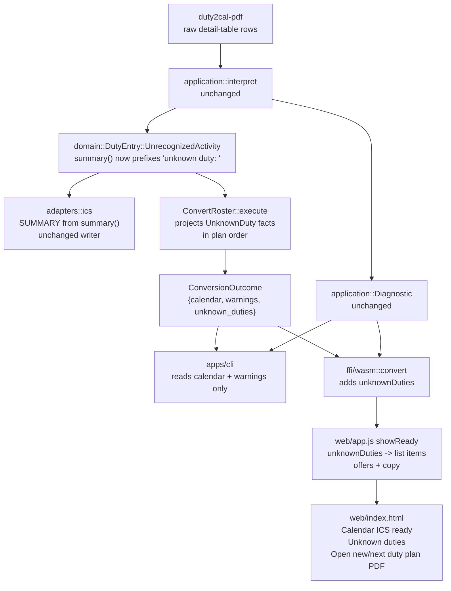

# Design: label-unknown-duties

## Scope

The HOW for the observable rules in [the delta](specs/export-duty-plan-calendar/export-duty-plan-calendar.feature) and in [the use case](../../specs/export-duty-plan-calendar/usecase.md). The conversion result, the interpretation, the report builders, the executable, the calendar writer's structure and the publication rules keep their current design. What changes is one presentation decision in the domain (the title of an activity represented from an unrecognized code), one derived application fact (the ready page's structured unknown-duty entries), and the browser's two ready states.

No crate, port, adapter boundary, dependency, runner, fixture oracle or document set is introduced. The affected production modules are `crates/duty2cal-core/src/domain/mod.rs`, `crates/duty2cal-core/src/application/mod.rs`, `ffi/wasm/src/lib.rs`, `web/index.html` and `web/app.js`; `web/styles.css` and `web/e2e/driver.mjs` are unchanged.

## Technology decisions

No version-bearing decision changes. The versions below are read from the workspace manifests at design time, not remembered as current releases.

| Area | Decision | Source |
|---|---|---|
| Language and layout | Rust stable (`rust-toolchain.toml` channel `stable`), edition 2021, workspace crates unchanged | Unchanged |
| Calendar writer | Hand-written RFC 5545 serializer; writes `SUMMARY` from `DutyEntry::summary()` and nothing else about the title | `crates/duty2cal-core/src/adapters/ics/mod.rs`; unchanged — the new prefix is produced by the domain accessor, so the writer needs no arm |
| Gherkin runner | cucumber-rs `cucumber = "0.23"` as a `harness = false` test target, invoked through `./run-tests.sh` | Read from `apps/cli/Cargo.toml` at design time; unchanged |
| Browser driver | Playwright `1.64.1` and `@axe-core/playwright` `4.14.0`, pinned in `web/e2e/package.json` / `package-lock.json` | Read from the manifests at design time; unchanged |
| Fixtures | Generated at test time by `crates/duty2cal-pdf-fixtures`; only expected calendars are committed | Unchanged; one fixture function is added |
| Golden oracle | `apps/cli/tests/fixtures/expected/2098-06.ics` and `2026-06.ics` remain byte-identical | Neither reference plan contains an unrecognized code |
| Date/time formatting in the facade | `time` is already a facade dependency; the facade formats the date and clock it exports | `ffi/wasm/src/lib.rs` imports `time::OffsetDateTime` today |

Version freshness: this design changes no language, runtime, framework, library, driver or image version. Nothing is pinned from memory. The cucumber-rs and Playwright versions above were read from this workspace's manifests on 2026-10-28; a later dependency change re-evaluates them under the design instruction's freshness rule.

## Data model

### The calendar title

`DutyEntry::UnrecognizedActivity` keeps its four fields. Only its `summary()` arm changes:

```rust
// crates/duty2cal-core/src/domain/mod.rs
Self::Availability { code, .. }
| Self::NonFlightDuty { code, .. } => code.clone(),
Self::UnrecognizedActivity { code, .. } => format!("unknown duty: {code}"),
Self::Layover { station, .. } => format!("Layover {station}"),
```

Both the timed fallback and the all-day fallback go through this one arm, so the prefix cannot drift between kinds. `location()`, `interval()`, `date()` and `description_fields()` are untouched: the station, the printed window and the empty-description exception stay exactly as they are. The prefix applies to every `UnrecognizedActivity`, including the standby-shaped `SB_X_CF` the converter does not recognize (D2).

### The ready page's structured fact

`Diagnostic` carries `row`, `date` and one English sentence; it does not carry the interval and is not a presentation source. The application therefore derives a narrow fact from the represented activities:

```rust
// crates/duty2cal-core/src/application/mod.rs

/// One activity the conversion represented from an unrecognized code.
///
/// Derived from the represented entry, never parsed out of a diagnostic
/// message: the ready page lists exactly what the calendar carries.
#[derive(Debug, Clone, PartialEq, Eq)]
pub struct UnknownDuty {
    /// The calendar activity's date: the timed interval's UTC start date
    /// (which a day qualifier can move off the row's date), otherwise the
    /// entry's duty-plan date.
    pub date: time::Date,
    /// The printed UTC window's start; `None` for the all-day fallback.
    pub start: Option<time::OffsetDateTime>,
    /// The printed activity code, verbatim.
    pub code: String,
}

/// A completed conversion: the calendar text, every fallback it used, and
/// the fallbacks' listable facts.
#[derive(Debug, Clone)]
pub struct ConversionOutcome {
    pub calendar: String,
    pub warnings: Vec<Diagnostic>,
    /// Every unrecognized-code activity, in plan order.
    pub unknown_duties: Vec<UnknownDuty>,
}
```

`UnknownDuty` is not a second interpretation of the row: it is a projection of `DutyEntry::UnrecognizedActivity`, whose `date`, `interval: Option<UtcInterval>` and `code` are the authoritative values. Its `Debug`/`PartialEq` derives match the surrounding value types; no behaviour is added.

### Derivation

`ConvertRoster::execute` builds the `Roster` and writes the calendar from a borrow of it. It projects the facts from that roster, in entry order; the projection order relative to `sink.write(&roster, …)` is irrelevant because both only read the roster:

```rust
let unknown_duties = roster
    .entries
    .iter()
    .filter_map(|entry| match entry {
        DutyEntry::UnrecognizedActivity { date, code, interval, .. } => Some(UnknownDuty {
            date: interval.map_or(*date, |window| window.start().date()),
            start: interval.map(|window| window.start()),
            code: code.clone(),
        }),
        _ => None,
    })
    .collect();
```

Properties this preserves:

- **Plan order.** `interpret` already returns entries in plan order, so the ready list needs no second sort and cannot disagree with the calendar's event order.
- **One entry per calendar event.** The list is derived from the same entries the sink renders; a row that produced no event (a silent layout row) produces no list item, and an error row still prevents the outcome that would carry this list. The timed line's date is the interval's UTC start date, so a day-qualified window whose event falls on the previous or next UTC day lists that event date, not the row's local date.
- **Report text untouched.** `warnings`, `diagnostic_line`, `warning_report_text` and `failure_report_text` do not read `unknown_duties`, and `unknown_duties` does not read `Diagnostic.message`.
- **Failure path untouched.** `ConvertError::Rows` returns before any outcome, so a failed conversion has no ready list; the failure state keeps its diagnostic lists.

## Architecture impact



Changed files:

| Path | Kind | Purpose |
|---|---|---|
| `crates/duty2cal-core/src/domain/mod.rs` | changed | `UnrecognizedActivity`'s `summary()` arm returns `unknown duty: <code>`. |
| `crates/duty2cal-core/src/application/mod.rs` | changed | `UnknownDuty`, `ConversionOutcome.unknown_duties`, and the projection in `execute`. |
| `crates/duty2cal-core/src/adapters/ics/mod.rs` | unchanged | Renders `entry.summary()`; the prefix arrives through the accessor. |
| `apps/cli/src/main.rs` | unchanged | Ignores the new field; printing, report publication and exit status are unchanged. |
| `ffi/wasm/src/lib.rs` | changed | Success result gains `unknownDuties`; one helper sets an optional string property. |
| `web/index.html` | changed | Ready heading, unknown-duty list heading, offer copy and way-back label. |
| `web/app.js` | changed | `showReady` renders the structured list, labels the warning-report offer, uses the new copy. |
| `web/styles.css` | unchanged | The existing `.diagnostics` list primitive is reused; no token or layout change. |
| `web/e2e/driver.mjs` | unchanged | `readState` already reports `#warning-list li` items and each offer's `{name, text, kind}`. |
| `crates/duty2cal-pdf-fixtures/src/lib.rs` | changed | Add `all_day_warned_plan()`: one dated row with an unrecognized code and no printed times. |
| `apps/cli/tests/steps/support.rs` | changed | Re-export `all_day_warned_plan`. |
| `apps/cli/tests/steps/export_duty_plan_calendar.rs` | changed | New and updated page phrases (table below). |
| `apps/cli/tests/steps/e2e/export_duty_plan_calendar.rs` | unchanged | No new `@e2e` phrase; the existing browser smoke still traverses `empty` → `ready`. |
| `docs/design/design-system.md` | amended 2026-10-28 | The 2026-10-28 amendment records the new ready-state copy, list, labels and way back; only the child-order clarification is added by this change. |
| `docs/arc42/12-glossary.md` | amended 2026-10-28 | The change's `arc42-docs` artifact adds **Unknown duty** and points `Conversion warning` at both presentations. |
| `givn/specs/export-duty-plan-calendar/usecase.md` | changed | The fallback title, the two ready states' copy, list and offer labels, and the affected examples. |

## Browser result shape

The facade's success object gains one array; every other property is byte-for-byte the same shape as today:

```jsonc
// success
{ "status": "ok", "calendar": "<RFC 5545 text>",
  "warnings": ["row 1 (2099-06-07): unrecognized activity code \"ZZ_M_CF\"; …"],
  "warningReport": "Source PDF: 2026-06.pdf\nWarnings:\n- row 1 …\n",
  "unknownDuties": [
    { "date": "07-06-2099", "start": "08:00", "code": "ZZ_M_CF" }
  ],
  "errorCount": 0, "warningCount": 1 }

// all-day fallback inside the same array
{ "date": "07-06-2099", "start": null, "code": "ZZ_M_CF" }
```

- `date` is formatted by the facade from `Date`'s numeric components, zero-padded, as `DD-MM-YYYY`; the page never reparses a date, so no browser time zone can move it. `start` is the UTC interval start, zero-padded, as `HH:MM` when the fallback is timed, and JavaScript `null` for the all-day fallback. `code` is the printed code verbatim.
- The array is empty when there are no unknown duties; the page still receives it and hides the list.
- `warnings`, `warningReport`, `errors` and `diagnostic` do not change: the warning report's text and filename stay as they are, and the failure object gains nothing.
- A formatting failure of the date or clock is impossible for a `Date` and an `OffsetDateTime` with the numeric/clock component accessors; no fallible parse is involved.
- Every new facade helper that builds the array is `#[cfg(target_arch = "wasm32")]`, like the existing helpers, so the native build carries no dead code and `cargo clippy --workspace --all-targets -- -D warnings` stays clean.

## Page: DOM and JavaScript

`web/index.html` changes the `#offer` region's copy and reorders its children to the operator's example: heading, status, unknown-duty list, save-choice copy, offers, note, way back. The element ids stay so `driver.mjs` and the accessibility structure are unchanged. The reorder is the only layout change; tokens, breakpoints and the surrounding panels do not move:

```html
<div id="offer" class="offer" hidden>
  <h2>Calendar ICS ready</h2>
  <p id="ready-status" class="offer-note" role="status" aria-live="polite"></p>
  <div id="warnings" class="diagnostics" hidden>
    <h3>Unknown duties</h3>
    <ul id="warning-list" class="diagnostics__list"></ul>
  </div>
  <p id="offer-copy">You can choose where to save the file.</p>
  <div id="offer-links"></div>
  <p id="offer-note" class="offer-note" hidden></p>
  <button id="reset-ready" type="button" class="button">Open new/next duty plan PDF</button>
</div>
```

`web/app.js`:

- `showReady(name, calendar, warningReport, unknownDuties)` receives the new array; `acceptFile` passes `(result && result.unknownDuties) || []`. The warning sentences are no longer rendered in the ready state; the structured array carries the list.
- `unknownDutyLine(item)` composes the settled line: `` `${item.date}${item.start ? ` ${item.start} UTC` : ''} unknown duty: ${item.code}` ``. This is the only place the ready list's wording exists.
- `renderList(container, list, items)` is unchanged and receives the composed strings; the existing `<ul id="warning-list">` is reused, so a warning-free conversion hides `#warnings` exactly as before and `readState` keeps classifying the state as `ready`.
- `addOffer(container, name, content, type, label = \`Save ${name}\`)` — the calendar call keeps the default, so its label stays `Save <stem>.ics`; the warning-report call passes `Save unknown duty warning for publisher`. The download filename argument is still `<stem>.parse-warnings.txt`.
- `offerCopy.textContent` is no longer chosen per state: the static `You can choose where to save the file.` stays in both ready states.
- The ready status keeps its two forms: plain ready `Calendar ready for ${name}.`; ready with unknown duties `Your calendar is ready to save. 1 row was converted with an unknown duty.` or `Your calendar is ready to save. ${n} rows were converted with unknown duties.` The count is `unknownDuties.length`. The warning-report offer and the `#warnings` visibility still follow `warnings.length > 0` (today warnings and unknown duties are the same set, but the offer must not silently inherit a new predicate).
- `showFailure`, `clearAttempt`, the offer-failure note, the object-URL lifecycle, the CSP, storage and request behaviour are untouched. In particular the failure state keeps `Conversion failed`, `Choose another plan`, the `Errors`/`Warnings` headings and `diagnostic_line` text.

The failure state's `#failure-warnings` block keeps the heading `Warnings`: it explains a rejected conversion, not a calendar the reader will import.

## Step Definitions

One file per capability per layer, as before. No delta step copy exists; every phrase is bound in the permanent file.

| Step definition file | Capability / module | Permanent merge target | New or changed phrase groups |
|---|---|---|---|
| `apps/cli/tests/steps/export_duty_plan_calendar.rs` | `export-duty-plan-calendar`, module `steps::export_duty_plan_calendar` of the `features_runner` target | none — the permanent file is the home | New: `the page shows the text "<text>"` (visible text only, for the ready heading, the list heading and the offer copy, so it does not constrain the live status region); `the page lists the unknown duty "<line>"` (exactly one observed `#warning-list li`, compared verbatim); `the page offers the calendar labelled "<label>"` (the `kind == "calendar"` offer's `text`); `the page offers the warning report "<name>" labelled "<label>"`; `the page offers the way back "<label>"` (`controls.chooseAnother` visible and the label in the visible text); `the crew member supplies the supported duty plan "<name>" containing an unrecognized activity code without printed times` (the `all_day_warned_plan` fixture). The existing `the page states "<sentence>"` binding stays status-only and is used only for the count sentence. Changed bindings: `the page shows that the calendar is ready` and `the page shows that the drop was accepted and the calendar is ready` assert the heading `Calendar ICS ready`; `the page shows that the calendar is ready with warnings` asserts the same heading; `the page still offers the calendar` asserts the new copy `You can choose where to save the file.`; the three negative guards in the offer-failure, cannot-run and stale-offer steps change `!text.contains("Calendar ready")` to `!text.contains("Calendar ICS ready")`; and `the calendar contains one activity for each of the three rows` builds `SUMMARY:unknown duty: <code>` for each warned row. Retired: `the page lists one warning naming the activity code`, whose row-number assertion no longer describes the ready state. |
| `apps/cli/tests/steps/e2e/export_duty_plan_calendar.rs` | `export-duty-plan-calendar` (e2e), module `steps::e2e::export_duty_plan_calendar` | none — unchanged | None. The existing `@e2e` browser scenario keeps its title and its `empty` → `ready` traversal; `assert_visual_baseline` is property-based, so the new heading does not change it. |
| `apps/cli/tests/steps/browser.rs` | Playwright client, module `steps::browser` | none — unchanged | None. The driver action list and `read_state` observation are unchanged. |
| `apps/cli/tests/steps/support.rs` | test fixtures, module `steps::support` | none — test support | Re-export `all_day_warned_plan` with the existing fixture functions. |

Test tooling `web/e2e/driver.mjs` is not Gherkin glue and is unchanged.

## Test runner, strict mode, and single-scenario command

- Unit/integration: `./run-tests.sh` — assembles `givn/specs/**` and every active change's `specs/**` into a temporary root, then runs `cargo test -p duty2cal --test features_runner` plus the Rust unit/property, architecture and golden tests. It executes the `.feature` files themselves; no parallel hand-maintained test asserts this copy.
- E2E: `./run-tests.sh --e2e` (`verify.e2e_command`), filtering `@e2e and not @browser`; distinct from `verify.command`.
- Browser: `./run-tests.sh --browser` (builds `web/pkg` and `dist/site`, then selects `@browser`). One browser scenario: `./run-tests.sh --browser --name "The page shows the warnings and offers both files when a plan converts with warnings"`.
- Single scenario on any surface: `./run-tests.sh --name "<scenario title>"`; a named run must select exactly one scenario, and a run that selects none is a refusal.
- Strict mode: `apps/cli/tests/features_runner.rs` line 80 calls `.fail_on_skipped().run_and_exit(root)` on the `Cucumber` builder. An undefined or skipped step fails the run, so the new phrases cannot silently pass before they exist. The delivery rule for the implementer: each new step starts as `panic!("not yet implemented: <step phrase>")`, with the phrase copied from the `.feature` text; the RED run must fail with exactly that phrase in the cucumber output, and a step that passes without it was bound to the wrong phrase. No step body is empty or returns a default.
- Quality gates: `cargo fmt --all --check`, `cargo clippy --workspace --all-targets -- -D warnings`, `cargo test --workspace`.

## Visual Design Contract

- Interface: web
- Viewports: mobile (360x780), desktop (1920x1080)
- Design system: `docs/design/design-system.md`

**Screens covered:** the converter screen's `ready` and `ready-with-warnings` states. `empty`, `converting`, `failure` and `cannot-run` are unchanged.

**Direction:** the change is a copy-and-label correction inside the approved direction, not a new visual direction. The operator's brief for this change supplies the ready-page example (`Calendar ICS ready`, the count sentence, the list of `unknown duty` entries, `You can choose where to save the file.`, the two save labels and the way back). No token, layout, breakpoint, elevation or motion change is made.

**design tokens:** unchanged. The ready states use the existing `--surface`, `--ink`, `--ink-muted`, `--border`, `--space`, `--radius` and type scale; contrast stays body ≥ 7:1, muted ≥ 4.5:1, focus and boundaries ≥ 3:1.

**Component primitives:**

| Primitive | States and rules |
|---|---|
| Ready panel heading (`#offer h2`) | Default: `Calendar ICS ready` in both ready states; `h2` under the page's single `h1`. |
| Status region (`#ready-status`, `role="status"`, `aria-live="polite"`) | Plain ready `Calendar ready for <name>.`; ready with unknown duties `Your calendar is ready to save. <n> rows were converted with unknown duties.` and the singular sentence for one row. |
| Unknown-duty list (`#warnings` → `h3` `Unknown duties` + `ul#warning-list`) | Default (visible with entries), empty (hidden). Real `<ul>`/`<li>`; each item is one line, `overflow-wrap: anywhere` from the existing `Diagnostic list` primitive; no hover, focus or disabled state. The heading sits under the ready `h2`, so the heading order stays valid. |
| Offer links (`#offer-links a[download]`) | Calendar: `Save <stem>.ics`. Warning report: `Save unknown duty warning for publisher`. Both keep the existing button styling and hover/focus-visible states; no disabled state. |
| Way back (`#reset-ready`) | Label `Open new/next duty plan PDF`; returns the page to `empty` and clears the attempt; hover and focus-visible as today. |

**Breakpoints:** unchanged — one column, full-width controls below 480 px, a 720 px maximum from 720 px. A long unknown-duty line wraps at 360 px rather than overflowing.

**Accessibility:** WCAG 2.2 AA. One `h1`; the ready heading is `h2`; the list heading is `h3`; the list is a real `<ul>` whose items name the date, the optional UTC start and the code, so the meaning is not carried by a marker alone. The offer links and the way-back button keep visible labels and keyboard focus. `lang="en"`, reduced motion and the token contrast are unchanged. Verified by the existing Playwright semantics/label/focus/language assertions, the new list and label assertions, and `@axe-core/playwright` on the `ready` and `ready-with-warnings` states.

**Rendered reference:** the reference view for the converter screen must be amended so it draws the two ready states with this contract's copy, list and labels; the tokens and structure stay. The durable design-system document and its reference are outside this planning pass's write scope and are amended in the implementation change together with the page (see the changed-files table). Until that amendment, the durable document's old ready-state copy contradicts this contract; this design is authoritative for the change.

**Capture mechanism and evidence path:** the driver resizes to 360x780 and 1920x1080, emulates `prefers-reduced-motion: reduce` and a light colour scheme, waits for `document.fonts.ready` and two animation frames after the final assertion, and calls `page.screenshot({ animations: 'disabled', fullPage: true })`. A run commits the evidence only with `DUTY2CAL_VISUAL_EVIDENCE_DIR=label-unknown-duties DUTY2CAL_UPDATE_VISUAL_EVIDENCE=1`; without the override the captures land in the scenario's temporary directory. The same override points the permanent `@e2e` browser scenario's `empty` and `ready` captures at this change's tree instead of the archived `build-browser-converter` record. Each modified and added `@browser` scenario that declares the visual baseline commits its final state:

- `givn/changes/label-unknown-duties/evidence/visual/the-page-shows-the-warnings-and-offers-both-files-when-a-plan-converts-with-warnings/<viewport>--ready-with-warnings.png`
- `givn/changes/label-unknown-duties/evidence/visual/the-page-lists-an-all-day-unknown-duty-with-its-date-and-code/<viewport>--ready-with-warnings.png`
- `givn/changes/label-unknown-duties/evidence/visual/the-page-shows-no-warning-list-when-the-plan-converts-without-warnings/<viewport>--ready.png`
- `givn/changes/label-unknown-duties/evidence/visual/the-page-states-how-many-rows-were-converted-with-warnings/<viewport>--ready-with-warnings.png`
- `givn/changes/label-unknown-duties/evidence/visual/the-page-keeps-the-calendar-and-the-warnings-when-it-cannot-offer-the-warning-report/<viewport>--ready-with-warnings.png`

The existing `@e2e` browser scenario traverses `empty` → `ready`; its property-based baseline continues to assert the heading, visible labels, language and reduced motion, and the override above refreshes its captures into this change's tree. Runs without the override write intermediate captures into the scenario's temporary directory; they are not review evidence.

**Motion:** unchanged — one 120 ms opacity/translate transition, `0ms` under `prefers-reduced-motion: reduce`. The list appears with its state; no new animation is added.

## E2E smoke test infrastructure

- **E2E runner command:** `./run-tests.sh --e2e` (`verify.e2e_command`), filtering `@e2e and not @browser`; distinct from `verify.command` (`./run-tests.sh`). The browser smoke is `./run-tests.sh --browser --name "Crew member converts a supported duty plan in the browser and saves the offered calendar"`.
- **E2E step definition location:** `apps/cli/tests/steps/e2e/export_duty_plan_calendar.rs`; the regular page variants and the new list scenarios live in `apps/cli/tests/steps/export_duty_plan_calendar.rs`, both over the shared `apps/cli/tests/steps/browser.rs` client and `web/e2e/driver.mjs`. One step file per capability per layer.
- **Real interface:** the built `duty2cal` binary as a real subprocess for the CLI action; the rendered page in Chromium for the browser action, with `std::process::Command` driving `node web/e2e/driver.mjs` over one JSON line per action.
- **Local test infrastructure:** per-scenario temporary directories for the CLI; for the page, the pinned Node from `web/e2e/.nvmrc`, `npm ci --prefix web/e2e`, `npx --prefix web/e2e playwright install --with-deps chromium`, `./scripts/build-web.sh` and `./scripts/build-site.sh` into `dist/site/`, served by the driver's in-process loopback server on `127.0.0.1:0`. No database, queue, container, port reservation or external service.
- **Framework choice and justification:** unchanged. cucumber-rs is the only Gherkin runner; Playwright drives the real page (file input, offers, download, request log, storage snapshot, reduced motion, axe) and is the project's pinned test-only dependency.
- **E2E strict-mode proof:** `.fail_on_skipped()` on the `Cucumber` builder; an undefined or skipped step fails the process. The driver is fail-closed: an unknown action, a missing element or a `{ "ok": false }` answer makes the Rust step panic. This change adds no `@e2e` scenario and does not retag one; the page observations are regular `@browser` scenarios.

## Interaction Coverage Matrix

| Inventory entry | @e2e scenario title | Real interface | Driving mechanism |
|---|---|---|---|
| supply a duty plan for conversion through the executable | Crew member converts a supported duty plan and receives a calendar file | CLI | `std::process::Command` runs the built `duty2cal` binary with the generated plan; reads the transcript, exit status and published calendar. The `unknown duty:` title itself is proven by the non-e2e calendar scenarios; this `@e2e` action proves the real publication path |
| supply a duty plan through the converter page and save the offered calendar | Crew member converts a supported duty plan in the browser and saves the offered calendar | Web UI | Playwright through `web/e2e/driver.mjs`: navigates to the built Site output, sets the file input to the generated fixture, clicks the offered download, captures the browser's save, reads the request log and the rendered ready state |

The inventory is unchanged. The new ready-state presentation is regular `@browser` coverage of the existing page action: the modified warning scenario and the new all-day scenario assert the list, labels and copy, which are invariants distinct from the `@e2e` save.

## Local runnability & digital twins

- **Local run command:** `./run-tests.sh` for the whole product suite; `./run-tests.sh --browser` for the page (it builds the bundle and the Site output). Manual use: `cargo run -p duty2cal -- <duty-plan.pdf>` and `./scripts/run-web.sh`.
- **Isolated network:** not applicable — the product performs no network I/O, and the page makes no request to another origin after load.
- **Digital twins:** none. The only outside dependencies are the local filesystem, the supplied plan and the locally installed browser driver.
- **Interface obstacles:** none new. The list is rendered from the same result object that already drives the offer, and the driver reads it from the DOM rather than from a test hook. The only test-side addition is a fixture function, not a channel: the all-day scenario builds a plan whose one dated row carries a code and no time cells, so the existing generated-PDF path produces the all-day fallback. The offer labels are read from each `a[download]`'s text, which `read_state` already exposes, so no new driver action is needed.

## Coverage process boundaries

Coverage is enabled. No new process is introduced; the existing two remain.

| Process | Started by | Instrumented artifact | Profile output | Merge step | Non-zero production probe |
|---|---|---|---|---|---|
| features_runner (unit/integration) | `./measure-coverage.sh` (`--tags "not @e2e and not @browser and not @nested-build"`) | `cargo llvm-cov --package duty2cal-core --package duty2cal-pdf --package duty2cal --test features_runner` | `coverage/non-e2e-cobertura.xml` | `./merge-coverages.sh` | `crates/duty2cal-core/src/application/mod.rs` — `execute`'s `unknown_duties` projection, exercised by the modified timed and all-day warning scenarios; `crates/duty2cal-core/src/domain/mod.rs` — the `UnrecognizedActivity` `summary()` arm, exercised by the same scenarios |
| E2E runner + spawned CLI | `./measure-coverage.sh` (`--tags "@e2e and not @browser and not @nested-build"`, which spawns the built CLI) | `cargo llvm-cov --workspace --test features_runner` with the CLI built under instrumentation | `coverage/e2e-cobertura.xml` | `./merge-coverages.sh` | `apps/cli/src/main.rs` — the successful publication path the permanent CLI `@e2e` conversion drives |
| browser scenario runner (Playwright + `web/e2e/driver.mjs` + Chromium) | `./run-tests.sh --browser` (not part of the coverage runs) | none — `web/app.js` is not coverage-instrumented; the committed screenshots and DOM assertions are its evidence | none (no coverage profile is produced for this process) | none (no merge step) | `web/app.js` `showReady`'s unknown-duty branch, exercised by the modified ready-with-warnings scenarios and observed as the rendered `#warning-list` entries and offer labels |

The browser scenarios are not part of the coverage runs (they are `@browser`), so the JavaScript change is evidenced by the committed screenshots and DOM assertions, not by line coverage.

## Black-Box-First policy

Every scenario drives the real CLI over a generated fixture or the real page through Playwright and asserts the published calendar, the rendered list, the offer labels, the visible copy or the status. No unit test of `summary()` or of the projection is added: a unit test would re-assert what the modified scenarios already observe through the calendar and the page. If an internal test is ever retained, it must name a case those surfaces cannot observe.

## Decisions

Every proposal ID is resolved here.

- **Decides D1:** the ready list's facts are a structured projection of the represented `DutyEntry::UnrecognizedActivity` entries — the calendar activity's date, optional UTC interval start and printed code — computed in `ConvertRoster::execute` into `ConversionOutcome.unknown_duties`, exported by the wasm facade as an array of `{date, start, code}` and composed into the visible line by `web/app.js`. For a timed fallback the date is the interval's UTC start date, so a day-qualified window lists the event date the calendar carries; for an all-day fallback it is the entry's duty-plan date. Nothing parses `Diagnostic.message`. — realized in `crates/duty2cal-core/src/application/mod.rs`, `ffi/wasm/src/lib.rs` and `web/app.js`; pinned by "The page shows the warnings and offers both files when a plan converts with warnings" and "The page lists an all-day unknown duty with its date and code".
- **Decides D2:** every activity represented from an unrecognized code is titled `unknown duty: <printed code>`, timed and all-day alike, including the standby-shaped `SB_X_CF`; the recognized `SB_F_CF`/`SB_M_CF`/`SB_S_CF` codes keep their bare titles. — realized in `DutyEntry::summary()`; pinned by the five modified calendar scenarios and unchanged by the recognized-standby scenarios.
- **Decides D3:** the ready states are the whole presentation change. The failure state's headings, lists, reason sentence and way back, the warning report's text and filename, the CLI's transcript and warning lines, and every diagnostic sentence stay as they are. — realized by leaving `Diagnostic`, both report builders, `showFailure`, `apps/cli/src/main.rs` and the `#failure` markup untouched; pinned by the unchanged failure scenarios and by "The page keeps the calendar and the warnings when it cannot offer the warning report".

## Use-case traceability

| Use-case element | Technical decision | Evidence |
|---|---|---|
| Main flow 7: the page shows the offered calendar and the unknown duties | `showReady` renders `unknownDuties`; the plain ready state has no list | "The page shows the warnings and offers both files when a plan converts with warnings"; "The page shows no warning list when the plan converts without warnings" |
| Rule: an unrecognized code becomes a timed or all-day activity titled from its printed evidence | `DutyEntry::summary()` prefixes `unknown duty: ` for both kinds | "An unrecognized activity code with a printed window becomes a timed activity with a warning"; "An unrecognized activity code without printed times becomes an all-day activity with a warning"; "An unrecognized activity code with an unqualified window across midnight keeps it as the following UTC day"; "An unrecognized activity code's activity carries no description"; "A standby-like code outside the three shift codes still warns" |
| Rule: conversion warnings are reported without withdrawing the calendar | `ConversionOutcome.unknown_duties` is derived only on the success path; `warnings` and the warning report are untouched | The modified warning scenarios and the unchanged warning-report scenarios |
| Browser realization: both ready states are drawn as the contract | `web/index.html` and `web/app.js` copy, list heading, offer labels and way back | The four modified `@browser` scenarios and the added all-day scenario |
| Browser realization: the failure state lists errors and warnings | `showFailure` untouched | The unchanged failure `@browser` scenarios |
| Rule: the page writes nothing and claims no save it did not observe | Object-URL offers and `pagehide` revocation untouched | The unchanged browser scenarios and the `@e2e` browser smoke |
| Minimal guarantee: no row is silently dropped; every fallback is visible | The ready list is derived from the calendar's own entries, one per event | "The page lists an all-day unknown duty with its date and code"; the modified timed list scenario |
| Success guarantee: one export with the calendar and, when needed, the warning report | Offer labels keep both artifacts distinct; filenames unchanged | "The page shows the warnings and offers both files when a plan converts with warnings" |
| Capability ownership | `export-duty-plan-calendar` only | Interaction Coverage Matrix |

Actors in Gherkin are domain actors; Personas are review lenses.

## Persona impact

- **`crew-member--personal-calendar-owner`** — the accuracy lens: an imported calendar now says which entries are fallbacks, and the page lists them in plan order with the date and UTC start a crew member can compare against the plan. The two saves are distinguishable by their labels, and the page still writes nothing and sends nothing.
- **`contributor--web-reviewer`** — the review lens for the page: the list is rendered text from the converter's own result, the markup keeps real headings and list semantics, the labels are visible text on the real links, and the CSP, no-network, no-storage and offer mechanics are unchanged.
- **`project-maintainer--release-owner`** — a pre-existing lens of this use case, unaffected: no release artifact, dependency, public claim or deployment changes here.
