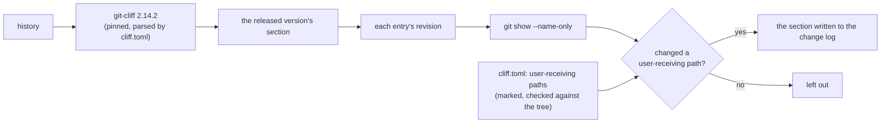

# Design: list-only-changes-a-user-receives

## Scope

The HOW for the rule in [the delta](specs/publish-public-release/publish-public-release.feature). The release channel, the pinned generator, the capability allow-list, the machinery phrase list, the drift check and the preparation's staging behaviour are unchanged. What changes is how the renderer decides that a released revision is a change a user can receive, and what the release runbook tells the maintainer.

Operator decision this design realizes (from the proposal's D1): **filter engineering work out of the notes by construction** — an entry whose revision changed no path a user receives is left out — with packaging paths inside the user-receiving list precisely so the executable-mode fix stays announceable.

## Technology decisions

No new runtime, library or tool. The one dependency is the already-pinned `git-cliff 2.14.2`, used exactly as before.

| Area | Decision | Rationale / source |
|---|---|---|
| Language | The renderer stays a POSIX-shell script (`scripts/render-changelog.sh`); the configuration stays `cliff.toml`. | The change is a rule inside the existing renderer; no new component is justified. |
| Generator | `git-cliff 2.14.2`, pinned in `cliff.toml` and refused by the renderer when another version is installed. | Unchanged; the new `commit.id` marker uses the generator's own context field, whose shape is part of the pinned output contract. |
| Path data | `git -c diff.renames=false -C <repo> show --name-only --format= <sha>` per announced revision. | `git` is already a hard requirement of the renderer (tags, dates, `describe`) and needs no new tool. Rename detection is pinned off because its default is a checkout configuration: with it on, a file moved out of a listed path is listed only under its new, unlisted path and the revision would vanish. |
| Path list | A marked line in `cliff.toml` beside the capability allow-list and the machinery phrases, read by the renderer and checked against the tree. | The project already maintains two marked lists this way and refuses a mismatch; a third follows the existing convention instead of inventing one. |
| Fixture repositories | `build_history` takes the set of paths each revision writes and creates every listed user-receiving path up front; a revision that must be announced writes under a listed path. | The scenarios must express "changed a user-receiving path", "changed only machinery" and "changed both"; the renderer's own list check runs against the fixture too. |

## Architecture impact

One filtering step joins the render pipeline; nothing else moves.



Changed files:

| Path | Kind | Purpose |
|---|---|---|
| `cliff.toml` | changed | The marked user-receiving path list, its drift check by the renderer, and the `commit.id` marker in the section body template. |
| `scripts/render-changelog.sh` | changed | Reads and checks the path list; resolves each announced entry's revision and paths; drops the entries no user receives; strips the marker. |
| `apps/cli/tests/steps/publish_public_release.rs` | changed | `build_history` gains each revision's path set and creates every listed path; the announced revisions of the existing fixtures write under a user-receiving path, the machinery-only ones under a machinery path, and the phrase-list revision stays on a user-receiving path so the phrase list remains the only reason it is dropped; the history behind the empty refusal writes machinery paths, so that refusal is exercised through the path filter. |
| `CHANGELOG.md` | changed | The committed `0.2.0` section, re-rendered under the new rule before its tag exists: it loses the two engineering entries and keeps the travel-title fix, so a fresh render of the released revision and the committed file agree. |
| `givn/specs/publish-public-release/usecase.md` | changed | The use case's visibility rule gains the third condition — a released revision must have changed a path a user receives. |
| `README.md` | changed | The release runbook's "Releasing a version" section states the authorship rule: a released subject says what a crew member can act on, and engineering work takes a housekeeping type so it is never released. |
| `docs/arc42/02-architecture-constraints.md`, `08-crosscutting-concepts.md`, `11-risks-and-technical-debt.md`, `12-glossary.md` | changed | The third marked list among the constraints, the visibility rule in "What a reader sees", TD-008 recorded as partly closed with its residual, and the term for a user-receiving path. |

## The rule

A released revision is announced only when it changed something a user receives.

**The user-receiving paths.** Marked in `cliff.toml` as

```
# <!-- user-receiving-paths: crates/ apps/cli/src/ Cargo.toml Cargo.lock rust-toolchain.toml .cargo/ scripts/prepare-release.sh .github/workflows/release.yml -->
```

and checked against the tree, so a path that no longer exists stops the render by name:

```
crates/                      the converter's domain, application, ICS adapter and PDF reader
apps/cli/src/                the command-line application a user runs
Cargo.toml, Cargo.lock       the dependency graph the executable is built from
rust-toolchain.toml, .cargo/ the toolchain and link configuration the executable is built with
scripts/prepare-release.sh   the packaging contract: what an archive holds and its file mode
.github/workflows/release.yml what the release builds, stages and publishes
```

The line between the two kinds of tooling is deliberate: a path whose contents decide **what a downloader receives or what those bytes do** is user-receiving; a path that only decides how the project works on them is not. `scripts/render-changelog.sh`, `cliff.toml`, `.github/workflows/ci.yml`, `docs/`, `givn/` and test code are not user-receiving, which is what removes 0.2.0's two engineering entries. `scripts/prepare-release.sh` and the release workflow **are**, which is what keeps the fix that forced the executable mode into the archives announceable — the cost the operator accepted for filtering.

**The pipeline, in this order.** The existing renderer took the version's section and collapsed identical entries in one `awk`; the marker that carries a revision must not reach that key, so the section is taken without collapsing and the collapse happens after the marker is gone:

1. The generator renders the history; the renderer takes the version's section, keeping entries as they are (group markers stripped, duplicates still present).
2. For each `- ` entry, the renderer reads the `<!--rev:<sha>-->` marker, resolves the revision's changed paths, and strips the marker from the line.
3. An entry whose revision changed no user-receiving path is dropped.
4. Identical subjects now collapse — one entry per released change, as before.
5. The empty case is counted, the comparison line is appended, and the section is assembled, written, and handed to `--release-text` and `--check` alike. The marker never reaches a written or compared byte.

**Resolving the paths.** `git -c diff.renames=false -C <repo> show --name-only --format= <sha>`. Rename detection is pinned off because `git show`'s output would otherwise depend on the checkout's `diff.renames` configuration:
- a file moved out of a listed path lists **both** paths, so the revision stays announceable;
- a deletion lists the path it removed, so a deletion under a listed directory is announceable;
- a merge commit and an empty commit list nothing, so both count as changing nothing and are dropped — a merge that carries a released subject is not announced, which is the same rule the generator already applies by naming a revision rather than a merge;
- a revision whose paths cannot be read refuses the render, naming the revision: silently dropping it would be a silently missing note. No fixture reaches that arm — the input is a repository whose object is missing — so it is a defensive refusal, recorded as such.

**The empty case** is unchanged: if every entry is dropped, the version changes nothing a user can see and nothing is written.

## Decisions

The proposal records one question and it is answered; nothing is carried.

- **Decides D1:** the notes are filtered by construction — an entry whose revision changed no user-receiving path is left out — rather than reported, refused, or left to a phrase list. Realized in the renderer's filter, the marked path list, and the delta's three scenarios (the rule with a machinery-only and a both-paths revision, the packaging boundary the accepted cost depends on, and the path list checked against the tree). Rejected alternatives and their costs are recorded in the proposal.
- **Design decision (the list's edge):** packaging and release-workflow paths are user-receiving. Realized in the marked list; the rationale is that the executable-mode fix (chapter 11's R-012) is a change a downloader benefits from and must stay announceable.
- **Design decision (the pipeline's order):** the section is taken without collapsing duplicates, the marker is read and stripped, the filter drops, and only then do identical subjects collapse. Realized in the renderer; the reason is that the marker would otherwise enter the de-duplication key.
- **Design decision (0.2.0's committed section):** re-rendered in this change. Realized in `CHANGELOG.md`; `v0.2.0` does not exist yet, so this is an ordinary pre-tag render, and leaving it stale would make the preparation's own drift check refuse the release.

## Step definition locations

One file per capability, unchanged:

- Non-e2e steps: `apps/cli/tests/steps/publish_public_release.rs` — two new `Given` steps plus the fixture-builder change; the delta reuses the existing `When` and `Then` steps for the generation and the refusal.
- E2E steps: `apps/cli/tests/steps/e2e/publish_public_release.rs` — unchanged; the change adds no `@e2e` scenario.

## Test runner, strict mode, and single-scenario command

- Unit/integration: `./run-tests.sh` → assembles the feature root from `givn/specs/**` and `givn/changes/*/specs/**`, then `cargo test -p duty2cal --test features_runner`.
- E2E: `./run-tests.sh --e2e` (`--tags "@e2e"`); distinct from `verify.command`.
- Strict mode: `apps/cli/tests/features_runner.rs` — `.fail_on_skipped()` with `.run_and_exit(root)`. Step bodies are never empty.
- Single-scenario run: `./run-tests.sh --name "<scenario title>"`.
- Quality gates: `cargo fmt --all --check`, `cargo clippy --workspace --all-targets -- -D warnings`, `cargo test --workspace`.
- Environment: the change-log scenarios drive `scripts/render-changelog.sh`, which refuses any `git-cliff` but 2.14.2; the pinned generator is placed on `PATH` for every run.

## Use-case traceability

| Use-case element | Technical decision | Evidence |
|---|---|---|
| Rule: a released change is one whose words do not name the project's own tooling | The machinery phrase list is unchanged and stays a second net over a subject that names tooling while changing a user-receiving path | the permanent machinery scenarios |
| Rule: a version's notes group the changes a reader can see | The filter runs before the grouping; a grouped entry survives only if its revision changed something a user receives | "A version's notes list only the changes a user can receive" |
| Rule: a version that changes nothing a user can see is refused | Unchanged, and now reachable through the filter as well as through the type and the words | the permanent refusal scenario |
| Rule: the configuration's marked lists cannot drift from the tree | The user-receiving path list is checked against the tree like the capability allow-list and the machinery phrases | "A configured path a user receives that the repository does not hold is refused"; the permanent allow-list and machinery scenarios |
| Capability ownership | `publish-public-release` only | Interaction Coverage Matrix |

Actors in Gherkin are domain actors; Personas are review lenses (below).

## Persona impact

User-visible surface: repository and terminal text (the release text a downloader reads, the change log file, and the preparation's output). Confirmed Personas:

- **`crew-member--personal-calendar-owner`** — the reader the notes promise serves: what a version's notes state must be something they can act on when they download it.
- **`project-maintainer--release-owner`** — the actor: the release runbook states the authorship rule, and a release whose notes would say nothing a user can see still refuses before publication.

## Visual Design Contract

- Interface: terminal
- Viewports: n/a (no rendered screen)
- Design system: none
- Evidence kind: a captured transcript per `@e2e` scenario under `givn/changes/list-only-changes-a-user-receives/evidence/visual/<scenario-slug>/transcript.txt`.
- Baseline: the transcript names the version rendered and the change log it wrote; no internal identifier or path outside the fixture appears.
- This change adds no `@e2e` scenario, so no new transcript is owed; the rendering rule is visible in the change log the capability's existing `@e2e` scenario writes.

## E2E smoke test infrastructure

- **E2E runner command:** `./run-tests.sh --e2e`.
- **E2E step location:** `apps/cli/tests/steps/e2e/publish_public_release.rs` (unchanged).
- **Real interface:** `scripts/render-changelog.sh` and `scripts/prepare-release.sh` as real subprocesses.
- **Local infrastructure:** none external; each scenario builds a fixture git repository with fixed committer dates.
- **Framework:** cucumber-rs + `std::process::Command`.
- **Strict-mode proof:** `fail_on_skipped()` — an undefined E2E step fails the run.

## Interaction Coverage Matrix

| Inventory entry | @e2e scenario title | Real interface | Driving mechanism |
|---|---|---|---|
| prepare a release for a version | Maintainer prepares a release and runs the archived executable | CLI + git repository | `std::process::Command` runs `scripts/prepare-release.sh` against a fixture binaries directory and starts the executable taken out of the produced archive |
| generate the change log for a version | Maintainer generates the change log for a version and reads its newest section | CLI + git repository | `std::process::Command` runs `scripts/render-changelog.sh` against a fixture repository and reads the section it wrote |

Two inventory entries, two rows, two `@e2e` scenarios, two real drivers. This change adds no consumer action, so no new row and no new `@e2e` scenario.

## Local runnability & digital twins

- **Local run:** `scripts/render-changelog.sh --version <version> --repo . --out CHANGELOG.md`; the preparation runs beside it and needs five platform executables.
- **Isolated network:** not applicable — the renderer touches the filesystem, the pinned binary and the local history.
- **Digital twins:** the fixture repositories the scenarios build are the twins; no network is used.
- **Interface obstacles:** none foreseen — the filter reads `git show` output for revisions the generator already named.

## Black-Box-First policy

Both new scenarios drive the real renderer over a fixture repository. No internal unit test is added: the filter's observable effect is the section that is written, which is what the scenarios read.
