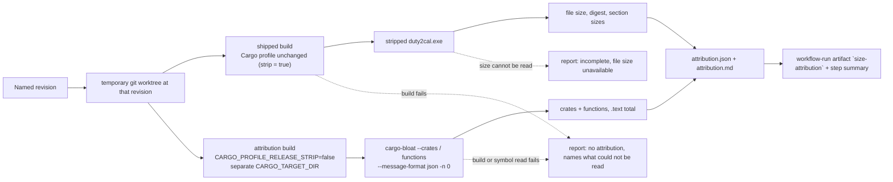

# Design: measure-executable-size

## Scope

The HOW for [the delta](specs/measure-distributed-executable-size/measure-distributed-executable-size.feature):
a size attribution of the Windows x86_64 executable, produced for every pushed
revision and requestable for any named revision, from an attribution build of
that revision (a build that retains the names the measurement needs), with the
stripped executable's own file size reported beside it.

The product crates, `Cargo.toml`, `.cargo/config.toml` and the distributed
executable's build configuration are **unchanged**. No size lever is applied,
no release is staged differently, and nothing is published. This is build
tooling, one new use case, the tests that prove the tooling, and the workflow
wiring that produces the attribution for every revision.

## Technology decisions

Versions below are resolved, not remembered: cargo-bloat was read from the
crates.io API on 2026-10-18 (`max_version` 0.12.1, last published 2024-05-10);
Rust is the repository's own `stable` channel from `rust-toolchain.toml`, not a
number this design names; the container tag is resolved at setup.

| Area | Decision | Rationale / source |
|---|---|---|
| Measurement interface | One command, `python3 scripts/measure_executable_size.py --revision <rev> [--repo <dir>] [--out <dir>] [--executable <path>]`, used by the project's automation and by a maintainer. | The use case's trigger names both callers; one interface means a reviewer's run and the automation's run are the same measurement. Rejected: a CI-only step (the maintainer could not request `v0.3.0`) and a Rust product binary (a new workspace member for build tooling). |
| Language | Python 3, latest stable from the distribution (`ubuntu-latest`; the local toolchain). No version pin: no output is byte-compared against a committed artifact. | The command parses the generator's two JSON outputs, checks a PE header, hashes the artifact and renders Markdown; `scripts/assemble_features.py` already makes python3 a project-tooling dependency. Rejected: shell + `awk`/`jq` (fragile JSON assembly), and no new third-party library. |
| Attribution generator | `cargo-bloat` 0.12.1, pinned, its own `--version` recorded in the report. | It reads PE symbol tables and reports per-crate and per-function `.text` sizes with `--message-format json -n 0`; no other stable-Rust tool produces this split. Its README states the numbers are "guesswork"; the report repeats that, which is why the attribution's total is never presented as a file size. |
| Build toolchain | Rust `stable` (`rust-toolchain.toml`) with the `x86_64-pc-windows-gnu` target and `mingw-w64` (latest from `ubuntu-latest`'s archive; latest stable in a container image resolved at setup). Neither is pinned by a number: the report records the toolchain's identity, and no number is compared byte-for-byte. | The supported platform's build is the only evidence the use case accepts; the gate already installs exactly this toolchain on `ubuntu-latest`. |
| Build identity | The report records the full revision, `x86_64-pc-windows-gnu`, the `rustc` version line, the generator's version, and the SHA-256 of `Cargo.toml` and `.cargo/config.toml` at that revision. | Main flow step 2 asks for the build's identity; the reviewer Persona's question is whether the attribution is reproducible. |
| Report format | `attribution.json` (machine-readable) and `attribution.md` (the human report, written to the run's step summary and the assertion surface). | A reviewer reads prose and tables; machine consumers read the JSON; both are rendered from one dataset, and the delta asserts the labels of the human report. |
| Test runner | Unchanged: `./run-tests.sh` (`verify.command`) executes the assembled `.feature` root with `cargo test -p duty2cal --test features_runner`. | Already the project's executable-spec runner. |
| Product code | None changed. | The measurement describes the product; it does not alter it. |

## Architecture impact

No product component moves. One new build-tooling command, one new use case,
one workflow step, and the test fixtures that drive them.



Changed files at implementation time:

| Path | Kind | Purpose |
|---|---|---|
| `scripts/measure_executable_size.py` | new | The measurement command: resolves the revision, creates the temporary worktree, performs the two builds, reads the stripped artifact, runs the generator, and writes both report files. |
| `apps/cli/tests/steps/measure_distributed_executable_size.rs` | new | The regular scenarios' step definitions and fixture construction (git histories, the fixture workspace copy, the foreign artifacts). |
| `apps/cli/tests/steps/e2e/measure_distributed_executable_size.rs` | new | The `@e2e` scenario's steps, the transcript capture and its committed path. |
| `apps/cli/tests/steps/mod.rs`, `apps/cli/tests/steps/e2e/mod.rs` | changed | One `pub mod` line each. |
| `apps/cli/tests/features_runner.rs` | changed | `DutyWorld` gains the scenario paths the new steps share (below). |
| `apps/cli/tests/fixtures/size-attribution/**` | new | A two-crate fixture workspace (`fixture-app` + `fixture-support`) with the project's release profile, its own `[workspace]` table and no registry dependency. |
| `.github/workflows/ci.yml` | changed | `windows-gnu-build` installs the pinned generator and runs the measurement for the revision it built as an evidence-only step: `set +e`, report appended to the step summary, `exit 0`, artifact uploaded with `if: always()`; the `test` and `coverage` jobs gain the target, `mingw-w64` and the generator so the regular and `@e2e` scenarios can drive the real command. |
| `cliff.toml` | changed | The marked `capability-allow-list` gains `measure-distributed-executable-size`, and the breaking/new/fix/perf/revert parser rows gain the capability so a later user-receiving revision under it is announceable rather than caught by the catch-all skip. The renderer compares the allow-list against the use-case ids under `givn/specs/` and refuses a difference, so creating the permanent use case without the allow-list line would stop the `changelog` job and the release preparation. |
| `README.md` | changed | One short section: the command, where the report is published, the local toolchain/container command, and the two-number distinction. |
| `givn/specs/measure-distributed-executable-size/usecase.md` | new | The permanent use case written by this change's `specs` artifact. |
| `docs/arc42/*` | changed by the `arc42-docs` artifact | The assessment in `arc42.md` records the affected chapters — 1, 2, 4, 5, 6, 7, 8, 10, 11 and 12 — and what each gained; this design does not edit them. |

## The measurement command

```
scripts/measure_executable_size.py \
  --revision <rev>            # required; the ref as given (e.g. v0.3.0),
                              # resolved with git rev-parse <rev>^{commit}
  [--repo <dir>]              # default: the current directory
  [--out <dir>]               # default: size-attribution/
  [--executable <path>]       # optional; the stripped executable to describe
```

It writes exactly two files into `--out`: `attribution.json` and
`attribution.md`. Exit status: **0** for `complete` and `incomplete` (the
attribution exists and the gap is stated), **non-zero** for `unreadable` (the
report is still written) and for an unresolved revision (no report is written,
because the refusal happens before the output directory exists). The report
records `requested` (the ref as given) and `revision` (the resolved commit).

Order of operations, and why:

1. **Resolve the revision.** `git rev-parse --verify <rev>^{commit}`; a revision
   that resolves to nothing is refused: the command names the requested ref in
   its error output, writes no report and exits non-zero (the use case's
   precondition made observable). On success the report carries both names:
   `requested` is the ref exactly as the caller gave it (`v0.3.0`, a branch
   name, or a full SHA) and `revision` is the resolved 40-hex commit. The
   resolved commit is what the builds describe; the requested ref is what the
   maintainer asked about, so the use case's `v0.3.0` example is observable in
   the report.
2. **Create a temporary worktree** at that SHA (`git worktree add --detach`),
   removed in a `finally`. Every build below runs there, so a measurement of
   `v0.3.0` never describes the working tree; scenario "An attribution
   requested for an earlier revision describes that revision" proves it.
   Every child process gets a controlled build environment: the command sets
   `CARGO_TARGET_DIR` explicitly for each build and drops the inherited
   `CARGO_TARGET_DIR`, `CARGO_BUILD_TARGET`, `RUSTFLAGS`,
   `CARGO_ENCODED_RUSTFLAGS`, `CARGO_BUILD_RUSTFLAGS` and `CARGO_PROFILE_*`
   variables, keeping `CARGO_HOME` and the registry/network settings. A caller
   that happens to export one of them — `cargo llvm-cov`, an IDE, a shell —
   cannot change the numbers or redirect the artifacts.
3. **Acquire the stripped executable.**
   - With `--executable`: open it, read its bytes for the size and digest.
     - Unreadable (missing, dangling, permissions) → record that the file size
       is unavailable and continue at step 5, so the report can still carry the
       split (extension 4).
     - Readable → verify it is the supported platform's executable: an `MZ`
       header and PE machine `0x8664`. Anything else — a host ELF, a
       `.tar.gz` — is refused before any build: the command writes the
       `unreadable` report (status, a reason naming `x86_64-pc-windows-gnu`,
       `attribution: null`) and then exits non-zero. It never exits without a
       report; the refusal is observable in `attribution.md` as well as in the
       status. This is the observable form of "a build for the host machine is
       not evidence" and "the archive's size is not evidence".
   - Without `--executable`: build the shipped artifact from the revision
     itself (`cargo build --release --locked --target x86_64-pc-windows-gnu`)
     and measure that. This is the maintainer's default and the self-contained
     path.
4. **Read the shipped artifact**: byte length, SHA-256, and section sizes from
   `x86_64-w64-mingw32-objdump -h` (best effort; an absent `objdump` leaves the
   section table empty and is stated in the Markdown, never a refusal, because
   the file size — the contract's number — was read; scenario "The attribution
   lists the stripped executable's sections" and "An absent objdump leaves the
   section table unread" make both the table and the absence observable).
   Section sizes are descriptive only: no number, scenario or report label ever
   derives from them.
5. **Build the attribution build and read its split**:

   ```sh
   CARGO_TARGET_DIR=<tmp>/attribution-target \
   CARGO_PROFILE_RELEASE_STRIP=false \
     cargo bloat --release --locked --target x86_64-pc-windows-gnu \
       --crates --message-format json -n 0
   # and, for functions:
   CARGO_TARGET_DIR=<tmp>/attribution-target \
   CARGO_PROFILE_RELEASE_STRIP=false \
     cargo bloat --release --locked --target x86_64-pc-windows-gnu \
       --message-format json -n 0
   ```

   The separate `CARGO_TARGET_DIR` is what keeps the attribution build from
   overwriting the shipped artifact measured in step 3; `strip` is disabled for
   this build only, exactly as the use case's rule states. `cargo bloat` runs
   `cargo build` itself, inherits both variables, and also forces
   `CARGO_PROFILE_RELEASE_STRIP=false` on its own; the command sets it
   explicitly so the rule is visible in its own code rather than in a
   dependency. `cargo bloat` 0.12.1 passes `--locked` through to cargo (its
   help lists it and `get_cargo_args` pushes it), so both invocations carry
   `--locked`: the worktree's committed `Cargo.lock` is honoured exactly as the
   shipped build honours it, and nothing is upgraded or rewritten by the
   measurement.

   The generator's JSON is converted, never passed through. `cargo bloat`
   emits `file-size`, `text-section-size` and, per `--crates`, a
   `crates: [{ name, size }]` list, or, for the functions run, a
   `functions: [{ crate?, name, size }]` list. The report maps `size` → the
   report's `bytes`, `file-size` → `attribution.build_file_size`, and copies
   `text-section-size` → `attribution.total`; `crate` may be absent for an
   `[Unknown]` symbol, so the report tolerates a missing crate and the
   Markdown renders `[Unknown]` in that cell. The generator's key names never
   appear in `attribution.json` or in the Markdown's labels.
6. **Refuse instead of substituting.** A non-zero generator exit (a stripped PE
   has no symbol table and no PDB to fall back to, so the tool fails) or an
   empty crate list → status `unreadable`, reason "the build cannot retain the
   names the attribution needs: <tool message>", `attribution` absent. The
   reason carries the tool's own message, so a different tool failure is
   visible rather than silently mislabelled. A shipped build failure → status
   `unreadable`, reason "the build could not be read: <cargo message>",
   `attribution` absent; the reason quotes cargo's own message, which for the
   fixture carries its unique `compile_error!` marker, so the scenario cannot
   pass on an unrelated toolchain failure. A generator that is not installed is
   classified separately ("the generator is not available: <message>"), never
   as "the build cannot retain the names", so a missing binary cannot satisfy
   the build-keeps-no-names scenario.
7. **Write the report** and exit per the status.

Every refusal path above writes `attribution.md` and `attribution.json` before
exiting; the only path that writes no report is an unresolved revision, which
is refused before a worktree or an output directory exists.

The generator's function list is fetched with `-n 0` (all symbols) so the JSON
is complete; `attribution.md` prints the largest 25 functions of N with the
count, so the human report stays readable. The crate list is complete in both.

### Report schema

```json
{
  "kind": "size-attribution",
  "status": "complete",
  "requested": "v0.3.0",
  "revision": "<40-hex sha>",
  "platform": "x86_64-pc-windows-gnu",
  "toolchain": "rustc 1.x.y (...)",
  "generator": { "name": "cargo-bloat", "version": "0.12.1" },
  "build_configuration": {
    "Cargo.toml": "<sha256>",
    ".cargo/config.toml": "<sha256 or null>"
  },
  "executable": {
    "source": "built",
    "bytes": 2097152,
    "sha256": "<sha256>",
    "sections": [ { "name": ".text", "bytes": 1234 } ]
  },
  "attribution": {
    "unit": "bytes",
    "total": 1234567,
    "build_file_size": 3145728,
    "crates": [ { "name": "fixture_support", "bytes": 4096 } ],
    "functions": [
      { "crate": "fixture_support",
        "name": "fixture_support::fixture_alpha",
        "bytes": 128 }
    ]
  },
  "reason": null
}
```

`requested` is the ref the caller gave, unchanged; `revision` is its resolved
40-hex commit. `attribution.build_file_size` is the attribution build's own
file size from the generator's `file-size` key — evidence about the build the
split describes, never a third attribution total and never a substitute for
`executable.bytes` or `attribution.total`. It is what proves the supplied
artifact is the stripped one: an attribution build is larger than its
stripped counterpart.

| Status | `executable` | `attribution` | Exit | Meaning |
|---|---|---|---|---|
| `complete` | object with `bytes` | object | 0 | Both numbers exist and are distinct fields. |
| `incomplete` | `null`, with `reason` | object | 0 | The split exists; the file size is unavailable and is never replaced by `total`. |
| `unreadable` | `null` | `null`, with `reason` | non-zero (report still written) | No attribution; the reason names the build, the missing capability, or the refused artifact. |

`attribution.total` is the attribution build's `.text` section size and
`executable.bytes` is the stripped artifact's file size: two fields, filled by
two different reads, never derived from each other. `attribution.build_file_size`
is the attribution build's file size, which is greater than
`executable.bytes` when the shipped artifact really is the stripped one; it is
evidence, not a third total. The Markdown states the two-number rule in words
under its two labelled lines.

The generator's numbers are estimates: `cargo-bloat` derives them from the
symbol table, and its own README calls them "guesswork". The report repeats
that caveat, so no reader takes `attribution.total` for a byte-exact accounting
of `.text` or for the file size.

### The Markdown report and its contract

`attribution.md` is what a reviewer reads and what the delta asserts; its
labels are part of the change's contract, so a rendering change is a
deliberate change to the scenario expectations. The shape:

- `- Requested: <ref as given>`, `- Revision: <resolved sha>`, `- Platform:
  x86_64-pc-windows-gnu`, `- Status: complete|incomplete|unreadable`, plus the
  toolchain and generator lines.
- `## Build identity` — `- Toolchain: rustc 1.x.y (...)`, `- Generator:
  cargo-bloat 0.12.1`, `- Cargo.toml: <64-hex sha256>`, `- .cargo/config.toml:
  <64-hex sha256>`, and `- Attribution build (file): <N> B` (the
  `attribution.build_file_size` value; omitted when there is no attribution).
  This is the section that makes reproducibility and the stripped-artifact
  claim checkable from the report alone.
- `## The two numbers`, with `- Stripped executable (file): <N> B (sha256 …)`
  and `- Size attribution (attribution build .text): <N> B`, and a sentence
  stating that the second is not the first and that both are estimates of the
  attribution build's `.text`, not a byte-exact accounting.
- `## By crate` — a `| crate | bytes |` table, every crate; a symbol with no
  crate renders as `[Unknown]`.
- `## By function` — a `| crate | function | bytes |` table, the largest 25 of
  N with the count in the heading; a symbol with no crate renders `[Unknown]`
  in the crate cell.
- `## Sections of the stripped executable` — `| section | bytes |` including
  the `.text` row, or a line saying the section sizes could not be read (an
  absent `objdump`).
- Incomplete: the file-size line reads `unavailable — <reason>` and no number
  is printed for it.
- Unreadable: a `## No attribution` section carrying the requested ref, the
  status and the reason; the two-number section and the crate/function tables
  are absent, so no number can be mistaken for an attribution. A refused
  artifact names the expected platform in that reason.

The suite reads `attribution.md` with plain string extraction (the project's
existing test style, no new test dependency) and the process exit status;
`attribution.json` carries the same data for machine consumers.

## CI wiring — every pushed revision

`windows-gnu-build` already builds and asserts the Windows executable on every
push and pull request. The measurement is appended to it, so the evidence
exists for the revision before any lever that revision carries lands:

```yaml
      - name: Install the attribution generator
        run: cargo install --locked cargo-bloat@0.12.1
      - name: Produce the size attribution for this revision
        run: |
          set +e
          python3 scripts/measure_executable_size.py \
            --revision "$GITHUB_SHA" \
            --executable target/x86_64-pc-windows-gnu/release/duty2cal.exe \
            --out size-attribution
          status=$?
          {
            echo '### Size attribution'
            echo ''
            echo "measurement exit status: $status"
            echo ''
            if [ -f size-attribution/attribution.md ]; then
              cat size-attribution/attribution.md
            else
              echo 'no attribution.md was written; see the step log'
            fi
          } >> "$GITHUB_STEP_SUMMARY"
          exit 0
      - if: always()
        uses: actions/upload-artifact@v7
        with:
          name: size-attribution
          path: size-attribution/
```

- **The measurement is evidence, not a gate.** The step exits zero whatever the
  command reported: `set +e` keeps the shell alive, the report (or the
  note that none was written) is appended to the step summary, and the step
  ends with `exit 0`. The upload runs `if: always()`, so the artifact exists
  beside a green step even when the command refused. A failed measurement
  therefore publishes the reason and does not refuse the revision, the Windows
  smoke, or a release. The command itself still exits non-zero for
  `unreadable` and for an unresolved revision, so a local caller gets a
  truthful status; only the CI step declines to propagate it.
- The measured revision is `GITHUB_SHA` — the revision the job itself built —
  so the supplied executable and the attribution build describe the same
  revision: on a pull request that is the merge revision, which is what the
  job's other checks report on. The report names it, so no reader can take it
  for the branch head of an unrelated revision.
- The workflow's `permissions: contents: read` is unchanged. A pull-request
  comment would need `pull-requests: write`; that widening is rejected.
- `actionlint` already checks the workflow definition, and the run's artifact
  is the evidence that the cadence exists. No local Gherkin scenario can drive
  GitHub's automation; the design records that honestly rather than adding a
  second, weaker assertion.

The `test` and `coverage` jobs gain what the regular and `@e2e` scenarios need
to drive the real command: `targets: x86_64-pc-windows-gnu` on
`dtolnay/rust-toolchain`, `sudo apt-get install -y mingw-w64`, and
`cargo install --locked cargo-bloat@0.12.1`. The fixture is two tiny crates;
the added cost per such job is the one-time generator build plus the fixture's
cross-builds (the shipped build, and where the split is asserted the
attribution build) of seconds each. `windows-gnu-build` pays only the generator
install and its one measurement of the product; it does not run the suite.

## Test runner, strict mode, and single-scenario command

- **Regular suite:** `./run-tests.sh` — the configured `verify.command` —
  assembles `givn/specs/**` and `givn/changes/*/specs/**` and runs
  `cargo test -p duty2cal --test features_runner`.
- **E2E suite:** `./run-tests.sh --e2e` — the configured
  `verify.e2e_command` — passing `--tags "@e2e"` to the same runner.
- **Strict mode:** `apps/cli/tests/features_runner.rs` builds the runner with
  `.fail_on_skipped()` and `.run_and_exit(root)`. An undefined or skipped step
  makes the process non-zero; no scenario can pass with an unimplemented step.
- **Strict-mode proof:** the setup task adds one deliberately undefined step to
  this exact configuration and requires the run to exit non-zero. During RED,
  every new step body panics with its own step name. The proof is independent
  of the scenarios.
- **Single-scenario run:** `./run-tests.sh --name "<scenario title>"`, e.g.
  `./run-tests.sh --name "An attribution requested for an earlier revision describes that revision"`.
- **Environment:** seven regular scenarios and the `@e2e` scenario need the
  Windows cross toolchain (the `x86_64-pc-windows-gnu` target and
  `mingw-w64`); five of those regular scenarios (earlier revision,
  keeps-no-names, size-cannot-be-read, sections table, absent objdump) and the
  e2e scenario additionally need `cargo-bloat` on `PATH`, while the
  build-fails and foreign-artifact scenarios need only the target and
  `mingw-w64`. The unresolved-revision scenario needs only `git`, `python3` and
  the command itself. Every Given that needs the toolchain preflights it
  (`command -v cargo-bloat`, `rustc --print target-list` containing
  `x86_64-pc-windows-gnu`, `command -v x86_64-w64-mingw32-gcc`) and panics
  naming the missing tool; the scenarios fail loudly (never skip). The local
  and CI setup is named under Local runnability.

## Step definitions and fixtures

One file per capability, as the corpus requires:

- `apps/cli/tests/steps/measure_distributed_executable_size.rs` — regular
  steps. It builds a fixture git repository per scenario from
  `apps/cli/tests/fixtures/size-attribution/`, writes the variant files inline
  (constants, like the existing release-history fixtures), tags the commits,
  runs the real command with `std::process::Command`, and asserts the written
  `attribution.md` with plain string extraction (no new test dependency).
- `apps/cli/tests/steps/e2e/measure_distributed_executable_size.rs` — the
  `@e2e` steps and the transcript. The transcript path follows the change:
  `givn/changes/measure-executable-size/evidence/visual/<scenario-slug>/transcript.txt`
  while the change is active, `givn/archive/measure-executable-size/...` once
  archived (the pattern `steps/e2e/publish_public_release.rs` already uses).
  The transcript is the command line plus `attribution.md`, with every
  scenario working directory and temporary path replaced by `<scenario-dir>`
  (the convention `publish_public_release.rs` already uses); no host path, user
  name or clock value survives.

`DutyWorld` gains three paths the new steps share:
`measurement_out: Option<PathBuf>` (the `--out` directory),
`attribution: Option<PathBuf>` (`attribution.json` inside it) and
`measurement_executable: Option<PathBuf>` (the `--executable` argument). The
existing `exit_status`, `stdout`, `stderr` and `scenario_transcript` capture
the process outcome.

The fixture workspace:

| Path | Content |
|---|---|
| `Cargo.toml`, `Cargo.lock` | `[workspace] members = ["app", "support"]`, and a `[profile.release]` mirroring the project's `opt-level = "z"`, `strip = true`, `codegen-units = 1`, with `lto = false`: the reviewed fallback below, because LTO internalised the fixture's function symbol and the crate/function split is the fixture's purpose. The lockfile is generated once with `cargo generate-lockfile` and committed, because the shipped build runs `--locked` and a path-only workspace otherwise has no lockfile to honour. |
| `.cargo/config.toml` | `[target.x86_64-pc-windows-gnu]` with `linker = "x86_64-w64-mingw32-gcc"` and the project's static-link rustflags (`["-C", "target-feature=+crt-static", "-C", "link-arg=-static"]`), so the fixture links like the project and the report's digest of this file is non-null. |
| `app/Cargo.toml`, `app/src/main.rs` | The `fixture-app` binary; calls `fixture_support::fixture_alpha`. |
| `support/Cargo.toml`, `support/src/lib.rs` | The `fixture-support` library; `#[inline(never)] pub fn fixture_alpha(n: u64) -> u64` with a mangled path, so both the crate row and the function row are attributable. |

It declares its own workspace, has no registry dependency (only a path
dependency), so `cargo deny`, the workspace lockfile and `cargo llvm-cov
--workspace` never see it. Source and manifest files carry the SPDX header that
`scripts/license-headers.sh` checks (it covers `.rs`, `.toml` and the other
source extensions); the fixture `Cargo.lock` is a generated file covered by the
repository's aggregate `REUSE.toml` annotation, like the root lockfile.

The scenario fixtures are four commits the steps create, not variants of the
command:

| Fixture | Content | Scenario |
|---|---|---|
| `base` | Fixture workspace with `fixture_alpha`; HEAD for the e2e and the remaining cases; the commit is tagged `v0.3.0`, the requested ref the e2e and earlier-revision scenarios pass. | e2e; "An executable whose file size cannot be read leaves the attribution incomplete"; "The attribution lists the stripped executable's sections"; "An absent objdump leaves the section table unread" |
| `base` + `newest` | `newest` replaces `fixture_alpha` with `fixture_beta`; HEAD is `newest`, the measured revision is the `v0.3.0` tag on `base`. | "An attribution requested for an earlier revision describes that revision" |
| `broken` | `support/src/lib.rs` carries `compile_error!("fixture_compile_error")`. | "A build that fails produces no attribution" |
| `strips-names` | Adds `-C link-arg=-s` to the target's existing static-link `rustflags` in `.cargo/config.toml` (`["-C", "target-feature=+crt-static", "-C", "link-arg=-static", "-C", "link-arg=-s"]`), so both builds link stripped while still linking statically. | "A build that keeps no names produces no attribution" |

The foreign-artifact cases are made by the steps, not stubbed: a host build of
the fixture (`cargo build --release` without `--target`) for the host row, a
real `tar czf` of the shipped fixture executable for the archive row, and a
missing path for the incomplete-size case. The missing path stands for a
supplied executable whose bytes cannot be read: the read fails before any
platform check, the command reports `incomplete`, and the scenario never relies
on `chmod` (which is unreliable under a root container).

The unresolved-revision scenario uses an ordinary fixture repository and passes
a ref that names no commit (such as `v9.9.9`); it asserts a non-zero exit, the
ref in `stderr` and the absence of `attribution.md`.

## Decisions

- **Decides D1 (seed Q6):** the attribution is produced for **every change** —
  every pushed revision — and can be requested for any named revision.
  Realized in the `windows-gnu-build` step and the `size-attribution` artifact
  (cadence) plus the command's `--revision` (on request). Rejected: release
  only (the use case's own context says evidence is owed before a lever lands)
  and on demand (no reproducible evidence in the review).
- **Decides D4:** the measurement is **one repository command**, and its report
  is carried **beside the revision's run** as a workflow artifact plus the step
  summary; it is not committed and not posted as a pull-request comment.
  Realized in `scripts/measure_executable_size.py` and the upload step.
  Rejected: a committed generated file (a change on every revision, history
  growth, and a drift check to maintain) and a PR comment (it would widen
  `permissions` beyond `contents: read`).
- **The measurement is evidence, not a gate (operator decision, 2026-10-18).**
  The CI step always exits zero, always publishes the report (or a note that
  none was written) and uploads the artifact with `if: always()`; it does not
  refuse the revision, the Windows smoke or a release. Realized in the CI
  wiring above and in R-034. Rejected: a hard gate (a generator or toolchain
  regression would block Windows execution evidence and a tagged release) and a
  separate measurement job (extra plumbing; a gate if required, unenforced if
  not). The command keeps its non-zero exit for local callers; only the step
  declines to propagate it.
- **D2 (seed Q3):** no decision is owed by this change — out of scope, with
  the parked question's owner the change that follows the reduction (Q3 in
  `givn/ideation/release-executable-size/questions.md`). Recorded in the
  proposal's Out of Scope and D2. Realized negatively: the command has no
  threshold input, and no CI step refuses a revision or a release on size.
- **D3 (seed Q8):** no decision is owed by this change — out of scope, owned by
  `reduce-executable-size`, which applies the first lever and writes its
  success example. Recorded in the proposal's D3.

Design decisions beyond the proposal's questions, each with the alternative
rejected:

- **`cargo-bloat` as the generator** — rejected: hand-rolled `nm` accounting
  (crate attribution would be re-derived by hand, and demangling is the tool's
  hard part) and no attribution at all (the use case's success guarantee
  requires the split).
- **Two builds with two target directories** — rejected: one build with
  `strip` disabled (its size would be a different artifact masquerading as the
  shipped one) and one build with `strip` enabled (it carries no names).
- **A temporary worktree per measurement** — rejected: building the working
  tree (a measurement of `v0.3.0` would describe whatever is checked out).
- **The artifact's platform is verified from the file itself** (`MZ`, PE
  machine `0x8664`) — rejected: a `--platform` flag (it can be typed wrongly;
  the file is the fact).
- **The `--executable` input, recorded as `source: "built" | "supplied"`** — so
  the gate's own artifact is described rather than rebuilt, and the incomplete
  case has a real artifact to point at. It carries the same trust model as
  `scripts/prepare-release.sh --binaries <dir>`: the caller names the artifact
  its own build produced, and the report records the caller's claim
  (`source`) beside the digest and size, so a reader can tell a described
  artifact from a rebuilt one. Rejected: always rebuilding (the gate has
  already built the artifact at the same revision, and a rebuild could never
  demonstrate an unreadable artifact).
- **JSON plus Markdown from one dataset** — rejected: JSON only (a reviewer
  cannot read a dump comfortably) and Markdown only (machine consumers would
  parse prose for the numbers).
- **Exit 0 for `incomplete`** — rejected: failing the job (the use case says
  the attribution is reported as incomplete, not that the measurement is
  refused; the report still exists for the reviewer).
- **Python, not a shell script** — rejected: shell JSON assembly.

## Use-case traceability

| Use-case element | Technical decision | Evidence |
|---|---|---|
| Goal: an attribution of the code the distributed executable is built from, for a named revision and the supported platform | The command resolves the revision into a worktree and builds `x86_64-pc-windows-gnu` there | "Maintainer requests an attribution for a revision and reads the report" |
| Main flow 1: resolves the named revision and the supported platform | `git rev-parse <rev>^{commit}`; the report carries `requested` (the ref as given) and `revision` (the resolved SHA); platform is the command's one target and is verified on the artifact | e2e (`- Requested: v0.3.0` and `- Revision: <sha>`); "An attribution requested for an earlier revision describes that revision" |
| Rule: the report names the requested revision and the resolved revision | `requested` and `revision` in the JSON envelope and as `- Requested:` / `- Revision:` in the Markdown | e2e; earlier-revision scenario |
| Main flow 2: an attributable build, with the build's identity recorded | `CARGO_PROFILE_RELEASE_STRIP=false` with a separate target directory; `## Build identity` carries the `rustc` line, `cargo-bloat 0.12.1` and the 64-hex digests of `Cargo.toml` and `.cargo/config.toml` | e2e |
| Rule: an unresolved revision is refused by name | `git rev-parse --verify` failure → non-zero exit, the requested ref on stderr, no report | "A revision name that resolves to nothing is refused by name" |
| Main flow 3: divides size by crate and by function | `cargo bloat --crates` and the functions run with `--message-format json -n 0`; the generator's `size` maps to the report's `bytes` and its `file-size` to `build_file_size` | e2e (the crate `fixture_support` and the function `fixture_support::fixture_alpha` appear) |
| Rule: divides size by crate and by function, with a concrete crate and function | Two generator runs; the report names the crate and the function rows | e2e; earlier-revision scenario (function names change with the revision) |
| Main flow 4: the stripped artifact's file size beside the split | The shipped build (or the supplied artifact), its byte length and digest; the `Stripped executable (file)` line equals the artifact's actual byte count | e2e; "An executable whose file size cannot be read leaves the attribution incomplete" |
| Main flow 5: hands over the attribution naming revision and platform, two numbers distinct | The report envelope's `requested`, `revision`, `platform`, `executable.bytes`, `attribution.total` | e2e |
| Rule: an attribution names the revision and the supported platform | Report envelope; the platform is also checked on the artifact | e2e |
| Rule: produced for every pushed revision, requestable for any named revision | `windows-gnu-build` measurement step + `--revision` | Workflow definition (`actionlint`) and the run's `size-attribution` artifact; a local Gherkin run cannot drive GitHub's automation, so no scenario is invented for it |
| Rule: the measurement is evidence, not a gate | The CI step runs with `set +e`, always appends the report (or the missing-report note), exits zero, and uploads with `if: always()`; the command still exits non-zero for a local caller | Workflow definition (`actionlint`); design's CI wiring section |
| Rule: a build that retains the names, `strip` disabled for the attribution only | Two builds, two target directories; the attribution build's `file-size` exceeds the stripped artifact's byte count | e2e; "A build that keeps no names produces no attribution" |
| Rule: the file size is reported beside the split and never substituted | `executable.bytes` and `attribution.total` are separate fields filled by separate reads; `attribution.total < executable.bytes` in the e2e | e2e; "An executable whose file size cannot be read leaves the attribution incomplete" |
| Rule: the release archive's compressed size is not used as evidence | The command reads only a PE file; a `.tar.gz` is refused by the header check | "An artifact that is not the supported platform's executable is refused as evidence" (archive row) |
| Rule: a host build is not evidence | PE machine check `0x8664` | Same scenario (host-build row) |
| Rule: an artifact that is not the supported platform's executable is refused by name and yields no attribution | Status `unreadable`, reason naming `x86_64-pc-windows-gnu`, `attribution: null`, report written, non-zero exit | "An artifact that is not the supported platform's executable is refused as evidence" |
| Rule: the section sizes describe the stripped executable | `objdump -h` table with the `.text` row; descriptive only, no number derived from it | "The attribution lists the stripped executable's sections" |
| Rule: a missing `objdump` leaves the section table unread and says so | Empty section table + a Markdown line; never a refusal | "An absent objdump leaves the section table unread" |
| Extension: the build fails → no attribution, named by its own message | Status `unreadable`, reason quoting cargo's message carrying `fixture_compile_error` | "A build that fails produces no attribution" |
| Extension 2: the build keeps no names → no attribution, named | Generator failure/empty crate list → status `unreadable`; a missing generator is a distinct reason | "A build that keeps no names produces no attribution" |
| Extension 4: the size cannot be read → incomplete, unavailable, never substituted | Status `incomplete`, `executable: null`, reason | "An executable whose file size cannot be read leaves the attribution incomplete" |
| Capability ownership | `NEW in measure-distributed-executable-size`, per the proposal's routing table | The delta's path and tags |
| Personas | Review lenses, not Actors | Persona impact below |

Actors in Gherkin stay domain roles: the Release maintainer, supported by the
project's automation. Personas are review lenses and are not named as Actors.

## Persona impact

User-visible surface: the command's terminal output, the report it writes, and
the published run artifact. Confirmed Personas:

- **`project-maintainer--release-owner`** — reads a report that names the
  revision and the platform, separates the executable's file size from the
  attribution's total, and says so when the build could not be attributed.
- **`contributor--build-configuration-reviewer`** — sees the attribution for
  the revision under review, with the build identity and the generator version
  needed to judge whether it is reproducible, and the artifact check that stops
  a host build or an archive being passed off as evidence.
- **`crew-member--personal-calendar-owner`** — the report and the transcript
  name crates and functions only; no plan-derived content is read, written or
  published by the measurement.

## Visual Design Contract

- Interface: terminal. Not a Web UI: the command writes text and files and
  renders no HTML, CSS or JavaScript in a browser, so no browser driver or
  viewport contract applies; the opposite classification does not hold.
- Viewports: n/a — no rendered screen
- Design system: none (the terminal output is plain text)
- Screens covered: none; this change introduces no screen
- Evidence kind: a transcript per `@e2e` scenario, committed at
  `givn/changes/measure-executable-size/evidence/visual/<scenario-slug>/transcript.txt`
  (and under `givn/archive/measure-executable-size/` after archive). It holds
  the command line and `attribution.md`, with the scenario's working directory
  and temporary paths replaced by `<scenario-dir>`; no host path, user name,
  clock value or real plan content appears.
- Motion: none; `prefers-reduced-motion` is not applicable to a terminal
  report.

## E2E smoke test infrastructure

- **E2E runner command:** `./run-tests.sh --e2e` (`verify.e2e_command`),
  distinct from `verify.command`.
- **E2E step location:**
  `apps/cli/tests/steps/e2e/measure_distributed_executable_size.rs`, one file
  per capability, separate from the regular steps because it captures and
  commits the transcript.
- **Real interface:** CLI (terminal). The scenario runs the real
  `python3 scripts/measure_executable_size.py` as a subprocess through
  `std::process::Command` against a real git repository, a real cross-build
  and the real generator, then asserts the requested and resolved revision
  lines, the `## Build identity` lines (toolchain, `cargo-bloat 0.12.1`, the
  64-hex configuration digests), the two labelled numbers, the concrete crate
  and function rows, and the process exit status of the written
  `attribution.md`; `attribution.json` is written beside it for machine
  consumers. The step records the fixture executable's byte length and asserts
  the `Stripped executable (file)` line equals it, that
  `attribution.total < executable.bytes`, and that the attribution build's
  `file-size` is greater than `executable.bytes` — the observable proof that
  the supplied artifact is the stripped one.
- **Local test infrastructure:** a temporary git repository built from the
  fixture workspace; a temporary `--out` directory; the `x86_64-pc-windows-gnu`
  target, `mingw-w64` and `cargo-bloat` on `PATH`; `python3` and `git`. No
  server, port, database, container, network or credential.
- **Framework:** cucumber-rs over the existing `DutyWorld`; it matches the CLI
  interface because every assertion comes from the command's own output and
  the report it writes.
- **E2E strict-mode proof:** the same `features_runner` builder with
  `.fail_on_skipped()`; an undefined or skipped e2e step fails the process.
  Step bodies are never empty.
- **Single-scenario run:** `./run-tests.sh --name "<title>"`.

## Interaction Coverage Matrix

The inventory is the owning use case's one entry. Cadence is a property of who
runs the same action, not a second action, so it adds no row (as a flag variant
would not).

| Inventory entry | @e2e scenario title | Real interface | Driving mechanism |
|---|---|---|---|
| request the size attribution for a named revision | Maintainer requests an attribution for a revision and reads the report | CLI (terminal) | `std::process::Command` runs `python3 scripts/measure_executable_size.py --repo <fixture repo> --revision v0.3.0 --out <dir>` from the project root; the scenario reads the requested and resolved revision lines, the build-identity lines, the two labelled numbers, and the `## By crate` and `## By function` tables of `attribution.md`, checks the exit status, and commits the transcript. |

## Local runnability & digital twins

- **One-command local run:** on a Linux host with the toolchain installed —
  one-time setup `rustup target add x86_64-pc-windows-gnu`,
  `sudo apt-get install mingw-w64`, `cargo install --locked cargo-bloat@0.12.1`
  — the whole suite, the `@e2e` scenario included, is `./run-tests.sh`, the
  e2e suite alone is `./run-tests.sh --e2e`, and one scenario is
  `./run-tests.sh --name "<title>"`. (`--e2e` is the configured
  `verify.e2e_command` and selects every `@e2e` scenario; it is not a
  single-scenario command.)
- **This workstation** has `rustup` and the `x86_64-pc-windows-gnu` target
  installed, but the active toolchain's `cargo`/`rustc` are not usable in this
  environment and `x86_64-w64-mingw32-gcc` is not on `PATH`, so the one
  command there is a container run that provides a usable toolchain (the image
  tag is resolved to the current stable at setup and recorded in the README):

  ```sh
  docker run --rm -v "$PWD:/w" -w /w rust:latest bash -lc '
    set -euo pipefail
    apt-get update && apt-get install -y --no-install-recommends mingw-w64 git python3
    rustup target add x86_64-pc-windows-gnu
    cargo install --locked cargo-bloat@0.12.1
    ./run-tests.sh --e2e'
  ```

  The container writes `target/` and the transcript as root; the operator
  removes or re-owns them afterwards (a recorded papercut, not a design gap).
- **Isolated network:** not applicable — the measurement touches the
  filesystem, the local git history and local binaries. No scenario opens a
  connection; the one-time setup installs the toolchain.
- **Digital twins:** none. There is no third-party service in this use case;
  the generator and the cross toolchain are local binaries, and no scenario
  may depend on a live service.
- **Interface obstacles and their fixes:**
  - *The workstation cannot cross-build the supported platform.* Fix: the
    container command above for the workstation; CI installs the same target
    and `mingw-w64` in the `test` and `coverage` jobs; the scenario fails
    loudly rather than skipping when they are absent.
  - *`cargo bloat` builds the binary it reads, which would clobber the stripped
    artifact.* Fix: a separate `CARGO_TARGET_DIR` and
    `CARGO_PROFILE_RELEASE_STRIP=false` for the attribution build only.
  - *A stripped PE makes the generator fall back to a PDB that does not
    exist and fail.* Fix: classified as the use case's "cannot retain the
    names" extension — the report names it and produces no number, which is the
    intended outcome, and the fixture proves the path.
  - *The fixture workspace could join the project workspace.* Fix: its own
    `[workspace]` table, path-only dependencies, and no registry dependency, so
    `cargo deny`, the lockfile and coverage stay untouched.
  - *The transcript would carry a host path.* Fix: the e2e step normalizes the
    scenario directory to `<scenario-dir>` before committing.
  - *A parent process can export a target directory or rustflags.* Fix: the
    command pins `CARGO_TARGET_DIR` and drops inherited target/rustflags/profile
    variables for every child (above), so `cargo llvm-cov`'s environment in the
    `coverage` job cannot redirect the fixture's artifacts.
  - *The gate's checkout is shallow.* Fix: the measurement resolves the
    revision that the job checked out (`GITHUB_SHA`), which is present in a
    shallow clone; `git worktree add` at that commit needs no deeper history.

## Coverage process boundaries

Unchanged; this change adds no production Rust process.

| Process | Started by | Instrumented artifact | Profile output | Merge step | Non-zero production probe |
|---|---|---|---|---|---|
| features_runner (unit/integration) | `./measure-coverage.sh` (`--tags "not @e2e"`) | `cargo llvm-cov --workspace --test features_runner` | `coverage/non-e2e-cobertura.xml` | `./merge-coverages.sh` | `crates/duty2cal-core/src/domain/timing.rs` |
| E2E runner + spawned CLI | `./measure-coverage.sh` (`--tags "@e2e"`) | `cargo llvm-cov --workspace --test features_runner` with the CLI built under instrumentation | `coverage/e2e-cobertura.xml` | `./merge-coverages.sh` | `apps/cli/src/fs.rs` |

The new step definitions are part of `features_runner` and are instrumented
with it. `scripts/measure_executable_size.py` and the fixture workspace's
builds are build tooling outside the Rust workspace — like
`scripts/prepare-release.sh` and `run-tests.sh` — so they add no row to this
table; their observable contract is the delta's scenarios. The `coverage` job
gains the target, `mingw-w64` and the generator so the `@e2e` scenario runs
there.

## Black-Box-First policy

Every scenario drives the real command as a subprocess and asserts the report
it wrote; no internal unit test is added, and no product crate changes.

- The earlier-revision scenario is observed through the report's function rows,
  not by inspecting the worktree.
- The refusal scenarios are observed through the report's status and reason and
  the process's exit status.
- The two-numbers distinction is observed through the report's two fields and
  the Markdown's two labelled lines.
- The `@e2e` scenario is the inventory's action; the other seven are the
  invariants it does not assert (revision provenance, build identity, the
  unresolved revision, three refusals, the section table and its absence, and
  the incomplete state).

## Risks and follow-ups

- **The central technical premise is unverified: `cargo-bloat` must read a
  `x86_64-pc-windows-gnu` PE built with `strip = false`.** The tool reads PE
  symbol tables and falls back to a PDB only when the symbol list is empty
  (and a GNU-built PE has no PDB), but nobody has yet run it against the
  project's GNU PE. If it reads no symbols, every measurement is `unreadable`
  and the change's core does not work. **The first implementation task is
  therefore a spike:** cross-build the fixture and run both
  `cargo bloat --release --locked --target x86_64-pc-windows-gnu --crates
  --message-format json -n 0` and the functions run, and record the JSON keys.
  Fallback 1: the fixture gains `-C link-dead-code`. If the *real project* PE
  still yields no symbols, stop and re-decide the generator with the operator;
  do not build the rest of the change on an unproven premise.
- **A broken measurement is green and can be ignored.** Because the CI step
  exits zero by design (evidence, not a gate), a `cargo-bloat` or toolchain
  regression leaves the job green and the attribution empty; nothing refuses
  it. Mitigation: the report or the "no attribution.md was written" note is
  always appended to the step summary and the `size-attribution/` artifact is
  uploaded with `if: always()`, and the build-configuration reviewer reads the
  report as part of reviewing a revision. If the measurement silently rots,
  that review is the control — a hard gate was rejected because it would block
  Windows execution evidence and a tagged release.
- **`cargo-bloat` says its numbers are estimates.** Its README states they are
  "guesswork"; the report repeats that, and the attribution total stays
  separate from the file size. A byte-exact accounting would need a different
  tool and is a separate decision.
- **`cargo-bloat` 0.12.1 is stable but old (last published 2024-05-10).** It
  is pinned so the report's generator version is meaningful; a newer toolchain
  whose PE layout it cannot parse makes the measurement refuse loudly rather
  than print a wrong number. Upgrading the pin is a deliberate change that
  re-records the version.
- **Pull-request runs measure the merge revision.** The report names what it
  measured; a reviewer comparing two runs compares the same kind of revision.
  Measuring the head commit instead would require checking out a revision the
  gate does not build, which the same-revision rule forbids.
- **A supplied `--executable` is trusted.** The report records its digest and
  whether it was built or supplied; CI passes the artifact its own job built at
  the same revision, and a reviewer can compare the digest with that build.
  Cryptographic provenance of the supplied file is out of scope.
- **The fixture's function symbol must survive the fixture's own LTO.** The
  fixture mirrors the project's release profile so the two-build distinction is
  the real one; if a toolchain internalises or renames `fixture_alpha`, the
  fixture gains `-C link-dead-code` (or drops `lto`), because the fixture
  exists to exercise "strip disabled for the attribution build", not to
  reproduce the project's whole profile. **Applied:** the fixture sets
  `lto = false`; with `lto = true` the toolchain internalised
  `fixture_support::fixture_alpha`, while `-C link-dead-code` did not restore
  the symbol. The profile's other settings still mirror the project.
- **The change announces nothing a user receives.** Its revisions touch
  `cliff.toml`, `.github/workflows/ci.yml`, `scripts/`, the test tree, `givn/`
  and `README.md`, none of which is on the renderer's user-receiving path
  list, so the path filter drops its revisions and the release notes omit them
  even though the commit subject names the capability. The allow-list and the
  parser rows in `cliff.toml` gain the capability anyway, so a later revision
  of `measure-distributed-executable-size` that does reach a user-receiving
  path is announceable; without the parser rows the catch-all `skip = true`
  would drop it first and the allow-list entry alone would be dead. Adding the
  measurement script or its paths to the user-receiving list is rejected: it
  would announce maintainer tooling as something a downloader receives.
- **A second workspace binary would need a generator target choice.**
  `cargo bloat` currently attributes the workspace's one binary; a second one
  requires an explicit `--bin` and is a separate decision.
- **CI cost.** Installing the generator (a `cargo install` build) and the
  fixture's cross-builds — the shipped build and, where the split is asserted,
  the attribution build — run in `test` and `coverage` for each scenario that
  needs them, never in `windows-gnu-build` (which pays one generator install
  and one product measurement). The fixture is two tiny crates; the generator
  install is the larger one-time cost per job.
- **The container writes root-owned files into the workspace.** Recorded with
  its workaround; a project-owned image or devcontainer would remove the
  papercut and is a separate infrastructure decision.
