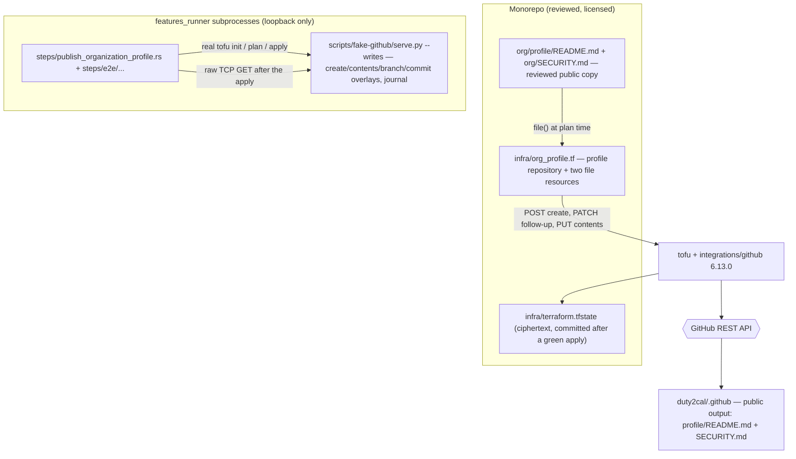

# Design: publish-organization-profile

## Scope

Technical design for the change that publishes the organization's public profile
and its default security policy through the existing declaration:
[apply a configuration change](../../specs/apply-configuration-change/usecase.md),
capability `publish-organization-profile`.

The observable WHAT is fixed by the proposal and the delta; this document is the
HOW: the third repository and its two files in the declaration, the reviewed
content under `org/`, the provider calls the apply actually makes, the fake
GitHub API extension that serves them, and the step definitions that drive the
real `tofu` binary end to end.

Three boundaries shape what follows:

- **What is declared.** `infra/org_profile.tf` adds the public organization
  profile repository and two `github_repository_file` resources whose content
  comes from `org/` in the monorepo. No existing object is adopted again and no
  adoption batch entry is added: the repository does not exist live, so the
  apply creates it.
- **What changes live.** Three creations in one apply — the repository, its
  profile content and its default security policy — and nothing else. The
  operator's one-time pinned-repository step is outside the declaration and
  outside the apply.
- **What the suite can prove.** Every scenario drives the real `tofu` binary
  (`init`, `plan -out`, `show -json`, the refresh-only preflight, `apply
  <plan>`) as a subprocess, against the local fake GitHub API behind the
  provider's base URL. The fake's opt-in `--writes` sandbox gains repository
  creation and repository-contents reads and writes, modelled on the calls the
  pinned provider makes.

## Technology decisions

No new language, framework, dependency or container is introduced. Every
version below is read from the repository's own pins on 2026-10-18, not from
memory.

| Area | Decision | Source |
|---|---|---|
| Declaration mechanism | OpenTofu with the `integrations/github` provider under `infra/`, unchanged (ADR-0005). | The existing declaration. |
| OpenTofu version | `1.13.1`, read from `infra/.opentofu-version`; the declaration keeps `required_version = ">= 1.7"`. The suite refuses another version. | `infra/.opentofu-version`, checked 2026-10-18; `scripts/setup-infra-tests.sh`. |
| GitHub provider version | `6.13.0`, read from `infra/.terraform.lock.hcl`; constraint `~> 6.0`. The request sequence below was checked against the provider's `v6.13.0` source and `google/go-github` v88 on 2026-10-18, not assumed. | `infra/.terraform.lock.hcl`; provider source at tag `v6.13.0`; go-github v88. |
| Repository resource | `github_repository` — already used for the monorepo and the Pages repository; the profile repository follows the same shape. | `infra/repos.tf`; provider source. |
| File resource | `github_repository_file` — the provider's resource for one file in a repository; not used by the declaration today. Its create path reads the repository, the branch and the file before writing, then reads the file and its commit back. | Provider source `github/resource_github_repository_file.go` at `v6.13.0`, checked 2026-10-18. |
| Content source | `org/profile/README.md` and `org/SECURITY.md` in the monorepo, resolved by `variable "org_source_dir"` (default `${path.module}/../org`) and read with `file("${local.org_source_dir}/...")`; the profile repository is output. The variable makes the declaration workspace-shape-independent. | This design; proposal D5. |
| Content licence | CC0-1.0 for `org/**`; the canonical text is added at `LICENSES/CC0-1.0.txt` and `REUSE.toml` gains an `org/**` annotation with `precedence = "override"`. | Proposal D6; REUSE specification 3.3 (checked 2026-10-18); the existing `REUSE.toml` and `LICENSES/`. |
| Test runner | Unchanged: `./run-tests.sh` → `cargo test -p duty2cal --test features_runner` over the assembled feature root. | `run-tests.sh`; `givn/commands.yaml`. |
| Gherkin library | Unchanged: `cucumber-rs` 0.23.0, pinned in `Cargo.lock`; strict via `.fail_on_skipped()`. | `Cargo.lock`, checked 2026-10-18; `apps/cli/tests/features_runner.rs`. |
| Fake GitHub API | `scripts/fake-github/serve.py`, Python standard library only, extended with repository creation and contents/branch/commit overlays under the existing `--writes` opt-in. No container, no network. | The existing twin; this design. |
| Browser driver | None. The system does not render the organization profile page; GitHub does. The capability's real interface is the `tofu` CLI and the GitHub REST API. | Proposal D4; the brief's interface decision. |

## Architecture impact

The product is untouched: no crate, port, conversion rule or release workflow
changes. The change adds a declaration file and its reviewed sources, extends
the test twin, and adds one test capability.



New or changed files:

| Path | Kind | Purpose |
|---|---|---|
| `infra/org_profile.tf` | new | `github_repository.dot_github`, `github_repository_file.org_profile_readme`, `github_repository_file.org_security`. |
| `infra/repos.tf` | comment only | The header says "Both repositories"; it becomes "The monorepo and the Pages repository" so the third repository's separate file is not a surprise. No resource changes. |
| `org/profile/README.md` | new | The reviewed organization profile content. |
| `org/SECURITY.md` | new | The reviewed organization-wide default security policy. |
| `LICENSES/CC0-1.0.txt` | new | The canonical CC0-1.0 legal text required by REUSE for the `org/**` annotation. |
| `REUSE.toml` | changed | An `org/**` annotation with `precedence = "override"` and `SPDX-License-Identifier = "CC0-1.0"`, after the existing aggregate annotation. |
| `scripts/fake-github/serve.py` | changed | Repository creation, contents/branch/commit overlays, deterministic blob and commit SHAs, `applied_write` journal fields; all under `--writes`. |
| `scripts/adopt-public-home.sh` | changed | The staged declaration excludes `org_profile.tf` (the profile repository is created, never adopted), so the adoption refresh-only verification never evaluates the profile files. |
| `scripts/setup-infra-tests.sh` | changed | The import-proof workspaces and the `security-applied` base workspace omit `org_profile.tf`; they prove only the existing/adopted objects, and the profile scenario owns the profile proof. |
| `apps/cli/tests/steps/enable_repository_security.rs` | changed | `ensure_base_adoption` removes `org_profile.tf` together with `security.tf` for the base declaration and restores it after the base apply; the shared `tofu` helper sets `TF_VAR_org_source_dir` to the scenario's `org/` copy or the repository's `org/`, so the security guard plan can evaluate the restored profile sources too. |
| `apps/cli/tests/steps/publish_organization_profile.rs` | new | Non-e2e steps: copy `org/` beside the scenario's `infra/`, prime the applied state, preview, apply, read the journal, the state and the fake's API. |
| `apps/cli/tests/steps/e2e/publish_organization_profile.rs` | new | E2E steps: the same real subprocesses plus the committed transcript. |
| `apps/cli/tests/steps/mod.rs`, `apps/cli/tests/steps/e2e/mod.rs` | changed | Declare the two new modules; without that they are never compiled. |
| `apps/cli/tests/features_runner.rs` | changed | `DutyWorld` gains `source_tree` (the scenario's `org/` copy) and `journal_offset` (the priming writes to ignore); existing fields are reused. |
| `givn/changes/publish-organization-profile/evidence/visual/<scenario-slug>/transcript.txt` | new | One scrubbed transcript for each of the two `@e2e` scenarios (preview and apply). |
| `infra/terraform.tfstate`, `infra/terraform.tfstate.backup` | changed after a green operator apply | Record the three new bindings and their applied values; committed only after the real apply. |
| `docs/arc42/*` | changed | The 12-chapter impact assessment and the affected chapters; no new ADR. |

`infra/adoption-batch.txt` and `infra/adoption-batch-security.txt` are not
edited. The profile repository does not exist live, so there is nothing to
adopt; adding an import line would fail. The apply creates it, which the use
case's main flow already covers.

## The declaration

### The profile repository

`infra/org_profile.tf`:

```hcl
# SPDX-License-Identifier: MPL-2.0
# SPDX-FileCopyrightText: 2026 Daniel Kressner
#
# The organization profile repository and its reviewed content (design.md "The
# declaration"). `auto_init` creates the default branch the file resources
# write to; the three feature toggles are stated false because the provider
# sends `false` for an omitted Optional-only boolean.
#
# The source directory is a variable because the declaration is planned from
# three workspace shapes: infra/ itself, the adoption command's staging copy,
# and the test/setup workspace copies. The default is ../org beside the
# declaration; a caller that copies the declaration elsewhere sets the variable
# (or places org/ beside it).

variable "org_source_dir" {
  type        = string
  default     = ""
  description = "Directory holding the reviewed org/ public copy; empty means ../org beside the declaration."
}

locals {
  org_source_dir = var.org_source_dir != "" ? var.org_source_dir : "${path.module}/../org"
}

resource "github_repository" "dot_github" {
  name        = ".github"
  description = "Organization profile and default community health files"
  visibility  = "public"

  has_issues      = false
  has_projects    = false
  has_wiki        = false
  has_discussions = false

  auto_init = true
}

resource "github_repository_file" "org_profile_readme" {
  repository          = github_repository.dot_github.name
  branch              = "main"
  file                = "profile/README.md"
  content             = file("${local.org_source_dir}/profile/README.md")
  commit_message      = "chore: update organization profile"
  overwrite_on_create = true
}

resource "github_repository_file" "org_security" {
  repository          = github_repository.dot_github.name
  branch              = "main"
  file                = "SECURITY.md"
  content             = file("${local.org_source_dir}/SECURITY.md")
  commit_message      = "chore: update security policy"
  overwrite_on_create = true
}
```

Why each field:

- `name = ".github"` is the only name GitHub reads for an organization
  profile; `visibility = "public"` makes it readable without membership.
- `has_issues`, `has_projects`, `has_wiki` and `has_discussions` are `false`.
  The first three are declared because the provider sends `false` for an
  omitted Optional-only boolean; leaving them out would not be neutral. The
  profile repository offers no issue tracker, which the security-policy
  scenario also reads.
- `auto_init = true` is required: `github_repository_file` writes to `main` and
  the provider checks the branch exists before writing. Without the initial
  commit there is no branch. The created repository therefore starts with
  GitHub's auto-generated `README.md`; the profile resources do not touch it.
- `description` is the profile repository's own description; it is not the
  organization's description, which stays empty (proposal "Out of Scope").
- No `security_and_analysis` block: a public repository's scanning statuses are
  GitHub's computed defaults, as they are for the Pages repository today. The
  declaration does not manage them, so no value is claimed.
- The file resources reference `github_repository.dot_github.name`, which is a
  real dependency: the repository is created (and its `PATCH` follow-up
  finishes) before either file is created. No explicit `depends_on` is needed.
- `overwrite_on_create = true` is deliberate: the target is an output
  repository; if a file already exists there, the reviewed content replaces it
  rather than the apply refusing. The provider reads the existing blob's SHA and
  sends it with the create, so the replacement is a normal content update, not
  an unverified clobber.
- `commit_message` is the subject the apply records for each file. It is a
  configuration string, not a release note.

### Workspace shapes and the existing suites

The declaration is not only planned from `infra/`. `scripts/adopt-public-home.sh`
stages every declaration file into `<declaration>/.adoption-staging/`, and the
setup proof and the security priming copy `infra/*.tf` into fresh workspaces.
With the default `${path.module}/../org`, those copies would resolve `org/`
outside their tree and OpenTofu would fail the plan while evaluating `file()`.

The integration fixes are therefore part of this change, not left to the
implementation:

- `infra/org_profile.tf` declares `variable "org_source_dir"` and resolves it
  through `locals.org_source_dir`; both `file()` calls read
  `${local.org_source_dir}/...`. The default keeps the repository-root
  `org/` beside `infra/`.
- `scripts/adopt-public-home.sh` excludes `org_profile.tf` from the staged
  declaration. The profile repository is created, never adopted, so the
  refresh-only verification must not evaluate the profile files at all.
- `scripts/setup-infra-tests.sh` removes `org_profile.tf` from the import-proof
  workspaces and the `security-applied` base workspace. The proof and the base
  declaration cover only the existing/adopted objects; the profile scenario
  owns the profile proof. The setup proof is therefore *changed*, not
  unchanged.
- `apps/cli/tests/steps/enable_repository_security.rs` (`ensure_base_adoption`)
  removes `org_profile.tf` together with `security.tf` for the base declaration
  and restores it after the base apply. The shared `tofu` helper sets
  `TF_VAR_org_source_dir` to the scenario's `org/` copy when one is set, else
  the repository root's `org/`, so the security preview's full-declaration
  guard plan also resolves the restored profile sources. The guard filter
  itself selects only the two security settings.
- The new profile step module copies `org/` beside the scenario's `infra/`, so
  the default `../org` holds, or sets `TF_VAR_org_source_dir` to the copied
  tree. `DutyWorld.source_tree` is that `org/` copy.

With these edits the existing adoption and security suites remain green: the
adoption staging and the base-apply workspaces never evaluate the profile
declaration, the security guard plan includes the restored three creates but
asserts only its two settings, and the profile scenario alone applies the
declaration.

### The reviewed content and the licence

The umbrella term for both published files is the **reviewed public copy**; its
two concrete terms are the **profile content** (`org/profile/README.md`,
published as `profile/README.md`) and the **default security policy**
(`org/SECURITY.md`, published as `SECURITY.md`).

The two source files carry SPDX headers and are covered twice:

```markdown
<!-- SPDX-FileCopyrightText: 2026 Daniel Kressner -->
<!-- SPDX-License-Identifier: CC0-1.0 -->
```

`REUSE.toml` gains, after the existing aggregate `**` annotation:

```toml
[[annotations]]
path = ["org/**"]
precedence = "override"
SPDX-FileCopyrightText = "2026 Daniel Kressner"
SPDX-License-Identifier = "CC0-1.0"
```

`precedence = "override"` is the REUSE 3.3 value that replaces the aggregate
MPL-2.0 annotation for these paths; without it the `**` aggregate would also
associate MPL-2.0. `LICENSES/CC0-1.0.txt` is added with the canonical CC0 1.0
legal text, because REUSE refuses a license identifier whose text is absent.
The project's code remains MPL-2.0; only the public profile and security-policy
prose is CC0-1.0. The profile content states the third-party data licence:
"Third-party Unicode data is licensed under Unicode-3.0" with the absolute link
`https://github.com/duty2cal/duty2cal/blob/main/LICENSES/Unicode-3.0.txt`, so
the page's own CC0-1.0 prose and the third-party attribution are both complete
(the existing `scripts/public-text-check.sh` already requires that attribution
in the README).

### The profile copy

The copy is part of the design because it is public and its claims are
reviewable. The published Markdown is:

```markdown
<!-- SPDX-FileCopyrightText: 2026 Daniel Kressner -->
<!-- SPDX-License-Identifier: CC0-1.0 -->
# duty2cal

Turns a crew duty plan (PDF) into an iCalendar (`.ics`) file on your own
machine. The conversion runs locally: no account, no network, no service, and
no file leaves your device. A plan it cannot read is reported as a failure,
never as a partial calendar.

**Download it:** [releases](https://github.com/duty2cal/duty2cal/releases/latest)
for Windows x86_64. Drag a duty plan PDF onto the executable.

The source, the conversion rules, the tests and the release automation live in
[duty2cal](https://github.com/duty2cal/duty2cal). Other platforms are not
supported or distributed; their source can be built with a Rust toolchain.

| Repository | Purpose |
|---|---|
| [duty2cal](https://github.com/duty2cal/duty2cal) | Source: Rust core, CLI, infrastructure and release automation |
| [duty2cal.github.io](https://github.com/duty2cal/duty2cal.github.io) | Project website — generated output; it does not host the converter today |
| [.github](https://github.com/duty2cal/.github) | This profile and the organization's default security policy |

The project is licensed under MPL-2.0; this page is CC0-1.0. Third-party
Unicode data is licensed under
[Unicode-3.0](https://github.com/duty2cal/duty2cal/blob/main/LICENSES/Unicode-3.0.txt).
Provided "as is", without warranty; verify every generated calendar against your
official roster. Not affiliated with any duty-plan provider or airline.

Found a bug? [Open an issue](https://github.com/duty2cal/duty2cal/issues).
Security concern? See [SECURITY.md](https://github.com/duty2cal/.github/blob/main/SECURITY.md).
```

How each draft conflict is resolved:

| Draft claim | Repository truth | Published wording |
|---|---|---|
| "runs entirely in your browser"; "Use it: the site" | No web UI, no WASM, `apps/cli` only; the live site is a stock Jekyll placeholder. | The local converter and its no-network behaviour; the site is linked as generated output that does not host the converter today. |
| "releases for Windows, macOS and Linux" | Current release support is Windows x86_64 only (ADR-0003 as amended; README). | "for Windows x86_64"; other platforms are not supported or distributed. |
| The third-party provider's name | The owner excludes it from new public content for naming-rights reasons. | "crew duty plan (PDF)" and "Not affiliated with any duty-plan provider or airline." No company name. |
| "Source: Rust core, CLI, WASM, web UI, infrastructure" | No WASM and no web UI exist. | "Rust core, CLI, infrastructure and release automation." |
| Unqualified "Licensed under MPL-2.0" | The profile text is CC0-1.0; the project code is MPL-2.0; third-party Unicode data is Unicode-3.0. | All three are named; the Unicode attribution carries its absolute licence link. |
| Badges, images, widgets | They would issue third-party requests from the profile page. | None; every link is absolute and only to `github.com`. |

The content-invariant scenario compares the published bytes with this reviewed
copy and asserts the concrete claims: the local converter and its crew duty
plan input, Windows x86_64 as the only distributed platform, no browser claim,
the stable latest-release address `https://github.com/duty2cal/duty2cal/releases/latest`
(never the mutable `/releases` page), the source repository
`https://github.com/duty2cal/duty2cal` and the site repository
`https://github.com/duty2cal/duty2cal.github.io`, the non-affiliation sentence,
the Unicode-3.0 attribution, absolute links only, and no image, badge or other
third-party embed. "Reads" means the published GitHub REST API response, not a
rendered page; the project owns no browser screen here.

The disclaimer is duplicated with the site footer because the site is generated
in another repository; no cross-repository build step is introduced (proposal
D9). The duplication is recorded as technical debt in chapter 11.

### The default security policy

`org/SECURITY.md` is a concise organization-wide policy, not a copy of the
monorepo's longer file. It has four sections:

1. **What is in scope** — a public artifact that exposes a duty plan or the
   people in it; a conversion defect that silently misrepresents a plan; a
   release asset that does not match its checksum or provenance; a credential
   in the repository or history; a defect in the project's own automation.
2. **How to report, privately** — the monorepo's private vulnerability
   reporting address
   `<https://github.com/duty2cal/duty2cal/security/advisories/new>`, the
   instruction not to open a public issue for a plan-exposure report, and the
   instruction never to attach a real plan or a converted calendar (a stripped
   sample is enough).
3. **Supported versions** — the latest published release only; earlier releases
   are not supported because releases are immutable.
4. **How a report is handled** — acknowledged, assessed, fixed and released if
   in scope; an advisory published with credit unless anonymity is requested;
   no bounty.

It names no third-party provider, no airline and no forbidden company name.

The route it names exists only when the organization owner has enabled private
vulnerability reporting on `duty2cal/duty2cal` by hand (Settings → Code security
and analysis); the pinned provider 6.13.0 has no resource for it. That
prerequisite is recorded in `docs/arc42/07-deployment-view.md` beside the
pinned-repository step and in R-030: the setting is enabled manually before the
profile is published and remains outside the declaration, the applied state and
the drift check. Neither the fake nor the suite can prove the live setting; the
default-security scenario asserts only that the policy names the route, and the
operator's confirmation is the acceptance evidence that the route exists.

### Why the repository is created, not adopted

The organization profile repository does not exist live. The use case's
"adoption before update" rule applies to an object that already exists; it does
not forbid creating a genuinely absent object. The preview therefore names a
create, the apply performs it, and the applied state records the new binding.
No adoption batch is edited. Because the profile repository is never adopted,
`scripts/adopt-public-home.sh` stages the declaration without `org_profile.tf`;
the adoption refresh-only plan therefore never evaluates the profile files. The
setup import proof is changed for the same reason: it removes `org_profile.tf`
from its workspaces and covers only the objects that exist (see "Workspace
shapes and the existing suites").

## Provider API calls

The following sequence is taken from the provider's `v6.13.0` source and
`google/go-github` v88, read on 2026-10-18. The fake must serve every call;
anything it does not serve returns the distinctive 599 unknown-path response,
which fails the scenario.

### Repository creation and reads

`resourceGithubRepositoryCreate` for an organization-owned repository:

1. `POST /orgs/duty2cal/repos` (`Repositories.Create` with the organization
   name). Body: `name`, `description`, `visibility`, `has_issues`,
   `has_projects`, `has_wiki`, `has_discussions`, `auto_init`, and the
   provider's other creation fields including its merge defaults. Response: a
   repository body; the provider uses `name` for the resource id.
2. `PATCH /repos/duty2cal/.github` (`Repositories.Edit`), because the create
   path ends with `resourceGithubRepositoryUpdate`. This is part of the create,
   not a separate configuration change; the body carries the declared fields
   and the provider's defaults, and omits `security_and_analysis` because the
   declaration did not change it. Because `visibility` goes from unset to
   `public`, the provider can issue a second, visibility-only `PATCH` in the
   same create; both calls are part of creating the repository and the test
   asserts their paths, not a fixed PATCH count.
3. `GET /repos/duty2cal/.github` (`Repositories.Get`), because the update path
   ends with `resourceGithubRepositoryRead`.
4. `GET /repos/duty2cal/.github/vulnerability-alerts`, because the repository
   body carries a `security_and_analysis` object. The fake answers 204, which
   the provider reads as alerts enabled.

A later refresh or preview repeats steps 3 and 4; it issues no write.

### File creation, reads and updates

`resourceGithubRepositoryFileCreate` for `profile/README.md` (the second file
is identical apart from its path):

1. `GET /repos/duty2cal/.github` (`Repositories.Get`) — the repository's id and
   default branch.
2. `GET /repos/duty2cal/.github/branches/main` (`Repositories.GetBranch`, via
   `checkRepositoryBranchExists`) — the explicit `branch = "main"` is checked
   before writing.
3. `GET /repos/duty2cal/.github/contents/profile/README.md?ref=main`
   (`Repositories.GetContents`) — 404 is the expected answer for a file that
   does not exist. The provider treats a 404 as "no existing file"; any other
   error aborts.
4. `PUT /repos/duty2cal/.github/contents/profile/README.md`
   (`Repositories.CreateFile`). Body: `message`, `content` (the file's bytes,
   JSON-encoded as base64), `branch`; no `sha`, because step 3 found no file.
   The response is `{"content": <file object>, "commit": <commit object>}`; the
   provider records the commit's SHA as `commit_sha`.
5. `GET /repos/duty2cal/.github/contents/profile/README.md?ref=main`
   (`resourceGithubRepositoryFileRead`) — the written file is read back. The
   provider decodes the base64 `content`, sets the blob `sha`, and parses the
   file object's `url` for the `ref` query parameter.
6. `GET /repos/duty2cal/.github/commits/{commit_sha}` (`Repositories.GetCommit`,
   with the known SHA) — the commit's message and committer are read back. The
   body is a `RepositoryCommit`: a top-level `sha` and a nested `commit`
   object. The provider calls `commit.GetSHA()` and
   `commit.Commit.GetCommitter()`; the flat create-response shape below would
   leave `commit.Commit` nil, set `commit_message` to the empty string, and make
   the follow-up plan report a diff.

`resourceGithubRepositoryFileUpdate` for a later content revision:

1. `PUT /repos/duty2cal/.github/contents/profile/README.md` with `sha` set to
   the blob SHA in state. No branch check is issued on the update path.
2. `GET /repos/duty2cal/.github/contents/profile/README.md?ref=main`.
3. `GET /repos/duty2cal/.github/commits/{new_commit_sha}`.

`resourceGithubRepositoryFileDelete` would issue
`DELETE /repos/duty2cal/.github/contents/{path}` with a `sha`; no scenario
removes a file, so the fake keeps that method refused. A later change that
removes a declared file extends the sandbox then.

### What the fake must therefore model

The provider treats a configured `base_url` as a GitHub Enterprise endpoint and
prefixes every request with `/api/v3`; `request_path()` already strips that
prefix. It also strips the query string, so `?ref=main` does not change the
fixture key.

| Method and path | Without `--writes` | With `--writes` |
|---|---|---|
| `POST /orgs/{owner}/repos` | 405, refused write | Creates an in-memory repository, responds 201 with a full repository body, journals `applied_write` with the request's body keys. 422 if the repository already exists in the overlay or the fixture tree. |
| `GET /repos/{owner}/{repo}` | fixture | overlay first (a repository created in this run), then fixture. |
| `GET /repos/{owner}/{repo}/vulnerability-alerts` | fixture | 204 for a repository this run created; fixture otherwise. |
| `GET /repos/{owner}/{repo}/branches/{branch}` | fixture | a synthesized branch for a repository this run created (`name`, `commit.sha`), then fixture. |
| `GET /repos/{owner}/{repo}/contents/{path}` | fixture (the scenario's 404 descriptor before the first write) | overlay file first, then fixture. A file body carries `type`, `encoding: "base64"`, `size`, `name`, `path`, `content`, `sha`, and a `url` ending in `?ref=main`. |
| `PUT /repos/{owner}/{repo}/contents/{path}` | 405, refused write | Decodes `content`, accepts only a repository this run created, requires `message` and `branch`, requires `sha` to equal the current blob SHA when it is present, stores the bytes and a deterministic commit, responds 201 for a create and 200 for an update with `{"content": <file object>, "commit": {"sha": ..., "message": ..., "author": {...}, "committer": {...}}}` (a flat `commit`), journals `applied_write` with the body keys, content length, blob SHA and commit SHA. |
| `GET /repos/{owner}/{repo}/commits/{sha}` | fixture | overlay commit first, then fixture; the body is `{"sha": ..., "commit": {"message": ..., "committer": {"name": "fake", "email": "fake@example.test"}, "author": {...}}}`, a nested `commit`. |
| `DELETE /repos/{owner}/{repo}/contents/{path}` | 405 | 405 (not used by this change). |

The overlay is guarded by the existing `FakeState.lock`, and the server is
`ThreadingHTTPServer`: Terraform may create the two file resources
concurrently, so the journal order of the two `PUT`s is not asserted. The
scenario asserts the set and the counts.

The repository create response is built from a full template rather than from
the request alone, so the provider's immediate read and the follow-up plan see
a complete repository body: `id`, `node_id`, `name`, `full_name`, `private`,
`visibility`, `default_branch = "main"`, the four feature booleans,
`has_pages = false`, the merge fields, and a `security_and_analysis` block for
a public repository (secret scanning and push protection enabled, Dependabot
security updates disabled). The block is present because the real API returns
it and because the provider's read then asks for the vulnerability-alerts
status; the fake answers 204.

### Deterministic overlay values

The fake cannot use static fixtures for the branch, blob SHAs and commits: the
repository and its files are created inside the apply, and the SHAs are
returned to the provider and must be read back by it. The overlay derives them
deterministically:

- base branch SHA: a fixed sentinel per created repository;
- blob SHA: `sha1(file bytes)` in hex;
- commit SHA: `sha1(repository path + file path + blob SHA + sequence)` in hex,
  where the sequence is the server's applied-write counter;
- `PUT` response commit: a flat `commit` object with `sha`, `message`, `author`
  and `committer` (`fake <fake@example.test>`);
- `GET /commits/{sha}` body: a top-level `sha` and a nested `commit` object
  carrying `message` and `committer` — the two shapes are deliberately
  different, as in the real API.

The two file creations are distinct paths and therefore distinct commits. The
determinism makes the journal and the state readable in a failure while keeping
the values independent of the host clock.

### Fixtures and the scenario tree

The scenarios start from `scripts/fake-github/fixtures/security-applied/`, the
inherited pre-security base tree: it is derived from the live read of
2026-10-18 *before* the security change's scanning write, and its monorepo body
therefore records secret scanning and push protection as disabled. The
apply-side profile scenarios prime the applied state by adopting both existing
batches and then running the base declaration's real apply; that base apply
performs the security change's scanning write. Those scenarios take
`journal_offset` after that base apply, so the priming writes are not mistaken
for the profile change's. The preview `@e2e` scenario instead reuses the
sibling security routine's base priming; see "Why the preview and the follow-up
are targeted" for its drift and offset. The base workspaces remove
`org_profile.tf` (see "Workspace shapes and the existing suites"), so the
profile objects are not in the base state.

The step copies the tree into the scenario directory and writes the four
pre-write fixtures this capability needs:

```
repos/duty2cal/.github.json                                   {"__fake_response__": {"status": 404}}
repos/duty2cal/.github/contents/profile/README.md.json        {"__fake_response__": {"status": 404}}
repos/duty2cal/.github/contents/SECURITY.md.json               {"__fake_response__": {"status": 404}}
repos/duty2cal/duty2cal.github.io/contents/SECURITY.md.json   {"__fake_response__": {"status": 404}}
```

The `repos/duty2cal/.github.json` descriptor is the absent profile repository
that the preview's live-object guard reads; a missing fixture would be a 599
unknown path, not the 404 the guard expects. The
`repos/duty2cal/duty2cal.github.io/contents/SECURITY.md.json` descriptor is the
observable premise of the default-security scenario: the Pages repository has
no security policy of its own, and the step asserts that the fake returns 404
for it. The two `.github/contents` descriptors are the pre-write state of the
profile files; after the first `PUT` the overlay serves them. No branch
or commit fixture is committed. The committed `security-applied` tree is not
edited; `scripts/setup-infra-tests.sh` changes only by omitting
`org_profile.tf` from its workspaces. The new paths are proven by the scenario
itself: an unserved path returns 599 and fails the run, so a missing piece of
the fake cannot look like an empty success.

### Why the preview and the follow-up are targeted

The preview scope is the objects the revision adds or changes, the same rule
the sibling capability follows. This revision adds exactly the profile
repository and its two files, so the preview, the preflight and the follow-up
plan are targeted at those three resources. The targeted scope is the
revision's scope, not a consequence of drift. The apply scenario primes its own
base from the unchanged `security-applied` fixture, whose
`orgs/duty2cal.json` carries the matching `billing@example.test`. The preview
`@e2e` scenario reuses the sibling's base priming, which introduces the known
organization billing drift after its base apply; because the preview is
targeted at the three profile resources, that drift is outside the plan and is
not named. The saved plan is still the applied revision; the targeted plan
names no unrelated difference because the revision adds no unrelated object.
The full plan is not used as a guard here because the profile declaration has no
already-live-and-unbound setting to refuse; the unbound-profile case is a
separate refusal scenario (see the use-case traceability).

## Test runner, strict mode, and single-scenario command

- **Runner command (`verify.command`):** `./run-tests.sh` — unchanged. It
  assembles `givn/specs/**` and `givn/changes/*/specs/**` into one feature root
  and runs `cargo test -p duty2cal --test features_runner` over it.
- **E2E command (`verify.e2e_command`):** `./run-tests.sh --e2e` — unchanged;
  the same runner with the `@e2e` tag filter.
- **Strict mode:** `DutyWorld::cucumber().fail_on_skipped()` in
  `apps/cli/tests/features_runner.rs`. An undefined, pending or skipped step
  fails the run, so the six `@wip` scenarios are red until their definitions
  exist.
- **Not-implemented stub pattern:** every new step body starts as
  `unimplemented!("<scenario>: <step>")` (or `todo!()`), so the RED run fails
  loudly at the first reached step rather than passing through an empty body;
  the GREEN replaces the stub with the real assertion. The review-time backstop
  is a mechanical grep for `unimplemented!`/`todo!()` in the two new step files
  (and their helpers) before the change is signed off: any hit is an
  unfinished step. The manual rename-a-step proof remains an independent
  strictness check: temporarily rename one step in a throwaway copy of the
  feature, observe a non-zero exit and an "undefined step" report, then
  restore. The fake's unknown-path 599 marker and its refused-write journal are
  the second net.
- **Single-scenario command:** `./run-tests.sh --name "<title>"`, for example
  `./run-tests.sh --name "Organization owner applies the previewed revision and the organization profile is published"`.
  The name filter alone selects the one scenario; it does not need the
  `@e2e` tag as a second filter. The pinned cucumber-rs 0.23.0 rejects
  `--tags` combined with `--name`, so `--e2e` is not appended to a
  single-scenario run. The e2e scope is proven separately by
  `./run-tests.sh --e2e` (8 scenarios) against the full suite (150).
  The same `--name` form runs the preview scenario and a regular scenario.
- **A regular scenario:** `./run-tests.sh --name "The published profile content states only supported claims and requests no third-party resource"`.

## Step definitions

One file per capability, as the project already does:

| File | Contents |
|---|---|
| `apps/cli/tests/steps/publish_organization_profile.rs` | Non-e2e steps. Prepare the scenario's declaration copy with `org/` copied beside its `infra/` (so the default `../org` holds, or set `TF_VAR_org_source_dir` to the copy); copy `security-applied` and write the four 404 descriptors; start the fake in `--writes` mode; adopt both existing batches (the adoption command already stages the declaration without `org_profile.tf`), remove `org_profile.tf` for the base declaration's real `tofu init`/`plan`/`apply`, and restore it after the base apply; run the targeted preview (`tofu plan -target=<repo> -target=<file> ... -out`, `tofu show -json`), the targeted refresh-only preflight, and `tofu apply <plan>`; read the journal from the scenario's offset; read the fake's repository, contents and commits with `fake_request`; decode base64 with a small local helper; read the state with `tofu state list`/`state show`; assert the content invariants. |
| `apps/cli/tests/steps/e2e/publish_organization_profile.rs` | The same real subprocesses plus the committed transcript. It asserts on the apply's output, the journal's applied-write set, the fake's repository and contents responses (the primary assertion), the applied state, and the empty targeted follow-up plan. |

The step text `the organization owner previews the declaration` and
`the organization owner applies the previewed revision` is shared with the
sibling security capability, so cucumber-rs binds it once in
`enable_repository_security.rs`. Those handlers dispatch to
`publish_organization_profile::preview` / `apply_previewed` when
`DutyWorld.source_tree` is set; the profile module owns the targeted plan,
apply and assertions. This shared-handler dispatch is the only
step-definition seam and is why the security module is also in the
changed-file table.

Both modules are declared in `apps/cli/tests/steps/mod.rs` and
`apps/cli/tests/steps/e2e/mod.rs`. They reuse the adoption module's
`copy_declaration`, `copy_tree`, `start_fake_with`, `fixtures_dir`,
`declaration_dir`, `scenario_dir`, `journal_lines`, `adopt`, `state_path`,
`terraformrc`, `TOKEN`, `PASSPHRASE` and `BILLING_EMAIL`, and the security
module's `tofu`, `fake_request`, `jq`, `combined` and `commit_transcript`; the
needed helpers become `pub(crate)`. No state is fabricated: every binding in a
scenario was written by the real adoption command or the real `tofu` apply.

`DutyWorld` gains two fields:

- `source_tree: Option<PathBuf>` — the scenario's copy of `org/`, placed beside
  the scenario's `infra/` copy (or named by `TF_VAR_org_source_dir`), so the
  `file()` source and the published content are read from the same tree;
- `journal_offset: usize` — the number of journal lines before the scenario's
  preview/apply, so the priming adoption and base apply are not mistaken for
  the change's writes.

The existing `declaration`, `plan_path`, `preview_transcript`,
`apply_transcript`, `fake`, `fake_port`, `journal` and `state` fields are
reused.

The profile content's base64 decoder is a test-only helper in the non-e2e
module (a small standard-alphabet decoder that removes whitespace); no new
crate dependency is added for it.

## Decisions

Resolves the proposal's open questions.

- **Decides D1:** the profile describes the current local converter and keeps
  the no-network promise; it makes no browser claim. Realized in the profile
  copy (`org/profile/README.md`, quoted above) and asserted by the
  content-invariant scenario. Rejected: the draft's browser claim, because the
  repository has no web UI or WASM and the site is a placeholder.
- **Decides D2:** Windows x86_64 is the only platform named; other platforms
  are stated unsupported and undistributed, with a source-build route.
  Realized in the profile copy and asserted by the content-invariant scenario.
  Rejected: the three-platform claim.
- **Decides D3:** the input is "crew duty plan (PDF)" and the profile states
  "Not affiliated with any duty-plan provider or airline"; the third-party name
  is absent from `org/**`. Realized in the profile copy and the security
  policy. The invariant step compares the published bytes with the reviewed
  `org/` source and asserts the positive claims; the absence of the excluded
  name is a review control, not a stored deny-list. Rejected: naming the
  provider.
- **Decides D4:** the site is linked as generated output that does not host the
  converter today. Realized in the profile copy and asserted by the
  content-invariant scenario. Rejected: linking it as a usable converter;
  omitting it.
- **Decides D5:** `org/` is the source and `github_repository_file` publishes
  it; the profile repository is output. Realized in `infra/org_profile.tf` and
  the profile repository's two resources. Rejected: hand-editing `.github`;
  a separate publishing workflow.
- **Decides D6:** `org/**` is CC0-1.0, with `LICENSES/CC0-1.0.txt` added and a
  `REUSE.toml` `org/**` override. Realized in the two SPDX headers, the license
  text and the REUSE annotation. Rejected: MPL-2.0 for prose; no annotation.
- **Decides D7:** pinned repositories are a one-time manual operator step
  recorded in `docs/arc42/07-deployment-view.md`; no provider resource and no
  API script is invented. Realized in the chapter's "Manual operator step:
  pinned repositories" section and chapter 11's risk. Rejected: declaring them;
  omitting pinning.
- **Decides D8:** the profile repository publishes `profile/README.md` and
  `SECURITY.md` only; `CONTRIBUTING.md`, `CODE_OF_CONDUCT.md` and the templates
  stay in the monorepo. Realized in the declaration and the default-security
  scenario. Rejected: copying every health file.
- **Decides D9:** the disclaimer is duplicated and reviewed in the profile and
  the site footer; no cross-repository build step is added. Realized in the
  profile copy and chapter 11's technical debt. Rejected: a shared snippet;
  omitting the disclaimer.

Two facts are recorded rather than decided as questions: the profile repository
is created (not adopted), because it does not exist live; and no ADR qualifies,
because the declaration boundary is already ADR-0005's (see "ADR qualification"
below).

## Use-case traceability

| Use-case element | Technical decision | Evidence |
|---|---|---|
| Goal: the live configuration matches the declared revision the apply accepts | The revision declares the profile repository and its two files; the apply creates them and a follow-up targeted preview of the profile objects is empty. | The apply and preview `@e2e` scenarios. |
| Main flow 2: the preview names every difference among the previewed objects; an existing unbound object is refused | The targeted preview names exactly three creates and no update or delete; no live write is issued. The profile repository is absent in the preview scenario, so the adoption rule is not triggered; a separate regular scenario adds a live, unbound profile repository and asserts the refusal, with no object bound and no live change. | "Organization owner previews the profile declaration and only the three creations are named"; "A profile repository that already exists live and is unbound refuses the preview". |
| Main flow 3: the saved plan is preflighted and applied | The targeted `tofu plan -out`, the read-only refresh-only preflight with the existing JSON verdict, then `tofu apply <plan>`. | The apply `@e2e` scenario and the update scenario. |
| Main flow 4: the outcome is reported and the revision recorded | The apply reports the three creations; `tofu state list`/`state show` records the repository and both files. | The apply `@e2e` scenario. |
| Rule: adoption before update | No adoption entry is added for an absent repository; the existing objects stay bound by the existing batches. | The design's "Why the repository is created, not adopted". |
| Rule: preflight | The same `PREFLIGHT_FILTER` reads the refresh-only JSON; a non-no-op refuses. | The apply `@e2e` and update steps. |
| Rule: refusal and partial outcomes | This capability adds the mandatory unbound-profile refusal: a live profile repository that is unbound makes the preview refuse and name it, binding nothing and changing nothing live. The shared partial-failure branch remains covered by the sibling `enable-repository-security` capability and is not re-asserted here; there is no deferral of a mandatory profile-specific check. | "A profile repository that already exists live and is unbound refuses the preview"; the existing security feature for the shared partial branch. |
| Capability ownership | `publish-organization-profile` in `apply-configuration-change`; two interaction rows (preview and apply) and two `@e2e` titles. | `givn/specs/apply-configuration-change/usecase.md`; the feature. |
| Persona `project-maintainer--organization-owner` | Authors the revision, previews, applies, owns the manual pin and private-reporting steps and answers for the published claims. | Both `@e2e` scenarios; the deployment chapter. |
| Persona `contributor--infrastructure-reviewer` | Reviews `org/`, the declaration and the default security policy without a token or passphrase. | The content-invariant and default-security scenarios; the declaration. |
| Persona `crew-member--personal-calendar-owner` | Reads a truthful profile, learns the platform and finds the release and the reporting route. | The content-invariant scenario. |

## Persona impact

- **`project-maintainer--organization-owner`** — the capability's Actor. The
  owner records the revision, sees the three creations in the preview, applies
  them, and performs the once-only pin step. The published claims are the
  owner's responsibility, so the content is reviewed text rather than a web-form
  edit.
- **`contributor--infrastructure-reviewer`** — reads the profile and security
  policy in the same history as the declaration, can diff a text change, and
  holds no token or passphrase. The reviewer cannot apply, which is unchanged.
- **`crew-member--personal-calendar-owner`** — the profile tells a prospective
  user the truth about the current release: Windows x86_64, local conversion,
  no browser application, no three-platform promise. The page loads no
  third-party resource.

## Visual Design Contract

- Interface: terminal — the system's interface is the owner's `tofu` invocation
  and the GitHub REST API; the organization profile page is rendered by GitHub,
  not by this system, so no browser driver is used.
- Viewports: n/a (no rendered screen owned by the system).
- Design system: none.
- Screens covered: none by this system. The organization profile page's content
  is covered by the content-invariant scenario through the published API
  response, not by a screenshot.
- rendered reference: none; the copy is the reviewed block above.
- Capture mechanism and evidence path: one transcript for each of the two
  `@e2e` scenarios under
  `givn/changes/publish-organization-profile/evidence/visual/<scenario-slug>/transcript.txt`
  — the preview transcript and the apply transcript — captured by the
  scenario's final step with the temporary directory, the fake's port, the
  token and the passphrase replaced by placeholders. The preview transcript
  carries the `tofu show -json` summary of the three creates and the unchanged
  live configuration; the apply transcript carries the apply outcome and the
  API read summary. Neither carries a credential.
- Baseline: the transcript names the three created objects and the served file
  paths; no token, passphrase, temporary path or live credential appears.
- Motion: n/a.

The content scenario's "a reader reads the published profile content" means the
published GitHub REST API response, not a rendered page; no browser driver is
used, and the API-only interface classification stands.

The alternative — a browser test against GitHub's rendered page — is rejected:
it would require a live third-party service and a credential, and it would test
GitHub's renderer rather than the system's declaration. The observable content
is the API response the apply produced, which is what the scenarios assert.

## E2E smoke test infrastructure

- **E2E runner command:** `./run-tests.sh --e2e`, distinct from
  `verify.command`; it filters `@e2e`.
- **E2E step location:** `apps/cli/tests/steps/e2e/publish_organization_profile.rs`,
  separate from the non-e2e steps because it commits the transcript and owns the
  end-to-end assertions.
- **Real interface:** the `tofu` CLI — `init`, `plan -out`, `show -json`, the
  read-only refresh-only preflight and `apply <plan>` — invoked as real
  subprocesses with the real provider, plus raw loopback HTTP requests that read
  the published repository and contents back.
- **Local test infrastructure:** the fake GitHub API on an ephemeral loopback
  port in `--writes` mode, a temporary declaration copy whose encrypted state is
  primed by the two existing adoption batches and the base declaration's real
  apply (the base tree is the inherited pre-security one, so that apply performs
  the security change's scanning write and the journal offset is taken after
  it), a temporary `org/` copy with `org_profile.tf` removed for the base
  priming and restored afterwards, the provider mirror and `terraformrc`
  prepared by `scripts/setup-infra-tests.sh`, a fixed 16-plus-character test
  passphrase and a dummy billing email. No container, no network, no
  credentials.
- **Framework:** cucumber-rs 0.23.0 with `std::process::Command` and
  `std::net::TcpStream`, as the existing infrastructure steps already use. No
  browser driver: the system does not render the page.
- **E2E strict-mode proof:** the same `fail_on_skipped()`, plus the fake's
  unknown-path 599 marker and refused-write journal; the rename-a-step check is
  an implementation task in `tasks.md`.

## Interaction Coverage Matrix

| Inventory entry | @e2e scenario title | Real interface | Driving mechanism |
|---|---|---|---|
| preview the declared configuration and read the named differences | Organization owner previews the profile declaration and only the three creations are named | CLI (the owner's `tofu plan`) and HTTP API (the live objects read by the plan) | `std::process::Command` runs `tofu init -input=false`, the targeted `tofu plan -input=false -no-color -target=github_repository.dot_github -target=github_repository_file.org_profile_readme -target=github_repository_file.org_security -out=<tmp>/plan.bin` and `tofu show -json` in the scenario's declaration copy, with `TF_VAR_state_passphrase`, `TF_VAR_billing_email`, `GITHUB_TOKEN=test-token`, `GITHUB_BASE_URL=http://127.0.0.1:<port>` and `TF_CLI_CONFIG_FILE` set; the assertion reads the plan JSON's creates and the journal's read-only request set. |
| apply the previewed revision and read the outcome | Organization owner applies the previewed revision and the organization profile is published | CLI (the owner's apply) and HTTP API (the published objects) | `std::process::Command` runs `tofu init -input=false`, the targeted `tofu plan -input=false -no-color -target=github_repository.dot_github -target=github_repository_file.org_profile_readme -target=github_repository_file.org_security -out=<tmp>/plan.bin` and `tofu show -json`, the targeted refresh-only preflight, then `tofu apply -input=false <tmp>/plan.bin` in the scenario's declaration copy, with `TF_VAR_state_passphrase`, `TF_VAR_billing_email`, `GITHUB_TOKEN=test-token`, `GITHUB_BASE_URL=http://127.0.0.1:<port>` and `TF_CLI_CONFIG_FILE` set; after the apply, a raw `TcpStream` GETs `/repos/duty2cal/.github`, `/repos/duty2cal/.github/contents/profile/README.md` and `/repos/duty2cal/.github/contents/SECURITY.md`, base64-decodes the two contents, and compares them with the scenario's `org/` files; the apply's output and the journal's applied-write set are the secondary evidence. |

The apply `@e2e` journal assertion is a set, not a fixed PATCH count: exactly one
`POST /orgs/duty2cal/repos`; the create's `PATCH` calls on
`/repos/duty2cal/.github` (one, or two when the provider's visibility update is
issued); and exactly two `PUT`s, one per contents path. No applied write names
another repository, the organization or a settings endpoint; no refused write
and no unknown path appears. The two file writes may be journaled in either
order because Terraform can create them concurrently.

## Black-Box-First policy

All six scenarios drive the real `tofu` binary as subprocesses; both `@e2e`
scenarios drive the same binary end to end and assert its output, the fake's
repository/contents responses, the journal and the recorded state (the preview
scenario asserts the plan JSON and the unchanged live state; the apply scenario
asserts the published objects and the recorded state). No
provider mock is injected into the command: the GitHub API is replaced at the
HTTP boundary the provider actually talks to. The content-invariant and
default-security scenarios read the published content through the same API, not
from a parallel in-process fixture. No internal test is retained.

## Local runnability & digital twins

- **Setup, once:** `./scripts/setup-infra-tests.sh` — checks `tofu` against
  `infra/.opentofu-version`, `python3` and `jq`, mirrors the locked provider
  into `~/.cache/duty2cal/terraform-provider-mirror`, writes the `terraformrc`,
  and proves the existing fixture trees with real imports. Its proof workspaces
  and the `security-applied` base workspace omit `org_profile.tf`; the script's
  proof is therefore changed to cover only the existing/adopted objects.
- **Run the suite:** `./run-tests.sh` (or `./run-tests.sh --name "<scenario>"`).
  The scenarios start the fake themselves; no service has to be running.
- **Manual walkthrough:**
  1. Run `./scripts/setup-infra-tests.sh` once; it prints the
     `TF_CLI_CONFIG_FILE` it wrote.
  2. Copy the inherited pre-security base tree and add the four pre-write
     descriptors:

     ```sh
     cp -r scripts/fake-github/fixtures/security-applied /tmp/org-profile-fixtures
     mkdir -p /tmp/org-profile-fixtures/repos/duty2cal/.github/contents/profile
     mkdir -p /tmp/org-profile-fixtures/repos/duty2cal/duty2cal.github.io/contents
     printf '%s\n' '{"__fake_response__": {"status": 404}}' \
       > /tmp/org-profile-fixtures/repos/duty2cal/.github.json
     printf '%s\n' '{"__fake_response__": {"status": 404}}' \
       > /tmp/org-profile-fixtures/repos/duty2cal/.github/contents/profile/README.md.json
     printf '%s\n' '{"__fake_response__": {"status": 404}}' \
       > /tmp/org-profile-fixtures/repos/duty2cal/.github/contents/SECURITY.md.json
     printf '%s\n' '{"__fake_response__": {"status": 404}}' \
       > /tmp/org-profile-fixtures/repos/duty2cal/duty2cal.github.io/contents/SECURITY.md.json
     ```
  3. Start the fake:

     ```sh
     python3 scripts/fake-github/serve.py \
       --fixtures /tmp/org-profile-fixtures \
       --port 8099 --journal /tmp/org-profile-journal.jsonl --writes
     ```
  4. Prepare the declaration and source copies, and prime the state with the
     existing batches and the base declaration's apply. `org/` is copied beside
     the declaration, so the default `../org` holds; a declaration copied
     elsewhere needs `TF_VAR_org_source_dir`. The adoption command excludes
     `org_profile.tf` itself; the base apply removes it, and that apply performs
     the security change's scanning write:

     ```sh
     cp -r infra /tmp/org-profile-infra
     cp -r org /tmp/org
     export GITHUB_TOKEN=test-token
     export GITHUB_BASE_URL=http://127.0.0.1:8099
     export TF_VAR_state_passphrase=test-passphrase-0123456789
     export TF_VAR_billing_email=billing@example.test
     export TF_CLI_CONFIG_FILE=~/.cache/duty2cal/terraformrc
     ./scripts/adopt-public-home.sh --declaration /tmp/org-profile-infra \
       --batch /tmp/org-profile-infra/adoption-batch.txt \
       --api-url http://127.0.0.1:8099 --token test-token
     ./scripts/adopt-public-home.sh --declaration /tmp/org-profile-infra \
       --batch /tmp/org-profile-infra/adoption-batch-security.txt \
       --api-url http://127.0.0.1:8099 --token test-token
     rm /tmp/org-profile-infra/org_profile.tf
     (cd /tmp/org-profile-infra && tofu init -input=false && \
       tofu plan -input=false -no-color -out=base.bin && \
       tofu apply -input=false base.bin)
     ```
  5. Restore the profile declaration and run the operator's routine:

     ```sh
     cp infra/org_profile.tf /tmp/org-profile-infra/
     cd /tmp/org-profile-infra
     tofu init -input=false
     tofu plan -input=false -no-color \
       -target=github_repository.dot_github \
       -target=github_repository_file.org_profile_readme \
       -target=github_repository_file.org_security \
       -out=plan.bin
     tofu show -json plan.bin > plan.json
     tofu plan -refresh-only -detailed-exitcode -json \
       -target=github_repository.dot_github \
       -target=github_repository_file.org_profile_readme \
       -target=github_repository_file.org_security \
       > preflight.json
     tofu apply -input=false plan.bin
     ```
  6. Read the published objects back:

     ```sh
     curl -sS http://127.0.0.1:8099/repos/duty2cal/.github
     curl -sS 'http://127.0.0.1:8099/repos/duty2cal/.github/contents/profile/README.md?ref=main'
     curl -sS 'http://127.0.0.1:8099/repos/duty2cal/.github/contents/SECURITY.md?ref=main'
     ```

- **Digital twin:** `scripts/fake-github/serve.py` is the deterministic twin of
  GitHub's REST API. It runs on loopback, requires no network, and is the only
  external service the scenarios touch. The provider is installed from the
  filesystem mirror; no registry request occurs.
- **Isolated network:** no host service is used or assumed; the fake binds an
  ephemeral port on `127.0.0.1` and is killed at scenario end.
- **Anticipated interface obstacles and their fixes:**
  - The provider prefixes `/api/v3` when `base_url` is set. The fake already
    strips it in `request_path()`; the journal records the normalized path.
  - `github_repository_file`'s read parses the content object's `url` for a
    `ref` query parameter. The fake's content body includes
    `?ref=<branch>`; a body without it would panic the provider, so the fake
    generates it.
  - The file create requires a branch and a 404 for the absent file. The fake
    creates the branch with the repository and serves the scenario's 404
    descriptors; after the first `PUT`, the overlay answers.
  - The provider retries 5xx responses. The scenarios use no fault injection;
    if a later change adds one, it uses a non-retried status (403/404), as the
    security change recorded.
  - The create response and the commit read use different shapes. `PUT
    .../contents/...` carries a flat `commit`; `GET .../commits/{sha}` returns
    `{"sha": ..., "commit": {"message": ..., "committer": ...}}`. A flat body
    for the `GET` leaves `commit.Commit` nil, the provider records an empty
    `commit_message`, and the no-diff follow-up plan fails or a later apply
    loops on an update.
  - The two file resources may be created concurrently. The fake is a
    `ThreadingHTTPServer` with a shared lock; the journal order is not asserted,
    only the set and counts.
  - The declaration is planned from more than one workspace shape. The
    `org_source_dir` variable (and the adoption/setup/base exclusions recorded
    above) keep `file()` resolvable in each; a workspace that copies the
    declaration without `org/` beside it must set `TF_VAR_org_source_dir`.
  - A `PATCH` is part of the repository create. The fake's existing `--writes`
    PATCH support handles it; the scenario's write set includes it and does not
    mistake it for a separate change.

## Coverage process boundaries

| Process | Started by | Instrumented artifact | Profile output | Merge step | Non-zero production probe |
|---|---|---|---|---|---|
| `features_runner` (cucumber-rs) | `./run-tests.sh` via `cargo test -p duty2cal --test features_runner` | the workspace test binary and linked crates, under `cargo llvm-cov` | the runner's llvm-cov profiles, collected into `coverage/non-e2e-cobertura.xml` and `coverage/e2e-cobertura.xml` by `measure-coverage.sh` | `merge-coverages.sh` writes `coverage/cobertura-coverage.xml` | the unchanged conversion path (`ConvertRoster`/`apps/cli`) in the non-e2e report; this change adds no production Rust line |
| `tofu` | the scenario's `std::process::Command` | none — an external binary, not a project artifact | n/a | n/a | n/a |
| `python3 scripts/fake-github/serve.py` | the scenario's `std::process::Command` | none — the test twin, Python standard library | n/a | n/a | n/a |

This capability's production is a declaration and two reviewed text files, not
compiled code. The coverage gate's production probe remains the existing
converter; the e2e report is a distinct instrumentation run as the gate
requires, and no coverage claim is made for the declaration or the fake.

## ADR qualification

Candidate: "Source the public organization profile and default security policy
from `org/` in the monorepo and publish them through the existing OpenTofu
declaration, rather than maintaining them by hand in the `.github` repository."

```text
qualification: NOT_QUALIFIED
alternatives: PASS
architectural_impact: FAIL
durable_consequence: PASS
lower_level_artifact: FAIL
existing_adr_check: PASS
must_be_shared: SUPPORTING
routing: CANONICAL_ARTIFACT
canonical_artifact: docs/arc42/07-deployment-view.md
target_adr: null
replacement_adr: null
```

Evidence:

- **Alternatives — PASS.** Hand-editing the `.github` repository, sourcing from
  `org/` through the declaration, and a separate publishing workflow are three
  materially different options (proposal D5).
- **Architectural impact — FAIL.** The declaration boundary, the single-writer
  rule and the applied state are already fixed by ADR-0005 and ADR-0006. This
  change adds one repository and two file resources to that existing boundary;
  it does not fix a new component, ownership, dependency or deployment
  boundary.
- **Durable consequence — PASS.** Future changes to the public text go through
  `org/` and an apply, and reversal would move content and re-bind state; but
  that consequence is the application of ADR-0005, not a new decision.
- **Lower-level artifact — FAIL.** The single canonical home is
  `docs/arc42/07-deployment-view.md`, which owns the deployed object inventory
  (the third repository, the two files, the manual pin and private-reporting
  steps). The design's resource and test-seam sections are implementation
  detail, not an additional home.
- **Existing-ADR check — PASS.** ADR-0005 covers declaring the public home's
  GitHub configuration, ADR-0006 covers the applied state, and ADR-0003 covers
  the Windows-only release platform the copy states. No record covers the
  profile text or the manual pin step, and neither is an architecture decision.

`ADR action: NONE`; `ADR target: none`. The `org/**` CC0-1.0 choice is not an
ADR candidate: it is a content-licensing configuration choice, not a system
boundary. Its canonical home is `REUSE.toml`; this design records the
implementation. No ADR is added.

## Manual operator steps

Two public-home facts are manual. The first is a prerequisite of the published
security policy: the owner enables private vulnerability reporting on
`duty2cal/duty2cal` by hand before the profile apply, because the pinned
provider has no resource for it; `docs/arc42/07-deployment-view.md` records the
step beside the pinned-repository step, and R-030 records that the setting
stays outside the declaration, the state and the drift check. The fake and the
suite cannot prove the live setting.

The second is pinned repositories. The durable home is
`docs/arc42/07-deployment-view.md`, in the "Declared configuration and the
applied state" section, because that chapter already owns the deployment
routine and no separate `infra/README.md` exists. The step is:

1. After the apply that creates the profile repository, open the organization's
   profile settings in the web interface
   (`https://github.com/organizations/duty2cal/settings/profile`).
2. Pin `duty2cal` and `duty2cal.github.io`; up to six repositories may be
   pinned, and the profile repository itself does not need to be pinned.
3. Save and re-read the organization overview once to confirm both appear.

The pinned provider 6.13.0 exposes no resource for pinned repositories, and
this change introduces no API script or second write path. The step is
one-time, cannot be previewed and cannot be reported as drift; chapter 11
records that risk.

## Risks and follow-ups recorded here

- **The fake proves the API shape, not GitHub's policy.** The scenarios prove
  the provider's calls, the declaration and the reviewed content; they do not
  prove that GitHub accepts the create or renders the profile as expected. The
  operator's real apply after GREEN is the acceptance evidence, as with the
  security change (R-028).
- **GitHub's default-health-file fallback is GitHub's behaviour.** The
  default-security scenario proves the file exists at the required path and
  carries the route; it cannot prove GitHub's renderer for every repository.
- **The pinned repositories are invisible to the preview and the drift check.**
  The manual step and chapter 11's risk are the controls.
- **The private-reporting route is a manual prerequisite.** The published
  policy names a route that exists only after the owner enables private
  vulnerability reporting; the fake proves neither the setting nor its absence.
  The operator's confirmation before the apply is the control, and R-030
  records the gap.
- **The declaration's source path is workspace-shape-dependent.** The
  `org_source_dir` variable, the adoption staging exclusion, the setup/base
  workspace removals and the profile scenario's `org/` copy are the controls.
  A copied declaration with neither `org/` beside it nor `TF_VAR_org_source_dir`
  set fails the plan loudly at `file()`.
- **The commit readback shape can look like drift.** The fake serves a flat
  `commit` on `PUT` and a nested `commit` on `GET /commits/{sha}`; a mismatch
  would surface as a non-empty follow-up plan (an empty `commit_message`), not
  as a silent pass.
- **No shared disclaimer source.** The profile and the site footer can diverge;
  chapter 11 records the debt and the review control.
