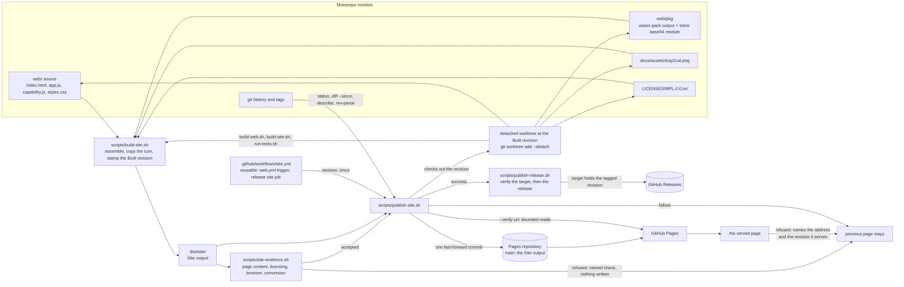

# Design: publish-public-website

## Scope

The HOW for the Release maintainer's goal in
[the new leaf](specs/publish-public-website/usecase.md): make the Public website
at `https://duty2cal.github.io/` serve the Site output built from a named Built
revision, after the page-content, licensing, browser and conversion evidence
passes, replacing the hosting target's content as a whole. The page's
conversion behaviour, the offer-and-save contract, the capability gate, the
20 MiB bound and the no-network rule are inherited unchanged from the archived
`build-browser-converter` change; this design adds the page's public statements,
footer and project icon, the Site output as an artifact, the publication
command with its serving check, the gate, the reusable workflow both callers
use, the workflow triggers and the release coupling.

Two existing capabilities are extended: the organization profile copy
(`publish-organization-profile` under `apply-configuration-change`) and the
release's platform wording and site gate (`publish-public-release`). The deploy
key, its `PAGES_DEPLOY_KEY` secret and the `pages protection` rule set already
exist live from the archived `publish-site-plumbing` change and are consumed,
not created; no `infra/` object changes.

## Technology decisions

| Area | Decision | Source / rationale |
|---|---|---|
| Site output assembler | A POSIX-shell command assembles one output directory from the page source: page, script, capability gate, stylesheet, the WASM bundle, the icon, the licence file and the stamped footer | One artifact to gate, inspect and publish; the source tree keeps source-only content (D4) |
| Publication command | One POSIX-shell command owns the trigger decision, the revision checkout, the build, the evidence, the publication into a git target and the serving check of the published address (`--verify-url`) | Every promise is executable locally; the workflow becomes a thin trigger (D1) |
| Trigger decision | `--since <commit>` on the publication command; the command owns the site-input path list and reports "no site input changed"; a tag publication omits it | One owner for one rule, and the decision is a command argument a scenario drives (D1) |
| Revision checkout | A detached `git worktree` at the resolved commit is the build's only source; `build-web.sh`, `build-site.sh` and the gate run inside it and it is removed on every exit path | The published bytes are that revision's tree, so a tag publication cannot publish a newer default branch (D3) |
| Gate | A second POSIX-shell command runs four checks as real subprocesses, fail-fast, inside the revision's worktree | The refusal the use case promises is a command, not YAML, and names the failing check (D5) |
| Page-content check | Its own POSIX-shell command over the assembled page, naming each missing statement | The input is the artifact that would be published (D5) |
| Revision stamp | `git describe --tags --always --match 'v*'` plus `git rev-parse` at build time, stamped into the assembled page; the publication refuses an unresolvable revision and an unclean caller tree (`git status --porcelain --untracked-files=no`, not a `-dirty` suffix) | The string is produced from the revision being built (D3) |
| Hosting target transport | `git` push over SSH with the deploy key in `GIT_SSH_COMMAND`; a local path or `file://` URL is also accepted, so the same command runs with no credential | The target is a git repository; the ruleset admits a write-enabled deploy key; the local target is the test twin (D1) |
| Whole-content replacement | One commit whose tree is exactly the Site output, replacing the branch tip by fast-forward | The pages rule set forbids non-fast-forward pushes and merge commits; the previous pages stay in the target's history |
| Serialization | An exclusive `flock` around fetch/replace/push, plus one `concurrency` group declared in `site.yml`, so every caller — the default-branch trigger and the release caller — serializes on the same group | Two concurrent publications would otherwise produce a rejected non-fast-forward push, and one group in one place is the only way both callers share it |
| Release coupling | `release.yml` has a `site` job that calls the reusable `site.yml` for the tag, then a `publish` job (`needs: site`) that runs `scripts/publish-release.sh`; that command first verifies the hosting target's branch tip carries the tagged Built revision (`git ls-remote`, plus a fetch of the target when the remote admits it) and refuses before any `gh` call otherwise | The coupling is both a job dependency a maintainer can read and a refusal the command performs and a scenario drives (D2, amended 2026-10-25) |
| Release host twin | A recording stand-in for `gh` on `PATH` in the tests; the real `gh` in CI | The release host is a third-party service no scenario may depend on |
| Reusable site workflow | `.github/workflows/site.yml` declares `on: workflow_call` with the inputs `revision` and `since` and the secret `PAGES_DEPLOY_KEY`, and runs `scripts/publish-site.sh`; `web.yml` is the trigger workflow (default-branch pushes and manual dispatch, no `v*` tag trigger) and `release.yml`'s `site` job is the second caller; both callers check out with `fetch-depth: 0` | One build-and-deploy definition instead of two copies, and the `fetch-depth: 0` checkout is what lets the `--since` diff and `git describe` resolve (D1, amended 2026-10-25) |
| Serving check | `--verify-url URL` is required on the publication command: after the push and the read-back it reads the address with bounded retries and refuses unless the served page carries the same Built revision text as the output; the refusal names the address and the revision it serves | The substituted page is the one failure the target's content cannot reveal; the check runs after the replacement, so it can only name the mismatch and never restores the previous page (D7) |
| Site icon | The page header carries the project icon from `docs/assets/duty2cal.png` as a 48×48 mark with alt text "duty2cal", and names it as the page's tab icon; the assembler copies it into the Site output as `icon.png` | One icon with one provenance: a project asset under CC0-1.0, served from the page's own origin, replacing the empty `href="data:, "` tab icon |
| Browser driver | Playwright 1.64.1 pinned in `web/e2e/package-lock.json` (existing pin, cited from that file); the driver serves the assembled output through `DUTY2CAL_SITE_ROOT` | One driver, one rendered-page contract; the evidence drives the artifact that would be published |
| Gherkin runner | cucumber-rs 0.23 as the existing `harness = false` `features_runner` target, `.fail_on_skipped()` | `apps/cli/Cargo.toml`, `apps/cli/tests/features_runner.rs`; one runner, one strict-mode contract |
| Licensing | The page and its scripts stay MPL-2.0; the licence file is a built output copied from `LICENSES/MPL-2.0.txt`; `docs/assets/**` becomes CC0-1.0 through a `REUSE.toml` override, because the icon is a non-code asset copied into the Site output | ADR-0001; the override is recorded here and applied to `REUSE.toml` by the implementation pass; the page's licence statement is unchanged — MPL-2.0 for the code, CC0-1.0 for the non-code assets, Unicode-3.0 attribution |
| Change log | `git-cliff` 2.14.2 (existing pin, `cliff.toml` and `scripts/render-changelog.sh`) gains the site's capability and paths as data | No new versioned tool; the renderer already refuses an allow-list that differs from the corpus |

### Version freshness

No version is written from memory, and this change introduces no new
language, runtime, framework, browser driver, container image or database
version. Every version-bearing choice is an existing project fact, cited from
the file that records it. The setup task therefore resolves nothing new.

| Technology | Version | Resolution / record |
|---|---|---|
| Rust | `stable` channel | `rust-toolchain.toml`; unchanged |
| WASM target | `wasm32-unknown-unknown` | `scripts/build-web.sh`, CI; unchanged |
| `wasm-pack` | the pin recorded in `web/.wasm-pack-version` (existing project fact) | `scripts/build-web.sh` installs exactly that; unchanged |
| Playwright | 1.64.1, pinned in `web/e2e/package-lock.json` (existing project fact) | That lockfile; unchanged |
| `@axe-core/playwright` | 4.14.0, pinned in `web/e2e/package-lock.json` (existing project fact) | That lockfile; unchanged |
| Node.js | pinned in `web/e2e/.nvmrc` (read by `actions/setup-node`; existing project fact) | That file; unchanged |
| Chromium | installed by `npx playwright install chromium`; revision tied to the Playwright package | No separate pin; unchanged |
| `git-cliff` | 2.14.2, recorded beside `cliff.toml` (existing project fact) | `cliff.toml`'s header and `scripts/render-changelog.sh`; unchanged |
| `git`, `flock`, `reuse` | the versions the runner image and the host provide; `reuse` is already a CI dependency (`pipx install reuse`) | No version claim: the commands are POSIX tooling and the checks fail by name when a tool is absent. A missing tool is a failure, never a skip |
| `gh` | the runner image's preinstalled CLI; not used by any local scenario | CI only; the tests use a recording stand-in |
| Containers / databases | none | The page has no backend and the publication needs no service |

## Architecture impact

The site publication is a build-and-publish path beside the workspace, not a
product block: it turns a revision into the Site output, gates it, and writes it
into a hosting target. The product page gains public statements and a footer;
the conversion path is untouched.



New and changed files:

| Path | Kind | Purpose |
|---|---|---|
| `scripts/build-site.sh` | new | Read `web/` from the checkout it is pointed at (the publication passes the revision's detached worktree) together with those `web/pkg/` members and `docs/assets/duty2cal.png`; stamp the footer anchor in the copied page from `--revision`; copy `LICENSE.txt` and the icon; assemble exactly the eight members; refuse a missing converter bundle naming `scripts/build-web.sh` |
| `scripts/check-site-content.sh` | new | Read the assembled page and name every missing public statement, a statement name that appears more than once, the missing Built revision link, the missing licence file or an icon that points off the page's origin; refuses an asset loaded from another origin |
| `scripts/site-evidence.sh` | new | Run the four evidence checks as real subprocesses in fail-fast order and name the failing check |
| `scripts/publish-site.sh` | new | Refuse an unclean repository (`--untracked-files=no`), decide `--since` against the site-input list it owns, resolve the Built revision, build and gate inside a detached worktree at that revision, replace the hosting target's content in one fast-forward commit under an exclusive lock (reporting `already current` and writing nothing when the target already holds it), read the pushed tree back, verify `--verify-url` carries the same Built revision and report it |
| `scripts/publish-release.sh` | new | Verify the hosting target's branch tip carries the tagged Built revision (`git ls-remote` plus a fetch of the target; `--site-repo DIR` names it) and refuse before any `gh` call otherwise, then create, inspect and publish the draft release through `gh`, comparing the staged assets with `release-notes.md` excluded |
| `scripts/build-web.sh` | changed | Still builds `web/pkg` and the inline bundle, relative to the checkout it runs in; the publication runs it inside the revision's worktree. The licence copy moves to `scripts/build-site.sh` so the licence lives in the Site output, not in a source directory |
| `scripts/run-web.sh` | changed | Build the Site output and serve `dist/site/` on loopback |
| `run-tests.sh` | changed | Build the Site output (unless `DUTY2CAL_SKIP_WEB_BUILD=1`) and export `DUTY2CAL_SITE_ROOT`, so every scenario drives the artifact that would be published |
| `web/e2e/driver.mjs` | changed | Serve `DUTY2CAL_SITE_ROOT` instead of `web/`; fail closed when the root is absent or holds no page |
| `web/index.html` | changed | Panel headed "Before you choose a plan" above the converter panel, carrying the what-it-does, browser-route, archive-route, privacy, non-affiliation and as-is statements; a "Source and licence" panel below the converter panels and above the footer, carrying the source and licence statements; a header in a flex row with `docs/assets/duty2cal.png` at 48×48 left of the heading and subheadline with alt text "duty2cal", the icon as the page's tab icon in place of `href="data:, "`, and a footer carrying the Built revision anchor plus the non-affiliation, as-is and privacy prose and no statement attribute |
| `web/styles.css` | changed | Styles for the two statement panels, the header flex row and the footer within the existing tokens |
| `web/e2e/package.json`, `web/e2e/package-lock.json` | unchanged | No new test dependency |
| `.github/workflows/site.yml` | new | The reusable build-and-deploy definition: `on: workflow_call` with inputs `revision` and `since` and the secret `PAGES_DEPLOY_KEY`; `permissions: contents: read`; the `concurrency` group every caller shares; a `fetch-depth: 0` checkout of the revision being published, then the wasm target, the Node version from `web/e2e/.nvmrc`, `npm ci --prefix web/e2e`, `npx --prefix web/e2e playwright install --with-deps chromium`, `reuse` and the pinned `wasm-pack`, and finally `scripts/publish-site.sh` with the deploy key and the caller's `--revision`/`--since` |
| `.github/workflows/web.yml` | new | The trigger workflow only: every default-branch push (no `paths:` filter; the job passes `github.event.before` as `since`) and manual dispatch with an optional `since`; it has **no** `v*` tag trigger, because a tag reaches the site through the release workflow, and each job is a bare `uses: ./.github/workflows/site.yml` call |
| `.github/workflows/release.yml` | changed | Gains a `site` job that calls `site.yml` with the tag as its `revision` and no `since`; the `publish` job gains `needs: site` and runs `scripts/publish-release.sh --site-repo <the checked-out target>` in place of its inline `gh release` steps, keeping the SBOM, attestation and green-checks steps before the command; the checkout of both jobs uses `fetch-depth: 0` |
| `.github/workflows/ci.yml` | changed | `run-tests.sh` now assembles the Site output; the jobs that already install Node and Chromium are otherwise unchanged, and `actionlint` covers both new workflows |
| `cliff.toml` | changed | `publish-public-website` joins the capability allow-list and every per-type parser row; `web/` and `ffi/wasm/` join the user-receiving paths. The allow-list entry lands with the archive merge that makes the use case permanent, because the renderer refuses an allow-list naming a capability the repository does not hold; the release-announcement fixture's capability list gains `publish-public-website` in the same pass |
| `scripts/public-text-check.sh` | changed | Adds the browser-route promise and the on-request builds statement to the checked public text |
| `README.md` | changed | States the browser route at the canonical address beside the one published archive platform, with builds for other operating systems available on request |
| `org/profile/README.md` | changed | Replaces "does not host the converter today" with the browser route and the Public website's address, and states that Windows x86_64 is the only published archive with builds for other operating systems on request |
| `docs/design/design-system.md` | changed | Records the new primitives (page header with the icon left of the heading, "Before you choose a plan" panel, "Source and licence" panel, site footer), the icon's `./icon.png` contract and the Site output path |
| `docs/design/reference/converter-reference.html` | changed | Implements the approved reference for this screen: the two statement panels in their decided places, the header flex row with the icon, and the footer carrying the Built revision and prose only (the orchestrator owns this file) |
| `REUSE.toml` | changed | Adds the `docs/assets/**` override to CC0-1.0, carrying the same recorded justification the `org/**` override carries, because the icon is a non-code asset published in the Site output |
| `.gitignore` | changed | Ignores `/dist/`, drops the now-unused `/web/LICENSE.txt` entry, and deletes the stale copied `web/LICENSE.txt`, because the licence file is assembled into the Site output instead of a source directory |
| `scripts/pii-guard.sh` | changed | Excludes the generated `dist/` tree from the tree scan, with the recorded justification |
| `givn/specs/publish-public-website/usecase.md` | new | The permanent home of the new leaf's contract and its interaction inventory |
| `givn/specs/apply-configuration-change/publish-organization-profile.feature` | changed | The profile content scenario asserts the published browser route |
| `givn/specs/export-duty-plan-calendar/usecase.md` | changed | The structural correction the proposal commits to: the inventory paragraph moves below the `## Diagram` block so the use-case parser accepts the `## Interactions` table, every word preserved |
| `givn/specs/publish-public-release/publish-public-release.feature` | changed | Adds the site-announcement, public-text and release-site-gate scenarios |

No database, schema or persistent data model changes. The only new artifact
shapes are the assembled Site output (generated, ignored) and its stamped
footer; both are files, not stored state.

### The assembled Site output

`dist/site/` holds exactly:

| Member | Origin | Why it is in the output |
|---|---|---|
| `index.html` | `web/index.html`, with the footer anchor replaced by the Built revision text and commit link | The published page |
| `app.js`, `capability.js`, `styles.css` | `web/` verbatim | The page's script, capability gate and stylesheet |
| `icon.png` | `docs/assets/duty2cal.png` verbatim | The header mark and the tab icon. The page names it by the relative path `./icon.png`, so it is served from the page's own origin and the content check can refuse a page that points anywhere else |
| `pkg/duty2cal_wasm.js`, `pkg/wasm-inline.js` | `web/pkg/` from `scripts/build-web.sh` | The WASM bundle: the generated ES-module glue and the inline base64 module that carries the bytes. The raw `.wasm` file is a build intermediate and is **not** published, because `connect-src 'none'` forbids fetching it and no asset should exist that the page cannot use |
| `LICENSE.txt` | `LICENSES/MPL-2.0.txt` | The licence file the use case names as a separate built output |

Nothing else: the eight members above are the whole output, and the read-back
compares that list with the pushed tree. The assembler refuses a missing
`web/pkg/duty2cal_wasm.js` and names `scripts/build-web.sh`, because a page
without its bundle would hide the converter behind the startup failure on the
public site.

### Where the public statements live

The page carries them as static copy with a stable content contract: each
required statement is an element carrying `data-site-statement="<name>"` and
non-empty text, and the content check requires **exactly one** element per
statement name — a duplicate is a refusal, not a harmless repetition, because
two copies of one statement can disagree. The attribute is not visible text, so
the visual baseline's "no internal identifier in visible text" rule is
unaffected, and the content check has one stable hook per statement instead of a
brittle phrase search. The rendered reference and the implementation must use the
same names, in the same places:

| Location | Statement names | Copy |
|---|---|---|
| Panel above the converter panel, headed **"Before you choose a plan"** | `what-it-does`, `browser-route`, `archive-route`, `privacy`, `non-affiliation`, `as-is` | The page explains itself before it asks for a file: what the tool does, both conversion routes, and the privacy, non-affiliation and as-is terms |
| Separate panel **below** the converter panels and above the footer, headed **"Source and licence"** | `source`, `license` | The source repository link and the licence statement with its licence-text link |
| Footer | `built-revision` only, plus plain prose | "Built from `<describe>`" linking the commit, then the non-affiliation sentence, the as-is sentence and the privacy note as plain text with **no** `data-site-statement` attributes, so no statement is asserted twice |

The reasoning for the split: the two links a reader follows away from the page
(the source and the licence text) belong together and belong after the
conversion offer, while the terms that govern using the page belong before it.
The footer keeps the provenance string and repeats the terms as ordinary prose
rather than as a second assertion hook, so the page has one authoritative
element per statement and the footer stays readable.

The archive route is stated in the operator's wording and makes no imperative
aimed at one platform: "Downloads for various operating systems are available on
request; the release page carries the published builds", linking
`https://github.com/duty2cal/duty2cal/releases`. It names no single downloadable
platform and asks the reader to do nothing platform-specific, because the site
serves every visitor while the release archive is the release capability's own
platform rule.

The page header gains the project icon: `docs/assets/duty2cal.png` copied into
the Site output as `icon.png`, shown at 48×48 **left of** the page heading and
its subheadline in a flex row, with the alt text "duty2cal", and used as the tab
icon through `<link rel="icon" href="./icon.png">` in place of the empty
`href="data:, "`. The relative path is part of the contract: the icon is a
project asset served from the page's own origin, so the content check refuses a
page that names another origin for it. The icon's licence is CC0-1.0 through the
`docs/assets/**` override recorded in the technology decisions; the page's
licence statement is unchanged (MPL-2.0 for the code, CC0-1.0 for the non-code
assets, Unicode-3.0 attribution).

## Technology: the publication command

### `scripts/publish-site.sh`

```text
publish-site.sh --repo DIR [--revision REV] [--since COMMIT] --target URL --out DIR
                --verify-url URL [--key FILE] [--branch main] [--lock PATH]
```

1. **Refuse an unclean repository.** `git -C "$repo" status --porcelain
   --untracked-files=no`; a non-empty result refuses the publication and names
   the revision whose tree is unclean, because a maintainer publishing with
   edits to tracked files would expect those edits to be live and they never
   are. The `--untracked-files=no` form is deliberate: an ignored build
   directory or a scratch file the revision does not track cannot reach the
   Site output, so reporting it would refuse a publication that changes nothing
   about what is published, while a modified or deleted tracked file would be
   missed if it were not reported. This is a tree comparison, not a suffix
   test: `git describe` does not append `-dirty` to the output for an explicitly
   named revision, so the marker cannot be relied on. The refusal lives only in
   this command, so local builds and the suite still work in a working tree with
   edits.
2. **Decide whether the revision is a site input.** Only when `--since` is
   supplied: `git -C "$repo" diff --name-only "$since..$rev"` intersected with
   the site-input path list. An empty intersection prints
   `no site input changed` and exits 0 without building, gating or writing. A
   release-tag publication omits `--since` and therefore always builds, which is
   what makes the footer's tag and the release agree. A `--since` value that
   cannot be resolved refuses and names it, rather than being read as "no
   change": an unknown base must not silently suppress a publication.
3. **Resolve the Built revision.** `git -C "$repo" rev-parse --verify
   "<revision>^{commit}"`, then `git -C "$repo" describe --tags --always
   --match 'v*' "$rev"`. A resolution failure refuses and names the Built
   revision.
4. **Build the revision's own tree.** `git -C "$repo" worktree add --detach
   "$scratch/tree" "$rev"`, then inside that worktree `scripts/build-web.sh`
   (the WASM bundle compiled from that revision's crates) and
   `scripts/build-site.sh --repo "$scratch/tree" --revision "$rev" --out "$out"`
   (page, capability gate, script, stylesheet, bundle members, `icon.png` copied
   from `docs/assets/duty2cal.png`, stamped footer and licence file — the eight
   members of the output table). Building in the worktree is what makes a tag
   publication publish the tagged tree even when the default branch is newer:
   nothing is read from the caller's working tree, and the string stamped into
   the footer and the tree it describes are the same commit. A worktree that
   cannot be created refuses the publication and names the worktree and the
   cause; a trap removes it on every exit path, including a refusal.
5. **Gate, in the worktree.** `scripts/site-evidence.sh --output "$out" --repo
   "$scratch/tree"`, so the conversion suite and the browser scenario are that
   revision's own tests, run with `DUTY2CAL_SITE_ROOT` pointing at the assembled
   output and `GIVN_RESULT_FILE` naming the result file the gate reads back. A
   refused check leaves the target untouched and names the check.
6. **Publish, or report that the target is current.** Under `flock` on `--lock`
   (default: the repository's `.git/publish-site.lock`), the command prepares a
   bare-adjacent working copy of the target branch, deletes every entry except
   `.git`, writes the Site output, stages everything with `git add -A`, commits
   once with a message naming the Built revision and pushes the branch by
   fast-forward. When the fetched branch tip already holds exactly that output
   for the same Built revision, the command reports `already current` and exits
   0 without staging, committing or pushing, so a re-run of a publication is
   idempotent rather than a second commit with the same content. A target branch
   that does not exist yet receives the first commit. An export of
   `GIT_SSH_COMMAND` with `--key` (when supplied) is the only credential path.
7. **Read back.** `git ls-tree`/`git cat-file` on the pushed revision: the
   command compares the pushed tree's member list with the Site output's and
   refuses a mismatch. A mismatch reports what the target holds, so the refusal
   is actionable without a second run.
8. **Verify the served page.** `--verify-url` is required, so every publication
   — local, CI and release — reads the address. After the read-back the command
   reads `<verify-url>` with bounded retries (a fixed attempt count with a short
   wait between attempts, never an unbounded loop) and refuses unless the served
   page carries the same Built revision text the output carries. The refusal
   names the address and the revision the served page carries, because a
   substituted or stale page is otherwise indistinguishable from a successful
   publication. `--verify-url` is deliberately not optional: the check runs
   after the replacement, so the previous page cannot be restored, and the only
   honest outcome is a refusal that states both revisions. The local twin serves
   the target's checked-out tree, so the same command is provable on loopback.

The site-input path list is owned by `scripts/publish-site.sh` alone:
`crates/**`, `ffi/wasm/**`, `web/**`, `docs/assets/**`, `Cargo.toml`,
`Cargo.lock`, `rust-toolchain.toml`, `LICENSES/MPL-2.0.txt`,
`.github/workflows/web.yml` and `.github/workflows/site.yml`. `docs/assets/**`
is on the list because the icon is a member of the Site output, so an icon
change must republish the page; `.github/workflows/site.yml` is on it because
that file decides how the page is built and published. It is deliberately not
the change log's user-receiving list (`cliff.toml`), which answers a different
question — what a released archive contains — and is read by a different tool;
sharing one list would make one change silently alter the other's meaning.

Whole-content replacement is a commit, not a force push: the pages rule set
forbids non-fast-forward pushes and merge commits, and a fast-forward commit
with one parent satisfies it while the target's earlier pages stay in its
history. A hand-edited file disappears because the commit's tree is the output
and nothing else.

### `scripts/site-evidence.sh`

| Order | Check | Command (run inside the revision's detached worktree) | Named failure |
|---|---|---|---|
| 1 | page content | `scripts/check-site-content.sh <out>` | `page content`, naming the missing statement, the statement name that appears more than once, the missing revision link, the missing licence file, the icon that points off the page's origin or the asset loaded from another origin |
| 2 | licensing | `reuse lint` | `licensing`, naming the offending file |
| 3 | browser check | `GIVN_RESULT_FILE=<file> DUTY2CAL_SITE_ROOT=<out> DUTY2CAL_SKIP_WEB_BUILD=1 ./run-tests.sh --name "<the browser @e2e scenario title>"` | `browser check`, with the scenario's own failure text (a request to another origin, a broken conversion or a missing footer) |
| 4 | conversion suite | `GIVN_RESULT_FILE=<file> DUTY2CAL_SITE_ROOT=<out> DUTY2CAL_SKIP_WEB_BUILD=1 ./run-tests.sh --tags "not @e2e and not @site-publication"` | `conversion suite` |

**The result-file contract.** Checks 3 and 4 run under `GIVN_RESULT_FILE`,
which names a file per run. After each run the gate reads that file and refuses
when it records `total == 0`, naming the check: a runner that selected nothing
exits 0 and would otherwise pass a check it never performed. The browser check
is stricter — it requires exactly one selected scenario, so a renamed scenario
or a filter that matches nothing is a refusal rather than a silent green.

The `@site-publication` tag is what stops the gate from re-entering itself. The
tag is on each publication scenario, not only on the feature, because a
feature-level tag would be invisible to a runner that filters scenarios. The
publication's own scenarios — and the release scenario that drives it — carry
it, so the suite the publication runs can never start a second publication. The
conversion suite, the browser check and their regular variants still run: the
tag excludes publication scenarios only. Those scenarios run in the ordinary
suite on landing, which is where a change to the publication is proven.

### The gate inside a worktree

A detached worktree is a clean checkout, so it holds neither the ignored
`web/pkg` build output nor the ignored `web/e2e/node_modules` tree. The
publication handles both explicitly:

- `scripts/build-web.sh` runs inside the worktree and writes that worktree's
  `web/pkg`, so the bundle is compiled from the revision's crates.
- The driver's package tree is the part that cannot simply be borrowed. Before
  it links anything, `scripts/publish-site.sh` compares the revision worktree's
  `web/e2e/package-lock.json` with the caller repository's. When they differ, it
  refuses and names the lockfile and the command to run at that revision
  (`npm ci --prefix web/e2e`), because a symlinked tree installed from another
  lockfile would silently run different Playwright and axe versions than the
  revision pins. When they are identical, it symlinks the caller's installed
  `web/e2e/node_modules` into the worktree; when the caller has no installed
  tree at all, it refuses by name and names `npm ci --prefix web/e2e`.
- `DUTY2CAL_SITE_ROOT` points at the assembled output and
  `DUTY2CAL_SKIP_WEB_BUILD=1` is set, so the runner in the worktree uses the
  artifact the gate is inspecting instead of assembling its own.

The CI cases satisfy the guard by construction: `site.yml` checks out the
revision it publishes with `fetch-depth: 0`, so the worktree's lockfile and the
checkout's are the same file and one `npm ci` serves both; `release.yml`'s
`site` job reaches the site the same way. A maintainer publishing a tag from a
newer checkout is the case the guard exists for: the two lockfiles differ, the
publication refuses, and the message names the revision to prepare instead of
mixing a tree that silently disagrees with it. Nothing is downloaded during a
publication when the lockfiles match, and nothing is published when they do not.

This keeps one suite per revision and one browser driver, and it means a
publication's own test cost is the revision's cost, not a second build.

Fail-fast order is deliberate: the cheap, purely local checks precede the
browser run, which precedes the full conversion suite. The gate runs with the
revision's worktree as its working directory, so `./run-tests.sh` is that
revision's suite and `reuse lint` scans that revision's tree, while the
assembled output is handed in through `DUTY2CAL_SITE_ROOT` and no rebuild is
allowed (`DUTY2CAL_SKIP_WEB_BUILD=1`), and `GIVN_RESULT_FILE` makes the selected
count auditable. The browser check is the project's existing browser `@e2e`
scenario from `export-duty-plan-calendar`, driven against the assembled output —
the no-other-origin assertion is the same scenario that already proves it, so the
gate adds no second browser test surface, and its `total == 1` requirement is
what makes a renamed scenario a refusal instead of an empty run. A missing
`reuse`, node_module tree or Chromium fails its check by name; nothing is
skipped.

### The workflow triggers

Three workflow files, one of which runs the publication and two of which call it.

**`.github/workflows/site.yml` — the reusable build-and-deploy definition.**

```yaml
on:
  workflow_call:
    inputs:
      revision: { type: string, required: false }
      since:    { type: string, required: false }
    secrets:
      PAGES_DEPLOY_KEY: { required: true }
```

It owns the `concurrency` group named for the site publication, so both
callers serialize against each other and not only against themselves. One job
with `permissions: contents: read` checks the revision out with `fetch-depth: 0`
— the diff, `git describe` and the detached worktree all need history and tags
— and prepares the toolchain the gate needs, in this order: the Rust toolchain
with the `wasm32-unknown-unknown` target; the Node version from
`web/e2e/.nvmrc`; `npm ci --prefix web/e2e` (the driver's Playwright and axe
packages — `npx playwright install` and every driver import fail without that
tree); `npx --prefix web/e2e playwright install --with-deps chromium`; `reuse`;
and the pinned `wasm-pack`. It then writes `secrets.PAGES_DEPLOY_KEY` to a
temporary file with mode `600` and runs `scripts/publish-site.sh --target
git@github.com:duty2cal/duty2cal.github.io.git --key <file> --out dist/site
--verify-url https://duty2cal.github.io/` with the caller's `revision`/`since`.
The address is the canonical one, so a publication always reads the page a
visitor would read.

**`.github/workflows/web.yml` — the trigger workflow.** Two triggers and no
decision of its own; each job is a bare `uses: ./.github/workflows/site.yml`
call.

- `push` to `main` — **no `paths:` filter**. GitHub's filter cannot be run
  locally and would be a second copy of the site-input list, so the decision
  belongs to the command. The call passes
  `since: ${{ github.event.before }}`; the command diffs that base against the
  pushed revision and exits 0 with `no site input changed` when the revision
  touched no site input. When `github.event.before` is the all-zero SHA (a first
  push or an unknown base), the call omits `since`, so the publication builds
  rather than guessing.
- `workflow_dispatch` — an optional `since` input and an optional `revision`;
  without `since` the publication always builds.

`web.yml` has **no `v*` tag trigger**. A tag reaches the site through the
release workflow, which is the only caller that publishes a tag; a second tag
trigger would race the release on the same concurrency group and produce the
second publication a release does not need.

**`.github/workflows/release.yml` — the release.** A `site` job calls
`site.yml` with `revision: ${{ github.ref_name }}` and no `since`, so a tag
always rebuilds and republishes the tagged tree. The `publish` job then declares
`needs: site`, checks out with `fetch-depth: 0`, keeps its green-checks, SBOM and
attestation steps, and runs `scripts/publish-release.sh` with the target
repository checked out beside it as `--site-repo`. The archive therefore cannot
be published unless the site job for that tag succeeded and the hosting target's
branch tip holds the tagged Built revision.

**Where the site-input decision lives.** It is a command argument, not workflow
text: `scripts/publish-site.sh` owns the list, reports "no site input changed",
and is the component the scenarios drive. The accepted cost is that a runner
starts for every default-branch push, including a documentation-only one, and
exits after the diff. The alternative — GitHub's `paths:` filter as the only
filter — was rejected because the decision would exist only on the host, and a
filter plus a command list is two owners for one rule.

**Amendment to the seed's 2026-10-19 Q8 decision (recorded 2026-10-25).** The
accepted decision describes "one reusable build-and-deploy workflow serving both
callers". The original design read that as *the command* being the shared
implementation and declined a reusable workflow, on the ground that workflow text
cannot be tested. The operator amended that reading on 2026-10-25: the shared
implementation is now the reusable `.github/workflows/site.yml` that both callers
invoke, and the command remains the tested part it wraps. The observable intent
is unchanged — one build-and-deploy implementation, one trigger decision, one
site-input path list, one serialized deploy, and a release gated on the site
deploy — and the untestable part stays as thin as before: `site.yml` holds only
the toolchain installs, the concurrency group and one command invocation, so
every refusal and every replacement is still the command a scenario drives. What
this amendment fixes is the duplication the seed's wording was about: without it
`release.yml` would carry a second copy of the installs. What it does not change
is where the path list is evaluated: still the command, so the "no publication
on an unrelated revision" promise stays provable by a scenario.

### The release coupling

`scripts/publish-release.sh`:

```text
publish-release.sh --version V --tag TAG --staged DIR --repo OWNER/NAME
                   --site-repo DIR [--key FILE]
```

1. **Verify the hosting target holds the tagged revision.** `git -C "$site_repo"
   ls-remote --heads origin` (or the local path when `--site-repo` is a local
   clone) reads the hosting target's branch tip; the branch tip's tree is then
   read — from the fetched objects where the remote admits a fetch, and from the
   repository's own fetched branch otherwise — and compared with the footer text
   the tag's built page would carry: a revision whose `git describe` yields the
   tag. A tip that does not carry the tagged Built revision refuses, names the
   revision the target holds and exits non-zero **before any `gh` call**. The
   site job already published the site, so this is the check that the bytes a
   visitor will receive are the ones the release announces, not the ones the job
   hoped to publish.
2. `gh release create "$TAG" --repo "$repo" --verify-tag --draft
   --notes-file "$staged/release-notes.md" "$staged"/*.tar.gz
   "$staged"/*.tar.gz.sha256 "$staged/CHANGELOG.md"`.
3. `gh release view "$TAG" --repo "$repo" --json assets` compared with the
   staged set, with `release-notes.md` excluded from the comparison on the
   staged side — the notes file is read into the release body and is never an
   asset, so including it would refuse every correct publication. A difference
   refuses and leaves the draft unpublished.
4. `gh release edit "$TAG" --repo "$repo" --draft=false`.

`--site-repo` exists because the verification reads a git repository, and the
scenarios read a local one; CI passes the hosting target checked out beside the
workspace. It replaces the earlier shape in which this command ran the
publication itself: the publication is now the `site` job's job, and this
command only refuses a release whose site is not the released revision. Both
arrangements keep the one promise that matters — no archive without the site of
its tag — and the job dependency makes the ordering visible to a maintainer
reading `release.yml` while the refusal makes it executable.

The release's own check gate (`scripts/await-green-checks.sh`), the SBOM and
the attestation actions stay in the workflow before this command: they are
either already-tested scripts or actions that cannot run outside the host.
`release.yml`'s `publish` job (`needs: site`) therefore reduces to: wait for
green checks, remember the version, download the staged artifact, list it, make
the SBOM directory, generate the SBOM, attest, run `scripts/publish-release.sh`.
The `site` job is a bare call to `site.yml`, which performs the toolchain
installs and the publication; the `publish` job needs no site toolchain of its
own, only the target repository. A missing key, a refused site job or a target
that holds another revision ends the run before any `gh` command, so the archive
is never published without the site of its tag. The `verify` job is unchanged,
and `fetch-depth: 0` in both new checkouts is what makes `git describe` and the
target's history readable.

## Data model changes

None. The command writes the Site output and at most one git commit into the
target (none when the target is already current); the page keeps no storage, and
the repository keeps no new state. The Built revision is a build input, not
stored data.

## Step Definitions

One file per capability; the delta steps are authored in the permanent tree, so
each phrase's binding is already durable when the archive gate runs. Column 2 is
the single path the integrity hook resolves.

| Capability | Step definition file | Role | Permanent merge target |
|---|---|---|---|
| publish-public-website | `apps/cli/tests/steps/publish_public_website.rs` | The regular scenarios: the `--since` trigger decision and an unresolvable base, the tag build, an unresolvable/unclean revision, a worktree that cannot be created, a missing bundle, a missing statement, a page script that requests another origin, a static foreign asset, a failing conversion check, a differing driver lockfile, an unlicensed asset, an unchanged revision reported as current, a hand edit, a refused push, an address that serves another revision, serialization | `apps/cli/tests/steps/publish_public_website.rs` — new file, declared in `steps/mod.rs` |
| publish-public-website | `apps/cli/tests/steps/e2e/publish_public_website.rs` | The one `@e2e`: publish into a local target while a loopback server serves the target's checked-out tree, so the required serving check passes, then assert the member list, the header icon, the statements, the two displayed states and the footer in Chromium | `apps/cli/tests/steps/e2e/publish_public_website.rs` — new file, declared in `steps/e2e/mod.rs` |
| publish-public-release | `apps/cli/tests/steps/publish_public_release.rs` | The three added release scenarios: site announcement, public text, release-site gate (a hosting target holding another revision) | `apps/cli/tests/steps/publish_public_release.rs` — existing file, steps added in place |
| publish-organization-profile | `apps/cli/tests/steps/publish_organization_profile.rs` | The replaced profile-content step: the copy states the browser route and links the Public website | `apps/cli/tests/steps/publish_organization_profile.rs` — existing file, the browser-claim step replaced in place |
| publish-public-website | `apps/cli/tests/steps/support.rs` | Shared helpers: a fixture git repository (init, three commits after a `v*` tag), a bare hosting target, pre-receive hooks, a recording `gh` stand-in, and loopback static servers that serve the target's tree or the tree published earlier | `apps/cli/tests/steps/support.rs` — existing file, helpers added in place |

`apps/cli/tests/features_runner.rs` gains no new field: the site scenarios use
the existing per-scenario working directory plus the shared helpers. The browser
`@e2e` reuses `steps/browser.rs` (the JSON-lines driver client) and starts the
driver with `DUTY2CAL_SITE_ROOT` pointing at the target's checked-out tree.

## Test runner, strict mode, and single-scenario command

- **Regular suite:** `./run-tests.sh` — the configured `verify.command`; it
  assembles `givn/specs/**` and `givn/changes/*/specs/**` through
  `scripts/assemble-features.sh`, exports `GIVN_FEATURES`, builds the Site
  output and runs `cargo test -p duty2cal --test features_runner`.
- **E2E suite:** `./run-tests.sh --e2e` — the configured
  `verify.e2e_command`, filtering `@e2e`; distinct from `verify.command`.
- **Strict mode:** `apps/cli/tests/features_runner.rs` builds the runner with
  `.fail_on_skipped()` and `.run_and_exit(root)`. An undefined, skipped or
  pending step makes the process exit non-zero, so no scenario in this change
  can pass with an unimplemented step.
- **Strict-mode proof:** the setup task adds one deliberately undefined site
  step to this exact runner configuration and requires a non-zero exit; during
  RED every new step body panics with its own step name. The commands the
  scenarios drive fail closed as well: `publish-site.sh`, `site-evidence.sh`,
  `check-site-content.sh` and `publish-release.sh` exit non-zero on an unknown
  argument, a missing tool or an unreadable input, and never report an
  unperformed step as success.
- **Single-scenario run:** `./run-tests.sh --name "<scenario title>"`, for
  example `./run-tests.sh --name "Release maintainer publishes the site and the
  hosting target holds the built page"`.
- **Environment:** the Node version pinned in `web/e2e/.nvmrc`,
  `web/e2e/node_modules` (`npm ci --prefix web/e2e`), Chromium
  (`npx --prefix web/e2e playwright install --with-deps chromium`), the pinned
  `wasm-pack`, and `reuse` on `PATH`. The site scenarios start their own local
  git targets and loopback static servers; no GitHub service is needed.
- **Result file:** `run-tests.sh` honours `GIVN_RESULT_FILE`, so the gate can
  read what a filtered run actually selected. The publication's gate refuses a
  check whose file records `total == 0`, and the browser check requires exactly
  one selected scenario; the ordinary suite runs without the variable and is
  unaffected.
- **Fixture revision text:** every scenario that asserts the footer's revision
  text takes the expected string from the fixture's own `git describe`, never
  from a literal, so a change to the fixture's tags or commit count cannot make
  the assertion state a string git never produced.

## Decisions

Resolves the proposal's `D1`–`D6` and adds `D7`. The seed's questions are
dispositioned in the proposal; no ideation question is reopened here. `D1` and
`D2` are amended by the operator's decisions of 2026-10-25, and `D7` is a
design-review decision of the same date.

- **Decides D1 (seed Q8, amended 2026-10-19; operator amendment 2026-10-25):** the Site publication is one
  project-owned command, `scripts/publish-site.sh`, with its evidence extracted
  into `scripts/site-evidence.sh` and `scripts/check-site-content.sh`; its target
  is any git URL, so the scenarios and a maintainer use a local bare repository
  and CI uses the same command with the deploy key. The command also owns the
  site-input decision: `--since` names the base revision, the command diffs it
  against the publication revision and the path list it holds, and reports
  `no site input changed` instead of the workflow guessing. `web.yml` therefore
  carries no `paths:` filter and passes `github.event.before` as `since`; a tag
  publication omits it and always builds. The build-and-deploy definition the
  two callers share is the reusable `.github/workflows/site.yml`, which holds
  the installs, the concurrency group and one command invocation and nothing
  else; `web.yml` is the trigger workflow (default-branch pushes and manual
  dispatch, no `v*` tag trigger) and `release.yml`'s `site` job is the second
  caller. Rejected: a reusable workflow whose *jobs gate each other* (the gate
  would exist only as YAML ordering on the host, so the refusal could not be
  exercised locally — the amendment keeps the gate in the command and the
  workflow thin); a third-party deploy action (push behaviour, pinning and
  failure reporting would sit outside the project's control in the public site's
  write path); and GitHub's `paths:` filter as the only trigger decision
  (untestable locally, and a filter plus a command list would be two owners of
  one rule). Realized in `scripts/publish-site.sh`, `scripts/site-evidence.sh`,
  `scripts/check-site-content.sh`, `.github/workflows/site.yml` and
  `.github/workflows/web.yml`.
- **Decides D2 (seed Q8, amended 2026-10-19; operator amendment 2026-10-25):** `release.yml` carries a `site`
  job that calls `site.yml` with the tag as its `revision` and no `since`, and a
  `publish` job that declares `needs: site` and runs
  `scripts/publish-release.sh`; that command first verifies the hosting target's
  branch tip carries the tagged Built revision through `git ls-remote` and a
  fetch of the target, refusing before any `gh` call otherwise, then creates,
  inspects and publishes the draft release. Both checkouts use
  `fetch-depth: 0`. The tests substitute a recording `gh` stand-in and a local
  target. Rejected: a command that publishes the site itself (the ordering would
  be invisible in the workflow, and the workflow would have to duplicate the
  installs for its other steps); an ordering with no target verification (a site
  job that succeeded for a tag whose content the target no longer holds would
  announce a page naming another revision); and an independent release (the
  state the user's 2026-10-19 decision removed). Realized in
  `scripts/publish-release.sh`, `.github/workflows/release.yml` and the release
  scenario "A release whose hosting target does not hold the tagged site
  revision is refused and publishes no release".
- **Decides D3 (seed Q5):** the Built revision is resolved and stamped at build time by
  `scripts/build-site.sh` from `git describe --tags --always --match 'v*'` and
  `git rev-parse`, and the assembly happens in a detached worktree at that
  commit (`git worktree add --detach`), created and removed by
  `scripts/publish-site.sh`, so the page is built from the revision the footer
  names and never from the caller's working tree. The publication refuses before
  building when the caller's tree is unclean at the revision
  (`git status --porcelain --untracked-files=no`, so an ignored build directory
  or a scratch file cannot refuse a publication that publishes the same bytes,
  while a modified tracked file still does), because `git describe` does not
  append `-dirty` for an explicitly named revision and a maintainer must not
  believe their uncommitted edits were published; a worktree that cannot be
  created is refused by name too. Rejected: fetching the revision
  at load time (blocked by `connect-src 'none'` and dependent on a reachable
  service), a hand-written value (false provenance that cannot be detected), and
  relying on a `-dirty` suffix in the describe output (the marker is absent when
  the revision is named). Realized in `scripts/build-site.sh` and
  `scripts/publish-site.sh`.
- **Decides D4:** the published artifact is the assembled `dist/site/`
  directory described above; `run-tests.sh`, `scripts/run-web.sh`, the driver
  and both checks read it, and `.gitignore` excludes it. Rejected: publishing
  `web/` as it stands (nothing distinguishes source from artifact, and the
  footer could not be stamped without dirtying source files) and a tarball (an
  archive format the git target does not need). Realized in
  `scripts/build-site.sh`, `run-tests.sh`, `scripts/run-web.sh`,
  `web/e2e/driver.mjs` and `.gitignore`.
- **Decides D5:** the page-content check is `scripts/check-site-content.sh`, a
  command over the assembled output with one named failure per missing
  statement, per statement name that appears more than once, per missing
  revision link, per missing licence file and per asset named off the page's
  origin, run first in the gate's fail-fast order. Rejected: the browser
  scenario's assertions alone (the publication could not name a missing
  statement and could not refuse on it) and a statement list in the workflow
  (host-only logic, untestable locally). Realized in
  `scripts/check-site-content.sh` and `scripts/site-evidence.sh`.
- **Decides D6 (seed Q7):** the change lands in this order — publish the site from a
  clean revision on `main` whose content the gate accepted, record the live
  page as evidence, land the `README.md` revision, then run the profile
  `apply-configuration-change`; the change is complete only when the page is
  live and the applied profile states it. Rejected: the profile first (between
  the two the profile would promise a page that returns nothing) and one
  combined step (the apply needs the state passphrase, which no workflow
  holds). Realized in the change's task order (owned by `tasks.md`), in
  `org/profile/README.md` and `README.md`, and in the profile scenario.
- **Decides D7 (design-review, 2026-10-25):** the publication command requires
  `--verify-url URL` and, after the push and the read-back, reads that address
  with bounded retries and refuses unless the served page carries the same Built
  revision text as the output; the refusal names the address and the revision
  the served page carries. The check runs after the replacement, so it cannot
  restore the previous page, and the use case's serving extension, examples and
  minimal guarantee are worded for exactly that outcome. The local twin is a
  loopback server over the target's tree, so the passing case and the refusal
  case are both provable without GitHub. Rejected: reporting the push as a
  served page and asserting nothing about the address (the substituted page is
  the one failure the target's content cannot reveal); requiring the host to
  report what it serves and treating that report as evidence (the host's own
  claim is not the page a visitor receives, and it reintroduces a third-party
  interface into the contract); making `--verify-url` optional (the default path
  would be the unverified one, so the promise would hold only when someone
  remembered the flag); and leaving the use case's old "serving failure" wording
  beside the new check (a contradiction the review refused). Realized in
  `scripts/publish-site.sh`, `.github/workflows/site.yml`, the scenario "An
  address that serves an earlier revision refuses the publication and is
  named", and the `@e2e` scenario's assertion that the served address and the
  footer name the same Built revision.

No proposal question is unresolved.

## Use-case traceability

The delta is under the new leaf; the ideation contract's rules remain
authoritative. Actors in Gherkin are domain roles (`Release maintainer`);
Personas are review lenses (below).

| Use-case element | Technical decision | Scenario / evidence |
|---|---|---|
| Goal: the Public website serves the Site output from a named Built revision | assembled `dist/site/`; publication replaces the target's content; the required serving check reads the published address with bounded reads | `@e2e` "Release maintainer publishes the site and the hosting target holds the built page" |
| Trigger: a default-branch revision that changes the site's inputs | `--since` diffed against the site-input list `scripts/publish-site.sh` owns; `web.yml` calls `site.yml` with `github.event.before` as `since`; an empty intersection prints `no site input changed` and writes nothing | "A default-branch revision that changes none of the site's inputs starts no Site publication" |
| Trigger: a release tag always publishes from the tagged revision | no `since`; the `site` job calls `site.yml` with the tag as `revision`; the tree is built in a detached worktree at that commit | "A release tag republishes the site from the tagged revision and the footer names the tag" |
| Main flow 2: the Site output is built only from the repository, with the footer, the icon and the licence file | detached worktree at the Built revision; `scripts/build-web.sh` then `scripts/build-site.sh` inside it; the footer anchor; `icon.png` copied from `docs/assets/duty2cal.png`; `LICENSE.txt` | `@e2e`; "A browser build that fails refuses the publication and names the build step"; "A revision whose tree cannot be checked out is refused and the worktree is named" |
| Main flow 3: only a working page becomes public | `scripts/site-evidence.sh` fail-fast checks under the `GIVN_RESULT_FILE` count contract | "A page missing a public statement is refused and the statement is named"; "A page whose script requests another origin after it loads is refused and the browser check is named"; "A page that loads a third-party asset is refused and the page-content check is named"; "A failing conversion check is refused and the conversion suite is named"; "An asset without licence information is refused and the asset is named" |
| Main flow 4: the previous page is replaced as a whole | one commit whose tree is exactly the output; fast-forward; an unchanged revision reports the target is current | `@e2e`; "A hand edit in the hosting target is removed by the whole-content replacement"; "Republishing an unchanged revision reports the target as current and writes nothing" |
| Main flow 5: the Built revision is recorded and served | the footer's revision text and commit link; the read-back; the required serving check comparing the address with the output | `@e2e` (the footer names the fixture's own `git describe` text and links the commit; the served address carries the same text) |
| Rule K3: the footer names and links a resolvable revision | `git describe` + `rev-parse`; build in a detached worktree at that commit; refusal of an unresolvable revision and of an unclean caller tree (`git status --porcelain --untracked-files=no`) | `@e2e`; "A Built revision that cannot be resolved refuses the publication"; "A source revision whose working tree carries changes it does not hold is refused" |
| Rule K4: the page states its terms before it asks for a file | a "Before you choose a plan" panel above the converter panel with six `data-site-statement` names, a "Source and licence" panel below with two, and a footer with the Built revision and no duplicate names; the content check requires exactly one element per name | `@e2e` (both panels and the footer rendered); the missing-statement scenario |
| Rule: the output carries `LICENSE.txt` and the licence statements | the assembler copies it; the content check requires it; the read-back compares the pushed tree with the output | `@e2e` ("the hosting target holds exactly the page, the capability gate, the script, the stylesheet, the icon, `pkg/duty2cal_wasm.js`, `pkg/wasm-inline.js` and `LICENSE.txt`"); the licensing scenario |
| Rule: the page shows the project icon in its header and as its tab icon | `docs/assets/duty2cal.png` copied as `icon.png`; the relative `./icon.png` path; the content check refusing a foreign-asset page | `@e2e` (header mark labelled "duty2cal" and the tab icon); "A page that loads a third-party asset is refused and the page-content check is named" |
| Rule K5: no request to another origin after load | unchanged CSP and page; the browser check observes every request after load | `@e2e` ("no request to another origin since it loaded"); the other-origin refusal scenario |
| Rule: the served page carries the Built revision after the replacement | required `--verify-url`; bounded reads; refusal naming the address and the revision it serves; no restoration | `@e2e` ("the served address carries the same Built revision the footer names"); "An address that serves an earlier revision refuses the publication and is named" |
| Rule P3: the site-input path list and the tag trigger | the command's `--since` comparison against the list it owns (`docs/assets/**` and `.github/workflows/site.yml` included); a tag publication omits it; `web.yml` carries no `paths:` filter and no tag trigger | the no-publication and tag scenarios |
| Rule: the release publishes only after the site deploy and the target verification | `release.yml`'s `site` job then `publish` job; `scripts/publish-release.sh` verifying the target's branch tip before any `gh` call | release scenario "A release whose hosting target does not hold the tagged site revision is refused and publishes no release" |
| Rule: a site change is announced in the release notes | `cliff.toml` gains the capability and `web/`, `ffi/wasm/` join the user-receiving paths | release scenario "A revision that changes the public website is announced in the release notes" |
| Rule: the export use case's document parses | the structural correction the proposal commits to — the inventory paragraph moves below `## Diagram` | `givn lint` on the change, and the archive merge that consumes the inventory |
| Rule: the pages source stays `main` at `/`; the credential is a prerequisite | no `infra/` change; `--key` supplies the deploy key | design statement; the live credential is the archived change's evidence |
| Rule: the profile copy and the README are revised in the same change seed | the profile delta, the README revision, D6 ordering | profile scenario "The published profile content states only supported claims and requests no third-party resource"; release scenario "The public text states the browser route beside the downloadable archive platform" |
| Minimal guarantee: a failure before the replacement leaves the previous page and names the failure | the refusal paths; the push happens last; the serving check runs after it and names the address and the revision it serves instead of restoring | every refusal scenario, including "A revision the publication is asked to compare against cannot be resolved" and "A driver package tree installed from a different lockfile is refused and the lockfile is named"; "A refused publication into the hosting target leaves the previous page" |
| Success guarantee | `@e2e` | `@e2e` |
| Extension: two publications must be serialized | exclusive `flock`; the `concurrency` group declared once in `site.yml`, shared by both callers | "Two publications that begin together are serialized and neither is refused" |
| Capability ownership | `publish-public-website` only; two extensions carry no new capability | Interaction Coverage Matrix |
| Confirmed Personas | release owner (claims, revision, coupling), web reviewer (CSP, no-network, artifact), visitor (explains before asking), crew member (the file it receives), organization owner (supporting: credential and profile apply) | `@e2e`, the refusal scenarios, the profile and public-text scenarios; the Persona impact section |

### Seed events mapped to this change

The seed's event storming names the chain; the site realizations are:

| Event (seed event storming) | Realization | Evidence |
|---|---|---|
| E8 Source revision received | the workflow trigger receives a default-branch revision or a tag; the command receives `--revision` | the no-publication and tag scenarios |
| E9 Site build started | `scripts/publish-site.sh` resolves the revision and calls the assembler | `@e2e`; the unresolvable and unclean scenarios |
| E10 Site built | the assembled output with the stamped footer, the icon and the licence file | `@e2e` |
| E11 Site build failed | the browser build refuses and names the build step | "A browser build that fails refuses the publication and names the build step" |
| E12 Site evidence accepted | the gate passes and the publication continues | `@e2e` |
| E13 Site evidence refused | a named check refuses; the target is untouched | the content, browser and licensing scenarios |
| E14 Site published | one fast-forward commit whose tree is the output; the read-back names the Built revision | `@e2e`; the hand-edit and serialization scenarios |
| E15 Site publication failed | the push or the preparation refuses and names the hosting target | "A refused publication into the hosting target leaves the previous page" |
| E16 Site served | the hosting service serves the target's branch; the publication reads the address with bounded reads and refuses a page that carries another revision, and the rendered page is driven against the target's checked-out tree | `@e2e` (rendered page, both viewports, the served address carrying the Built revision); "An address that serves an earlier revision refuses the publication and is named" |

## Persona impact

User-visible surface: a Web UI (the Public website) plus the release notes and
the public text. Confirmed Personas:

- **`project-maintainer--release-owner`** — the primary lens. The page names
  and links the revision that built it; a tag publishes from the tagged
  revision so the footer and the release agree; a failed site publication
  publishes no archive; the site publication is a command the maintainer can
  run and read.
- **`contributor--web-reviewer`** — the CSP, no-network, artifact and gate
  lens. The gate runs the browser scenario that observes every request after
  load; the published artifact is exactly the output the gate inspected; the
  publication has no secret beyond the deploy key and no write logic outside
  the project's own command.
- **`visitor--project-reader`** — the clarity and trust lens. The page states
  what it does and what it does not do, both routes, the source, the licence,
  the privacy rule and the non-affiliation statement before it offers a file
  picker; no account is needed and the release link is reachable.
- **`crew-member--personal-calendar-owner`** — the route and the file it
  receives. The published page offers the calendar and the diagnostic exactly
  as the archived browser change established; the publication changes nothing
  about the conversion or the offer.
- **`project-maintainer--organization-owner`** — supporting lens. The deploy
  key and secret are consumed, not created; the profile copy is applied through
  the declared configuration after the site is live; the Pages source and the
  rule set are unchanged.

## Visual Design Contract

- Interface: web
- Viewports: mobile (360x780), desktop (1920x1080)
- Design system: `docs/design/design-system.md`

**Approval:** the visual direction was approved by the operator on 2026-10-25
and refined in the same review — a panel headed **"Before you choose a plan"**
above the converter panel holding the what-it-does, browser-route,
archive-route, privacy, non-affiliation and as-is statements; a separate
**"Source and licence"** panel below the converter panels and above the footer
holding the source and licence statements; the footer keeping the Built revision
plus the terms as plain prose with no duplicate statement attributes; and the
project icon to the left of the heading and subheadline in a flex row. The
approved rendered reference (`docs/design/reference/converter-reference.html`)
implements that arrangement, so the reference the implementation follows and the
contract below agree. The archive-route copy is the operator's wording of
2026-10-25, quoted in "Where the public statements live": it offers downloads for
various operating systems on request and points at the release page, so the page
gives no instruction aimed at one platform while the release's own platform rule
is untouched.

**Screens covered:** the Public website — one page whose visible change is the
two statement panels, the header icon and the footer. The source and licence
statements moved out of the footer with this revision: they live in the "Source
and licence" panel, and the footer now carries the Built revision anchor plus
the non-affiliation, as-is and privacy prose. The page's four existing states
(empty, ready, failure, `cannot-run` startup) are unchanged; the new primitives
appear in every state, and the footer's revision text is the only build-derived
visible string. The `@e2e` scenario traverses the **empty** state and the
**ready** state, so those are the two states its evidence covers; the failure
and `cannot-run` states are covered by assertions in their own scenarios, not by
this change's screenshots.

**Design tokens:** unchanged. The contract reuses `docs/design/design-system.md`
as it stands: the colour roles, the 0–64 px spacing scale, the system
typographic stack, the 4 px/8 px radii, the flat elevation with the optional
panel shadow, and the 120 ms motion. The two statement panels use the existing
surface panel and the existing body/link typography; the footer uses the
existing muted small-text treatment above its existing top border. The header
mark is the project's own icon at a fixed 48×48 box, flex-aligned to the left of
the heading and subheadline, served from the page's own origin, so no new
colour, font or third-party asset is introduced.

**Component primitives and states:**

| Primitive | States |
|---|---|
| Page header | default only; a flex row holding the project icon at 48×48 with the alt text "duty2cal" to the left of the page heading and its subheadline; the icon is also declared as the page's tab icon; no loading, error or disabled state |
| "Before you choose a plan" panel (`data-site-statement`: what-it-does, browser-route, archive-route, privacy, non-affiliation, as-is) | default only; its own surface panel above the converter panel, a `<ul>` of labelled links and short sentences; every link is keyboard reachable with visible focus; no disabled, loading or error state |
| "Source and licence" panel (`data-site-statement`: source, license) | default only; its own surface panel below the converter panels and above the footer, two labelled links with short sentences; keyboard reachable with visible focus; no state varies |
| Site footer | default only; the Built revision anchor ("Built from `<describe>`", linking the commit) plus the non-affiliation, as-is and privacy prose as plain text, with no `data-site-statement` attribute; the revision link is keyboard reachable with visible focus; no state varies |
| Picker button, drop zone, status region, offer link, failure panel, reset button | unchanged from the design system |

**Breakpoints:** unchanged. Both statement panels are single-column lists at
every width; at `< 480 px` labels wrap and links keep a 44 px touch target; at
`≥ 720 px` the panels sit inside the existing 720 px centered column and the
header row keeps the icon aligned with the heading block.

**Accessibility:** WCAG 2.2 AA, unchanged mechanisms. The two statement panels
and the footer are plain text and links, and the header mark is a single image
with alt text, all inside the existing landmarks; link text is meaningful without
surrounding context; contrast uses the existing token roles; `lang="en"`;
reduced motion is unchanged. Verified by the Playwright assertions and
`@axe-core/playwright` at both viewports in the `@e2e` scenario, plus the visual
baseline in each state that scenario traverses.

**Rendered reference:** the committed
`docs/design/reference/converter-reference.html` is the approved rendered
reference for this screen and now implements the arrangement above — the
"Before you choose a plan" panel above the converter panel, the "Source and
licence" panel below the converter panels, the header icon (the 48×48
`app-icon` mark and the tab icon) and the footer — using the same markup roles,
`data-site-statement` names, tokens and copy, so the approved direction exists
before the page source changes. The durable contract in
`docs/design/design-system.md` records the primitives and the Site output path in
the same change.

**Capture mechanism and evidence path:** the existing Playwright driver
resizes to 360x780 and 1920x1080, emulates `prefers-reduced-motion: reduce` and
a light colour scheme, waits for `document.fonts.ready` and two animation
frames after the final assertion, and calls
`page.screenshot({ animations: 'disabled' })`. The `@e2e` scenario traverses the
empty state and then the ready state, so it commits one screenshot per viewport
for each: the ready state (the final state, the page as a visitor sees it after
offering a plan) as `<viewport>.png` and the empty state as
`<viewport>--empty.png`, both under
`givn/changes/publish-public-website/evidence/visual/release-maintainer-publishes-the-site-and-the-hosting-target-holds-the-built-page/`.
The earlier page the publication replaces is an intermediate capture under
`reports/visual/` and is not review evidence.

**Motion:** unchanged — one 120 ms opacity/translate transition, `0ms` under
`prefers-reduced-motion: reduce`, no looping animation. The new primitives are
static; the E2E still asserts the reduced-motion computed value.

## E2E smoke test infrastructure

- **E2E runner command:** `./run-tests.sh --e2e` — the configured
  `verify.e2e_command`, filtered to `@e2e`; distinct from `verify.command`
  (`./run-tests.sh`).
- **E2E step definition location:** `apps/cli/tests/steps/e2e/publish_public_website.rs`,
  separate from the regular steps in
  `apps/cli/tests/steps/publish_public_website.rs`, and using the shared
  `apps/cli/tests/steps/browser.rs` driver client.
- **Local test infrastructure:** a fixture git repository created by the scenario
  as a clone of the project's committed history (`git clone <project> <fixture>`)
  with its own commits and a real `v0.5.0` tag, so the revision's worktree
  carries the real page, the real suites and the permanent corpus, and the tree
  is clean. The fixture creates **three** commits after `v0.5.0`, and every
  asserted revision text is taken from the fixture's own
  `git describe --tags --always --match 'v*'`, never from a literal, so the
  footer assertion states exactly the string git produced. The rest: a local
  bare repository as the hosting target (`git init --bare`), optionally with a
  `pre-receive` hook that refuses the push; the primary checkout's installed
  `web/e2e/node_modules`, symlinked into the worktree by the publication only
  after the two `web/e2e/package-lock.json` files compare equal (the fixture
  clone carries the same lockfile as the project, so the guard passes); the Node
  version from `web/e2e/.nvmrc`, Chromium from the Playwright package, the
  pinned `wasm-pack` and `reuse` on `PATH`; and two loopback static servers —
  one over the target's checked-out tree, which is what `--verify-url` reads in
  the passing cases, and one over the tree published earlier, which is what the
  serving-refusal scenario points at so the check reads a page naming another
  revision. No port is reserved, no database, queue or credential is needed, and
  nothing reaches GitHub.
- **E2E framework choice and justification:** Playwright (pinned in
  `web/e2e/package-lock.json`) through the project's existing long-lived
  JSON-lines driver, because the capability renders HTML in a browser and the
  published page's statements, header icon and footer are only observable when
  rendered; the publication itself is driven as a real subprocess. `gh` is
  replaced by a recording stand-in only inside the release scenario, where the
  host is a third-party service.
- **Rendered-state evidence:** the `@e2e` makes two observations of the same
  page — the empty state before a plan file is offered and the ready state after
  a supported plan is offered — so it proves that the rendered state changes, not
  merely that the page loaded. Both statement panels, the header icon and the
  footer are asserted in both observations; the footer's revision text is the
  fixture's own `git describe` string.
- **E2E strict-mode proof:** `.fail_on_skipped()` in
  `apps/cli/tests/features_runner.rs` fails an undefined, skipped or pending
  step; the setup task proves it against this exact configuration with one
  deliberately undefined site step. The driven commands fail closed on an
  unknown argument or a missing tool, and the driver returns
  `{ "ok": false, "error": ... }` for an unknown action, which the Rust step
  turns into a panic.

## Interaction Coverage Matrix

The owning use case's inventory has one normalized entry: the Release
maintainer's publication action. A release-tag build is a variant of that
action, a re-publication of an unchanged revision is a no-op of the same
action, and reading the served page is a read model, so none adds an entry. The
two extended capabilities' inventories are inherited unchanged; their four rows
are reproduced here so the matrix covers every capability this change touches,
each marked unchanged with the `@e2e` scenario that already proves it.

| Inventory entry | @e2e scenario title | Real interface | Driving mechanism |
|---|---|---|---|
| publish the site from a source revision | Release maintainer publishes the site and the hosting target holds the built page | CLI (the publication command) for the publication, Web UI for the published page | `std::process::Command` runs `scripts/publish-site.sh --repo <fixture repo> --revision <sha> --target <local bare repo> --out <dir> --verify-url <loopback address over the target's checked-out tree>`; the step then serves that tree with the Playwright driver (`DUTY2CAL_SITE_ROOT`) in Chromium, navigates to the page, observes the empty state, offers a supported plan and observes the ready state, and asserts the member list (including `icon.png`), the header mark labelled "duty2cal" and the tab icon, both statement panels, the footer against the fixture's own `git describe` string, no request to another origin and the visual baseline — capturing 360x780 and 1920x1080 screenshots in both states |
| publish-public-release · prepare the release for a version | Maintainer prepares a Windows release and inspects the archived executable | unchanged | unchanged — the existing `@e2e` scenario in the permanent spec |
| publish-public-release · generate the change log for a version | Maintainer generates the change log for a version and reads its newest section | unchanged | unchanged — the existing `@e2e` scenario in the permanent spec |
| publish-organization-profile · preview the declared configuration and read the named differences | Organization owner previews the profile declaration and only the three creations are named | unchanged | unchanged — the existing `@e2e` scenario in the permanent spec |
| publish-organization-profile · apply the previewed revision and read the outcome | Organization owner applies the previewed revision and the organization profile is published | unchanged | unchanged — the existing `@e2e` scenario in the permanent spec |

The regular scenarios are variants and error cases of the same action (the
`--since` decision and an unresolvable base, the tag build, an unresolvable or
unclean revision, a worktree that cannot be created, a missing bundle, a missing
statement, a page script that requests another origin, a static foreign asset, a
failing conversion check, a differing driver lockfile, an unlicensed asset, an
unchanged revision reported as current, a hand edit, a refused push, an address
that serves another revision, serialization); they add no inventory entry and no
`@e2e` scenario.

## Black-Box-First policy

Every scenario drives the real command and the real rendered page; no unit test
is added for a shell script, the driver or the assembler. The scenarios assert
what the command printed and what the git target holds, and what Chromium
rendered. A content assertion is not a substitute for a command assertion: the
page-content check is exercised through its own command (the missing-statement
scenario), never by reading the page source text. No internal test survives that
duplicates an E2E outcome.

## Local runnability & digital twins

- **Local run command:** `./scripts/run-web.sh` builds the Site output and
  serves `dist/site/` at `http://127.0.0.1:8000/`; the page behaves as it will
  in production, including the stamped footer.
- **Local publication:** `git init --bare /tmp/duty2cal-pages.git`, start a
  static server over a checkout of its `main` branch (the driver's server root
  works), and run `./scripts/publish-site.sh --repo . --target
  /tmp/duty2cal-pages.git --out dist/site --verify-url
  http://127.0.0.1:<port>/`. That performs the whole Site publication — the
  detach, build, gate, replacement, read-back and serving check — with no GitHub
  account, no network and no credential. Adding `--since <older revision>
  --revision <newer revision>` reproduces the default-branch trigger decision,
  and dropping `--since` reproduces a tag publication, so both trigger scenarios
  are a real subprocess invocation rather than a workflow inspection. Because
  `--verify-url` is required, a local run states its address: a server over the
  target's tree passes, and a server over anything else refuses and names the
  revision it serves.
- **Isolated network:** everything runs on the host and on loopback. The driver
  starts a per-scenario server on an ephemeral loopback port, the git targets
  are local paths, and no scenario assumes a service is already running.
- **Digital twins:**

| External dependency | Twin | Behaves deterministically because |
|---|---|---|
| The Pages repository (write target) | a local bare git repository created by the scenario, optionally with a `pre-receive` hook | It is a real git repository: the fast-forward rule, the whole-content commit and the history are the real behaviour, not a model |
| GitHub Pages (serving) | a loopback static server over the target's checked-out tree, plus a second server over the tree published earlier | It serves the bytes its tree holds, which is exactly what Pages serves from a branch — so the required serving check passes against the first and refuses against the second, proving both outcomes |
| GitHub Releases (`gh`) | an executable stand-in on `PATH` that records each invocation and answers from fixture JSON, exiting non-zero for an unknown subcommand | The scenario asserts the recorded invocation order and the absence of any invocation on a refused site publication |
| GitHub Actions (runner) | not twinned | The workflows are thin triggers and one shared call site; every behaviour they invoke is a command the scenarios drive directly |

- **Anticipated interface obstacles and fixes:**
  - *The hosting service serves asynchronously.* A successful push is not a
    served page, so the command reads the published address through the required
    `--verify-url` with bounded retries and refuses unless the served page
    carries the same Built revision text. The check runs after the replacement,
    so a refused check cannot restore the previous page; it names the address
    and the revision the address serves instead, and the target keeps the
    complete output until the host catches up and a later publication (or the
    same revision re-published, which is then `already current` at the target
    and re-reads the address) succeeds. The rendered-page assertions drive the
    target's checked-out tree on loopback, so the page's content is proven
    independently of propagation.
  - *The rule set forbids non-fast-forward pushes.* A force push would be
    refused, so the publisher fetches the target branch, replaces the tree,
    commits once with a single parent and pushes by fast-forward; a target
    branch that does not exist receives a first commit.
  - *Two publications race.* Both would push, and the loser would be refused as
    a non-fast-forward. The publisher holds an exclusive `flock` across
    fetch/replace/push, and `site.yml` declares one `concurrency` group both
    callers share.
  - *The implementation tree is dirty while tests run.* The assembly stamps
    whatever `git describe` yields and runs in a temporary worktree at the
    resolved commit, so local and suite builds work while the caller's tree has
    edits; only the publication refuses an unclean caller tree
    (`git status --porcelain --untracked-files=no`) and names the revision,
    because describe does not append `-dirty` for an explicitly named revision.
    The `@e2e` uses a clean fixture repository.
  - *A detached worktree must be created, cleaned and not collide.* The command
    creates it under a per-run temporary directory (`git worktree add --detach
    <dir> <rev>`), refuses by name when git cannot create it — an unreadable
    repository, a missing object or an unwritable scratch path — and removes it
    from a trap on every exit path, so an interrupted publication leaves no
    worktree registered and no lock file behind.
  - *A `--since` base may be unknown.* The all-zero SHA of a first push, or a
    base object a shallow clone does not hold, would otherwise read as "nothing
    changed". The workflow omits `--since` in that case, and a supplied `--since`
    that cannot be resolved refuses and names it instead of publishing nothing.
  - *`git describe` needs a tag.* The fixture repository creates a real
    `v0.5.0` tag and three further commits, so the `tag-N-gSHA` form is produced
    by git, not synthesised by the test, and the expected string is read back
    from the fixture's own `git describe` rather than written into the step.
  - *The deploy key cannot exist locally.* The command takes any git URL, so a
    local path needs no credential; the SSH key path is exercised only in CI,
    and the key is written to a `600` file and referenced through
    `GIT_SSH_COMMAND`.
  - *The revision's driver tree may not be the caller's.* A worktree has no
    `web/e2e/node_modules` of its own, and borrowing the caller's can silently
    mix versions when the two `web/e2e/package-lock.json` files differ (a local
    tag publication from a newer checkout is the usual case). The publication
    compares the two lockfiles first and, on a difference, refuses and names the
    lockfile and the `npm ci --prefix web/e2e` to run at that revision; it
    symlinks the tree only when the lockfiles are identical, and refuses by name
    when no tree is installed. CI passes because it checks out the revision it
    publishes.
  - *`reuse` and Chromium may be absent.* Their checks fail by name; the gate
    never treats a missing tool as an accepted check.
  - *The base64 WASM bundle could trip the private-data guard.* The guard's
    tree scan excludes the generated `dist/` tree, with the same recorded
    justification the installed `node_modules` exclusion carries; the source it
    is built from is scanned.

## Coverage process boundaries

The product's coverage gate is unchanged: `measure-coverage.sh` instruments the
native packages and the browser scenarios exercise the page. The publication
tooling is build tooling and stays outside the coverage denominator, exactly as
`scripts/prepare-release.sh` and `scripts/render-changelog.sh` already do, so no
new process needs an instrumented artifact.

| Process | Started by | Instrumented artifact | Profile output | Merge step | Non-zero production probe |
|---|---|---|---|---|---|
| `features_runner` (non-@e2e) | `./measure-coverage.sh` (unchanged) | `cargo llvm-cov --package duty2cal-core --package duty2cal-pdf --package duty2cal --test features_runner` | `coverage/non-e2e-cobertura.xml` | `./merge-coverages.sh` (unchanged) | `crates/duty2cal-core/src/domain/timing.rs` (unchanged) |
| `features_runner` + spawned CLI + browser driver + Chromium (@e2e) | `./measure-coverage.sh` (unchanged) | the same instrumented runner; the wasm bundle is not instrumented | `coverage/e2e-cobertura.xml` | `./merge-coverages.sh` (unchanged) | `apps/cli/src/fs.rs` from the existing CLI `@e2e` scenario (unchanged) |
| `scripts/publish-site.sh` and the commands it invokes (`build-web.sh`, `build-site.sh`, `site-evidence.sh`, `check-site-content.sh`, `run-tests.sh`, `git worktree`) | the site scenarios and `.github/workflows/site.yml` (called by `web.yml` and `release.yml`'s `site` job) | none — POSIX shell and git; build tooling outside the coverage denominator (the same boundary as `prepare-release.sh`) | none | none | the production code the gate's `run-tests.sh` run exercises is the same conversion path the rows above cover; the publication adds no product line |
| `scripts/publish-release.sh` and the recording `gh` stand-in | the release scenario | none — build tooling, as above | none | none | the release's production code is `scripts/prepare-release.sh`, already covered by the release rows |

## Risks recorded here for the arc42 artifact

- The site's write path now holds the deploy key in CI; a compromised workflow
  or secret can push to the Pages repository. Mitigated by the key's scope, the
  workflow's `contents: read` permission, the rule set that admits only
  write-enabled deploy keys, and the target's history, which keeps every
  published page.
- The whole-content replacement deletes anything the output does not hold,
  including a deliberate out-of-band file; that is the accepted cost of K1/K2.
- A successful push is still not a served page: the required `--verify-url`
  check proves only that the address it read carried the expected Built revision
  at that moment. It depends on Pages propagation, so a slow or cached host makes
  a correct publication refuse; the refusal names the address and the revision it
  served, the target already holds the complete new content, and re-running the
  same revision re-reads the address without writing a second commit.
- Because the serving check runs after the replacement, a failure there cannot
  restore the previous page. The previous pages remain in the target's history
  and a later publication of an older revision restores them deliberately, but
  no scenario and no command performs that rollback automatically — the honest
  outcome of a served mismatch is a named refusal over an already-replaced
  target, which is weaker than the pre-replacement refusals and is stated here
  rather than hidden.
- The serving check also means a publication needs a reachable address: a local
  run must point `--verify-url` at a server over the target's tree, and a run in
  an environment with no server refuses. That is the accepted cost of making the
  promise a check instead of a claim.
- The reusable `site.yml` is workflow text that no scenario drives: the
  concurrency group, the `fetch-depth: 0` checkout and the input wiring are
  proven by `actionlint` and by a real tagged run, not by a local test. Every
  refusal and the replacement itself stay in the command, which is what keeps
  that gap small.
- The gate runs the project's own suite inside the publication, so a flaky
  browser run blocks a site deploy and, on a tag, a release. The fail-fast order
  bounds the cost and the refusal names the check.
- The recording `gh` stand-in proves the ordering, not GitHub's acceptance; a
  real release publication is proven only on a tagged run.
- The private-data guard's `dist/` exclusion is narrower than its rule; the
  tree is generated, ignored and rebuilt from scanned source.
- A runner starts for every default-branch push, including a documentation-only
  one, because the site-input decision moved into the command; the job exits
  after the diff. The alternative was a host-only filter that no scenario can
  prove.
- A `--since` comparison reads committed history only: a publication that names
  a base outside the clone's depth (a shallow checkout) is refused rather than
  silently treated as unchanged, and the workflow omits `--since` when
  `github.event.before` is unusable.
- A detached worktree left behind by a killed process (no trap run) would keep a
  registration in the repository; the next publication reuses a per-run
  temporary path, and `git worktree prune` is the documented recovery.
- The browser check depends on a driver package tree the worktree does not own.
  The publication refuses rather than borrowing one installed from a different
  lockfile, so a local tag publication from a newer checkout fails loudly
  instead of running Playwright or axe versions the revision does not pin; the
  cost of that refusal is a `npm ci` at the revision being published. CI is
  unaffected because it checks out what it publishes.
