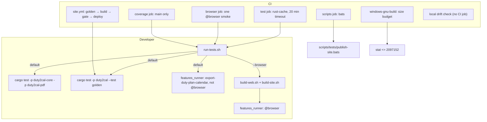

# Design: reduce-test-runtime

## Scope

Operational maintenance change: reduce the default `cargo test` surface and the CI runtime without changing product behaviour. The product feature `export-duty-plan-calendar` stays executable; the eight operational feature files stay in `givn/specs` as documentation but leave the runner root. Their guarantees move to the job that owns them.

`specs` is skipped in `.givn-skip`: no capability is added, modified, or removed, and no `.feature` delta is authored. The only Gherkin edits are tags: `@documentation` on the operational features and `@browser` on the browser scenarios of the product feature.

## Technology decisions

| Area | Decision | Rationale |
|---|---|---|
| Gherkin runner | `cargo test -p duty2cal --test features_runner -- <filters>` through `./run-tests.sh`; cucumber-rs 0.23 (workspace lockfile). | Existing runner. Strict mode stays `.fail_on_skipped()`. |
| Default scenario set | `export-duty-plan-calendar` only, excluding `@browser`. | The operational features are documentation; the browser variants need Playwright and run on demand. |
| Browser smoke | `./run-tests.sh --browser` builds the bundle and Site output and selects `@browser`; CI runs the one `@e2e` browser scenario by name. | Keeps one real-browser proof of the WASM facade without putting Chromium in the default suite. |
| Rust unit/property/architecture/golden | `cargo test -p duty2cal-core -p duty2cal-pdf --no-fail-fast`, `cargo test -p duty2cal --test golden --no-fail-fast`. | `cargo test` verifies the product; the golden test pins `tests/fixtures/expected/2026-06.ics`. |
| Golden test | New integration test `apps/cli/tests/golden.rs`, using the fixture builder moved to `apps/cli/tests/steps/support.rs` and the CLI binary. | One direct, fast assertion independent of cucumber. |
| Cache | `Swatinem/rust-cache@v2` in `test`, `browser`, `coverage`, `deny`, `windows-gnu-build`. | No cache is the largest fixed CI cost after the removed tests. |
| Tool installs | `taiki-e/install-action@v2` for `cargo-bloat@0.12.1`, `cargo-deny`, `cargo-llvm-cov`. | Removes source builds from every job. |
| Shell tests | `bats` in a `scripts` job, `scripts/tests/publish-site.bats`. | The publication command's early refusals are shell logic, not product behaviour. |
| Drift | Local `scripts/check-drift.sh`; no CI job. | ADR-0006 and chapter 2: the passphrase and administer token stay in the maintainer's environment. |
| Size budget | `windows-gnu-build` asserts `stat -c %s target/x86_64-pc-windows-gnu/release/duty2cal.exe` is at most `2097152` bytes. | D3: the last published distributed executable is 2,097,152 B; a local cross-build of this revision measured 2,013,696 B, leaving ~83,456 B (81.5 KiB). The budget gates the executable's file size, not the compressed 1,035,358-byte archive. |
| Size attribution | `windows-gnu-build` installs `cargo-bloat@0.12.1` with the install action and still runs `scripts/measure_executable_size.py`; the `test` job no longer installs it. | The user's brief moves the generator to the job that uses it; the attribution remains per-push evidence and the budget is the additional gate. |
| Operational feature marker | Feature-level `@documentation`; `scripts/assemble_features.py` skips a feature whose prefix carries the tag. | The files stay in the spec corpus as documentation and cannot silently re-enter the runner. |
| Coverage | `coverage` job gated to `refs/heads/main`; `measure-coverage.sh` instruments the default suite (no browser, no operational features). | The analysis's CI change 4. |

**Version freshness.** No new version is written from memory. `cargo-bloat@0.12.1`, `git-cliff@2.14.2`, and the OpenTofu pin are existing repository pins; the install action resolves the current `cargo-deny` and `cargo-llvm-cov` at run time.

## Architecture impact

No product crate, FFI surface, or web asset changes. The test harness shrinks; CI jobs split by owner.

New or changed files:

| Path | Kind | Purpose |
|---|---|---|
| `apps/cli/tests/features_runner.rs` | changed | World trimmed to the product fields. |
| `apps/cli/tests/steps/mod.rs` | changed | Only the product capability modules, browser client, and support. |
| `apps/cli/tests/steps/support.rs` | changed | Fixture builder retained; operational site/git/tofu helpers removed. |
| `apps/cli/tests/steps/export_duty_plan_calendar.rs` | changed | Uses the shared `equivalence_plan`; no operational dependencies. |
| `apps/cli/tests/golden.rs` | new | Direct 2026-06 golden assertion. |
| operational step files and `steps/e2e/*` counterparts | deleted | Dead test surface. |
| `apps/cli/tests/fixtures/size-attribution/`, `apps/cli/tests/support/site_server.py` | deleted | Only the operational scenarios used them. |
| `scripts/assemble_features.py` | changed | Skips `@documentation` features. |
| `run-tests.sh` | changed | Phase timings, default/excluded tags, browser mode, rust tests, `--no-fail-fast`. |
| `measure-coverage.sh` | changed | No browser build; filters `@browser`. |
| `.github/workflows/ci.yml` | changed | Job split, cache, install action, timeout, coverage gate, size budget, scripts job. |
| `.github/workflows/site.yml` | changed | Golden test before build. |
| `scripts/check-drift.sh` | new | Local drift check. |
| `scripts/tests/publish-site.bats` | new | Refusal coverage for `publish-site.sh`. |
| `givn/specs/*/*.feature` | changed tags | `@documentation` on operations; `@browser` on browser scenarios. |
| `docs/arc42/*` | changed | Constraints, building blocks, deployment, cross-cutting, risks. |

## Step definitions

| Step definition file | Permanent merge target | Subject |
|---|---|---|
| `apps/cli/tests/steps/export_duty_plan_calendar.rs` | same | CLI and in-process conversion behaviour. |
| `apps/cli/tests/steps/e2e/export_duty_plan_calendar.rs` | same | End-to-end CLI and browser conversion actions. |
| `apps/cli/tests/steps/browser.rs` | same | Playwright driver client used by the browser scenarios. |

The operational files (`adopt_existing_configuration`, `enable_repository_security`, `measure_distributed_executable_size`, `publish_organization_profile`, `publish_public_release`, `publish_public_website`, `publish_site_plumbing`, `reduce_distributed_executable_size`, and their `e2e/` counterparts) are deleted. No delta step copy exists in this change.

## Test runner, strict mode, and single-scenario command

- Full product suite: `./run-tests.sh` — Rust unit/property/architecture tests, the golden test, then cucumber over the assembled product feature.
- End-to-end CLI only: `./run-tests.sh --e2e` (`@e2e and not @browser`).
- Browser smoke and variants: `./run-tests.sh --browser` (`@browser`, after `scripts/build-web.sh` and `scripts/build-site.sh`).
- One scenario: `./run-tests.sh --name "<scenario title>"`.
- Strict mode: `.fail_on_skipped()` on `DutyWorld::cucumber()`; an undefined or skipped step fails.
- Failure policy: `cargo test ... --no-fail-fast` and no script-level short-circuit; the Rust tests, the golden test, and the scenarios all report even when one class fails.
- Selection guard: a run that selects no scenario fails; a `--name` run must select exactly one. The result file marks `failed >= 1` when an earlier class failed, so a count-reading gate cannot read a false green.
- Concurrency: `--concurrency "${DUTY2CAL_CUCUMBER_CONCURRENCY:-$(getconf _NPROCESSORS_ONLN)}"`; reported in the phase line.

`run-tests.sh` prints `phase=name seconds=n` and `phase=cucumber seconds=n concurrency=<cpus>`. The CI test job appends the captured lines to `$GITHUB_STEP_SUMMARY`.

## Visual Design Contract

- Interface: web (the existing converter page, exercised by the browser smoke only; no screen changes).
- Viewports: mobile (360x780), desktop (1920x1080).
- Design system: `docs/design/design-system.md`.
- Screens covered: none new or visibly changed. The existing browser `@e2e` scenario keeps its screenshots under `givn/archive/build-browser-converter/evidence/visual/crew-member-converts-a-supported-duty-plan-in-the-browser-and-saves-the-offered-calendar/`.
- Capture mechanism: the Playwright driver; evidence path unchanged.
- Motion: `prefers-reduced-motion` assertion unchanged.
- Persona lens: `crew-member--personal-calendar-owner` (review lens only).

## Interaction Coverage Matrix

| Inventory entry | @e2e scenario title | Real interface | Driving mechanism |
|---|---|---|---|
| supply a duty plan for conversion through the executable | Crew member converts a supported duty plan and receives a calendar file | CLI | Real `duty2cal` subprocess with a generated PDF; reads stdout, exit status, and the published file. |
| supply a duty plan through the converter page and save the offered calendar | Crew member converts a supported duty plan in the browser and saves the offered calendar | Web UI | Playwright driver: navigate, set file, click save, read rendered state and the captured download. |

## Coverage process boundaries

| Process | Started by | Instrumented artifact | Profile output | Merge step | Non-zero production probe |
|---|---|---|---|---|---|
| features_runner | `cargo llvm-cov` | `target/.../features_runner` | per-test LLVM profile | `cargo llvm-cov` export | conversion scenarios execute `duty2cal-core` and `duty2cal-pdf`. |
| `duty2cal` CLI subprocess | scenario steps | `CARGO_BIN_EXE_duty2cal` under the instrumented environment | inherited `LLVM_PROFILE_FILE` | `cargo llvm-cov` export | `apps/cli/src/main.rs` writes a calendar. |

The browser process is outside the coverage profiles; `duty2cal-wasm` remains excluded because the wasm target has no file-based LLVM profile writer.

## Local runnability and digital twins

- Local run: `./run-tests.sh` (Rust toolchain only).
- Browser smoke: `npm ci --prefix web/e2e`, `npx --prefix web/e2e playwright install chromium`, then `./run-tests.sh --browser`.
- No external service or container is needed. The browser driver serves the assembled Site output on loopback; the page makes no request to another origin. There is no digital twin in the default suite because no third-party service is involved.

## Decisions

- Decides D1: configuration drift stays local; `scripts/check-drift.sh` reads the encrypted state with the maintainer's passphrase and a read-only token, and no CI job or secret is added — realized in `scripts/check-drift.sh` and chapter 2/7.
- Decides D2: the default suite excludes `@browser`; the browser smoke runs in its own CI job and all browser variants remain available with `--browser` — realized in `run-tests.sh` and `.github/workflows/ci.yml`.
- Decides D3: the Windows executable budget is 2,097,152 bytes — realized in `windows-gnu-build`.
- Decides D6: the per-push size attribution stays in `windows-gnu-build`; the `test` job drops the generator — realized in `.github/workflows/ci.yml`.
- D4 (operational features stay as documentation): `@documentation` feature tag plus assembler exclusion — realized in `scripts/assemble_features.py`.
- D5 (stale archive steps): remove the `givn archive --change publish-site-plumbing` block from the `test` job; archive is a separate operator action — realized in `.github/workflows/ci.yml`.

## Use-case traceability

| Use-case guarantee or rule | Design decision | E2E evidence |
|---|---|---|
| Export a complete calendar through the executable | CLI steps and golden test retained | "Crew member converts a supported duty plan and receives a calendar file" |
| Offer and save the calendar in the browser | Browser steps retained; smoke job | "Crew member converts a supported duty plan in the browser and saves the offered calendar" |
| No operational test inside `cargo test` | Step files deleted; feature marker; runner filters | `run-tests.sh` default run |
| Each operational guarantee has an owner | Size stat, site workflow, release check wait, local drift, bats | `windows-gnu-build`, `site.yml`, `release.yml`, `scripts/check-drift.sh`, `scripts` job |
