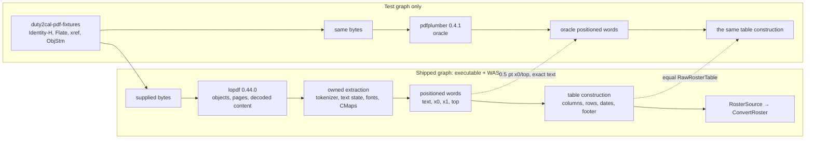

# Design: replace-pdf-extraction-backend

## Scope

The HOW for the change that replaces the third-party PDF extraction backend with
an extraction the project owns, behind the existing `RosterSource` port. The
observable WHAT is fixed by [the proposal](proposal.md) and the delta:

- [`own-the-duty-plan-extraction`](specs/own-the-duty-plan-extraction/own-the-duty-plan-extraction.feature)
  (new capability under
  [`own-the-duty-plan-extraction`](specs/own-the-duty-plan-extraction/usecase.md)),
- the document-only delta of
  [`export-duty-plan-calendar`](specs/export-duty-plan-calendar/usecase.md),
  which replaces its pinned-extractor delivery constraint.

Three boundaries shape what follows:

- **The shipped graph and the test graph diverge.** The release executable and
  the WASM bundle lose the extractor entirely; the extractor survives only as a
  `[dev-dependencies]` oracle of `duty2cal-pdf`, checked mechanically.
- **The seam is the positioned word.** The owned extraction ends at words with
  text and page-space position; the table construction (`words →
  RawRosterTable`) is one implementation, unchanged in its rules, shared by the
  executable and the browser.
- **The supported subset is frozen, and everything outside it fails closed.**
  The corpus already exercises xref streams and object streams, so the design
  keeps the file-structure layer (measured floor 779,016 B) and owns the
  interpretation instead of owning xref repair as well.

This design does not write the ADR, the architecture chapters, the tasks or the
implementation. It names them.

## Technology decisions

Versions below are resolved, not remembered:

| Area | Decision | Source |
|---|---|---|
| Language and edition | Rust `stable` from `rust-toolchain.toml`, workspace edition 2021. No version number is asserted. | `rust-toolchain.toml`; `Cargo.toml` `[workspace.package]` |
| PDF object/xref layer | `lopdf` 0.44.0, `default-features = false`, as a direct dependency of `duty2cal-pdf`. The version is already resolved in this repository's lock through `pdfplumber-parse`, so the lock does not move it. `cargo search lopdf` on 2026-10-28 reports 0.46.0 as the latest release; 0.44.0 is kept because the 779,016 B floor was measured with it and because it is already resolved. Upgrading is a separate dependency revision that must re-measure the floor and re-run the differential. | `Cargo.lock:1041` (`lopdf 0.44.0`); `cargo search lopdf` run in this session |
| Owned interpretation | Project code in `crates/duty2cal-pdf/src/reader/`: content tokenizer, text state and matrices, the frozen operator subset, Type0/Identity-H fonts, `/W` advances, `ToUnicode` CMaps, word assembly and the refusal mapping. No additional dependency. Flate decoding arrives through `lopdf`'s own `flate2`/`miniz_oxide` path. | The measured floor includes `lopdf`'s `encoding_rs` and `flate2`; no new crate is added for reading |
| Test oracle | `pdfplumber = "=0.4.1"` moves from `[dependencies]` to `[dev-dependencies]` of `duty2cal-pdf`. It is the only crate allowed to depend on it (`deny.toml` wrapper rule stays satisfied). | `Cargo.lock:1155`; `deny.toml:18-21` |
| Fixture generator | New dev-only workspace member `crates/duty2cal-pdf-fixtures` (`publish = false`), reached only from the test graph; `miniz_oxide` 0.9.1 (already resolved) is its only dependency, used to write zlib/Flate streams. It is a dev-dependency of `duty2cal-pdf` and `duty2cal`. A sized fixture keeps `support::build_pdf_at_size`'s exact-byte contract: the content stream is emitted **unfiltered** with a byte-counted `%` comment whose `/Length` is corrected, never as a Flate stream, so the file is exactly N bytes. | `Cargo.lock:1083`; the generator emits bytes, never committed PDFs |
| Gherkin runner | Unchanged: cucumber-rs 0.23.0 through `apps/cli/tests/features_runner.rs`, strict via `.fail_on_skipped()`. | `apps/cli/Cargo.toml:14`; `Cargo.lock:377` |
| Measurement | Python 3 scripts (the project already depends on `python3` for `scripts/assemble_features.py`), `git worktree`, the existing Windows GNU cross-build and `wasm-pack` 0.15.0. | `.github/workflows/ci.yml`; `web/.wasm-pack-version` |
| Browser driver | Unchanged: Playwright pinned by `web/e2e/package-lock.json`; this change adds no browser interaction. | `web/e2e/package-lock.json` |

### Version freshness

Read from the repository on 2026-10-28: `lopdf 0.44.0` and `pdfplumber 0.4.1`
are in `Cargo.lock`, `cucumber 0.23.0` in `Cargo.lock`, `miniz_oxide 0.9.1` in
`Cargo.lock`, `wasm-pack 0.15.0` in `web/.wasm-pack-version`. `lopdf`'s latest
release was checked with `cargo search lopdf` on the same date (0.46.0); the
kept version is the measured one, and the upgrade note above is part of the
decision. The Rust toolchain is the repository's `stable` channel, not a
number this design names.

## Architecture impact



New or changed files:

| Path | Kind | Purpose |
|---|---|---|
| `crates/duty2cal-pdf/Cargo.toml` | changed | Removes `pdfplumber` from `[dependencies]`; adds `lopdf = { version = "=0.44.0", default-features = false }`; moves `pdfplumber` to `[dev-dependencies]`; adds the fixture generator as a dev-dependency. |
| `crates/duty2cal-pdf/src/lib.rs` | changed | Keeps the public `PdfRosterSource` and its blanket `RosterSource` implementation; becomes `reader::extract(bytes)` followed by `table::build(document)`. |
| `crates/duty2cal-pdf/src/reader/mod.rs` | new | `PositionedWord`, `PageWords`, `ExtractedDocument`, and `extract(bytes) -> Result<ExtractedDocument, SourceError>`. |
| `crates/duty2cal-pdf/src/reader/document.rs` | new | `lopdf` load, encryption refusal, page order, `/MediaBox` height, decoded page content, `/Resources` fonts. |
| `crates/duty2cal-pdf/src/reader/content.rs` | new | Tokenizer and operator dispatch for the frozen subset; graphics-state stack (`q`, `Q`, `cm`); text state (`BT`, `ET`, `Tf`, `Tm`, `Tj`); explicit refusals for `TJ`, `Td`, `TD`, `T*`, `Tz`, `Tc`, `Tw`, `'`, `"`, inline images, form XObjects and unknown operators. |
| `crates/duty2cal-pdf/src/reader/font.rs` | new | Type0/Identity-H checks, `/W` and `/DW` advances, font descriptor ascent/descent, `ToUnicode` lookup. |
| `crates/duty2cal-pdf/src/reader/cmap.rs` | new | `beginbfchar` and `beginbfrange` parsing into a code→Unicode map. |
| `crates/duty2cal-pdf/src/reader/words.rs` | new | Character boxes, the horizontal text-rendering matrix, word splitting (`x_tolerance` 3.0, blank chars dropped, ligatures expanded) and word bboxes. |
| `crates/duty2cal-pdf/src/table.rs` | new | The existing table construction moved out of `lib.rs`; rules unchanged; `Word` becomes `PositionedWord`; page text is derived from the page's words. |
| `crates/duty2cal-pdf/src/differential_tests.rs` | new (`#[cfg(test)]`) | Oracle comparison over the generated corpus; `#[ignore]` real-corpus test; table equality; refusal cases. |
| `crates/duty2cal-core/src/application/mod.rs` | changed | `SourceError::UnsupportedConstruct` with the closed `Construct` enum; its `Display` supplies the reason line. |
| `crates/duty2cal-pdf-fixtures/Cargo.toml`, `src/lib.rs` | new | The synthetic generator: Identity-H fonts, `ToUnicode`, Flate content, classic xref, xref stream, object streams, logo image, and the refusal variants. |
| `Cargo.toml` | changed | Adds `crates/duty2cal-pdf-fixtures` to `[workspace] members`. |
| `Cargo.lock` | changed | `pdfplumber` remains, reached only from the dev graph; `lopdf` becomes a direct dependency; no other version moves. |
| `apps/cli/tests/steps/support.rs` | changed | Re-exports the fixture generator; the local Helvetica builder is removed. Existing scenario step code keeps its `support::build_pdf` call sites. |
| `apps/cli/tests/fixtures/expected/2026-06.ics` | unchanged | The committed accepted calendar; the generator's `/W` advances reproduce the old fixture's line layout, so this reference stays the comparison target. |
| `apps/cli/tests/fixtures/expected/2098-06.ics` | unchanged | The second committed accepted calendar; it stays unchanged for the same reason. |
| `apps/cli/tests/steps/own_the_duty_plan_extraction.rs` | new | Regular and outline steps for the new capability. |
| `apps/cli/tests/steps/e2e/own_the_duty_plan_extraction.rs` | new | The `@e2e` steps, the CLI invocation and the transcript capture. |
| `apps/cli/tests/steps/mod.rs`, `apps/cli/tests/steps/e2e/mod.rs` | changed | One `pub mod` line each. |
| `apps/cli/tests/features_runner.rs` | changed | `DutyWorld` gains only the fields the new steps need for the accepted calendar and the generated plan. |
| `ffi/wasm/src/lib.rs` | changed | One test converts a generated out-of-subset plan through the facade and asserts the named construct and the two-line diagnostic text; the page's rendering is unchanged. |
| `scripts/measure_extraction_backend.py` | new | Same-revision Windows GNU measurement: landed size against the same tree with the previous extraction and lock restored. |
| `scripts/measure_browser_bundle.py` | new | The same comparison for the WASM bundle and its inlined module. |
| `scripts/check-extraction-dependency.sh` | new | The mechanical split: no extractor in the Windows or WASM normal graph, oracle present in the dev graph. |
| `scripts/validate-local-corpus.sh` | changed | Gains `--differential`; reads `private/*.pdf` in place and never copies them. |
| `.github/workflows/ci.yml` | changed | Windows measurement and graph check in `windows-gnu-build`; bundle measurement and WASM graph check in `browser`; dev-graph check in `test`. |
| `docs/arc42/adr/ADR-0008-own-the-duty-plan-extraction.md` | new (arc42-docs artifact) | The scope freeze: the supported subset, the refusal discipline and the review triggers. |
| `docs/arc42/09-architecture-decisions.md` | changed (arc42-docs artifact) | The ADR index entry. |
| `README.md` | changed | One short contributor paragraph: the supported subset, the oracle-only status of the extractor, and the local differential command. |
| `THIRD-PARTY-NOTICES.md` | changed | Regenerated with `cargo-about@0.9.0`. It gains `duty2cal-pdf-fixtures 0.1.0` in the MPL-2.0 block, because that block lists every workspace crate and `ci.yml` runs `cargo about generate … && git diff --exit-code`; a hand edit is not the source, the regeneration is. |
| `cliff.toml` | changed after the archive move | The capability allow-list gains `own-the-duty-plan-extraction`, and the conventional-commit group matchers gain `feat`, `fix`, `perf` and `revert` with their breaking-change matchers, in the revision that carries the archive move, because `givn/specs/<id>/` exists only then. Without the matchers the final `.*` skip rule would drop the capability's revisions from the change log. |
| `givn/specs/own-the-duty-plan-extraction/usecase.md` | new by archive | The permanent use case. |
| `givn/specs/export-duty-plan-calendar/usecase.md` | changed by archive | The document-only delivery-constraint delta. |
| `docs/arc42/*` beyond ADR-0008 | changed by the arc42-docs artifact | Chapters 1, 2, 4, 5, 6, 8, 9, 10, 11 and 12 record the new component, the constraint, the flow, the decision, the quality scenario, the risk and the vocabulary. |

No `crates/duty2cal-core/src/domain`, no calendar writer, no conversion rule, no
`web/` page, no `infra/`, no release workflow and no dependency of the shipped
graph other than the swap changes.

## Decisions

The ledger resolves every proposal question.

**Decides D1: keep a small PDF object/xref library and own the interpretation; a
fully self-owned xref/stream layer is a later candidate, not this change — realized
in `crates/duty2cal-pdf/Cargo.toml` and `src/reader/document.rs`.**

- Measured on the host at `30bbcb9` (release profile): current 2,233,584 B; adapter
  stubbed with the extractor removed 295,560 B; `lopdf` with a stubbed adapter
  779,016 B. The extraction stack is 1,938,024 B (86.8%); `lopdf` costs 483,456 B
  over the no-PDF floor; the rest (1,454,568 B) leaves with the third-party
  extractor. `cargo bloat` .text: `lopdf` 141.1 KiB, the extractor's three crates
  222.8 KiB, `duty2cal-pdf` 31.5 KiB; `.rodata` 968,863 B, of which 589,240 B is
  the extractor's Adobe CMap tables and 37,680 B a CJK encoding table.
- Landed host size is [INFERENCE] ≈820–860 KB (779,016 B floor plus the
  interpretation, [INFERENCE] ≈40–80 KB): a 61–63% saving, 1.37–1.41 MB. No cheap
  feature lever exists: the extractor exposes only `std`/`parallel`/`serde` (and
  `tracing` in its parse crate), `lopdf` already runs `default-features = false`
  and still compiles its encryption stack, and `panic = "abort"` has landed.
- Rejected now: **own xref/streams too**. [INFERENCE] ≈400–450 KB total, ≈380 KB
  below this choice, but it requires owning xref repair and object-stream parsing
  for files that already use them (2026-08/09 have xref streams, 2026-10/11 add
  object streams). Reopen condition: a prototype that measures at or below the
  [INFERENCE] ≈450 KB upper bound for the whole executable, with the differential
  run over the six-file corpus green. Commit requirement: record that measurement,
  not an estimate.
- Rejected: **keep the current extractor** — 0 B saved.
- Rejected as an interim lever: **vendor `pdfplumber-parse` 0.4.1 with the four
  Adobe CID→Unicode tables stubbed** (`ADOBE_GB1/CNS1/KOREA1/JAPAN1_CID_TO_UNICODE`
  → empty, `lookup_*_unicode` → `None`, reached only for predefined CJK CMaps the
  roster never names). Measured on a clean worktree at `30bbcb9` with a
  `[patch.crates-io]` pointing at the vendored copy: **2,233,584 B → 1,642,384 B,
  −591,200 B (−26.5%)**, `.rodata` 968,839 B → 378,447 B, `.text` −528 B; the
  patched binary converts all six private plans (`6 passed, 0 failed`) and its
  calendar for 2026-11 is byte-identical to the current binary's (sha256
  `40cdf1d…`). Rejected because it vendors a 956 KB, 24-file PDF parser whose
  upstream fixes must be ported by hand; it removes 26.5% of the stack instead of
  86.8%; the `encoding_rs` CJK tables (~120 KB of the remaining `.rodata`) stay
  because `pdfplumber`'s predefined-CMap path still reaches them, so dropping
  those needs a second fork of `encoding_rs`; and the fork is discarded when this
  replacement lands. It is evidence for the ADR's context, not a step in this
  change. A stopgap release built on the fork would be a separate change with its
  own fork-maintenance decision.

**Decides D2: a word-level seam inside `duty2cal-pdf`, one table construction and
two extractors (owned in release, oracle in tests) — realized in
`src/reader/mod.rs`, `src/table.rs` and `PdfRosterSource::read`.**

- Payload: `PositionedWord { text: String, x0: f64, x1: f64, top: f64 }`,
  `PageWords { page: usize, words: Vec<PositionedWord> }`, `ExtractedDocument {
  pages: Vec<PageWords> }`. Units are PDF points; `top` is the page-space distance
  from the page's top edge, exactly the quantity the existing table code reads
  from the oracle's bbox. Page order is the page tree's order.
- `PdfRosterSource::read` keeps its signature:
  `reader::extract(bytes)?` → `table::build(document)` → `SourceDocument`. The
  public type and the `RosterSource` trait do not change, so `apps/cli` and
  `ffi/wasm` need no edit for the seam.
- The table construction keeps every rule: `ROW_TOLERANCE`, `TABLE_GAP`,
  continuation tokens, anchor/body labels, month/weekday tables, date
  resolution, footer parsing. Two changes only: the word field names, and the
  page heading/footer text is derived from the page's own words instead of a
  separate page-text extraction. `page_text` clusters the words by `top` within
  the oracle's `y_tolerance` (3.0 pt), orders by `x0`, joins a row with one
  space and rows with a newline — the same shape the oracle's default
  `extract_text` produces. A drift here surfaces in the golden calendar and the
  export scenarios, which do not use the oracle.
- Rejected: a second complete `RosterSource` (two copies of the table rules); an
  in-place swap with no word payload (the differential could only compare final
  calendars and localize nothing).

**Decides D3: a synthetic Identity-H corpus is the CI gate; the real corpus is an
opt-in local differential; the extractor stays a test-only oracle — realized in
`crates/duty2cal-pdf-fixtures`, `src/differential_tests.rs`,
`scripts/validate-local-corpus.sh --differential` and
`scripts/check-extraction-dependency.sh`.**

- CI corpus, generated in-process, never committed as PDF. Three groups:
  - **Differential fixtures**, compared word by word with the oracle: classic xref
    + Flate + three Type0/Identity-H fonts with per-font `ToUnicode` and `/W`; the
    same plan re-encoded with an xref stream; the same plan with an object stream;
    a multi-page plan with a repeated header.
  - **Reader-only supported variants**, exercised through the CLI (not the oracle):
    a page carrying an image XObject referenced by `Do` with `/Filter /DCTDecode`
    (the extraction skips it and must not decode it) and an unfiltered content stream.
  - **Refusal variants** for the named diagnostics, one generated plan per
    outline example: encrypted (its own scenario, no page), Type3, text rotation,
    page rotation, `Tz`, inline image, unknown filter, font encoding other than
    Identity-H, missing `ToUnicode` CMap, unmapped glyph code, a differing page
    box, a form XObject, a font descriptor without a descent, `TJ`, an unknown
    content-stream operator, truncated, and no detail header. Every outline
    example asserts the page it occurs on, so each generated plan places its
    construct on a known page. Reader unit tests additionally
    cover each unsupported text-positioning operator; the outline's examples are
    the user-visible representatives.

  The generator reproduces the **shape**, not the HPDF generator's bytes; it does
  not claim to be byte-equivalent to a real export. Keeping the image variant
  outside the differential avoids making the oracle the judge of a JPEG the
  extraction never decodes.
- Differential comparison: for each differential fixture, owned words vs oracle
  words per page; word text exactly equal; `x0` and `top` within 0.5 pt; the same word
  count and order after sorting by `(top, x0, text)`; then
  `table::build(owned) == table::build(oracle)` and the resulting
  `SourceDocument` equal. The oracle's default word rules are read from
  `pdfplumber-core-0.4.1/src/words.rs`: `x_tolerance` 3.0, `y_tolerance` 3.0,
  `keep_blank_chars` false, `expand_ligatures` true. The extraction reproduces the
  oracle's horizontal character box from
  `pdfplumber-parse-0.4.1/src/char_extraction.rs:40-110`: `top = page_height -
  max_y` of the text-matrix/CTM-transformed box, glyph displacement
  `w0/1000`, and the font's descent for the box's vertical extent.
  `pdfplumber-parse` uses `/FontFile2` only for vertical metrics and as a width
  fallback when `/W` is absent (`cid_font.rs:595-601`,
  `font_metrics.rs:196-198`), so the generated `/W`-bearing Type0 font needs no
  embedded font program; the differential test is the proof.
- The split is checked on the resolver's graph, not on `Cargo.lock`: the lock still
  lists `pdfplumber` because the dev graph reaches it, while `cargo tree -e
  normal` for the Windows and WASM targets must not. A later revision cannot
  reintroduce the extractor into a shipped graph or silently drop the oracle
  without failing the check. The calls are:

  ```sh
  scripts/check-extraction-dependency.sh --normal --target x86_64-pc-windows-gnu
  scripts/check-extraction-dependency.sh --normal --target wasm32-unknown-unknown
  scripts/check-extraction-dependency.sh --dev --package duty2cal-pdf
  ```

  The first runs in `windows-gnu-build`, the second in `browser`, the third in
  `test`; each prints one line and exits non-zero with the offending target or
  package named.
- Local, opt-in differential: `scripts/validate-local-corpus.sh --differential`
  sets `DUTY2CAL_LOCAL_CORPUS` and runs
  `cargo test -p duty2cal-pdf -- --ignored real_corpus_matches_the_oracle`; the
  test reads `private/*.pdf` in place and prints one PASS/FAIL line per plan with
  the first mismatching page and word. **Operator decision (2026-10-28)**: this
  local real-corpus differential is the release-time equivalence evidence, and
  the release checklist carries one step that runs
  `./scripts/validate-local-corpus.sh --differential` and records its output with
  the release. It never runs as a CI gate; CI's synthetic corpus is necessary,
  not sufficient.
- Uncovered risk under this choice: CI cannot prove the HPDF generator's exact
  font subsetting, CMap ordering, xref-stream/ObjStm layout or the real logo
  image; only the local run over the six plans can. The generated corpus cannot
  reproduce those bytes. A CI green run is therefore necessary, not sufficient;
  the release evidence records the local run.
- Rejected: a sanitized real plan committed. The privacy rule forbids it, a
  sanitization review can miss a field, and the artifact would live in public
  history. Rejected: local-only differential — CI would have no equivalence gate.

**Decides D4: `SourceError::UnsupportedConstruct` carries a closed, named construct
and the page; the existing two-line report is unchanged — realized in
`crates/duty2cal-core/src/application/mod.rs` and `src/reader/`.

```rust
pub enum SourceError {
    Unreadable(String),
    UnsupportedFamily,
    UnsupportedConstruct { construct: Construct, page: Option<usize> },
}

pub enum Construct {
    EncryptedDocument,
    StreamFilter(String),
    InlineImage,
    Type3Font,
    NonIdentityEncoding,
    MissingToUnicode,
    UnmappedGlyph,
    TextRotation,
    HorizontalScaling,
    PageRotation,
    PageBox,
    FormXObject,
    MissingDescent,
    TextOperator(&'static str),
    UnknownOperator(String),
}
```

- Reason line: `the source uses a PDF construct outside the supported family:
  <construct>` and, when a page is known, ` on page <n>`. The construct's display
  names are the ones the scenarios assert: `encrypted document`, `unsupported
  stream filter <name>`, `inline image`, `Type3 font`, `font encoding other than
  Identity-H`, `missing ToUnicode CMap`, `unmapped glyph code`, `text rotation`,
  `horizontal text scaling`, `page rotation`, `page box other than the media
  box`, `form XObject`, `font descriptor without a descent`, `text operator
  <op>`, `unknown content-stream operator <op>`.
- The message never contains printed plan content: no text, station, name, date or
  activity code; only construct names and page numbers. The source name in
  `Source PDF:` is the filename the caller supplied, unchanged.
- `ConvertError::Source` already routes to `diagnostic_text`, so the executable
  and the WASM facade keep the identical `Source PDF:` / `Reason:` two-line form,
  and the CLI keeps the numbered `<stem>.parse-error[-N].txt` report names from
  `apps/cli/src/fs.rs`. No revision line and no row numbering are added to a
  source-level failure.
- Never panic: every extraction path returns `Result`; `lopdf` errors become
  `Unreadable`; truncation and malformed token streams become `Unreadable` or a
  named construct; the differential/refusal tests run the CLI and assert the
  exit status and the report, so a panic (which `panic = "abort"` turns into a
  signal) fails the scenario.
- Rejected: a separate extraction error enum (a second vocabulary to map at the port);
  free-text `Unreadable` (it would report a valid but unsupported plan as "not a
  readable PDF").

**Decides D5: a new permanent use case `own-the-duty-plan-extraction`, not an
extension of a size use case or of the export use case (the proposal answered it
in the routing table) — realized in the specs delta and the Capability Routing
table.**

- `givn spec route --change replace-pdf-extraction-backend` reports no signal —
  the top candidates tie at 13.00 — so the decision is recorded, not derived.
- Rejected `EXTEND reduce-distributed-executable-size`: its Goal and Rules define
  a size lever as a build-configuration change with a cumulative measured saving,
  reviewed by the build-configuration reviewer; its Out of scope names backend
  replacement. A source-level extraction replacement has no place there.
- Rejected `NEW in export-duty-plan-calendar`: its actor goal is the crew member's
  export with exactly two inventory actions; a new capability there would
  duplicate a conversion action or name a component, and its delivery constraint
  pinned the extractor. Only its delivery-constraint sentence changes, by the
  document-only delta.
- Boundary redraw: the size use cases keep their exclusion (this use case owns the
  replacement); `generalized-duty-plan-input`'s inherited "one pinned extractor"
  constraint is superseded by the owned-extraction constraint recorded here; the
  topic's next session re-reads its Frame. The ideation records are not edited.

**Decides D6: CI measures the Windows GNU executable and the browser bundle
against a same-revision rebuild with the previous extraction and lock restored,
while the base revision still carries that extraction; host sizes are not
evidence — realized in `scripts/measure_extraction_backend.py`,
`scripts/measure_browser_bundle.py` and `.github/workflows/ci.yml`.**

The base revision is resolved explicitly, and the job's checkout gains
`fetch-depth: 0` so it is present:

- Pull request: `git fetch origin <base>`, then
  `git merge-base HEAD origin/<base>`.
- Push: `git merge-base HEAD origin/main`.

Windows, in the existing `windows-gnu-build` job after
`cargo build --release --target x86_64-pc-windows-gnu`:

```sh
stat -c '%s' target/x86_64-pc-windows-gnu/release/duty2cal.exe
BASE_SHA="<the resolved base revision>"
python3 scripts/measure_extraction_backend.py \
  --repo . \
  --base "$BASE_SHA" \
  --landed target/x86_64-pc-windows-gnu/release/duty2cal.exe \
  --out extraction-backend
```

- The command resolves both revisions, creates a temporary worktree of the landed
  revision, restores `crates/duty2cal-pdf/` and `Cargo.lock` from the base
  revision, asserts that the worktree differs only in those paths (the lock may
  gain the fixture crate's workspace entry during resolution), and reads the
  landed executable. Building only the CLI package keeps the fixture crate out of
  the baseline executable. This is the buildable same-revision control: the
  landed tree no longer contains the previous extraction, so a base-revision
  checkout would attribute other changes to the extraction.
- **Operator decision D-A (2026-10-28), the size gate is one-shot.** The script
  reads the restored base tree's `crates/duty2cal-pdf/Cargo.toml`. When its
  `[dependencies]` still name `pdfplumber`, it builds
  `cargo build --release --target x86_64-pc-windows-gnu -p duty2cal` with the same
  toolchain, reads both stripped executables and writes `status: "measured"`.
  When the base carries no extractor — `[dependencies]` do not name
  `pdfplumber`, the state of every base after this change lands — it writes
  `status: "not applicable"` with the resolved base revision and the landed size
  and exits 0. The consequence is recorded, not hidden: after landing there is no
  automated size gate.
- It writes `extraction-backend.json` and `extraction-backend.md` (both
  revisions, the two sizes, the status, saved bytes and percent when measured,
  `rustc -V`, and the two `Cargo.lock` digests), appends the markdown to the job
  summary and uploads the artifact `extraction-backend`. It exits non-zero and
  records a refusal when the restored tree does not build, the worktree diff
  exceeds the allowed paths, the landed file is not the Windows target's
  executable, or a measured run's landed size is not smaller. The existing
  2,097,152 B budget check stays
  as it is; this change introduces no new size ceiling.
- Browser, in the `browser` job after the WASM target and Playwright setup:
  `python3 scripts/measure_browser_bundle.py --repo . --base "$BASE_SHA"
  --out browser-bundle`. It builds the landed `scripts/build-web.sh` output, and
  the baseline in the same restored worktree, and records
  `web/pkg/duty2cal_wasm_bg.wasm` and `web/pkg/wasm-inline.js` sizes in
  `browser-bundle.json`/`.md`, uploaded as `browser-bundle`. The wasm size must
  be smaller; the inlined module's size is reported beside it. It follows the
  same `status` rule as the Windows measurement. The job's 20-minute timeout is
  raised to 35 minutes because it gains a second `wasm-pack` build.
- The published Windows binary is 2,014,208 B today and is reported separately,
  never as the baseline. The local host numbers in D1 are attribution evidence,
  not the acceptance number.
- Acceptance (operator decision D-C, 2026-10-28): the introducing revision's
  reports show a positive saved-bytes figure and the `status: "measured"` run,
  and the accepted replacement passes the differential and the refusal evidence.
  A zero or negative figure rejects the replacement and reopens D1. Two proposed
  alternatives were rejected in this decision: a 50-percent floor on the saved
  share and a 1,000,000-byte absolute floor. Both would refuse a genuine smaller
  replacement or reintroduce a size ceiling the proposal forbids; the single
  rule is that the introducing revision's artifacts are smaller.
- The 2,097,152-byte budget is untouched by this decision, and no automated size
  gate remains after landing; that consequence is recorded in chapter 11's risk
  table and in the use case's measurement rule.

## Use-case traceability

The use case is [`own-the-duty-plan-extraction`](specs/own-the-duty-plan-extraction/usecase.md).
Its capability is owned by this change; the export use case's scenario corpus and
the size use cases keep their own capabilities.

| Use-case element | Technical decision | Evidence |
|---|---|---|
| Goal: the supported plan is read by an extraction the project owns, so the crew member's download carries no third-party extractor | D1 object layer + owned interpretation; D2 word seam; D3 test-only oracle and graph guard | E2E; `scripts/check-extraction-dependency.sh` |
| Precondition: a size attribution naming the extractor's share | The measured attribution in D1 | Design evidence; the CI report in D6 |
| Precondition: the subset is one decision before implementation | ADR-0008 | ADR review |
| Precondition: the Windows GNU cross-build and the browser target can both be built | The `windows-gnu-build` and `browser` jobs build both | Both jobs green in CI |
| Precondition: the extractor is the test oracle | `[dev-dependencies]` of `duty2cal-pdf` | `scripts/check-extraction-dependency.sh --dev` |
| Main flow 1: freeze the supported subset before implementation | ADR-0008; the frozen-subset table in "The owned extraction" | Design review; `docs/arc42/adr/ADR-0008-own-the-duty-plan-extraction.md` |
| Main flow 2: a supported plan yields the accepted calendar, warnings and diagnostics | D2 word seam; D3 differential and table equality | E2E; "An unrecognized activity code still publishes the calendar with its warning"; differential test |
| Main flow 3: a construct outside the subset is refused by name | D4 typed construct, page and two-line report | Outline "A document outside the frozen subset is refused by name"; the encrypted, family, truncated and privacy scenarios; the `ffi/wasm` refusal test |
| Main flow 4: review the extraction and its evidence, then accept or reject | The contributor reviewer lens; D6 measurement and the release-checklist differential | `extraction-backend.md`, `browser-bundle.md`; `./scripts/validate-local-corpus.sh --differential` |
| Rule: one table construction, reading boundary at the positioned word | D2 | Differential table equality; existing export scenarios |
| Rule: the subset is frozen by ADR-0008 | The frozen-subset table; ADR-0008 | ADR review; refusal scenarios |
| Rule: equivalence at 0.5 pt and exact text, judged against the previously accepted extraction | D3 comparison definition | Differential test over the generated corpus; the opt-in local real-corpus run |
| Rule: the oracle stays in the test graph only | `[dev-dependencies]`; dev-graph check | `scripts/check-extraction-dependency.sh --dev` |
| Rule: the dependency split is mechanical | D3 graph check | `scripts/check-extraction-dependency.sh` in CI |
| Rule: measurement is on the shipped artifacts | D6 | `extraction-backend.md`, `browser-bundle.md` |
| Rule: the same-revision measurement is one-shot; after landing no automated size gate exists | D6 / D-A: `status: not applicable` when the base carries no extractor, the 2,097,152-byte budget untouched | `extraction-backend.json` `status`; chapter 11 R-079 |
| Rule: delivery constraints — both targets buildable, no native extraction dependency | The `windows-gnu-build` and `browser` jobs | Both jobs green in CI |
| Rule: privacy — no real plan or derived fixture committed | Generated fixtures; in-place local corpus | `git status`; `scripts/validate-local-corpus.sh` |
| Extension 2: the subset claims a plan it cannot read → refuse and record the gap | The differential failure names the page and word | Differential test |
| Extension 2: a supported plan differs → refuse the replacement | The differential failure names the page and word | Differential test |
| Extension 3: a panic, an empty calendar or a misnamed refusal for an unsupported source → refuse | The truncated and family scenarios; D4 | Scenario evidence |
| Extension 3: a construct has no recorded name → refuse until named | The closed `Construct` enum review | D4; the `ffi/wasm` refusal test |
| Extension 4: the review rejects the extraction → not accepted, does not land | The acceptance record | The review artifact (not this design) |
| Extension 4: the shipped graph still names the extractor, or the test graph lost the oracle | D3 split check | `scripts/check-extraction-dependency.sh` |
| Minimal guarantee: every source failure is visible, named and non-panicking | D4 report path; `ConvertError::Source` | The refusal, family and truncated scenarios |
| Success guarantee: the accepted output, the named refusals and an artifact whose graphs carry no third-party extractor | D1, D2, D4, D3 | E2E plus the refusal scenarios and the graph check |
| Capability ownership | `own-the-duty-plan-extraction` in the Interaction Coverage Matrix | The inventory row |
| Conversion events unchanged: Calendar export published, Conversion diagnostic written, Conversion warning reported | The table construction and the CLI/WASM report path are untouched | E2E; warning scenario |
| Confirmed Personas | Separate "Persona impact" section | The three lenses |

## The owned extraction: frozen subset and behaviour

The subset is ADR-0008's content. It is enumerated here so the implementation has
one checklist; the ADR owns the decision and its review triggers.

| Area | Supported | Refused with the named construct |
|---|---|---|
| File structure | classic xref table, xref stream, object stream, Flate or unfiltered page content | encryption; a content-stream filter other than FlateDecode |
| Pages | page tree order; `/MediaBox`; a `/CropBox` equal to it or absent; `/Rotate` absent or 0 | a differing page box; non-zero page rotation |
| Fonts | `/Type0` with `/Encoding /Identity-H`; one `/CIDFontType2` descendant with `/W` and `/DW`; `/FontDescriptor` with `/Ascent` and `/Descent`; a per-font `/ToUnicode` stream | Type3; any other subtype or encoding; missing `ToUnicode`; missing descent; unmapped glyph code |
| Content | `BT`, `ET`, `Tf`, `Tj`, `Tm`; graphics `q`, `Q`, `cm`, `rg`, `RG`, `w`, `J`, `d`, `j`, `S`, `f`, `re`, `m`, `l`, `h`, `W`, `Do` | `TJ`, `Td`, `TD`, `T*`, `Tz`, `Tc`, `Tw`, `'`, `"`; inline images; form XObjects; unknown operators |
| XObjects | image XObjects referenced by `Do` are skipped, never decoded, including `/DCTDecode` | anything else referenced by `Do` |

Reader invariants:

- The text state keeps `Tf` font and size, the `Tm` text matrix, the `CTM` stack for
  `q`/`Q`/`cm`, and zero text rise; `Tj` shows one string per operator.
- A character's box uses the horizontal convention read from the oracle:
  `top = page_height − max_y` of the text-matrix/CTM-transformed box, x-extent from
  the glyph's `/W` displacement, vertical extent from the descriptor's descent and
  the font size.
- Words split on decoded whitespace and on a horizontal gap greater than 3.0 pt
  (the oracle's `x_tolerance`), blank characters are dropped, the Latin
  ligatures U+FB00–U+FB06 are expanded, and a word bbox is the union of its
  character boxes.
- Page heading and footer text is derived from the same words by the table layer;
  no second page-text extractor exists.
- Arithmetic that can see NaN uses the existing total-order helper; no `unwrap`
  on parsed page data.

## Scope-freeze ADR (ADR-0008)

`docs/arc42/adr/ADR-0008-own-the-duty-plan-extraction.md` is new. The ADR directory
holds ADR-0001…ADR-0007; 0005 declares the public home and has nothing to do with
this freeze, so the next number is 0008. The ADR records:

- **Status**: accepted by this change.
- **Context**: the measured stack share (D1), the six-plan corpus shape, the
  pinned extractor, and the two size use cases that exclude backend replacement.
- **Decision**: own the extraction of exactly the frozen subset; keep a small
  object/xref layer (D1); end the owned extraction at the positioned word (D2);
  keep the extractor only as a test oracle (D3); refuse every construct outside
  the subset by name (D4); any widening is a new decision with differential
  evidence, never an incidental code change. The ADR supersedes the export use
  case's pinned-extractor delivery constraint.
- **Consequences**: the measured and [INFERENCE] savings from D1; the standing
  obligations (differential corpus, opt-in real-corpus run, dependency guard, CI
  measurement); the reopen conditions (a fully self-owned prototype measured at
  or below the [INFERENCE] ≈450 KB upper bound, with the differential green, or a
  supported plan that needs a new construct).
- The ADR index row in `docs/arc42/09-architecture-decisions.md` and the chapter
  text belong to the arc42-docs artifact; this design only fixes the file path
  and the decision's content.

## Failure contract

The failure surface has three named kinds and one unchanged report shape:

| Situation | Variant | Reason line |
|---|---|---|
| not a PDF / corrupt / truncated / unreadable page | `SourceError::Unreadable(detail)` | `the source is not a readable PDF: <detail>` |
| readable PDF, no supported detail table | `SourceError::UnsupportedFamily` | `the source is not a supported Released Roster detail-table export` |
| readable PDF, construct outside the frozen subset | `SourceError::UnsupportedConstruct { construct, page }` | `the source uses a PDF construct outside the supported family: <construct>` (+ ` on page <n>`) |

Contract obligations, each proved by a scenario or a test:

- The report is the two-line `Source PDF: <name>` / `Reason: <reason>` text from
  `diagnostic_text`; the executable attempts a new numbered report and exits
  non-zero; the WASM result carries the same reason and diagnostic text.
- No calendar, warning report or partially converted month is published.
- The reason contains no printed plan content.
- A panic is a failure of the replacement, not a refusal: the truncated and
  malformed cases assert a diagnostic and the exit status, not an abort.
- The browser facade is proved by one Rust test in `ffi/wasm/src/lib.rs`: it
  converts a generated out-of-subset plan and asserts the named construct and
  the two-line `Source PDF:` / `Reason:` text. No browser scenario is added,
  because the page's rendering is unchanged.
- Row-level errors and warnings are untouched.

## Differential oracle and fixtures

| Question | Decision |
|---|---|
| Where does the oracle live? | `[dev-dependencies]` of `duty2cal-pdf` only. `cargo tree -e normal` for the Windows and WASM targets must not name it; `cargo tree -e dev -p duty2cal-pdf` must name it. |
| Where is the differential test? | `crates/duty2cal-pdf/src/differential_tests.rs`, `#[cfg(test)]`, so it can read the private reader/table modules without a public test API. `cargo test -p duty2cal-pdf` runs it; `./run-tests.sh` already runs that command. |
| What is compared? | Perpage word text exactly; `x0` and `top` within 0.5 pt; word count and order after sorting by `(top, x0, text)`; then the shared table construction's `RawRosterTable` and the resulting `SourceDocument` equality. |
| What is the CI corpus? | The generated shapes in `crates/duty2cal-pdf-fixtures`: classic xref, xref stream, object stream, multi-page with repeated header, image XObject, and the refusal variants. Generated in-process; no PDF is committed. |
| What is the local corpus? | `private/*.pdf`, read in place by `scripts/validate-local-corpus.sh --differential` via the ignored `real_corpus_matches_the_oracle` test. Opt-in, never CI, never copied. |
| What remains uncovered in CI? | The HPDF generator's exact font subsets, CMap orderings, xref-stream/ObjStm bytes and real logo image. The local run covers them; the release evidence records it. |
| What about the old Helvetica fixture? | The generator replaces it with the real Identity-H/ToUnicode shape, so every existing conversion scenario exercises the shipped path instead of a standard-font shortcut. Its `/W` advances reproduce the line layout the old fixture had, so BOTH committed reference calendars — `apps/cli/tests/fixtures/expected/2026-06.ics` and `apps/cli/tests/fixtures/expected/2098-06.ics` — stay unchanged and remain the comparison targets. `support::build_pdf_at_size` keeps its exact-byte contract: the sized fixture's content stream stays unfiltered with a byte-counted `%` comment whose `/Length` is corrected, not a Flate stream. |

Oracle proof obligation (setup task): the generated `/W`-bearing Type0 font is
accepted by `pdfplumber 0.4.1` without a `FontFile2` program. This is expected
from `pdfplumber-parse`'s use of `/W` for advances and `FontFile2` only as a
fallback (`font_metrics.rs:196-198`); the differential test is the proof, and a
failure there means the generator is wrong, not that the tolerance is loosened.

## Test runner, strict mode, single-scenario command

- Runner: `./run-tests.sh` (`verify.command`) assembles `givn/specs/**` and
  `givn/changes/*/specs/**` with `scripts/assemble_features.sh`, then runs
  `cargo test -p duty2cal-core -p duty2cal-pdf`, `cargo test -p duty2cal --test
  golden` and `cargo test -p duty2cal --test features_runner`. The new capability
  is executable Gherkin, not `@documentation`.
- Single scenario: `./run-tests.sh --name "<title>"`. The script refuses a name
  that selects zero or more than one scenario.
- Not-implemented stub for the first RED: `reader::extract` returns
  `Err(SourceError::UnsupportedConstruct { construct:
  Construct::UnknownOperator("unimplemented"), page: Some(1) })`. Every scenario
  then runs and fails on its own assertion instead of a compile error, so the
  red run shows the expected behaviour of each scenario rather than one missing
  symbol.
- A Scenario Outline's examples share one name, so `./run-tests.sh --name
  "<outline title>"` is refused by the exactly-one guard. The outline's RED step
  runs with `--tags` (for example `--tags @own-the-duty-plan-extraction`) or the
  whole suite.
- RED and regression labels: against the stub the behavioural RED scenarios are
  "Release maintainer converts the supported plan …", the outline "A document
  outside the frozen subset is refused by name", "An encrypted document is
  refused by name", "A readable PDF outside the supported family …", "A
  truncated document …" and "A refusal names the construct and no printed plan
  content", because the stub refuses every source with the placeholder construct.
  "The same plan encoded with object streams publishes the same calendar content",
  the multi-page continuation scenario and "An unrecognized activity code still
  publishes the calendar with its warning" already hold for the old backend and
  become regression guards once the owned reader exists.
- E2E: `./run-tests.sh --e2e` selects `@e2e and not @browser`.
- Strict mode: `apps/cli/tests/features_runner.rs` calls `.fail_on_skipped()` on
  the cucumber-rs 0.23 builder, so an undefined or pending step fails the run.
  Proof in the setup task: add one deliberately undefined step, record the
  non-zero exit, remove it, re-run the scenario and record the pass in
  `tasks.md`.

## Step Definitions

| Capability | Step definition file | Role | Permanent merge target |
|---|---|---|---|
| `own-the-duty-plan-extraction` | `apps/cli/tests/steps/own_the_duty_plan_extraction.rs` | regular and outline steps | same file (durable project source; archive copies no step file) |
| `own-the-duty-plan-extraction` | `apps/cli/tests/steps/e2e/own_the_duty_plan_extraction.rs` | `@e2e` steps, CLI invocation, transcript | same file |
| `own-the-duty-plan-extraction` | `apps/cli/tests/steps/mod.rs` | registration only | same file |
| `own-the-duty-plan-extraction` | `apps/cli/tests/steps/e2e/mod.rs` | registration only | same file |

The regular steps build the named fixture through
`duty2cal_pdf_fixtures::build_*`, run `env!("CARGO_BIN_EXE_duty2cal")` in the
scenario directory, and read the produced calendar or report. The e2e steps run
the same binary, assert the committed accepted calendar, and write the transcript.
The word-level differential is a Rust test, not a step definition; it is the
internal evidence the CLI scenarios cannot observe.

## E2E smoke test infrastructure

- E2E runner: `./run-tests.sh --e2e` (`verify.e2e_command`).
- E2E step location: `apps/cli/tests/steps/e2e/own_the_duty_plan_extraction.rs`.
- Real interface: CLI (terminal). `std::process::Command` runs the built
  `duty2cal` binary on a generated supported plan in a temporary directory and
  reads the published calendar and the process exit status.
- Local test infrastructure: the Rust toolchain, the fixture generator, a
  temporary directory; no server, port, database, container, network, browser or
  credential.
- Framework: cucumber-rs 0.23 over `DutyWorld`. It is the project's existing
  Gherkin runner and it drives the real one-shot CLI through
  `std::process::Command`, so the scenario steps are the executable spec and no
  parallel hand-maintained test file exists. A browser driver is not applicable:
  the interface is the terminal.
- E2E strict proof: `.fail_on_skipped()`, with the setup-task proof described
  above; an undefined e2e step fails `./run-tests.sh --e2e`.
- A single scenario: `./run-tests.sh --name "Release maintainer converts the
  supported plan through the executable and receives the accepted calendar"`.

## Interaction Coverage Matrix

| Inventory entry | @e2e scenario title | Real interface | Driving mechanism |
|---|---|---|---|
| convert the supported duty plan through the built executable and read the calendar it publishes | Release maintainer converts the supported plan through the executable and receives the accepted calendar | CLI (terminal) | `std::process::Command` runs `env!("CARGO_BIN_EXE_duty2cal")` on the generated Identity-H plan in the scenario directory, reads the published `.ics`, compares it with `apps/cli/tests/fixtures/expected/2026-06.ics`, and records the exit status in the committed transcript |

## Persona impact

User-visible surfaces: the Windows download, the browser bundle, the calendar and
the numbered diagnostic text.

- `project-maintainer--release-owner` — reads the measured saving and the frozen
  subset, and answers for the replacement; the evidence is the CI artifacts
  `extraction-backend.md` and `browser-bundle.md`, which name both revisions, the
  sizes and the saved bytes.
- `crew-member--personal-calendar-owner` — receives the same calendar and the
  same numbered refusal, with a smaller download; no printed plan content appears
  in a refusal. The evidence is the committed `@e2e` transcript and the refusal
  report wording the refusal scenarios assert.
- `contributor--web-reviewer` — sees the WASM bundle measurement and that the
  browser route still converts through the same table construction; the evidence
  is `browser-bundle.md` plus the new `ffi/wasm` refusal test.

## Visual Design Contract

- Interface: terminal
- Viewports: n/a — no rendered screen
- Design system: none (plain CLI text)
- Screens covered: none; this change introduces no screen and changes no page
- Why this is not a Web UI, considered in the opposite direction: classifying
  the change as a Web UI would fail because it changes no markup, no copy and no
  interaction; the page renders the shared `diagnostic_text` unchanged, the
  existing browser failure scenarios already cover that rendering, and the one
  new browser-side claim — the WASM result carrying the same named refusal — is
  proved by the new facade test rather than by a rendered screen.
- Evidence kind: one transcript per `@e2e` scenario, committed at
  `givn/changes/replace-pdf-extraction-backend/evidence/visual/release-maintainer-converts-the-supported-plan-through-the-executable-and-receives-the-accepted-calendar/transcript.txt`
  (and under `givn/archive/replace-pdf-extraction-backend/` after archive). It
  holds the command line, the `Written:` path, the exit status and the calendar's
  normalised comparison result, with `<scenario-dir>` substitution; no host path,
  user name or clock value survives.
- Motion: none; `prefers-reduced-motion` is not applicable to CLI text.

## Local runnability & digital twins

- Full suite: `./run-tests.sh` on a Linux host with the Rust stable toolchain.
- E2E alone: `./run-tests.sh --e2e`; one scenario:
  `./run-tests.sh --name "<title>"`.
- The converter locally: `cargo run --release -p duty2cal -- <duty-plan.pdf>`.
- The private corpus, opt-in and local only:
  `cargo build --release -p duty2cal && ./scripts/validate-local-corpus.sh`;
  the word-level differential is
  `./scripts/validate-local-corpus.sh --differential`. The script reads
  `private/*.pdf` in place, writes only into a temporary directory, and prints
  "nothing to validate" when the corpus is absent.
- No server, port, database, queue, container or credential. There is no
  external or third-party service at conversion time, so there is no digital twin
  to run.
- Anticipated interface obstacle: CI cannot read the private corpus. The named fix
  is the generated Identity-H corpus in CI plus the recorded local differential
  run before a release; CI never depends on `private/`.

## Coverage process boundaries

Coverage is enabled. This change adds no new production process; it adds extraction
code inside an existing production crate and a new Gherkin capability.

| Process | Started by | Instrumented artifact | Profile output | Merge step | Non-zero production probe |
|---|---|---|---|---|---|
| `features_runner` | `cargo llvm-cov --test features_runner` from `./measure-coverage.sh` | the instrumented test binary | cargo-llvm-cov's profile (collision-safe per process) | `./measure-coverage.sh` writes `coverage/non-e2e-cobertura.xml` and `coverage/e2e-cobertura.xml`; `./merge-coverages.sh` merges | `crates/duty2cal-pdf/src/table.rs` (row clustering and cell assignment) |
| `duty2cal` CLI child | the `@e2e` and conversion step definitions via `env!("CARGO_BIN_EXE_duty2cal")` | the cargo-built, instrumented CLI binary | `LLVM_PROFILE_FILE` inherited from the runner; flushed on exit | the same `measure-coverage.sh` run folds it into the matching scope | `crates/duty2cal-pdf/src/reader/content.rs` (the operator loop) |

The differential tests run inside `cargo test -p duty2cal-pdf`, not under the
Gherkin coverage scopes; they are evidence, not a coverage scope. The browser
bundle's coverage remains excluded, as `measure-coverage.sh` already documents.

## Black-Box-First policy

Every new scenario drives the real CLI and asserts the published file or the
report. The word-level differential is an internal test retained for a concrete
case the E2E cannot cover: the E2E observes one calendar text for one generated
plan, while the differential observes every positioned word of every page against
the oracle, and the ignored local test observes the HPDF generator's exact files
that CI cannot read. The existing golden test stays because it pins the committed
reference calendar outside the Gherkin assembler and gives the fast product
signal during RED/GREEN; it is not a substitute for the e2e's exit-status and
report evidence.
