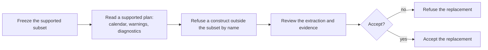

# Use case: own-the-duty-plan-extraction

## Level

!

## Actors

- Release maintainer — primary Actor; names the supported subset, decides the extraction replacement, and accepts or rejects it on the measured evidence.
- Supporting: Contributor reviewer — reviews the owned extraction, its equivalence evidence and the frozen subset; cannot land or publish.
- Supporting: Project automation for the release maintainer — builds the landed and baseline revisions for the supported platform and the browser target, runs the equivalence comparison and reports the measured sizes that step 4 reviews.

## Goal

Own the reading of the supported duty plan, so that a crew member receives the accepted calendar, warnings and diagnostics from a download that carries no third-party PDF extractor.

## Trigger

The release maintainer starts replacing the third-party PDF extractor with the project's own reading of the supported plan, on a size attribution that names the extractor's share of the distributed executable.

## Preconditions

- A size attribution for the revision is available and names the third-party extractor's share of the distributed executable.
- The supported subset is recorded as one decision before implementation starts.
- The Windows GNU cross-build and the browser target can both be built from the revision.
- The third-party extractor is available to the test graph as the comparison oracle.

## Main flow

1. Release maintainer freezes the supported subset — the constructs the extraction reads and the constructs it refuses by name; System records the subset as one architecture decision before any implementation is measured.
2. Release maintainer supplies a supported duty plan; System's owned extraction reads it, the detail-table construction is unchanged, and the conversion yields the accepted calendar, the accepted conversion warnings and the accepted diagnostics for the same source snapshot.
3. Release maintainer supplies a document whose construct is outside the frozen subset; System refuses it by name, writes the numbered failure report naming the source and the reason, publishes no calendar and does not panic.
4. Contributor reviewer reviews the extraction and the equivalence and refusal evidence, and the release maintainer accepts or rejects the replacement; System reports the review outcome and records the decision with the evidence and the reason.

## Extensions

- 2: the frozen subset claims to support a plan the owned extraction cannot read → the replacement is refused until that plan reads correctly; the gap is recorded rather than narrowed silently.
- 2: a supported plan produces a different calendar, warning or diagnostic than the previously accepted extraction → the replacement is refused, and the differing source snapshot, detail row and wording are recorded. Protects equivalence.
- 3: a document outside the subset panics, yields an empty calendar, or is reported as unreadable although it is a valid PDF → the replacement is refused; a panic or a misnamed refusal is a defect, not a refusal.
- 3: a construct has no recorded name yet → the replacement is refused until it is either implemented or named; no construct is skipped silently.
- 4: the review rejects the extraction → it is not accepted and does not land.
- 4: the accepted replacement is not reproducible → either shipped graph still contains the third-party extractor, or the test graph no longer carries the oracle; the first is not recorded as landed, the second is recorded as lost equivalence evidence before acceptance.

## Rules

- **Provenance and contract status**: created by the change to replace the PDF extraction backend; it has no ideation seed. It redraws the boundary recorded by `release-executable-size` (backend replacement was excluded from the size-lever use cases) and `generalized-duty-plan-input` (the inherited pinned-extractor constraint becomes one owned extraction implementation behind the source port). On archive it becomes the permanent leaf at `givn/specs/own-the-duty-plan-extraction/usecase.md`.
- **Owned extraction** is the project-owned implementation that turns one supplied duty plan's bytes into the positioned words the detail-table construction reads. It is not a general-purpose PDF library, and it is not the detail-table construction, which remains extraction-agnostic. The third-party extractor is the **test oracle**, not part of the reading the project ships.
- **The reading boundary is the positioned word.** The owned extraction produces a page's words with their text and page-space position; the detail-table construction consumes that payload and is the one implementation used by the executable and the browser. No second copy of the column, clustering, date or footer rules exists.
- **The supported subset is frozen by ADR-0008** to the constructs the supplied reference plans and the explicitly validated variations exercise: Type0 fonts with `Identity-H` encoding and a per-font `ToUnicode` CMap, a CIDFontType2 descendant with `/W` and `/DW` advances and a `/FontDescriptor` carrying `/Ascent` and `/Descent`, Flate content streams, classic xref tables, xref streams, object streams, and the content operators the family prints (`BT`, `ET`, `Tf`, `Tj`, `Tm`, and the graphics operators `q`, `Q`, `cm`, `rg`, `RG`, `w`, `J`, `d`, `j`, `S`, `f`, `re`, `m`, `l`, `h`, `W`, `Do`). A construct outside it is never guessed.
- **Every construct outside the subset is refused by name.** A readable document that uses encryption, another font subtype or encoding, a missing `ToUnicode` map, an unmapped glyph code, a font descriptor without a descent, text rotation, horizontal text scaling, page rotation, a page box other than the media box, an inline image, a form XObject, a text-positioning operator outside the subset, or an unknown content-stream filter produces one named refusal. A readable PDF that does not carry the supported family keeps the unsupported-family refusal; a non-PDF keeps the unreadable refusal.
- **The refusal contract is observable.** The named refusal keeps the two-line `Source PDF:` / `Reason:` failure report, names the construct and the page when one is known, never contains printed plan content (no text, station, name, date or code printed by the plan), never panics, and never publishes a calendar, a warning report or an empty calendar.
- **Equivalence is judged against the previously accepted extractor.** For the same source snapshot the calendar text, the conversion warnings and the detail-row diagnostics are identical. At the word level the owned extraction matches the oracle's word text exactly and its `x0` and page-space `top` within 0.5 point, using the oracle's default word rules.
- **The dependency split is mechanical.** The release and browser dependency graphs contain no third-party PDF extractor; the test graph keeps it as the oracle. A check reports the split so a later revision cannot reintroduce the extractor into a shipped graph or silently drop the oracle.
- **Measurement is on the shipped artifacts.** The Windows GNU executable and the browser bundle are measured against the same revision rebuilt with the previous extraction; host builds are not evidence, the published binary is not the baseline, and a replacement that is not smaller is rejected.
- **The same-revision measurement is one-shot.** It is repeated only while the base revision still carries the previous extraction, that is while the base's `crates/duty2cal-pdf/Cargo.toml` still names `pdfplumber` in its dependencies; a base revision that carries no extractor records `status: not applicable` with the landed size. After landing no automated size gate exists, and the unchanged 2,097,152-byte budget is not a substitute for one because the proposal forbids a size ceiling.
- **Delivery constraints** carry over: Rust stable with edition 2021, a single self-contained executable without companion-runtime installation, the Windows GNU cross-build on Linux/CI, the working browser conversion route, no native C/C++ extraction dependency, and the public support statement unchanged.
- **Privacy**: no real plan or plan-derived fixture is committed; the private corpus is read locally and only by an opt-in command; generated fixtures use fictional values.

## Examples

- The supported plan converts to the accepted calendar; the owned extraction's positioned words match the oracle within 0.5 point and with identical text on every page.
- A plan whose only difference is a revised source snapshot converts; the calendar keeps its source-snapshot identities.
- A row with an unrecognized activity code still publishes the calendar and the conversion warning; the owned extraction changes no row semantics.
- An encrypted document → one named refusal, the numbered failure report naming the source and the construct, no calendar, non-zero exit status.
- A Type3 font → one named refusal naming the Type3 font and its page.
- A text rotation → one named refusal naming the rotation and its page.
- A horizontal text scaling other than 100 percent → one named refusal naming the scaling and its page.
- An inline image → one named refusal naming the inline image and its page.
- A content stream whose filter is outside the subset → one named refusal naming the filter.
- A readable PDF with no detail-table header → the unsupported-family refusal, not an empty calendar.
- A truncated PDF → the unreadable refusal and the two-line report, not a panic.
- A refusal on a plan that prints an identifying name → the report names the construct and contains none of the printed name.
- The Windows executable measured against the same revision with the previous extraction → a positive saved-bytes figure recorded with the change.
- The browser bundle measured the same way → a positive saved-bytes figure recorded with the change.
- A release graph that still names the extractor → the replacement is not recorded as landed.

## Minimal guarantee

No failure becomes less visible than before: every unreadable, unsupported-family or unsupported-construct source produces the numbered failure report naming the source and the reason, with the existing two-line form and numbered names; no construct is skipped silently; no refusal panics or publishes an empty or partial calendar; no printed plan content enters a refusal, a fixture or a committed artifact. An equivalence failure or a non-positive size delta is never reported as success.

## Success guarantee

The supported duty plan is read by an extraction the project owns: the same source snapshot yields the accepted calendar, warnings and diagnostics, every construct outside the frozen subset is refused by name without a panic or an empty calendar, and the artifacts a crew member receives carry no third-party PDF extractor.

This is a changing use case: it replaces the implementation that reads the supported plan, and it creates the extraction the project owns.

## Personas

- project-maintainer--release-owner
- crew-member--personal-calendar-owner
- contributor--web-reviewer

## Capabilities

- own-the-duty-plan-extraction

## Interactions

| Capability | Consumer action | E2E scenario |
|---|---|---|
| own-the-duty-plan-extraction | convert the supported duty plan through the built executable and read the calendar it publishes | Release maintainer converts the supported plan through the executable and receives the accepted calendar |

## Includes

- none

## Extends

- none

## Out of scope

- Changing the conversion rules, the calendar representation or the detail-row diagnostic semantics (`export-duty-plan-calendar`).
- The size attribution's own report shape and cadence (`measure-distributed-executable-size`), and applying other build-configuration levers (`reduce-distributed-executable-size`).
- A size ceiling or a release refusal on size.
- Supporting another plan, operator, generator or PDF layout; encrypted documents; a general-purpose PDF library or writer; any native dependency.
- Publishing a release or its archive; the browser page's copy, design, save behaviour or site publication.
- Committing real plans, a sanitized real plan, or any plan-derived fixture.
- Editing the ideation records; this use case records the redraw and their next session re-reads it.

## Diagram

