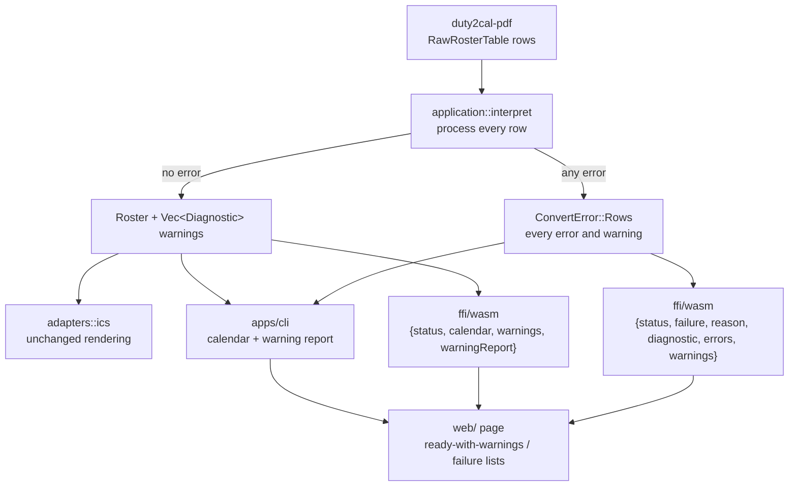
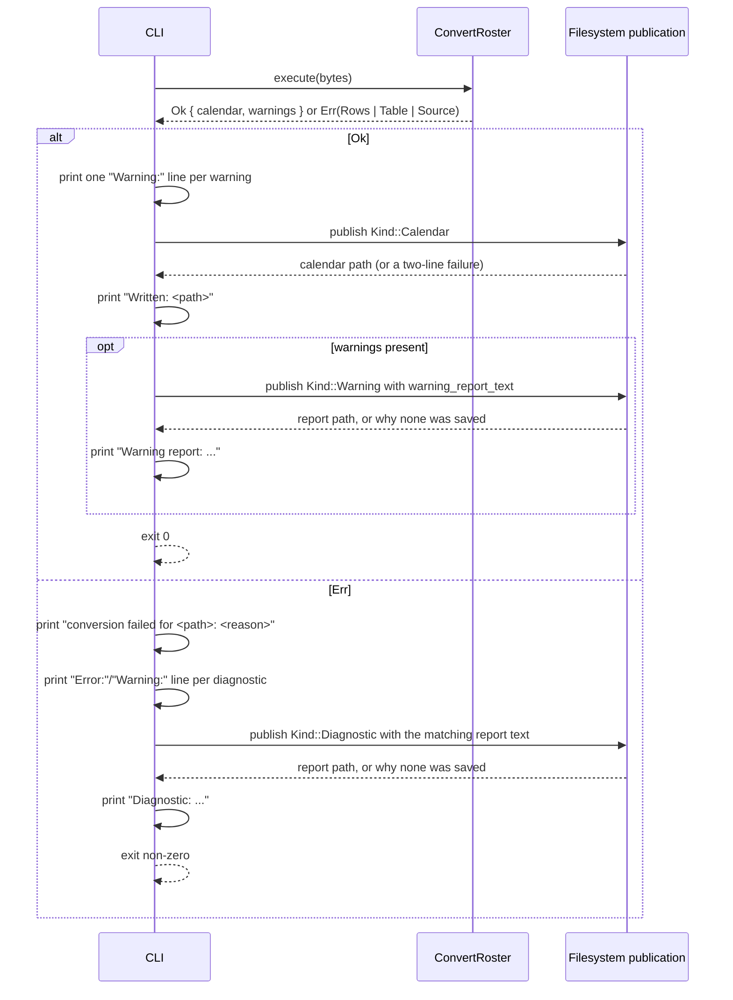

# Design: report-row-diagnostics

## Scope

The HOW for the observable rules in [the delta](specs/export-duty-plan-calendar/export-duty-plan-calendar.feature) and in [the use case](../../specs/export-duty-plan-calendar/usecase.md). The converter keeps its crates, ports, adapters, runner, fixtures, golden oracle and publication semantics. What changes is the interpretation outcome: every detail row is processed, every error and warning is collected and reported, an unrecognized activity code becomes an ordinary timed or all-day activity from its printed evidence, and a second report kind carries the warnings.

No new technology, dependency, crate, module boundary or document set is introduced. The change touches the domain's activity value, the application's interpretation and report text, the filesystem adapter's names, the two facades, the page's state set and the step definitions.

## Technology decisions

No version-bearing decision changes. The versions below are read from the workspace manifests at design time, not assumed to be current releases.

| Area | Decision | Source |
|---|---|---|
| Language and layout | Rust stable (`rust-toolchain.toml` channel `stable`), edition 2021, workspace `duty2cal-core` / `duty2cal-pdf` / `apps/cli` | Unchanged |
| Error types | `thiserror`-derived typed errors; no `unwrap()`/`expect()` outside tests | Chapter 2; unchanged |
| Calendar writer | Hand-written RFC 5545 serializer; writes `SUMMARY` from `DutyEntry::summary()` and `DTSTART`/`DTEND` from `DutyEntry::interval()` / `DutyEntry::date()` | `crates/duty2cal-core/src/adapters/ics/mod.rs`; unchanged — it renders through the entry's accessors and has no `match` on the entry, so the new variant needs no arm |
| Gherkin runner | cucumber-rs `cucumber = "0.23"` as a `harness = false` test target, invoked through `./run-tests.sh` | Read from `apps/cli/Cargo.toml` at design time; unchanged |
| Browser driver | Playwright `1.64.1` and `@axe-core/playwright` `4.14.0`, pinned in `web/e2e/package.json` / `package-lock.json` | Read from the manifests at design time; unchanged |
| Fixtures | Generated at test time by `apps/cli/tests/steps/support.rs`; only the expected calendar is committed | Unchanged |
| Golden oracle | `apps/cli/tests/fixtures/expected/2098-06.ics` remains byte-identical | The reference plan contains no unrecognized code |

Version freshness: this design changes no language, runtime, framework, library, driver or image version. Nothing is pinned from memory. The Playwright and cucumber versions above were read from this workspace's manifests on 2026-10-27; a later dependency change re-evaluates them under the design instruction's freshness rule.

## Data model

### Diagnostics

The domain stays pure. Diagnostics belong to the application layer, because interpretation is where a detail row is resolved or rejected and where the source's own words are known.

```rust
// crates/duty2cal-core/src/application/mod.rs

/// How a diagnostic affects publication.
#[derive(Debug, Clone, Copy, PartialEq, Eq)]
pub enum Severity {
    /// The row cannot be represented; any error prevents publication.
    Error,
    /// The row was represented by a documented fallback.
    Warning,
}

/// One reported finding about one detail row.
#[derive(Debug, Clone, PartialEq, Eq)]
pub struct Diagnostic {
    /// Which severity a reader must apply.
    pub severity: Severity,
    /// 1-based position of the row among the rows the adapter yielded for the
    /// detail table, counting silent layout rows (rows with no activity code
    /// and no route).
    pub row: usize,
    /// The row's duty-plan date: the row's own date, or the carried date for a
    /// continuation row, so a warned continuation row prints the date it
    /// belongs to rather than none. `None` when no date resolved.
    pub date: Option<Date>,
    /// The complete sentence a reader sees.
    pub message: String,
}
```

`row` is the raw table position, not an index into a filtered list: `for (position, cells) in table.rows.iter().enumerate()` gives `row = position + 1`. A silent layout row therefore keeps its place in the numbering even though it produces no activity, and a row whose date cannot be resolved is still named by the line a reader can find in the source. The numbering is pinned by "A silent layout row before a warned row keeps its place in the row numbering".

### Outcome and failure

```rust
/// A completed conversion: the calendar text and every fallback it used.
pub struct ConversionOutcome {
    pub calendar: String,
    pub warnings: Vec<Diagnostic>,
}

pub enum ConvertError {
    /// The source could not be read as a supported plan.
    Source(#[from] SourceError),
    /// The detail table itself is unusable (a required column is missing).
    Table(String),
    /// Row-level errors; carries every error and warning of the run.
    Rows(Vec<Diagnostic>),
}
```

`Rows` is constructed only with at least one `Severity::Error`. `Rows` uses a hand-written `Display` (a vector is not itself a message): it renders the first error's `message`, so `error.to_string()` — the page's and the executable's primary reason — keeps the established sentences, including `a required activity could not be resolved: …` and `a required timing could not be resolved: …`.

The old `UnresolvedRequiredActivity`, `UnresolvedTiming` and `NonPositiveInterval` variants are deleted; their sentences move into the `message` of the diagnostic that reports them. `Table` replaces the one table-structure failure that is not about a row, and its hand-written `Display` retains the established prefix so no user-visible failure text changes: `Table(label)` renders `a required activity could not be resolved: the detail table carries no <label> column` — the exact sentence today's `UnresolvedRequiredActivity("the detail table carries no {label} column")` renders. The permanent scenario that asserts the substring `carries no From column` therefore still passes unchanged.

### One domain activity value

`DutyEntry` gains one variant for a row represented from printed evidence without a recognized meaning:

```rust
/// An activity represented from a row whose code the converter does not know.
///
/// The kind comes from the printed evidence, never from the code's letters:
/// both printed endpoints make it timed, none makes it all-day.
UnrecognizedActivity {
    date: Date,
    /// The printed activity code, verbatim.
    code: String,
    /// The printed station, when the row prints one.
    station: Option<String>,
    /// The printed UTC window; `None` means all-day.
    interval: Option<UtcInterval>,
},
```

Rendering is the existing rule, with no bespoke calendar shape:

| Accessor | `UnrecognizedActivity` |
|---|---|
| `summary()` | the printed `code` |
| `location()` | `station` |
| `interval()` | `interval` |
| `date()` | `date` |
| `description_fields()` | empty — the fallback publishes only the printed code, station and interval; other optional context the row happens to print (a Trip ID, a report time) is deliberately not represented, and repeating the title as a description would duplicate visible content. This is the one stated exception to the descriptive-field rule in the use case (Q10). |

All other variants are untouched, so their calendar text cannot change (D7).

## Internal Primitives

The change introduces these production primitives. Each is the single home for one decision, and no parallel representation exists.

| Primitive | Location | Purpose |
|---|---|---|
| `Severity { Error, Warning }` | `application` | The two outcomes a diagnostic can carry; any `Error` prevents publication. |
| `Diagnostic { severity, row, date, message }` | `application` | One reported finding about one raw detail row, carrying its plan position and date. |
| `ConversionOutcome { calendar, warnings }` | `application` | A published conversion plus every fallback it used, in plan order. |
| `ConvertError::{Table, Rows}` | `application` | A structural failure (`Table`) or the complete row-level error/warning set (`Rows`); `Source` remains for unreadable input. |
| `DutyEntry::UnrecognizedActivity { date, code, station, interval }` | `domain` | An activity represented from printed evidence without a recognized code; `interval: None` is the all-day fallback. |
| `diagnostic_line(&Diagnostic) -> String` | `application` | The one spelling of a row/date/message line for the reports, the transcript and the page. |
| `failure_report_text(source, diagnostics) -> String` | `application` | The sectioned failure report (`Source PDF`, `Reason`, `Errors`, `Warnings`). |
| `warning_report_text(source, warnings) -> String` | `application` | The warning report (`Source PDF`, `Warnings`). |
| `Kind::Warning` | `apps/cli/src/fs.rs` | The `<stem>.parse-warnings[-N].txt` publication name. |

No new public primitive is introduced in the PDF adapter, the ports, or the calendar writer; `adapters/ics` renders the new variant through the existing accessors.

## Architecture impact



Changed files:

| Path | Kind | Purpose |
|---|---|---|
| `crates/duty2cal-core/src/domain/mod.rs` | changed | `DutyEntry::UnrecognizedActivity` and its accessor arms. |
| `crates/duty2cal-core/src/application/mod.rs` | changed | `Severity`, `Diagnostic`, `ConversionOutcome.warnings`, `ConvertError::{Table, Rows}`, the all-rows interpretation, and the two report-text builders. |
| `crates/duty2cal-core/src/adapters/ics/mod.rs` | unchanged | It renders through `summary()`, `location()`, `description_fields()`, `interval()` and `date()`; there is no `match` on the entry, so the new variant needs no arm. |
| `apps/cli/src/fs.rs` | changed | `Kind::Warning` (`<stem>.parse-warnings[-N].txt`). |
| `apps/cli/src/main.rs` | changed | Print every diagnostic line, publish the warning report, choose the report shape on failure. |
| `ffi/wasm/src/lib.rs` | changed | Extend the success/failure objects; add `warning_report_text` alongside `diagnostic_text`. |
| `web/index.html` | changed | Warning and error list containers; ready-with-warnings state. |
| `web/app.js` | changed | Render lists, offer the warning report, new state transition. |
| `web/styles.css` | changed | The `Diagnostic list` primitive. |
| `web/e2e/driver.mjs` | changed | `readState` exposes `lists` and the `ready-with-warnings` state; `warnings` offer kind. |
| `apps/cli/tests/steps/export_duty_plan_calendar.rs` | changed | New and strengthened phrases (table below); unused unrecognized-code fixtures removed. |
| `apps/cli/tests/steps/e2e/export_duty_plan_calendar.rs` | changed | The visual-baseline/axe/capture helper takes a state suffix, and new phrases assert and capture the `ready-with-warnings` and failure states of the two new regular `@browser` scenarios. |
| `givn/specs/export-duty-plan-calendar/usecase.md` | changed | The replaced rule, severity, reports, extensions, guarantees and examples. |
| `docs/design/design-system.md`, `docs/design/reference/converter-reference.html` | changed | The declared `ready-with-warnings` state, the `Diagnostic list` primitive and its reference view. |
| `docs/arc42/*` | changed | Chapters 1, 3, 4, 5, 6, 8, 9, 10, 11 and 12. |

`apps/cli/tests/steps/support.rs`, `apps/cli/tests/steps/browser.rs`, `apps/cli/tests/fixtures/expected/2098-06.ics`, the ports (`RosterSource`, `CalendarSink`, `Clock`) and every crate boundary are unchanged.

## Aggregation algorithm

`interpret(table, snapshot)` keeps its signature's inputs and changes its result to `Result<Interpretation, ConvertError>`, where `Interpretation { entries: Vec<DutyEntry>, diagnostics: Vec<Diagnostic> }`.

1. **Table structure.** `Date`, `From` and `To` must exist as columns. A missing column returns `ConvertError::Table("the detail table carries no <label> column")` before any row is read; this is not row-level and keeps the two-line report.
2. **One pass over every raw row**, in table order, with `row = position + 1`:
   1. A `Layover:` marker supplies the row's activity and station, exactly as today.
   2. A row whose `Activity`, `From` and `To` cells are all empty is **silent**: it contributes no entry, no diagnostic, and no carried-date update. This is the layout-row rule (D3).
   3. The date is the row's own `Date` cell, or the last resolved date for a continuation row. A row that prints a date which cannot be parsed, or that prints none and has no earlier resolved date, produces an **error** diagnostic whose `date` is `None`; the row contributes nothing further and updates neither carried value, because it could not be placed in the plan.
   4. A resolved date updates the carried date. A printed `Trip` updates the carried trip. Both are otherwise unchanged from today's rules.
   5. Classification, in this order:
      - a recognized all-day, availability or non-flight code with a resolvable positive interval → its entry (no diagnostic); a recognized timed code whose interval cannot be built with the endpoints it prints falls through to the final catch-all below, never to a silent skip;
      - `Layover` → its entry (no diagnostic);
      - a route (both `From` and `To`) with both endpoints → a travel entry; an interval that is not strictly positive produces an **error** diagnostic for that row instead;
      - a departure-fragment shape (`From` + `Start`, no `To` and no `End`) → held as a pending fragment;
      - an arrival-fragment shape (`To` + `End`, no `From` and no `Start`) → paired with the most recent pending fragment whose `Activity` and `Pos` are equal; no partner produces an **error** diagnostic for the arrival row, the row contributes nothing, and the still-unmatched departure then produces its own error at step 3, so a mis-paired leg reports two errors in row order; an unresolved endpoint or a merged interval that is not positive produces an **error** diagnostic at the departure row, where the leg belongs;
      - an unrecognized code with **both** endpoints and no route → `UnrecognizedActivity { interval: Some(..) }` and one **warning**, built with the same `row_interval` rule as the known timed codes: the positive-interval check and the narrow unqualified overnight rollover apply, so an unqualified 23:10–01:05 window becomes the following UTC day while an equal or qualified-backwards window is an error;
      - an unrecognized code with **neither** endpoint and no route → `UnrecognizedActivity { interval: None }` and one **warning**;
      - an unrecognized code with exactly one endpoint and no route → an **error** diagnostic that names the code and the single endpoint;
      - no code and no route → an **error** diagnostic (`a detail row carries neither an activity code nor a route`);
      - no code with a route but an incomplete interval → an **error** diagnostic (`a route row carries an incomplete printed interval`);
      - **the final catch-all:** any row that reached none of the branches above is an **error** diagnostic. A code-bearing row with a route and an incomplete interval uses `a route row carries an incomplete printed interval`, because it does print a route; a recognized timed code (SB, RE, SBX, TK, DTUSA or EM) whose positive interval cannot be built with one or no endpoint also lands here. No row leaves the classification without an entry or a diagnostic — there is no silent path.
   6. A recognized code wins over the route branch and over the fallback: a TK or SB row that also prints a route keeps its printed kind. A route wins over the fallback, so an unrecognized code with both stations is travel and never warns; only a code outside the known sets that carries no route warns (D4). The classification and its order are pinned by "A known timed activity code that also prints a route stays a timed non-flight activity", "A timed activity code with a route and an incomplete printed interval rejects the conversion" and "An unrecognized activity code with a route and a single printed endpoint rejects the conversion".
3. **Unmatched fragments.** After the pass, every remaining pending departure produces one **error** diagnostic at its own row; a matched pair whose merged interval is not positive has already reported its error at the departure row and does not report it twice. Processing never stops early, so later rows and later fragments are still reported.
4. **Ordering.** Entries are sorted by their row position, as today, so a split leg stays where it departs. Diagnostics are sorted by `row` before they are reported, so the list reads in plan order even though an unmatched departure is discovered at the end. The ordering is pinned by "An unmatched departure and a later warning are reported in plan order", which asserts that the earlier departure error is the `Reason:` line.
5. **Outcome.** If any diagnostic has `Severity::Error`, return `ConvertError::Rows(diagnostics)`; the entries are discarded and no calendar is composed. Otherwise build the `Roster`, compose the calendar through the unchanged sink, and return `ConversionOutcome { calendar, warnings }` where `warnings` holds every diagnostic (all of them `Severity::Warning`).

### Carried date and carried trip

The continuation rules that exist today are preserved, with one decision made explicit: a row that cannot resolve its date is skipped for carrying purposes.

- `carried_date` updates only when a row resolves a date. A continuation row (empty `Date`) uses it; a row that fails to parse its own date does not.
- `carried_trip` updates from a row's own printed `Trip`, but only for a row whose date resolved: the row must belong to the plan before it can hand trip context to a later leg. Blank `Trip` cells and page/date continuations keep the previous value.
- Silent layout rows (no activity code and no route) never update either value, exactly as today — they are skipped before the date is read.

### The November plan

The supplied plan's thirty dated rows now produce a calendar and six warnings, because all six unrecognized rows print a station and both endpoints and no route. The eight silent layout rows stay silent. The two split travel legs, the layover row and every recognized code produce byte-identical calendar text. No row in that plan is an error.

## Report text

The application owns both report builders and both facades call them, so the executable and the page cannot drift into different spellings.

```rust
/// The complete failure report for row-level errors.
pub fn failure_report_text(source_name: &str, diagnostics: &[Diagnostic]) -> String;

/// The complete warning report for a conversion that published a calendar.
pub fn warning_report_text(source_name: &str, warnings: &[Diagnostic]) -> String;

/// One diagnostic as a reader sees it in a list: `row <n> (<YYYY-MM-DD>): <message>`
/// when the date is known and `row <n>: <message>` otherwise — the entry line
/// without its `- ` prefix. Both report builders and the wasm facade call this,
/// so the report, the transcript and the page cannot spell a row differently.
pub fn diagnostic_line(diagnostic: &Diagnostic) -> String;

/// The two-line report for failures that are not about a row. Unchanged.
pub fn diagnostic_text(source_name: &str, reason: &str) -> String;
```

An entry line is `- ` followed by `diagnostic_line`'s text: `- row <n> (<YYYY-MM-DD>): <message>` when the date is known and `- row <n>: <message>` otherwise. The date is written in ISO form because the source prints several local conventions and a report reader compares rows across plans. A section with no entries is omitted. The browser result's `errors` and `warnings` arrays carry `diagnostic_line`'s text unchanged, so the page's list items and the report's entries are the same words.

Warning report (all values generated):

```text
Source PDF: roster.pdf
Warnings:
- row 4 (2099-06-07): unrecognized activity code "ZZ_M_CF"; converted as a timed activity using its printed UTC window 08:00-15:30
- row 5 (2099-06-08): unrecognized activity code "ZZ_M_CF"; converted as an all-day activity
```

Failure report for two errors and one warning (all values generated):

```text
Source PDF: roster.pdf
Reason: a required activity could not be resolved: unrecognized activity code "ZZ_M_CF" with only one printed UTC endpoint
Errors:
- row 3 (2099-06-06): a required activity could not be resolved: unrecognized activity code "ZZ_M_CF" with only one printed UTC endpoint
- row 7: a required activity could not be resolved: a detail row prints no date and no earlier row supplies one
Warnings:
- row 4 (2099-06-07): unrecognized activity code "ZZ_M_CF"; converted as a timed activity using its printed UTC window 08:00-15:30
```

The last line of each report is terminated by a newline, and the file uses LF: report files are read in editors and terminals, unlike the CRLF the calendar contract requires.

### Sentences

Each message is one complete sentence, so the transcript, the page and the report can share it verbatim.

| Finding | Severity | `message` |
|---|---|---|
| Unresolved date | Error | `a required activity could not be resolved: unresolved date: "<cell>"` |
| No date and none carried | Error | `a required activity could not be resolved: a detail row prints no date and no earlier row supplies one` |
| Unresolved timing | Error | `a required timing could not be resolved: <timing error>` |
| Non-positive interval | Error | `a timed interval must end after it starts` |
| Unmatched fragment | Error | `a required activity could not be resolved: no unique compatible partner for travel fragment "<Printed Identification>"` |
| Neither code nor route | Error | `a required activity could not be resolved: a detail row carries neither an activity code nor a route` |
| Route with an incomplete interval | Error | `a required activity could not be resolved: a route row carries an incomplete printed interval` |
| Unrecognized code, one endpoint | Error | `a required activity could not be resolved: unrecognized activity code "<code>" with only one printed UTC endpoint` |
| Unrecognized code, timed fallback | Warning | `unrecognized activity code "<code>"; converted as a timed activity using its printed UTC window <start>-<end>` |
| Unrecognized code, all-day fallback | Warning | `unrecognized activity code "<code>"; converted as an all-day activity` |
| Missing required column (not row-level) | Error | `a required activity could not be resolved: the detail table carries no <label> column` |

The error sentences keep the established prefixes because the existing primary-reason assertions (`a required activity could not be resolved: …`) read them and because the reason line and the first error entry must agree. The last row is `ConvertError::Table`'s `Display`; it is listed here because it is the one failure sentence a reader can still see unchanged, and the change must not silently reword it.

## Executable publication flow



- Warning lines are printed as soon as the interpretation completes, before publication, so a calendar that then fails to publish does not hide the warnings it would have carried.
- The warning report is written only after the calendar was published, and only when warnings exist. A warning report that cannot be saved prints `Warning report: no new report was saved: <error>` (or `no unused report name is available`) and leaves the exit status at zero: the calendar is a success and the warnings already reached the screen.
- `ConvertError::Table` and `ConvertError::Source` use `diagnostic_text`, so an unreadable source, an unsupported plan, a missing required column, an unnameable source and a publication failure keep exactly today's two-line report.
- `ConvertError::Rows` uses `failure_report_text`; the printed `Reason:` is the first error message in plan order.

## Browser result shape

```jsonc
// success
{ "status": "ok", "calendar": "<RFC 5545 text>",
  "warnings": ["row 4 (2099-06-07): unrecognized activity code \"ZZ_M_CF\"; …"],
  "warningReport": "Source PDF: 2026-06.pdf\nWarnings:\n- row 4 …\n" }

// failure
{ "status": "failure", "reason": "<first error message>",
  "errorCount": 1, "warningCount": 1,
  "diagnostic": "<complete failure report>",
  "errors": ["row 3 (2099-06-06): …"],
  "warnings": ["row 4 (2099-06-07): …"] }
```

- `warnings` and `errors` carry `diagnostic_line`'s text — the entry line without the `- ` prefix — so the page renders them as list items and cannot spell a row differently from the report.
- `warningReport` is the exact file text the page offers; it is the empty string when there are no warnings.
- `errorCount` and `warningCount` are the lengths of the two arrays, exported so the page can build its count-based reason sentence without counting list items or parsing `reason`. `reason` stays the report's `Reason:` line (the first error in plan order) for callers that need the exact sentence; the page shows the count sentence instead (F10).
- `diagnostic` is the complete file text: the sectioned failure report for `Rows`, the unchanged two-line report for `Source`/`Table`. The page displays the count sentence and the lists separately, so it never parses the report.
- `diagnostic_text(filename, reason)` remains exported for failures the page detects itself (size bound, startup, trap); those are not row-level and keep the two-line form.

## Page: DOM, JavaScript and CSS

Declared states gain one: `ready-with-warnings`. `empty`, `converting`, `ready`, `failure` and `cannot-run` are otherwise unchanged.

```html
<section id="ready" class="panel" hidden>
  <h2>Calendar ready</h2>
  <p id="ready-copy">Your complete calendar is ready. The browser chooses where the file is saved.</p>
  <div id="offer" class="offer" hidden></div>
  <div id="warnings" class="diagnostics" hidden>
    <h3>Warnings</h3>
    <ul id="warning-list" class="diagnostics__list"></ul>
  </div>
  <p id="status" class="muted" role="status" aria-live="polite">Calendar ready for <name>.</p>
  <button id="ready-reset" type="button" class="button">Choose another duty plan</button>
</section>

<section id="failure" class="panel panel--failure" role="alert" hidden>
  <h2>Conversion failed</h2>
  <p id="failure-reason"></p>
  <div id="failure-errors" class="diagnostics" hidden>
    <h3>Errors</h3>
    <ul id="error-list" class="diagnostics__list"></ul>
  </div>
  <div id="failure-warnings" class="diagnostics" hidden>
    <h3>Warnings</h3>
    <ul id="failure-warning-list" class="diagnostics__list"></ul>
  </div>
  <div id="failure-offer"></div>
  <p id="failure-note" hidden></p>
  <button id="reset" type="button" class="button">Choose another plan</button>
</section>
```

JavaScript rules:

- `renderList(container, items)` fills or hides a list container; it is called with `warnings` for the ready state and with `errors`/`warnings` for the failure state. An empty list hides its block, so a warning-free conversion shows no warning area (D6).
- The `ready` state is drawn exactly as the reference draws it: heading `Calendar ready`; copy `Your complete calendar is ready. The browser chooses where the file is saved.`; the `<stem>.ics` offer; the status `Calendar ready for <name>.`; and a visible `Choose another duty plan` button (`#ready-reset`) that returns the page to `empty` and clears the attempt. The button is the reference's drawn way back, kept in the ready state even though the picker is also above it.
- Success with warnings (`ready-with-warnings`): the same heading and the plural copy `Your complete calendar is ready. The browser chooses where the files are saved.`; `showReady` offers `<stem>.ics` and `<stem>.parse-warnings.txt` (from `warningReport`), reveals `#warnings`, sets the status to `Your calendar is ready to save. <n> rows were converted with warnings.` — `Your calendar is ready to save. 1 row was converted with a warning.` for a single row — and keeps the same `Choose another duty plan` button. A failed warning-report offer keeps the calendar offer and the list, and appends `No warning report was offered.` to the offer note.
- Failure: `showFailure` receives the filename, the counts, the lists and the report text; it lists both severities, keeps the existing `#failure-offer` for `<stem>.parse-error.txt`, keeps the existing no-report note when that offer fails, and keeps the `Choose another plan` button. `#failure-reason` shows the count-based page sentence, never the first error sentence: `<name>: the plan has <error clause>[ and <warning clause>].` with `one row that cannot be represented` / `<n> rows that cannot be represented` and `one row that was converted with a warning` / `<n> rows that were converted with warnings`; counts are English words up to twenty and digits above. So the page reads `roster.pdf: the plan has one row that cannot be represented and one row that was converted with a warning.`, while the first error sentence appears once, as the first `Errors:` entry. This removes the duplicate reason the earlier draft showed in `#failure-reason` and in `#error-list` (F10), and the report under the offer keeps the first error as its `Reason:` line.
- `clearAttempt` hides both list containers and empties them, so a later attempt cannot inherit a previous attempt's diagnostics; a second attempt after a warned conversion therefore shows the new attempt's warnings only, or none.
- No fetch, no storage, no address change: only object URLs, revoked on replacement and `pagehide`, exactly as today. The CSP is unchanged.

CSS adds one primitive, built from existing tokens and no new color:

```css
.diagnostics { margin-top: var(--space); border-left: 3px solid var(--border); padding-left: var(--space); }
.diagnostics h2, .diagnostics h3 { font-size: 1rem; margin: 0 0 0.5rem; }
.diagnostics__list { margin: 0; padding-left: 1.25rem; }
.diagnostics__list li { overflow-wrap: anywhere; }
.panel--failure .diagnostics__list li::marker { color: var(--failure-ink); }
```

`overflow-wrap: anywhere` is required: an activity code or a row message can contain an unbroken token longer than the 360 px column.

The Playwright `readState` observation gains `lists: { errors: string[], warnings: string[] }` (from `#error-list li`, `#warning-list li` and `#failure-warning-list li`), reports `state: "ready-with-warnings"` when the offer area and the warning list are both visible, and classifies an offer whose download name ends in `.parse-warnings.txt` as `kind: "warnings"`. `offerSelector("warnings")` is `#offer a[download$=".parse-warnings.txt"]`.

## File naming

| Publication | Plain name | Enumerated | `Kind` |
|---|---|---|---|
| Complete calendar | `<stem>.ics` | `<stem>-1.ics`, … | `Calendar` (unchanged) |
| Warning report | `<stem>.parse-warnings.txt` | `<stem>.parse-warnings-1.txt`, … | `Warning` (new) |
| Failure report | `<stem>.parse-error.txt` | `<stem>.parse-error-1.txt`, … | `Diagnostic` (unchanged) |

`Kind::Warning` spells `(".parse-warnings", "txt")` in the existing `spelling()` match. `publish()` is otherwise untouched: create-new, enumerate past an occupied or concurrently claimed name, never replace, and report a name that only looked free.

## Step Definitions

One file per capability, as before. Every new phrase has a permanent home in this change; no delta step copy is created, so no separate merge target exists.

| Capability | Step definition file | Module | Permanent merge target | New or changed phrase groups |
|---|---|---|---|---|
| `export-duty-plan-calendar` | `apps/cli/tests/steps/export_duty_plan_calendar.rs` | `steps::export_duty_plan_calendar` of the `features_runner` target | none (the permanent file is the home) | Fixture Givens for an unrecognized code with a window (station + both endpoints), without times, with one endpoint, three unrecognized rows, mixed errors and warnings, an occupied warning-report name, a no-writable-destination run, and the page fixtures: `…with activity code <code>, a printed route from <A> to <B>, a printed UTC start 08:00 and no end`; `…with activity code <code>, a printed route from <A> to <B> and printed UTC times 08:00 and 12:00`; `…with activity code <code>, one local-date block and unqualified printed UTC clocks 23:10 and 01:05`; `…with activity code <code> and equal printed UTC clocks 10:00 and 10:00`; `…with activity code <code> at station ABC, printed UTC times 08:00 and 15:30, and a printed Trip ID T42`; `a supported duty plan whose first detail row is a silent layout row carrying only a date and whose second detail row carries the unrecognized activity code …`; `…with an unmatched departure fragment on an earlier detail row and an unrecognized activity code with printed UTC times on a later detail row`; `a supported duty plan with a travel leg printing flight number LU742 from ABC to DEF with printed UTC times 09:00 and 10:00 and no crew position`; `the converter page … that cannot create a download offer for the warning report`; `the crew member supplies the supported duty plan "<name>" containing two rows with unrecognized activity codes and printed windows`. Thens for the timed/all-day fallback activity, `that activity carries no description`, the warning count and row/date identity, the warning report's existence, name, collision and entries, `the warning report's first line states the source PDF "<name>"`, `the warning report carries a "Warnings:" section listing one entry`, the report sections, `the failure report lists the departure row's error before the later row's warning`, `the failure report's reason line is the departure row's error`, `the converter reports two conversion errors`, the transcript lines, the publishable/unpublishable warning report, and the page's ready-with-warnings and failure lists. |
| `export-duty-plan-calendar` (existing phrases) | `apps/cli/tests/steps/export_duty_plan_calendar.rs` | `steps::export_duty_plan_calendar` | none (the permanent file is the home) | `the diagnostic text identifies "<name>" and the reason` now accepts the sectioned failure report instead of the exact two-line text; the unresolved-activity fixture and the page's unresolved-activity fixture carry a row that is genuinely unrepresentable (one endpoint), not a bare unrecognized code; the Givens `a supported duty plan containing a required activity code the converter does not recognize` and `a supported duty plan with an unknown activity code and no route` are deleted with their retired scenarios. |
| `export-duty-plan-calendar` (browser) | `apps/cli/tests/steps/browser.rs` | `steps::browser` | none (unchanged) | Unchanged: the driver action list is unchanged; `read_state` already returns the extended observation. The page-state phrases used by the new scenarios (`the page shows that the calendar is ready with warnings`, `the page states "<text>"`, `the page shows a failure heading and the count-based reason sentence`, `the page states that no warning report was offered`) live in the capability's step file, not here. |
| `export-duty-plan-calendar` (e2e) | `apps/cli/tests/steps/e2e/export_duty_plan_calendar.rs` | `steps::e2e::export_duty_plan_calendar` | none (unchanged) | The baseline/axe/capture helper accepts a state suffix, and the phrase `the page meets the visual baseline in the (ready-with-warnings\|failure\|ready) state` is added: it calls `assert_visual_baseline(&state, "<suffix>", "en")`, `assert_axe_clean(w, "<suffix>")` and `capture_screenshots` with the matching `<viewport>--<state>.png` name, so the `ready`/`empty` behaviour of the existing `@e2e` phrase is unchanged. No `@e2e` scenario is added or retagged; the existing `@e2e` does not traverse the new states. |
| `export-duty-plan-calendar` (fixtures) | `apps/cli/tests/steps/support.rs` | `steps::support` | none (unchanged) | Unchanged: the existing `at`, `detail_header_row` and column constants build every new fixture. |
| `export-duty-plan-calendar` (browser driver) | `web/e2e/driver.mjs` | test tooling (not Gherkin glue) | none (test tooling) | `readState` gains `lists` and `ready-with-warnings`; `save_offer`/`capture_offer` accept the `warnings` kind. |

## Test runner, strict mode, and single-scenario command

- Unit/integration: `./run-tests.sh` — assembles `givn/specs/**` and every active change's `specs/**` into a temporary root, then runs `cargo test -p duty2cal --test features_runner` plus the Rust unit/property, architecture and golden tests.
- E2E: `./run-tests.sh --e2e` (`--tags "@e2e and not @browser"`), distinct from `verify.command`.
- Browser: `./run-tests.sh --browser` (builds `web/pkg` and `dist/site`, then `--tags "@browser"`); one scenario: `./run-tests.sh --browser --name "<scenario title>"`.
- Single scenario on any surface: `./run-tests.sh --name "<scenario title>"`; a named run must select exactly one scenario, and a run that selects none is a refusal.
- Strict mode: `apps/cli/tests/features_runner.rs` calls `DutyWorld::cucumber().fail_on_skipped().run_and_exit(root)`. An undefined or skipped step fails the run, which is why every new scenario is `@wip` until its steps exist.
- Not-implemented stub pattern: each new step starts as `panic!("not yet implemented: <step phrase>")`, with the phrase copied from the `.feature` text and nothing else in the body. The RED run for the scenario must fail with exactly that phrase in the cucumber output before any production or step code exists; a step that passes without it was bound to the wrong phrase. Step bodies are never empty, never return a default value and never assert a weaker value than the phrase states.
- Quality gates: `cargo fmt --all --check`, `cargo clippy --workspace --all-targets -- -D warnings`, `cargo test --workspace`.

The executable-spec invariant holds: `verify.command` runs the `.feature` files themselves through cucumber-rs; no parallel hand-maintained test asserts a diagnostic.

## Golden oracle

Two committed fixtures guard the conversion. `Scenario: The reference roster converts to the expected calendar` compares the generated reference plan with `apps/cli/tests/fixtures/expected/2098-06.ics` after CRLF-to-LF and folding normalisation, and the cucumber-free `apps/cli/tests/golden.rs` compares the generated `2026-06` equivalence plan with `apps/cli/tests/fixtures/expected/2026-06.ics` under the same normalisation. Neither reference plan contains an unrecognized code, so both expected calendars are not regenerated and must stay byte-identical. A changed line in either fixture is a defect in this change (D7).

## Decisions

Every proposal ID is resolved here.

- **Decides D1:** severity has exactly two levels, `Error` and `Warning`; an error means the row cannot be represented and prevents publication, a warning means a documented fallback was used and publication continues. — realized in `Severity`, `ConvertError::Rows`, the CLI exit status, the page states and the use case's severity rule; pinned by "An unrecognized activity code with a single printed endpoint rejects the conversion" and "A conversion without warnings publishes no warning report".
- **Decides D2:** an unrecognized code with both endpoints becomes a timed activity titled by the code, located at the printed station, using the printed window; with neither it becomes an all-day activity titled by the code; with exactly one it is an error. The code's letters are never read. — realized in `interpret`'s fallback arms and `DutyEntry::UnrecognizedActivity`; pinned by the timed, all-day and one-endpoint scenarios.
- **Decides D3:** a silent layout row — no activity code and no route, of which a date-only row is the common shape — is silent (no event, no warning, no carried-date update); a row that prints a station but neither a code nor a route stays an error. — realized in `interpret`'s silent-row skip and its last error arm; pinned by the permanent "A date-only row is not turned into an activity", the new "A silent layout row produces no warning" and "A row with a station but neither a code nor a route rejects the conversion".
- **Decides D4:** recognized codes keep today's semantics and win over the route branch, so a TK or SB row that also prints a route stays its printed kind; a route means travel for a code the converter does not recognize, including a flight number, and only such an unexpected code warns. The proposal's "whatever its code" clause is clarified, not changed: it is about flight numbers, which are outside the known sets. — realized by leaving every recognized arm untouched and placing the route branch before only the fallback; pinned by the golden calendar, the permanent known-code scenarios, "A known timed activity code that also prints a route stays a timed non-flight activity", "A travel leg with a flight number produces no warning" and "A silent layout row produces no warning".
- **Decides D5:** `<stem>.parse-warnings.txt` (enumerated) carries warnings beside a published calendar; `<stem>.parse-error.txt` (enumerated) carries no calendar and lists every error and warning under `Errors:`/`Warnings:` after `Source PDF:` and `Reason:`; non-row failures keep the two-line report. — realized in `Kind::Warning`, `warning_report_text`, `failure_report_text` and `main`'s choice of builder; pinned by the warning-report, collision, section and "second conversion with warnings" scenarios.
- **Decides D6:** the executable prints every error and warning line and the report path, exiting zero when the calendar was published; the page lists warnings in the ready state and errors plus warnings in the failure state and offers the matching report. No network, storage, dependency or CSP change. — realized in `main`'s printing, the page's `renderList`/offer paths and the driver's observations; pinned by "The executable prints each warning beside the new calendar path", "The page shows the warnings and offers both files when a plan converts with warnings" and "The page lists the errors and the warnings when a plan cannot be converted".
- **Decides D7:** calendar text for already-recognized activities is byte-identical; the fallbacks are ordinary timed and all-day events; component identity stays snapshot plus ordinal. — realized by the unchanged `adapters::ics` rendering and the untouched golden fixture; pinned by "The reference roster converts to the expected calendar" and "An identical source snapshot keeps its component identifiers".
- **Decides D8:** the use case's rule that an unknown activity code rejected the conversion is replaced by "converted using its printed evidence and reported as a warning; only a row that cannot be represented at all is an error", with the replaced rule named in place. — realized in `givn/specs/export-duty-plan-calendar/usecase.md` (rule, extensions, guarantees, examples, diagram).
- **Decides D9:** the change extends `export-duty-plan-calendar`; no capability is created. `givn spec route --change report-row-diagnostics` reports no signal (top candidates tie), so the proposal records the decision and its rationale. — realized in the proposal's Capability Routing table and this delta file.
- **Decides D10:** the two interaction-inventory actions are unchanged; warning and error visibility is regular `@browser` coverage of the existing page action, not a new `@e2e` action. — realized in the unchanged use-case `## Interactions` table and the Interaction Coverage Matrix below.

## Use-case traceability

| Use-case element | Technical decision | Evidence |
|---|---|---|
| Rule: every detail row accounted for; every row processed and every error and warning reported | One pass collecting `Diagnostic`s; `Rows` carries all of them; diagnostics sorted by row | "Several unrecognized rows are all reported in one conversion"; "Several failing rows are all reported with the warnings in one failure report" |
| Rule: an unrecognized code is represented from printed evidence and warns (replaces the old failure rule) | `UnrecognizedActivity` with `Some(interval)` or `None`, with the positive-interval check and the narrow unqualified overnight rollover of `row_interval` | "An unrecognized activity code with a printed window becomes a timed activity with a warning"; "An unrecognized activity code without printed times becomes an all-day activity with a warning"; "An unrecognized activity code with an unqualified window across midnight keeps it as the following UTC day"; "An unrecognized activity code with an equal printed window rejects the conversion"; "An unrecognized activity code's activity carries no description" |
| Rule: a row that cannot be represented is an error and no calendar is published | `ConvertError::Rows` when any `Error` exists; entries discarded | "An unrecognized activity code with a single printed endpoint rejects the conversion" |
| Rule: only an unexpected code warns; a route is still travel for an unrecognized code; a station-only row is an error | Classification order: known sets, layover, route, fragments, fallback, final catch-all error | The golden calendar; the permanent known-code and station-only scenarios; "A known timed activity code that also prints a route stays a timed non-flight activity"; "A travel leg with a flight number produces no warning"; "A silent layout row produces no warning"; "A timed activity code with a route and an incomplete printed interval rejects the conversion"; "An unrecognized activity code with a route and a single printed endpoint rejects the conversion" |
| Extension: a silent layout row is silent | Silent-row skip before date parsing, for a row with no activity code and no route | The permanent "A date-only row is not turned into an activity" and "A silent layout row produces no warning" |
| Rule: a conversion with warnings publishes the calendar and a warning report | `Kind::Warning` + `warning_report_text` after calendar publication | "A second conversion with warnings uses the next unused warning-report name"; "The warning report identifies the source and carries a warnings section"; "A warning report that cannot be published keeps the calendar and the warnings visible" |
| Rule: a conversion with errors publishes a failure report carrying every severity | `failure_report_text` and `Rows` | "Error and warning entries are distinguishable in the failure report" |
| Rule: the executable prints every line and exits zero with warnings | `main` printing and exit status | "The executable prints each warning beside the new calendar path"; "A conversion without warnings publishes no warning report" |
| Rule: the page lists warnings and errors and offers the matching report | `renderList`, `warningReport` offer, failure lists, count-based reason, ready-state way back | The seven new `@browser` scenarios |
| Lifecycle event: Conversion warning reported | `ConversionOutcome.warnings` printed and listed; the warning report written after publication | "The executable prints each warning beside the new calendar path"; "The page shows the warnings and offers both files when a plan converts with warnings"; "The page states how many rows were converted with warnings"; "A second attempt clears the previous attempt's warning list" |
| Lifecycle event: Conversion diagnostic written / offered | `failure_report_text` with `Kind::Diagnostic`; the page offers the same text | "Several failing rows are all reported with the warnings in one failure report"; the permanent "An interpretation failure preserves an older diagnostic" |
| Success guarantee: one export outcome with two artifacts — a complete calendar and, when warnings exist, the warning report of the same export | `ConversionOutcome { calendar, warnings }`; a warning report cannot be produced without performing the same conversion | The permanent `@e2e` "Crew member converts a supported duty plan and receives a calendar file"; "The warning report identifies the source and carries a warnings section" |
| Minimal guarantee: no silent drop, no successful partial conversion | `Rows` on any error; report attempted; warnings never withdraw a calendar | The error scenarios and the permanent publication-failure scenarios |
| Capability ownership | `export-duty-plan-calendar` only | Interaction Coverage Matrix |

Actors in Gherkin are domain actors; Personas are review lenses.

## Persona impact

User-visible surfaces: a terminal interface (CLI text output), the calendar text a crew member reads, and the browser conversion page. Confirmed Personas for this change:

- **`crew-member--personal-calendar-owner`** — the accuracy lens: one unfamiliar code no longer destroys the whole month; each fallback is visible beside the calendar with the row and date it came from, and a row that truly cannot be placed still stops the calendar instead of vanishing. The written calendar for every recognized activity is unchanged.
- **`contributor--web-reviewer`** — the review lens for the new page state: the warning and error lists are plain rendered text from the converter's own result, the page still writes nothing, sends no request after load, stores nothing and offers only object URLs under the unchanged CSP; the lists name no internal state value.
- **`project-maintainer--release-owner`** — pre-existing use-case lens, unaffected by this change: no release artifact, dependency, public claim, deployment or golden fixture changes.

## Visual Design Contract

- Interface: web (the page served from the built Site output); the executable's surface is terminal text, covered by the same diagnostic wording.
- Viewports: mobile (360x780), desktop (1920x1080).
- Design system: `docs/design/design-system.md` (updated by this change).
- Approved direction: **reference as drawn.** The operator chose on 2026-10-27 to implement `docs/design/reference/converter-reference.html` literally, including the ready state's `Choose another duty plan` button and its alternate ready copy. The reconciled-reference option (dropping the button, keeping the page's older copy) and the render-two-alternatives option were both rejected: the reference is the approved amendment, and reconciling it would make the drawn contract differ from what ships. `docs/design/design-system.md` records the approval.

**Screens covered:** the converter screen only. Its declared states gain `ready-with-warnings`; `empty`, `converting` and `cannot-run` are unchanged, while `ready`, `ready-with-warnings` and `failure` gain the drawn copy and controls recorded above. The failure state gains two list blocks (`Errors`, `Warnings`) and the count-based reason; the ready states gain one list (`Warnings`, warnings only) and the `Choose another duty plan` button.

**design tokens:** unchanged. The lists use `--surface`, `--ink`, `--ink-muted`, `--border`, `--failure-ink`, `--space`, `--radius` and the existing type scale. Contrast is unchanged: body text ≥ 7:1, muted ≥ 4.5:1, danger ≥ 4.5:1, focus and boundaries ≥ 3:1.

**Component primitives:**

| Primitive states | Rules |
|---|---|
| Diagnostic list (`#warnings`, `#failure-errors`, `#failure-warnings`) | default (visible with entries), empty (hidden). A left 3 px `--border` rule, a list heading of 16 px, items with `overflow-wrap: anywhere`. Inside the failure panel the list markers use `--failure-ink`. No hover, focus or disabled state: the list is not interactive. |
| Warning report offer | default, hover, focus-visible; text `Save <name>` from the existing offer rule; no disabled state. |
| Ready reset button (`#ready-reset`) | Default, hover, focus-visible, labelled `Choose another duty plan`; the reference's drawn control in both ready states; returns the page to `empty` and clears the attempt. No disabled state. |
| Status region | ready: `Calendar ready for <name>.`; ready-with-warnings: `Your calendar is ready to save. <n> rows were converted with warnings.` (`1 row was converted with a warning.`); `role="status"`, `aria-live="polite"` unchanged. |
| Failure panel | gains the two lists above the report offer; `role="alert"` unchanged; heading, count-based reason (`<name>: the plan has …`), report offer, note and `Choose another plan` way back. The first error sentence appears only as the first `Errors:` entry, never also as the reason. |

**Breakpoints:** unchanged and unchanged in effect — one column, full-width controls below 480 px, a 720 px maximum from 720 px. A diagnostic entry wraps rather than overflowing at 360 px.

**Accessibility:** WCAG 2.2 AA. One `h1`; each diagnostic list is headed `h3` under the state's `h2` (`Calendar ready` or `Conversion failed`), so the heading order stays valid. Lists are real `<ul>` elements with `<li>` entries. No information is conveyed by the list marker alone: the visible words name the row, the date and the finding. Keyboard focus remains on the offer links and the two reset buttons (`#ready-reset`, `#reset`). `lang="en"`, reduced motion and the token contrast are unchanged. Verified by the existing Playwright semantics/label/focus/language assertions, the new list assertions and `@axe-core/playwright` on the `ready-with-warnings` and failure states.

**Rendered reference:** `docs/design/reference/converter-reference.html` gains a `ready-with-warnings` view and the failure view's two list blocks, using the same markup roles, tokens and copy the implementation must use. Its ready, ready-with-warnings and failure views are authoritative for copy and controls: the ready heading `Calendar ready`, the ready copy `Your complete calendar is ready. The browser chooses where the file is saved.`, the ready status `Calendar ready for <name>.`, the ready state's `Choose another duty plan` button, the plural copy and `Your calendar is ready to save. <n> rows were converted with warnings.` when warnings exist, and the failure state's `Conversion failed` heading, count-based reason sentence, `Errors`/`Warnings` lists, report offer, note and `Choose another plan` button. `docs/design/design-system.md` records the state, the primitive and the operator's approval.

**Capture mechanism and evidence path:** the driver resizes to 360x780 and 1920x1080, emulates `prefers-reduced-motion: reduce` and a light color scheme, waits for `document.fonts.ready` and two animation frames after the final assertion, and calls `page.screenshot({ animations: 'disabled' })`. The change adds no new `@e2e` scenario, and the existing `@e2e` browser scenario traverses only `empty` → `ready`, so it does **not** prove the new states; no `@e2e` tag is added, removed or moved (D10). Instead the new regular `@browser` scenarios assert the visual baseline with the state suffix (`assert_visual_baseline(&state, "ready-with-warnings", "en")`, `assert_axe_clean(w, "ready-with-warnings")`, and the same for `failure`) and capture their final states as change-local evidence:

- `givn/changes/report-row-diagnostics/evidence/visual/the-page-shows-the-warnings-and-offers-both-files-when-a-plan-converts-with-warnings/<viewport>--ready-with-warnings.png`
- `givn/changes/report-row-diagnostics/evidence/visual/the-page-lists-the-errors-and-the-warnings-when-a-plan-cannot-be-converted/<viewport>--failure.png`

Each of the other four new `@browser` scenarios ("The page states how many rows were converted with warnings", "The page offers a warning report that names the source and carries the warnings", "A second attempt clears the previous attempt's warning list", "The page keeps the calendar and the warnings when it cannot offer the warning report") writes the same `<scenario-slug>/<viewport>--<state>.png` evidence for the state it ends in.

The helper extension is one argument: the state label already passed to `assert_visual_baseline`/`assert_axe_clean` selects the baseline and screenshot suffix, so the existing `ready`/`empty` behaviour is unchanged. Intermediate captures live under `reports/visual/` and are not review evidence.

**Verification posture:** these states run in the nightly `@browser` job (`./run-tests.sh --browser`, `.github/workflows/nightly.yml`), not in the per-push suite (`ci.yml` runs three named browser scenarios; `run-tests.sh` excludes `@browser` from the default and `--e2e` runs). That posture is recorded as the accepted risk R-070/R-071 rather than hidden, and this change does not edit either workflow. A defect in the new lists is therefore found within one nightly run, not on the push that introduced it.

**Motion:** unchanged — one 120 ms opacity/translate transition, `0ms` under `prefers-reduced-motion: reduce`, and the list blocks appear with the state they belong to. The `@e2e` and `@browser` steps keep asserting the computed `--motion-duration`.

## E2E smoke test infrastructure

- **E2E runner command:** `./run-tests.sh --e2e` (`verify.e2e_command`), filtering `@e2e and not @browser`; distinct from `verify.command` (`./run-tests.sh`).
- **E2E step definition location:** `apps/cli/tests/steps/e2e/export_duty_plan_calendar.rs`; the regular browser variants and the new list scenarios live in `apps/cli/tests/steps/export_duty_plan_calendar.rs`, both over the shared `apps/cli/tests/steps/browser.rs` driver client and `web/e2e/driver.mjs`. One step file per capability per layer.
- **Real interface:** the built `duty2cal` binary as a real subprocess for the CLI action; the rendered page in Chromium for the browser action, with `std::process::Command` driving `node web/e2e/driver.mjs` over one JSON line per action.
- **Local test infrastructure:** per-scenario temporary directories for the CLI; for the page, the pinned Node from `web/e2e/.nvmrc`, `npm ci --prefix web/e2e`, `npx --prefix web/e2e playwright install --with-deps chromium`, `./scripts/build-web.sh` and `./scripts/build-site.sh` into `dist/site/`, served by the driver's in-process loopback server on `127.0.0.1:0`. No database, queue, container, port reservation or external service.
- **Framework choice and justification:** unchanged. cucumber-rs remains the only Gherkin runner; Playwright remains the browser driver because it drives the real page, file input, downloads, request log, storage snapshot, reduced-motion emulation and axe in one test-only dependency.
- **E2E strict-mode proof:** `apps/cli/tests/features_runner.rs` uses `.fail_on_skipped()`, so an undefined or skipped step — including a new `@wip` step — fails the process. The driver is fail-closed: an unknown action, a missing element or a `{ "ok": false }` answer makes the Rust step panic. The change adds no new `@e2e` scenario and does not retag any, so the existing `@e2e` proof is unchanged; it also does not traverse `ready-with-warnings` or the failure lists, which is why those are regular `@browser` coverage. Each new step is proven RED before implementation because its body is `panic!("not yet implemented: <step phrase>")`.

## Interaction Coverage Matrix

| Inventory entry | @e2e scenario title | Real interface | Driving mechanism |
|---|---|---|---|
| supply a duty plan for conversion through the executable | Crew member converts a supported duty plan and receives a calendar file | CLI | `std::process::Command` runs the built `duty2cal` binary with the plan path; reads the transcript and the recorded exit status, then reads the published calendar |
| supply a duty plan through the converter page and save the offered calendar | Crew member converts a supported duty plan in the browser and saves the offered calendar | Web UI | Playwright through `web/e2e/driver.mjs`: navigates to the built Site output, sets the file input to the generated fixture, clicks the offered download, captures the browser's save, reads the request log and the rendered state |

The inventory is unchanged (D10). The new warning and error visibility is regular coverage of the page action: "The page shows the warnings and offers both files when a plan converts with warnings", "The page lists the errors and the warnings when a plan cannot be converted" and "The page shows no warning list when the plan converts without warnings" assert invariants distinct from the `@e2e` save scenario — the lists and the second offer, not the saved calendar.

## Local runnability & digital twins

- **Local run command:** `./run-tests.sh` for the whole product suite; `./run-tests.sh --browser` for the page (it builds the bundle and the Site output). Manual use: `cargo run -p duty2cal -- <duty-plan.pdf>` and `./scripts/run-web.sh`.
- **Isolated network:** not applicable — the product performs no network I/O, and the page makes no request to another origin after load.
- **Digital twins:** none. The only outside dependencies are the local filesystem, the supplied plan and the locally installed browser driver.
- **Interface obstacles:** none new for the product. The page's lists are rendered from the same result object that already drives the offer, so no new observer or channel is needed; the driver reads them from the DOM rather than from a test hook. Activity codes and messages may contain long unbroken tokens, which the CSS wraps rather than the layout clipping. One test-side obstacle is named rather than deferred: the scenario "A warning report that cannot be published keeps the calendar and the warnings visible" needs a warning-report write to fail while the calendar write succeeds, which a read-only directory cannot express because both files share the source's directory. The step creates a **dangling symlink** at `<stem>.parse-warnings.txt` in the scenario directory: `Path::exists()` follows the link and reports the name free, so `fs::publish` attempts `create_new`, and the kernel returns **`EEXIST`** because the directory entry exists even though its target does not. The `AlreadyExists && candidate.exists()` guard then re-checks `exists()`, gets `false`, and does not enumerate past it; `publish` returns the error instead. So the outcome the scenario asserts holds — the calendar is published, the warning report is not, and the transcript says no new report was saved — while the mechanism is `EEXIST` plus a false `exists()` re-check, not `ENOENT`. The calendar name is unaffected. This is Linux test-host behaviour, like the existing missing-directory diagnostic case, and needs no production hook.

## Coverage process boundaries

Coverage is enabled (`addons.coverage: true`). No new process is introduced; the existing two remain.

| Process | Started by | Instrumented artifact | Profile output | Merge step | Non-zero production probe |
|---|---|---|---|---|---|
| features_runner (unit/integration) | `./measure-coverage.sh` (`--tags "not @e2e and not @browser and not @nested-build"`) | `cargo llvm-cov --package duty2cal-core --package duty2cal-pdf --package duty2cal --test features_runner` | `coverage/non-e2e-cobertura.xml` | `./merge-coverages.sh` | `crates/duty2cal-core/src/application/mod.rs` (`interpret`'s fallback and diagnostic collection), and `apps/cli/src/fs.rs` (`Kind::Warning`'s name enumeration, exercised by "A second conversion with warnings uses the next unused warning-report name") |
| E2E runner + spawned CLI | `./measure-coverage.sh` (`--tags "@e2e and not @browser and not @nested-build"`, which spawns the built CLI) | `cargo llvm-cov --workspace --test features_runner` with the CLI built under instrumentation | `coverage/e2e-cobertura.xml` | `./merge-coverages.sh` | `apps/cli/src/main.rs` (the successful publication path the `@e2e` CLI conversion drives) and `apps/cli/src/fs.rs` (`Kind::Calendar`'s name spelling on that same publication) |

Both reports come from distinct instrumentation runs; `./measure-coverage.sh` calls `scripts/assemble-features.sh` itself and exports the assembled root as `GIVN_FEATURES` for both runs, rather than reusing `./run-tests.sh`'s root.

## Black-Box-First policy

Every new scenario drives the real CLI over a generated fixture, or the real page through Playwright, and asserts the published calendar, the report text, the transcript or the rendered DOM. No unit test of `interpret`, `warning_report_text` or `failure_report_text` is added: such a test would re-assert what the scenarios observe through the real interfaces, and every distinct branch — the two fallbacks, the one-endpoint error, the two route errors, the silent-row numbering, the report sections and the diagnostic ordering — is exercised through them. If an internal test is ever retained, it must name a case the scenarios cannot observe through the transcript, the report or the page.
