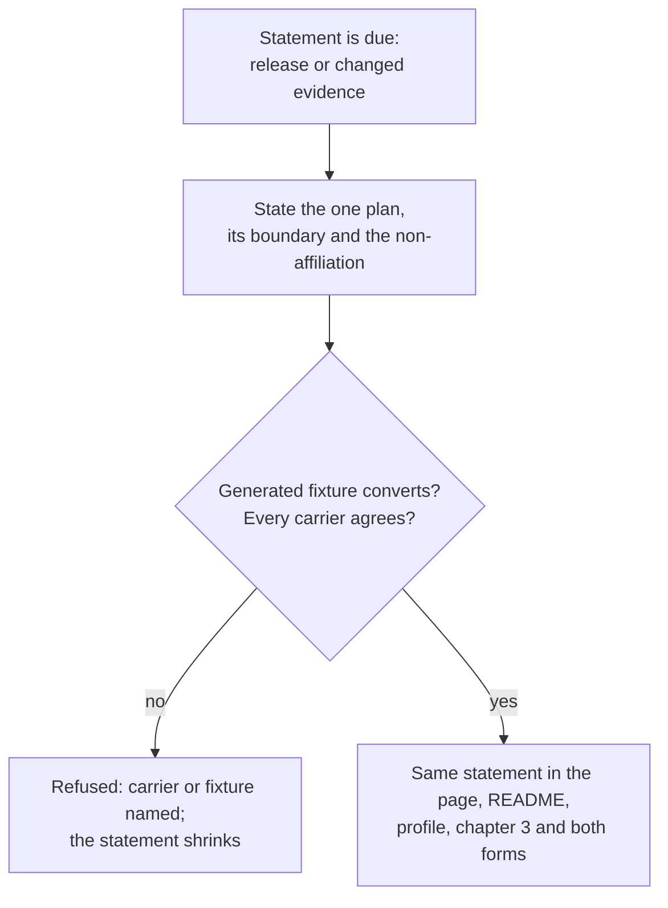

# Use case: state-the-converter-support-statement

## Level

!

## Actors

- Release owner — primary Actor; decides what the project claims about what the converter handles, and answers for the evidence behind every claim.
- Supporting: none. The evidence for the plan is produced by the conversion capability and the generated fixture, not by an independently valuable actor goal here.

## Goal

Keep the public support statement true to the exercised evidence.

## Trigger

The Release owner publishes or revises the support statement — on a release, or because the evidence behind it changed.

## Preconditions

- The named duty plan's evidence has been exercised: the generated fixture of it converts through the unchanged conversion. A statement may exist with no plan named, but never with an unexercised one.
- The documents that carry the statement exist: the website's `what-it-does` statement, the repository README, the organization profile, chapter 3 of the architecture documentation, and the two issue forms. They are edited together, not separately.
- The organization profile is published through the declared configuration, so its carrier is a configuration change rather than a hand edit of the profile repository.

## Main flow

1. Actor decides the statement is due: a release will publish it, or evidence changed since it was last stated.
2. Actor states the one plan the converter reads: a Lufthansa cabin-crew duty plan published as a Jeppesen PDF export. The boundary travels with the sentence: one roster month of cabin crew; not cockpit duties, other Lufthansa duty plans, other Jeppesen exports or another operator. The non-affiliation sentence names Lufthansa and Jeppesen.
3. Actor names the plan whose evidence is exercised, and only that plan.
4. System checks the statement before it is published: the named plan has a generated fixture that converts, the statement's boundary and non-affiliation sentences travel with it, no carrier still carries the withdrawn wording or promises a plan's future support, and nothing is named that the evidence does not cover.
5. Actor publishes the same statement in every document that carries it; a document carrying a different statement is a defect, not a variant. The page's sentence is the same claim with "This tool" as its subject; the profile's carrier is published by the apply.
6. Actor can stop; the published statement matches the exercised evidence and every carrier carries it.

## Extensions

- 4: the named plan's generated fixture no longer converts → the statement shrinks: the carriers state that the plan is currently refused, and the refusal names the missing fact or unknown code. Protects the claim and lets the crew member trust the statement.
- 4: a carrier still carries the withdrawn wording, or a carrier disagrees with the statement → the check is refused and names the carrier. Protects a reader who meets the statement in a different place.
- 4: the statement names a plan whose evidence is not exercised → refused, naming the plan and the missing fixture. The statement reports evidence, never intent.
- 4: the statement describes a plan's future support → refused. The statement reports what works, never what will be added.
- 5: the profile's carrier is not applied → the reviewed source carries the statement and the apply publishes it; the published profile lags the repository until the operator applies. Protects the single-source rule without claiming a live write.

## Rules

- **Name the plan, not a format family**: the statement names the operator, the crew role and the export — a Lufthansa cabin-crew duty plan published as a Jeppesen PDF export. It does not name a file format, an internal layout family or a taxonomy the reader must classify their own plan into.
- **The boundary travels with the sentence**: cabin crew; this Jeppesen PDF export; one roster month; not cockpit duties, other Lufthansa duty plans, other Jeppesen exports or another operator.
- **Non-affiliation**: the statement carries "Not affiliated with Lufthansa, Jeppesen, or any duty-plan provider or airline." No logo, no "official" and no implied endorsement accompanies it.
- **Evidence or silence**: a plan is named only with exercised evidence; the statement names no plan whose generated fixture does not convert, and the private plans stay private while the committed fixture is generated or stripped.
- **One statement**: five carriers carry the same statement — the website's `what-it-does` statement, the README, the organization profile, chapter 3 and both issue forms. Changing it is one act across them; the page's subject is "This tool", and the remaining four use the project's name as their subject. The check refuses a carrier that disagrees and names it.
- **Owner of the copy**: the site's publication, its Built revision and its page copy belong to the use case to publish the public website; the profile's text is published by the use case to apply a configuration change. This case changes the one support statement those carriers carry, and delivers the page sentence through `publish-public-website` and the profile sentence through `apply-configuration-change`.
- **Shrinks honestly**: when the plan's fixture stops holding — a plan is refused at conversion — the carriers state that the plan is currently refused, the reduction is one act across the five carriers, and the conversion's refusal names what could not be established.
- **Not the release text**: the release text reports one version's changes. A statement revision changes no conversion behaviour, but because the page is a user-receiving path its revision is announced as a public-copy change; the release text gains no support promise of its own.
- **No promise of intent**: the statement reports what works, never what will be added, and never names a plan on the strength of a plan.

## Examples

- All values generated. Statement: "duty2cal converts a Lufthansa cabin-crew duty plan published as a Jeppesen PDF export into one calendar file." The boundary and non-affiliation sentences follow it, and the generated fixture for that plan converts.
- The website carries "This tool converts a Lufthansa cabin-crew duty plan published as a Jeppesen PDF export into one calendar file." while the README carries "duty2cal converts ..." — the same claim, and the check accepts both subjects.
- The README names the plan and the organization profile still says "Turns a crew duty plan (PDF) ...": the check is refused until both carry the same statement.
- A plan of the named export is refused after a change to it → the statement shrinks to "duty2cal does not currently convert ...", every carrier carries the reduction, and the refusal names the code or fact that could not be established.
- A form still offers "another export family (unsupported)" → the check is refused and names the form.
- The profile's reviewed text carries the statement and the operator has not applied it yet → the source passes the check; the published profile lags until the apply, and the operator records the apply.

## Minimal guarantee

True whatever the outcome: no carrier claims more than the exercised evidence; a refused publication leaves the previously true statement in place; no conversion behaviour changes.

## Success guarantee

Every document that carries the support statement carries the same one; it names the one plan the converter reads, its boundary and the non-affiliation sentence, and it states whether that plan's generated fixture converts; no carrier states more than the exercised evidence.

## Personas

- project-maintainer--release-owner
- crew-member--personal-calendar-owner
- contributor--web-reviewer
- contributor--publication-reader

## Capabilities

- state-the-support-statement

## Interactions

| Capability | Consumer action | E2E scenario |
|---|---|---|
| state-the-support-statement | run the support-statement check before publication and read the named refusal | Release owner runs the support-statement check and every carrier carries the statement |

## Includes

- none

## Extends

- none

## Out of scope

- Any change to conversion behaviour or to an activity meaning: the statement
  describes what the unchanged conversion does, and giving a code a meaning is
  its own change with its own evidence.
- Any other plan: cockpit duties, other Lufthansa duty plans, other Jeppesen
  exports and another operator are outside the boundary, and no reading or
  support claim for them is added.
- The withdrawn general-duty-plan intake, the NetLine-style route and the
  further-publication evidence route: withdrawn on 2026-10-27.
- Changing the converter's own refusal wording: the unsupported-document
  refusal belongs to `export-duty-plan-calendar`, and a fixture failure's
  unknown-code or missing-fact refusal is already named there.
- The release archive, its platform promise and its publication path; the site
  publication's mechanism and the configuration apply's declaration, state and
  preview semantics.
- Marketing, roadmaps, a promise to support another plan later, and
  per-publication documentation of quirks; the statement is one claim, not a
  manual.
- Rewriting Persona files or the ideation record.

## Diagram

