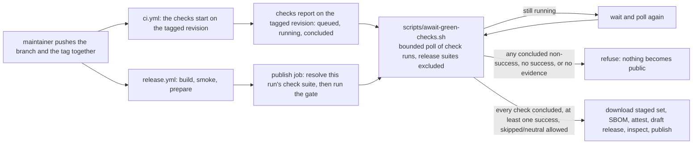

# Design: wait-for-green-checks-before-publish

## Scope

The HOW for the rules in [the delta](specs/publish-public-release/usecase.md) and the eight scenarios in [the delta feature](specs/publish-public-release/publish-public-release.feature): publication waits for the tagged revision's checks to conclude, refuses a concluded non-success, requires at least one success, treats skipped and neutral as allowed, and refuses at a bounded wait naming the checks still running.

What does not change: the build matrix, the Windows smoke job, the preparation command and its refusals, the SBOM, the attestations, the draft-first attach-and-inspect flow, the publish and `verify` jobs after the gate, release immutability, the landing ruleset, and the `README.md` release runbook. The atomic branch-and-tag push stays documented and becomes safe because the gate waits.

## Technology decisions

| Area | Decision | Rationale / source |
|---|---|---|
| Language / runtime | Bash, POSIX-shell compatible in the same style as `scripts/prepare-release.sh` and `scripts/render-changelog.sh`; no new runtime or dependency in the product crates. | The gate is release tooling; the repository already carries three bash commands in the release path and the suite already drives them as subprocesses. |
| The wait | A repository command, `scripts/await-green-checks.sh`, invoked by the `publish` job. Not inline workflow shell. | Inline shell could only be proven by a tagged run (resolves D1). An extracted command is driven by the suite through a stub `gh`, and a maintainer can run it by hand. |
| Check-run source | `gh api` against `GET /repos/{owner}/{repo}/commits/{ref}/check-runs`, which is the same client and endpoint the current step uses. | `gh` is preinstalled on GitHub-hosted `ubuntu-latest` runners and is already the publish job's only API client; no new credential or permission is introduced. |
| JSON handling | `jq`, already used by the current assertion step and present on the runner. | One `jq` pass flattens the slurped pages and excludes every check suite the release workflow created for the revision; `awk` then classifies. No new tool. |
| Latest attempt | `filter=latest` explicitly in the query (it is the endpoint's default). | It keeps the most recent attempt within a suite and name; it does not collapse the same name across suites, so every suite on the revision still contributes its current run. The gate must describe the current check set, not a superseded failed attempt. See the risks about retags and duplicate suites. |
| Static workflow check | The existing `actionlint` CI job (`rhysd/actionlint:1.7.12` image, read from `.github/workflows/ci.yml`, not from memory) continues to cover the edited workflow. | The release path only executes on the host, so the schema, expression and known-action-input checks stay the pre-push guard. Version source: `ci.yml` (pinned there by the release change). |
| Versions | No version is chosen here: `gh` and `jq` are the runner image's own; bash is the runner's; `actionlint` stays the existing pinned tag. Rust, Gherkin tooling and the coverage toolchain are untouched. | Version freshness: no new pin is introduced, so no new version needs resolving. |

## Architecture impact

The gate is one command between "the checks report on the tagged revision" and "anything becomes public". Nothing else moves.



Changed files at implementation time:

| Path | Kind | Purpose |
|---|---|---|
| `.github/workflows/release.yml` | changed | The `publish` job's single assertion step resolves every release-workflow suite for the tagged revision, then invokes the gate with the bounded wait. Every later step keeps its order and contents; permissions are unchanged. |
| `scripts/await-green-checks.sh` | new | The bounded wait and the refusals; the only GitHub-facing logic in this change. Mode `0755`, SPDX `MPL-2.0` header on line 2, executable, included by `scripts/license-headers.sh`. |
| `apps/cli/tests/steps/publish_public_release.rs` | changed | New `Given`/`When`/`Then` steps, the stub `gh` helper and the per-poll fixture writer. No new step file: the capability already owns one, and this change adds no new capability. |
| `apps/cli/tests/features_runner.rs` | unchanged | The existing `DutyWorld` fields (`dir`, `stdout`, `stderr`, `exit_status`, `command_transcript`) carry everything the new steps need. |
| `apps/cli/tests/steps/e2e/publish_public_release.rs` | unchanged | No new consumer action, so no new `@e2e` scenario. |
| `givn/changes/wait-for-green-checks-before-publish/specs/publish-public-release/*` | new | The delta this design serves; merged on archive. |
| `README.md` | unchanged | The atomic push becomes safe because the gate waits (D4). No runbook rewrite, no sentence that would describe an order the project no longer needs. |
| `docs/arc42/02-architecture-constraints.md`, `05-building-block-view.md`, `06-runtime-view.md`, `07-deployment-view.md`, `08-crosscutting-concepts.md`, `10-quality-requirements.md`, `11-risks-and-technical-debt.md`, `12-glossary.md` | changed by the arc42-docs artifact | Impact recorded below; this design does not edit them. |

## The gate command

### Interface

```
scripts/await-green-checks.sh --repo <owner/name> --sha <sha> --exclude-suite <id>
                              [--exclude-suite <id>…]
                              [--interval <seconds>] [--timeout <seconds>]
```

| Flag | Required | Value | Default |
|---|---|---|---|
| `--repo` | yes | `owner/name` of the public repository | — |
| `--sha` | yes | the tagged revision (`GITHUB_SHA`) | — |
| `--exclude-suite` | yes, repeatable | a check-suite id created by the release workflow for this revision; the workflow passes one per release run found by `head_sha`, including an earlier run on a retagged revision | — |
| `--interval` | no | seconds between polls, a non-negative integer | `15` |
| `--timeout` | no | total seconds the gate may wait, a non-negative integer | `1800` |

Missing or malformed values print the usage line and exit `1` before any API call. The command prints one progress line per poll on stdout and every refusal on stderr prefixed `await-green-checks: `, matching `prepare-release.sh`'s `refuse()` style. It writes nothing else and needs `GH_TOKEN` in the environment, exactly as the current step does.

### API calls

One endpoint, called once per poll, paginated and slurped:

```sh
gh api --paginate --slurp \
  "repos/${repo}/commits/${sha}/check-runs?filter=latest&per_page=100"
```

- `--paginate --slurp` yields an array of page objects, each `{total_count, check_runs: […]}`; the script flattens all pages with `jq`, so 100+ checks are classified in one pass. `per_page=100` is the endpoint maximum.
- `filter=latest` is stated explicitly although it is the endpoint default: it returns the most recent attempt within a suite and name, so a superseded failed attempt cannot refuse a revision whose re-run is green. It does **not** collapse a name across suites: the atomic branch-and-tag push creates two CI suites on the same revision, and both copies of each check name count, which is what “every check run” requires.
- Before the loop, the workflow resolves every release-workflow suite for the revision, not just the current run's, so a retag of an unpublished version cannot inherit an earlier run's failed `publish` check:

  ```sh
  releases="$(gh api --paginate --slurp \
    "repos/${GITHUB_REPOSITORY}/actions/runs?head_sha=${GITHUB_SHA}&per_page=100" \
    --jq '[.[].workflow_runs[] | select(.path == ".github/workflows/release.yml") | .check_suite_id] | unique | .[]')"
  exclude=()
  while IFS= read -r id; do
    [ -n "$id" ] && exclude+=(--exclude-suite "$id")
  done <<< "$releases"
  ```

  One extra paginated call, before the loop; the per-poll request count is unchanged. The workflow path is compared exactly (`.github/workflows/release.yml`); the recorded API responses carry no `@ref` suffix.
- Worst case request count at the defaults: 30 minutes ÷ 15 seconds = 120 check-run calls, plus the one pre-loop call that resolves every release-workflow suite. The workflow token's limit is far above that, and the `concurrency` group allows one release run per tag.

### Classification, once per poll

`jq` produces one tab-separated row per check run outside the release-workflow suites:

```sh
jq -r --argjson suite "$exclude_suite" '
  [ .[] | .check_runs[] | select(.check_suite.id != $suite) ]
  | .[] | [ .name, .status, (.conclusion // "pending") ] | @tsv
' "$work/check-runs.json" > "$work/checks.tsv"
```

A row is **running** when `status != "completed"` — this includes `queued`, `in_progress`, and any other non-completed status GitHub reports. A row is **successful** when `status == "completed" && conclusion == "success"`. A row is **allowed but not successful** when `status == "completed"` and the conclusion is `skipped` or `neutral`. Every other completed conclusion — `failure`, `cancelled`, `timed_out`, `action_required`, `stale`, and any conclusion GitHub adds later — is **not green**. The default arm is refusal, so an unknown conclusion fails closed.

The loop, in this exact order, after each poll:

1. **No rows after excluding the release-workflow suites** → refuse with
   `no check evidence: no check run outside this workflow's own suites reports on <sha>`.
   Observed releases do not reach this arm: in the v0.3.0 runs the outside-suite check runs were created at push time, minutes before the `publish` job started (3m12s in the successful run). The refusal is immediate rather than waited for because the publish job is gated behind `build`, the Windows smoke and `prepare`; a suite appearing later than that chain would be anomalous, and the fail-closed refusal is safe. The delta's no-evidence scenario pins this arm; the exclusion is what makes every release suite's `build`/`prepare`/`publish` check runs invisible to it.
2. **Any completed non-green row** → print the failed rows, then refuse with
   `the tagged revision does not carry a green check set: <name> (<conclusion>), …`.
   Refusal is immediate even while another check is still running: a completed failure is already conclusive, and waiting for the rest cannot make the set green. The delta's failed-check scenario asserts both the refusal and that no further poll happens.
3. **No running rows** → require at least one successful row; otherwise refuse with
   `no check on the tagged revision concluded successfully` (an all-skipped or all-neutral set is not check evidence of success). When at least one row is successful, print
   `every check run on <sha> outside this workflow's own suites concluded: <n> successful, <m> skipped or neutral`
   and exit `0`.
4. **Elapsed bound reached while rows are still running** → print the running rows, then refuse with
   `the tagged revision's checks did not conclude within <timeout> seconds: <name> (<status>), …`.
   The refusal names every still-running check, including one queued since the first poll — a check that never starts is a running check for this purpose and receives no separate message.
5. **Otherwise sleep `--interval` and poll again.**

Progress line per poll (stdout, after classification):

```
poll 2: 12 check run(s) outside this workflow's own suites; 2 still running; 9 successful; 1 skipped or neutral
still running: test (in_progress), coverage (queued)
```

Elapsed time uses bash's `SECONDS`, so `--timeout 0` evaluates the first poll and then takes the timeout arm without sleeping; `--interval 0` removes the sleep for scenario runs. Both are ordinary values of the command's interface, not test-only switches.

Sketch of the core (the implementation may reorganize, not reword the messages):

```bash
deadline=$(( SECONDS + timeout ))
poll=0
while :; do
  poll=$(( poll + 1 ))
  if ! gh api --paginate --slurp \
      "repos/${repo}/commits/${sha}/check-runs?filter=latest&per_page=100" \
      > "$work/check-runs.json"; then
    refuse "could not read the check runs of ${sha}"
  fi
  jq -r --argjson suites "$exclude_json" '
    [ .[] | .check_runs[]
      | select((.check_suite.id | tostring) as $id | ($suites | index($id) | not)) ]
    | .[] | [ .name, .status, (.conclusion // "pending") ] | @tsv
  ' "$work/check-runs.json" > "$work/checks.tsv" \
    || refuse "could not classify the check runs of ${sha}"

  [ -s "$work/checks.tsv" ] || refuse "no check evidence: no check run outside this workflow's own suites reports on ${sha}"

  not_green=$(awk -F'\t' '$2 == "completed" && $3 != "success" && $3 != "skipped" && $3 != "neutral"' "$work/checks.tsv")
  if [ -n "$not_green" ]; then
    printf 'not green:\n%s\n' "$not_green"
    refuse "the tagged revision does not carry a green check set: $(…names and conclusions…)"
  fi

  running=$(awk -F'\t' '$2 != "completed"' "$work/checks.tsv")
  if [ -z "$running" ]; then
    green=$(awk -F'\t' '$2 == "completed" && $3 == "success"' "$work/checks.tsv" | wc -l)
    [ "$green" -gt 0 ] || refuse "no check on the tagged revision concluded successfully"
    printf 'every check run on %s outside this workflow'"'"'s own suites concluded: %s successful\n' "$sha" "$green"
    exit 0
  fi

  printf 'poll %s: …\nstill running:\n%s\n' "$poll" "$running"
  if [ "$SECONDS" -ge "$deadline" ]; then
    refuse "the tagged revision's checks did not conclude within ${timeout} seconds: $(…names and statuses…)"
  fi
  sleep "$interval"
done
```

`mktemp -d` holds the two scratch files and a `trap` removes them; nothing is written into the checkout.

### The workflow change

In `.github/workflows/release.yml`, the `publish` job's step
`Assert every check on the tagged revision concluded successfully` is replaced — same position, first step after checkout, before the staged set is downloaded:

```yaml
      - name: Wait for every check on the tagged revision to conclude green
        timeout-minutes: 40
        env:
          GH_TOKEN: ${{ secrets.GITHUB_TOKEN }}
        run: |
          set -euo pipefail
          releases="$(gh api --paginate --slurp \
            "repos/${GITHUB_REPOSITORY}/actions/runs?head_sha=${GITHUB_SHA}&per_page=100" \
            --jq '[.[].workflow_runs[] | select(.path == ".github/workflows/release.yml") | .check_suite_id] | unique | .[]')"
          exclude=()
          while IFS= read -r id; do
            [ -n "$id" ] && exclude+=(--exclude-suite "$id")
          done <<< "$releases"
          scripts/await-green-checks.sh \
            --repo "$GITHUB_REPOSITORY" \
            --sha "$GITHUB_SHA" \
            "${exclude[@]}" \
            --interval 15 \
            --timeout 1800
```

- `timeout-minutes: 40` is a backstop above the script's 30-minute bound, so a hung `gh` call cannot occupy the job for the job's default limit. The script's bound, not the step timeout, owns the refusal message and the named checks.
- `GITHUB_SHA` on a tag push is the tagged commit, the revision the checks and the release both name.
- Permissions are unchanged and sufficient: `actions: read` resolves the run's suite id, `checks: read` reads the check runs; `contents: write`, `id-token: write` and `attestations: write` are untouched. No new secret.
- No other job and no other step changes. The gate runs before the SBOM, the attestations and the draft creation, so a refusal leaves no release, no asset and no attestation — the existing `needs` chain and the one release per tag already guarantee the tag is not reused by this run.

## Verification, and the host-only limit

- **Static:** the existing `actionlint` job checks the edited `release.yml` (schema, expressions, known action inputs). It does not execute the step's shell, so it cannot prove the wait.
- **Executable, local:** the eight delta scenarios run through `./run-tests.sh` and drive `scripts/await-green-checks.sh` as a real subprocess. The local parser is `jaq` on this workstation while CI's `test` job uses GNU `jq`; the scenarios use only the common filter subset and are also proven by CI's real `jq`. Their check-run source is a stub `gh` placed first on `PATH`; the stub prints a recorded page array per invocation, matching GitHub's documented `GET …/commits/{ref}/check-runs` response shape. `./run-tests.sh --name "<scenario title>"` runs one. These prove the exclusion, waiting, immediate refusal, timeout naming, skipped/neutral allowance, and no-evidence refusal of the command — i.e. every decision the workflow delegates to it.
- **Host-only, recorded honestly:** the real API call, the runner's `gh` version, and the workflow's step ordering are exercised only by a tagged run on GitHub. This is the operator boundary recorded for the publication interface on 2026-10-13 (the development environment holds no credential; the host owns the interface), unchanged here. No local test may call the live API (no token, no network, no third-party dependence). The residual is bounded: a divergence in the API response shape makes `jq`/`gh` fail under `set -euo pipefail`, or leaves the gate on its fail-closed default arm; it cannot silently publish a non-green revision. The first tagged run after this change is the host evidence and is not claimed here.

## Step definitions and fixtures

One file per capability, unchanged: `apps/cli/tests/steps/publish_public_release.rs`. Its module comment gains one sentence naming the gate as a driven subprocess.

New helpers in that file:

```rust
/// Writes a stub `gh` plus its successive page arrays into a fresh directory.
/// Returns the stub's bin directory (prepended to PATH) and the poll directory.
fn stub_check_runs(dir: &Path, polls: &[&str]) -> (PathBuf, PathBuf)

/// Runs `scripts/await-green-checks.sh` against the stub with `--interval 0`
/// and the given timeout; records stdout/stderr/status on the world and
/// returns the poll directory, whose `calls` file holds the poll count.
fn run_gate(w: &mut DutyWorld, timeout: u64) -> PathBuf
```

- The stub script is written mode `0755`; it increments `<polls>/calls`, appends its arguments to `<polls>/args.log`, prints `poll-<n>.json` for the n-th invocation, and repeats the last file when the count exceeds the recorded sequence. This makes "checks never conclude" one file, and makes the poll count an assertion surface.
- Each poll file is the slurped shape `[{ "total_count": N, "check_runs": [ … ] }]`; a poll may carry two page objects to exercise the flattening. Each check run is `{ "name", "status", "conclusion", "check_suite": { "id" } }`. The own-suite runs carry suite id `99`; the atomic-push fixture uses suite `7` (branch push) and `8` (tag push) with the same check name. Fixtures use the documented enum values only: `queued`, `in_progress`, `completed` with `success`, `skipped`, `neutral`, `failure`, `timed_out`. The stub has a failing mode that exits non-zero without printing a page, so the unreadable-source arm is exercised without a real API.
- The step runs the command with `Command::new("scripts/await-green-checks.sh")`, `.current_dir(repository_root())`, `.env("PATH", format!("{}:{}", stub_bin, std::env::var("PATH")?))`, `.env("GH_TOKEN", "test")` (the stub never reads it), and `--repo kressnerd/duty2cal --sha <fixture sha> --exclude-suite 99 --interval 0`.
- Behaviour is read from `w.exit_status`, `w.stdout`, `w.stderr` (through the existing `run_command` capture) and the stub's `calls` file. The command's own transcript is the evidence; no internal function is called.

New step definitions, exact text and signatures:

```rust
#[given("a tagged revision whose checks are still running")]
async fn a_revision_with_running_checks(w: &mut DutyWorld)

#[when("the publication gate examines the tagged revision")]
async fn the_gate_examines_the_revision(w: &mut DutyWorld)

#[then("the gate reports the still-running checks")]
async fn gate_reports_the_running_checks(w: &mut DutyWorld)

#[then("the gate reports the tagged revision ready only after every check has concluded successfully")]
async fn gate_reports_ready_after_conclusion(w: &mut DutyWorld)

#[given("a tagged revision whose checks include a completed failure and a check still running")]
async fn a_revision_with_a_failure_and_a_running_check(w: &mut DutyWorld)

#[then("the gate refuses publication, naming the failed check")]
async fn gate_refuses_naming_the_failed_check(w: &mut DutyWorld)

#[then("the gate does not wait for the check still running")]
async fn gate_does_not_wait_for_the_running_check(w: &mut DutyWorld)

#[given("a tagged revision whose checks never conclude")]
async fn a_revision_whose_checks_never_conclude(w: &mut DutyWorld)

#[when("the publication gate examines the tagged revision until the elapsed limit")]
async fn the_gate_examines_until_the_limit(w: &mut DutyWorld)

#[then("the gate refuses publication, naming the still-running checks")]
async fn gate_refuses_naming_the_still_running_checks(w: &mut DutyWorld)

#[given("a tagged revision whose completed checks are one success, one skipped, and one neutral")]
async fn a_revision_with_success_skipped_and_neutral(w: &mut DutyWorld)

#[then("the gate reports the tagged revision ready to publish")]
async fn gate_reports_the_revision_ready(w: &mut DutyWorld)

#[given("a tagged revision whose completed checks are one skipped and one neutral")]
async fn a_revision_with_only_allowed_non_successes(w: &mut DutyWorld)

#[then("the gate refuses publication, stating that no check concluded successfully")]
async fn gate_refuses_for_no_success(w: &mut DutyWorld)

#[given("a tagged revision whose check runs cannot be read")]
async fn a_revision_whose_checks_cannot_be_read(w: &mut DutyWorld)

#[then("the gate refuses publication, stating that the check runs could not be read")]
async fn gate_refuses_for_unreadable_checks(w: &mut DutyWorld)

#[given("a tagged revision whose only check runs belong to the release workflow")]
async fn a_revision_with_only_the_release_workflow(w: &mut DutyWorld)

#[then("the gate refuses publication, stating that the revision carries no check evidence")]
async fn gate_refuses_for_no_check_evidence(w: &mut DutyWorld)

#[given("the default branch and a version tag pushed together, each starting a check suite on the same revision")]
async fn branch_and_tag_pushed_together_with_two_suites(w: &mut DutyWorld)

#[then("the gate waits for both suites' checks instead of refusing them as not yet concluded")]
async fn gate_waits_for_both_suites(w: &mut DutyWorld)

#[then("the gate reports the revision ready to publish only once every check in both suites has concluded successfully")]
async fn gate_ready_only_once_both_suites_concluded(w: &mut DutyWorld)
```

Fixture sequence per scenario:

| Scenario title (referenced, not restated) | Poll files | Timeout | Assertions |
|---|---|---|---|
| …waiting… | 1: two pages — success + queued + own-suite `publish` in_progress; 2: all success | 5 | exit 0; stdout names the running check in poll 1 and reports ready; the own-suite row never appears under `still running`; `calls` = 2; `args.log` contains `filter=latest` |
| …failed… | 1: failure + timed_out + in_progress | 5 | exit 1; stderr names both non-successes; `calls` = 1 |
| …bounded wait… | 1: queued only | 1 | exit 1; stderr names the queued check and states `1 second`; elapsed < a few seconds |
| …skipped or neutral… | 1: success + skipped + neutral | 5 | exit 0; `calls` = 1; no refusal |
| …all skipped or neutral… | 1: skipped + neutral + own-suite success | 5 | exit 1; stderr states `no check on the tagged revision concluded successfully`; `calls` = 1 |
| …unreadable… | stub exits non-zero | 5 | exit 1; stderr states `could not read the check runs`; `calls` = 1 |
| …no evidence… | 1: one success whose suite is 99 | 5 | exit 1; stderr states no check evidence; `calls` = 1 |
| …branch and tag… | 1: suite 7 `test` success + suite 8 `test` in_progress + own-suite `publish` in_progress; 2: both suites' `test` success | 5 | exit 0; no refusal text; both suites waited for; own-suite row never listed; `calls` = 2 |

RED/GREEN: each new step body starts as a stub that panics with its own name, so every new scenario fails for the intended reason before the command exists. After the command exists, the waiting, failed, bounded-wait, skipped/neutral, all-skipped, unreadable, no-evidence and atomic-push scenarios pass through the real command. The all-skipped scenario distinguishes an allowed conclusion set from a set with a success, and the atomic-push scenario drives two suites with the same check name so a single-suite implementation fails it. The suite is run per scenario with `./run-tests.sh --name "<scenario title>"` during implementation, then once as a whole by the main agent.

## Decisions

- **Decides D1:** the wait is an extracted repository command, `scripts/await-green-checks.sh`, called by the `publish` job — not inline workflow shell. Realized in the workflow step above and in the stub-driven scenarios. Rejected: inline shell, whose waiting, ordering and refusal rules would be provable only by a tagged run.
- **Decides D2:** green means every check run reporting on the tagged revision outside every check suite the release workflow created for that revision, including an earlier release run's suite on a retagged revision, not a fixed list of names. Realized in the pre-loop `head_sha` runs query plus the repeatable `--exclude-suite` and the fail-closed default conclusion arm; evidenced by the delta's failed, skipped/neutral, all-skipped, unreadable and no-evidence scenarios and by the atomic-push two-suite scenario. Rejected: excluding only the current run's suite (a retag would inherit the earlier failed `publish` check) and a named required-check list, which lets a newly added check escape the gate — the exact defect TD-009 records.
- **Decides D3:** poll every 15 seconds, wait at most 1800 seconds (30 minutes), both configurable; the workflow passes those values and the step carries a 40-minute backstop. Realized in the flag defaults and the workflow invocation; the bounded-wait scenario passes `--timeout 1` to exercise the same arm. At the defaults the gate issues at most 120 check-run calls plus one pre-loop release-runs call, well inside the token's limit; a healthy full check set (coverage and the Windows cross-build included) concludes well inside 30 minutes. Rejected: 5 minutes (refuses healthy releases) and 60 minutes (holds a stuck release for an hour without improving the outcome).
- **Decides D4:** `README.md` does not change and the atomic branch-and-tag push stays documented; the gate makes it safe. Realized by the gate waiting through the check runs the branch push starts, and by the delta's atomic-push scenario. Rejected: documenting a serialized push, which loses the guarantee that a tag never points at a revision that did not land.
- **Decides D5:** a queued check is a running check and is waited for under the same bound, then named by the timeout refusal; skipped and neutral conclusions are allowed; a set with no successful conclusion is refused. Realized in the classification arms and the timeout message; evidenced by the skipping/neutral and bounded-wait scenarios. Rejected: refusing an in-progress check immediately (the spurious refusal this change removes) and refusing skipped/neutral (an intentionally absent check would block a healthy release).
- **Decides D6:** the gate is proven by the static `actionlint` check plus eight subprocess scenarios driven by a stub `gh`; the real API and the workflow ordering remain host-only and are recorded as such. Realized in "Verification, and the host-only limit" and the step fixture described above. Rejected: actionlint alone (no decision of the gate is exercised) and no automated proof (an irreversible publication is the first test).

Design decisions beyond the proposal's questions, each with the alternative rejected:

- **One query URL with `filter=latest`.** The current step omits it even though it is the default; stating it makes the semantics explicit and prevents a future edit from silently switching to `all` and refusing a revision whose current attempt is green. Rejected: reading every attempt (`filter=all`), which would make a superseded failure permanent.
- **Every release-workflow suite is excluded by id, resolved once before the loop.** The revision may carry more than one release suite (a retag of an unpublished version); excluding only the current run's suite would let an earlier failed `publish` check refuse the new run. Rejected: recomputing per poll (unnecessary; the run set for a SHA is settled by the time the publish job starts), excluding by workflow name instead of path (a same-named workflow could be hidden), and excluding by check name (a same-named check from another suite would be hidden).
- **No evidence refuses immediately.** The publish job is gated behind build, smoke and prepare; in the observed v0.3.0 runs the outside-suite check runs existed minutes before `publish` started (3m12s in the successful run). A suite appearing later than that chain would be anomalous, and refusing is the fail-closed choice. Rejected: a grace poll for evidence, which would delay the refusal without making a genuinely absent suite appear.
- **The step timeout is a backstop, not the refusal.** The script owns the message and the named checks; `timeout-minutes: 40` only prevents a hung client from occupying the job. Rejected: relying on the job timeout, whose kill message names neither the checks nor the cause.
- **The stub is the suite's GitHub twin, injected through `PATH`.** No test-only flag enters the production command. Rejected: a `--source-file` switch on the script, which would add a surface only tests use, and rejected: calling the live API from the suite, which needs a token and network.
- **No README or runbook sentence about the gate.** The runbook already promises that the tag starts the release workflow and that the draft is inspected; the gate strengthens that promise without changing what the maintainer does. Rejected: describing the internal wait in the runbook, which would duplicate a rule the use case owns and could drift from the timeout.

## Use-case traceability

| Use-case element (added or changed by this delta) | Technical decision | Evidence |
|---|---|---|
| Rule: a version is published only after every check run on the tagged revision, other than every release-workflow suite, has concluded | Query + `jq` suite exclusion + poll loop | "A tagged revision whose checks are still running is not published until they conclude" |
| Rule: the wait is bounded, and a still queued or running check at the bound refuses, naming it | `--interval` / `--timeout` and the timeout refusal | "A check that does not conclude within the bounded wait refuses publication" |
| Rule: a concluded check that is not a success refuses; skipped and neutral are allowed | Classification arms; default arm refuses | "A completed check that is not successful refuses publication"; "A skipped or neutral check does not refuse publication" |
| Rule: at least one concluded success is required; no check evidence is refused | The no-evidence arm and the no-success arm; release-suite exclusion | "A tagged revision with no check evidence is refused"; "A tagged revision whose checks all concluded without success is refused" |
| Rule: an unreadable check-run source refuses rather than passing | The query-failure arm | "The check-run source cannot be read" |
| Rule: the default branch and the tag may be pushed together | The gate waits instead of refusing in-progress checks; the workflow invokes it before any asset is created | "A branch and its tag pushed together publish only after the checks in both suites conclude" |
| Extension: a concluded non-success refuses and names the check; nothing becomes public | Immediate refusal before any later `publish` step runs | Failed-check scenario; the `publish` job's step order |
| Extension: no evidence outside the release-workflow suites refuses | No-evidence arm | No-evidence scenario |
| Extension: a still-running check at the bound refuses, naming every running check | Timeout arm | Bounded-wait scenario |
| Minimal guarantee: a version is never published while a check is outstanding, and a non-success refuses it | The gate is the first step of `publish`; nothing later runs on refusal | All eight delta scenarios; the workflow step position |
| Every other release rule (platform set, preparation refusals, change log, notes, draft-first, immutability, provenance, verify job) | Unchanged; the gate does not stage, attach or publish anything | Existing permanent scenarios and the unchanged workflow jobs |
| Capability ownership | `publish-public-release` only | Interaction Coverage Matrix |

Actors in Gherkin remain domain roles (the release maintainer); Personas are review lenses.

## Persona impact

User-visible surface: the publication job's terminal log, the release page's readiness, and whether a version that becomes public carries a green check set. Confirmed Personas:

- **`project-maintainer--release-owner`** — no longer has to serialize the branch push and the tag push: the documented atomic push is safe, and a refusal names exactly which check blocked publication, so the maintainer knows what to fix.
- **`crew-member--personal-calendar-owner`** — a published version is one whose checks had concluded green before it became immutable, so a download is never a version the gate could not see.

## Visual Design Contract

- Interface: terminal
- Viewports: n/a (no rendered screen)
- Design system: none
- Evidence kind: none new. This change adds no `@e2e` scenario, so no transcript is owed; the two existing `@e2e` transcripts of the capability remain the interaction evidence. The gate's progress and refusal lines are asserted in the new regular scenarios, not committed as evidence.
- Baseline for the unchanged transcripts: the command and reported version/section are shown; no host path, user name or clock value appears. The gate's own output obeys the same rule: it names the check runs and the wait bound, never a runner path or token.

## E2E smoke test infrastructure

- **E2E runner command:** `./run-tests.sh --e2e` (`--tags "@e2e"`), distinct from `verify.command`.
- **E2E step location:** `apps/cli/tests/steps/e2e/publish_public_release.rs`, unchanged.
- **Real interface:** the gate is a CLI subprocess; its real external dependency, `gh`, is replaced by a stub for the scenarios. The two existing `@e2e` scenarios already drive `scripts/prepare-release.sh` and the produced executable.
- **Local infrastructure:** none external. Each scenario creates a temporary working directory, a stub `gh` and its poll files; no server, port, database, container, network or credential. The stub `gh` is the digital twin of the one third-party interface this change touches.
- **Framework:** cucumber-rs over `DutyWorld` with `std::process::Command`; it matches the CLI boundary the gate exposes.
- **E2E strict-mode proof:** the same `features_runner` builder with `.fail_on_skipped()` and `.run_and_exit(root)`; an undefined or skipped step fails the process. New step bodies are never empty — RED is a panic naming the step.

## Interaction Coverage Matrix

The inventory is the owning `usecase.md`'s two entries. This change adds no consumer action, so the rows and their `@e2e` evidence are unchanged; the eight new scenarios are variants of the publication gate, not new user actions.

| Inventory entry | @e2e scenario title | Real interface | Driving mechanism |
|---|---|---|---|
| prepare the release for a version | Maintainer prepares a release and runs the archived executable | CLI (terminal) | `std::process::Command` runs `scripts/prepare-release.sh --version 0.1.0 --binaries <dir> --out <dir>`, asserts the reported archive and checksum for this machine's platform, extracts with `tar`, and runs the produced executable. |
| generate the change log for a version | Maintainer generates the change log for a version and reads its newest section | CLI (terminal) | `std::process::Command` runs `scripts/render-changelog.sh --version 0.1.0 --repo <fixture repo> --out <path>` and asserts the written section; the transcript is committed as evidence. |

The gate is invoked by the release automation, not by a consumer; no inventory entry is added for it. Its behaviour is nonetheless driven through a real subprocess in the regular scenarios.

## Local runnability & digital twins

- **Local run:** `./run-tests.sh` starts the whole suite in one command; `./run-tests.sh --name "<title>"` runs one scenario. The gate itself is a standalone command: `scripts/await-green-checks.sh --repo <owner/name> --sha <sha> --exclude-suite <id>`. Running it against the live API needs `GH_TOKEN` and is a maintainer action, not a test action; the suite never performs it.
- **Isolated network:** not applicable to the suite — no scenario uses the network. The only external dependency, GitHub's check-runs API, is replaced inside the test process's `PATH`, isolated from the host's real client.
- **Digital twin:** a deterministic stub `gh` written per scenario. It implements exactly the one endpoint the gate calls, in the documented slurped shape, and records the call count; it needs no network and no token. `jq`, `awk`, `sleep` and `bash` are the runner's own tools.
- **Interface obstacle and its fix:** the development machine has no `gh` on `PATH` (verified on 2026-10-17), so a scenario cannot rely on the real client. The fix is the twin first on `PATH`; the production command gains no test switch. A second foreseeable obstacle — a timeout scenario that sleeps a real bound — is fixed by driving the same arm with `--interval 0 --timeout 1`, so the scenario proves the arm without a 30-minute run.

## Coverage process boundaries

Unchanged: no production Rust runs for this change, and the gate is bash, which the Rust coverage denominator does not measure. Its contract is proven by the delta's scenarios and by `actionlint`, not by line coverage.

| Process | Started by | Instrumented artifact | Profile output | Merge step | Non-zero production probe |
|---|---|---|---|---|---|
| features_runner (unit/integration) | `./measure-coverage.sh` (`--tags "not @e2e"`) | `cargo llvm-cov --workspace --test features_runner` | `coverage/non-e2e-cobertura.xml` | `./merge-coverages.sh` | `crates/duty2cal-core/src/domain/timing.rs` |
| E2E runner + spawned CLI | `./measure-coverage.sh` (`--tags "@e2e"`) | `cargo llvm-cov --workspace --test features_runner` with the CLI built under instrumentation | `coverage/e2e-cobertura.xml` | `./merge-coverages.sh` | `apps/cli/src/fs.rs` |

The new step definitions belong to `features_runner` and are instrumented with it; `scripts/await-green-checks.sh` is shell and is outside the denominator, as `scripts/render-changelog.sh` already is.

## Black-Box-First policy

Every new scenario drives the real gate command as a subprocess and asserts its exit status and terminal output; none calls an internal function, inspects a private helper or reads the workflow as a substitute. No unit test is added in a lower layer. The one layer that cannot be driven locally — the real GitHub API — is replaced by a twin at the command's external boundary, and the residual host-only proof is recorded rather than papered over.

## Arc42 impact (recorded for the arc42-docs artifact)

- **Chapter 2, architecture constraints.** The change-log-drift constraint's rationale says the publish job refuses only checks that already concluded non-green; that premise becomes false. Rewrite it to say the publish job waits for the tagged revision's checks and refuses a concluded non-success or the bounded wait, while the preparation's own drift check remains an independent pre-publication check. The constraint itself is unchanged.
- **Chapter 5, building-block view.** Add `scripts/await-green-checks.sh` to the release toolbox table and diagram, with the `release.yml publish job → gate` and `gate → check-runs API` edges; update the `release.yml` responsibility row to name the wait.
- **Chapter 6, runtime view.** The scenario “A version tag becomes a verified published release” gains one numbered step between preparation and the draft: the `publish` job resolves every release-workflow suite for the tagged revision, then waits on the remaining check runs until they conclude green, refusing on a concluded non-success, on no success, on no evidence, or at the bounded wait. The Mermaid flow gains the gate node between `prepare` and `publish` and the refusal edge `publish → nothing public`.
- **Chapter 7, deployment view.** The `publish` job's description names the bounded wait and its location; the permissions table stays as it is (`actions: read` and `checks: read`, plus the existing write permissions).
- **Chapter 8, crosscutting concepts (recommended).** Record the publication gate beside the landing gate: fail-closed classification, bounded wait, release-suite exclusion. If the arc42 author judges it to duplicate chapter 6 rather than a cross-cutting rule, record why in the assessment.
- **Chapter 10, quality requirements.** Add one requirement in the release family: *Release gate currency — a check on the tagged revision is still queued or running when publication begins; publication waits for it and publishes only after it concludes successfully, refusing at the bound and naming it.* Its evidence is the delta's eight scenarios and the host-only first tagged run.
- **Chapter 11, risks and technical debt.** TD-009 is closed by this change, with the residual recorded: the real API call and the workflow ordering are proven only on the host, and the commit check-runs endpoint returns at most the 1000 most recent check suites. The gate fails closed, so neither residual can silently publish a non-green revision.
- **Chapter 12, glossary.** Add **Publication gate**, **Check run** and **Check suite**; refine **Gate (on landing)** to point at the publication gate as its release-time counterpart. Define the gate as allowing publication only when every remaining check has concluded, at least one succeeded, and skipped/neutral are the only non-successes — not as refusing “until” they conclude.

## ADR qualification

One candidate: extracting the wait into a repository command and choosing its polling policy. It is `NOT_QUALIFIED` and routed to `design.md`:

| Field | Value |
|---|---|
| qualification | NOT_QUALIFIED |
| alternatives | PASS — extracted command vs inline shell (D1), 15 s/1800 s vs shorter/longer bounds (D3) |
| architectural_impact | FAIL — no component, ownership, deployment or compatibility boundary moves; the gate is a step inside the existing release job |
| durable_consequence | FAIL — reversible within this change by inlining or deleting the script; the single-change-reversibility test applies |
| lower_level_artifact | FAIL — `design.md` and the delta use case own the rationale |
| existing_adr_check | PASS — ADR-0003 covers the release channel and platforms; ADR-0004 covers draft-first immutable publication; neither covers this gate |
| must_be_shared | FAIL — a contributor reading the workflow and this design has the rule |
| routing | CANONICAL_ARTIFACT |
| canonical_artifact | `design.md` |

No ADR file, chapter-09 register row or ADR-index entry is created.

## Risks and follow-ups

- **Retagging an unpublished version on the same revision.** The gate excludes every release-workflow suite found for the SHA, so an earlier release run's failed `publish` check cannot block the new run. The pre-loop runs query is the only place this is handled; the recorded API evidence shows `head_sha` returns the release run with `path == ".github/workflows/release.yml"`.
- **`filter=latest` and duplicate suites.** The endpoint returns the current attempt per suite and name, not one row per name across the revision. The documented atomic push creates two CI suites on the same revision, so both copies of a same-named check are waited for and counted; that is intentional under “every check run”.
- **`filter=latest` and the 1000-suite cap.** GitHub documents that a ref with more than 1000 check suites returns only the 1000 most recent suites' check runs. A project that reaches that depth would need the check-suites endpoint; this repository has a handful. Recorded, not handled.
- **A check queued forever holds the job for the bound.** 30 minutes at 15-second intervals, then a refusal naming it. The 40-minute step timeout is the backstop if `gh` itself hangs. Rejected: a per-check timeout, which would need a policy the use case does not state.
- **Unknown conclusions fail closed.** GitHub can add a conclusion; the default arm refuses. A future intentional conclusion would need a one-line allow-list addition, which is the safe direction.
- **The twin encodes GitHub's documented shape.** If the live API changes, the first tagged run fails loudly under `set -euo pipefail` or on the fail-closed arm; it cannot publish a non-green revision. The first run after this change is the host evidence and is not claimed by this design.
- **A second workflow triggered by the same tag would be waited for.** It would have its own check suite, distinct from the release run's, so the gate would wait for it. That is consistent with "every check on the tagged revision"; no such workflow exists today.
- **TD-009 closes with a residual.** The gate now waits for the checks and refuses non-success; the residual is the host-only proof and the 1000-suite cap, both recorded above.
