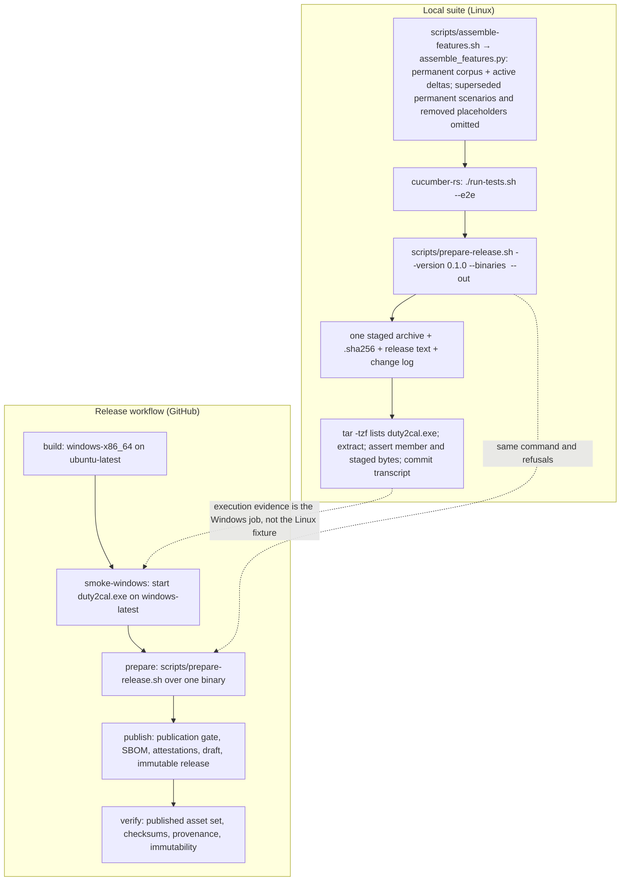

# Design: windows-only-release

## Scope

Technical design for narrowing the published platform set of [publish a public release](specs/publish-public-release/usecase.md) to Windows x86_64. The observable WHAT is fixed by the proposal and the delta; this document is the HOW: the one supported platform in the preparation command, the one-entry release matrix and its Windows smoke evidence, the public text and documentation that stop promising Linux and macOS downloads, the test-step changes that keep the release-preparation `@e2e` honest on a Linux host, and the amendment of ADR-0003.

Two boundaries shape the design:

- **What runs locally.** The project's own suite drives `scripts/prepare-release.sh` as a real subprocess. With Windows as the only supported platform, the local suite stages a deterministic stand-in `duty2cal.exe`, asserts the staged archive and its checksum, extracts the archive, and inspects its member list and bytes. A Linux host cannot execute that Windows executable, so the local scenario does not claim to; the real execution evidence is the `windows-latest` smoke job in CI and in the release workflow.
- **What runs on the host.** The release workflow builds the Windows executable on `ubuntu-latest`, starts it on `windows-latest`, prepares the archive on `ubuntu-latest`, and publishes and verifies it there. That is GitHub's interface, exercised by the project's automation and recorded as the change's evidence. No local scenario calls it.

No product code changes: no crate, module, port or conversion rule. The converter's behaviour and its scenarios are untouched.

## Technology decisions

| Area | Decision | Rationale |
|---|---|---|
| Product code | None. | The change is a distribution and documentation decision; the converter's compilation targets and runtime behaviour do not change. |
| Supported platform set | One canonical value in `scripts/prepare-release.sh`: `PLATFORMS='windows-x86_64'`. The test helper and the public-text check mirror that one value. | A second list would let the preparation, the tests and the README drift; the existing design already treats the script as the canonical set. |
| Windows target | `x86_64-pc-windows-gnu`, cross-built on `ubuntu-latest`, started on `windows-latest`. | This is the existing confirmed distribution constraint (chapter 2); nothing about the Windows target changes. |
| Linux host | Linux stays the CI, coverage and local test host; it is not a published platform. | The suite runs on `ubuntu-latest` and the Windows executable is cross-built there; removing the host would remove the test path (proposal D3). This is engineering context for chapter 2, not a promise of the use case. |
| Release matrix | One `windows-x86_64` entry; the `linker` matrix field, both musl `CARGO_TARGET_*_UNKNOWN_LINUX_MUSL_LINKER` variables and the non-Windows "Start the built executable" step are removed; `smoke-windows` remains the real execution evidence. | The old start step was guarded by `matrix.platform != 'windows-x86_64'`, so it never ran in a Windows-only matrix, and the linker values configure targets the matrix no longer builds; removing them leaves no dead branch or dead value. |
| Public text gate | `scripts/public-text-check.sh` requires the Windows archive name, both checksum commands, the provenance command, the licence promises, the verbatim source-route and platform-request statements and the history statement; it forbids the four non-Windows archive names and the Linux/macOS download-row labels. | The use case says the text must not promise other platforms; a presence-only gate cannot fail a README that keeps the old rows. |
| Test assembly | `scripts/assemble_features.py` (invoked by the stable `scripts/assemble-features.sh` entry point) omits a permanent scenario whose exact title is carried by a `@givn.modified` or `@givn.removed` delta in any active change, and omits every `@givn.removed` placeholder from the copied delta. | A narrowing change replaces assertions that contradict the new platform set. Running the superseded permanent copy beside the delta would make the pre-archive suite red while asserting a platform the change removes. Gherkin is parsed as blocks, not grepped by title. |
| Versions | No new language, runtime, framework, database, browser or container version is introduced. The existing pins (`git-cliff 2.14.2`, the stable Rust toolchain, the GitHub-hosted runner labels) are unchanged. | Version freshness requires a lookup only when a version is named; this change names none. |

## Architecture impact

The release pipeline loses four build and start paths and keeps one build plus one Windows start. The local suite loses the host-platform assumption and stages the one supported archive; feature assembly gains a Gherkin-aware helper behind its existing entry point.



New or changed files:

| Path | Kind | Purpose |
|---|---|---|
| `scripts/prepare-release.sh` | changed | `PLATFORMS='windows-x86_64'`; the completeness refusal now names Windows, the whitelist refusal rejects Linux, macOS and anything else; `executable_for` keeps `duty2cal.exe`; comments stop saying five. |
| `scripts/public-text-check.sh` | changed | Presence checks for the Windows promise set plus the verbatim statements; negative checks for non-Windows archive names and download-row labels. |
| `scripts/assemble_features.py` | new | Gherkin-aware assembly: maps each active delta to its permanent capability file, drops superseded permanent scenario blocks, omits `@givn.removed` placeholders, fails loudly on an unmatched title. |
| `scripts/assemble-features.sh` | changed | Keeps its no-argument interface and printed-root contract; delegates the Gherkin work to `assemble_features.py`. `run-tests.sh` and `measure-coverage.sh` keep calling this path. |
| `.github/workflows/release.yml` | changed | The `build` matrix keeps only the `windows-x86_64` entry; the `linker` field, both musl linker variables and the non-Windows "Start the built executable" step are deleted; `smoke-windows`, `prepare`, `publish` and `verify` keep their behaviour; comments stop saying five. |
| `README.md` | changed | One-row download table; Windows extraction, run, checksum and provenance examples; the `chmod` note, the macOS `shasum` example, "all five platforms" and the macOS approval section are removed; the source-route and platform-request statements and the history statement are added. |
| `.github/ISSUE_TEMPLATE/bug.yml` | changed | Platform options become `Windows x86_64` and `built from source`; Linux and macOS options are removed. Reviewed by hand; no gate reads this file. |
| `SECURITY.md` | changed | The Gatekeeper/macOS out-of-scope bullet is removed; the release-channel text remains otherwise unchanged. Reviewed by hand; no gate reads this file. |
| `docs/arc42/01-introduction-and-goals.md` | changed | Requirement 5 and the quality/stakeholder rows state one Windows x86_64 archive; other platforms are not supported. |
| `docs/arc42/02-architecture-constraints.md` | changed | The target/platform constraint lists Windows x86_64 only; the musl and macOS-native rows are removed or rewritten; the Windows cross-build and smoke constraint remains; the Linux build-and-test host is recorded here as engineering context. |
| `docs/arc42/03-context-and-scope.md` | changed | The GitHub release-channel edge serves one Windows x86_64 archive, not a per-platform set; the crew-member download route names the supported platform only. |
| `docs/arc42/04-solution-strategy.md` | changed | The distribution row and release strategy state the Windows-only platform set; ADR-0003 remains the reference. |
| `docs/arc42/05-building-block-view.md` | changed | The release toolbox describes one supported platform and the Windows smoke job. |
| `docs/arc42/06-runtime-view.md` | changed | The release flow shows one build, the Windows smoke start, and preparation over one binary; the macOS and arm64 build flows are removed. |
| `docs/arc42/07-deployment-view.md` | changed | The infrastructure diagram and artefact table show one archive and one builder/smoke pair; macOS runners and archive-signedness text are removed; the crew-member OS row becomes Windows x86_64, with other platforms unsupported. |
| `docs/arc42/08-crosscutting-concepts.md` | changed | The packaging determinism text says "the same five executables"; it becomes the one Windows executable, with the same deterministic `tar` inputs. |
| `docs/arc42/09-architecture-decisions.md` | changed | The ADR-0003 register row carries the amended title and an amendment note dated 2026-10-17. |
| `docs/arc42/10-quality-requirements.md` | changed | QS-008 says "the same five executables"; it becomes the one Windows executable prepared twice. |
| `docs/arc42/11-risks-and-technical-debt.md` | changed | R-010 and TD-006 (unsigned macOS archives) are closed/removed because no macOS archive is published; R-009 and R-013 are rewritten for the one-build-plus-Windows-smoke path; a new risk row records that source builds on other platforms are unverified. |
| `docs/arc42/12-glossary.md` | changed | **Supported platform** becomes Windows x86_64 only; **Release archive** says exactly one per version; the platform row and its contract stop naming five (the unrelated "five terms" promotion note is untouched). No "Build and test host" term is added: the Linux-host fact stays engineering context in chapter 2 and this design. |
| `docs/arc42/adr/ADR-0003-release-channel-and-platforms.md` | amended | Frontmatter amendment date, Qualification verdict, checklist evidence, context, drivers, options, outcome and title, consequences, confirmation, pros/cons and More Information are revised (see "ADR qualification routing"). |
| `docs/arc42/adr/README.md` | changed | The register row for ADR-0003 reflects the amended title, with an amendment note dated 2026-10-17; the notes say it was amended, not replaced. |
| `apps/cli/tests/steps/publish_public_release.rs` | changed | `SUPPORTED` becomes one entry; `machine_platform()`/`machine_executable()` become `supported_platform()`/`supported_executable()`; the no-binary Given and the Linux-refusal steps are added; the five-archive assertion message is rewritten. |
| `apps/cli/tests/steps/e2e/publish_public_release.rs` | changed | The `@e2e` steps always stage the deterministic stand-in, assert the archive's single member from a `tar -tzf` transcript, compare the extracted bytes with the staged stand-in, and commit the transcript under the active change. |
| `givn/changes/windows-only-release/evidence/visual/maintainer-prepares-a-windows-release-and-inspects-the-archived-executable/transcript.txt` | new evidence | The `@e2e` transcript: preparation command, reported Windows archive and digest, release-text line, `tar -tzf` member listing, extraction command, exit statuses. |

`apps/cli/tests/features_runner.rs`, `run-tests.sh`, `measure-coverage.sh`, `merge-coverages.sh`, `.github/workflows/ci.yml`, `cliff.toml` and `CHANGELOG.md` need no change. The CI workflow already builds and smokes only the Windows target; the coverage scripts already delegate feature assembly to `scripts/assemble-features.sh`; the change-log configuration and the publication gate do not depend on the platform count. The change-level `arc42.md` is written by the later arc42-docs artifact, not here; its independent assessment is 12 rows **Yes**, including chapter 03.

## The preparation command

`scripts/prepare-release.sh` keeps its interface and refusal order:

```
scripts/prepare-release.sh --version <version> --binaries <dir> --out <dir> [--repo <dir>]
```

- `PLATFORMS='windows-x86_64'`.
- `<binaries>/windows-x86_64/duty2cal.exe` is the only required input.
- The whitelist scan rejects any other platform directory, including `linux-x86_64`, `linux-arm64`, `macos-arm64`, `macos-x86_64` and `freebsd-x86_64`, naming the directory and staging nothing.
- The completeness scan rejects a missing or unreadable `duty2cal.exe`, naming Windows x86_64 and staging nothing.
- The archive is `duty2cal-<version>-windows-x86_64.tar.gz`, holding only `duty2cal.exe`, with `sha256sum` output beside it.
- The release text and change-log staging, the already-prepared refusal, the version validation and the drift check are unchanged.

The script remains Linux-only GNU `tar` packaging, outside the workspace and outside the coverage denominator.

## The release workflow

- The `build` matrix has one entry: `windows-x86_64`, runner `ubuntu-latest`, target `x86_64-pc-windows-gnu`, binary `duty2cal.exe`, `apt: mingw-w64`. The `linker` field is deleted from every entry.
- The `linux-x86_64`, `linux-arm64`, `macos-arm64` and `macos-x86_64` matrix entries are deleted.
- The `CARGO_TARGET_X86_64_UNKNOWN_LINUX_MUSL_LINKER` and `CARGO_TARGET_AARCH64_UNKNOWN_LINUX_MUSL_LINKER` environment lines and their comment are deleted from "Build the release executable"; they configured targets the matrix no longer builds.
- "Install the linker this target needs" keeps installing `matrix.apt` (now `mingw-w64` only), with no linker variable passed to it.
- The "Start the built executable" step is deleted. It was guarded by `matrix.platform != 'windows-x86_64'`, so it never ran for the only remaining entry; its non-Windows assertion is not replaced by a weaker one.
- `smoke-windows` keeps starting the cross-built `duty2cal.exe` on `windows-latest`, asserting the usage line, the non-zero exit and the allowed system DLL imports. This remains the execution evidence.
- `prepare` lays out the one downloaded artifact and runs the preparation unchanged; `publish` and `verify` are platform-agnostic and keep their gates, attestations, draft inspection and immutability assertion.

## Public text and documentation

The README's download section becomes:

- one row: `| Windows x86_64 | duty2cal-<version>-windows-x86_64.tar.gz |`;
- the verbatim sentences `Other platforms are not supported or distributed; the source can be built with a Rust toolchain.`, `A platform may be added back when users request it.` and `Already-published releases keep their original assets and links; only future releases are Windows-only.`;
- Windows extraction (`tar -xzf duty2cal-<version>-windows-x86_64.tar.gz`), a Windows run example (`.\duty2cal.exe .\2026-06.pdf`), and `Get-FileHash` for the checksum, with `sha256sum --check` kept as the POSIX-shell alternative;
- `gh attestation verify` unchanged;
- the macOS Gatekeeper approval section, the `chmod +x` note, the macOS `shasum` example and the sentence "one extraction route serves all five platforms" are deleted.

`scripts/public-text-check.sh` keeps its `[readme]` interface, names each missing promise separately, and gains negative checks. The exact checks the tasks implement:

| Kind | Name | Pattern |
|---|---|---|
| require | clone-address | `git clone https://github\.com/kressnerd/duty2cal\.git` |
| require | windows-archive | `duty2cal-[^[:space:]]*-windows-x86_64\.tar\.gz` |
| require | checksum-command | `sha256sum --check` |
| require | checksum-command-powershell | `Get-FileHash` |
| require | provenance-command | `gh attestation verify` |
| require | licence-statement | `MPL-2\.0` |
| require | licence-text-link | `LICENSES/MPL-2\.0\.txt` |
| require | unicode-data-licence | `Unicode-3\.0` |
| require | unicode-data-licence-link | `LICENSES/Unicode-3\.0\.txt` |
| require (fixed string) | source-route-statement | `Other platforms are not supported or distributed; the source can be built with a Rust toolchain.` |
| require (fixed string) | platform-request-statement | `A platform may be added back when users request it.` |
| require (fixed string) | published-history-statement | `Already-published releases keep their original assets and links; only future releases are Windows-only.` |
| forbid | non-windows-archive | `duty2cal-[^[:space:]]*-(linux-x86_64\|linux-arm64\|macos-arm64\|macos-x86_64)\.tar\.gz` |
| forbid | non-windows-download-row | `^\|[[:space:]]*(Linux x86_64\|Linux arm64\|macOS arm64( \([^)]*\))?\|macOS x86_64( \([^)]*\))?)[[:space:]]*\|` |

A `forbid` match names the offending pattern and fails the gate; a `require` miss names the promise. The gate reads only `README.md`. `.github/ISSUE_TEMPLATE/bug.yml` and `SECURITY.md` are changed and reviewed by hand; they are not gated, and the design records that the public-text guarantee is enforced over the README only.

The issue form, `SECURITY.md` and the arc42 chapters listed above remove the Linux/macOS download promises and the macOS signing risk; ADR-0003 is amended rather than replaced.

## The feature-assembly helper

`scripts/assemble-features.sh` stays the stable entry point (`./run-tests.sh` and `./measure-coverage.sh` call it with no arguments and expect the assembled root on stdout). It invokes `scripts/assemble_features.py`, which performs all Gherkin-aware work:

- It processes every permanent `.feature` under `givn/specs/**` and every delta `.feature` under `givn/changes/*/specs/**`.
- It maps a delta path `givn/changes/<change>/specs/<usecase>/<capability>.feature` to the permanent `givn/specs/<usecase>/<capability>.feature`. A delta with no permanent counterpart is copied as a new capability.
- In the corresponding permanent file only, it removes the scenario blocks whose exact titles are tagged `@givn.modified` or `@givn.removed` in that delta. Two active changes therefore filter their own permanent files; their removal sets are never unioned by title across capabilities.
- It parses scenario blocks by line: a block starts at a `Scenario:` or `Scenario Outline:` line together with its immediately preceding tag line(s), and ends at the next tag line, the next `Scenario:`/`Scenario Outline:` line, or EOF. An `Outline` keeps its `Examples:` table. Doc-string and step-text bodies are not treated as block boundaries.
- It omits every `@givn.removed` scenario block from the copied delta output, so the placeholder step never reaches cucumber-rs.
- It copies added and modified delta scenarios unchanged.
- It fails loudly, with a non-zero exit naming both the title and the file, when a `@givn.modified`/`@givn.removed` title is not found exactly once in the corresponding permanent feature. A duplicate title in the permanent file is also an error, because the removal would be ambiguous.
- It never rewrites a permanent file on disk; the assembly is written to a fresh temporary root owned by the caller.

Scope: this helper understands Gherkin tags and scenario blocks, not macro/step expansion or any other prose. It does not validate scenario shape; `givn lint` remains the delta validator.

No permanent unit tests are added for the helper because the repository has no script-test harness. Verification is a throwaway fixture smoke run (an Outline with `Examples`, a multi-line tag block, a doc string containing `Scenario:`, a duplicate title, and two active changes) plus a smoke over the real change corpus: the assembled root contains exactly one copy of each modified title, no `@givn.removed` placeholder title, and every added scenario; the scenario count of the assembled corpus is recorded as evidence.

## Decisions

The proposal's three questions are resolved here:

- **Decides D1:** the local `@e2e` drives the real preparation with a deterministic stand-in `duty2cal.exe`, asserts the staged Windows archive and checksum, extracts the archive, and inspects its only member and bytes; it does not execute the Windows binary. The real execution evidence is the `smoke-windows` job on `windows-latest` in `.github/workflows/ci.yml` and in `.github/workflows/release.yml` — the CI job on the landing revision and the release job before publication. That is host evidence, not a change artifact: no CI log is committed under `evidence/`; the references are the job names and the delta's `@e2e` scenario. Realized in `apps/cli/tests/steps/e2e/publish_public_release.rs` and the retained `smoke-windows` jobs.
- **Decides D2:** already-published releases are untouched; their Linux and macOS archives stay on their release pages, and only future releases are Windows-only. Realized by the absence of any release-editing step and by README/ADR text: the README gains the sentence `Already-published releases keep their original assets and links; only future releases are Windows-only.` (it has no such statement today), and ADR-0004 and the use case state immutability. Evidenced by the unchanged `publish`/`verify` jobs and ADR-0004.
- **Decides D3:** Linux remains the CI, coverage and local test host, and the Windows executable stays cross-built there; a platform returns only through a later change when users request it. Realized in the unchanged `ubuntu-latest` build/test path and the README/public-text statements; evidenced by the CI workflow and the release matrix. Other platforms are not supported, tested or distributed, and no compile job is added for them.

Design decisions beyond the proposal's questions:

- **The supported set has one source of truth in the preparation script.** The test helper and the public-text check mirror `windows-x86_64`; no third list is introduced. Rejected: keeping the five-platform list in any one place, which would make the preparation and the public text disagree.
- **The non-Windows start step and the musl linker configuration are deleted, not disabled.** They were already dead for the remaining entry and configure targets the matrix no longer builds. Rejected: leaving them guarded, which leaves untested branches and misleading matrix comments.
- **Feature assembly is a Gherkin parser invoked by the existing shell entry point.** A title grep cannot reliably handle `Scenario Outline`/`Examples`, tag lines, doc strings, duplicate titles or two open changes, and it would leave `@givn.removed` placeholders to fail at runtime. Rejected: compatibility branches in step definitions that make old scenarios pass for the wrong reason, a tagged run that hides `@givn.removed`, and accepting a red pre-archive suite.
- **The `@e2e` scenario is retitled with a remove/add pair.** `@givn.removed` with the exact old title `Maintainer prepares a release and runs the archived executable` deletes the superseded permanent scenario, and `@givn.added @e2e` adds `Maintainer prepares a Windows release and inspects the archived executable`. The title now states what the scenario asserts. The use-case Interactions table and the evidence slug `maintainer-prepares-a-windows-release-and-inspects-the-archived-executable` follow.
- **The local e2e always stages the deterministic stand-in, on every host.** The preparation is Linux-only and the stand-in is never described as the Windows binary; the real binary is built and started on the host path. Because the stand-in bytes are fixed, the archive digest is stable and the transcript needs no digest scrub.
- **The e2e digest assertion is three-way.** The digest the preparation reported, the digest in the `.sha256` file, and the digest computed over the staged archive must agree, so the consumer-visible output is tied to the bytes rather than only to the fixture. The extracted bytes are then compared with the staged stand-in.
- **ADR-0003 is amended in place.** The release channel and the platform set are the same durable decision, narrowed; a new ADR would split one boundary across two records. The amendment keeps the channel, immutability, provenance and evidence rules and changes the supported set and its consequences.
- **The change keeps the release-note sentence as every revision subject.** `Offer one downloadable archive for Windows, the only platform the project distributes.` is the proposal's release note and the subject of each revision this change records; the scenario title goes in the body.
- **The source-build route is stated, not promised.** The public text and the use case say other platforms are unsupported, untested and undistributed and that their source can be built with a Rust toolchain; no compile job is added, and chapter 11 records the unverified route as a risk.

## Use-case traceability

| Use-case element (narrowed or re-affirmed by this change) | Technical decision | Evidence |
|---|---|---|
| Rule: the supported platform is Windows x86_64; nothing else is supported or offered | `PLATFORMS='windows-x86_64'` in the preparation; the public-text loop; the issue-form options | "A prepared release offers one archive for every supported platform"; "An executable for the previously offered Linux platform is refused" |
| Rule: a release offers exactly one archive, never a promising platform without one | The preparation's completeness and whitelist refusals | "A prepared release offers one archive for every supported platform"; "A platform whose executable was not built stops the release"; "An executable for the previously offered Linux platform is refused" |
| Rule: the archive is named for the tool, version and platform and holds only `duty2cal.exe` | The deterministic `tar` payload and archive name | "A prepared release offers one archive for every supported platform"; the `@e2e` scenario's extracted-member assertion |
| Rule: a platform outside the supported set is refused, including a previously offered one | The preparation's unsupported-platform scan | "An executable for an unrecognised platform is refused" (unchanged); "An executable for the previously offered Linux platform is refused" |
| Rule: the archive's executable runs on Windows with no runtime installation | The cross-build on `ubuntu-latest` plus `smoke-windows` on `windows-latest` | The Windows smoke job (host evidence); the local `@e2e` asserts the archive contents, not execution |
| Rule: each archive carries a checksum covering it | `sha256sum` beside the archive | "Each archive's checksum covers that archive" |
| Rule: the archive is published only after its executable was built and started on Windows | `build` + `smoke-windows` before `prepare`/`publish` | The workflow's `needs: [build, smoke-windows]`; ADR-0003 confirmation |
| Rule: build provenance and a bill of materials are attached | `actions/attest@v4` and `anchore/sbom-action@v0` over the staged archive | The `publish` job (unchanged) |
| Rule: the public text names the archive and commands, states the unsupported-platform route and the published-history statement | `public-text-check.sh` promises; README rewrite | `scripts/public-text-check.sh` (host text gate); no Gherkin scenario because the gate is the executable check |
| Extension: a missing platform executable fails and stages nothing | The completeness refusal | "A platform whose executable was not built stops the release" |
| Extension: an unsupported or previously offered platform fails and stages nothing | The whitelist refusal | "An executable for the previously offered Linux platform is refused" |
| Extension: an unreadable executable fails and stages nothing | The readability refusal | "An unreadable executable stops the preparation" |
| Main flow 1: the release text is the newest section of the change log | Unchanged renderer/preparation path | Existing permanent change-log scenarios and the `@e2e` release-text assertion |
| Publication gate, immutability, draft-first publication, change-log rules, dependency announcements | Unchanged | The existing permanent scenarios |
| Capability ownership | `publish-public-release` only; the proposal's routing table records `EXTEND publish-public-release` | This design's Interaction Coverage Matrix |
| Persona: `project-maintainer--release-owner` | One build, one start evidence job, one archive to inspect; a public text that matches the platform set | The release workflow, the preparation scenarios, the documentation change |
| Persona: `crew-member--personal-calendar-owner` | The Windows user keeps a downloadable, verifiable archive; other users read that no download is offered and the source can be built | README, issue form, the `@e2e` archive assertions |

Actors in Gherkin remain domain roles (the maintainer); Personas are review lenses, not Actors.

## Persona impact

User-visible surface: yes — a terminal interface (the preparation command's output) and public text (README, issue form, security policy, release page text and documentation).

- **`project-maintainer--release-owner`** — the release path shrinks from five builds and five start-evidence paths to one build, one Windows smoke start and one archive. The maintainer's release note, change log and publication gate are unchanged, and the platform promise now matches the audience. They judge it by whether a release can be prepared, inspected and published without building assets nobody downloads.
- **`crew-member--personal-calendar-owner`** — a Windows user still downloads one archive, verifies its checksum and provenance and runs it without installation. A Linux or macOS user reads that their platform is not supported or distributed and that the source can be built with a Rust toolchain, instead of a download link that leads to an archive the project no longer builds. They judge it by whether the public text tells them what to do on their machine.

## Visual Design Contract

- Interface: terminal
- Viewports: n/a (no rendered screen; the release page and the repository text are GitHub's rendering, not this project's)
- Design system: none
- Evidence kind: a captured transcript per `@e2e` scenario at `givn/changes/windows-only-release/evidence/visual/maintainer-prepares-a-windows-release-and-inspects-the-archived-executable/transcript.txt`.
- Baseline: the transcript shows the preparation command and its arguments, the reported Windows archive and digest, the release text's version line, the `tar -tzf` listing with exactly `duty2cal.exe`, the extraction command and the exit statuses. The scenario directory is replaced by `<scenario-dir>`; the digest is not scrubbed because the always-staged stand-in makes it deterministic.
- Motion: n/a.

## E2E smoke test infrastructure

- **Test runner command:** `./run-tests.sh` — assembles `givn/specs/**` and the active changes' `specs/**` through `scripts/assemble-features.sh` (which invokes `assemble_features.py`) and runs the `features_runner` cucumber-rs test. It executes the `.feature` files; it is not a parallel hand-maintained test list.
- **E2E runner command:** `./run-tests.sh --e2e` — the same runner filtered to `@e2e`, distinct from `verify.command`.
- **Single-scenario command:** `./run-tests.sh --name "<scenario title>"` — used for every RED/GREEN check, for example `./run-tests.sh --name "A prepared release offers one archive for every supported platform"` (or `--name "Maintainer prepares a Windows release and inspects the archived executable"`).
- **E2E step location:** `apps/cli/tests/steps/e2e/publish_public_release.rs`, one file per capability, separate from the in-process steps.
- **Real interface:** `scripts/prepare-release.sh`, invoked as a real subprocess with real arguments; the assertions read the staged files it wrote and its terminal transcript.
- **Local infrastructure:** a throwaway directory holding `<binaries>/windows-x86_64/duty2cal.exe` (a deterministic stand-in written by the step), the staged output directory, and `tar`/`sha256sum`; no network, no credentials, no container.
- **Framework:** cucumber-rs with `std::process::Command`, as the existing `publish-public-release` steps use.
- **Strict-mode proof:** `.fail_on_skipped()` on the `Cucumber` builder in `apps/cli/tests/features_runner.rs`. A step left undefined or pending makes the run non-zero. Every new step body is written as a stub that panics with its own name until implemented; the tasks setup task proves strictness by running one new scenario before its steps exist and observing a non-zero result.

## Test-step changes

`apps/cli/tests/features_runner.rs` and `apps/cli/tests/steps/mod.rs` / `steps/e2e/mod.rs` need no change; the modules are already declared.

`apps/cli/tests/steps/publish_public_release.rs`:

- `SUPPORTED` becomes `[("windows-x86_64", "duty2cal.exe")]`; `supported_platforms()` and `executable_for()` keep their shape.
- `machine_platform()` and `machine_executable()` are removed. Their callers use `supported_platform()` (returns `"windows-x86_64"`) and `supported_executable()` (returns `"duty2cal.exe"`). No `distribution_platform` term is introduced.
- `build_binaries()` keeps its shape. The new Given `no executable was built for the supported platform` is a dedicated step that calls no build helper: it creates the empty `<binaries>` directory, so the scenario asserts the refusal rather than a filtered partial set. The existing Then `the preparation fails and names "windows-x86_64"` asserts that the refusal names the supported platform.
- `every_supported_platform_except()` is no longer used by the delta; the remaining permanent scenarios that use it keep working with the one-entry `SUPPORTED`.
- `an_unreadable_executable()` asserts the named platform is supported, stages the Windows executable and removes its read permission.
- New step `given an executable presented as the previously offered platform "<platform>"`: writes a directory and executable for an unsupported platform (the `linux-x86_64` case), reusing the existing unrecognised-platform fixture mechanics.
- `holds_exactly_these_archives` keeps reading the scenario's table; the delta's table has one row. Its failure message becomes `"the staged set is not the one Windows archive, its checksum, the release text and the change log"`; the task greps the step files for remaining "five" wording.
- The two steps added by the deleted duplicate scenario (`the prepared release holds exactly the Windows archive for version <version>` and `the prepared release holds no archive for a platform outside Windows x86_64`) are not written at all.

`apps/cli/tests/steps/e2e/publish_public_release.rs`:

- The imports of `machine_platform` / `machine_executable` are replaced by `supported_platform` / `supported_executable`.
- `the_executable_built_for_this_machine` becomes `given a stand-in executable built for "windows-x86_64"`: it writes the fixed stand-in bytes to `<binaries>/windows-x86_64/duty2cal.exe` directly and does not build or copy a host binary.
- `the_preparation_reports_archive_and_checksum` resolves `windows-x86_64` explicitly and asserts the reported archive in the transcript and the three-way digest equality: reported digest == `.sha256` file digest == `sha256_of(staged archive)`.
- The release-text assertion step runs `cat release-notes.md` through `run_command` before asserting version 0.1.0, so the release-text line is in the transcript.
- `extracts_the_archive` resolves `windows-x86_64` explicitly and runs `tar -xzf` through `run_command`.
- `runs_the_extracted_executable` and `prints_usage_and_reports_failure` are deleted; no local step executes the Windows binary.
- New step `then the extracted archive holds exactly the executable "duty2cal.exe"`: runs `tar -tzf` through `run_command` so the member listing appears in the transcript, then asserts the member list is exactly that one name.
- New step `then the extracted executable is the executable the preparation staged`: compares the extracted bytes with the staged `<binaries>/windows-x86_64/duty2cal.exe` and asserts equality; this is the final Then and it calls `commit_transcript(w)`.
- `transcript_path()` follows the active change like `render_transcript_path()` does (active `givn/changes/windows-only-release/` while the change is open, the archive directory afterwards), so the evidence is written under the change, not into an archived directory. The slug is `maintainer-prepares-a-windows-release-and-inspects-the-archived-executable`.
- `commit_transcript()` replaces the scenario directory with `<scenario-dir>` and appends the exit status. It performs no digest scrub: the stand-in is deterministic and is the only executable the e2e stages.
- The transcript is committed by the final Then, after the member and bytes assertions.

The six executable delta scenarios carry `@wip` in the specs artifact because their steps are not yet implemented (four modified plus the added e2e and Linux-refusal scenarios). The retired `@givn.removed` placeholder is not a test and is never assembled. The tasks RED/GREEN loop removes each `@wip` tag as its scenario becomes green; the archive gate refuses any remaining `@wip`.

## RED drivers and re-baselined evidence

Two scenarios are the production-change RED drivers; they fail against the old five-platform implementation for the behaviour this change asserts:

- **The one-row exact-set table scenario** (`A prepared release offers one archive for every supported platform`). After the fixture stages the one supported executable, the old script's completeness scan demands all five binaries and stages nothing, and its exact-set assertion expects one archive while the old implementation would stage five. The new table cannot be satisfied by the old set.
- **The added Linux-refusal scenario** (`An executable for the previously offered Linux platform is refused`). The old `PLATFORMS` still lists `linux-x86_64`, so the old preparation accepts that directory and succeeds; the `the preparation fails and names "linux-x86_64"` assertion is red.

One shell gate is also a RED driver: the strengthened `public-text-check.sh` fails against today's README because of the forbidden non-Windows archive names and download rows.

The remaining scenarios are re-baselined or keep-true evidence, immediate-green by design, and are not counted as RED drivers:

- **The missing-executable scenario** (`A platform whose executable was not built stops the release`) uses the new Given that builds nothing. The old script's completeness refusal also names `windows-x86_64`, so the scenario passes against the old implementation: it re-affirms a refusal the change retains rather than proving the platform reduction.
- **The checksum scenario** asserts unchanged checksum behaviour; its prepared-release fixture now stages one supported executable, so against the old script it fails at preparation for fixture incompleteness, not because the checksum rule changed. It becomes meaningful only once the helper and script agree.
- **The unreadable scenario** likewise asserts unchanged readability-refusal machinery with the platform narrowed to `windows-x86_64`; against the old script it fails earlier at completeness, for the fixture reason above.
- **The retitled e2e scenario** asserts unchanged archive/extraction behaviour; its failure against the old script is again the one-binary fixture versus the five-platform requirement, not a production behaviour the change introduces. It stays `@e2e` and its execution evidence remains the Windows smoke job.

## Interaction Coverage Matrix

| Inventory entry | @e2e scenario title | Real interface | Driving mechanism |
|---|---|---|---|
| prepare the release for a version | Maintainer prepares a Windows release and inspects the archived executable | CLI (terminal) | `std::process::Command` runs `scripts/prepare-release.sh --version 0.1.0 --binaries <fixture>/binaries --out <fixture>/out` with a deterministic stand-in `binaries/windows-x86_64/duty2cal.exe`; asserts the reported `duty2cal-0.1.0-windows-x86_64.tar.gz` and the three-way digest, prints the release text and asserts version 0.1.0, runs `tar -tzf` to assert the single member, extracts and compares the bytes with the staged stand-in, then commits the transcript. Execution of the real Windows binary remains the `windows-latest` smoke job. |
| generate the change log for a version | Maintainer generates the change log for a version and reads its newest section | CLI (terminal) | `std::process::Command` runs `scripts/render-changelog.sh --version 0.1.0 --repo <fixture repo> --out <path>` and reads the written change log; unchanged by this change. |

The inventory is unchanged in size: this change narrows the prepare interaction's platform, not the set of actions.

## Local runnability & digital twins

- **Local run command:** `./run-tests.sh` starts the whole testable system in one step (the feature assembly, the cucumber runner, the real preparation subprocess and the fixture filesystem). For a manual preparation, run `scripts/prepare-release.sh --version 0.1.0 --binaries <dir> --out <dir>` after placing a stand-in at `<dir>/windows-x86_64/duty2cal.exe`.
- **Isolated network:** not applicable — the suite and the preparation touch only the filesystem and the local git history. Nothing starts a server, database or queue.
- **Digital twins:** none, and deliberately so. The only external service is GitHub, and only GitHub's own automation talks to it on GitHub's infrastructure. No local scenario calls the release API, so no twin is required, and no scenario may depend on a live third-party service.
- **Interface obstacles and their fixes:**
  - *A Linux host cannot execute the only distributed Windows binary.* Fix: the local `@e2e` drives the real preparation, inspects the staged archive, extraction and bytes, and stages an always-deterministic stand-in; it does not execute the Windows binary. The execution evidence is `smoke-windows` on `windows-latest` in both CI and the release workflow (proposal D1).
  - *A delta `@givn.modified` scenario and its permanent copy would both run before archive, and the permanent copy asserts the removed platform set.* Fix: `scripts/assemble_features.py` omits a permanent scenario whose exact title a delta replaces or removes, and omits the `@givn.removed` placeholder. The delta is the executable spec during the change; archive merges it. No compatibility branch in a step definition is used to make a stale assertion pass.
  - *The stand-in must not drift the transcript.* Fix: the stand-in bytes are a fixed string on every host, so the archive digest is deterministic and the transcript is stable; the scenario directory is replaced by a placeholder and no digest scrub is needed.

## Coverage process boundaries

Coverage is enabled (`addons.coverage: true`). The change adds no production Rust; the new step definitions are part of `features_runner` and are instrumented with it. The shell scripts (`prepare-release.sh`, `public-text-check.sh`, `assemble_features.py`) are outside the Rust coverage denominator; their observable contracts are covered by the delta's scenarios and the public-text gate.

| Process | Started by | Instrumented artifact | Profile output | Merge step | Non-zero production probe |
|---|---|---|---|---|---|
| features_runner (non-e2e) | `./measure-coverage.sh` (`--tags "not @e2e"`) | `cargo llvm-cov --workspace --test features_runner` | `coverage/non-e2e-cobertura.xml` | `./merge-coverages.sh` | `crates/duty2cal-core/src/domain/timing.rs` |
| E2E runner + spawned preparation | `./measure-coverage.sh` (`--tags "@e2e"`) | `cargo llvm-cov --workspace --test features_runner` | `coverage/e2e-cobertura.xml` | `./merge-coverages.sh` | The permanent conversion scenario `Crew member converts a supported duty plan and receives a calendar file` (`givn/specs/export-duty-plan-calendar/export-duty-plan-calendar.feature:4`) spawns the production CLI through `CARGO_BIN_EXE_duty2cal` (`apps/cli/tests/steps/export_duty_plan_calendar.rs:83`) and runs `apps/cli/src/main.rs` and the converter on Linux, so the e2e report measures production lines. The publish `@e2e` scenario contributes the archive and extraction assertions against the real preparation subprocess. |

The e2e report is therefore valid and distinct without changing `measure-coverage.sh`: the archive gate's non-zero-production and distinctness checks hold because the conversion e2e executes production Rust. The publish `@e2e` scenario itself does not execute production Rust (it spawns a shell script and reads files); that is expected and is not the report's production probe. The merged coverage reflects the converter's non-e2e coverage plus the conversion e2e's production execution and the test harness; the design does not claim publish-preparation production coverage from the Linux suite.

## Black-Box-First policy

The delta's non-`@e2e` scenarios drive `scripts/prepare-release.sh` as a real subprocess and assert the staged files and terminal output; the `@e2e` scenario additionally proves the interaction through the same real command, with the deterministic fixture standing in for the Windows binary. No internal test is retained alongside them: the only Rust added by this change is step definitions.

The case the local scenarios do not cover is the execution of the real Windows binary, and it is not silently dropped: it is covered by the `smoke-windows` job on `windows-latest` in `.github/workflows/ci.yml` and `.github/workflows/release.yml`, which starts the cross-built executable and asserts its usage line, non-zero exit and allowed DLL imports. That is the same evidence the project already uses for its distribution claim, and it is recorded on the host, not simulated locally.

## ADR qualification routing

The platform set remains an architecturally significant deployment boundary. This change narrows it; it does not create a new boundary, and the channel and immutable-publication decisions are untouched.

| Field | Value |
|---|---|
| qualification | QUALIFIED (amendment of an accepted ADR) |
| alternatives | PASS — Windows-only versus keeping five platforms versus source-build only (proposal D3) |
| architectural_impact | PASS — it fixes which machines the project promises to serve and which build/start evidence every release needs |
| durable_consequence | PASS — every future version is bound by the narrowed set, and the public text, issue form and evidence path are bound with it |
| lower_level_artifact | PASS — the concrete preparation, matrix and runner mechanics live in this design, but the platform-set promise itself cannot be delegated there |
| existing_adr_check | PASS — ADR-0003 owns the release channel and platform set; ADR-0004 owns immutability; the register search finds no competing record and no `docs/arc42/adr/archive/` directory |
| must_be_shared | SUPPORTING — a contributor who adds a platform promise without build/start evidence would violate the architecture |
| routing | AMEND_ADR |
| canonical_artifact | null |
| target_adr | `docs/arc42/adr/ADR-0003-release-channel-and-platforms.md` |
| replacement_adr | null |

The amendment revises the whole record, not only its prose body:

- **Frontmatter and date:** `date: 2026-10-13` stays as the original decision date; `amended: 2026-10-17` is added, and the body opens with an "Amended 2026-10-17" note naming this change and the narrowed platform set.
- **Qualification:** the verdict block records `routing: AMEND_ADR`, `target_adr: ADR-0003-release-channel-and-platforms.md`, `replacement_adr: null`, and an `existing_adr_check` stating that the register was searched and that no `docs/arc42/adr/archive/` directory exists.
- **Checklist evidence:** the four MADR checklist entries are rewritten for the one-platform boundary (hard to reverse because the public promise and evidence path change; shapes portability/distributability; structural because it fixes the single build-and-start path; must be shared because a new platform promise without evidence still violates it).
- **Context and Drivers:** the context records the earlier five-platform decision and why it is narrowed; the drivers state that Windows is the audience the release serves, that every platform promise needs build-and-start evidence, and that the converter stays local and offline.
- **Considered Options:** Windows x86_64 only (chosen), the five-platform set (rejected as unearned breadth), and source-build only with no downloadable archive (rejected because the Windows audience needs a binary).
- **Decision Outcome and title:** the title becomes `Publish downloadable releases for Windows x86_64 from one public repository`; the chosen option is Windows x86_64 only, because it reaches the audience that uses the tool while keeping every promise backed by evidence.
- **Consequences:** the five-build "Bad" consequence is replaced by the one-build/Windows-smoke cost; a new "Bad" consequence records that other platforms lose the download route, are unsupported and untested, and their source build with a Rust toolchain is not verified by CI; the provenance and public-repository "Good" consequences stay.
- **Confirmation:** every archive is published only after the cross-build and the `windows-latest` smoke start; the preparation refusals are covered by the `publish-public-release` scenarios; `rhysd/actionlint:1.7.12` checks the workflow; immutability and attestation remain ADR-0004's fitness function.
- **Pros and Cons:** the option lists are rewritten for the three options above, keeping provenance/bill-of-materials and removing the per-platform-build claims.
- **More Information:** the D4/unsigned-macOS reference is removed; the note points at this change's design, chapters 2, 3, 7, 11 and 12, and ADR-0004; ADR-0001 and ADR-0002 remain unaffected.

Chapter 09's register and `docs/arc42/adr/README.md` are updated to the amended title with an amendment note dated 2026-10-17. No ADR is minted and no ADR is superseded; ADR-0004 is unaffected. Chapter 11 gains the source-build risk row described above.

## Risks and follow-ups recorded here

- **Users on other platforms lose a download route.** They are not supported, tested or distributed, and their source build is unverified: no CI target compiles Linux/macOS after the matrix narrows. The README states the route with a Rust toolchain and the gate checks the statement; chapter 11 records the unverified route as a risk, and a platform returns only when users request it (proposal D3).
- **The release workflow's correctness remains host-only.** The one remaining build and smoke path is still exercised only on GitHub; `rhysd/actionlint` checks the workflow before the push, and the first tagged run after the change is the host evidence.
- **Already-published Linux and macOS archives remain visible.** They are immutable and stay on their release pages; the README states that published assets and links are unchanged and no longer instructs users to download them. The divergence is deliberate and recorded (proposal D2).
- **The e2e production probe depends on the conversion scenario.** The e2e coverage report remains valid only while `Crew member converts a supported duty plan and receives a calendar file` spawns the production CLI. If that scenario ever stops spawning it or is deleted, the e2e report becomes runner-only and the archive gate must reject it; `measure-coverage.sh` and the gate stay unchanged in this change.
- **Feature assembly is new logic.** The helper's contract is explicit and fails loudly, and verification is a throwaway fixture smoke plus the real assembled corpus; a malformed delta is still caught by `givn lint`, so the two gates complement each other.
- **The public-text guarantee is enforced over the README only.** `.github/ISSUE_TEMPLATE/bug.yml` and `SECURITY.md` are edited and reviewed by hand; a future change that reintroduces a Linux/macOS option there is caught by review, not by CI.
