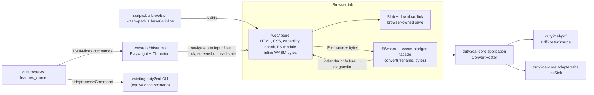

# Design: build-browser-converter

## Scope

The HOW for the browser realization of the permanent goal in
[the delta](specs/export-duty-plan-calendar/export-duty-plan-calendar.feature).
The conversion contract — supported family, classification, timing, identities,
descriptions, RFC 5545 output and complete-or-explicit-failure — is inherited
unchanged. The new surface is a bytes-in/result-out WASM facade over the
existing application boundary, a static converter page that owns the browser
offer, and a real-browser E2E harness. The Public website's publication,
Built revision, deploy key and full public copy are the separate
`publish-public-website` change and are not designed here.

## Technology decisions

| Area | Decision | Source / rationale |
|---|---|---|
| Language and layout | Rust stable (edition 2021) workspace, unchanged; new member `ffi/wasm` (package `duty2cal-wasm`) | `Cargo.toml`, `rust-toolchain.toml`; the existing application boundary already takes `&[u8]` and returns `String` |
| WASM target | `wasm32-unknown-unknown` | Standard browser target; the feasibility probe compiles the whole chain for it |
| Randomness on WASM | `getrandom = { version = "0.4", features = ["wasm_js"] }` as a wasm-target dependency of `ffi/wasm` | `givn/ideation/public-website/evidence/wasm-probe.txt`: the default check fails without the feature; the feature-only probe compiles |
| WASM binding | `wasm-bindgen` 0.2 (0.2.129 resolved by the feasibility probe); `js-sys` for the browser clock | The probe's lock; the workspace `Cargo.lock` is authoritative |
| WASM build tool | `wasm-pack`, `--target web --out-dir ../../web/pkg` (relative to `ffi/wasm`) | `wasm-pack` produces the ES-module glue and the matching `wasm-bindgen` CLI in one documented command; a manual `wasm-bindgen-cli` sequence would maintain fragile glue, and a bundler such as `trunk` adds a second build system for a page that needs neither |
| Static page | Hand-written HTML, CSS and ES modules; no framework, no bundler, no third-party runtime asset | The page is one screen; a framework would add a runtime asset and a build step for no observable gain |
| Browser driver | Playwright 1.64.1 (looked up with `npm view playwright version` on 2026-10-19), pinned in `web/e2e/package-lock.json` | The chosen driver because it supports file inputs, downloads, request logging, screenshots, reduced-motion emulation and `@axe-core/playwright` in one test-only dependency; the project has no existing browser driver. Selenium or WebDriverIO would add a driver/port layer without improving real-interface fidelity |
| Accessibility check | `@axe-core/playwright` 4.14.0 (looked up with `npm view @axe-core/playwright version` on 2026-10-19), test-only | Automated contrast, label and semantics evidence; not a runtime asset |
| Gherkin runner | cucumber-rs 0.23 as the existing `harness = false` `features_runner` target; `.fail_on_skipped()` | `apps/cli/Cargo.toml`, `apps/cli/tests/features_runner.rs`; one runner, one strict-mode contract |
| Test driver protocol | A long-lived Node process (`web/e2e/driver.mjs`) controlled by newline-delimited JSON from Rust steps | Keeps one browser context across Gherkin steps without a second Gherkin runner; the `.feature` file remains the executable spec |
| Licensing | MPL-2.0 for code (`ffi/wasm/**`, `web/*.js`, `web/*.css`, `web/*.html`, `web/e2e/**`); CC0-1.0 for any non-code asset under `web/assets/**`; `LICENSES/` unchanged | ADR-0001 and the seed's licensing decision; REUSE annotations are added only if an asset exists |
| PDF extraction | `pdfplumber = "=0.4.1"`, unchanged, still only in `duty2cal-pdf` | Existing exact pin; no new extraction dependency |

### Version freshness

No version is written from memory. Every version-bearing choice records how it
was resolved. The implementation's setup task resolves the unpinned items once
and commits the lock/record; later upgrades are deliberate changes.

| Technology | Version | Resolution / record |
|---|---|---|
| Rust | stable channel; probe host rustc 1.99.1 (2026-10-19) | `rust-toolchain.toml`; no new pin |
| `pdfplumber` | 0.4.1 | Existing exact pin; unchanged |
| `wasm-pack` | 0.15.0 | Looked up on crates.io/npm on 2026-10-19; the setup task records the resolved version in `web/.wasm-pack-version`, and `scripts/build-web.sh` installs exactly that version |
| `wasm-bindgen` | 0.2.129 resolved by the 2026-10-19 feasibility probe | The workspace `Cargo.lock` is authoritative; the crate asks for `0.2` and the lock records the exact release |
| `getrandom` | 0.4.3 resolved by the probe | `Cargo.lock`; the `wasm_js` feature is the wasm policy |
| `time` | 0.3.55 resolved by the probe | `Cargo.lock`; unchanged workspace dependency |
| `cucumber` (cucumber-rs) | 0.23 | Existing `apps/cli/Cargo.toml`; unchanged test runner |
| Playwright | 1.64.1 | `npm view playwright version` on 2026-10-19; pinned in `web/e2e/package-lock.json` |
| `@axe-core/playwright` | 4.14.0 | `npm view @axe-core/playwright version` on 2026-10-19; pinned in `web/e2e/package-lock.json` |
| Node.js | latest LTS at setup, then pinned: `actions/setup-node` with `node-version-file: web/e2e/.nvmrc`; the setup task resolves `lts/*` once, records the exact major in `web/e2e/.nvmrc` and the CI `node-version`, and commits both | The authoring host ran Node v24.21.0 on 2026-10-19, but that observation is not a product promise and the latest LTS must not float at every run (D6). The committed `.nvmrc` is the reviewed version; a Node upgrade is a deliberate change |
| Chromium | Installed by `npx playwright install chromium`; version tied to the Playwright package | No separate pin; Playwright's browser revision is recorded by its package |
| Containers / databases | None | The page has no backend |

## Architecture impact

The page is a driving adapter over the unchanged application. It supplies the
file's bytes and filename; the facade returns calendar text or a structured
failure; the page owns the browser offer. No path crosses the WASM boundary and
the facade performs no filesystem or network I/O.



New and changed files:

| Path | Kind | Purpose |
|---|---|---|
| `Cargo.toml` | changed | Add `ffi/wasm` as a workspace member |
| `Cargo.lock` | changed | Records the exact `wasm-bindgen`, `js-sys`, `getrandom` and target-scoped dependency resolutions |
| `THIRD-PARTY-NOTICES.md` | changed | Regenerated with the pinned `cargo-about@0.9.0` after `ffi/wasm` joins the workspace, so the `notices` CI job's `git diff --exit-code` passes |
| `ffi/wasm/Cargo.toml` | new | `duty2cal-wasm`, `crate-type = ["cdylib", "rlib"]`, core/pdf, `time`; `wasm-bindgen`, `js-sys` and `getrandom` under `[target.'cfg(target_arch = "wasm32")'.dependencies]` |
| `ffi/wasm/src/lib.rs` | new | `convert(filename, bytes)` facade, browser/native clock, structured result |
| `ffi/wasm/clippy.toml` | new | Same no-filesystem/no-network/no-environment guardrails as the core |
| `crates/duty2cal-core/src/application/mod.rs` | changed | Add `diagnostic_text(source_name, reason)` shared by the CLI and the facade |
| `apps/cli/src/main.rs` | changed | `report()` uses the shared `diagnostic_text` format |
| `web/index.html` | new | The converter screen: title, heading, picker/drop zone, status, offer, failure, minimal privacy copy, CSP |
| `web/capability.js` | new | Classic capability check; renders the cannot-run message and leaves the picker hidden |
| `web/app.js` | new | ES module: WASM init, file handling, size guard, conversion, states, offers, no storage/network |
| `web/styles.css` | new | Design tokens, layout, breakpoints, states, reduced motion |
| `web/.wasm-pack-version` | new | The resolved `wasm-pack` pin |
| `web/pkg/` | generated, ignored | `wasm-pack` output (`duty2cal_wasm.js`, `duty2cal_wasm_bg.wasm`) plus the generated `wasm-inline.js` base64 module; never committed |
| `web/e2e/package.json`, `web/e2e/package-lock.json` | new | Pinned Playwright and axe test dependencies; test-only |
| `web/e2e/.nvmrc` | new | The resolved Node LTS major, pinned after the one-time setup lookup and read by `actions/setup-node` |
| `web/e2e/driver.mjs` | new | Long-lived Playwright driver: loopback static server, browser context, actions/observations, screenshots, request log, storage snapshot, download capture |
| `scripts/build-web.sh` | new | Install the pinned `wasm-pack`, build `web/pkg`, generate `web/pkg/wasm-inline.js` (base64), copy `LICENSES/MPL-2.0.txt` to `web/LICENSE.txt` |
| `scripts/run-web.sh` | new | Build if needed and serve `web/` on loopback for manual use |
| `docs/design/reference/` | new | The approved design-only rendered reference views for the empty, ready and failure states (the page source does not exist yet); `docs/design/design-system.md` links them |
| `apps/cli/tests/features_runner.rs` | changed | `DutyWorld` owns an optional browser driver and kills it in `Drop` |
| `apps/cli/tests/steps/mod.rs` | changed | `pub mod browser;` |
| `apps/cli/tests/steps/browser.rs` | new | Shared JSON-lines driver client; not a step-definition file |
| `apps/cli/tests/steps/e2e/export_duty_plan_calendar.rs` | changed | The one browser `@e2e` scenario's steps alongside the existing CLI e2e steps |
| `apps/cli/tests/steps/export_duty_plan_calendar.rs` | changed | The regular browser variant steps alongside the existing CLI steps |
| `run-tests.sh` | changed | Builds the web bundle (unless `DUTY2CAL_SKIP_WEB_BUILD=1`) before either suite mode; it is the root script `givn/commands.yaml` invokes |
| `measure-coverage.sh` | changed | Builds the web bundle once before its two instrumented runs; it is the root script `givn/commands.yaml` invokes |
| `.github/workflows/ci.yml` | changed | The `test` and `coverage` jobs install the pinned Node version from `web/e2e/.nvmrc` and Chromium; the existing `fmt`, `clippy`, `deny`, `notices`, `reuse`, `license-headers`, `pii-guard` and `windows-gnu-build` jobs see the new files and workspace member. No publish workflow is added; that is the site publication's scope. |
| `givn/specs/export-duty-plan-calendar/usecase.md` | changed | Channel-neutral trigger and publication/diagnosis wording, the 20 MiB flow check, the browser interaction row and the web-reviewer lens |
| `docs/design/design-system.md` | new | Durable design system for the converter screen (tokens, primitives, breakpoints, accessibility, capture rules, references) |
| `.gitignore` | changed | Ignore `/web/pkg/`, `web/e2e/node_modules/`, `web/e2e/test-results/`, `reports/visual/` |

`REUSE.toml` gains no entry in this change because the page introduces no
non-code asset; if a favicon or logo is added, it goes under `web/assets/**`
with a CC0-1.0 override. `deny.toml` is unchanged: `wasm-bindgen`, `js-sys` and
`getrandom` are already within the allow-list. Adding the workspace member
changes `Cargo.lock` and `THIRD-PARTY-NOTICES.md`; the setup task regenerates the
notices with the pinned `cargo-about@0.9.0` after the member is added, because
the `notices` CI job fails on a stale generated file.

No database or persistent data model changes. The only new data shapes are
the JS result object (`status`, `calendar` or `reason`, `diagnostic`) and the
page's in-memory state; neither is persisted. The diagnostic text and the
calendar text are the existing application outputs.

The `ffi/wasm` crate compiles natively (as `rlib`) for `cargo fmt --all`,
`cargo clippy --workspace --all-targets` and the Windows GNU workspace build;
only the `wasm_bindgen` exports (`convert`, `diagnostic_text`) and
`BrowserClock` are `cfg(target_arch = "wasm32")`. `wasm-bindgen`, `js-sys` and `getrandom` are target-scoped under
`[target.'cfg(target_arch = "wasm32")'.dependencies]`, so the native and
Windows workspace builds depend only on `duty2cal-core`, `duty2cal-pdf` and
`time`. The browser artifact is produced by `wasm-pack` in the test and
coverage jobs. Node and Chromium are test-only; they never enter the product
archive, and no `web` publish workflow is added by this change.

"Supported platform" continues to mean the platforms a release offers as
downloadable archives: Windows x86_64. The browser is a supported conversion
route and offers no archive; that distinction is recorded in the glossary,
chapter 4 and the delivery constraints. The release note says the capability is
available from the built Site output, not from the public URL, which the
`publish-public-website` change owns.

## The WASM facade (`ffi/wasm`)

The facade is a thin driving adapter. It has no filesystem, network, clock or
environment access of its own beyond the browser clock needed by the existing
`Clock` port.

```rust
// The page calls convert with the File.name and the bytes, and
// diagnostic_text for a failure the page detects before conversion.
#[cfg(target_arch = "wasm32")]
#[wasm_bindgen]
pub fn convert(filename: &str, bytes: &[u8]) -> JsValue {
    // map ConvertRoster::execute to the structured JS object
}

#[cfg(target_arch = "wasm32")]
#[wasm_bindgen]
pub fn diagnostic_text(filename: &str, reason: &str) -> String {
    duty2cal_core::application::diagnostic_text(filename, reason)
}
```

The result is a plain JS object, not a serialized string and not a Rust type
with hidden fields:

- success: `{ status: "ok", calendar: "<complete RFC 5545 text>" }`;
- failure: `{ status: "failure", reason: "<ConvertError Display>", diagnostic:
  "Source PDF: <filename>\nReason: <reason>\n" }`.

The page derives the offered names from the supplied filename; the facade never
returns a path and never chooses a save location. The page writes the calendar
or diagnostic text to a `Blob` and offers it with an `<a download>`.

Wiring:

```rust
let outcome = ConvertRoster::new(PdfRosterSource, IcsSink, BrowserClock)
    .execute(bytes);
```

- `BrowserClock` implements the existing `Clock` port with `js_sys::Date::now()`
  and `OffsetDateTime::from_unix_timestamp_nanos`; a native `NativeClock` uses
  `OffsetDateTime::now_utc()` so `cargo clippy --workspace --all-targets` can
  compile and lint the crate on the Linux host. The wasm-only `wasm_bindgen`
  export and `BrowserClock` are `#[cfg(target_arch = "wasm32")]`.
- The source's own Created footer remains the preferred revision timestamp;
  the browser clock is only the existing fallback. The equivalence scenario
  uses a fixture with a Created footer, so both interfaces derive the same
  DTSTAMP.
- The diagnostic format is not re-implemented in the facade. A pure
  `diagnostic_text(source_name: &str, reason: &str) -> String` lives in
  `duty2cal-core/src/application/mod.rs`; the CLI's `report()` and the facade
  both call it. The page's last-resort trap fallback composes the same two
  lines because the WASM instance may be unusable; that fallback is the only
  duplicated spelling and is exercised by the diagnostic-unavailable scenario.
- A trap, out-of-memory abort or any non-structured JS exception is caught by
  `app.js`; it becomes a failure with the generic reason `the plan could not be
  processed in this browser`, keeps the primary failure visible, attempts the
  diagnostic offer, and discards the WASM instance so the next attempt starts
  from a fresh one. No partial calendar is ever offered.
- `ffi/wasm/clippy.toml` repeats the core's `disallowed-types` and
  `disallowed-methods` (`std::fs`, `std::net`, `std::time::SystemTime`,
  `std::env`, `std::process::exit`). The native dependency set is only
  `duty2cal-core`, `duty2cal-pdf` and `time`; `wasm-bindgen`, `js-sys` and
  `getrandom` are wasm-target dependencies, so the Linux/Windows workspace
  builds do not pull wasm-only crates.
- The wasm `getrandom` feature is enabled only for the target:
  `[target.'cfg(target_arch = "wasm32")'.dependencies] getrandom = { version =
  "0.4", features = ["wasm_js"] }`. This is the feature-unification seam the
  feasibility probe proved.

## The converter page (`web/`)

### State machine

The page has four observed states; three are rendered states and one is
transient:

| State | Visible content | Controls |
|---|---|---|
| empty | heading, explanation, drop zone, picker, `No plan selected.` | picker enabled |
| converting | `Converting…` status, picker disabled | no new plan until the attempt settles |
| calendar ready | `Calendar ready` heading, `Save <stem>.ics` offer, privacy note | picker enabled, offer clickable |
| failure | `Conversion failed` heading, reason, `Save <stem>.parse-error.txt` if available, `Choose another plan` | reset enabled |
| cannot-run (startup) | `This browser cannot run the converter` heading, reason, no picker | none |

The declared conversion-screen states are empty, ready and failure. The
`cannot-run` state is a startup state outside the conversion flow: the
capability gate or a module/instantiation failure renders it before the picker
exists. It is asserted by the WebAssembly, ES-module and startup-failure
scenarios and has a reference view in the design reference; the `@e2e`
scenario does not traverse it. The `@e2e` scenario traverses empty and ready
and captures both at each viewport. The failure state is asserted by the
regular failure scenarios (heading, reason, diagnostic offer or its absence,
and the way back) and its approved reference render is committed under
`docs/design/reference/`. The converting state is a transient status, not a
declared screen state, and is not captured.

Every `acceptFile` call begins by clearing the previous attempt: it revokes the
live calendar and diagnostic object URLs, removes the offer links and resets
the status region before it validates or reads the new file. A failed attempt
therefore withdraws any calendar offered by an earlier attempt; a successful
attempt replaces it. A second success never leaves two calendar offers on the
page.

### Capability gate and loading

- `web/capability.js` is a classic deferred script. It checks
  `typeof WebAssembly === 'object'`, `typeof WebAssembly.instantiate ===
  'function'`, and ES-module support via `HTMLScriptElement.supports?.('module')`
  with a `noModule` fallback when `supports` is absent. It sets
  `document.documentElement.dataset.duty2calSupported` and, when the check
  fails, renders the cannot-run message and leaves the picker hidden.
- The picker and drop zone are in the markup with `hidden`; `app.js` reveals
  them only after the capability check passes and the WASM module has
  initialized. A no-WebAssembly browser therefore sees the message and no file
  picker.
- `scripts/build-web.sh` generates `web/pkg/wasm-inline.js` from
  `duty2cal_wasm_bg.wasm`: a single exported base64 string. `app.js` imports
  `./pkg/duty2cal_wasm.js` and `./pkg/wasm-inline.js`, decodes the base64 into
  a `Uint8Array`, and calls the generated `init(bytes)`. The generated
  `wasm-bindgen` loader accepts an `ArrayBuffer`/`Uint8Array` and instantiates
  it with `WebAssembly.instantiate`; it never calls `fetch`. This is required
  by `connect-src 'none'`, which blocks the loader's default `fetch` of the
  `.wasm` file.
- A module-load or instantiation failure shows a startup failure with the
  cannot-run treatment and no picker; it never falls back to a server or an
  upload. The regular scenario "A converter module that cannot be instantiated
  shows the startup failure" forces this path with an init script, and the ES
  path has its own scenario, so both branches are asserted rather than only
  reviewed.
- The page is served over loopback HTTP because ES modules are not reliably
  loadable from `file://`; the local run and the E2E both use a static HTTP
  server. The WASM itself is inline, so no `.wasm` request is made.

### Input and conversion

- The picker is a visible `Choose a duty plan` button plus a labelled hidden
  `<input type="file" accept="application/pdf,.pdf">`; the drop zone accepts
  one file and prevents the browser's default navigation. Both entry points
  call one `acceptFile(file)` function; the `@e2e` scenario drives the picker
  (the accessible primary path), and the drop handler is a thin alias with its
  own regular scenario ("A supported plan dropped onto the drop zone is
  converted"). Drop is a variant of the same supply action, not a second
  end-to-end action.
- `acceptFile` rejects a file larger than 20 MiB (`20 * 1024 * 1024` bytes)
  before reading it, with the reason naming the 20 MiB bound. The page calls the
  facade's `diagnostic_text(filename, reason)` for that failure, so the size
  path uses the same two-line diagnostic as a conversion failure. The size
  check is the page's bound; the converter still checks the family and the
  content.
- The page reads `await file.arrayBuffer()`, calls `convert(file.name, new
  Uint8Array(buffer))`, and routes the structured result. It does not read the
  file's path, create a form submission, or send a request.
- The page uses the source stem: strip the final extension only when a dot is
  present after the first character; `2026-06.pdf` becomes `2026-06`,
  `roster.v2.pdf` becomes `roster.v2`. The calendar name is `<stem>.ics`; the
  diagnostic name is `<stem>.parse-error.txt`.

### Offers and no-write behavior

- The page creates an object URL from a `Blob` and an `<a download="<name>">`.
  The link text names the file (`Save 2026-06.ics`); the page also states that
  the browser chooses the location.
- The page tracks its live object URLs, revokes them when a new offer replaces
  an old one, and revokes every live URL on `pagehide`. It never calls
  `URL.revokeObjectURL` before the browser has had the chance to start the
  download.
- A failed attempt withdraws the earlier offer: because `acceptFile` clears the
  offer and state before it reads the new file, a previously offered calendar
  is no longer offered once the new attempt fails. The scenario "A failed
  attempt withdraws a calendar offered by an earlier attempt" pins this; the
  wrong-file risk the minimal guarantee targets is not left to review.
- The page never uses the File System Access API, `showSaveFilePicker`,
  `localStorage`, `sessionStorage`, IndexedDB, cookies, `document.cookie`,
  `history.pushState`, `location.hash`, or a form submission. The plan bytes
  live in a local variable for the duration of the attempt; the derived
  calendar/diagnostic lives in the object URL until it is revoked.
- The page never renders the word `saved` as a claim about its own work. It
  offers; the browser saves. A dismissed save leaves the offer visible and the
  page unchanged.
- If the calendar offer cannot be created, the page does not enter the ready
  state: it shows the failure panel with the reason `the calendar could not be
  offered for saving`, offers no calendar, and attempts the diagnostic offer
  with the same reason. Success is never reported without an offer.
- If `URL.createObjectURL` or `Blob` construction throws for the diagnostic,
  the page catches it, keeps the primary failure panel and its reason, and adds
  `No diagnostic was offered.` It never replaces the primary failure with the
  diagnostic failure.

### Network and CSP

`web/index.html` carries this meta CSP in the head, before any resource:

```text
default-src 'self'; connect-src 'none'; script-src 'self' 'wasm-unsafe-eval';
style-src 'self'; img-src 'self' data:; object-src 'none'; base-uri 'none';
form-action 'none'
```

- `connect-src 'none'` forbids fetch, XHR, WebSocket, EventSource and
  `sendBeacon`. The page makes no such call. This is also why the WASM bytes are inlined at build time
  and passed to `init(bytes)`: the generated loader's default `fetch` of
  `duty2cal_wasm_bg.wasm` would be blocked by this directive. The CSP is not
  weakened for the loader.
- `script-src 'self' 'wasm-unsafe-eval'` is required for
  `WebAssembly.instantiate` from the inline bytes in Chromium under a CSP; the
  E2E loads the page with the CSP active and fails if instantiation is blocked.
  Firefox and Safari are checked manually before a release; the risk is
  recorded below.
- No third-party asset is loaded: the font is the system stack, there is no
  icon font, no external stylesheet, no image from another origin, and no
  analytics or tag manager. The page declares an inline empty favicon
  (`<link rel="icon" href="data:,">`) so the browser makes no favicon request;
  every remaining request is same-origin.
- The driver records every request; the E2E asserts every request's origin is
  the local page origin, and that no request to another origin occurs after the
  page load. Same-origin script and stylesheet requests are allowed; no `.wasm`
  request is made because the bytes are inline, and the plan bytes never enter
  a request.

### Accessibility and visual rules

- Semantics: `<header>`, `<main>`, `<footer>`; one `<h1>`; the failure panel has
  an `<h2>`; the picker button, the file input's label, the offer links and the
  reset button have visible text.
- Live regions: the converting/ready status is `role="status"` with
  `aria-live="polite"`; the failure panel is `role="alert"`.
- Keyboard: every control is reachable and operable with the keyboard; focus is
  visible on the picker button, the links and the reset.
- Contrast: the token values below meet WCAG 2.2 AA (normal text 4.5:1, large
  text and UI boundaries 3:1); `@axe-core/playwright` runs after each rendered
  state and the step fails on any violation.
- Reduced motion: `--motion-duration` is `120ms` normally and `0ms` under
  `prefers-reduced-motion: reduce`; only opacity/translate transitions use it,
  and no animation loops. The E2E emulates the preference and asserts the
  computed value is `0ms`.
- Language: `<html lang="en">`; all visible copy is English.
- No internal identifier or state name appears in visible text: the baseline
  step checks the visible text against a denylist (`ok`, `failure`, `status`,
  `WASM`, `blob:`, `parse-error` as a bare state name, and component names).
  The offered filenames are the intended exception.
- No visible content is duplicated: the baseline step compares visible text
  blocks and fails on repeated identical blocks.
- The error state has a heading and a way back (`Choose another plan`).

## Validation decisions

- The page's structural copy states what the control does and that processing
  is local. The full public statements (both routes, source and release links,
  Built revision, licence, non-affiliation, as-is) and the published footer are
  the `publish-public-website` change's content. This change owns the converter
  screen's labels, privacy note and offer behavior, not the site's public copy.
- The page offers `<source-stem>.ics` and `<source-stem>.parse-error.txt`; it
  never enumerates or claims an unused numbered name and never observes the
  save. The browser's own collision suffix is accepted and not simulated as a
  page behavior.
- The diagnostic text is `Source PDF: <filename>\nReason: <reason>\n`, the same
  two lines the executable writes; the shared function is the single source.
  The page calls the facade's `diagnostic_text` for the size guard; the only JS
  spelling is the last-resort trap fallback, where the WASM instance may be
  unusable.
- **Fictional fixture dates and targeted privacy-gate exclusions.** Every
  committed calendar fixture uses the project's fictional-year convention
  (2098/2099). The equivalence fixture keeps the scenario stems `2026-06.pdf`
  and `2026-06.ics`, but its generated plan dates, Created footer and resulting
  `DTSTART`/`DTEND`/`DTSTAMP` are 2099, so the committed calendar is not a real
  plan's output. `scripts/pii-guard.sh` excludes only three recorded cases:
  `web/e2e/node_modules` from the tree scan (the installed, git-ignored
  end-to-end dependency, not committed material), `terraform.tfstate*` from
  both scans (ADR-0006 state ciphertext, where the identifier pattern is a
  false positive on base64), and, in the history scan only, the superseded
  `apps/cli/tests/fixtures/expected/2026-06.ics` revisions (generated test data
  at a path later overwritten by the fictional-date fixture). The guard's own
  file and the standard `.git`, `target` and `private` directories are excluded
  by construction; every other path, including shell scripts, is scanned. No
  non-fictional year is allowed: a real 2026 calendar outside those paths still
  fails the gate.

## Step definition locations

One file per capability for the step definitions, as the project already does.
The shared browser driver client is support code, not a second step file.

| File | Role |
|---|---|
| `apps/cli/tests/steps/browser.rs` | `BrowserDriver`: starts `web/e2e/driver.mjs`, sends one JSON command per line, parses one JSON result per line, fails closed on an unknown command or a non-`ok` result; owns the child and kills it on drop. Shared by both step modules. |
| `apps/cli/tests/steps/e2e/export_duty_plan_calendar.rs` | The `@e2e` browser steps for `Crew member converts a supported duty plan in the browser and saves the offered calendar`, alongside the existing CLI e2e steps for the same capability. |
| `apps/cli/tests/steps/export_duty_plan_calendar.rs` | The regular browser steps for the size, family, unresolved-activity, stale-offer, drop, WebAssembly-capability, ES-module, startup-failure, calendar-offer-failure, diagnostic-unavailable, cancelled-save, stem and persistence scenarios, alongside the existing CLI steps. |
| `apps/cli/tests/steps/mod.rs` | Adds `pub mod browser;`. |
| `apps/cli/tests/features_runner.rs` | Adds `browser: Option<BrowserDriver>` to `DutyWorld` and kills the child in `Drop`. |
| `web/e2e/driver.mjs` | The Playwright driver. It contains actions and observations, no scenario text and no assertions that belong to the step bodies; an unknown action is an error. |

The driver protocol (one JSON object per line in each direction) has these
actions, each returning the observed state the Rust step asserts on:

`start` (serve `web/`, launch Chromium, open the page, return the initial
rendered state and request log), `set_file` (path, optional init-script mode),
`drop_file`, `read_state` (empty/converting/ready/failure, visible text, offers,
visible failure reason, storage snapshot, address/history, request log),
`save_offer` (click a calendar or diagnostic offer and capture the browser's
download to a path), `dismiss_save`, `reload`, `screenshot` (viewport, path),
`axe` (return violations), `stop`.

`read_state` never returns the diagnostic's file contents: `connect-src 'none'`
forbids the page or driver from `fetch`ing the Blob, and no page-side test hook
is added. The diagnostic scenarios use `save_offer` to capture the diagnostic
download, and the Rust step reads that file and matches
`Source PDF: <filename>\nReason: <reason>\n`. The same capture path proves the
calendar offer's contents.

## Test runner, strict mode, and single-scenario command

- **Regular suite:** `./run-tests.sh` (the configured `verify.command`), which
  assembles `givn/specs/**` and `givn/changes/*/specs/**` and runs `cargo test
  -p duty2cal --test features_runner`.
- **E2E suite:** `./run-tests.sh --e2e` (the configured
  `verify.e2e_command`), filtering `@e2e`. It remains distinct from
  `verify.command`; it includes the existing CLI `@e2e` scenario and the new
  browser `@e2e` scenario.
- **Browser build:** both `./run-tests.sh` and `./run-tests.sh --e2e` call
  `scripts/build-web.sh` before the runner unless `DUTY2CAL_SKIP_WEB_BUILD=1`
  is set, because the full suite runs the regular browser variants and the
  `--e2e` suite runs the browser smoke test. `scripts/build-web.sh` installs
  the pinned `wasm-pack`, builds `web/pkg`, and copies the licence. The build is
  not a test assertion; the steps assert the rendered result.
- **Strict mode:** `apps/cli/tests/features_runner.rs` builds the runner with
  `.fail_on_skipped()` and `.run_and_exit(root)`. An undefined or skipped step
  makes the process non-zero, so no scenario can pass with an unimplemented
  step.
- **Strict-mode proof:** the setup task adds a deliberately undefined browser
  step to the exact runner configuration and requires the process to exit
  non-zero. During RED, every new step body starts as a stub that panics with
  its own step name. The driver also fails closed: an unknown action returns
  `{ "ok": false, "error": "unknown action" }` and a non-zero exit, and the
  Rust step panics on any non-`ok` result. The driver has no path that reports
  an unperformed action as success.
- **Single-scenario run:** `./run-tests.sh --name "<scenario title>"`, for
  example `./run-tests.sh --name "Crew member converts a supported duty plan in
  the browser and saves the offered calendar"`.
- **Environment:** the Node version pinned in `web/e2e/.nvmrc`,
  `web/e2e/node_modules` (`npm ci --prefix web/e2e`), and Chromium
  (`npx --prefix web/e2e playwright install --with-deps chromium`) must be
  present for browser scenarios. The E2E driver starts its own loopback server;
  no external service is needed.

## Decisions

Resolves the proposal's `D1`–`D6`. Seed questions Q1–Q9 are dispositioned in
the proposal; Q1/Q3/Q4 are realized here by D2/D4 and the page contract, Q2/Q9
are the confirmed Personas/Handoff, and Q5/Q7/Q8 are out of scope for the
separate site publication.

- **Decides D1:** build with `wasm-pack` 0.15.0, `--release --target web
  --out-dir ../../web/pkg`; record the resolved version in
  `web/.wasm-pack-version` and install exactly it in `scripts/build-web.sh`.
  The same script then inlines `duty2cal_wasm_bg.wasm` as a base64 ES module
  (`web/pkg/wasm-inline.js`), and `app.js` passes the decoded bytes to
  `init(bytes)`. This is required by the `connect-src 'none'` CSP: the
  generated loader's default `fetch` of the `.wasm` file would be blocked, so
  the CSP is not weakened and no `.wasm` request is made. Rejected: a manual
  `wasm-bindgen-cli` sequence (maintains fragile glue and a second version to
  match), `trunk` (a second build system and dev server for a static page that
  needs neither), and loosening `connect-src` to `'self'` (weakens the
  no-network claim). Realized in `scripts/build-web.sh`, `web/app.js`,
  `ffi/wasm/Cargo.toml` and the generated `web/pkg` build output.
- **Decides D2:** extend the existing cucumber-rs runner with a long-lived
  Playwright driver; Playwright 1.64.1 is pinned in `web/e2e/package-lock.json`;
  the step files are the two capability files named above and the shared client
  is `apps/cli/tests/steps/browser.rs`. Rejected: a separate cucumber-js runner
  (a second Gherkin runner and a second strict-mode contract) and a
  hand-maintained Playwright test file (a parallel test surface that violates
  the executable-spec invariant). Realized in the step files, the driver and
  the `DutyWorld` child process.
- **Decides D3 (operator-approved 2026-10-19):** exclude `duty2cal-wasm` from
  the native coverage workspace with `cargo llvm-cov --package duty2cal-core
  --package duty2cal-pdf --package duty2cal --test features_runner`; the
  facade is thin, its wasm-only wrapper lines are outside the denominator, its
  behavior is browser-evidenced, the e2e report remains non-zero from the
  existing CLI `@e2e` scenario, and the limitation is recorded as a risk.
  Rejected: instrumenting the WASM bundle (the browser target has no
  file-based LLVM profile writer in this toolchain) and adding a native
  duplicate test (a weaker duplicate of the browser scenario). Realized in
  `measure-coverage.sh` and the coverage table below.
- **Decides D4:** add the pure `diagnostic_text(source_name, reason)` function
  to `duty2cal-core/src/application/mod.rs`; the CLI's `report()` and the WASM
  facade call it; the page owns the offer names and Blob mechanics. Rejected:
  duplicating the format in the page (two formats that can drift) and moving
  publication into the core (a filesystem/Blob dependency that breaks the
  bytes-in/text-out boundary). Realized in the core function, `apps/cli/src/main.rs`
  and `ffi/wasm/src/lib.rs`.
- **Decides D5:** generalize the permanent use case's publication/diagnostic
  wording and add the browser interaction row, rather than creating a separate
  browser contract. Realized in
  `givn/specs/export-duty-plan-calendar/usecase.md` and the delta feature.
- **Decides D6:** resolve the latest Node LTS once at setup, then pin it in
  `web/e2e/.nvmrc` (read by `actions/setup-node` and CI); pin the looked-up
  Playwright 1.64.1 and `@axe-core/playwright` 4.14.0 in
  `web/e2e/package-lock.json`; pin `wasm-pack` 0.15.0 in
  `web/.wasm-pack-version`; let `Cargo.lock` hold the exact
  `wasm-bindgen`/`getrandom`/`time` resolutions. Rejected: resolving latest on
  every run (non-reproducible, the state D6 exists to prevent) and avoiding a
  Node test dependency (no real browser evidence, which the Web UI policy
  forbids). Realized in `web/e2e/.nvmrc`, the lockfiles,
  `web/.wasm-pack-version`, `scripts/build-web.sh` and the CI setup.

No proposal question is unresolved.

## Use-case traceability

The delta is under `export-duty-plan-calendar`; the permanent contract's rules
remain authoritative. Actors in Gherkin are domain roles; Personas are review
lenses (below).

| Use-case element | Technical decision | Scenario / evidence |
|---|---|---|
| Precondition: current browser with WebAssembly and ES modules | `web/capability.js` gate; `app.js` dynamic WASM import after the gate; picker hidden until ready | "A browser without WebAssembly shows the cannot-run message"; "A browser without ES-module support shows the cannot-run message" |
| Precondition: the converter module initializes after the capability gate | `init(bytes)` import/instantiation; startup failure uses the cannot-run treatment and no picker | "A converter module that cannot be instantiated shows the startup failure" |
| Flow check: plans at most 20 MiB | `MAX_BYTES` check in `acceptFile` before reading the bytes (the use case carries it in the flow, not as a precondition) | "A plan at the supported size bound is accepted"; "A plan larger than the supported size bound is refused by name" |
| Main flow 1: receive bytes and filename without a request | `File.arrayBuffer()`; `convert(filename, bytes)`; no form/fetch; CSP | `@e2e` "Crew member converts a supported duty plan in the browser and saves the offered calendar"; "A browser conversion leaves no plan in persistent storage or a navigable address"; "A supported plan dropped onto the drop zone is converted" |
| Main flow 2: supported family | `PdfRosterSource` family recognition; `SourceError::UnsupportedFamily` | "A source outside the supported family is rejected with a diagnostic offer" |
| Main flow 3: resolve required activities, never omit | `ConvertRoster`/`interpret` unchanged | "An unresolved required activity is rejected with a diagnostic offer"; "The browser offers the same calendar the executable produces for the same plan" |
| Main flow 4: complete RFC 5545 | `IcsSink` unchanged; the `@e2e` step asserts the reference fixture (events, CRLF, UID, DTSTAMP, no extras) | `@e2e`; "The browser offers the same calendar the executable produces for the same plan" |
| Main flow 5: offer `<stem>.ics`, write nothing | `offerCalendar` Blob/object URL/`<a download>`; browser-owned save | `@e2e`; "A cancelled save is not reported as a save"; "The offered names use the source file's stem" |
| Main flow 6: result visible, no save claim | state machine; `role="status"`/`role="alert"` | `@e2e` (empty → ready); failure scenarios |
| Extension: oversized plan | size guard + diagnostic offer | "A plan larger than the supported size bound is refused by name" |
| Extension: unsupported family | `UnsupportedFamily` + diagnostic offer | "A source outside the supported family is rejected with a diagnostic offer" |
| Extension: unresolved required activity | `ConvertError` + diagnostic offer | "An unresolved required activity is rejected with a diagnostic offer" |
| Extension: module load or instantiation fails | startup failure with the cannot-run treatment; no picker; no server/upload fallback | "A converter module that cannot be instantiated shows the startup failure" |
| Extension: browser memory failure/trap during conversion | `try/catch` around `convert`; generic failure; no partial calendar; discard the instance; attempt the diagnostic | Not deterministically forced in Chromium. Operator-accepted manual check at each release: a throwaway facade wrapper that throws mid-conversion confirms the generic failure, the diagnostic attempt and the fresh-instance retry; the check is repeated when the Chromium or WASM bundle version changes (chapter 11) |
| Extension: calendar offer cannot be created | `try/catch` around `offerCalendar`; failure panel with the offer reason; no ready state; diagnostic attempted with the same reason | "A calendar that cannot be offered is not reported as ready" |
| Extension: diagnostic offer cannot be created | `try/catch` around the diagnostic offer; primary failure stays | "A diagnostic that cannot be offered does not hide the primary failure" |
| Extension: cancelled save | the page never observes the save; the offer remains | "A cancelled save is not reported as a save" |
| Rule: a failed attempt withdraws the earlier offer | `acceptFile` clears offers/status before reading; object URLs revoked | "A failed attempt withdraws a calendar offered by an earlier attempt" |
| Rule: no network after load; no third-party asset | CSP `connect-src 'none'`; no third-party asset; request log | `@e2e` (no other-origin request) |
| Rule: no persistent storage, navigable URL or history entry | no storage APIs; no `pushState`/hash; object URL revoked on `pagehide` | "A browser conversion leaves no plan in persistent storage or a navigable address" |
| Rule: offer names | stem rule; `<stem>.ics` / `<stem>.parse-error.txt` | `@e2e`; "The offered names use the source file's stem" |
| Rule: diagnostic content | shared `diagnostic_text` | the oversized, unsupported-family and unresolved-activity scenarios |
| Rule: page writes nothing/never claims a save | no filesystem/save API; offer only | `@e2e`; "A cancelled save is not reported as a save" |
| Minimal guarantee | failure visibility, diagnostic attempt, no save claim, no data leaving the page | the failure scenarios; `@e2e`; persistence scenario |
| Success guarantee | complete calendar offered, same rules as the executable | `@e2e`; equivalence scenario; size-bound scenario |
| Capability ownership | `export-duty-plan-calendar` only; no new capability | Interaction Coverage Matrix |
| Confirmed Personas | crew-member--personal-calendar-owner (accuracy/privacy), project-maintainer--release-owner (evidence/claims), contributor--web-reviewer (CSP/no-network/fallback) | `@e2e`, equivalence, failure and privacy scenarios; the Persona impact section |
| Permanent use-case wording | channel-neutral publication/diagnosis + browser interaction row | `givn/specs/export-duty-plan-calendar/usecase.md` (the delta's permanent home) |

The seed's event-storming events map to the browser realization as follows;
they are the same aggregate events, not a second event set.

| Event (seed event storming) | Browser realization | Evidence |
|---|---|---|
| E1 Duty plan supplied | the picker or drop zone hands one `File` and its bytes to `acceptFile` | `@e2e`; capability, size and family scenarios |
| E2 Duty-plan calendar completed | `ConvertRoster::execute` returns the complete calendar text | `@e2e`; equivalence scenario |
| E3 Duty-plan conversion rejected | the facade returns `{ status: "failure", reason }`; the page renders the failure panel | unsupported-family, unresolved-activity and oversized scenarios |
| E4 Calendar export offered (browser realization of Calendar export published) | the page offers `<stem>.ics`; the browser saves; the page writes nothing | `@e2e`; cancelled-save and stale-offer scenarios |
| E5 Calendar export publication failed | the page cannot create the calendar offer; it shows the failure panel, offers no calendar and attempts the diagnostic | "A calendar that cannot be offered is not reported as ready" |
| E6 Conversion diagnostic offered (browser realization of Conversion diagnostic written) | the page offers `<stem>.parse-error.txt` with the shared diagnostic text; the page writes nothing | unsupported-family, unresolved-activity and oversized scenarios; the diagnostic download is captured and read in the step |
| E7 Conversion diagnostic unavailable | the page states that no diagnostic was offered and keeps the primary failure | diagnostic-unavailable scenario |

## Persona impact

User-visible surface: a Web UI (the converter page). Confirmed Personas:

- **`crew-member--personal-calendar-owner`** — the primary accuracy and privacy
  lens. The browser route produces the same calendar as the executable for the
  same plan; a rejected plan is visibly rejected with a diagnostic offer; the
  plan never leaves the tab; the browser saves the offered file and the page
  does not claim a save.
- **`project-maintainer--release-owner`** — the public-claim and evidence lens.
  A browser failure is a defect backed by the real-browser `@e2e` scenario; the
  tool and browser versions are recorded and pinned; the site publication owns
  the published claim and Built revision.
- **`contributor--web-reviewer`** — the no-network proof, CSP, fallback and
  WASM-bundle lens. The request log, the storage snapshot, the capability
  message, the CSP and the fail-closed driver are all reviewable in the same
  history as the page.

No `visitor--project-reader` impact is recorded: this change builds the
converter screen, not the Site publication's full public copy; the reader lens
belongs to `publish-public-website`.

## Visual Design Contract

- Interface: web
- Viewports: mobile (360x780), desktop (1920x1080)
- Design system: `docs/design/design-system.md` (created in this change)
- Approval: the operator approved this token, primitive and state direction on
  2026-10-19 (design review). The direction is constrained by the project's
  no-third-party-asset rule, so the rendered reference is a design-only static
  page rather than an external style tile.

**Screens covered:** the converter screen served from the built Site output —
one page with the empty, ready and failure screen states, plus the
`cannot-run` startup state rendered before the picker exists when the browser
lacks WebAssembly/ES modules or the module cannot initialize. "Converting" is a
transient status, not a declared screen state. The startup state is asserted by
the regular capability/startup scenarios and has a reference view in
`docs/design/reference/`; the `@e2e` scenario does not traverse it. The public
publication of the page is the separate `publish-public-website` change; the
contract covers the page the built output contains.

**Design tokens** (style-level; the implementation may adjust values within
the stated contrast and scale rules):

| Token group | Roles / values |
|---|---|
| Color roles | `--color-bg` page white; `--color-surface` light neutral panel; `--color-text` near-black body; `--color-muted` secondary text; `--color-border` neutral divider; `--color-accent` blue for links and the primary picker; `--color-accent-contrast` white on accent; `--color-success` dark green for the ready heading; `--color-danger` dark red for the failure heading; `--color-focus` the accent color, used as a 2 px visible focus outline. Body text ≥ 7:1, muted text ≥ 4.5:1, accent and danger ≥ 4.5:1 on their surfaces, focus and UI boundaries ≥ 3:1. Light theme only; no dark-mode claim. |
| Spacing scale | 0, 4, 8, 12, 16, 24, 32, 48, 64 px; page padding 16 px mobile, 24 px at 480 px, 32 px at 720 px. |
| Typography scale | System stack `system-ui, -apple-system, "Segoe UI", Roboto, sans-serif`; 14 px small, 16 px body, 20 px section heading, 28 px page heading on mobile, 36 px at ≥ 720 px; line-height 1.5 body, 1.2 headings; weights 400 and 600. No third-party font. |
| Radii | 4 px for controls and links' focus shape, 8 px for the converter panel and failure panel. |
| Elevation | Flat by default; the converter panel may use one subtle `0 1px 2px rgb(0 0 0 / 0.08)` shadow. No modal or overlay elevation. |

**Component primitives and states:**

| Primitive | States |
|---|---|
| Page shell (`header`, `main`, `footer`) | default; one `h1`; landmarks. |
| Drop zone | default, dragover/hover, focus-within, disabled (converting); accepts one file. |
| Picker button + labelled file input | default, hover, focus-visible, disabled, loading (converting). |
| Status region | empty, converting, ready; `role="status"`, `aria-live="polite"`. |
| Offer link | default, hover, focus-visible; text `Save <name>`; no `disabled` state. |
| Failure panel | error heading, reason, optional diagnostic offer, `Choose another plan` reset; `role="alert"`. |
| Reset button | default, hover, focus-visible. |
| Privacy note | static text; local processing, no upload, no storage, no network after load. |

**Breakpoints:** mobile-first single column. At `< 480 px` the page uses 16 px
padding, full-width controls and a 28 px `h1`. From `480 px` the padding is
24 px. From `720 px` the content is centered at a 720 px maximum, the padding is
32 px and the `h1` is 36 px. From `1200 px` the 720 px centered column is
unchanged and the surrounding whitespace grows; there is no multi-column
layout. Controls keep a minimum 44 px touch target below 720 px.

**Accessibility:** WCAG 2.2 AA. Landmarks, one `h1`, a failure `h2`, visible
labels on every control, `role="status"`/`role="alert"`, visible keyboard focus,
the token contrast ratios (body text ≥ 7:1, muted text, accent and danger
≥ 4.5:1, focus and UI boundaries ≥ 3:1), `lang="en"`, and reduced-motion
support. Verified by Playwright assertions for semantics, labels, focus, language and
the reduced-motion computed value, plus `@axe-core/playwright` after each
rendered state (contrast, labels, landmarks, duplicate ids).

**Rendered reference:** an approved design-only reference page containing the
empty, ready and failure views is committed at
`docs/design/reference/converter-reference.html` and linked from
`docs/design/design-system.md`. It is responsive at both viewports and rendered
from the same markup, tokens and copy the implementation must use, so the
approved direction exists before the page source is built. The `@e2e`
screenshots are the later execution evidence for the empty and ready states;
the failure reference is the approved visual reference and the failure
scenarios assert its heading, reason, offer and way-back content.

**Capture mechanism and evidence path:** the Playwright driver resizes the page
to 360x780 and 1920x1080, emulates `prefers-reduced-motion: reduce` and a light
color scheme, waits for `document.fonts.ready` and two animation frames after
the final assertion, and calls `page.screenshot({ animations: 'disabled' })`.
The final ready state is
`givn/changes/build-browser-converter/evidence/visual/crew-member-converts-a-supported-duty-plan-in-the-browser-and-saves-the-offered-calendar/<viewport>.png`;
the empty state is `<viewport>--empty.png`. The referenced states are exactly
the ones the scenario traverses (empty and ready). Intermediate captures go to
`reports/visual/` and are not review evidence; the failure state's reference is
the committed `docs/design/reference/` render.

**Motion:** a single 120 ms opacity/translate transition on the status and
panel; no looping animation, no parallax. Under `prefers-reduced-motion:
reduce`, `--motion-duration` is `0ms` and all transitions are effectively
instant. The E2E emulates the preference and asserts the computed value.

## E2E smoke test infrastructure

- **E2E runner command:** `./run-tests.sh --e2e` (the configured
  `verify.e2e_command`), filtering `@e2e`; it is distinct from
  `verify.command` (`./run-tests.sh`). The script builds `web/pkg` first unless
  `DUTY2CAL_SKIP_WEB_BUILD=1`; both suite modes do so because the regular suite
  also runs browser variants.
- **E2E step definition location:** `apps/cli/tests/steps/e2e/export_duty_plan_calendar.rs`
  (the browser `@e2e` steps) and `apps/cli/tests/steps/export_duty_plan_calendar.rs`
  (the regular browser variants), both using the shared
  `apps/cli/tests/steps/browser.rs`. These are separate from the CLI e2e steps
  only by scenario, not by a second runner; the capability keeps one step file
  per layer. The Playwright driver is `web/e2e/driver.mjs`.
- **Real interface:** the rendered page in Chromium, driven by Playwright. The
  driver navigates to a loopback static server, asserts the rendered empty and
  ready states, sets the file input to a generated fixture, clicks the offer and
  captures the browser's download, reads the request log and the browser storage
  snapshot, and captures the screenshots. The equivalence scenario additionally
  runs the built CLI as a real subprocess for the same fixture.
- **Concrete `@e2e` assertion:** the step reads the captured calendar download
  and compares it with the reference calendar fixture for `2026-06.pdf`: one
  `VEVENT` per expected activity with the fixture's `SUMMARY`, `DTSTART` and
  `DTEND`, CRLF line endings, the expected `UID` values, the fixture's
  `DTSTAMP`, and no extra or partial event. "Complete RFC 5545 calendar" is the
  scenario's Then phrase; the step asserts the fixture, not a
  `BEGIN:VCALENDAR`/`END:VCALENDAR` stub.
- **Local test infrastructure:** the Node version pinned in `web/e2e/.nvmrc`
  (resolved once from the latest LTS at setup and committed), `npm ci
  --prefix web/e2e`, `npx --prefix web/e2e playwright install --with-deps
  chromium`, and `./scripts/build-web.sh`. The driver starts an in-process
  `http.Server` on `127.0.0.1:0` serving `web/`, one browser context per
  scenario, and one driver process per scenario. No database, queue, container,
  port reservation, credential or external service is needed.
- **Framework choice and justification:** Playwright is the chosen browser
  driver, not an existing project default: the project had no browser driver or
  Node test runner before this change. It supports the real page, file inputs,
  downloads, request logging, screenshots, reduced-motion emulation and the axe
  accessibility engine in one test-only dependency. Selenium or WebDriverIO
  would add a driver/port layer without improving the real-interface fidelity.
  The Gherkin
  runner remains cucumber-rs; the driver is invoked as a real subprocess, so the
  `.feature` file is the executable specification.
- **E2E strict-mode proof:** `apps/cli/tests/features_runner.rs` uses
  `.fail_on_skipped()`; an undefined or skipped browser step fails the process.
  The driver's protocol is fail-closed: an unknown action or a missing observed
  element returns `{ "ok": false, "error": ... }` and a non-zero exit, and the
  Rust step panics on any non-`ok` result. The setup task's proof adds one
  deliberately undefined browser step to this exact runner configuration and
  requires a non-zero exit; during RED every new step body panics with its own
  name. PASS is never inferred from an empty body.
- **Single-scenario run:** `./run-tests.sh --name "<scenario title>"`.

## Interaction Coverage Matrix

The owning `usecase.md` now has two normalized inventory entries. The CLI row
is unchanged; the browser row is this change's new action. Both have exactly one
matching `@e2e` scenario.

| Inventory entry | @e2e scenario title | Real interface | Driving mechanism |
|---|---|---|---|
| supply a duty plan for conversion through the executable | Crew member converts a supported duty plan and receives a calendar file | CLI (terminal) | Existing `std::process::Command` runs the built `duty2cal` binary with the plan path (unchanged). |
| supply a duty plan through the converter page and save the offered calendar | Crew member converts a supported duty plan in the browser and saves the offered calendar | Web UI | Playwright 1.64.1 via `web/e2e/driver.mjs` launches Chromium, navigates to the loopback-served page (the built Site output), asserts the empty and ready rendered states, sets the file input to the generated `2026-06.pdf` fixture, clicks the `2026-06.ics` offer and captures the browser download, reads the request log and browser storage, and captures the 360x780 and 1920x1080 screenshots. |

The regular browser scenarios are variants of the same inventory action (size,
family, unresolved activity, stale offer, drop, WebAssembly capability,
ES-module capability, startup failure, calendar-offer failure,
diagnostic-offer failure, cancelled save, naming, persistence); they add no
inventory entry and no `@e2e` scenario. Drop is a variant of the supply action,
so it is regular coverage, not a second end-to-end action. The equivalence
scenario is a distinct invariant of the same action, not a second end-to-end
action.

## Local runnability & digital twins

- **Local run command:** `./scripts/run-web.sh` builds `web/pkg` if needed and
  serves `web/` at `http://127.0.0.1:8000/`; the Crew member opens that address
  in a current browser. The entire system is one static server and the browser;
  there is no application server, database, queue or container to start.
- **Isolated network:** the page and the manual/E2E server use loopback only.
  The E2E driver starts a per-scenario server on an ephemeral loopback port and
  records every request; a request to another origin fails the scenario. There
  is no shared host service and no assumption that anything is already running.
- **Digital twins:** none. The page has no runtime external or third-party
  dependency; the only external systems are the browser itself and the local
  static server, which serves the real built page rather than a fake. Setup-time
  downloads (npm packages, the Playwright Chromium build, the pinned
  `wasm-pack`) are not runtime dependencies and occur before the scenario.
- **Anticipated interface obstacles and fixes:**
  - ES modules and WASM do not load reliably from `file://` → the local run and
    the E2E serve the built `web/` over loopback HTTP.
  - The browser context must persist across Gherkin steps → one long-lived Node
    driver process per scenario, one browser context, JSON-lines commands; the
    `DutyWorld` drop kills the process.
  - Downloads are browser events, not page writes → the driver waits for
    `page.waitForEvent('download')` and saves the captured download to the
    scenario directory; the page's offer is a real `<a download>` on an object
    URL.
  - `connect-src 'none'` would block the generated `wasm-bindgen` loader's
    default `fetch` of the `.wasm` file → `scripts/build-web.sh` inlines the
    bytes as base64 and `app.js` calls `init(bytes)`; the CSP is never weakened
    and no `.wasm` request is made.
  - WebAssembly under the CSP → the page is loaded with the real CSP; the E2E
    fails if `'wasm-unsafe-eval'` blocks `WebAssembly.instantiate`. No test-only
    CSP override is allowed.
  - A missing WebAssembly capability cannot be produced by a normal Chromium →
    the driver uses `context.addInitScript` before navigation to delete or
    shadow `window.WebAssembly` (with a configurable-property fallback); the
    classic capability script renders the message and the hidden picker stays
    hidden.
  - A browser without ES-module support cannot be produced normally → the same
    init-script mode shadows `HTMLScriptElement.supports` and forces the
    `noModule` fallback, so the capability gate takes the ES branch.
  - A module-load or instantiation failure must be forceable without a broken
    bundle → the init-script mode replaces the module import/`init` entry with a
    rejecting function after the capability gate; the page shows the startup
    failure, leaves the picker hidden, and makes no request to another origin.
  - The calendar offer must be forceable to fail → the driver injects an init
    script that throws only for a `text/calendar` object URL, after the page
    loads; the diagnostic offer path (`text/plain`) is unaffected.
  - The diagnostic offer must be forceable to fail → the driver injects an
    init script that throws only for a `text/plain` object URL, after the page
    loads; the calendar offer path is unaffected.
  - A cancelled save is not observable by the page → the driver either does not
    click the offer or calls the captured download's cancel; the step asserts
    only what the page can know (the offer remains and no save claim appears).
  - The exact 20 MiB fixture must remain a valid supported plan → the fixture
    builder appends a PDF comment/padding after a valid generated detail table so
    the bytes reach exactly 20 MiB and the reader still recognizes the family;
    the oversized 25 MiB fixture is rejected before parsing.
  - Deterministic equivalence needs a fixed DTSTAMP → the equivalence fixture
    carries a Created footer, so both the CLI and the browser use the source
    timestamp, not their construction clocks.

## Coverage process boundaries

The browser bundle runs on `wasm32-unknown-unknown`; this toolchain has no
file-based LLVM profile writer for it. The facade is excluded from the native
coverage denominator and its behavior is evidenced by the browser scenario. The
e2e report remains non-zero because the existing CLI `@e2e` scenario runs in the
same e2e scope. `measure-coverage.sh` invokes `scripts/build-web.sh` once before
its two instrumented runs, so the browser scenarios have `web/pkg`; the web
build itself is not instrumented or merged.

| Process | Started by | Instrumented artifact | Profile output | Merge step | Non-zero production probe |
|---|---|---|---|---|---|
| `features_runner` (non-e2e) | `./measure-coverage.sh` (`--tags "not @e2e"`) | `cargo llvm-cov --package duty2cal-core --package duty2cal-pdf --package duty2cal --test features_runner` | `coverage/non-e2e-cobertura.xml` | `./merge-coverages.sh` | `crates/duty2cal-core/src/domain/timing.rs` |
| `features_runner` + spawned CLI + browser driver + Chromium (e2e) | `./measure-coverage.sh` (`--tags "@e2e"`) | `cargo llvm-cov --package duty2cal-core --package duty2cal-pdf --package duty2cal --test features_runner`, with the CLI built under instrumentation; the wasm bundle is not instrumented | `coverage/e2e-cobertura.xml` | `./merge-coverages.sh` | `apps/cli/src/fs.rs` from the existing CLI `@e2e` scenario |
| Chromium + loopback static server (browser scenario) | `apps/cli/tests/steps/browser.rs` → `web/e2e/driver.mjs` | `web/pkg/*.wasm` produced by `wasm-pack`; not LLVM-instrumented because the browser runtime has no file-based profile writer in this toolchain | none (browser runtime) | none — not merged into either Cobertura report | the shared `crates/duty2cal-core/src/application/mod.rs::ConvertRoster::execute` path is exercised by the browser scenario; its native profile is non-zero in the rows above |

Both Cobertura reports come from distinct instrumentation runs. The exclusion
is a coverage-boundary decision, not a behavior waiver: the browser scenario
still asserts the facade's observable result, and the shared core/pdf code
remains covered natively by the CLI scenarios.

**Coverage-exclusion decision (operator-approved 2026-10-19).** The browser
bundle cannot be LLVM-profiled by this toolchain, so `duty2cal-wasm`'s
wasm-only wrapper lines are excluded from the native Cobertura denominator and
the facade is evidenced through the browser scenario. The shared core remains
covered by the CLI rows. The operator rejected a native duplicate of the
browser scenario. Residual risk: the facade's Rust wrapper lines outside the
denominator could regress without a native coverage signal; the browser
scenario is the behavior evidence. Revisit the exclusion when the toolchain can
collect a wasm profile, and re-open the decision rather than adding a duplicate
test silently.

## Black-Box-First policy

Every new scenario drives the real rendered page in Chromium (and the
equivalence scenario also drives the real CLI), asserting what the browser
displayed or saved. No internal unit test is added for the page, the driver or
the facade. The coverage exclusion does not create a weaker duplicate test; it
records that the browser's WASM profile is not collectable and that the shared
production path remains profiled through the CLI rows. If a native test for the
facade is added later, it must answer which case it covers that the browser
scenario does not; the intended answer would be the native `NativeClock` or
error-mapping branch, which is currently a deliberate exclusion, not an
unstated test.

## Risks and follow-ups recorded here

- **WASM link/instantiation under the real CSP is the first setup milestone.**
  `wasm-probe.txt` proves compilation only. The setup task's first milestone is
  a minimal real-Chromium `init(bytes)` instantiation with the real CSP before
  page or E2E work proceeds; if it fails, fix the `getrandom` target
  configuration or revisit the inline/CSP decision with the operator rather
  than weakening the no-network claim silently.
- **WASM bundle and memory.** The 20 MiB bound is a public limit; a browser tab
  may still run out of memory below it. The page catches a trap/abort, keeps the
  primary failure visible and attempts the diagnostic; the bound and the manual
  check are the mitigation. The base64 inline adds roughly a third to the WASM
  payload and moves it into the JS parse path; a measured bundle-size budget is
  a follow-up, not a release claim.
- **`getrandom/wasm_js` coupling.** The probe proves compilation only. Linking,
  `wasm-pack` output and a real browser run are proven by the setup task and the
  `@e2e` scenario; a later dependency upgrade must re-run the probe and the
  browser evidence.
- **CSP `'wasm-unsafe-eval'`.** Chromium is proven by the E2E; Firefox and
  Safari are manual release checks. If a current browser rejects the token, the
  page cannot instantiate and the capability message is the fallback; the
  browser matrix is capability-based, not a version promise.
- **No browser farm.** CI drives Chromium only. Firefox and Safari remain
  manual checks before a release; a browser-specific defect is possible between
  checks, which is why the support claim is capability-based rather than a
  version matrix.
- **20 MiB fixture validity.** The exactly-20 MiB feature must still be a
  supported plan. The fixture builder appends PDF padding after a valid
  generated detail table, and the builder-to-reader check runs before the
  size-bound scenarios are written; a fixture that the reader rejects would
  make the boundary scenario prove the wrong behavior.
- **Coverage exclusion (operator-approved).** `duty2cal-wasm`'s wasm-only
  wrapper lines are outside the native Cobertura denominator. The facade is
  thin; the behavior is browser-evidenced; the residual risk is recorded, and
  the exclusion is revisited when the toolchain can collect a wasm profile. A
  native duplicate of the browser scenario is not added.
- **Browser save semantics.** The page cannot observe or control the save
  location or a collision suffix. It never claims a save or an unused numbered
  name; the browser's own suffix is accepted.
- **Node/Playwright supply chain.** Playwright, axe and Chromium are test-only
  and pinned in `web/e2e/package-lock.json`; Node is pinned in
  `web/e2e/.nvmrc` after the one-time LTS resolution; no runtime third-party
  asset enters the page. A setup without the pinned Node/Chromium cannot run
  the browser scenarios and must fail loudly, not skip silently.
- **The privacy guard's exclusions are narrower than its rule.** The gate skips
  the installed `node_modules` tree, the encrypted `terraform.tfstate*` files
  and the superseded `2026-06.ics` revisions in history. A leak placed at one
  of those paths would not be detected. Each exclusion is bounded to a known
  no-leak case (generated git-ignored dependency, ADR-0006 ciphertext, replaced
  test data), and the mitigation is to fix the cause rather than widen the
  exclusion; a new exclusion needs the same recorded justification.
- **Browser test runtime.** Each browser scenario starts one Chromium and one
  driver process for isolation, so the full suite and both coverage runs take
  longer. A shared context would reduce the cost but weaken the per-scenario
  storage/request isolation; the design keeps isolation and accepts the cost.
- **Site publication boundary.** This change does not publish the page, the
  deploy key, the Pages workflow, the Built revision or the full public copy.
  The converter screen's structural copy is here; the site publication adds the
  public statements and may extend the visual contract. The two changes must not
  disagree about the page's privacy statement or the offer behavior. The
  release note says the capability is available from the built Site output; the
  public URL is the sibling change's outcome. "Supported platform" keeps naming
  downloadable archive platforms, so the browser route is not misreported as an
  archive platform. Release-use-case wording is coordinated with
  `publish-public-website`.
- **Mid-conversion trap/OOM is a manual check, not Gherkin.** The startup and
  module-instantiation failures are Gherkin-proven. A trap or OOM during a
  conversion cannot be forced deterministically at a chosen allocation in
  Chromium. Operator-accepted mitigation: at each release, and again whenever
  the Chromium or WASM bundle version changes, a throwaway facade wrapper that
  throws mid-conversion is run through the page and confirms the generic
  failure, no partial calendar, the diagnostic attempt, and a successful fresh
  retry; the manual result is recorded with the release evidence. Revisit the
  deferral when Playwright can force a renderer OOM deterministically.

## Arc42 impact (recorded for the arc42-docs artifact)

The separate `arc42-docs` artifact owns the corpus edits and has applied them;
this section records the impact it must carry. All twelve chapter rows were
walked; chapters 1, 2, 3, 4, 5, 6, 7, 8, 9, 10, 11 and 12 are affected.

- Chapter 1: the requirements gain the browser conversion route; the
  truthful-copy goal stops claiming "no browser application" and keeps the
  published claim with the site publication.
- Chapter 2: `wasm32-unknown-unknown`, the `getrandom/wasm_js` target policy,
  the target-scoped wasm dependencies, the no-filesystem/no-network facade, the
  CSP and inline bundle, the 20 MiB bound, the pinned browser-test supply
  chain, and MPL-2.0/CC0-1.0.
- Chapter 3: add the browser and the loopback-served built page; no backend;
  the executable's filesystem boundary is unchanged.
- Chapter 4: add the browser-local delivery channel and the WASM facade; keep
  the browser route distinct from downloadable archive platforms.
- Chapter 5: add `ffi/wasm`, `web/`, `web/e2e/driver.mjs`,
  `scripts/build-web.sh` and the shared diagnostic function.
- Chapter 6: add the browser conversion, offer, failure and startup sequences.
- Chapter 7: the site publication publishes `web/`; this change builds and
  serves it locally and in CI only.
- Chapter 8: CSP, inline WASM, browser offer/no-write, browser E2E driver and
  version pinning.
- Chapter 9: one ADR (ADR-0007) for the browser-local conversion facade.
- Chapter 10: add the browser conversion, no-network, no-storage, 20 MiB,
  capability and startup-failure quality scenarios.
- Chapter 11: add the WASM bundle/memory, browser-matrix, CSP-token,
  coverage-exclusion, fixture-validity, manual trap check and Node-supply-chain
  risks; reflect ADR-0007's consequences.
- Chapter 12: generalize the lifecycle events for the browser offer, add
  **Offer**, and clarify **Supported platform**.

**ADR qualification verdict (one candidate: browser-local conversion facade).**

qualification: QUALIFIED
alternatives: PASS — server-side conversion (privacy violation), executable
only (the status-quo gap), and browser-local facade (chosen).
architectural_impact: PASS — adds a new driving adapter and the `wasm32`
target boundary, fixes the no-server deployment boundary and the facade's
inward dependency direction, and constrains the page's CSP/inline loading.
durable_consequence: PASS — a durable workspace member, build/test toolchain
and coverage boundary; reversal would remove a supported conversion route and
touch the build, CI and packaging surfaces.
lower_level_artifact: PASS — the behavior is owned by the use case/spec, but
the component/deployment/dependency boundary is not; `design.md` owns the
mechanism and the spec owns the observable behavior.
existing_adr_check: PASS — ADR-0002 owns the layer model (this facade applies
it, so no amendment); ADR-0003 owns downloadable archive platforms (the browser
route offers no archive, so it is neither an amendment nor a supersession); the
archived register has no record for this boundary.
must_be_shared: SUPPORTING
routing: NEW_ADR
canonical_artifact: null
target_adr: null
replacement_adr: null

The browser-owned save is observable workflow behavior: its canonical home is
the capability spec and `givn/specs/export-duty-plan-calendar/usecase.md`, not an
ADR. The Playwright/JSON-lines driver is test tooling owned by this
`design.md`, not an ADR. The arc42-docs artifact owns the ADR text and the
register entry; both are applied in `docs/arc42/adr/` and chapter 09.
