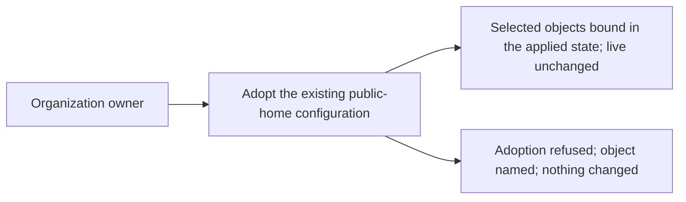

# Use case: adopt-existing-configuration

## Level

!

## Actors

- Organization owner — primary Actor; holds administration authority, records
  the declared configuration in the repository, and adopts the objects that
  already exist.

## Goal

Place the already-existing objects of the public home under the declared
configuration without changing them.

## Trigger

The owner begins declaring the objects that already exist in the organization
and its repositories.

## Preconditions

- The organization and both repositories exist.
- The Pages site exists on the pages repository.
- The owner can request the adoption.
- The declared configuration may not exist yet; recording its first revision is
  part of the flow.
- An applied state record may or may not exist.

## Main flow

1. Actor selects the existing in-scope objects to adopt and checks the applied
   state; System refuses any object that is already bound.
2. Actor states the intended values for each object and records them as a
   revision of the declared configuration in the repository; System validates
   that revision and reads each selected object's live configuration, refusing
   any object it cannot read or whose live counterpart the declaration does not
   name.
3. Actor asks to adopt the objects; System binds each declared object to its
   existing live counterpart and records the binding in the applied state,
   without creating, modifying or deleting any live object.
4. Actor wants to know what was adopted; System reports every object in the
   selected batch as bound.
5. Actor can stop; the live configuration is unchanged and the first
   configuration change can now be prepared against an adopted state.

## Extensions

- 1: a selected object is already bound in the applied state → refuse and name
  it; protects the success guarantee and the no-duplicate-binding rule.
- 2: a selected object cannot be read → refuse the whole adoption and name the
  object and the unreadable field; the live configuration is untouched and no
  binding is recorded; protects the success guarantee.
- 2: a selected object does not exist in the live configuration → refuse and
  name it; creating it is a configuration change, not an adoption; protects the
  minimal guarantee.
- 2: a selected live object has no declared counterpart → refuse and name the
  undeclared object; protects the success guarantee and the
  declared-vs-state correspondence.
- 2: the declared configuration cannot be read or validated → adoption refuses
  before any binding and names the declaration error; the live configuration is
  untouched and no binding is recorded.
- 3: the applied state cannot be written → no live change and no binding is
  recorded; name the object and the state failure; the declaration revision
  recorded earlier may remain; protects the minimal guarantee.
- 2–3: a live object changes between the read in step 2 and the binding in
  step 3 → refuse and name the object; adoption binds an identity, and a
  changed object needs a fresh read; protects the success guarantee.

## Rules

- **What adoption applies to**: adoption applies only to objects that already
  exist in the live organization. An object that already exists live but is not
  adopted is never updated or recreated by a configuration change; the change
  refuses it and points to adoption. A declared object absent from live is
  created by a configuration change.
- **No live change**: adoption changes no live object — no create, update,
  delete, permission change or feature toggle. Declared values may differ from
  live values; the difference is left for the first preview, not reconciled by
  adoption.
- **Identity, not a copy**: the applied state binds an identity, not a copy of
  the live values.
- **The batch is the selected set**: the success guarantee covers the selected
  set; the whole batch is adopted or none is. One unreadable, already-bound or
  unbindable object refuses the batch and names it.
- **The batch excludes what does not exist**: the deploy key and the
  `PAGES_DEPLOY_KEY` secret do not exist and are never adopted; the first
  configuration change creates them.
- **One protection object**: the rule set is adopted and the duplicate legacy
  branch protection is omitted from the declaration; a later configuration
  change removes the legacy object.
- **Recorded values are chosen**: the declared values are the ones this
  change's proposal records; adoption itself is neutral about them.
- **Where the binding is recorded**: the applied state is the encrypted local
  state committed in the repository; adoption reads and writes it and nothing
  else, and needs the maintainer's passphrase.
- **Selection is a batch, not a policy**: an object the declaration names but
  the batch omits stays outside the applied state and is not refused.

## Examples

- Adopt the monorepo: live has projects on, all merge methods allowed,
  delete-branch-on-merge off; declared has projects off and squash-only. The
  repository is bound in the applied state; live stays projects on and all
  merges allowed. The first preview later names the differences.
- Adopt the organization: live profile fields are empty and the member defaults
  are today's. The organization is bound; no profile field changes.
- Adopt the rule set: live rule set `main protection` carries deletion,
  non-fast-forward and linear history. The rule set is bound by identity; no
  rule changes.
- Adoption of a missing object: the batch names `duty2cal/example`; no such
  repository exists. Adoption refuses and names the object; nothing is created.
- Adoption twice: the monorepo is already bound in the applied state. The
  second adoption refuses and names the repository; no duplicate binding
  appears.
- Unreadable scope: the owner's authority can read the repositories but not the
  organization settings. Adoption refuses the batch and names the organization
  settings; nothing is bound and no live object changes.
- Batch narrower than the declaration: the declaration names both repositories
  and the batch names only the monorepo. The monorepo is bound; the site
  repository stays outside the applied state.
- Pages source: Pages is built from `main` at `/`. The source is bound; the site
  is not rebuilt and no deploy key or secret appears.
- Changed after the read: the repository's description changes between the read
  and the binding. Adoption refuses and names the repository; nothing is bound.

## Minimal guarantee

No live object is created, modified or deleted; a failed adoption records no
binding and names the object; the applied state never binds an object the
declared configuration does not name; a declaration revision committed before a
later failure may remain in the repository, but the applied state records no
binding for it.

## Success guarantee

Every already-existing object in the selected batch is named by the declared
configuration and bound in the applied state, with the live configuration
unchanged.

This is a changing use case: it writes the declared configuration and the
applied state, never the live configuration.

## Personas

- project-maintainer--organization-owner
- contributor--infrastructure-reviewer
- crew-member--personal-calendar-owner

## Capabilities

- adopt-existing-configuration

## Interactions

| Capability | Consumer action | E2E scenario |
|---|---|---|
| adopt-existing-configuration | adopt the selected batch of existing objects | Maintainer adopts the existing public home and every object is bound without changing it |

## Includes

- none

## Extends

- none

## Out of scope

- Creating the organization or transferring a repository into it.
- Creating any new object, enabling a feature, or writing a live settings value.
- Publishing the website, and creating the deploy key or the publishing secret.
- Setting release immutability or private vulnerability reporting.
- Managing teams or membership.
- Reporting configuration drift, and repairing an already-published release.
- Running a configuration change: previewing, reviewing or applying one.

## Diagram

