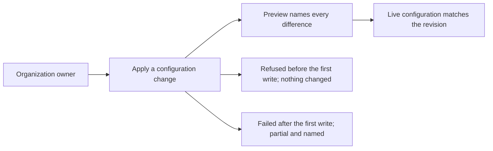

# Use case: apply-configuration-change

Name: Apply a configuration change

Status: permanent leaf created by `enable-repository-security` from the topic
contract `givn/ideation/public-home-infrastructure/use-cases/apply-configuration-change.md`.
This change realizes the capability `enable-repository-security`; the remaining
capabilities beneath this goal (the publishing plumbing and the drift report)
arrive with their own changes.

## Level

!

## Actors

- Organization owner — primary Actor; records the declared configuration
  revision, previews it, applies it and answers for the outcome.
- Supporting: Contributor reviewer — reads the revision and its preview and
  records a review outcome, when review is part of the flow (open: Q10).

## Goal

Make the live configuration match the declared configuration revision the
apply accepts.

## Trigger

The owner begins a configuration change by recording a revision of the
declared configuration.

## Preconditions

- The organization and both repositories exist.
- The owner can request the configuration change.
- The applied state is not marked stale; a stale marker refuses the preview and
  the apply until a green apply removes it.

## Main flow

1. Actor records the intended values as a revision of the declared
   configuration; System keeps that revision as the candidate for preview and
   apply.
2. Actor asks for a preview; System reads the applied state, the live
   configuration and the revision, and names every difference by object and
   field. A revision that would add an object which already exists live and is
   unbound is refused, and the object is named.
3. When review is part of the flow (open: Q10), the contributor reviewer reads
   the preview and the revision and records a review outcome.
4. Actor asks to apply; System checks that the saved plan is the previewed
   revision, that the live configuration still matches what the preview saw (a
   read-only refresh-only plan reports no change), that no existing object would
   be created, and — if review gates — that the outcome allows it. Then System
   changes the live configuration object by object.
5. Actor wants the outcome; System reports every object it changed and records
   the applied revision in the applied state.
6. Actor can stop; the live configuration matches the revision and the applied
   state records it.

## Extensions

- 2: the live configuration or the applied state cannot be read → refuse the
  preview and name the object and field; protects the success guarantee.
- 2: the declared revision is invalid → refuse the preview and name the
  problem; protects the success guarantee.
- 2: the revision removes an object the declaration no longer names → the
  preview reports the intended removal; whether an apply may delete it is open
  (Q11); protects the success guarantee.
- 2: the preview would add an object that already exists live and is not bound
  → refuse the preview and name the object; the owner adopts it first; protects
  the minimal guarantee (P1).
- 3: the declared configuration is edited after the preview → the saved plan is
  the previewed revision; the edit is not applied and takes effect only after a
  new preview; protects the current-preview rule (P2).
- 4: the live configuration changed since the preview (a manual edit) → the
  read-only refresh-only preflight names the changed object and refuses the
  apply; the saved plan is not applied; protects the success guarantee and the
  no-silent-overwrite rule.
- 4: the applied state is marked stale → refuse the preview and the apply and
  name the stale state until a green apply removes the marker; protects the
  minimal guarantee.
- 4: the preflight's report does not complete → refuse; an incomplete report is
  not a no-op; protects the success guarantee.
- 4: review gates and no approval is recorded (open: Q10) → refuse and name the
  missing approval; protects the success guarantee (P3).
- 4: the owner's authority does not cover the first object → refuse before any
  write and name the object; nothing changes; protects the minimal guarantee.
- 4: the first live change succeeds and a later object fails → report the
  applied objects, the failed object and the reason; write the stale marker
  beside the applied state and do not record the failed object; protects the
  minimal guarantee and the truthful-reporting rule (P6).
- 4: an apply would delete a repository, the organization, or a published
  release → refuse; protects the minimal guarantee. What may be deleted is open
  (Q11).

## Rules

- The applied revision is exactly the previewed revision: the saved plan is the
  previewed revision, and a declaration edit made after the preview is not
  carried by it (P2).
- An existing object the declaration names must be readable, or the apply
  refuses it. A declared object absent from live is created by the apply and
  is not a readability failure.
- An object that already exists live must be adopted before it is updated; a
  new object is created when it does not exist live and the declaration adds
  it. A repository setting that the configuration can only express as its own
  declared value follows the same rule: it is adopted while it already exists,
  and a preview that would add it instead is refused and names it.
- Review's role is open: gating or advisory (Q10).
- Immediately before applying the saved plan, the System compares the applied
  state with the live configuration in a read-only refresh-only plan; a
  non-no-op change is refused and names the object and field that changed. The
  plan's JSON report decides, not its exit status (OpenTofu 1.13.1 can exit 2
  for a no-op), and an incomplete report is refused.
- A refused apply makes no live change; a failed apply after the first write is
  reported as partial and its applied state carries a stale marker beside it
  (P4, P6).
- The applied revision is recorded only when every object succeeded; after a
  partial failure the applied state is marked stale by that marker and is not
  committed. While the marker exists the preview and the apply refuse and name
  the stale state; a green apply removes it.
- The apply never deletes a repository, the organization, or a published
  release; which lesser objects may be removed is open (Q11).
- Settings the owner's authority cannot read are not declared silently; the
  preview names them as unread.
- The deploy key and `PAGES_DEPLOY_KEY` secret are created by the first
  configuration change that adds them; they are not adoption content.
- The declared values are the intended ones, settled by Q5 (closed 2026-10-17;
  `givn/ideation/public-home-infrastructure/questions.md`): projects off,
  merge and squash merges off, rebase merges on, delete-branch-on-merge on, the
  description and topics kept, Dependabot through its dedicated resources.
- The classic branch protection is not a declared object: it was removed by
  hand on 2026-10-18, and this change verifies it stays gone.
- The ruleset shape (pull requests, bypass actors) is Q2 and Q3. (open: Q2,
  Q3)

## Examples

The declared values are decided (Q5 closed 2026-10-17).

| Example | Supplied facts | Observable outcome |
|---|---|---|
| Enable scanning | Declared: secret scanning and push protection enabled. Live: both off. | Preview names the two fields; apply enables them; the applied state records the revision; no other object changes. |
| Change an organization default | Declared: default repository permission `write`. Live: `read`. | Preview names the organization field; apply changes it; the applied state records the revision. |
| First publish plumbing | Declared: `duty2cal/duty2cal.github.io` deploy key and the monorepo `PAGES_DEPLOY_KEY` secret. Neither exists live. | Preview names two creations; apply creates both; no existing object is touched. |
| Declaration edited after preview | Preview of revision A; the declared configuration is edited to revision B before apply. | The saved plan is the previewed revision: apply carries A, not the edit; revision B takes effect only after a new preview. |
| Unadopted setting | The declared configuration enables Dependabot alerts and security updates, both already live, and the applied state has no binding. | The preview refuses and names both settings; the owner adopts the second batch first. |
| Authority before the first write | The owner's authority covers the repositories but not the organization settings. | Apply refuses before any write and names the organization settings; nothing changes. |
| Partial failure | The scanning settings apply; the Dependabot security-updates change then fails on authority. | Report names the applied settings, the failed setting and the reason; the applied state does not record the failed setting and is marked stale; the next preview refuses and names the stale state. |
| Manual edit since preview | Live `has_projects` was changed by hand after the preview that saw it on. | The read-only refresh-only preflight names `has_projects` and refuses the apply; the saved plan is not applied; a new preview shows the edit. |
| Read-back failure after the PATCH | The repository `PATCH` succeeds; the provider's read-back then fails. | The apply reports the repository and the reason; live carries the enabled statuses, the applied state does not claim them, and the next preview names them. |

## Scenario skeletons

- Given a declared configuration revision with a current preview; When the
  owner applies it; Then every named object matches the revision and the
  applied state records it.
- Given the declared configuration changed after its preview; When the owner
  applies it; Then the saved plan's revision is applied, the edit is not
  carried, and a new preview is required for it.
- Given the live configuration changed after its preview; When the owner
  applies it; Then the read-only preflight names the changed object, the apply
  is refused, the saved plan is not applied, and the live configuration is
  unchanged by the apply.
- Given an existing object the revision would add that was never adopted; When
  the owner asks for a preview; Then the preview is refused and the object is
  named.
- Given the first live change succeeds and a later object fails; When the owner
  applies; Then the outcome is reported as partial, the failed object is named,
  the applied state does not record it, and the applied state is marked stale.
- Given a stale applied state; When the owner asks for a preview; Then the
  preview is refused and the stale state is named.
- Given review gates and no approval is recorded (open: Q10); When the owner
  applies; Then the apply is refused and the missing approval is named.
- Given a revision that would delete a repository (open: Q11); When the owner
  applies it; Then the apply is refused and the repository is named.

## Minimal guarantee

A refusal before the first live write leaves the live configuration and the
applied state unchanged; a failure after the first write is reported as partial
with the applied state marked stale by a marker beside it, and the preview
refuses while the marker exists until a green apply removes it; no
already-existing object is recreated; no repository, organization or published
release is deleted; the failure names the object and the reason.

## Success guarantee

The live configuration matches the declared configuration revision the apply
accepted for every object the revision retains, and the applied state records
that revision. Removals follow Q11. (open: Q11)

This is a changing use case: it changes the live organization and
repositories.

## Personas

- project-maintainer--organization-owner
- contributor--infrastructure-reviewer
- crew-member--personal-calendar-owner

The organization owner is the primary administration lens. The contributor
reviewer is the review-without-authority lens, and gating is open (Q10). The
crew member is a lens of the parent use case, not a Persona confirmed for this
change and not a Gherkin Actor: in the parent it covers the release channel
(Q3) and the Pages publish path (Q2); this change touches no release object, so
that lens records no impact and no Persona is invented for it.

## Capabilities

- `enable-repository-security` — preview the revision that enables the
  monorepo's security settings, apply it, and report the outcome.

## Interactions

| Capability | Consumer action | E2E scenario |
|---|---|---|
| enable-repository-security | preview the declared configuration and read the named differences | Organization owner previews the security settings and only the declared differences are named |
| enable-repository-security | apply the previewed revision and read the outcome | Organization owner applies the previewed revision and the security settings are enabled |

## Includes

- none

## Extends

- none

## Out of scope

- Adopting an already-existing object. The objects this revision retains are
  adopted first, by `adopt-existing-configuration`; the preview refuses to add
  one that is live and unbound, and names it.
- Removing the classic branch protection. It was removed by hand on 2026-10-18
  (the live read returns 404 "Branch not protected"); this change verifies it
  stays gone and declares nothing for it.
- Requiring pull requests on the default branch (Q3) and modelling review
  gating in the apply flow (Q10); this capability previews and applies a
  revision and reports the outcome.
- Deleting or disabling anything (Q11): no declared object is removed and no
  security setting is turned off.
- Enabling settings the seed does not name: non-provider patterns, validity
  checks, advanced security, and the pages repository's scanning.
- Private vulnerability reporting, release immutability and organization-level
  security defaults.
- Reporting configuration drift, publishing the website, and repairing an
  already-published release.
- Creating the organization or transferring a repository into it.
- Any product behaviour: the converter never contacts GitHub.

## Diagram

The full kind-labelled command/event canvas is in
`../../../ideation/public-home-infrastructure/eventstorming.md`.
