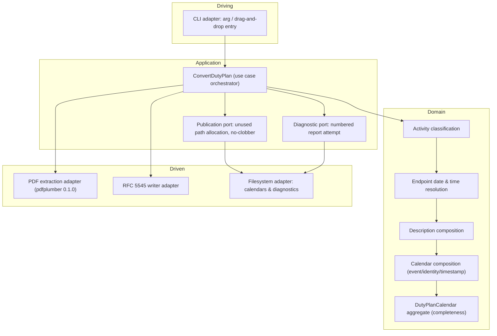

# Design: export-released-roster-calendar

## Scope

Technical design for the change that implements [export a duty-plan calendar](specs/export-duty-plan-calendar/usecase.md). The observable WHAT is fixed by the proposal and the spec delta; this document is the HOW.

The product is a local, offline command-line converter: it reads one supported duty-plan PDF and writes one RFC 5545 calendar (or an explicit failure with a numbered diagnostic) beside the source. It has no server, no database, and no network dependency.

## Technology decisions

| Area | Decision | Rationale / source |
|---|---|---|
| Language | Rust, edition 2021 | Supplied non-negotiable constraint inherited from the first draft and the approved contract. |
| Toolchain | Latest stable Rust toolchain satisfying the extraction dependency's minimum (the pinned crate declares Rust 1.85). Resolve via `rustup` at setup time. | Version freshness: no number from memory; the setup task pins the resolved stable toolchain. Edition stays the supplied 2021 even though the dependency declares 2024. |
| PDF extraction | Rust `pdfplumber` crate, exact pin `pdfplumber = "=0.1.0"`. No native C/C++ extraction dependency. | Supplied exact pin. Verified against docs.rs and crates.io during ideation (0.1.0 exists, not yanked, declares `MIT OR Apache-2.0`). The draft's path-opening snippets do not match the 0.1.0 API; adoption is a setup task. |
| PDF layout access | Positioned-word extraction plus table detection from the pinned crate; column identity reconstructed from rendered geometry, not flat text. | Ideation structural findings: multi-line headers, sparse continuation rows, and explicit day qualifiers cannot be assigned from flat word order. |
| Calendar writing | Hand-written RFC 5545 writer (no iCalendar library). | Supplied constraint; the byte-level contract (CRLF, escaping, octet-aware folding) is easier to prove when written directly. |
| Gherkin runner | `cucumber` (cucumber-rs) as a `harness = false` test target; version pinned to `0.23` in `Cargo.toml` (checked crates.io: 0.23.0 latest stable at setup). | Rust companion; the `.feature` files are the executable spec, and 0.23 is the version whose single-feature-root behaviour the runner assembly depends on. |
| Test target | `tests/features_runner.rs` (`harness = false`) runs cucumber-rs over the single feature root named by the `GIVN_FEATURES` environment variable; `./run-tests.sh` assembles that root from `givn/specs/**` and the change's `specs/**`. | cucumber-rs 0.23 takes one feature root, so assembly makes `verify.command` execute the permanent corpus and the change delta together in one strict run. |
| Strict mode | `.fail_on_skipped()` on the `Cucumber` builder. | Most runners treat pending steps as non-failures; without this, every task can tick while nothing is implemented. |
| Not-implemented stub | `unimplemented!("<step>")` in every step body. | Forces a hard panic if a step is ever reached undefined. |
| Test scripts | `./run-tests.sh` (assembles the feature root, then `cargo test --test features_runner`) and the same script with `--e2e` (adds `--tags "@e2e"`). Created by the setup task. | `verify.command`/`verify.e2e_command` stop pointing at the sentinel. |
| Coverage | `cargo llvm-cov` producing Cobertura XML, driven by `./measure-coverage.sh` and `./merge-coverages.sh`. | The coverage addon gates archive; Rust native tooling emits Cobertura without extra shims. |

No specific version is stated from memory. The pinned extraction crate is a user-supplied exact version with its ideation look-up note; the toolchain and the `cucumber` crate resolve to latest stable at setup.

## Architecture impact

Clean Architecture is a supplied constraint. The dependency rule points inward at a pure domain; the outside world (PDF, filesystem) is reached through ports implemented by adapters.

New modules: the CLI adapter, the conversion orchestrator, the domain modules named above, and the three driven adapters. The existing corpus has no source tree (`src/` is empty), so everything is new.

### Domain modules (new)

- `classification` — source code → activity kind (all-day vs timed vs travel vs layover vs unknown). Unknown required codes are errors.
- `timing` — UTC endpoint resolution: explicit adjacent-day qualifiers, the narrow unqualified overnight rollover, per-endpoint independence, start-before-end validation.
- `description` — selected field order, omission, complementary/equal coalescing, and the differing-optional-value role labelling decided under D1.
- `trip` — within-roster-trip Trip ID carry with boundary detection.
- `calendar` — event model, all-day/TZID handling, UID scoping to the source snapshot, DTSTAMP provenance and construction fallback.
- `roster` — the `DutyPlanCalendar` aggregate: accumulates resolved activities and enforces complete-or-fail before publication.

## Data model

No database. In-memory domain types (indicative, exact shape is the implementer's within these constraints):

- `DutyPlanCalendar` — aggregate root; holds source snapshot fingerprint, resolved activities, and publication state; only reaches "complete" once every required activity and field resolves.
- `Activity` — enum: `AllDay { code, date }`, `Timed { kind, start_utc, end_utc }`, `Travel { designator, from, to, start_utc, end_utc, position, blocktime, aircraft }`, `Layover { date, station }`.
- `DescriptionFields` — the selected optional fields plus per-value fragment origin (departure/arrival).
- `SourceSnapshot` — input fingerprint + parsed revision timestamp (`Option`) used for UID scoping and DTSTAMP.
- `ConversionOutcome` — `Published { path }` | `Rejected { reason, diagnostic: Option<PathBuf> }`.

No field is populated by inference the source did not supply; absence is represented, never zero-filled.

## Step definition locations

One file per capability (the change has exactly one):

- Unit/integration steps: `tests/steps/export_duty_plan_calendar.rs` (registered from `tests/features_runner.rs`).
- E2E steps: `tests/steps/e2e/export_duty_plan_calendar.rs` — separate module because it drives the built binary as a subprocess.

## Test runner, strict mode, and single-scenario command

- Unit/integration: `./run-tests.sh` → assembles the feature root, then `cargo test --test features_runner`.
- E2E: `./run-tests.sh --e2e` → the same, with `--tags "@e2e"`.
- Feature root: cucumber-rs 0.23 takes exactly one root, so `./run-tests.sh` copies every `.feature` from `givn/specs/**` and `givn/changes/*/specs/**` into a temporary directory and passes it to the runner through `GIVN_FEATURES`. The runner reads that variable, defaulting to `tests/features`.
- Strict mode: `.fail_on_skipped()` on the `Cucumber` builder in `tests/features_runner.rs`, with `.run_and_exit(root)` so the process exit code reflects failures; step bodies use `unimplemented!(...)`. Proven: an undefined step exits 101.
- Single-scenario run (used by every RED/GREEN check): `./run-tests.sh --name "<scenario title>"`.

Proof-of-strictness (setup task): temporarily add an unimplemented step and confirm the run fails rather than reporting skipped/passed.

## Decisions

Resolves the proposal's open questions. Cross-references use the proposal's IDs with the seed question beside them.

- **Decides D1 (seed Q28):** compatible travel fragments that supply *different* selected optional values are published as one event whose description keeps both values labelled with their supplying fragment (`Report (LT) 07:30 (departure fragment); Report (LT) 08:00 (arrival fragment)`); the rule never merges conflicting required values and neither value computes an instant. Realized in the `description` domain module and the scenario "Differing optional values are both retained with their fragment roles".
- **Decides D2 (seed Q5):** out of scope — this change publishes no source-derived material; fixtures and golden calendars are independently generated. The seed question stays parked; a named owner (the maintainer Persona's release-evidence review) reopens it only if a source-derived artifact is proposed.
- **Decides D3 (seed Q13):** out of scope — the converter represents an already assigned FZ day as an all-day activity and performs no entitlement, age, or annual-quota validation. The seed question stays parked and non-blocking.

No other proposal question is unresolved.

## Use-case traceability

| Use-case element | Technical decision | E2E / scenario evidence |
|---|---|---|
| Success guarantee: complete RFC 5545 calendar beside the source under an unused name | `calendar` module + RFC 5545 writer adapter; `Publication` port | `@e2e` "Crew member converts a supported duty plan and receives a calendar file"; "The published calendar is a valid RFC 5545 file" |
| Minimal guarantee: prior contents unchanged; failure never reported as success | `Publication` no-clobber port (create-new + enumerated retry; a concurrently claimed path behaves exactly like an occupied one) + exhaustive `ConversionOutcome` | "An occupied calendar name yields a new unused numbered name" |
| Rule: all-day codes ignore clocks | `classification` | "All-day codes ignore printed clocks" (Outline); "All-day activities use dates with a non-inclusive following-day end" |
| Rule: timed non-flight and availability windows | `classification` + `timing` | "Office or seminar duty uses its printed UTC window"; "Consulate visa duty uses its printed UTC window"; "Standby duty uses its own UTC window"; "Reserve duty uses its own UTC window"; "Single-day standby uses its own window rather than a cancelled flight"; "Consecutive standby days interrupted by a day off stay separate" |
| Rule: DH is one travel event with a title marker | `classification` + `calendar` title rendering | "Deadhead positioning travel keeps one event and marks the assignment in its title" |
| Rule: explicit UTC day qualifiers resolve to adjacent Gregorian dates | `timing` | "An explicit next-day qualifier moves the endpoint to the following UTC day"; "A previous-year UTC qualifier resolves across the year boundary"; "A next-month UTC qualifier resolves across the month boundary"; "An explicit qualifier with no unique adjacent date rejects the conversion" |
| Rule: narrow unqualified overnight rollover | `timing` | "Unqualified endpoints that appear to cross midnight roll to the next UTC day"; "A zero-length travel interval is not repaired" |
| Rule: description field selection, omission, coalescing, differing values | `description` | "An unsupplied optional description field is omitted"; "Complementary optional values from compatible fragments combine"; "Differing optional values are both retained with their fragment roles" |
| Rule: Trip ID carry within one roster trip | `trip` | "A known trip identifier is carried across the legs of one unambiguous roster trip" |
| Rule: snapshot-scoped UIDs; source/fallback DTSTAMP | `calendar` + `SourceSnapshot` | "An identical source snapshot keeps its component identifiers"; "A revised source snapshot has separate component identifiers"; "The revision timestamp comes from the source's Created footer"; "Without usable source metadata the construction time is the revision timestamp" |
| Extension: any failure attempts a numbered diagnostic | `Diagnostic` port | "A source outside the supported family is rejected"; "An unknown required activity code rejects the conversion"; "An interpretation failure preserves an older diagnostic"; "A publication failure is exposed and a diagnostic is attempted"; "An unsavable diagnostic keeps the original failure visible"; "An occupied diagnostic name yields a new unused numbered report" |
| Events: supplied / completed / rejected / published / publication failed / diagnostic written / diagnostic unavailable | `roster` aggregate state + `ConversionOutcome` | Covered by the E2E happy path plus the rejection/publication-failure scenarios above |
| Capability ownership | `export-duty-plan-calendar` only | Interaction Coverage Matrix below |

Actors in Gherkin are domain actors (the Crew member). Personas are review lenses, recorded below.

## Persona impact

User-visible surface: a terminal interface (CLI text output — the reported output path and the failure message). Confirmed Personas:

- **Crew member exporting their own duty plan (`crew-member--personal-calendar-owner`)** — accuracy/privacy lens: the calendar faithfully represents required activities without invented dates, and failures are explicit. Reviewed through the scenario set above.
- **Maintainer responsible for a public release (`project-maintainer--release-owner`)** — release-evidence lens: public fixtures/golden calendars are generated, distribution is one self-contained Windows executable, dependencies are permissively licensed, and support claims match evidence. Reviewed through the coverage/setup tasks and the release gates.

## Visual Design Contract

- Interface: terminal
- Viewports: n/a (no rendered screen; terminal text output)
- Design system: none
- Evidence kind: captured transcript per `@e2e` scenario (no screenshots). See capture path below.

The terminal baseline asserted by the `@e2e` scenario: the converter's visible text names the actual new calendar path (or the failure and the attempted diagnostic); no internal identifier or state name appears in the text; the failure text names the source PDF and the reason.

- **Capture mechanism and evidence path:** each `@e2e` scenario writes the captured stdout/stderr transcript to `givn/changes/export-released-roster-calendar/evidence/visual/<scenario-slug>/transcript.txt`.
- **Motion:** n/a (no animation); `prefers-reduced-motion` is not applicable to a terminal interface.

## E2E smoke test infrastructure

- **E2E runner command:** `./run-tests.sh --e2e` → assembled feature root with `--tags "@e2e"`; distinct from `verify.command`.
- **E2E step definition location:** `tests/steps/e2e/export_duty_plan_calendar.rs`.
- **Real interface:** the CLI — the built binary at `target/<profile>/duty2ical`, invoked as a subprocess with the source path as an argument (the same surface a drag-and-drop invocation uses).
- **Local test infrastructure:** none external. Scenarios build the binary once, copy a generated fixture PDF and any pre-existing calendars/reports into a per-scenario temp directory, invoke the binary, and assert the transcript plus filesystem secondary evidence. No server, port, database, or container.
- **Framework choice and justification:** cucumber-rs driving `std::process::Command`, because the real interface is a CLI process and a subprocess invocation is the faithful driver.
- **E2E strict-mode proof:** same `fail_on_skipped()` configuration; the setup task proves an undefined E2E step fails the run.

Fixture generation: the generated Released Roster PDFs and golden calendars use independently generated data (Typst or equivalent), never private sources; no external valiator receives real data.

## Interaction Coverage Matrix

| Inventory entry | @e2e scenario title | Real interface | Driving mechanism |
|---|---|---|---|
| supply a duty plan for conversion | Crew member converts a supported duty plan and receives a calendar file | CLI | `std::process::Command` runs the built binary with the plan path; asserts the transcript reports the new calendar path and the file exists beside the source |

## Local runnability & digital twins

- **Local run command:** `cargo run -- <duty-plan.pdf>` (or drag-and-drop the file onto the binary). The converter is a self-contained CLI with no service dependency, so it is fully runnable with one command and needs no orchestrator.
- **Isolated network:** not applicable — the converter performs no network I/O. Nothing may introduce an outbound call.
- **Digital twins:** none. The system talks to no third-party service; its only outside dependencies are the local filesystem and the input file. This is stated explicitly so no mock is invented.
- **Anticipated interface obstacles:** the primary ones are filesystem, not network — (a) publishing a file that another process claims concurrently (fixed by creating the candidate with create-new semantics and retrying the next unused name), and (b) a nonzero exit status carrying the failure while still writing the diagnostic (fixed by returning the diagnostic path only after the write succeeds and mapping any failure to a nonzero exit). Both fixes are named here so the E2E steps do not discover them mid-scenario.

## Coverage process boundaries

| Process | Started by | Instrumented artifact | Profile output | Merge step | Non-zero production probe |
|---|---|---|---|---|---|
| features_runner (unit/integration) | `./run-tests.sh` | `cargo llvm-cov --test features_runner` | `coverage/non-e2e-cobertura.xml` | `./merge-coverages.sh` | `src/domain/timing.rs` (qualifier resolution) |
| E2E runner + spawned CLI | `./run-tests.sh --e2e` | `cargo llvm-cov --test features_runner` with the CLI built under instrumentation and `LLVM_PROFILE_FILE` set for the child | `coverage/e2e-cobertura.xml` | `./merge-coverages.sh` | `src/adapters/fs_publication.rs` (no-clobber allocation) |

Both reports come from distinct instrumentation runs; the E2E copy is never produced by copying the non-E2E report. `./measure-coverage.sh` reuses the same assembly as `./run-tests.sh` (it exports `GIVN_FEATURES` before invoking the instrumented runner) rather than re-implementing the feature-root assembly.

## Black-Box-First policy

All observable behaviour is proven through the CLI (`@e2e`) or through the Gherkin scenarios, which drive the real interface for the single inventory action. Any retained internal unit test must answer "which case does the E2E not cover?" — expected answers are pure domain-edge cases (qualifier arithmetic at year boundaries, folding at the 75-octet boundary, UID determinism) that are impractical to observe through a whole PDF. If no such answer exists, use the E2E scenario instead.
