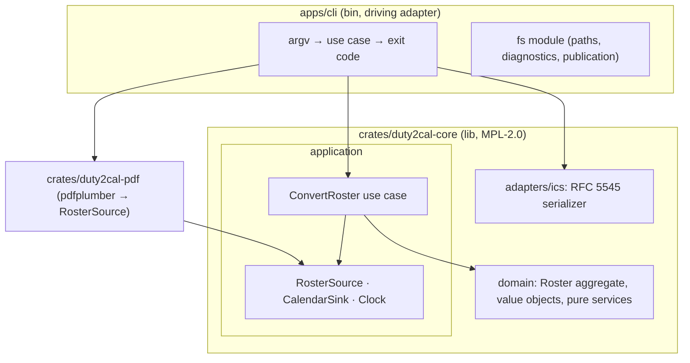

# Design: export-released-roster-calendar

## Scope

Technical design for the change that implements [export a duty-plan calendar](specs/export-duty-plan-calendar/usecase.md). The observable WHAT is fixed by the proposal and the spec delta; this document is the HOW.

The product is `duty2cal` — a local, offline command-line converter reading one supported duty-plan PDF and writing one calendar (or an explicit failure with a numbered diagnostic) beside the source. No server, no database, no network.

This design incorporates the operator's external brief; the conflict-by-conflict outcomes are recorded in `design-review.md` under "Brief reconciliation" and summarised in the decisions ledger below.

## Technology decisions

| Area | Decision | Rationale / source |
|---|---|---|
| Language | Rust, edition 2021; toolchain `stable` via `rust-toolchain.toml` (resolved latest at setup; rustc 1.98.1 used so far). | Supplied constraint. |
| Name | Product and binary `duty2cal`; crates `duty2cal-core`, `duty2cal-pdf`. | Operator rename (reconciliation conflict 1/5a): the tool is not limited to iCalendar output. |
| PDF extraction | `pdfplumber = "=0.4.1"` (Apache-2.0), the only crate depending on it being `duty2cal-pdf`. | Supplied pin updated by the brief (conflict 2); verified on crates.io and compiled on rustc 1.98.1. |
| Calendar writing | Hand-written RFC 5545 serializer in `duty2cal-core/src/adapters/ics`, with no calendar library dependency in the product or the tests; the golden scenario compares the published file byte for byte after normalisation. | Supplied constraint; byte-level determinism for the golden scenario, and no third-party licence obligation. |
| Gherkin runner | `cucumber` 0.23 as a `harness = false` test target. | .feature files are the executable specification. |
| Architecture test | `archunit = "=0.0.2"` (dev-dependency, dev-dep of core), Dependabot ignores its minor/major updates. | Brief §4 level 3; pre-1.0 API pinned exactly. |
| Errors | `thiserror` 2 for typed errors; no `unwrap()`/`expect()` outside tests. | Brief conventions. |
| Date/time | `time` 0.3 in the core. | Small, `wasm32`-safe; time values enter through the `Clock` port only. |
| Windows target | `x86_64-pc-windows-gnu`, cross-compiled on Linux/CI, statically linked. | Supplied constraint kept (conflict 3). |
| Licence | MPL-2.0 project-wide for `crates/**` and `apps/**`; `deny.toml`, `REUSE.toml`, `LICENSES/`, `cargo-about` notices, per-file SPDX headers, DCO sign-off. | ADR-0001 (conflict 4, amended: the brief's GPL application layer was dropped because the operator intends to publish an iOS UI in the App Store). |
| Test runner | `./run-tests.sh` assembles the feature root and runs `cargo test -p duty2cal --test features_runner`. | cucumber-rs takes one feature root. |

## Architecture impact

DDD + Hexagonal (ports and adapters), dependencies point inward. The workspace keeps a crate boundary only where dependencies, target platform, or `crate-type` differ; layer boundaries inside a crate are modules.



New: the whole workspace (`crates/duty2cal-core`, `crates/duty2cal-pdf`, `apps/cli`). Phase-2 `ffi/{wasm,uniffi}` is roadmap only (conflict 20).

### Layer rules (four levels)

1. **Compiler (crate boundaries).** `duty2cal-core` depends on no workspace crate; `duty2cal-pdf` depends only on `duty2cal-core` + `pdfplumber`; `apps/*` and future `ffi/*` are composition roots.
2. **Static policy.** `deny.toml` (licence allowlist; no copyleft third-party crate; no `pdfplumber` outside `duty2cal-pdf`) and `crates/duty2cal-core/clippy.toml` (`disallowed-types`: `File`, `TcpStream`, `UdpSocket`, `SystemTime`, `Instant`; `disallowed-methods`: `fs::read|write|read_to_string`, `env::var|args`, `process::exit`). CI runs `cargo clippy --workspace -- -D warnings`.
3. **Architecture tests.** `crates/duty2cal-core/tests/architecture.rs` (archunit 0.0.2) enforces intra-crate module direction: `domain` → nothing; `application` → `domain`; `adapters` → `application` + `domain`; and the cycle rule. Limits: syntax-based, file granularity, no macro expansion.
4. **Review conventions.** Each adapter implements exactly one port with no business logic; value objects are built only through validating `Result` constructors with no public fields; ports are traits in `application` and know no adapter type; every port is exercised through the real adapters, so no test-double module exists; no `unwrap()`/`expect()` outside tests.

### Modules in `duty2cal-core`

- `domain` — `Roster` aggregate, `DutyEntry` values, and the pure timing rules (`timing`). No I/O, no format knowledge.
- `application` — the ports (`RosterSource`, `CalendarSink`, `Clock`), the `ConvertRoster` use case, `RawRosterTable`, and the row interpretation that classifies activities and pairs travel fragments.
- `adapters/ics` — the dependency-free RFC 5545 serializer.

## Domain model

Bounded context "Roster". Aggregate root `Roster { id: RosterId, entries: Vec<DutyEntry> }`, ordered. `RosterId` is `{ period }` only — crew identity is never modelled or persisted (privacy; conflict 18).

Value objects: `IataCode` (3 uppercase letters, validated), `FlightNumber`, `TripId`, `Aircraft`, `Blocktime`, `TimezoneDiff`, `Tags`, `LocalDate`, `LocalTime`, `Position` (`Operating` | `Deadhead`), and `UtcInterval { start, end }` with the invariant `end > start` (validating constructor returning `Result`).

`DutyEntry` is shaped to the resolved activity rules (conflict 1/8/9 — the brief's `AllDayKind /* Free, Off, Standby */` is superseded):

```rust
pub enum DutyEntry {
    /// Timed travel. `position` carries the DH marker that prefixes the title.
    FlightLeg { date: LocalDate, trip: Option<TripId>, report_lt: Option<LocalTime>,
                position: Option<Position>, flight: FlightNumber, from: IataCode,
                to: IataCode, interval: UtcInterval, aircraft: Option<Aircraft>,
                tz_diff: Option<TimezoneDiff>, blocktime: Option<Blocktime>,
                layover: Option<Blocktime>, tags: Option<Tags> },
    /// Code-driven all-day: FREE, OFF, U (vacation), FZ (additional vacation).
    AllDay { date: LocalDate, kind: AllDayKind /* Free, Off, Vacation, AdditionalVacation */,
             tags: Option<Tags> },
    /// Timed availability windows: SB, RE, SBX.
    Availability { date: LocalDate, kind: AvailabilityKind /* Standby, Reserve, SingleDayStandby */,
                   station: Option<IataCode>, interval: UtcInterval, tags: Option<Tags> },
    /// Timed non-flight duty: TK, DTUSA, EM.
    NonFlightDuty { date: LocalDate, kind: NonFlightKind /* OfficeOrSeminar, ConsulateVisa, Extended */,
                    trip: Option<TripId>, station: Option<IataCode>, interval: UtcInterval,
                    tags: Option<Tags> },
    /// Explicit dated station-bearing Layover row; all-day.
    Layover { date: LocalDate, station: IataCode },
}
```

Unknown required codes, unmatched travel fragments, zero/negative intervals, and unqualified contradictions produce typed errors, never a partial calendar.

## Ports and use case (`duty2cal-core/src/application`)

```rust
/// Driven port: yields raw, position-based rows from a document.
pub trait RosterSource { fn read(&self, bytes: &[u8]) -> Result<SourceDocument, SourceError>; }
/// Driven port: serializes a roster into a calendar format.
pub trait CalendarSink { fn write(&self, roster: &Roster, opts: &WriteOptions) -> Result<String, SinkError>; }
/// Driven port: time (for the DTSTAMP construction fallback); fixed in tests.
pub trait Clock { fn now_utc(&self) -> UtcDateTime; }
/// Driven port: event observer (CLI logger; later progress/JS).

/// Driving port.
pub struct ConvertRoster<S: RosterSource, K: CalendarSink, C: Clock> { /* … */ }
impl<S, K, C> ConvertRoster<S, K, C> {
    pub fn execute(&self, input: &[u8]) -> Result<ConversionResult, ConvertError>;
}
```

Input `&[u8]`, output `String` — no path or file handle crosses the boundary, so the same use case is callable from the CLI, WASM, and UniFFI without adaptation.

`RawRosterTable` is the anti-corruption intermediate format: rows of column cells (`date, trip, report, pos, activity, from, to, start, end, ac, layover, tz, block, tags`). Column assignment (header row → X bands, derived dynamically, never hard-coded; Y clustering into rows) happens in `duty2cal-pdf`; interpretation (classification, fragment pairing, date carry, date resolution) happens in `application`. The PDF adapter is therefore replaceable.

**Domain events** (in-process, synchronous, ordered; no broker, no async channel — conflict 19): `RosterParsed`, `EntryRecognized`, `MidnightLegMerged`, `UnknownActivity` (hard failure), `CalendarWritten`.

**Error mapping across crates:** the orphan rule forbids `impl From<pdfplumber::Error> for SourceError` in `duty2cal-pdf`; use explicit `map_err` with a crate-local conversion. Never re-export a third-party error type through a port.

### Reading the producer's own layout

The producer's export, as the operator's real plans print it — the only evidence that counts, since the change's first fixture set was invented:

- **Heading.** `Month: June 2026` once per page supplies the roster month and year; dated rows print `DD Ddd` (`07 Sun`) only. The adapter resolves the cell to a calendar date and checks the weekday against it, so a misaligned cell is never accepted as activity timing. This is why the reader needs no per-row month.
- **Wrapped header.** The header spans several rows, and word extraction may or may not merge adjacent label words (`Date (LT)` or `Date(LT)`, `Start (UTC)`). A band therefore runs from one label word to the next, and a word that continues a column (`(LT)`, `(UTC)`, `ID`, `Difference`) joins the band that contains it. Bands are frozen at the first row that prints in a body column (Date, Pos, Activity, From, To); the rows after the header and before that row are label material. Nothing above the header on a page is a detail row, so the overview grid and the statistics tables that precede it can never supply an activity. Material that follows the table is ended by the row-pitch gap (`TABLE_GAP`), and rows that print in no body column carry no activity whatever their vertical position: the committed scenario that places overview and statistics material above the header pins the first rule, and the guard for the second is the body-column test, not the gap alone.
- **Continuation rows.** A row that prints no date carries the local date above it; a leg that crosses midnight prints its arrival in a second row with no departure airport or start clock, and the fragment pairing merges the two.
- **Designator.** `Pos` and `Activity` are separate columns (`FB` and `568`); an operating leg reads them as one designator (`LU742`), while a deadhead `DH` never joins it, because the calendar title already carries `DH`.
- **Layover.** The producer prints a `Layover: <station>` row instead of an activity code; the marker supplies the station.
- **All-day rows.** Their `00:00` clocks belong to accounting columns (LSW, BZW, Blocktime) and their `==` marker is not a tag.
- **Footer.** `Created DDMonYYYY HH:MM (UTC) by <producer>`, with the per-page number after it, supplying the revision stamp; the ISO spelling stays accepted.
- **Row identity.** A row carries its position in the reachable-row list, not among every row the table prints, because the fragment pairing indexes that list once any row is skipped (a date-only day, a layover marker, a statistics row).

The read rules describe **one** producer template: the Released Roster export whose header carries the
`Date`/`(LT)`/`(UTC)` anchors and whose dated rows print `DD Ddd` under a `Month: <Month> <Year>` heading.
A plan whose header does not carry those anchors is rejected as an unsupported family, with the numbered
diagnostic naming the source and the reason. The operator confirmed (design-review, 2026-10-13) that a
second template is expected soon: recognising it is a later change with its own committed fixture and its
own local plans, because a template validated only against invented fixtures is how this reader was
mis-shaped once already.

Verification: `scripts/validate-local-corpus.sh` converts the operator's local plans from a temporary directory, writes nothing into `private/` or the repository, stays out of CI, and is the standing check that the rules above still hold (`5 passed, 0 failed`).

## Step definition locations

One file per capability:

- Non-e2e steps: `apps/cli/tests/steps/export_duty_plan_calendar.rs`.
- E2E steps: `apps/cli/tests/steps/e2e/export_duty_plan_calendar.rs` (drives the built binary as a subprocess).

## Test runner, strict mode, and single-scenario command

- Unit/integration: `./run-tests.sh` → assembles the feature root, then `cargo test -p duty2cal --test features_runner`.
- E2E: `./run-tests.sh --e2e` → the same, with `--tags "@e2e"`.
- Feature root: cucumber-rs 0.23 takes exactly one root, so `./run-tests.sh` copies every `.feature` from `givn/specs/**` and `givn/changes/*/specs/**` into a temporary directory and passes it through `GIVN_FEATURES`.
- Strict mode: `.fail_on_skipped()` + `.run_and_exit(root)`; step bodies use `unimplemented!(...)`. Proven: an undefined step exits 101.
- Single-scenario run: `./run-tests.sh --name "<scenario title>"`.
- Architecture test: `cargo test -p duty2cal-core --test architecture`.
- Quality gates: `cargo fmt --check`, `cargo clippy --workspace -- -D warnings`, `cargo test --workspace`.

## Golden oracle

The whole-file oracle is a Gherkin scenario (conflict 17), not a parallel Rust test: `Scenario: The reference roster converts to the expected calendar` builds the reference plan into a test directory (independently generated, fictional values — conflict 18), converts it, and compares the produced calendar with `apps/cli/tests/fixtures/expected/2098-06.ics` after CRLF→LF and line-folding normalisation. The expected file's event list is the operator's 26-event oracle; the UID scheme follows the committed snapshot-scoped identity (conflict 11), not a date/flight/route recipe.

Fixture generation (as implemented): the reference plan is built at test time by the shared fixture builder (`apps/cli/tests/steps/support.rs`), which writes an uncompressed PDF from positioned text; no binary PDF and no Typst toolchain are required, and no host metadata exists to strip. Only the expected calendar (`apps/cli/tests/fixtures/expected/2098-06.ics`) is committed, so the oracle pins the output for a deterministically reproducible input. All values are fictional and non-personal.

Distribution notes: the release profile uses `opt-level = "z"`, `lto` and `strip` to keep the single executable small.

## Decisions

Resolves the proposal's open questions and the external brief's conflicts. Seed references in parentheses.

- **Decides D1 (seed Q28):** compatible travel fragments supplying different selected optional values publish one event whose description keeps both values labelled with the supplying fragment; required-value contradictions still fail. Realized in the `description` domain rules and the scenario "Differing optional values are both retained with their fragment roles".
- **Decides D2 (seed Q5):** out of scope — generated fixtures only; no source-derived public material. Reopens only if a source-derived artifact is proposed.
- **Decides D3 (seed Q13):** out of scope — FZ is represented as an assigned all-day activity; no entitlement/age/quota validation.
- **Brief reconciliation (conflicts 1–20, full log in `design-review.md`):** kept committed — all-day by code (U/FZ/FREE/OFF) with timed SB/RE/SBX and TK/DTUSA/EM; DH title prefix; independent endpoint resolution with adjacent-day qualifiers and the narrow unqualified rollover; snapshot-scoped opaque identity; source-footer DTSTAMP with a `Clock` fallback; enumerated no-overwrite calendar names; numbered preserved diagnostics; one plan per conversion (batch deferred); golden oracle inside Gherkin. Adopted from the brief — rename to `duty2cal`; `pdfplumber = "=0.4.1"`; project-wide MPL-2.0 licensing (the brief's GPL application layer was dropped — operator amendment for App-Store distribution of the future iOS UI); the reduced two-crate workspace with four-level layer enforcement; in-process domain events; ADRs minted in `docs/arc42/adr/`. Kept committed against the brief — Windows GNU target; generated fixtures only; Phase 1 scope (Phase 2/3 roadmap).

No proposal question is unresolved.

The CLI exposes one documented seam for deterministic runs: `DUTY2CAL_CONSTRUCTION_CLOCK` fixes the instant behind the revision-timestamp fallback (used by the golden-oracle, fallback and `@e2e` scenarios), so no production constant is needed.

## Use-case traceability

| Use-case element | Technical decision | Evidence |
|---|---|---|
| Success guarantee: complete RFC 5545 calendar beside the source under an unused name | `adapters/ics` + `CalendarSink`; `RosterSource`/`CalendarSink`/`Clock` ports | `@e2e` "Crew member converts a supported duty plan and receives a calendar file"; "The reference roster converts to the expected calendar"; "The published calendar is a valid RFC 5545 file" |
| Minimal guarantee: prior contents unchanged; failure never reported as success | publication port + exhaustive `ConversionOutcome`; numbered diagnostics | "An occupied calendar name yields a new unused numbered name"; the diagnostic scenarios |
| Rule: all-day codes ignore clocks (U/FZ/FREE/OFF) | `classify_activity` | "All-day codes ignore printed clocks"; "All-day activities use dates with a non-inclusive following-day end" |
| Rule: timed non-flight and availability windows (TK/DTUSA/EM/SB/RE/SBX) | `classify_activity` + `timing` | the TK/DTUSA/EM/SB/RE/SBX scenarios |
| Rule: DH is one travel event with a title marker | `Position` + ICS title rendering | "Deadhead positioning travel keeps one event and marks the assignment in its title" |
| Rule: explicit UTC day qualifiers resolve to adjacent Gregorian dates | `timing` | the qualifier and boundary scenarios |
| Rule: narrow unqualified overnight rollover | `timing` | "Unqualified endpoints that appear to cross midnight roll to the next UTC day"; "A zero-length travel interval is not repaired" |
| Rule: description selection, omission, coalescing, differing values, order | `description` rules | the description scenarios |
| Rule: Trip ID carry within one roster trip | `trip` rules | "A known trip identifier is carried across the legs of one unambiguous roster trip" |
| Rule: snapshot-scoped deterministic UIDs; source/fallback DTSTAMP | `calendar` + `SourceSnapshot` + `Clock` | the identity and timestamp scenarios |
| Capability ownership | `export-duty-plan-calendar` only | Interaction Coverage Matrix |

Actors in Gherkin are domain actors; Personas are review lenses (below).

## Persona impact

User-visible surface: a terminal interface (CLI text output). Confirmed Personas:

- **`crew-member--personal-calendar-owner`** — accuracy/privacy lens: faithful activities, explicit failures.
- **`project-maintainer--release-owner`** — release-evidence lens: generated fixtures, one self-contained Windows executable, permissive-or-weak-copyleft dependency set, public material free of private data.

## Visual Design Contract

- Interface: terminal
- Viewports: n/a (no rendered screen)
- Design system: none
- Evidence kind: captured transcript per `@e2e` scenario at `givn/changes/export-released-roster-calendar/evidence/visual/<scenario-slug>/transcript.txt`.
- Baseline: the transcript names the actual new calendar path (or the failure and diagnostic outcome) and the process exit status is recorded alongside it; no internal identifier appears.

## E2E smoke test infrastructure

- **E2E runner command:** `./run-tests.sh --e2e` (assembled root, `--tags "@e2e"`); distinct from `verify.command`.
- **E2E step location:** `apps/cli/tests/steps/e2e/export_duty_plan_calendar.rs`.
- **Real interface:** the built binary at `target/<profile>/duty2cal`, invoked as a subprocess with the source path.
- **Local infrastructure:** none external (no server/DB/digital twin); per-scenario temp directories hold the generated fixture and any pre-existing calendars/reports.
- **Framework:** cucumber-rs + `std::process::Command`.
- **Strict-mode proof:** `fail_on_skipped()`; an undefined E2E step fails the run.

## Interaction Coverage Matrix

| Inventory entry | @e2e scenario title | Real interface | Driving mechanism |
|---|---|---|---|
| supply a duty plan for conversion | Crew member converts a supported duty plan and receives a calendar file | CLI | `std::process::Command` runs the built `duty2cal` binary with the plan path; asserts the transcript reports the new path and the exit status |

## Local runnability & digital twins

- **Local run:** `cargo run -p duty2cal -- <duty-plan.pdf>` (or drag-and-drop). Self-contained CLI; no orchestrator.
- **Isolated network:** not applicable — no network I/O.
- **Digital twins:** none; the only outside dependencies are the local filesystem and the input file.
- **Interface obstacles:** (a) publishing a path another process claims — create-new semantics with enumerated retry; (b) a failure must still attempt a diagnostic while returning a non-zero exit — the diagnostic path is returned only after a successful write.

## Coverage process boundaries

| Process | Started by | Instrumented artifact | Profile output | Merge step | Non-zero production probe |
|---|---|---|---|---|---|
| features_runner (unit/integration) | `./measure-coverage.sh` (`--tags "not @e2e"`) | `cargo llvm-cov --workspace --test features_runner` | `coverage/non-e2e-cobertura.xml` | `./merge-coverages.sh` | `crates/duty2cal-core/src/domain/timing.rs` |
| E2E runner + spawned CLI | `./measure-coverage.sh` (`--tags "@e2e"`, which spawns the built CLI) | `cargo llvm-cov --workspace --test features_runner` with the CLI built under instrumentation (`LLVM_PROFILE_FILE` for the child) | `coverage/e2e-cobertura.xml` | `./merge-coverages.sh` | `apps/cli/src/fs.rs` |

Both reports come from distinct instrumentation runs, and `--workspace` instruments every crate (the CLI binary alone leaves the core and PDF crates uncovered); `./measure-coverage.sh` reuses `./run-tests.sh`'s assembly (`GIVN_FEATURES`) rather than re-implementing it.

## Roadmap (out of this change)

Phase 2: `ffi/wasm` (wasm-bindgen over `ConvertRoster`) and `ffi/uniffi`; multi-path batch input; a real second/third roster corpus gated on documented source-use permission. Phase 3: native UIs (SwiftUI/Compose/WinUI/Flutter) as driving adapters over the unchanged application.

## Black-Box-First policy

All observable behaviour is proven through the CLI (`@e2e`) or the Gherkin scenarios, which drive the real interface for the single inventory action. Any retained internal unit test must answer which case it covers that the E2E does not — expected answers are pure domain edges (qualifier arithmetic, folding at the 75-octet boundary, UID determinism).
